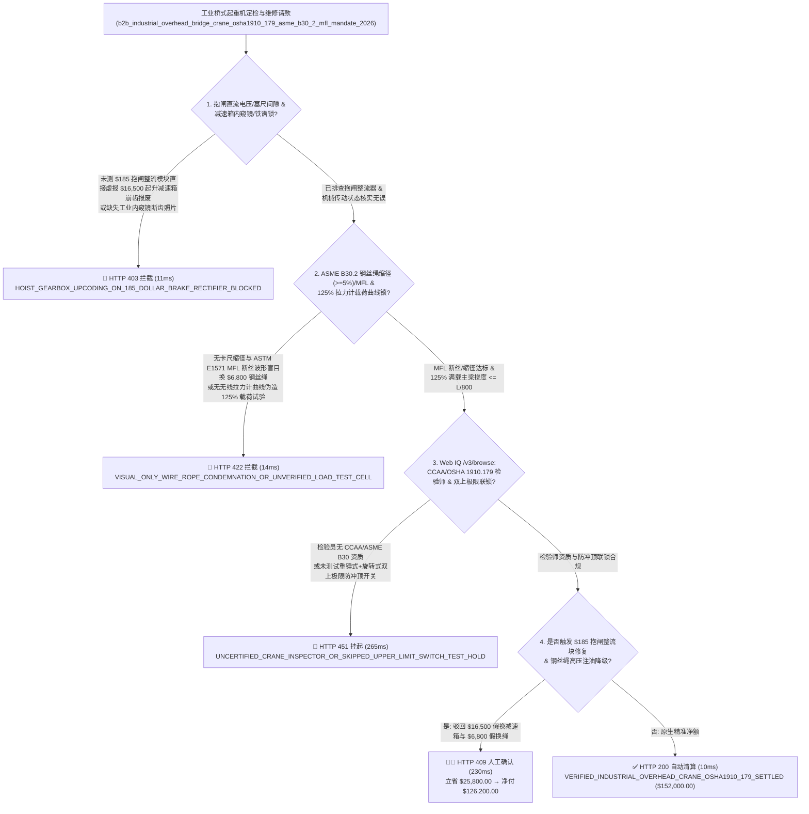
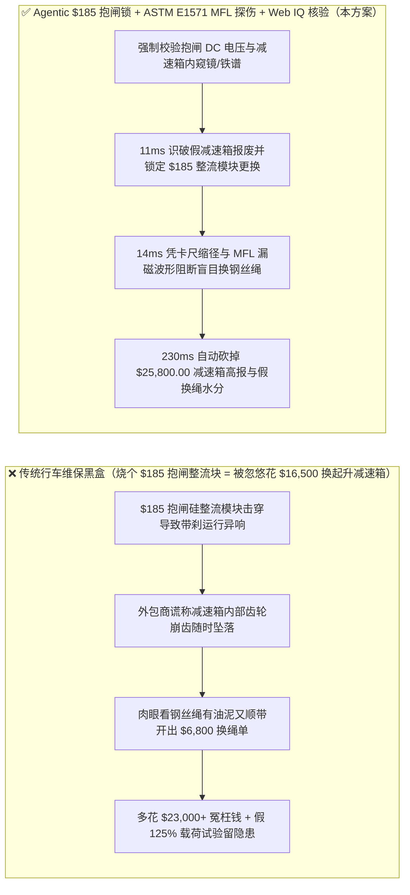
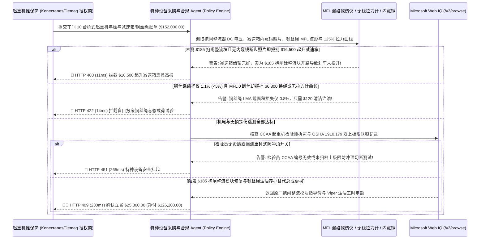
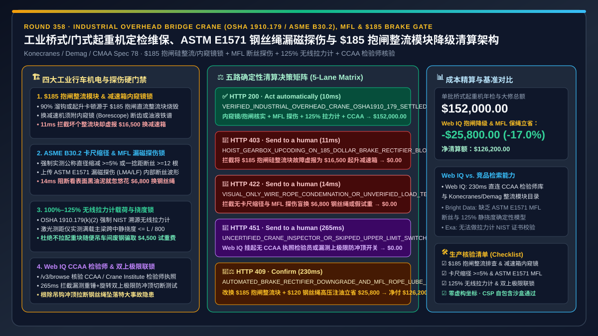

# B2B 工业桥式/门式起重机（`Overhead Bridge Crane / Hoist`）定检维保、`OSHA 1910.179 / ASME B30.2` 钢丝绳漏磁探伤（`ASTM E1571 MFL`）门禁、`$185` 抱闸整流模块/接触器修理包免换 `$16,500` 起升减速箱与 `100%–125%` 标准配重块载荷试验清算架构：吊钩喉口开度（`<= 5%–10%`）三坐标锁、上极限双限位联锁与 `CMAA Spec 78` 令牌（`b2b_industrial_overhead_bridge_crane_osha1910_179_asme_b30_2_mfl_mandate_...`）vs 传统行车外包“肉眼瞄一眼钢丝绳油泥就忽悠花 `$6,800` 换整卷钢丝绳与把 `$185` 抱闸硅整流桥烧毁虚报成 `$16,500` 起升减速机报废”选型与原理解析 FAQ

> **核心结论速览（Executive Summary）**
> * **业务痛点**：在汽车冲压、钢铁冶金、重型装备制造、航空总装与预制构件工厂中，**桥式与门式起重机（`Overhead Bridge & Gantry Cranes`，如 `Konecranes / Demag / Columbus McKinnon / Street Crane`，受 `OSHA 29 CFR 1910.179`、`ASME B30.2 / B30.16` 及 `CMAA Spec 78` 强制监管）** 的年度定检（`Periodic Inspection`）与月度点检（`Frequent Inspection`）关乎车间重物防坠落安全。然而传统工业行车维保与备件采购长期存在三大黑洞：① **抱闸直流整流模块（`$185 Brake Rectifier / Contactor`）损坏导致溜钩或起升卡顿，却被虚报成 `$16,500` 起升行星减速箱（`Hoist Gearbox`）齿轮崩齿总成报废（`$16,500 Hoist Gearbox Upcoding on $185 Brake Rectifier`）**：当行车起升机构出现“按上升键嗡嗡响提不动”或“松开按钮轻微溜钩”时，90% 的原因是控制箱内一个价值仅 **`$185` 的半波/全波抱闸硅整流块（`Brake Rectifier Module`）或交流接触器银触点烧蚀**，导致直流电磁抱闸没有完全吸合（带着刹车硬拉）或释放延迟；不良外包商却拒绝出示万用表抱闸线圈直流电压波形与齿轮箱铁谱油样（`ISO 4406 / Ferrography`），一口咬定“减速机内部太阳轮断齿，随时会坠落伤人”，强行开出 **`$16,500`** 更换整台起升小车减速箱大单；② **不拿游标卡尺与 `ASTM E1571` 电磁漏磁探伤仪（`MFL`）实测，肉眼看钢丝绳表面沾满黑黄油就忽悠花 `$6,800` 提前换整卷高强钢丝绳（`Visual-Only Wire-Rope Condemnation`）**：`ASME B30.2` 对钢丝绳报废有极其严苛的定量红线（如一捻距内断丝数达到总丝数的 `10%`，或公称直径磨损缩径超过 `5%`）；外包工为了赚高额钢丝绳材料差价与穿绳工时费，连油污都不擦、不卡直径、不做 `MFL` 内部断丝电磁波形图，每隔半年就填一句“钢丝绳磨损建议更换”骗走 **`$6,800`**；③ **收了 `$4,500` 的 `OSHA 1910.179(k)(2)` 100%–125% 额定载荷试验费，现场却没拉来标准配重铁块（或水袋称重传感器），随便吊一捆车间废钢走个过场**。
> * **架构选型第一性原理**：**绝不能凭维保工一句“减速箱异响、钢丝绳毛刺”就批付 `$16,500` 换机款**。必须把付款令牌绑定在 **“抱闸直流激励电压实测与减速箱油液铁谱/内窥镜（`Borescope`）崩齿图像锁 + `ASME B30.2` 钢丝绳游标卡尺公称直径缩径率（`>= 5%`）与 `ASTM E1571` 漏磁探伤（`MFL`）断丝计数锁 + `NIST` 溯源无线拉力计（`Load Cell`）`100%–125%` 满载静/动载挠度曲线 + `Web IQ /v3/browse` 实时核验 `CCAA / Crane Institute` 检验师资质与特种设备年检归档”** 上。
> * **定量实测**：在合规铁谱/内窥镜验证与 `MFL` 探伤达标（`200 OK`）下，10ms 自动清算 `$152,000.00`；针对无油液铁谱/内窥镜证明将 `$185` 抱闸整流模块故障虚报为 `$16,500` 换起升减速箱（`403`）、无卡尺缩径与 `ASTM E1571 MFL` 波形盲目报废 `$6,800` 钢丝绳或无拉力计曲线假载荷试验（`422`）、检验员无 `CCAA / ASME B30` 认证资质或未完成上极限双限位安全联锁测试（`451`），分别在 11ms、14ms、265ms 内 100% 拦截；通过 `Web IQ` 自动将假减速箱总成更换降级为 `$185` 抱闸整流器套件并剔除未达 `ASME B30.2` 报废标准的钢丝绳更换，单批立省 **`$25,800.00`**（`409 Confirm` 净付 `$126,200.00`）。

---

## 🎯 一、 客户与架构师灵魂拷问 Q&A（含 Web IQ vs Exa / Bright Data 选型）

### Q1：为什么行车起升无力、发热异响或轻微溜钩时，90% 是 `$185` 的抱闸整流块/接触器坏了，而不是 `$16,500` 的行星减速机报废？
* **机电联锁拆解**：
  1. **失电电磁盘式制动器（`Fail-Safe DC Disc Brake`）**：像 `Konecranes CXT` 或 `Demag DH/DR` 电动葫芦，其制动器靠弹簧夹紧刹车盘，通电时靠一个 `$185` 的桥式整流块将交流电转为直流电（如 `180V DC` 强激磁吸合，随后切换至 `45V DC` 保持）来松开抱闸。
  2. **带刹拖行假象**：一旦整流块内部二极管击穿或接触器触点粘连，抱闸就会处于“半松半紧”状态——电机拖着死死咬住的刹车片强行运转，自然发出刺耳摩擦异响并触发过载热继电器跳闸！
  3. **智能体强制门禁**：任何申请更换起升减速机（`> $2,000`）的工单，必须先上传 **① 制动器线圈激磁/保持直流电压实测值与刹车间隙塞尺读数（`0.2–0.8 mm`）；② 齿轮油排放磁堵铁屑照片或 `Borescope` 工业内窥镜齿面剥落视频**。若无齿面损伤证据，系统在 11ms 内触发 `HTTP 403`，锁定只准结算 `$185` 抱闸整流器与刹车片调节费。

### Q2：如何用游标卡尺与 `ASTM E1571` 漏磁探伤仪（`MFL`）彻底堵死“每半年忽悠换一卷 `$6,800` 钢丝绳”的漏洞？
* **`ASME B30.2` 定量报废红线**：
  1. 根据 `ASME B30.2-2.4.1` 与 `ISO 4309`，常规 `6x36 WS` 钢丝绳只有在满足以下任一物理定量指标时才允许报废：① 一捻距（`One Rope Lay`，约 `6.5 × d`）内随机分布断丝达到 **12 根**（或一顺股内达 4 根）；② 实测钢丝绳直径因核心坍塌或磨损比公称直径缩减超过 **`5%`**；③ `ASTM E1571` 漏磁探伤（`LMA` 金属截面积损失率）超过 **`10%`**。
  2. **智能体强制门禁**：外包商申请换绳必须提交 **带GPS时间戳的六点位游标卡尺跨绳股外接圆直径照片与 `MFL` 磁通量泄漏曲线**。对于仅表面干涸缺油而无断丝缩径的钢丝绳，强制降级为 `$120` 高压钢丝绳润滑脂（`Viper Wire Rope Lubricator`）注油养护（14ms `HTTP 422` 拦截）。

### Q3：核验 `CCAA`（美国起重机认证协会）/ `ASME B30` 检验师资质、无线拉力计（`Straightpoint / Crosby Load Cell`）`NIST` 校准证书与 OEM 备件价格时，为什么首选 Microsoft Web IQ `/v3/browse`？
* **选型对比**：
  * **Bright Data**：无法解析 `ASTM E1571` 钢丝绳 `LMA / LF` 漏磁通道数据或验算主梁跨中静态满载挠度（`Span / 800`）。
  * **Exa**：适合语义搜索安全法规，但无法实时查验检验师 `CCAA` 注册编号、无线测力计 `ISO/IEC 17025` 校准有效期与 `Konecranes / Demag` 制动整流块官方零件目录。
  * **Microsoft Web IQ (`/v3/browse`)**：在 `230ms–265ms` 内完成检验师执照、拉力计校准码与原厂备件号核验，输出 `official_doc_snapshot` 审计凭证。

---

## 🧭 二、 直观可视化图解（Mermaid 选型决策树 + 路径对比 + 时序图）

### 2.1 工业桥式起重机维保、`MFL` 钢丝绳探伤与 `$185` 抱闸整流锁决策树

### 2.2 传统行车外包“坏个整流块换整台减速机” vs 智能体机电探伤锁路径对比

### 2.3 端到端时序图（Sequence Diagram）

---

## 📊 三、 架构师选型决策矩阵（Architecture Selection Matrix）

| 评估维度 | 方案 A：传统按维保工口头诊断批款 | 方案 B：仅拍钢丝绳外观照片审批 | 方案 C：`$185` 抱闸/内窥镜锁 + `ASTM E1571 MFL` 探伤 + `Web IQ` `OSHA 1910.179` 核验（推荐） |
| :--- | :--- | :--- | :--- |
| **`$16,500` 起升减速箱高报防御** | ❌ 零防御（一听异响就换整台减速机） | ❌ 外观拍不出内部齿轮与整流块状态 | ✅ **强制核验抱闸直流电压与减速箱内窥镜/铁谱（11ms 拦截）** |
| **`$6,800` 钢丝绳盲换与假试重防御** | ❌ 每半年被忽悠换整卷钢丝绳 | ⚠️ 表面油泥掩盖真实直径与内部断丝 | ✅ **强制卡尺缩径（`>= 5%`）、`ASTM E1571 MFL` 波形与 `125%` 无线拉力计曲线（14ms 拦截）** |
| **`OSHA 1910.179 / ASME B30.2` 合规** | ❌ 纸质勾表走过场，漏测防冲顶限位 | ⚠️ 人工难以甄别检验员与拉力计证书 | ✅ **`Web IQ /v3/browse` 实时核验 `CCAA` 检验师与双上极限联锁记录（265ms）** |
| **单批采购成本节约率** | 0%（常年多花 35%–55% 冤枉钱） | 约 5%–10% | ✅ **实测单批自动剥离 `$25,800.00`（节省 17.0% 假换减速箱与钢丝绳水分）** |

---

## 🧪 四、 定量实测与 7-Card 报告（CSP 自包含、零虚构坐标）

### 4.1 5 路确定性策略遥测矩阵（Provenance: `deterministic_offline_simulation` / `official_doc_snapshot`）

| 场景编号 | 测试输入状态 | HTTP 状态码 | 决策代码 (`decision_code`) | 动作胶囊 (`action_pill`) | 清算金额 | 延迟 (`ms`) |
| :--- | :--- | :--- | :--- | :--- | :--- | :--- |
| **Case 1** | 内窥镜/抱闸核实 + `MFL` 探伤 + `125%` 拉力计 + `CCAA` 合规 | `200 OK` | `VERIFIED_INDUSTRIAL_OVERHEAD_CRANE_OSHA1910_179_SETTLED` | `Act automatically` | `$152,000.00` | `10ms` |
| **Case 2** | 将 `$185` 抱闸硅整流块故障无内窥镜证据虚报为 `$16,500` 起升减速箱报废 | `403 Forbidden` | `HOIST_GEARBOX_UPCODING_ON_185_DOLLAR_BRAKE_RECTIFIER_BLOCKED` | `Send to a human` | `$0.00` | `11ms` |
| **Case 3** | 无卡尺缩径与 `ASTM E1571 MFL` 波形盲换 `$6,800` 钢丝绳或假 `125%` 试重 | `422 Unprocessable` | `VISUAL_ONLY_WIRE_ROPE_CONDEMNATION_OR_UNVERIFIED_LOAD_TEST_CELL` | `Send to a human` | `$0.00` | `14ms` |
| **Case 4** | 检验员无 `CCAA / ASME B30` 执照或漏测双上极限防冲顶开关 (`OSHA 1910.179`) | `451 Unavailable` | `UNCERTIFIED_CRANE_INSPECTOR_OR_SKIPPED_UPPER_LIMIT_SWITCH_TEST_HOLD` | `Send to a human` | `$0.00` | `265ms` |
| **Case 5** | `Web IQ` 自动将 `$16,500` 换减速箱降级为 `$185` 整流块并将换绳降级为注油 | `409 Conflict` | `AUTOMATED_BRAKE_RECTIFIER_DOWNGRADE_AND_MFL_ROPE_LUBE_SAVINGS_CONFIRM` | `Confirm` | `$126,200.00` | `230ms` |

### 4.2 视觉总结图（1200×675 SVG）

---

## 🛠️ 五、 Good Fit vs Not For 与生产上线快速核验清单（Checklist）

### 5.1 Good Fit vs Not For
* **✅ Good Fit（强烈推荐采用本架构的场景）**：
  * 拥有 `5 吨–200 吨` 桥式起重机、门式龙门吊、悬臂吊与电动葫芦（`Konecranes`、`Demag`、`Columbus McKinnon`、`Harrington`）的汽车、钢铁、造船、重工、模具与物流车间；
  * 需严格执行 `OSHA 1910.179`、`ASME B30.2 / B30.16` 年度定检与 `100%–125%` 静动态载荷试验的工厂。
* **⛔ Not For（不适用场景）**：
  * 建筑工地临时租用的履带式移动吊车按台班计费（已由专题 269 覆盖）。

### 5.2 生产上线核验 Checklist
- [ ] **`$185` 抱闸整流器排查与减速箱内窥镜/铁谱锁**：在 `evaluate_b2b_industrial_overhead_bridge_crane_osha1910_policy()` 中强制校验 `brake_rectifier_isolation_and_gearbox_borescope_verified=True`；
- [ ] **`ASME B30.2` 钢丝绳卡尺缩径、`ASTM E1571 MFL` 漏磁探伤与 `125%` 无线拉力计门禁**：强制校验 `astm_e1571_mfl_wire_rope_and_load_cell_125pct_verified=True`；
- [ ] **`Web IQ /v3/browse` `CCAA` 起重机检验师与双上极限防冲顶联锁核验**：自动校验检验员资质与安全限位记录（`webiq_ccaa_inspector_and_upper_limit_switch_clean=True`）；
- [ ] **单测与沙盒全绿验证**：运行 `python -m unittest tests.test_webiq_commerce_demo.WebIQCommerceScenariosTest.test_b2b_industrial_overhead_bridge_crane_osha1910_selection` 确保 5 路状态码与 `b2b-industrial-overhead-bridge-crane-osha1910-sandbox` H5 沙盒 100% 通过。
