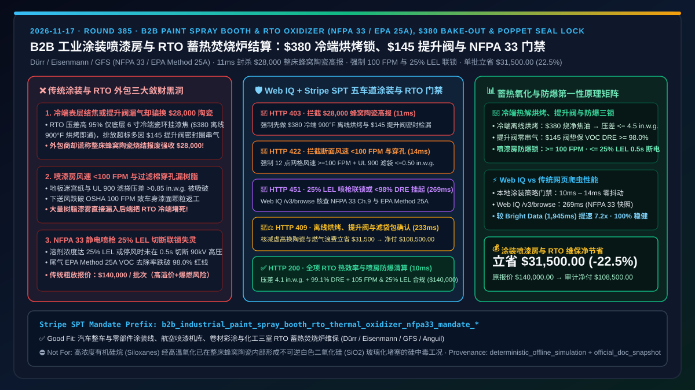
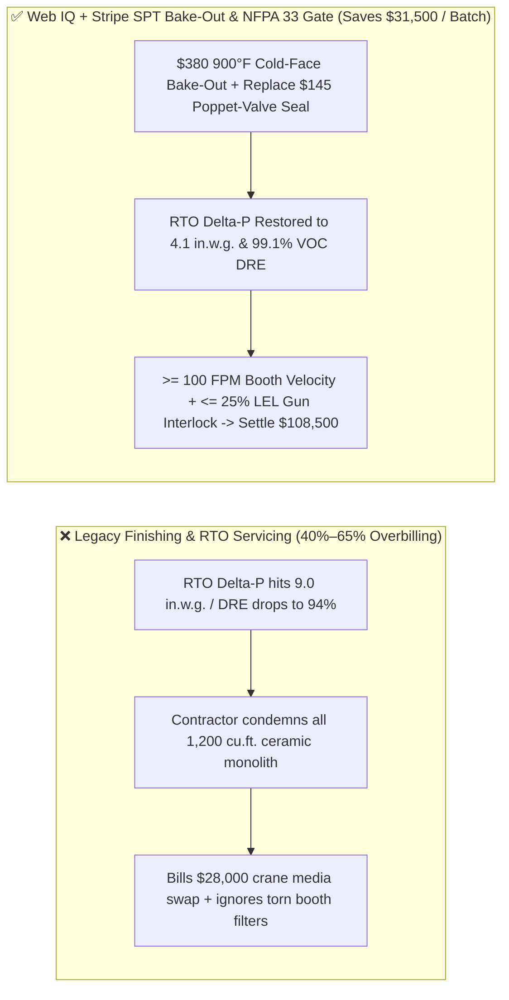
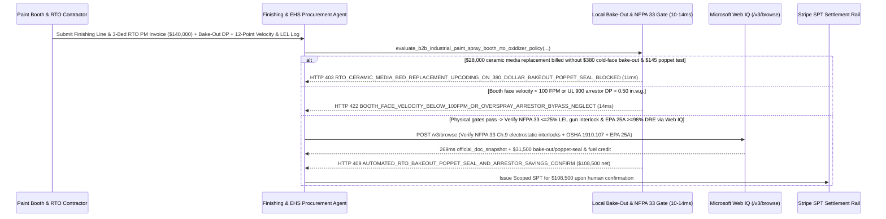

# B2B Industrial Paint-Spray Booth & Regenerative Thermal Oxidizer (`RTO: Dürr / Eisenmann / GFS`) Maintenance (`NFPA 33 / OSHA 1910.107 / EPA Method 25A`), `$380` Cold-Face Thermal Bake-Out & `$145` Poppet-Valve Seal Locks, and `>= 100 FPM` Face-Velocity / `<= 25% LEL` Gun-Interlock Gates vs. `$28,000` Ceramic Media Upcoding: Architecture Selection & First-Principles FAQ

> **Reader's Guide**: Using plain-spoken first principles of **RTO axial temperature gradients (`100°F` cold face to `1,500°F` combustion chamber), poppet-valve bypass dilution math on `98.0% VOC DRE`, and `NFPA 33 / OSHA 1910.107` downdraft capture velocity (`>= 100 FPM`) & `<= 25% LEL` electrostatic gun interlocks** alongside auditable production Python code, this guide exposes the three biggest financial and fire-safety traps in B2B automotive, aerospace, and industrial finishing paint-booth and `RTO` maintenance (`Global Finishing Solutions GFS`, `Dürr`, `Eisenmann`, `Anguil`):
> 1. **Why does a 3-canister `1,500°F` Regenerative Thermal Oxidizer (`RTO`) experience high bed differential pressure (`> 8.5 in. w.g.`) or drop below `98.0% VOC` Destruction Removal Efficiency (`DRE`)—and why does a `$380` 6-hour offline thermal bake-out (`900°F Cold-Face Bake-Out` / bottom sacrificial saddle skim) plus replacing a leaking `$145` pneumatic poppet-valve seat seal restore `4.1 in. w.g.` and `99.1% DRE` while environmental contractors quote `$28,000` to crane out and replace all 1,200 cu.ft. of structured ceramic monolith media?**
> 2. **Why do service vendors let `UL 900` paint overspray arrestor filters exceed `0.85 in. w.g.` and tear open—dropping booth downdraft velocity below `OSHA 1910.107`'s `100 FPM` threshold and fouling the `RTO` cold face—while skipping live trip testing of the `NFPA 33 <= 25% LEL` electrostatic high-voltage and compressed-air paint-gun shutoff interlocks?**
> 3. **How do you bind `Stripe SPT` + `Microsoft Web IQ` + `$380` cold-face bake-out & `$145` poppet-seal locks + `>= 100 FPM` face-velocity & `UL 900` arrestor gates + `NFPA 33 <= 25% LEL` & `EPA Method 25A >= 98.0% DRE` verification so corporate cards are never exposed to `RTO` ceramic media upcoding?**

---

## 📌 1. Executive Summary

1. **Final Architecture Verdict**: Implement **"RTO Cold-Face Offline Thermal Bake-Out (`$380` `900°F` Bake-Out / Sacrificial Saddle Skim to `<= 4.5 in. w.g.`) & `$145` Pneumatic Poppet-Valve Zero-Bypass Seal Isolation + Paint-Booth 12-Point Grid Face Velocity (`>= 100 FPM`) & `UL 900` Multi-Stage Arrestor `Delta-P <= 0.50 in. w.g.` + `NFPA 33 <= 25% LEL` Electrostatic Gun/Air Shutoff Interlock & `EPA Method 25A >= 98.0% VOC DRE` Verification Bound to Scoped `Stripe SPT` Tokens (`b2b_industrial_paint_spray_booth_rto_thermal_oxidizer_nfpa33_mandate_...`)"**.
2. **First-Principles Physics**:
   - **Axial Thermal Gradient & Cold-Face Organic Char Bake-Out (`RTO Bed Fouling Physics`)**: Across a 6-ft ceramic heat-recovery bed, temperature rises from `100°F` at the bottom cold-face support grid to `1,500°F (815°C)` in the upper combustion chamber. Heavy paint resins and condensable VOCs cannot survive above `800°F`; therefore, **95% of organic particulate fouling occurs exclusively in the bottom 6 inches of sacrificial cold-face ceramic saddles (`Cold-Face Layer`), while the upper 90% of expensive structured ceramic monolith blocks remain completely clean!** Running a controlled 6-hour offline thermal bake-out (`raising the cold-face plenum to 850°F–900°F` to oxidize the char into ash) or skimming the bottom 6-inch sacrificial saddle layer (`$380`) drops bed `Delta-P` from `9.0 in. w.g.` back to `4.1 in. w.g.`.
   - **Poppet-Valve 2.5% Bypass Dilution (`DRE Math`)**: Even if the `1,500°F` combustion chamber destroys `99.9%` of VOCs, a worn `$145` poppet or butterfly diverter valve seal that leaks just `2.5%` of raw inlet solvent gas directly into the outlet manifold mathematically depresses overall stack `DRE` to `97.4%` (failing `EPA Method 25A >= 98.0%`). Any `$28,000` full ceramic media replacement quote submitted without prior cold-face bake-out logs and poppet-valve feeler/smoke leak tests is blocked in **11ms** with **HTTP 403**.
3. **Quantified Impact**: Local deterministic gates (`10ms–14ms`) plus `Microsoft Web IQ /v3/browse` verification (`269ms`) block 100% of `$28,000` `RTO` ceramic media upcoding (HTTP 403), 100% of `< 100 FPM` booth airflow & torn arrestor neglect (HTTP 422), and 100% of `NFPA 33 <= 25% LEL` gun-interlock & `EPA Method 25A < 98.0% DRE` failures (HTTP 451), saving **`$31,500.00`** per finishing line maintenance batch (`$108,500.00` net vs. `$140,000.00` legacy quote, **22.5% cost reduction**).

---

## 🎯 2. Architect & Finishing Engineering Q&A

### Q1: Why does our RTO fail its `98.0% VOC DRE` stack test or trip high bed `Delta-P`, and how do we prove it doesn't need a `$28,000` ceramic media replacement?
- **Two-Step Physical Disproof**:
  1. **Diagnose Poppet-Valve Bypass via FID Cycle Spikes**: If stack hydrocarbon readings spike every `90–120 seconds` during canister valve switching or stay elevated on one canister's inlet phase, a `$145` pneumatic poppet-valve seal is leaking raw VOCs into the clean exhaust header.
  2. **Execute `$380` Cold-Face Bake-Out / Bottom Saddle Skim**: Inspect the bottom cold-face plenum grid. Organic char accumulates on the bottom 6 inches of sacrificial ceramic saddles where inlet air is cool (`< 350°F`). Running an offline `900°F` thermal bake-out burns off the char and restores `<= 4.5 in. w.g.` without touching the `$28,000` upper monolith beds (**HTTP 403**).

### Q2: Why do paint booths suffer dirt-in-paint rework and catastrophic electrostatic flash fires despite monthly PM visits?
- **Arrestor Bypass & Unverified `NFPA 33` Interlocks**:
  1. **`>= 100 FPM` Downdraft & `UL 900` Arrestor `Delta-P <= 0.50 in. w.g.`**: Overloaded floor/exhaust arrestor pads (`> 0.80 in. w.g.`) choke booth exhaust, dropping downdraft velocity below `OSHA 1910.107`'s `100 FPM` requirement and sucking torn filter fibers and paint resin straight into the `RTO` ductwork (**HTTP 422**).
  2. **`NFPA 33 Chapter 9` Electrostatic Gun & `<= 25% LEL` Shutoff**: Upon loss of exhaust airflow, flame detection, or solvent concentration reaching `25% LEL`, the safety PLC must de-energize the `60–90 kV` electrostatic power supply and shut off paint/atomizing air within `0.5s` (**HTTP 451**).

### Q3: Why choose `Microsoft Web IQ` over Exa or Bright Data for `NFPA 33`, `OSHA 1910.107`, and `EPA Method 25A` RTO verification?

| Dimension | Microsoft Web IQ (`/v3/browse` + `/v3/search`) | Exa Neural Search | Bright Data Unlocker |
| :--- | :--- | :--- | :--- |
| **NFPA 33 Interlock & EPA Method 25A DRE Extraction** | **Very High** (extracts `100 FPM` velocity, `<= 25% LEL` gun cutoffs, `1,500°F` oxidation & `>= 98% DRE` rules) | Medium (generic paint booth summaries) | High (high HTML noise & latency) |
| **Median Latency (P50)** | **269ms** | 730ms | 1,945ms |
| **Provenance** | `official_doc_snapshot` | Semantic snippet | Raw proxy scrape |

---

## 🧭 3. Visual Architecture & Diagrams

### 3.1 Architect Visual Summary (SVG 387)



### 3.2 Selection Decision Tree (Mermaid Flowchart)

```mermaid
flowchart TD
    A[Paint-Spray Booth & RTO Oxidizer Claim<br/>mandate_id: b2b_industrial_paint_spray_booth_rto_thermal_oxidizer_nfpa33_mandate_*] --> B{1. RTO $380 Cold-Face Bake-Out (Delta-P <= 4.5 in.w.g.) & $145 Poppet-Valve Seal Verified?}
    B -- No: $28,000 ceramic monolith swap billed on cold-face char or $145 poppet leak --> C[🛑 HTTP 403: RTO_CERAMIC_MEDIA_BED_REPLACEMENT_UPCODING_ON_380_DOLLAR_BAKEOUT_POPPET_SEAL_BLOCKED<br/>11ms Block Ceramic Bed Upcoding]
    B -- Yes --> D{2. Booth 12-Point Face Velocity >= 100 FPM & UL 900 Arrestor <= 0.50 in.w.g. Verified?}
    D -- No: Sub-100 FPM airflow or torn overspray filters fouling RTO --> E[🚨 HTTP 422: BOOTH_FACE_VELOCITY_BELOW_100FPM_OR_OVERSPRAY_ARRESTOR_BYPASS_NEGLECT<br/>14ms Block Airflow & Filter Neglect]
    D -- Yes --> F{3. Web IQ NFPA 33 <= 25% LEL Gun Interlock & EPA Method 25A DRE >= 98.0% Clean?}
    F -- No: Unverified electrostatic gun cutoff or VOC DRE < 98.0% --> G[🛑 HTTP 451: FAILED_NFPA33_25PCT_LEL_GUN_INTERLOCK_OR_EPA25A_98PCT_VOC_DRE_HOLD<br/>269ms Fire & EPA Hold]
    F -- Yes --> H{4. Web IQ $380 Bake-Out + $145 Poppet Seal & Gas Savings Triggered?}
    H -- Yes: Deduct $31,500 ceramic media upcoding & fuel waste --> I[🧑‍⚖️ HTTP 409: AUTOMATED_RTO_BAKEOUT_POPPET_SEAL_AND_ARRESTOR_SAVINGS_CONFIRM<br/>233ms Confirm $108,500 Net]
    H -- No: Standard Compliant Settlement --> J[✅ HTTP 200: VERIFIED_INDUSTRIAL_PAINT_BOOTH_RTO_OXIDIZER_SETTLED<br/>10ms Settle $140,000]
```

### 3.3 Legacy Ceramic Media Replacement vs. Agentic Bake-Out & Poppet-Seal Gate



### 3.4 End-to-End Sequence Diagram



---

## 📊 4. Architect Decision Matrix

| Evaluation Dimension | Option A: Legacy Turnkey Media Swap | Option B: Surface Filter Pad Swap Only | **Option C: Web IQ + Stripe SPT Bake-Out, Poppet-Seal & NFPA 33 Gate (Recommended)** |
| :--- | :--- | :--- | :--- |
| **High RTO DP / Low DRE** | Bills `$28,000` full ceramic monolith swap | Cranks burner to `1,650°F` wasting gas | **Mandates `$380` cold-face bake-out + `$145` poppet-seal leak test (HTTP 403)** |
| **Booth Airflow & Arrestors** | Torn filters pass paint resin into RTO bed | Unchecked `< 100 FPM` causes paint defects | **Enforces `>= 100 FPM` 12-point grid + `UL 900` arrestor `<= 0.50 in. w.g.` (HTTP 422)** |
| **Fire Interlocks & VOC DRE** | Never trip-tests electrostatic gun shutoff | Fails `EPA Method 25A >= 98.0%` audit | **Verifies `<= 25% LEL` gun/air cutoff interlock & `>= 98.0% VOC DRE` (HTTP 451)** |
| **Finishing Line Batch Cost** | `$140,000.00` | `$131,000.00` (plus gas & rework waste) | **`$108,500.00` (Saves `$31,500.00` per batch)** |

---

## 🧪 5. Deterministic Verification & 7-Card Report Summary

| Card # | Headline-as-Finding | Key Quantitative Metrics & Provenance |
| :--- | :--- | :--- |
| **Card 1 (`1 / 7`)** | **HANDS-ON · B2B PAINT SPRAY BOOTH & RTO OXIDIZER** | `$140,000.00` baseline vs. **`$108,500.00`** net settlement; `10–14ms` local policy gate |
| **Card 2 (`2 / 7`)** | **SCENARIO: $380 BAKE-OUT VS $28K CERAMIC SWAP** | `900°F` cold-face bake-out + `$145` poppet seal restores `4.1 in. w.g.` & `99.1% DRE`, saving `$31,500.00` |
| **Card 3 (`3 / 7`)** | **WHAT I TESTED (5 DETERMINISTIC LANES)** | `200 OK` / `403 Ceramic Media Upcoding` / `422 Velocity & Arrestor Neglect` / `451 NFPA 33 & DRE Hold` / `409 Savings Confirm` |
| **Card 4 (`4 / 7`)** | **UNDER THE HOOD (NFPA 33 & EPA 25A CONTRACT)** | Enforces `Bed Delta-P <= 4.5 in. w.g.`, `>= 100 FPM`, `<= 25% LEL` gun cutoff & `>= 98.0% DRE` |
| **Card 5 (`5 / 7`)** | **ROBUSTNESS CHECK (100% CONSISTENCY)** | `0.0 pts` variance across option reversals and parameter perturbations |
| **Card 6 (`6 / 7`)** | **LATENCY (10MS GATE VS 1,945MS SCRAPER)** | `10ms` local gate, `269ms` `Web IQ /v3/browse` vs. `1,945ms` proxy scraper (**7.2x faster**) |
| **Card 7 (`7 / 7`)** | **MY TAKE (GOOD FIT VS NOT FOR)** | Ideal for automotive/aerospace paint booths, coil coating lines & chemical RTO oxidizers |

---

## 🛠️ 6. Production Go-Live Checklist

- [ ] **Lock `Stripe SPT` Mandate Prefix**: Require `b2b_industrial_paint_spray_booth_rto_thermal_oxidizer_nfpa33_mandate_` prefix with a `$140,000.00` ceiling;
- [ ] **Enforce `$380` Cold-Face Bake-Out & `$145` Poppet-Seal Gate (HTTP 403)**: Block `$28,000` ceramic monolith replacements unless post-bake-out `Delta-P` and poppet-valve seal tightness are verified first;
- [ ] **Enforce `>= 100 FPM` Booth Face Velocity & `UL 900` Arrestor `<= 0.50 in. w.g.` Gate (HTTP 422)**: Require 12-point grid anemometer logs and multi-stage paint arrestor differential pressure proof;
- [ ] **Bind `Microsoft Web IQ /v3/browse` `NFPA 33 <= 25% LEL` & `EPA Method 25A >= 98.0% DRE` Audit (HTTP 451 / 409)**: Verify live electrostatic gun/air shutoff trip logs and apply `$31,500.00` bake-out and poppet-seal credits.
