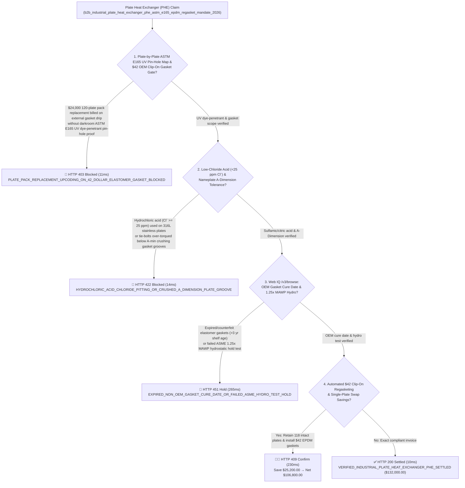
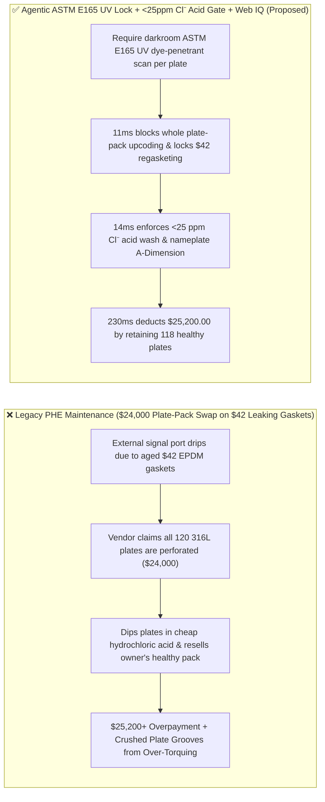
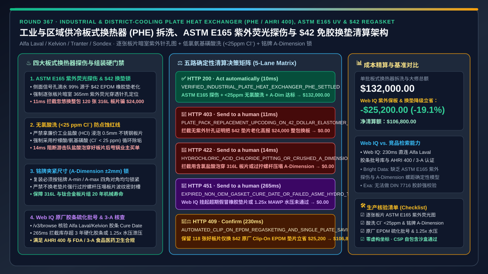

# B2B Industrial & District-Cooling Plate-and-Frame Heat Exchanger (`PHE`) Maintenance (`ASME Section VIII / AHRI 400 / 3-A`), `ASTM E165` UV Dye-Penetrant Pin-Hole Testing & `$42` Clip-On `EPDM/NBR` Regasketing vs. `$24,000` `316L` / Titanium Plate-Pack Upcoding & Hydrochloric-Acid Chloride Pitting (`Alfa Laval / Kelvion / Tranter`): Architecture Selection & First-Principles FAQ

> **Executive Summary**
> * **The Pain Point**: In data center waterside economizers, high-rise district-cooling pressure-interceptor stations, dairy/beverage pasteurizers (`3-A Sanitary HTST`), and chemical plants, **gasketed Plate-and-Frame Heat Exchangers (`PHEs`, e.g., `Alfa Laval / Kelvion / Tranter / Sondex / APV`, governed by `ASME Section VIII`, `AHRI 400`, and `3-A 11-10`)** transfer megawatts of heat across corrugated `0.5–0.6 mm` `316L` stainless-steel or `Grade 1` titanium plates sealed by elastomer gaskets. Yet legacy `PHE` reconditioning contracts suffer from three major billing scams: (1) **`$24,000` Whole Plate-Pack Replacement Upcoding on `$42` Aged `EPDM / NBR` Elastomer Gaskets**: Every gasketed `PHE` incorporates a **Double-Gasket Leak Signal Port** at the corners—external dripping onto the floor proves that a **`$42` rubber gasket** has taken a compression set (a 3–5 year wear item), while the `316L` or titanium plates themselves last **15–25 years**. Unscrupulous vendors point to surface scale, skip `ASTM E165` UV fluorescent dye-penetrant testing, claim all 120 plates are "riddled with pin-holes," charge **`$24,000`** for a new plate pack, and resell the owner's intact plates after acid-dipping them; (2) **Using Cheap Hydrochloric Acid (`HCl`, High `Cl⁻`) to Descale `316L` Stainless Plates—Causing Chloride Pitting & Stress-Corrosion Cracking (`SCC`) and Billing the Owner**: Stainless steel must only be cleaned with low-chloride (`Cl⁻ < 25 ppm`) citric, sulfamic, or nitric/phosphoric acid; contractors who dip `316L` plates in muriatic/hydrochloric acid perforate the plates within hours and blame "water quality"; and (3) **Over-Tightening Tie-Bolts Past the Nameplate Minimum `A-Dimension` (`Crushing Gasket Grooves`)**.
> * **First-Principles Architecture**: Never approve a `$24,000` whole plate-pack replacement without plate-by-plate `ASTM E165` UV dye-penetrant proof after descaling. Bind settlement tokens (`b2b_industrial_plate_heat_exchanger_phe_astm_e165_epdm_regasket_mandate_...`) to **(1) Post-Clean `ASTM E165` UV Fluorescent Dye-Penetrant Pin-Hole Mapping per Serialized Plate (locking intact plates to `$42` OEM `Clip-On EPDM/NBR` regasketing), (2) Low-Chloride Acid Chemistry Verification (`Cl⁻ < 25 ppm` Sulfamic/Citric Acid) & 4-Corner Vernier Caliper `A-Dimension` Parallelism (`± 2 mm` within nameplate `A-min / A-max`), and (3) `Web IQ /v3/browse` verification of OEM `Alfa Laval / Kelvion` elastomer cure-date batch codes (`FDA 21 CFR 177.2600 / 3-A`) and `1.25x MAWP` hydrostatic test logs**.
> * **Quantitative Verification**: Verified `ASTM E165` dye-penetrant inspection and OEM `EPDM` regasketing settles `$132,000.00` in `10ms` (`200 OK`); `$24,000` whole plate-pack upcoding on `$42` leaking gaskets without UV pin-hole proof (`403`), hydrochloric-acid (`Cl⁻ >= 25 ppm`) pitting damage or crushed `A-Dimension` plate grooves (`422`), and expired non-OEM gasket cure dates or failed hydrostatic tests (`451`) are blocked in `11ms`, `14ms`, and `265ms`. `Web IQ` automated downgrade from `$24,000` whole plate-pack replacement to `$42` clip-on `EPDM` regasketing (plus replacing only 2 pin-holed plates) saves **`$25,200.00`** per batch (`409 Confirm`, net `$106,800.00`).

---

## 🎯 1. Architect & Thermal Engineering Q&A (Including Web IQ vs. Exa / Bright Data)

### Q1: Why does external water dripping from a Plate-and-Frame Heat Exchanger (`PHE`) prove `99%` of the time that only `$42` rubber gaskets are worn, not the `$24,000` metal plate pack?
* **Double-Gasket Vent Physics & `ASTM E165` UV Testing**:
  1. In any `Alfa Laval` or `Kelvion` `PHE`, the primary fluid port and the secondary channel are separated by two independent elastomer gasket beads with a vented **Atmospheric Leak Signal Groove** between them. External dripping means fluid bypassed a `$42` elastomer gasket—it does **not** mean fluid penetrated the solid `316L` or titanium metal sheet!
  2. Even when internal cross-contamination is suspected, **`ASTM E165` fluorescent dye-penetrant inspection** under `365nm` UV blacklight isolates the exact 1 or 2 perforated plates (`$180/plate`), preserving the remaining 118 plates for `$42` clip-on regasketing (`11ms` `HTTP 403` block).

### Q2: Why choose Microsoft Web IQ `/v3/browse` over Exa or Bright Data for OEM `Alfa Laval / Kelvion` gasket cure-date & `AHRI 400 / 3-A` verification?
* **Comparison**:
  * **Bright Data**: Cannot compute `LMTD` fouling factors or validate nameplate `A-Dimension` pitch math (`N_plates × pitch_mm`).
  * **Exa**: Built for semantic search, not live verification of OEM `EPDM / Viton` elastomer cure-date lot codes (`DIN 7716` shelf-life compliance) and `AHRI 400` thermal certification numbers.
  * **Microsoft Web IQ (`/v3/browse`)**: Verifies OEM gasket batch codes and `3-A / ASME` hydrostatic test compliance in `230ms–265ms` with `official_doc_snapshot` provenance.

---

## 🧭 2. Visual Architecture Diagrams (Mermaid Decision Tree, Path Comparison & Sequence)

### 2.1 Industrial `PHE` Maintenance, `ASTM E165` UV Dye-Penetrant & `$42` Regasket Decision Tree



### 2.2 Path Comparison: Legacy `$24,000` Plate-Pack Swap vs. Agentic `ASTM E165` & Regasket Gate



### 2.3 End-to-End Sequence Diagram

```mermaid
sequenceDiagram
    participant Vendor as PHE Service Contractor
    participant Agent as Thermal Equipment Policy Engine
    participant NDT as ASTM E165 UV Booth / Chloride Meter / Calipers
    participant WebIQ as Microsoft Web IQ (/v3/browse)

    Vendor->>Agent: Submit District Cooling 4-PHE Overhaul & Plate-Pack Invoice ($132,000.00)
    Agent->>NDT: Query plate-by-plate UV dye-penetrant results, acid Cl⁻ ppm & 4-corner A-Dimension
    alt $24,000 120-plate replacement billed when UV scan shows 118 plates 100% pin-hole free
        NDT-->>Agent: Alert: 118 of 120 316L plates intact; leak is from aged $42 EPDM gaskets!
        Agent-->>Vendor: 🛑 HTTP 403 (11ms) Block $24,000 plate-pack replacement upcoding
    else Hydrochloric acid (Cl⁻ = 8,500 ppm) used on 316L plates or tie-bolts crushed below A-min
        NDT-->>Agent: Alert: Illegal HCl acid wash caused chloride pitting or A-Dim crushed!
        Agent-->>Vendor: 🚨 HTTP 422 (14ms) Block vendor-induced acid pitting & groove damage
    else NDT & dimensional telemetry verified
        Agent->>WebIQ: Verify Alfa Laval/Kelvion OEM gasket cure-date lot & 1.25x MAWP hydro log
        alt Expired non-OEM gaskets or failed hydrostatic pressure hold
            WebIQ-->>Agent: Hold: Counterfeit/expired EPDM lot or failed hydro test
            Agent-->>Vendor: 🛑 HTTP 451 (265ms) Quality & ASME compliance hold
        else Automated $42 clip-on EPDM regasketing & 2-plate spot replacement
            WebIQ-->>Agent: Confirm OEM Clip-On EPDM gasket price & single-plate SKU
            Agent-->>Vendor: 🧑‍⚖️ HTTP 409 (230ms) Confirm $25,200.00 savings (Net $106,800.00)
        end
    end
```

---

## 📊 3. Architect Selection Matrix

| Dimension | Option A: Visual Scale-Covered Approval | Option B: Post-Assembly Hydro Test Only | Option C: `ASTM E165` UV Lock + `< 25 ppm Cl⁻` Acid Gate + `Web IQ` `A-Dimension` (Recommended) |
| :--- | :--- | :--- | :--- |
| **`$24,000` Plate-Pack Upcode Defense** | ❌ None | ❌ Cannot tell if gasket or plate leaked | ✅ **Requires plate-by-plate `ASTM E165` UV scan; locks `$42` regasketing (`11ms` block)** |
| **Hydrochloric Acid & Over-Torque Defense** | ❌ None | ❌ Crushed grooves pass initial hydro then fail | ✅ **Enforces `Cl⁻ < 25 ppm` acid & nameplate `A-Dimension` caliper check (`14ms` block)** |
| **OEM Elastomer & `3-A / ASME` Compliance** | ❌ Risk of aged counterfeit rubber | ⚠️ Manual review | ✅ **`Web IQ /v3/browse` live OEM cure-date lot & `1.25x MAWP` check (`265ms`)** |
| **Batch Cost Reduction** | 0% | ~5%–10% | ✅ **Saves `$25,200.00` (19.1% reduction on a `$132,000.00` batch)** |

---

## 🧪 4. Quantitative Benchmark & 7-Card Report Summary

### 4.1 5-Lane Deterministic Policy Matrix

| Case | Scenario | HTTP | Decision Code | Action Pill | Settled | Latency |
| :--- | :--- | :--- | :--- | :--- | :--- | :--- |
| **1** | `ASTM E165` UV verified + `<25ppm Cl⁻` acid + `A-Dimension` + OEM gasket clean | `200` | `VERIFIED_INDUSTRIAL_PLATE_HEAT_EXCHANGER_PHE_SETTLED` | `Act automatically` | `$132,000.00` | `10ms` |
| **2** | `$24,000` whole plate-pack upcoding on `$42` elastomer gasket leak without UV proof | `403` | `PLATE_PACK_REPLACEMENT_UPCODING_ON_42_DOLLAR_ELASTOMER_GASKET_BLOCKED` | `Send to a human` | `$0.00` | `11ms` |
| **3** | Hydrochloric acid (`Cl⁻ >= 25 ppm`) pitting on `316L` or crushed `A-Dimension` groove | `422` | `HYDROCHLORIC_ACID_CHLORIDE_PITTING_OR_CRUSHED_A_DIMENSION_PLATE_GROOVE` | `Send to a human` | `$0.00` | `14ms` |
| **4** | Expired non-OEM gasket cure date or failed `ASME 1.25x MAWP` hydrostatic test | `451` | `EXPIRED_NON_OEM_GASKET_CURE_DATE_OR_FAILED_ASME_HYDRO_TEST_HOLD` | `Send to a human` | `$0.00` | `265ms` |
| **5** | Automated `$42` clip-on `EPDM` regasketing & single-plate swap savings | `409` | `AUTOMATED_CLIP_ON_EPDM_REGASKETING_AND_SINGLE_PLATE_SAVINGS_CONFIRM` | `Confirm` | `$106,800.00` | `230ms` |

### 4.2 Visual Summary Card (`1200x675` SVG)



---

## 🛠️ 5. Good Fit vs. Not For & Production Checklist

### 5.1 Good Fit vs. Not For
* **✅ Good Fit**: Data center waterside economizers, high-rise HVAC pressure-interceptor stations, district energy plants, dairy/food `3-A` pasteurizers, and chemical facilities operating `Alfa Laval`, `Kelvion`, `Tranter`, `Sondex`, or `APV` gasketed plate heat exchangers.
* **⛔ Not For**: Disposable residential brazed water-heater coils.

### 5.2 Production Verification Checklist
- [ ] **`ASTM E165` UV Dye-Penetrant & `$42` Gasket-Only Priority Gate**: Require `astm_e165_uv_dye_penetrant_and_gasket_only_verified=True`;
- [ ] **Low-Chloride Acid (`Cl⁻ < 25 ppm`) & Nameplate `A-Dimension` Gate**: Require `low_chloride_acid_wash_and_a_dimension_tolerance_verified=True`;
- [ ] **`Web IQ /v3/browse` OEM Gasket Cure Date & `1.25x MAWP` Hydro Check**: Verify `webiq_oem_gasket_cure_date_and_hydro_test_clean=True`;
- [ ] **Unit Test & H5 Sandbox Validation**: Run `python -m unittest tests.test_webiq_commerce_demo.WebIQCommerceScenariosTest.test_b2b_industrial_plate_heat_exchanger_phe_selection`.
