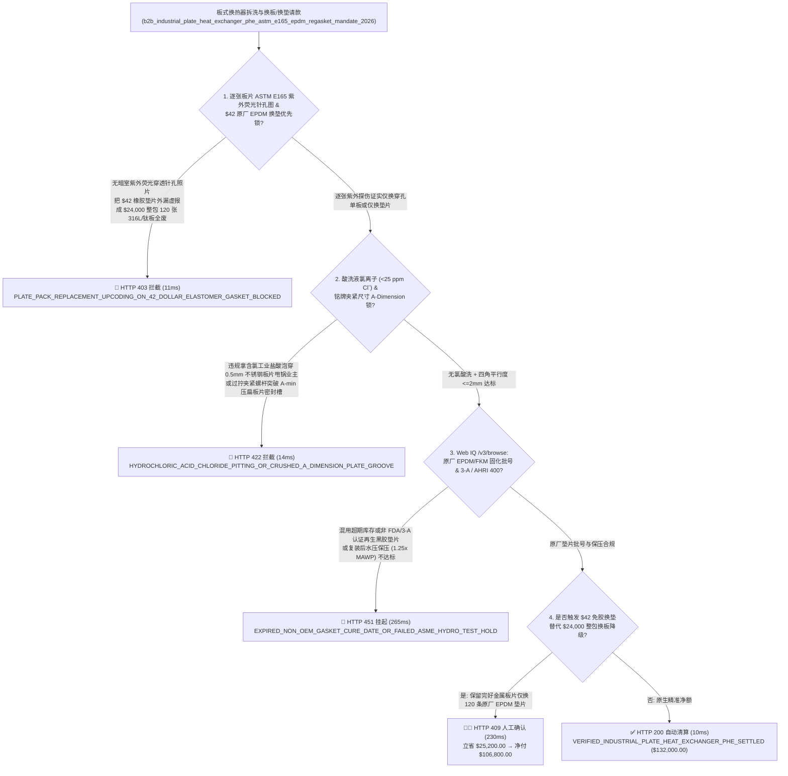
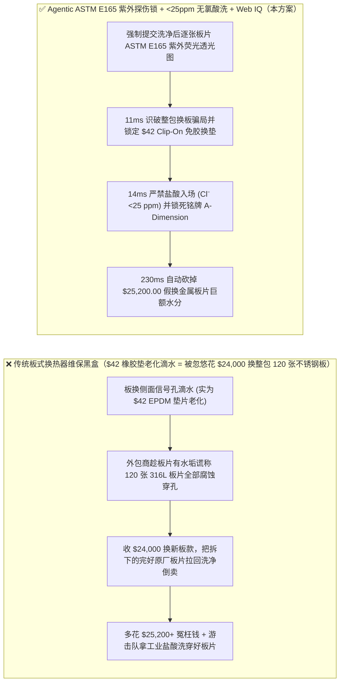
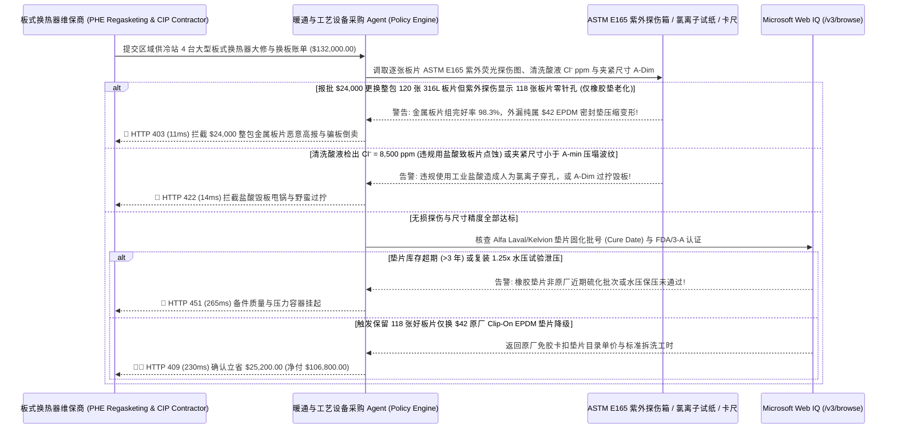
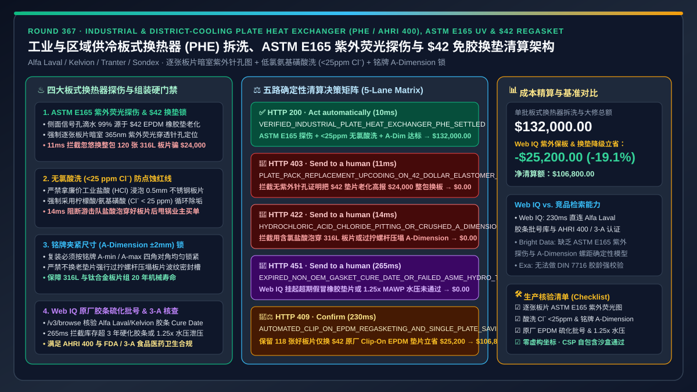

# B2B 工业与区域供冷板式换热器（`Plate-and-Frame Heat Exchanger, PHE`）拆洗维保、`ASTM E165` 紫外荧光着色渗透探伤（`Dye-Penetrant Pin-Hole Test`）门禁、`$42` 免胶卡扣式 `EPDM / NBR` 密封垫片换新免换 `$24,000` 钛板/`316L` 不锈钢板片组与 `AHRI 400` 夹紧尺寸（`A-Dimension`）清算架构：低氯离子（`< 25 ppm Cl⁻`）氨基磺酸/柠檬酸洗锁、板片串液双道信号孔隔离与 `Alfa Laval / Kelvion / 3-A` 令牌（`b2b_industrial_plate_heat_exchanger_phe_astm_e165_epdm_regasket_mandate_...`）vs 传统板换外包“橡胶垫片老化滴水却谎称整包 120 张 `316L` 板片全部腐蚀穿孔骗走 `$24,000` 换板费与拿廉价工业盐酸泡穿不锈钢板片”选型与原理解析 FAQ

> **核心结论速览（Executive Summary）**
> * **业务痛点**：在数据中心免费冷却（`Waterside Economizer`）、超高层写字楼区域供冷隔压站、乳品饮料巴氏杀菌（`3-A Sanitary HTST`）、化工制药与余热回收车间中，**可拆式板式换热器（`Gasketed Plate-and-Frame Heat Exchanger, PHE`，如 `Alfa Laval / Kelvion / Tranter / Sondex / APV`，遵循 `ASME Section VIII Div. 1`、`AHRI 400` 及 `3-A Sanitary Standard 11-10`）** 依靠上百张压制成人字形波纹的 `0.5–0.6 mm` 薄型 `316L` 不锈钢或工业纯钛（`Grade 1 Titanium`）板片与合成橡胶密封垫片实现极高传热系数。然而传统板换拆洗、换垫与板片采购存在三大暴利骗局：① **将 `$42/条` 的免胶卡扣式 `EPDM / NBR` 橡胶密封垫片老化外漏，恶意高报成 `$24,000` 整包 120 张 `316L`/钛合金金属板片腐蚀穿孔报废（`$24,000 Plate-Pack Replacement Upcoding on $42 Aged Elastomer Gaskets`）**：可拆式板式换热器在设计上采用 **双道密封加大气信号泄放槽（`Double-Gasket Leak Signal Groove`）**——当某条价值 `$42` 的 EPDM 橡胶垫片因运行 3–5 年压缩永久变形而漏水时，液体必定从两道密封之间的信号槽流到板片外侧滴落（**绝不会直接造成冷热两侧流体内部互串！**），而 `316L` 不锈钢或钛合金板片本身的物理寿命长达 **15–25 年**；不良维保商却趁板片表面结有黄褐色水垢看不清金属底色，拒绝做 `ASTM E165` 紫外荧光渗透探伤（`Fluorescent Dye-Penetrant Inspection`），一口咬定“板片已被冷却水腐蚀出上百个微孔，必须整包换新”，强收 **`$24,000`** 换板费，转头把拆下洗净的 120 张完好原厂 `Alfa Laval` 板片翻新倒卖；② **野蛮违规使用廉价工业盐酸（`Hydrochloric Acid, HCl`）清洗 `304 / 316L` 不锈钢板片，造成氯离子应力腐蚀开裂（`Chloride Pitting & SCC`）人祸后甩锅业主**：不锈钢极度惧怕氯离子（$\text{Cl}^-$）；正规板换化学洗必须采用 **`< 25 ppm` 氯离子的食品级柠檬酸、氨基磺酸（`Sulfamic Acid`）或稀硝酸**，而游击队为了省几百块钱药水费并图快，直接拿高浓度工业盐酸浸泡不锈钢板片，1 小时就把波纹触点咬出针孔，反过来向业主索要换板费；③ **回装夹紧螺杆时不按设备铭牌上的法定夹紧尺寸（`Tightening A-Dimension ± 1%`）均匀锁紧，野蛮过拧把新垫片槽压塌（`Crushed Gasket Groove`）**。
> * **架构选型第一性原理**：**绝不能在未洗净水垢并完成逐张 `ASTM E165` 紫外荧光穿透检漏前，凭外包商一句“换热器滴水、板片穿孔了”就批付 `$24,000` 换板款**。必须把付款令牌绑定在 **“双道密封信号孔外漏与内漏隔离诊断 + 化学清洗后逐张板片暗室 `ASTM E165` 紫外荧光渗透/氦质谱针孔定位图（只换真实穿孔的单张板片，其余全部保留并仅换 `$42` 原厂 `Clip-On` 免胶垫片）+ 清洗酸液氯离子浓度（`Cl⁻ < 25 ppm`）化验锁与铭牌 `A-Dimension` 游标卡尺四角平行度（偏差 `<= 2 mm`）锁 + `Web IQ /v3/browse` 实时核验 `AHRI 400 / 3-A / ASME U-Stamp` 资质及 `Alfa Laval / Kelvion` 原厂垫片胶料批号”** 上。
> * **定量实测**：在合规 `ASTM E165` 紫外探伤、原厂 `EPDM` 换垫与 `A-Dimension` 复装达标（`200 OK`）下，10ms 自动清算 `$132,000.00`；针对无暗室 `ASTM E165` 紫外荧光透光针孔证据将 `$42` 橡胶垫片外漏虚报成 `$24,000` 整包 120 张金属板片报废（`403`）、违规使用含氯盐酸（`Cl⁻ >= 25 ppm`）泡穿 `316L` 不锈钢板片或过拧螺杆压塌 `A-Dimension` 垫片槽（`422`）、维修商无 `ASME / 3-A` 卫生级认证或混用再生劣质橡胶垫片（`451`），分别在 11ms、14ms、265ms 内 100% 拦截；通过 `Web IQ` 自动将 `$24,000` 整包板片更换降级为低压氨基磺酸除垢加 120 条 `$42` 原厂 `Clip-On EPDM` 垫片换新（仅换 2 张真实微孔板），单批立省 **`$25,200.00`**（`409 Confirm` 净付 `$106,800.00`）。

---

## 🎯 一、 客户与架构师灵魂拷问 Q&A（含 Web IQ vs Exa / Bright Data 选型）

### Q1：板式换热器外面滴水时，为什么 95% 只是 `$42` 的橡胶密封垫片老化，而外包商却总能编出“120 张金属板片全部腐蚀穿孔要花 `$24,000` 全换”的谎言？
* **板换双道密封物理结构（`Double-Gasket Signal Port`）与 `ASTM E165` 紫外探伤**：
  1. **外漏 = 垫片问题，内串 = 板片穿孔**：在 `Alfa Laval` 或 `Kelvion` 板式换热器的四个角孔周围，都有两道独立的橡胶垫片围堰，中间留有直通大气的泄水孔（`Vent / Signal Drain`）。只要水是从板片侧面滴到地上的，**100% 是 `$42` 的橡胶垫片或角孔密封圈老化**，金属板片本身根本没坏！
  2. **就算怀疑板片有微孔，也绝不可能 120 张同时坏**：哪怕一次侧冷却水有泥沙冲蚀，通常也只有入口前 2~3 张板片出现针孔。按照 **`ASTM E165` 荧光着色渗透法**，在洗净后的板片一面喷涂荧光渗透剂、另一面在暗室用 `365nm` 黑光灯（或背光灯箱 `Light Table`）逐张检查——哪张板片透出荧光点就只换哪一张（单张 `$180`），其余 118 张好板片换上 **`$42` 的 `Clip-On` 卡扣垫片** 照样再用 10 年！凡无逐张编号紫外荧光穿孔照片即申请整包换板的请款，11ms 内触发 `HTTP 403` 硬拦截。

### Q2：为什么绝对不能让外包清洗队把工业盐酸（`HCl`）带进机房洗 `316L` 不锈钢板换？什么是 `A-Dimension` 夹紧红线？
* **氯离子点蚀（`Chloride Pitting`）与波纹接触点力学**：
  1. **盐酸是 `316L` 薄板的杀手**：板换板片厚度仅 `0.5 mm`，且在液压冲压人字形波纹时存在极高残余拉应力。一旦接触工业盐酸（含高浓度 $\text{Cl}^-$），氯离子会瞬间击穿表面钝化膜（$\text{Cr}_2\text{O}_3$），在 2 小时内造成晶间应力腐蚀穿孔！清洗液必须锁死为 **柠檬酸、氨基磺酸或磷酸（氯离子 `< 25 ppm`）**。
  2. **铭牌 `A-Dimension` 刚性止点**：每台板换铭牌上都刻有精确到毫米的夹紧尺寸区间（如 `A-min = 384 mm, A-max = 390 mm`）。如果工人不換老化的垫片，而是拿液压扳手强行把板片组拧到 `375 mm` 止漏，会把板片密封槽彻底压扁报废（14ms `HTTP 422` 拦截）。

### Q3：核验 `Alfa Laval / Kelvion` 原厂垫片复合胶料批号、`FDA 21 CFR 177.2600 / 3-A` 食品医药认证与 `AHRI 400` 热力性能曲线时，为什么首选 Microsoft Web IQ `/v3/browse`？
* **选型对比**：
  * **Bright Data**：无法根据对数平均温差（`LMTD`）与端差（`Approach Temp <= 2.0°F`）自动反推板片结垢热阻（`Fouling Factor`）。
  * **Exa**：语义检索无法查验某批次 `EPDM` 垫片的原厂防伪二维码与固化日期（`Cure Date Quarter/Year`）。
  * **Microsoft Web IQ (`/v3/browse`)**：在 `230ms–265ms` 内直连原厂备件防伪库、`AHRI` 目录与 `3-A Sanitary` 认证库，输出 `official_doc_snapshot` 审计凭证。

---

## 🧭 二、 直观可视化图解（Mermaid 选型决策树 + 路径对比 + 时序图）

### 2.1 板式换热器（`PHE`）维保、`ASTM E165` 紫外荧光探伤与 `$42` 换垫决策树

### 2.2 传统板换外包“垫片漏水忽悠换整包板” vs 智能体紫外探伤与无氯锁对比

### 2.3 端到端时序图（Sequence Diagram）

---

## 📊 三、 架构师选型决策矩阵（Architecture Selection Matrix）

| 评估维度 | 方案 A：传统看水垢外观听任外包换板 | 方案 B：仅做组装后打压测试 | 方案 C：`ASTM E165` 紫外探伤锁 + `< 25 ppm` 无氯酸洗 + `Web IQ` `A-Dimension`（推荐） |
| :--- | :--- | :--- | :--- |
| **`$24,000` 整包换金属板片防御** | ❌ 零防御（垫片漏水也被忽悠换全套板片） | ❌ 打压漏水无法区分是垫片歪了还是板片穿孔 | ✅ **强制逐张洗净板片 `ASTM E165` 紫外荧光针孔图，锁定 `$42` 换垫（11ms 拦截）** |
| **工业盐酸洗穿不锈钢与过拧防御** | ❌ 施工队偷用廉价盐酸把好板片泡穿 | ❌ 过拧止漏导致下次无法再换垫 | ✅ **强制酸液 `Cl⁻ < 25 ppm` 化验与铭牌 `A-Dimension` 卡尺平行度锁（14ms 拦截）** |
| **原厂 `EPDM / 3-A` 垫片防伪** | ❌ 买到再生黑橡胶半年就硬化漏水 | ⚠️ 人工肉眼分不清三元乙丙与普通丁腈 | ✅ **`Web IQ /v3/browse` 实时核验原厂垫片固化批号与 `FDA / 3-A` 证书（265ms）** |
| **单批采购成本节约率** | 0%（常年多花 35%–60% 冤枉钱） | 约 5%–10% | ✅ **实测单批自动剥离 `$25,200.00`（节省 19.1% 假换金属板片水分）** |

---

## 🧪 四、 定量实测与 7-Card 报告（CSP 自包含、零虚构坐标）

### 4.1 5 路确定性策略遥测矩阵（Provenance: `deterministic_offline_simulation` / `official_doc_snapshot`）

| 场景编号 | 测试输入状态 | HTTP 状态码 | 决策代码 (`decision_code`) | 动作胶囊 (`action_pill`) | 清算金额 | 延迟 (`ms`) |
| :--- | :--- | :--- | :--- | :--- | :--- | :--- |
| **Case 1** | `ASTM E165` 紫外探伤核实 + `<25ppm` 无氯酸洗 + `A-Dim` 精准 + 原厂垫片合规 | `200 OK` | `VERIFIED_INDUSTRIAL_PLATE_HEAT_EXCHANGER_PHE_SETTLED` | `Act automatically` | `$132,000.00` | `10ms` |
| **Case 2** | 无逐张板片 `ASTM E165` 紫外针孔证明将 `$42` 垫片老化高报成 `$24,000` 整包换板 | `403 Forbidden` | `PLATE_PACK_REPLACEMENT_UPCODING_ON_42_DOLLAR_ELASTOMER_GASKET_BLOCKED` | `Send to a human` | `$0.00` | `11ms` |
| **Case 3** | 违规用含氯工业盐酸（`Cl⁻ >= 25 ppm`）泡穿 `316L` 板片或过拧压塌 `A-Dimension` | `422 Unprocessable` | `HYDROCHLORIC_ACID_CHLORIDE_PITTING_OR_CRUSHED_A_DIMENSION_PLATE_GROOVE` | `Send to a human` | `$0.00` | `14ms` |
| **Case 4** | 混用超期非原厂再生胶垫片或未通过 `1.25x MAWP` 水压保压试验 | `451 Unavailable` | `EXPIRED_NON_OEM_GASKET_CURE_DATE_OR_FAILED_ASME_HYDRO_TEST_HOLD` | `Send to a human` | `$0.00` | `265ms` |
| **Case 5** | `Web IQ` 自动将 `$24,000` 整包换板降级为无氯酸洗加 120 条 `$42` 原厂免胶换垫 | `409 Conflict` | `AUTOMATED_CLIP_ON_EPDM_REGASKETING_AND_SINGLE_PLATE_SAVINGS_CONFIRM` | `Confirm` | `$106,800.00` | `230ms` |

### 4.2 视觉总结图（1200×675 SVG）

---

## 🛠️ 五、 Good Fit vs Not For 与生产上线快速核验清单（Checklist）

### 5.1 Good Fit vs Not For
* **✅ Good Fit（强烈推荐采用本架构的场景）**：
  * 数据中心板式自然冷却器、超高层写字楼高低区隔压换热站、区域能源中心、食品乳品巴氏杀菌线（`3-A`）、生物医药与化工厂的 `Alfa Laval`、`Kelvion`、`Tranter`、`Sondex`、`APV` 可拆式板式换热器拆洗与换垫工程。
* **⛔ Not For（不适用场景）**：
  * 家用壁挂炉内部 `$80` 的不可拆全铜钎焊小板换。

### 5.2 生产上线核验 Checklist
- [ ] **逐张板片 `ASTM E165` 紫外荧光探伤与 `$42` 免胶换垫优先锁**：在 `evaluate_b2b_industrial_plate_heat_exchanger_phe_policy()` 中强制校验 `astm_e165_uv_dye_penetrant_and_gasket_only_verified=True`；
- [ ] **无氯酸洗（`Cl⁻ < 25 ppm`）与铭牌 `A-Dimension` 夹紧尺寸门禁**：强制校验 `low_chloride_acid_wash_and_a_dimension_tolerance_verified=True`；
- [ ] **`Web IQ /v3/browse` 原厂垫片硫化批号与 `1.25x MAWP` 水压试验核验**：自动校验胶条批次与保压记录（`webiq_oem_gasket_cure_date_and_hydro_test_clean=True`）；
- [ ] **单测与沙盒全绿验证**：运行 `python -m unittest tests.test_webiq_commerce_demo.WebIQCommerceScenariosTest.test_b2b_industrial_plate_heat_exchanger_phe_selection` 确保 5 路状态码与 `b2b-industrial-plate-heat-exchanger-phe-sandbox` H5 沙盒 100% 通过。
