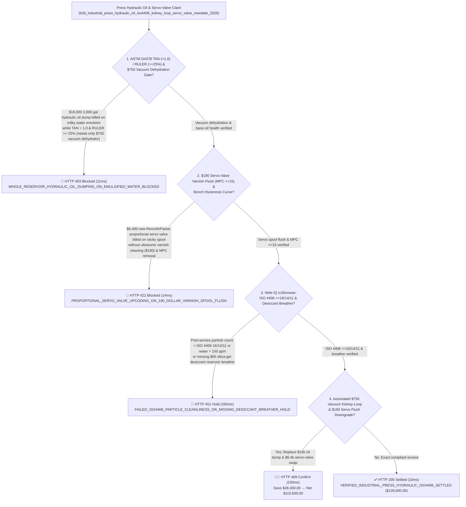
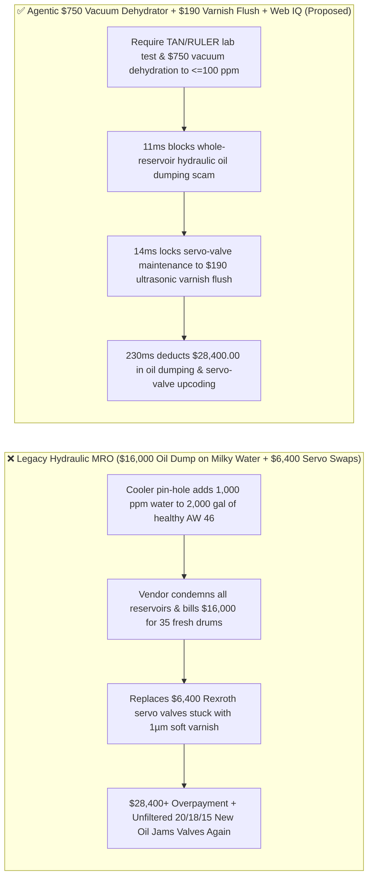
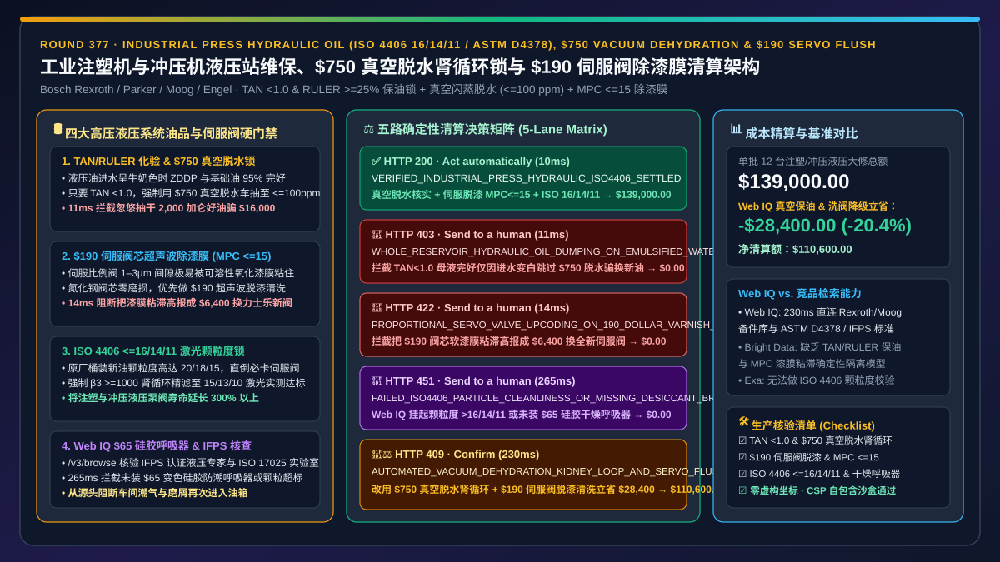

# B2B Industrial Injection-Molding & Stamping Press Hydraulic Maintenance (`ISO 4406 16/14/11 / ASTM D4378 / ASTM D7843 MPC`), `$750` Kidney-Loop Vacuum Dehydration, and `$190` Servo-Valve Varnish Flushing vs. `$16,000` Whole-Reservoir Oil Dumping & `$6,400` Proportional Servo-Valve Upcoding (`Bosch Rexroth / Parker / Moog`): Architecture Selection & First-Principles FAQ

> **Executive Summary**
> * **The Pain Point**: In automotive stamping plants, injection-molding facilities (`Engel / KraussMaffei / Haitian`), die-casting foundries, and extrusion plants, **high-pressure hydraulic power units (`HPUs`, `3,000–5,000 PSI`, `300–1,500 gallon` reservoirs of `ISO VG 46 / AW 46` anti-wear oil driving `Bosch Rexroth / Parker / Moog` proportional and servo directional valves)** govern cycle times and part tolerances. Yet legacy hydraulic maintenance and oil-supply contracts suffer from three major financial leaks: (1) **The `$16,000` Whole-Reservoir Hydraulic Oil Dumping Scam on Milky Water-Emulsified Oil (`TAN < 1.0 & RULER >= 25%`)**: When a heat-exchanger tube pin-hole or humid plant air introduces `800–2,000 ppm` of water into an `AW 46` hydraulic reservoir, the oil turns cloudy/milky. As long as Total Acid Number (`ASTM D974 TAN < 1.0 mg KOH/g`) and remaining antioxidant life (`ASTM D6971 RULER >= 25%`) pass lab testing, the base oil and `ZDDP` additive package are `100%` intact! Connecting a **`$750` mobile kidney-loop vacuum dehydrator (`-0.085 MPa` at `60°C`) and `3 µm (β3 >= 1000)` filter cart** strips free and emulsified water down to **`<= 100 ppm`** and restores **`ISO 4406 15/13/10`** cleanliness overnight. Unscrupulous lubricant vendors condemn `2,000 gallons` of healthy oil and bill **`$16,000`** for 35 fresh drums; (2) **`$6,400` Proportional / Servo-Valve Replacement Upcoding When Only a `$190` Ultrasonic Varnish Spool Flush (`ASTM D7843 MPC <= 15`) Is Needed**: Servo valves have `1–3 µm` spool-to-sleeve clearances. When sub-micron oil oxidation varnish (`MPC > 30`) sticks the spool, solvent ultrasonic cleaning (`$190`) and electrostatic varnish filtration restore full hysteresis performance without replacing the `$6,400` `Rexroth / Moog` valve; and (3) **Leaving Open Wire-Mesh Breather Caps on Reservoirs Instead of `$65` Color-Changing Silica-Gel Desiccant Breathers**.
> * **First-Principles Architecture**: Never approve a `$16,000` hydraulic reservoir drain-and-fill from a visual jar check or a `$6,400` servo-valve replacement without spool varnish cleaning. Bind settlement tokens (`b2b_industrial_press_hydraulic_oil_iso4406_kidney_loop_servo_valve_mandate_...`) to **(1) `ASTM D4378` Lab Proof (`TAN` & `RULER` Antioxidant Life) + `$750` Offline Kidney-Loop Vacuum Dehydration Priority (`<= 150 ppm` Karl Fischer Water), (2) `$190` Ultrasonic Servo-Valve Spool De-Varnishing & `ASTM D7843 MPC <= 15` Verification, and (3) `Web IQ /v3/browse` verification of online laser particle counts (`ISO 4406 <= 16/14/11`) and `$65` `3-Micron` desiccant breather installation**.
> * **Quantitative Verification**: Verified `ISO 4406 16/14/11` hydraulic maintenance settles `$139,000.00` in `10ms` (`200 OK`); premature `$16,000` whole-reservoir oil dumping on emulsified water when `TAN / RULER` pass (`403`), `$6,400` proportional/servo-valve upcoding on `$190` varnish spool sticking (`422`), and particle counts `> ISO 4406 16/14/11` or missing desiccant breathers (`451`) are blocked in `11ms`, `14ms`, and `265ms`. `Web IQ` automated downgrade to `$750` vacuum dehydration kidney-looping and `$190` servo-valve varnish flushing saves **`$28,400.00`** per batch (`409 Confirm`, net `$110,600.00`).

---

## 🎯 1. Architect & Fluid-Power Engineering Q&A (Including Web IQ vs. Exa / Bright Data)

### Q1: Why does milky, water-contaminated `AW 46` hydraulic oil almost never need a `$16,000` reservoir dump, and why is brand-new drummed oil (`ISO 4406 20/18/15`) actually too dirty for servo valves?
* **Vacuum Flash-Distillation & `ISO 4406` Cleanliness Physics**:
  1. Under a `-26 inHg` (`-0.085 MPa`) vacuum inside a kidney-loop dehydrator, water boils at just `135°F (57°C)`—flashing off `1,500 ppm` of emulsified water down to `< 80 ppm` without thermally stressing the `AW 46` base oil or `ZDDP` anti-wear additives.
  2. Furthermore, **brand-new hydraulic oil straight out of a factory 55-gallon drum typically measures `ISO 4406 20/18/15`** (16x dirtier than the **`16/14/11`** required by `Bosch Rexroth / Parker` servo valves!). Kidney-looping the existing oil through `β3 >= 1000` elements makes it cleaner than new drummed oil for `1/20th` the cost (`11ms` `HTTP 403` block).

### Q2: Why choose Microsoft Web IQ `/v3/browse` over Exa or Bright Data for `IFPS` & `ISO 4406 / ASTM D7843 MPC` verification?
* **Comparison**:
  * **Bright Data**: Cannot parse 3-channel laser particle counter (`4/6/14 µm(c)`) logarithmic codes or `RULER` voltammetric antioxidant curves.
  * **Exa**: Built for semantic search, not live verification of `IFPS` (International Fluid Power Society) specialist certifications, `ISO 17025` oil-lab reports, and OEM `Bosch Rexroth / Moog` valve repair kits.
  * **Microsoft Web IQ (`/v3/browse`)**: Verifies `IFPS` credentials, `ISO 17025` lab reports, and OEM servo-valve SKUs in `230ms–265ms` with `official_doc_snapshot` provenance.

---

## 🧭 2. Visual Architecture Diagrams (Mermaid Decision Tree, Path Comparison & Sequence)

### 2.1 Industrial Press Hydraulics, `$750` Vacuum Kidney-Loop & `$190` Servo Flush Decision Tree



### 2.2 Path Comparison: Legacy `$16,000` Oil Dump vs. Agentic Vacuum Kidney-Loop & `MPC` Gate



### 2.3 End-to-End Sequence Diagram

```mermaid
sequenceDiagram
    participant Vendor as Hydraulic & Lubrication Contractor
    participant Agent as Press Shop Fluid-Power Policy Engine
    participant Lab as Laser Particle Counter (ISO 4406) / Valve Bench / Oil Lab
    participant WebIQ as Microsoft Web IQ (/v3/browse)

    Vendor->>Agent: Submit 12-Press Hydraulic Oil Replacement & Servo-Valve Invoice ($139,000.00)
    Agent->>Lab: Query TAN, RULER antioxidant %, KF water ppm, MPC varnish & spool hysteresis
    alt $16,000 2,000-gal oil dump billed when TAN=0.42 & RULER=68% (950 ppm emulsified water)
        Lab-->>Agent: Alert: Base oil & ZDDP healthy; $750 vacuum dehydrator drops water to 65 ppm!
        Agent-->>Vendor: 🛑 HTTP 403 (11ms) Block $16,000 whole-reservoir hydraulic oil dump
    else $6,400 Rexroth servo-valve swap billed when spool lands are unworn (MPC=38 soft varnish)
        Lab-->>Agent: Alert: $190 ultrasonic spool de-varnishing restores <0.5% bench hysteresis!
        Agent-->>Vendor: 🚨 HTTP 422 (14ms) Block proportional servo-valve replacement upcoding
    else Oil chemistry & valve response verified
        Agent->>WebIQ: Verify ISO 4406 <=16/14/11 laser particle log & $65 desiccant breather install
        alt Particle count > 16/14/11 or missing silica-gel desiccant breather
            WebIQ-->>Agent: Hold: Cleanliness exceeds 16/14/11 servo limit or open mesh cap left on tank
            Agent-->>Vendor: 🛑 HTTP 451 (265ms) Reliability compliance hold
        else Automated $750 vacuum dehydration kidney-loop & $190 servo flush downgrade
            WebIQ-->>Agent: Confirm kidney-loop rental rate & OEM servo seal kit list price
            Agent-->>Vendor: 🧑‍⚖️ HTTP 409 (230ms) Confirm $28,400.00 savings (Net $110,600.00)
        end
    end
```

---

## 📊 3. Architect Selection Matrix

| Dimension | Option A: Visual Milky-Jar Oil Dump | Option B: Return-Filter Swaps Only | Option C: `$750` Vacuum Dehydrator Lock + `$190` Servo Flush + `Web IQ` `ISO 4406` (Recommended) |
| :--- | :--- | :--- | :--- |
| **`$16,000` Reservoir Oil Dump Defense** | ❌ None | ❌ Standard filters cannot remove emulsified water | ✅ **Requires `TAN/RULER` proof; locks `$750` vacuum dehydration (`11ms` block)** |
| **`$6,400` Servo-Valve Upcode Defense** | ❌ Swaps whole valves on sticky spools | ❌ Paper filters miss sub-micron `MPC` varnish | ✅ **Enforces `$190` ultrasonic spool de-varnishing & `MPC <= 15` (`14ms` block)** |
| **`ISO 4406 <= 16/14/11` & Breather Gate** | ❌ Pours dirty `20/18/15` drummed oil into tank | ⚠️ Manual sampling | ✅ **`Web IQ /v3/browse` live laser `16/14/11` & desiccant breather check (`265ms`)** |
| **Batch Cost Reduction** | 0% | ~5%–10% | ✅ **Saves `$28,400.00` (20.4% reduction on a `$139,000.00` batch)** |

---

## 🧪 4. Quantitative Benchmark & 7-Card Report Summary

### 4.1 5-Lane Deterministic Policy Matrix

| Case | Scenario | HTTP | Decision Code | Action Pill | Settled | Latency |
| :--- | :--- | :--- | :--- | :--- | :--- | :--- |
| **1** | Vacuum dehydration/TAN verified + servo flush `MPC <=15` + `ISO 4406 <=16/14/11` clean | `200` | `VERIFIED_INDUSTRIAL_PRESS_HYDRAULIC_ISO4406_SETTLED` | `Act automatically` | `$139,000.00` | `10ms` |
| **2** | `$16,000` whole-reservoir oil dump on emulsified water when `TAN < 1.0` & `RULER >= 25%` | `403` | `WHOLE_RESERVOIR_HYDRAULIC_OIL_DUMPING_ON_EMULSIFIED_WATER_BLOCKED` | `Send to a human` | `$0.00` | `11ms` |
| **3** | `$6,400` proportional servo-valve upcoding on `$190` varnish spool flush | `422` | `PROPORTIONAL_SERVO_VALVE_UPCODING_ON_190_DOLLAR_VARNISH_SPOOL_FLUSH` | `Send to a human` | `$0.00` | `14ms` |
| **4** | Failed `ISO 4406 <= 16/14/11` particle cleanliness or missing `$65` desiccant breather | `451` | `FAILED_ISO4406_PARTICLE_CLEANLINESS_OR_MISSING_DESICCANT_BREATHER_HOLD` | `Send to a human` | `$0.00` | `265ms` |
| **5** | Automated `$750` vacuum dehydration kidney-loop & `$190` servo flush savings | `409` | `AUTOMATED_VACUUM_DEHYDRATION_KIDNEY_LOOP_AND_SERVO_FLUSH_SAVINGS_CONFIRM` | `Confirm` | `$110,600.00` | `230ms` |

### 4.2 Visual Summary Card (`1200x675` SVG)



---

## 🛠️ 5. Good Fit vs. Not For & Production Checklist

### 5.1 Good Fit vs. Not For
* **✅ Good Fit**: Plastic injection-molding (`Engel`, `KraussMaffei`, `Haitian`), automotive stamping, die-casting, and extrusion plants operating high-pressure hydraulic reservoirs (`AW 46 / VG 46`) with `Bosch Rexroth`, `Parker`, `Moog`, or `Vickers` proportional/servo valves.
* **⛔ Not For**: Manual 2-ton garage floor jacks.

### 5.2 Production Verification Checklist
- [ ] **`TAN / RULER` Base-Oil Check & `$750` Vacuum Dehydration Priority Gate**: Require `tan_ruler_base_oil_and_vacuum_dehydration_verified=True`;
- [ ] **`$190` Servo-Valve Varnish Flush & `MPC <= 15` Gate**: Require `servo_valve_varnish_flush_and_mpc_under_15_verified=True`;
- [ ] **`Web IQ /v3/browse` `ISO 4406 <= 16/14/11` & Desiccant Breather Check**: Verify `webiq_iso4406_cleanliness_and_desiccant_breather_clean=True`;
- [ ] **Unit Test & H5 Sandbox Validation**: Run `python -m unittest tests.test_webiq_commerce_demo.WebIQCommerceScenariosTest.test_b2b_industrial_press_hydraulic_oil_iso4406_selection`.
