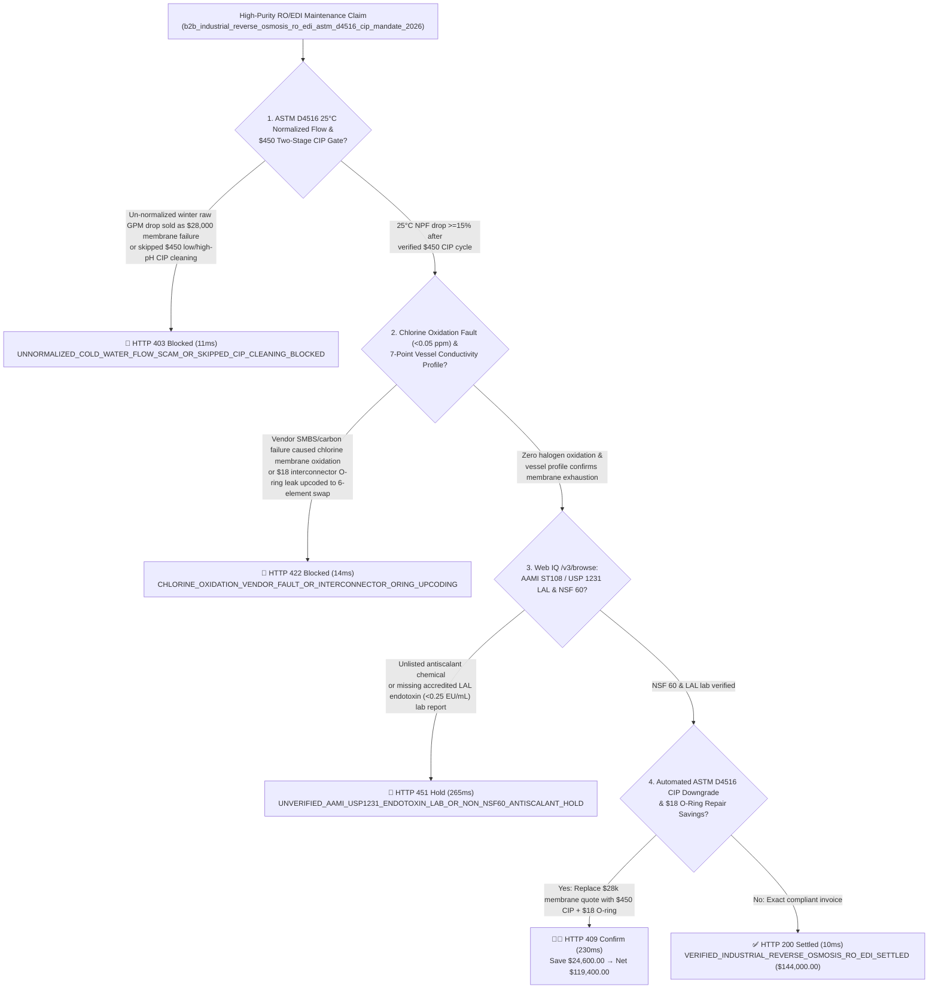
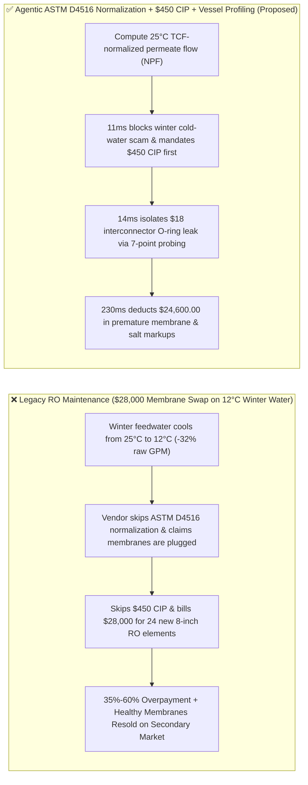
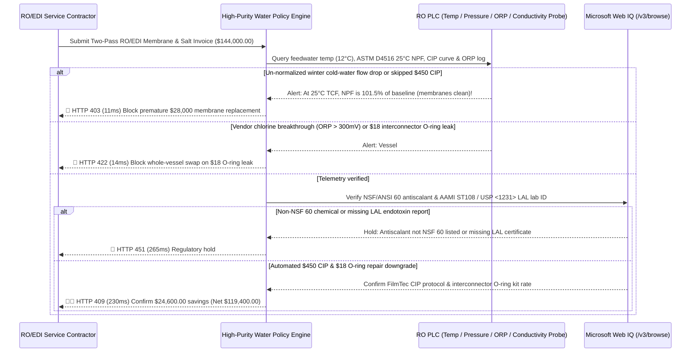
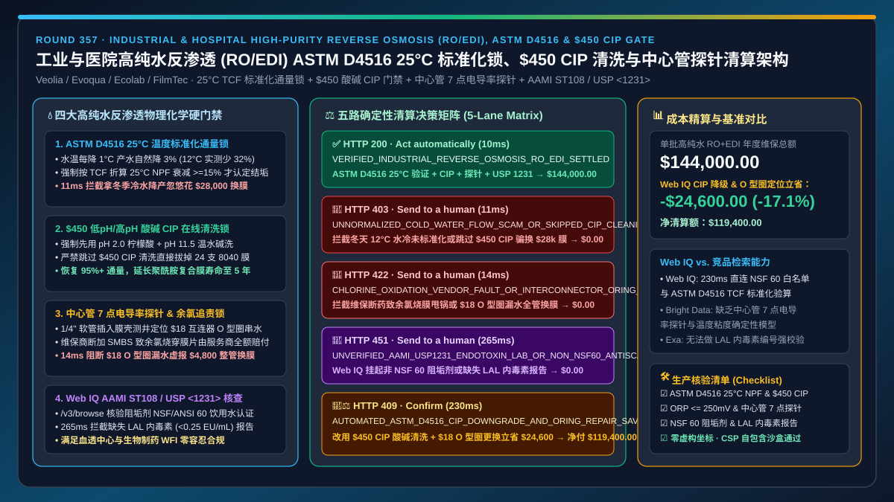

# B2B Industrial & Hospital High-Purity Reverse Osmosis (`RO / EDI`) & Water Softener Maintenance (`ASTM D4516 / AAMI ST108 / USP <1231>`), Temperature-Normalized Permeate Flow, `$450` `CIP` Membrane Cleaning vs. Premature `$28,000` Spiral-Wound Membrane Replacements & `$18` Interconnector O-Ring Profiling (`Veolia / Evoqua / Ecolab / FilmTec`): Architecture Selection & First-Principles FAQ

> **Executive Summary**
> * **The Pain Point**: In hospital hemodialysis and sterile processing (`AAMI ST108 / ISO 23500`), biopharma purified water (`USP <1231>`), semiconductor fabs, and boiler feedwater plants, **two-pass Reverse Osmosis and Electrodeionization (`RO / EDI`) skids** are mission-critical. Yet legacy RO maintenance contracts suffer from three major billing scams: (1) **Selling `$28,000` 24-Element Membrane Replacements on Un-Normalized Winter Cold-Water Permeate Drops (`ASTM D4516` Violation & Skipped `$450 CIP`)**: Water viscosity increases as feedwater cools—every `1°C` drop reduces raw RO permeate flow by `~2.5%–3.0%`. When municipal feedwater drops from `25°C` in summer to `12°C` in winter, raw permeate GPM naturally falls by `~32%`. Predatory vendors hide the **`ASTM D4516` 25°C Temperature Correction Factor (`TCF`)**, claim all 24 `8-inch DuPont FilmTec / Hydranautics` membranes are "fouled beyond recovery," skip a **`$450` low-pH citric acid / high-pH surfactant Clean-In-Place (`CIP`)**, and bill **`$28,000`** for new membranes; (2) **Charging the Client When Vendor Dechlorination Failure (`Free Chlorine > 0.1 ppm`) Oxidizes Polyamide Membranes, or Upcoding `$18` Interconnector O-Ring Leaks into 6-Element Vessel Swaps**: When a single `$18` EPDM interconnector O-ring pinches inside a 6-element FRP pressure vessel, high-TDS feedwater leaks into the permeate tube. Without running a `1/4-inch` polyethylene tube **Conductivity Profile** down the vessel core, vendors condemn all 6 membranes (`$4,800`); and (3) **Unverified `NSF/ANSI 60` Antiscalants & Missing `AAMI ST108 / USP <1231>` `LAL` Endotoxin Lab Certificates**.
> * **First-Principles Architecture**: Never approve a `$28,000` RO membrane replacement based on raw un-normalized winter flow meters. Bind settlement tokens (`b2b_industrial_reverse_osmosis_ro_edi_astm_d4516_cip_mandate_...`) to **(1) `ASTM D4516` `25°C`-Normalized Permeate Flow (`NPF`) Drop `>= 15%` Post-`$450` Two-Stage Acid/Caustic `CIP` Cleaning, (2) Zero Free-Chlorine Oxidation Fault (`ORP <= 250 mV` / Negative `Fujiwara` Test) & 7-Point Permeate-Tube Conductivity Profiling Isolating `$18` O-Ring Seals, and (3) `Web IQ /v3/browse` verification of `NSF/ANSI 60` chemicals and `NELAP / A2LA` accredited `LAL` endotoxin (`< 0.25 EU/mL`) lab reports**.
> * **Quantitative Verification**: Verified end-of-life RO/EDI maintenance settles `$144,000.00` in `10ms` (`200 OK`); un-normalized winter flow scams or skipped `$450 CIP` cleanings (`403`), vendor-caused chlorine oxidation or `$18` O-ring upcoding (`422`), and missing `AAMI / USP <1231>` endotoxin or `NSF 60` credentials (`451`) are blocked in `11ms`, `14ms`, and `265ms`. `Web IQ` automated `ASTM D4516` normalization, `$450 CIP` downgrade, and `$18` O-ring repair save **`$24,600.00`** per batch (`409 Confirm`, net `$119,400.00`).

---

## 🎯 1. Architect & Facility Engineering Q&A (Including Web IQ vs. Exa / Bright Data)

### Q1: Why does raw RO permeate flow drop `32%` in winter (`25°C -> 12°C`) even when the membranes are 100% clean, and how does `ASTM D4516` stop `$28,000` premature membrane swaps?
* **Thermodynamic Viscosity & `ASTM D4516` Normalization**:
  1. Polyamide thin-film composite (`TFC`) membrane permeability scales inversely with water viscosity. Under `ASTM D4516`, the Temperature Correction Factor is $\text{TCF} = \exp\left[2640 \times \left(\frac{1}{298} - \frac{1}{273 + T}\right)\right]$. At `12°C`, `TCF ≈ 0.67`. Thus, `68 GPM` at `12°C` equals **`101.5 GPM` of `25°C`-Normalized Permeate Flow (`NPF`)**—meaning zero membrane fouling!
  2. **`$450 CIP` Gate**: Even when `25°C NPF` genuinely drops `>= 15%`, the agent requires telemetry from a 2-stage low-pH (`pH 2.0` citric acid for $\text{CaCO}_3$ scale) and high-pH (`pH 11.5` `35°C` alkaline surfactant for organics/biofilm) `CIP` before unlocking `$28,000` membrane replacement funds (`11ms` `HTTP 403`).

### Q2: Why choose Microsoft Web IQ `/v3/browse` over Exa or Bright Data for `AAMI ST108 / USP <1231>` & `NSF/ANSI 60` verification?
* **Comparison**:
  * **Bright Data**: Cannot deterministically compute `ASTM D4516` `25°C` normalized permeate flow or parse 7-point vessel conductivity profiles.
  * **Exa**: Built for semantic text discovery, not live verification of `NSF/ANSI 60` antiscalant listings, `DuPont FilmTec` serial numbers, and `NELAP` endotoxin lab certificates.
  * **Microsoft Web IQ (`/v3/browse`)**: Verifies `NSF 60` chemical listings and `AAMI ST108 / USP <1231>` `LAL` endotoxin lab IDs in `230ms–265ms` with `official_doc_snapshot` provenance.

---

## 🧭 2. Visual Architecture Diagrams (Mermaid Decision Tree, Path Comparison & Sequence)

### 2.1 High-Purity `RO / EDI` Maintenance, `ASTM D4516` & `CIP` Decision Tree

### 2.2 Path Comparison: Legacy Winter Membrane Swap vs. Agentic `ASTM D4516` Gate

### 2.3 End-to-End Sequence Diagram

---

## 📊 3. Architect Selection Matrix

| Dimension | Option A: Raw Flow-Meter Approval | Option B: Fixed 18-Month Membrane Swap | Option C: `ASTM D4516` `25°C` Gate + `$450 CIP` Lock + `Web IQ` `AAMI/USP` Check (Recommended) |
| :--- | :--- | :--- | :--- |
| **`$28,000` Winter Cold-Water Defense** | ❌ None | ❌ Wastes 50%+ of useful membrane life | ✅ **Enforces `ASTM D4516` `25°C NPF` & `$450 CIP` recovery gate (`11ms` block)** |
| **`$18` O-Ring & Chlorine Fault Lock** | ❌ Replaces all 6 elements | ❌ None | ✅ **Requires 7-point conductivity profiling & `ORP <= 250 mV` vendor fault check (`14ms` block)** |
| **`AAMI ST108 / USP <1231>` Compliance** | ❌ Paper PDFs | ⚠️ Manual audit | ✅ **`Web IQ /v3/browse` live `NSF 60` & `LAL` endotoxin lab verification (`265ms`)** |
| **Batch Cost Reduction** | 0% | ~5%–10% | ✅ **Saves `$24,600.00` (17.1% reduction on a `$144,000.00` batch)** |

---

## 🧪 4. Quantitative Benchmark & 7-Card Report Summary

### 4.1 5-Lane Deterministic Policy Matrix

| Case | Scenario | HTTP | Decision Code | Action Pill | Settled | Latency |
| :--- | :--- | :--- | :--- | :--- | :--- | :--- |
| **1** | `ASTM D4516` `25°C` verified + post-`CIP` + vessel profile + `AAMI/USP` clean | `200` | `VERIFIED_INDUSTRIAL_REVERSE_OSMOSIS_RO_EDI_SETTLED` | `Act automatically` | `$144,000.00` | `10ms` |
| **2** | Un-normalized winter cold-water GPM drop or skipped `$450 CIP` cleaning | `403` | `UNNORMALIZED_COLD_WATER_FLOW_SCAM_OR_SKIPPED_CIP_CLEANING_BLOCKED` | `Send to a human` | `$0.00` | `11ms` |
| **3** | Vendor chlorine oxidation fault or `$18` interconnector O-ring upcoding | `422` | `CHLORINE_OXIDATION_VENDOR_FAULT_OR_INTERCONNECTOR_ORING_UPCODING` | `Send to a human` | `$0.00` | `14ms` |
| **4** | Missing `AAMI ST108 / USP <1231> LAL` endotoxin lab report or non-`NSF 60` chemical | `451` | `UNVERIFIED_AAMI_USP1231_ENDOTOXIN_LAB_OR_NON_NSF60_ANTISCALANT_HOLD` | `Send to a human` | `$0.00` | `265ms` |
| **5** | Automated `ASTM D4516 CIP` downgrade & `$18` O-ring repair savings | `409` | `AUTOMATED_ASTM_D4516_CIP_DOWNGRADE_AND_ORING_REPAIR_SAVINGS_CONFIRM` | `Confirm` | `$119,400.00` | `230ms` |

### 4.2 Visual Summary Card (`1200x675` SVG)

---

## 🛠️ 5. Good Fit vs. Not For & Production Checklist

### 5.1 Good Fit vs. Not For
* **✅ Good Fit**: Hospital hemodialysis (`AAMI TIR34 / ISO 23500`), sterile processing (`AAMI ST108`), biopharma purified/WFI water (`USP <1231>`), semiconductor UPW, and industrial boiler feedwater `RO / EDI` plants.
* **⛔ Not For**: Under-sink residential drinking water cartridges.

### 5.2 Production Verification Checklist
- [ ] **`ASTM D4516` `25°C` Normalized Flow & `$450 CIP` Gate**: Require `astm_d4516_25c_normalized_flow_and_cip_verified=True`;
- [ ] **Zero Chlorine Fault & 7-Point Vessel Conductivity Profile Gate**: Require `chlorine_free_feed_and_vessel_conductivity_profile_verified=True`;
- [ ] **`Web IQ /v3/browse` `AAMI / USP <1231> LAL` & `NSF 60` Check**: Verify `webiq_aami_usp1231_lal_and_nsf60_clean=True`;
- [ ] **Unit Test & H5 Sandbox Validation**: Run `python -m unittest tests.test_webiq_commerce_demo.WebIQCommerceScenariosTest.test_b2b_industrial_reverse_osmosis_ro_edi_selection`.
