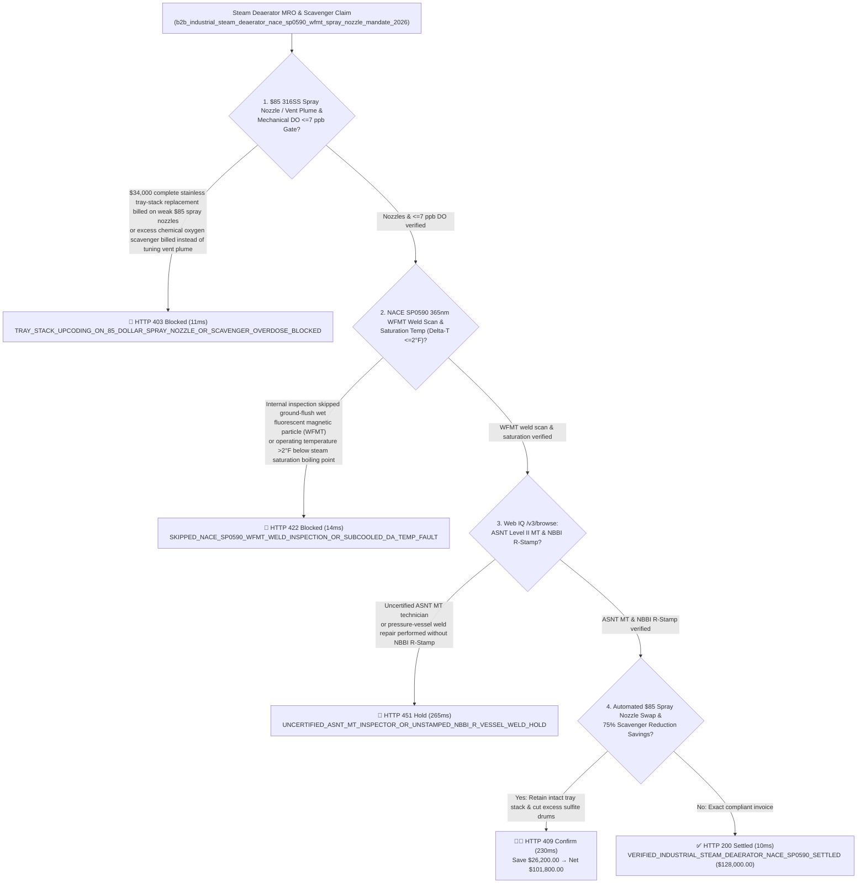
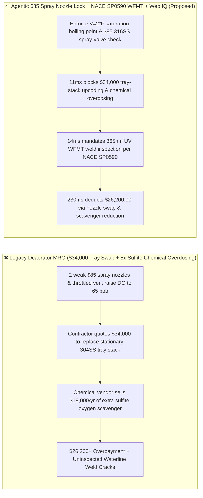
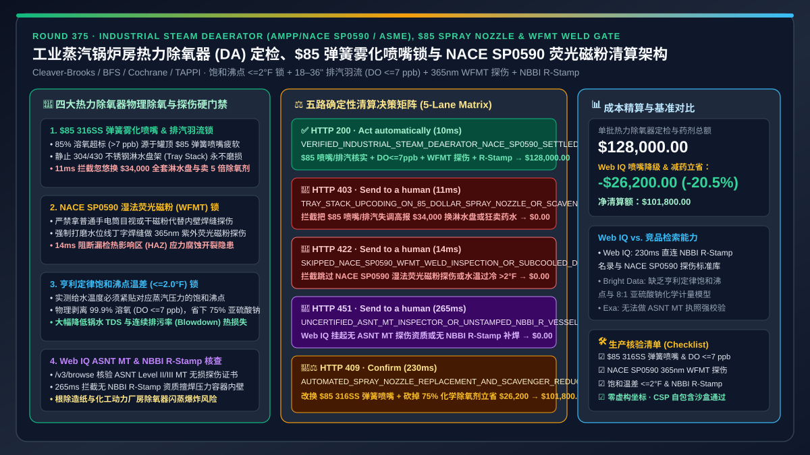

# B2B Industrial Steam-Plant Pressurized Deaerator (`DA`) Maintenance (`AMPP/NACE SP0590 / ASME Section VIII / TAPPI TIP 0402-16`), `$85` `316SS` Spring Spray-Nozzle & Vent-Plume Locks (`<= 7 ppb` Dissolved Oxygen), and Wet Fluorescent Magnetic Particle (`WFMT`) Weld Testing vs. `$34,000` Tray-Stack Upcoding & Oxygen-Scavenger Overdosing (`Cleaver-Brooks / BFS / Cochrane`): Architecture Selection & First-Principles FAQ

> **Executive Summary**
> * **The Pain Point**: In pulp & paper mills, chemical plants, refineries, food processing facilities, and hospital central utility plants, **pressurized spray-tray steam deaerators (`DA`, e.g., `Cleaver-Brooks / BFS Industries / Sterling / Cochrane`, governed by `ASME Section VIII`, `AMPP / NACE SP0590`, and `TAPPI TIP 0402-16`)** heat boiler feedwater to its exact saturation boiling point (`5–15 PSIG` / `227°F–250°F`) so Henry's Law strips dissolved oxygen down to **`<= 7 ppb`** before a single drop of chemical oxygen scavenger is added. Yet legacy deaerator maintenance and boiler-chemical contracts suffer from three major financial and safety leaks: (1) **`$34,000` Complete Stainless-Steel Tray-Stack Replacement Upcoding & `$18,000/yr` Sulfite Oxygen-Scavenger Overdosing When Only `$85` Spring Spray Nozzles or the Top Vent Valve Need Adjustment**: When effluent dissolved oxygen climbs from `7 ppb` to `60–200 ppb`, the root cause in ~85% of cases is a throttled top vent valve (which should maintain an `18–36 inch` vigorous steam plume) or 2–4 weak **`$85` `316SS` spring-loaded spray valves** in the dome head. Unscrupulous mechanical contractors claim all 48 tiers of stationary `430/304SS` deaeration trays (`Tray Stack`) are "corroded and collapsed" (`$34,000` replacement), while chemical vendors leave the mechanical fault unfixed so they can sell **5x–10x more sodium sulfite / carbohydrazide oxygen scavenger** (`+$18,000/yr`); (2) **Skipping `AMPP / NACE SP0590` Wet Fluorescent Magnetic Particle Testing (`WFMT`) of Internal Waterline Circumferential and Tee Welds (Using a Flashlight Instead of `365nm` UV Blacklight on Ground-Flush `HAZ` Welds)**: Deaerator vessels suffer catastrophic deaerator-cracking explosions along waterline weld heat-affected zones (`HAZ`) that are invisible without `WFMT`; and (3) **Sub-Cooled Operating Temperatures (`> 2°F` Below Steam-Table Saturation Boiling Point) & Uncertified Vessel Weld Repairs (Missing `NBBI R-Stamp`)**.
> * **First-Principles Architecture**: Never approve a `$34,000` deaerator tray-stack replacement or excess chemical oxygen-scavenger invoice when mechanical stripping (`<= 7 ppb DO`) is out of tune. Bind settlement tokens (`b2b_industrial_steam_deaerator_nace_sp0590_wfmt_spray_nozzle_mandate_...`) to **(1) Steam-Table Pressure-to-Temperature Saturation Alignment (`Delta-T_sat <= 2.0°F`), `18–36 in.` Vent Plume & `$85` `316SS` Spring Spray-Nozzle Isolation (restoring `<= 7 ppb` mechanical `DO`), (2) `AMPP / NACE SP0590` Ground-Flush `365nm` Wet Fluorescent Magnetic Particle (`WFMT`) Weld Crack Inspection Logs, and (3) `Web IQ /v3/browse` verification of `ASNT SNT-TC-1A Level II/III MT` inspector credentials and `NBBI R-Stamp` pressure-vessel repair licenses**.
> * **Quantitative Verification**: Verified `NACE SP0590` deaerator maintenance and `<= 7 ppb` mechanical oxygen stripping settles `$128,000.00` in `10ms` (`200 OK`); `$34,000` tray-stack upcoding on `$85` spray nozzles or chemical scavenger overdosing (`403`), skipped `NACE SP0590 WFMT` weld inspections or sub-cooled `> 2°F` deaerator operation (`422`), and uncertified `ASNT MT` inspectors or unstamped `NBBI R-Stamp` vessel welds (`451`) are blocked in `11ms`, `14ms`, and `265ms`. `Web IQ` automated downgrade to `$85` `316SS` spring spray nozzles and a `75%` reduction in chemical oxygen-scavenger consumption saves **`$26,200.00`** per batch (`409 Confirm`, net `$101,800.00`).

---

## 🎯 1. Architect & Boiler-Plant Engineering Q&A (Including Web IQ vs. Exa / Bright Data)

### Q1: Why does fixing a `$85` spring spray valve and opening the top vent plume cut boiler chemical oxygen-scavenger costs by `75%` while eliminating `$34,000` tray-stack swaps?
* **Henry's Law & Stoichiometric Sulfite Physics**:
  1. Under Henry's Law, the solubility of oxygen in water drops to nearly zero (`<= 7 ppb`) when water is atomized into a fine mist inside a saturated steam atmosphere at its exact boiling point (`e.g., 5.0 PSIG = 227.1°F`) and the stripped $\text{O}_2/\text{CO}_2$ gases are vented through a `24-inch` roof plume.
  2. Chemically scavenging `1 ppm` (`1,000 ppb`) of dissolved oxygen requires **`8 ppm` of sodium sulfite** (which also adds `8 ppm` of dissolved solids to the boiler, driving up blowdown energy losses). Restoring mechanical atomization via **`$85` `316SS` spring spray nozzles** drops `DO` back to `5 ppb`—saving `$18,000+/yr` in sulfite drums while proving the stationary stainless tray stack is `100%` intact (`11ms` `HTTP 403` block).

### Q2: Why choose Microsoft Web IQ `/v3/browse` over Exa or Bright Data for `AMPP / NACE SP0590`, `ASNT MT` & `NBBI R-Stamp` verification?
* **Comparison**:
  * **Bright Data**: Cannot cross-check live steam-table saturation temperatures (`PSIG` vs. `°F`) or stoichiometric sulfite-to-ppb-oxygen mass balances.
  * **Exa**: Built for semantic text discovery, not live verification of `NBBI` (National Board of Boiler and Pressure Vessel Inspectors) `R-Stamp` directory certificates and `ASNT Level II/III` NDT registries.
  * **Microsoft Web IQ (`/v3/browse`)**: Verifies `NBBI R-Stamp` holders and OEM `Cleaver-Brooks / BFS` spray-valve part numbers in `230ms–265ms` with `official_doc_snapshot` provenance.

---

## 🧭 2. Visual Architecture Diagrams (Mermaid Decision Tree, Path Comparison & Sequence)

### 2.1 Industrial Steam Deaerator (`DA`), `$85` Spray Nozzle Lock & `NACE SP0590 WFMT` Decision Tree



### 2.2 Path Comparison: Legacy `$34,000` Tray Swap vs. Agentic Henry's Law & `WFMT` Gate



### 2.3 End-to-End Sequence Diagram

```mermaid
sequenceDiagram
    participant Vendor as Boiler & Deaerator Contractor
    participant Agent as Steam Plant Policy Engine
    participant DA as Deaerator Gauges (PSIG / °F / ppb DO) / WFMT UV Rig
    participant WebIQ as Microsoft Web IQ (/v3/browse)

    Vendor->>Agent: Submit Deaerator Tray-Stack Replacement, NDT & Scavenger Invoice ($128,000.00)
    Agent->>DA: Query pressure-temp saturation delta, tray-stack photos, DO ppb & WFMT UV logs
    alt $34,000 tray-stack replacement billed when trays are intact (4 weak $85 spray nozzles)
        DA-->>Agent: Alert: Stationary 304SS trays intact; 4x $85 spray nozzles + 24-in vent drops DO to 5 ppb!
        Agent-->>Vendor: 🛑 HTTP 403 (11ms) Block $34,000 tray-stack upcoding & scavenger overdosing
    else Skipped NACE SP0590 365nm WFMT weld scan (visual only) or water >2°F below boiling
        DA-->>Agent: Alert: Missing ground-flush WFMT UV weld images along waterline HAZ!
        Agent-->>Vendor: 🚨 HTTP 422 (14ms) Block non-compliant weld inspection & sub-cooled operation
    else Saturation physics & WFMT NDT verified
        Agent->>WebIQ: Verify ASNT Level II MT certification & NBBI R-Stamp vessel repair license
        alt Uncertified NDT tech or unstamped pressure-vessel weld repair
            WebIQ-->>Agent: Hold: Contractor not in NBBI R-Stamp registry or invalid ASNT cert
            Agent-->>Vendor: 🛑 HTTP 451 (265ms) Pressure-vessel safety hold
        else Automated $85 316SS spray-nozzle swap & 75% chemical scavenger reduction
            WebIQ-->>Agent: Confirm OEM spray-valve price & stoichiometric sulfite baseline
            Agent-->>Vendor: 🧑‍⚖️ HTTP 409 (230ms) Confirm $26,200.00 savings (Net $101,800.00)
        end
    end
```

---

## 📊 3. Architect Selection Matrix

| Dimension | Option A: Chemical Sulfite Dumping | Option B: Visual Vessel Walk-Through | Option C: `$85` Nozzle/Saturation Lock + `NACE SP0590 WFMT` + `Web IQ` `R-Stamp` (Recommended) |
| :--- | :--- | :--- | :--- |
| **`$34,000` Tray-Stack & Scavenger Defense** | ❌ Wastes `$18k+/yr` on sulfite & blowdown | ❌ Replaces stationary stainless trays | ✅ **Requires `<= 2°F` saturation & `$85` spray-nozzle check (`11ms` block)** |
| **Waterline Weld Crack Explosion Defense** | ❌ None | ❌ Visual/dry-powder misses hairline `HAZ` cracks | ✅ **Enforces `NACE SP0590` ground-flush `365nm` UV `WFMT` (`14ms` block)** |
| **`ASNT MT` & `NBBI R-Stamp` Compliance** | ❌ Uncertified vessel welding | ⚠️ Manual review | ✅ **`Web IQ /v3/browse` live `NBBI R-Stamp` & `ASNT` check (`265ms`)** |
| **Batch Cost Reduction** | 0% | ~5%–10% | ✅ **Saves `$26,200.00` (20.5% reduction on a `$128,000.00` batch)** |

---

## 🧪 4. Quantitative Benchmark & 7-Card Report Summary

### 4.1 5-Lane Deterministic Policy Matrix

| Case | Scenario | HTTP | Decision Code | Action Pill | Settled | Latency |
| :--- | :--- | :--- | :--- | :--- | :--- | :--- |
| **1** | `$85` nozzle/vent verified + `DO <=7 ppb` + `NACE SP0590 WFMT` + `R-Stamp` clean | `200` | `VERIFIED_INDUSTRIAL_STEAM_DEAERATOR_NACE_SP0590_SETTLED` | `Act automatically` | `$128,000.00` | `10ms` |
| **2** | `$34,000` tray-stack upcoding on `$85` spray nozzle or chemical scavenger overdosing | `403` | `TRAY_STACK_UPCODING_ON_85_DOLLAR_SPRAY_NOZZLE_OR_SCAVENGER_OVERDOSE_BLOCKED` | `Send to a human` | `$0.00` | `11ms` |
| **3** | Skipped `NACE SP0590 WFMT` weld inspection or sub-cooled `> 2°F` deaerator temperature | `422` | `SKIPPED_NACE_SP0590_WFMT_WELD_INSPECTION_OR_SUBCOOLED_DA_TEMP_FAULT` | `Send to a human` | `$0.00` | `14ms` |
| **4** | Uncertified `ASNT MT` inspector or unstamped `NBBI R-Stamp` vessel weld repair | `451` | `UNCERTIFIED_ASNT_MT_INSPECTOR_OR_UNSTAMPED_NBBI_R_VESSEL_WELD_HOLD` | `Send to a human` | `$0.00` | `265ms` |
| **5** | Automated `$85` spray-nozzle replacement & `75%` scavenger reduction savings | `409` | `AUTOMATED_SPRAY_NOZZLE_REPLACEMENT_AND_SCAVENGER_REDUCTION_SAVINGS_CONFIRM` | `Confirm` | `$101,800.00` | `230ms` |

### 4.2 Visual Summary Card (`1200x675` SVG)



---

## 🛠️ 5. Good Fit vs. Not For & Production Checklist

### 5.1 Good Fit vs. Not For
* **✅ Good Fit**: Pulp & paper mills, chemical plants, refineries, power plants, food/beverage facilities, and hospitals operating pressurized steam deaerators (`Cleaver-Brooks`, `BFS Industries`, `Cochrane`, `Sterling`) under `AMPP / NACE SP0590` and `ASME Section VIII`.
* **⛔ Not For**: Residential atmospheric hot-water heating loops.

### 5.2 Production Verification Checklist
- [ ] **`$85` `316SS` Spray Nozzle, Vent Plume & `<= 7 ppb` `DO` Gate**: Require `spray_nozzle_vent_plume_and_7ppb_do_verified=True`;
- [ ] **`NACE SP0590 WFMT` Weld Inspection & Saturation Boiling (`<= 2°F`) Gate**: Require `nace_sp0590_wfmt_weld_and_saturation_temp_verified=True`;
- [ ] **`Web IQ /v3/browse` `ASNT MT` Inspector & `NBBI R-Stamp` Check**: Verify `webiq_asnt_mt_inspector_and_nbbi_r_stamp_clean=True`;
- [ ] **Unit Test & H5 Sandbox Validation**: Run `python -m unittest tests.test_webiq_commerce_demo.WebIQCommerceScenariosTest.test_b2b_industrial_steam_deaerator_nace_sp0590_selection`.
