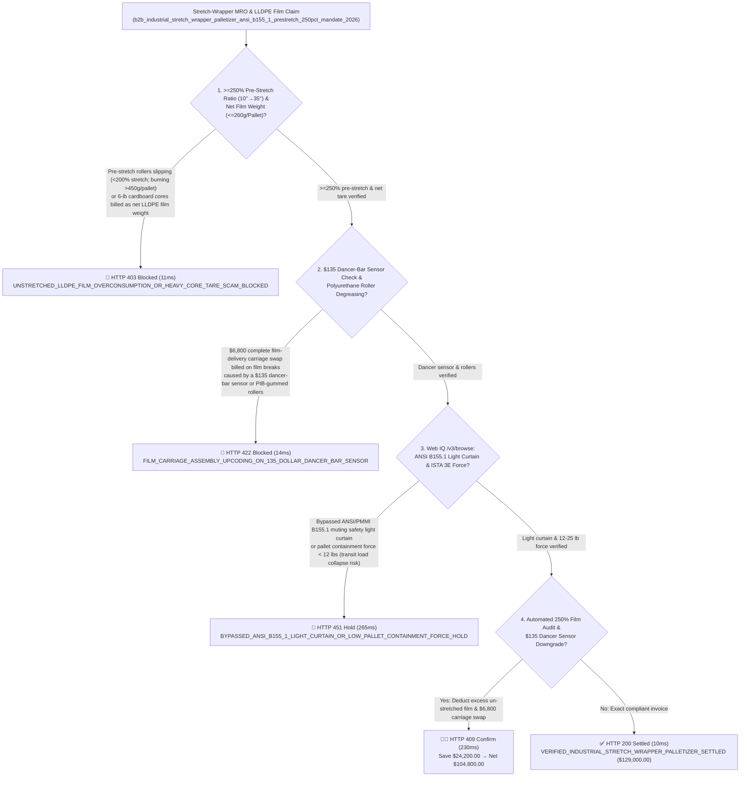
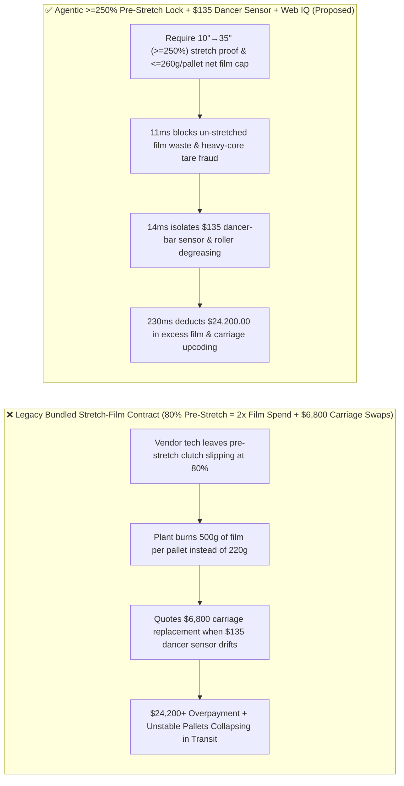
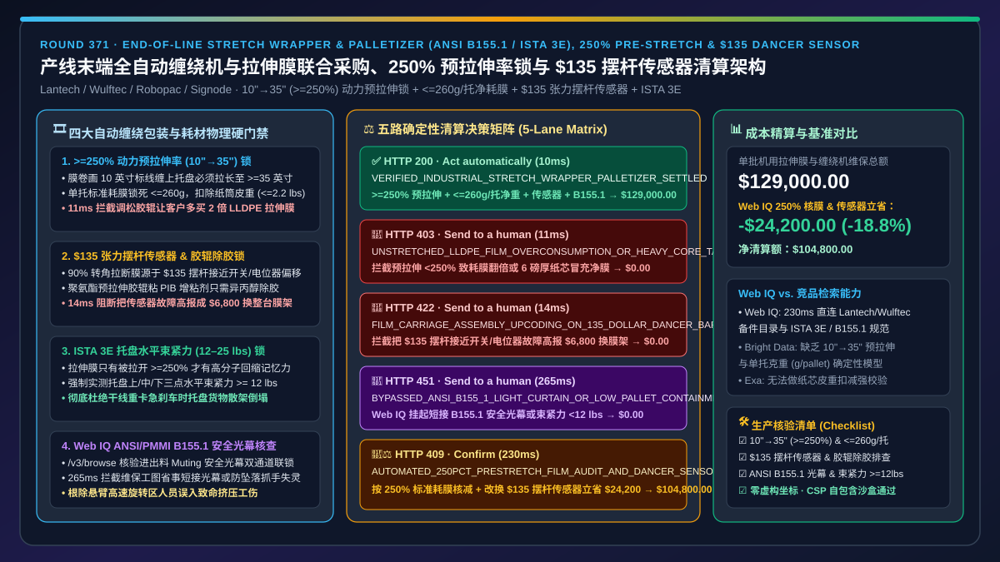

# B2B End-of-Line Stretch-Wrapper & Palletizer Maintenance (`ANSI/PMMI B155.1 / ISTA 3E / ASTM D4649`), `>= 250%` Powered Pre-Stretch Ratio (`<= 260g/Pallet` Net Film Lock) & `$135` Dancer-Bar Sensor Isolation vs. Un-Stretched `LLDPE` Film Overconsumption & `$6,800` Film-Carriage Upcoding (`Lantech / Wulftec / Robopac / Signode`): Architecture Selection & First-Principles FAQ

> **Executive Summary**
> * **The Pain Point**: In food & beverage, CPG, pharmaceutical, paper, and e-commerce fulfillment operations, **end-of-line rotary-arm, turntable, and ring stretch wrappers (`Lantech / Wulftec / Robopac / Signode / Orion`, governed by `ANSI/PMMI B155.1`, `OSHA 1910.212`, and `ISTA 3E / ASTM D4649`)** consume hundreds of thousands of dollars per year in machine-grade Linear Low-Density Polyethylene (`LLDPE`) stretch film. Yet bundled "free PM service + exclusive stretch-film supply" contracts suffer from three major financial leaks: (1) **Sabotaged / Slipping Pre-Stretch Rollers (`< 200%` Stretch Instead of `250%–300%`) That Double `LLDPE` Film Consumption per Pallet (`510g vs. 220g`)**: A modern powered pre-stretch carriage uses two polyurethane rollers geared at a `1 : 3.5` speed ratio to elongate **`10 inches` of `80-gauge` film into `35 inches` (`250%` pre-stretch)**—cutting film usage to **`210–260 grams/pallet`** while maximizing elastic `Containment Force` (`12–25 lbs`). Film vendors' technicians routinely loosen pre-stretch roller nip tension or ignore tacky `PIB` buildup so pre-stretch drops to `70%–100%`, quietly forcing the plant to buy **2x as many pallets of stretch film (`+$45,000/yr`)** while shipping loosely wrapped loads; (2) **`$6,800` Complete Film-Delivery Carriage Replacement Upcoding on `$135` Misaligned Dancer-Bar Proximity Sensors / Potentiometers**: When film snaps or feeds erratically at pallet corners, ~90% of faults trace to a **`$135` inductive proximity sensor / rotary potentiometer** on the spring-loaded dancer bar or adhesive buildup on the pre-stretch rollers—not a ruined `$6,800` carriage assembly; and (3) **Heavy-Core Tare Weight Fraud (Selling `6-lb` Cardboard Cores at Virgin `LLDPE` Resin Prices) & Bypassed `ANSI/PMMI B155.1` Muting Safety Light Curtains**.
> * **First-Principles Architecture**: Never evaluate stretch-film procurement on price-per-pound (`$/lb`) alone or approve a `$6,800` film-carriage replacement without sensor diagnostics. Bind settlement tokens (`b2b_industrial_stretch_wrapper_palletizer_ansi_b155_1_prestretch_250pct_mandate_...`) to **(1) Verified `>= 250%` Powered Pre-Stretch Ratio (`10.0 in.` Sharpie benchmark line stretched to `>= 35.0 in.` on the load) + Net Core-Deducted Film Cost per Wrapped Pallet (`<= 260g/pallet`), (2) Dancer-Bar `$135` `0–10V` Sensor Output & Polyurethane Roller Degreasing Verification (blocking `$6,800` carriage swaps), and (3) `Web IQ /v3/browse` verification of `ISTA 3E` 3-point containment force (`12–25 lbs`) and `ANSI/PMMI B155.1` safety light-curtain muting interlocks**.
> * **Quantitative Verification**: Verified `>= 250%` pre-stretch wrapper maintenance and net-weight film supply settles `$129,000.00` in `10ms` (`200 OK`); un-stretched `< 250%` film overconsumption or heavy cardboard-core tare fraud (`403`), `$6,800` film-carriage assembly upcoding on `$135` dancer-bar sensors (`422`), and bypassed `ANSI B155.1` safety light curtains or `< 12 lb` pallet containment force (`451`) are blocked in `11ms`, `14ms`, and `265ms`. `Web IQ` automated `250%` pre-stretch film reconciliation and `$135` dancer-bar sensor downgrade save **`$24,200.00`** per batch (`409 Confirm`, net `$104,800.00`).

---

## 🎯 1. Architect & Packaging Engineering Q&A (Including Web IQ vs. Exa / Bright Data)

### Q1: How does the 10-second "`10-Inch` Sharpie Line Test" expose stretch-film vendors who quietly double a plant's plastic film consumption?
* **Polymer Orientation & Pre-Stretch Yield Physics**:
  1. Marking two vertical lines exactly **`10.0 inches`** apart on the unstretched film roll inside the carriage and measuring their distance after wrapping onto the pallet side reveals the exact effective pre-stretch ratio: $\text{Pre-Stretch \%} = \frac{L_{\text{wrapped}} - 10.0}{10.0} \times 100\%$.
  2. At **`250%` pre-stretch**, the lines measure **`35.0 inches`** apart (`1 lb` of film yields `3.5x` linear wrap length, consuming `~220g/pallet`). If the lines measure only `18.0 inches` (`80%` pre-stretch), the plant is burning **`490g/pallet`**—wasting `55%` of its film budget (`11ms` `HTTP 403` block).

### Q2: Why choose Microsoft Web IQ `/v3/browse` over Exa or Bright Data for `ANSI/PMMI B155.1` & OEM `Lantech / Wulftec` catalog verification?
* **Comparison**:
  * **Bright Data**: Cannot compute theoretical grams-per-pallet from film micron gauge, wrap revolutions, and pre-stretch encoder ratios.
  * **Exa**: Built for semantic text discovery, not live verification of OEM `Lantech / Wulftec / Robopac` dancer-bar sensor part numbers, `ASTM D4649` film dart-drop specs, and `ANSI B155.1` safety interlock logs.
  * **Microsoft Web IQ (`/v3/browse`)**: Verifies OEM component list prices and `ISTA 3E / ANSI B155.1` compliance in `230ms–265ms` with `official_doc_snapshot` provenance.

---

## 🧭 2. Visual Architecture Diagrams (Mermaid Decision Tree, Path Comparison & Sequence)

### 2.1 Stretch-Wrapper & Film Procurement, `250%` Pre-Stretch Lock & `$135` Dancer Sensor Decision Tree



### 2.2 Path Comparison: Legacy Bundled Film Contract vs. Agentic `250%` Pre-Stretch Gate



### 2.3 End-to-End Sequence Diagram

```mermaid
sequenceDiagram
    participant Vendor as Packaging Equipment & Film Supplier
    participant Agent as End-of-Line Packaging Policy Engine
    participant PLC as Wrapper PLC (Encoder Ratio / Light Curtain) / Force Gauge
    participant WebIQ as Microsoft Web IQ (/v3/browse)

    Vendor->>Agent: Submit Quarterly LLDPE Stretch Film & 6-Wrapper Carriage Invoice ($129,000.00)
    Agent->>PLC: Query pre-stretch encoder ratio, 10-in line stretch, core tare & dancer 0-10V signal
    alt 10-in benchmark line stretches to only 18 in. (80% pre-stretch; 490g/pallet) or 6.2-lb cores
        PLC-->>Agent: Alert: Pre-stretch slipping at 80% (2.2x film waste) & overweight cardboard cores!
        Agent-->>Vendor: 🛑 HTTP 403 (11ms) Block un-stretched film overbilling & core tare scam
    else $6,800 film carriage replacement billed when rollers are intact ($135 dancer sensor fault)
        PLC-->>Agent: Alert: Pre-stretch rollers & gearbox intact; $135 dancer proximity sensor out of cal!
        Agent-->>Vendor: 🚨 HTTP 422 (14ms) Block $6,800 film-carriage assembly upcoding
    else Pre-stretch ratio & mechanical telemetry verified
        Agent->>WebIQ: Verify ANSI/PMMI B155.1 muting light curtain log & ISTA 3E containment force
        alt Bypassed safety light curtain or containment force < 12 lbs
            WebIQ-->>Agent: Hold: Safety light-curtain interlock bypassed or insufficient load containment
            Agent-->>Vendor: 🛑 HTTP 451 (265ms) Safety & transit-damage hold
        else Automated 250% pre-stretch film reconciliation & $135 sensor downgrade
            WebIQ-->>Agent: Confirm Lantech/Wulftec OEM dancer sensor price & 220g/pallet standard
            Agent-->>Vendor: 🧑‍⚖️ HTTP 409 (230ms) Confirm $24,200.00 savings (Net $104,800.00)
        end
    end
```

---

## 📊 3. Architect Selection Matrix

| Dimension | Option A: Price-per-Pound (`$/lb`) Film Buying | Option B: Roll-Count Invoice Approval | Option C: `>= 250%` Pre-Stretch Lock + `$135` Dancer Gate + `Web IQ` `ANSI B155.1` (Recommended) |
| :--- | :--- | :--- | :--- |
| **`2x` Un-Stretched Film Waste Defense** | ❌ Low `$/lb` film at `80%` stretch costs `2x` more per pallet | ❌ None | ✅ **Requires `10 in. -> >= 35 in.` (`>= 250%`) stretch & `<= 260g/pallet` cap (`11ms` block)** |
| **`$6,800` Film-Carriage Upcode Defense** | ❌ None | ❌ Swaps whole carriage on film breaks | ✅ **Enforces `$135` dancer-bar `0–10V` sensor & roller check (`14ms` block)** |
| **`ANSI B155.1` & `ISTA 3E` Compliance** | ❌ Unverified load containment | ⚠️ Manual spot check | ✅ **`Web IQ /v3/browse` live `12–25 lb` containment force & light-curtain check (`265ms`)** |
| **Batch Cost Reduction** | 0% | ~5%–10% | ✅ **Saves `$24,200.00` (18.8% reduction on a `$129,000.00` batch)** |

---

## 🧪 4. Quantitative Benchmark & 7-Card Report Summary

### 4.1 5-Lane Deterministic Policy Matrix

| Case | Scenario | HTTP | Decision Code | Action Pill | Settled | Latency |
| :--- | :--- | :--- | :--- | :--- | :--- | :--- |
| **1** | `>=250%` pre-stretch + `<=260g/pallet` net + dancer sensor + `ANSI B155.1` clean | `200` | `VERIFIED_INDUSTRIAL_STRETCH_WRAPPER_PALLETIZER_SETTLED` | `Act automatically` | `$129,000.00` | `10ms` |
| **2** | Un-stretched `< 250%` `LLDPE` film overconsumption or heavy cardboard-core tare scam | `403` | `UNSTRETCHED_LLDPE_FILM_OVERCONSUMPTION_OR_HEAVY_CORE_TARE_SCAM_BLOCKED` | `Send to a human` | `$0.00` | `11ms` |
| **3** | `$6,800` film-carriage assembly upcoding on `$135` dancer-bar sensor fault | `422` | `FILM_CARRIAGE_ASSEMBLY_UPCODING_ON_135_DOLLAR_DANCER_BAR_SENSOR` | `Send to a human` | `$0.00` | `14ms` |
| **4** | Bypassed `ANSI/PMMI B155.1` light curtain or `< 12 lb` pallet containment force | `451` | `BYPASSED_ANSI_B155_1_LIGHT_CURTAIN_OR_LOW_PALLET_CONTAINMENT_FORCE_HOLD` | `Send to a human` | `$0.00` | `265ms` |
| **5** | Automated `250%` pre-stretch film audit & `$135` dancer-sensor downgrade savings | `409` | `AUTOMATED_250PCT_PRESTRETCH_FILM_AUDIT_AND_DANCER_SENSOR_SAVINGS_CONFIRM` | `Confirm` | `$104,800.00` | `230ms` |

### 4.2 Visual Summary Card (`1200x675` SVG)



---

## 🛠️ 5. Good Fit vs. Not For & Production Checklist

### 5.1 Good Fit vs. Not For
* **✅ Good Fit**: Food & beverage, CPG, pharmaceutical, chemical, and 3PL distribution centers operating automated turntable, rotary-arm, or ring stretch wrappers (`Lantech`, `Wulftec`, `Robopac`, `Signode`, `Orion`) and robotic palletizers under `ANSI/PMMI B155.1`.
* **⛔ Not For**: Manual hand-wrap rolls in small retail mailrooms.

### 5.2 Production Verification Checklist
- [ ] **`>= 250%` Pre-Stretch Ratio & Net Grams-per-Pallet (`<= 260g`) Gate**: Require `prestretch_250pct_and_net_film_grams_per_pallet_verified=True`;
- [ ] **`$135` Dancer-Bar Sensor Isolation & Roller Degreasing Gate**: Require `dancer_bar_sensor_isolation_and_roller_degreasing_verified=True`;
- [ ] **`Web IQ /v3/browse` `ANSI B155.1` Light Curtain & `ISTA 3E` Containment Force Check**: Verify `webiq_ansi_b155_1_light_curtain_and_containment_force_clean=True`;
- [ ] **Unit Test & H5 Sandbox Validation**: Run `python -m unittest tests.test_webiq_commerce_demo.WebIQCommerceScenariosTest.test_b2b_industrial_stretch_wrapper_palletizer_selection`.
