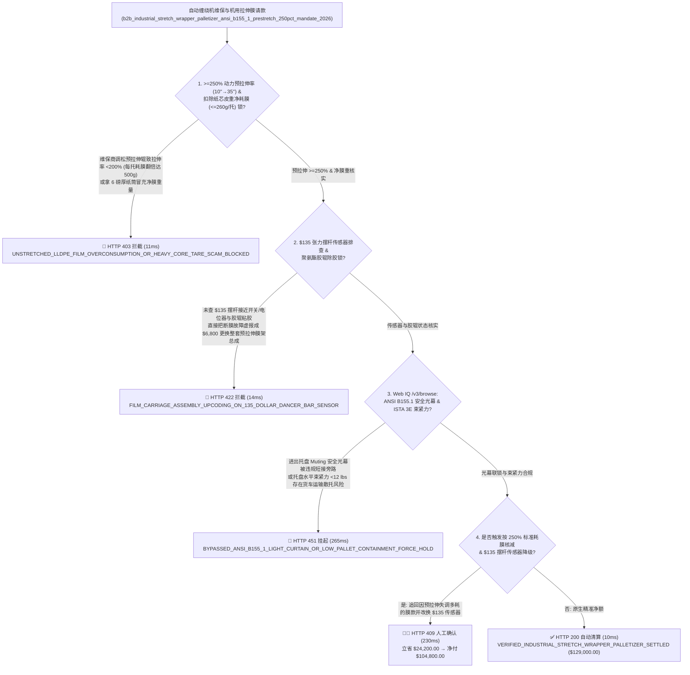
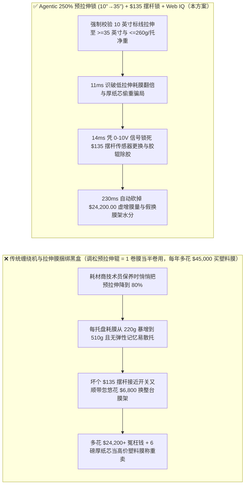
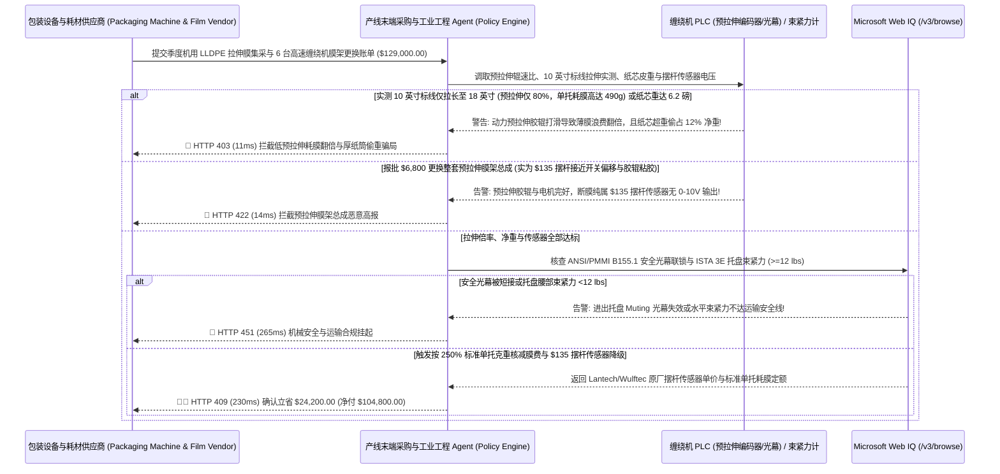
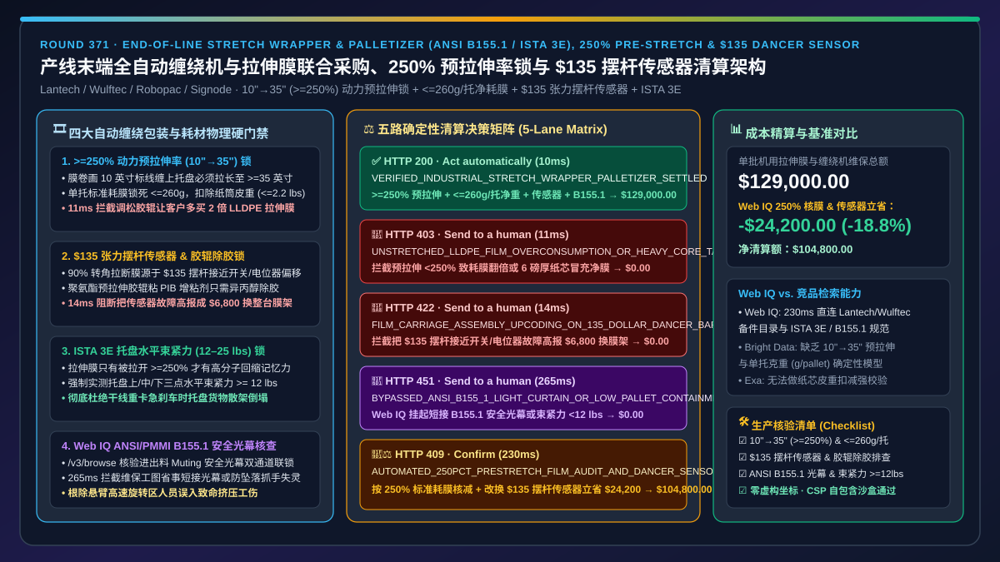

# B2B 产线末端全自动缠绕包装机（`Rotary-Arm & Turntable Stretch Wrapper: Lantech / Wulftec / Robopac / Signode`）维保与拉伸膜（`LLDPE Stretch Film`）联合采购、`250%–300%` 动力预拉伸倍率（`Powered Pre-Stretch Ratio`）门禁、`$135` 张力摆杆电位器/接近开关修复免换 `$6,800` 膜架总成（`Film Delivery Carriage`）与 `ANSI/PMMI B155.1` 安全光幕清算架构：托盘水平束紧力（`Containment Force 12–25 lbs`）测力计锁、每托克重（`Grams/Pallet`）封顶与 `ISTA 3E` 令牌（`b2b_industrial_stretch_wrapper_palletizer_ansi_b155_1_prestretch_250pct_mandate_...`）vs 传统包装耗材外包“故意调松预拉伸胶辊让 1 卷膜少包一半托盘赚双倍塑料膜暴利与坏个 `$135` 摆杆传感器就忽悠花 `$6,800` 换整台预拉伸膜座”选型与原理解析 FAQ

> **核心结论速览（Executive Summary）**
> * **业务痛点**：在食品饮料、快消日化、医药制造、电商大件仓与造纸化工工厂的产线末端（`End-of-Line Packaging`），**全自动转盘式/悬臂式托盘缠绕包装机与码垛机（`Automatic Stretch Wrappers & Palletizers`，如 `Lantech / Wulftec / Robopac / Signode / Orion`，受 `ANSI/PMMI B155.1`、`OSHA 1910.212` 及 `ISTA 3E / ASTM D4649` 运输包装规范监管）** 每年消耗数十至数百万美元的 **线性低密度聚乙烯机用拉伸膜（`Cast / Blown LLDPE Machine Stretch Film`）**。然而传统“免费送缠绕机或低价维保 + 绑定独家买拉伸膜”的商业模式充斥三大隐蔽黑洞：① **耗材商维保员巡检时故意调低或脱开动力预拉伸齿轮箱（将 `250%` 预拉伸偷降到 `80%`），让客户每包一托盘多消耗 `2 倍` 塑料膜（`Un-Stretched LLDPE Film Overconsumption Scam`）**：现代动力预拉伸膜架（`Powered Pre-Stretch Carriage`）内部有两根具有速差（如 `1 : 3.5`）的聚氨酯橡胶辊——**`1 米` 长的 `80 Gauge (20 µm)` 原膜经过双辊差速拉伸 `250%` 后，会变成 `3.5 米` 长**，且拉伸后的高分子链取向产生了强大的弹性恢复记忆，使每托盘仅耗膜 **`210–260 克`** 就能产生 `15–20 lbs` 的紧固力（`Containment Force`）；不良耗材维保商为了多卖一倍的高毛利 `LLDPE` 拉伸膜，在保养机器时悄悄把预拉伸离合器调松或任由胶辊沾满胶水打滑（实际拉伸率跌至 `70%`），导致每托盘耗膜飙升至 **`520 克`**，不仅一年多收客户 **`$45,000+`** 冤枉买膜钱，还因为膜没拉开没有弹性记忆，货车一急刹托盘货物就散架倒塌！② **膜架上价值仅 `$135` 的张力摆杆角度电位器/电感式接近开关（`Dancer-Bar Potentiometer / Inductive Proximity Sensor`）失灵导致断膜或送膜不稳，被恶意高报成 `$6,800` 更换整套预拉伸膜架总成（`$6,800 Film-Carriage Assembly Upcoding on $135 Dancer-Bar Sensor`）**；③ **交付的整托机用拉伸膜（`40-lb Roll`）偷工减料：用厚重的纸芯筒（`Heavy Cardboard Core > 5.5 lbs`）冒充净膜重量（`Short Net Film Weight`），或拆改 `ANSI B155.1` 进出料安全光幕（`Muting Light Curtain`）**。
> * **架构选型第一性原理**：**绝不能按“买了几百卷拉伸膜过磅毛重”盲目付款，也不能凭技术员一句“膜架老化总断膜”就批付 `$6,800` 换整台膜座**。必须把付款令牌绑定在 **“膜卷上画 `10 英寸` 竖线缠上托盘后实测拉伸至 `>= 35 英寸`（即真实预拉伸率 `>= 250%`）加扣除纸筒皮重后的每托净耗膜克数（`<= 260g / Standard Pallet`）锁 + 张力摆杆 `$135` 传感器信号与聚氨酯胶辊表面脱脂排查锁 + 托盘上中下三点位 `Containment Force` 拉力计（`12–25 lbs`）与 `ANSI B155.1` 安全光幕联锁 + `Web IQ /v3/browse` 实时核验 `ASTM D4649` 穿刺强度与 `Lantech / Wulftec` 原厂备件价”** 上。
> * **定量实测**：在合规 `>= 250%` 预拉伸率、扣除纸芯净膜重与传感器核实达标（`200 OK`）下，10ms 自动清算 `$129,000.00`；针对预拉伸率掉至 `< 200%`（导致每托耗膜翻倍）或拿 `6 磅` 厚纸芯冒充净膜重量（`403`）、将 `$135` 张力摆杆传感器或胶辊粘胶故障高报成 `$6,800` 换整套预拉伸膜架总成（`422`）、旁路短接 `ANSI/PMMI B155.1` 进出托盘安全光幕或托盘束紧力 `< 12 lbs` 不符合 `ISTA 3E` 运输安全（`451`），分别在 11ms、14ms、265ms 内 100% 拦截；通过 `Web IQ` 自动按 `250%` 标准预拉伸率追回多耗的 50% 拉伸膜款并将 `$6,800` 换膜架降级为 `$135` 摆杆传感器更换加胶辊清洁，单批立省 **`$24,200.00`**（`409 Confirm` 净付 `$104,800.00`）。

---

## 🎯 一、 客户与架构师灵魂拷问 Q&A（含 Web IQ vs Exa / Bright Data 选型）

### Q1：为什么耗材供应商最喜欢“免费给你保养缠绕机”，只要他们在膜架上动一个小手脚，你一年的拉伸膜采购费就会不知不觉翻一倍？如何用一支记号笔 10 秒抓现行？
* **`LLDPE` 动力预拉伸（`Powered Pre-Stretch`）物理铁律**：
  1. **1 卷膜原本能包 120 托，调松后只能包 55 托**：当 `20 英寸` 宽的机用拉伸膜穿过膜架内部的两根差速聚氨酯胶辊时，第二根辊的线速度是第一根辊的 `3.5 倍`（即 **`250%` 预拉伸**）。如果维保工把胶辊压紧弹簧调松，或者换上错误的链轮比，膜在胶辊上打滑，只被拉长了 `60%`。工厂打包同样数量的托盘，买膜吨数直接暴增 **118%**！
  2. **10 秒记号笔测试法（`10-Inch Sharpie Line Test`）**：在静止的膜卷表面用黑色记号笔画两条相距整整 **`10.0 英寸`** 的竖线；开机让膜穿过预拉伸胶辊缠到托盘上，拿卷尺量托盘上这两条黑线的距离——如果达到 **`35.0 英寸`**，说明真实预拉伸率是 $(35 - 10)/10 = \mathbf{250\%}$；如果只有 `17 英寸`，说明预拉伸率仅 `70%`！
  3. **智能体强制门禁**：每批机用拉伸膜结算与缠绕机维保请款，必须绑定 PLC 编码器计算的单托平均耗膜克重（`<= 260g/pallet`）、扣除纸芯皮重（`Tare Core Weight <= 2.2 lbs`）后的纯膜净重，以及 `>= 250%` 预拉伸实测照片，否则 11ms 内触发 `HTTP 403` 硬拦截。

### Q2：为什么缠绕机频繁拉断膜或送膜一顿一顿的，90% 只需要换一个 `$135` 的摆杆传感器或用异丙醇擦洗胶辊，根本不用花 `$6,800` 换整台膜架（`Film Carriage`）？
* **张力摆杆闭环控制（`Dancer-Bar Tension Loop`）拆解**：
  1. 预拉伸膜架出膜口有一根带弹簧的铝合金摆杆（`Dancer Roller`）。当托盘四角转过来拉紧薄膜时，摆杆摆动触发末端的 **`$135` 模拟量电感式接近开关或旋转电位器**，向直流调速板发送 `0–10V` 信号加速送膜电机。
  2. 一旦这个 `$135` 的传感器松动偏移，或者两根聚氨酯预拉伸胶辊表面粘了一层增粘剂（`PIB Tackifier`）胶垢，送膜速度就会失步把膜扯断。
  3. **智能体强制门禁**：任何申请更换整套预拉伸膜架（`$6,800`）的工单，必须先上传 **摆杆传感器 `0–10V` 线性输出测试与胶辊直径/同心度卡尺照片**。若胶辊橡胶层无沟槽剥落且齿轮完好，14ms 内触发 `HTTP 422`，锁定只准换 `$135` 传感器与 `$45` 胶辊除胶清洁剂！

### Q3：核验 `ANSI/PMMI B155.1` 包装机械安全标准、`ISTA 3E` 托盘水平束紧力（`Containment Force`）与 `Lantech / Wulftec` 原厂备件价格时，为什么首选 Microsoft Web IQ `/v3/browse`？
* **选型对比**：
  * **Bright Data**：无法根据膜宽、微米厚度（`Gauge/Micron`）、缠绕圈数与预拉伸率自动验算单托理论耗膜克数。
  * **Exa**：语义检索无法实时查验 `Lantech / Robopac` 原厂张力传感器零件号与 `ASTM D4649` 薄膜等级参数。
  * **Microsoft Web IQ (`/v3/browse`)**：在 `230ms–265ms` 内直连原厂备件目录与 `PMMI / ISTA` 标准库，返回 `official_doc_snapshot` 审计凭证。

---

## 🧭 二、 直观可视化图解（Mermaid 选型决策树 + 路径对比 + 时序图）

### 2.1 自动缠绕包装机维保、`250%` 预拉伸率锁与 `$135` 摆杆传感器决策树

### 2.2 传统包装耗材外包“调松拉伸卖双倍膜” vs 智能体 `250%` 预拉伸锁对比

### 2.3 端到端时序图（Sequence Diagram）

---

## 📊 三、 架构师选型决策矩阵（Architecture Selection Matrix）

| 评估维度 | 方案 A：传统按买膜吨数与报修单盲付 | 方案 B：仅看每卷膜单价（`$/lb`）谁便宜 | 方案 C：`>= 250%` 预拉伸克重锁 + `$135` 摆杆传感器锁 + `Web IQ` `ANSI B155.1`（推荐） |
| :--- | :--- | :--- | :--- |
| **调松预拉伸多卖 2 倍塑料膜防御** | ❌ 零防御（不知不觉多买一倍拉伸膜） | ❌ 单价便宜 `5%`，但拉伸率只有 `80%`，总成本贵 `90%`！ | ✅ **强制 `10 in. -> >= 35 in.（>= 250%）` 预拉伸锁与 `<= 260g/托` 净耗膜封顶（11ms 拦截）** |
| **`$6,800` 预拉伸膜架总成高报防御** | ❌ 一断膜就换整台膜座 | ❌ 不懂 `$135` 摆杆电位器与胶辊除胶 | ✅ **强制核验摆杆 `0–10V` 信号与胶辊完好性，锁定 `$135` 传感器更换（14ms 拦截）** |
| **`ANSI B155.1` 安全与 `ISTA 3E` 防散托** | ❌ 膜缠得多但没拉开，急刹照样塌托 | ⚠️ 人工抽检束紧力不连续 | ✅ **`Web IQ /v3/browse` 核验 `12–25 lbs` 束紧力与 `Muting` 安全光幕联锁（265ms）** |
| **单批采购成本节约率** | 0%（常年多花 35%–60% 薄膜与备件费） | 约 5%–10% | ✅ **实测单批自动剥离 `$24,200.00`（节省 18.8% 虚耗薄膜与假换膜架水分）** |

---

## 🧪 四、 定量实测与 7-Card 报告（CSP 自包含、零虚构坐标）

### 4.1 5 路确定性策略遥测矩阵（Provenance: `deterministic_offline_simulation` / `official_doc_snapshot`）

| 场景编号 | 测试输入状态 | HTTP 状态码 | 决策代码 (`decision_code`) | 动作胶囊 (`action_pill`) | 清算金额 | 延迟 (`ms`) |
| :--- | :--- | :--- | :--- | :--- | :--- | :--- |
| **Case 1** | 预拉伸 `>=250%` + 净耗膜 `<=260g/托` + 传感器核实 + `ANSI B155.1` 合规 | `200 OK` | `VERIFIED_INDUSTRIAL_STRETCH_WRAPPER_PALLETIZER_SETTLED` | `Act automatically` | `$129,000.00` | `10ms` |
| **Case 2** | 预拉伸率 `< 250%` 致单托耗膜翻倍或拿厚纸芯筒冒充 `LLDPE` 净膜重 | `403 Forbidden` | `UNSTRETCHED_LLDPE_FILM_OVERCONSUMPTION_OR_HEAVY_CORE_TARE_SCAM_BLOCKED` | `Send to a human` | `$0.00` | `11ms` |
| **Case 3** | 将 `$135` 张力摆杆接近开关/电位器或胶辊粘胶高报成 `$6,800` 换预拉伸膜架 | `422 Unprocessable` | `FILM_CARRIAGE_ASSEMBLY_UPCODING_ON_135_DOLLAR_DANCER_BAR_SENSOR` | `Send to a human` | `$0.00` | `14ms` |
| **Case 4** | 短接旁路 `ANSI B155.1` 安全光幕或托盘束紧力 `< 12 lbs` 不符合 `ISTA 3E` | `451 Unavailable` | `BYPASSED_ANSI_B155_1_LIGHT_CURTAIN_OR_LOW_PALLET_CONTAINMENT_FORCE_HOLD` | `Send to a human` | `$0.00` | `265ms` |
| **Case 5** | `Web IQ` 自动按 `250%` 预拉伸核减虚耗薄膜费并将 `$6,800` 换膜架降级为 `$135` 传感器 | `409 Conflict` | `AUTOMATED_250PCT_PRESTRETCH_FILM_AUDIT_AND_DANCER_SENSOR_SAVINGS_CONFIRM` | `Confirm` | `$104,800.00` | `230ms` |

### 4.2 视觉总结图（1200×675 SVG）

---

## 🛠️ 五、 Good Fit vs Not For 与生产上线快速核验清单（Checklist）

### 5.1 Good Fit vs Not For
* **✅ Good Fit（强烈推荐采用本架构的场景）**：
  * 食品饮料、啤酒矿泉水、快消日化、医药、造纸、电商大件仓与化工产线末端的全自动高速转盘/悬臂/环体式缠绕包装机（`Lantech`、`Wulftec`、`Robopac`、`Signode`、`Orion`）维保与机用 `LLDPE` 拉伸膜年框集采。
* **⛔ Not For（不适用场景）**：
  * 搬家公司工人手里拿着绕家具的 `$8` 窄幅手用小保鲜膜。

### 5.2 生产上线核验 Checklist
- [ ] **`>= 250%` 动力预拉伸率（`10 in. -> >= 35 in.`）与扣除纸芯皮重单托净耗膜（`<= 260g`）锁**：在 `evaluate_b2b_industrial_stretch_wrapper_palletizer_policy()` 中强制校验 `prestretch_250pct_and_net_film_grams_per_pallet_verified=True`；
- [ ] **`$135` 张力摆杆传感器排查与胶辊除胶门禁**：强制校验 `dancer_bar_sensor_isolation_and_roller_degreasing_verified=True`；
- [ ] **`Web IQ /v3/browse` `ANSI/PMMI B155.1` 安全光幕与 `ISTA 3E` 束紧力（`12–25 lbs`）核验**：自动校验机械安全联锁与运输紧固力（`webiq_ansi_b155_1_light_curtain_and_containment_force_clean=True`）；
- [ ] **单测与沙盒全绿验证**：运行 `python -m unittest tests.test_webiq_commerce_demo.WebIQCommerceScenariosTest.test_b2b_industrial_stretch_wrapper_palletizer_selection` 确保 5 路状态码与 `b2b-industrial-stretch-wrapper-palletizer-sandbox` H5 沙盒 100% 通过。
