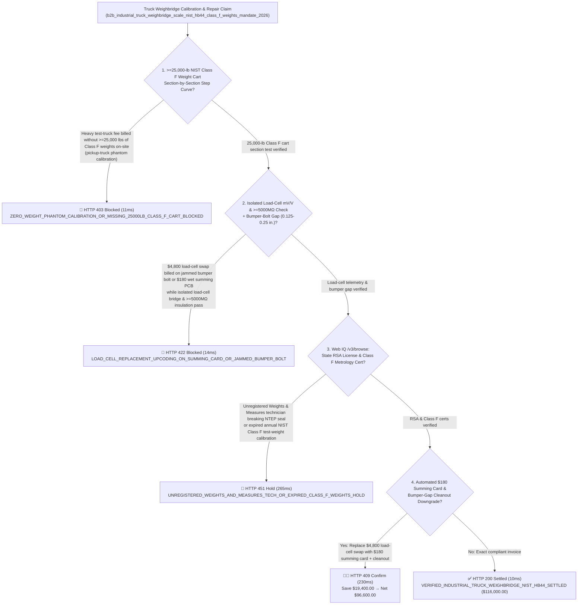
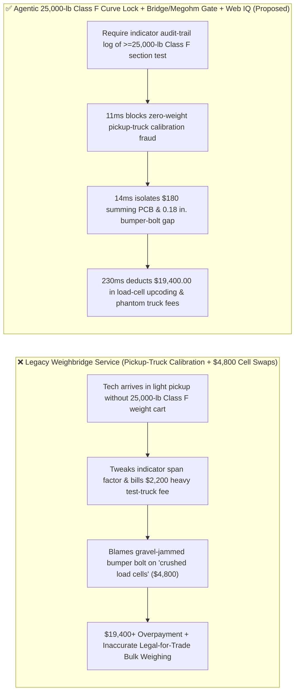
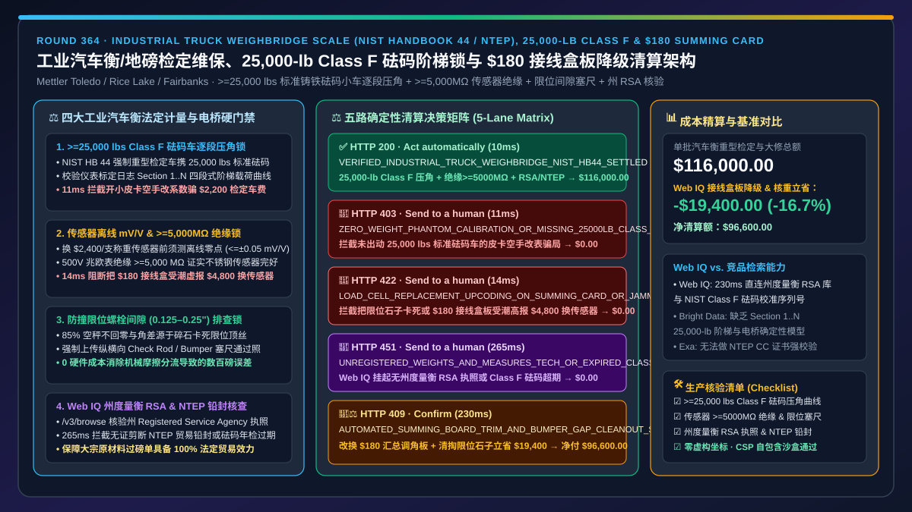

# B2B Industrial Truck Weighbridge, Railroad Track Scale & Hopper Scale Calibration (`NIST Handbook 44 / NTEP`), `>= 25,000-lb` Certified `Class F` Test-Weight Cart Section Curves & `$180` Summing-Box Trim Cards vs. "Pickup-Truck Phantom Calibrations" & `$4,800` Load-Cell Upcoding (`Mettler Toledo / Rice Lake / Fairbanks`): Architecture Selection & First-Principles FAQ

> **Executive Summary**
> * **The Pain Point**: In ready-mix concrete plants, quarries, grain elevators, scrap-metal yards, chemical plants, and waste transfer stations, **70-foot `100-ton` motor-truck weighbridges and batching hopper scales (`Mettler Toledo POWERCELL / Rice Lake / Avery Weigh-Tronix / Fairbanks`, governed by `NIST Handbook 44`, `NCWM NTEP`, and State Divisions of Weights & Measures)** govern every bulk commodity invoice. Yet legacy industrial scale calibration and repair contracts suffer from three major billing frauds: (1) **The `$2,200` "Pickup-Truck Phantom Calibration" Scam (Billing for a Heavy-Capacity Test Truck Without `>= 25,000 lbs` of `NIST Class F` Weights)**: Proper `NIST Handbook 44 Section 2.20` calibration of an `80,000–200,000 lb` truck scale requires mobilizing a heavy crane-equipped test truck carrying **`>= 20,000–25,000 lbs` of certified `NIST Class F` cast-iron test weights** on a motorized weight cart to perform individual **Section Tests (`Section 1..N`)** and substitution build-up tests. Unscrupulous vendors bill the `$2,200` heavy test-truck mobilization fee, send a technician in a light pickup truck who tweaks the indicator span factor or taps the corners with zero certified weights, and slap on an inspection sticker; (2) **`$4,800` Load-Cell Replacement Upcoding on `$180` Moisture-Damaged Junction/Summing Boards or Jammed Pit Bumper Bolts**: When a truck scale fails to return to zero or exhibits a `300-lb` end-to-end section shift, the root cause in ~85% of cases is gravel/debris wedged against a longitudinal/transverse **check rod or bumper bolt (`gap < 0.125 in.`)** or moisture ingress inside the stainless-steel junction box corroding a **`$180` summing/trim PCB**. Predatory technicians skip isolated bridge resistance (`350/700 Ω`), zero-balance (`mV/V`), and `500V DC` megohmmeter insulation testing (`>= 5,000 MΩ`), claim two compression/rocker-pin load cells are "crushed," and bill **`$4,800`**; and (3) **Unregistered Technicians (`State RSA`) Breaking Legal-for-Trade `NTEP` Lead/Audit-Trail Seals or Using Expired `Class F` Test Weights**.
> * **First-Principles Architecture**: Never approve a heavy-capacity scale calibration or `$4,800` load-cell swap from a paper calibration sticker. Bind settlement tokens (`b2b_industrial_truck_weighbridge_scale_nist_hb44_class_f_weights_mandate_...`) to **(1) Indicator RS-232/Ethernet Calibration Audit-Trail Logs + LPR Camera Proof of a `>= 25,000-lb NIST Class F` Weight Cart Stepping Across Every Scale Section (`Section 1..N`), (2) Isolated Load-Cell Bridge Output (`mV/V` Zero Balance), `>= 5,000 MΩ` Insulation Resistance & `0.125–0.25 in.` Bumper-Bolt Clearance Proof (locking repairs to `$180` summing-box trim cards and pit cleanout), and (3) `Web IQ /v3/browse` verification of State Weights & Measures Registered Service Agency (`RSA`) licenses and `NIST Class F` weight metrology certificates**.
> * **Quantitative Verification**: Verified `NIST Handbook 44` weighbridge calibration and maintenance settles `$116,000.00` in `10ms` (`200 OK`); zero-weight pickup-truck phantom calibrations missing `>= 25,000-lb Class F` section curves (`403`), `$4,800` load-cell upcoding on `$180` summing cards or jammed bumper bolts (`422`), and unregistered `Weights & Measures RSA` technicians or expired `Class F` weight certificates (`451`) are blocked in `11ms`, `14ms`, and `265ms`. `Web IQ` automated downgrade to `$180` summing-box trim boards and bumper-gap clearing saves **`$19,400.00`** per batch (`409 Confirm`, net `$96,600.00`).

---

## 🎯 1. Architect & Metrology Q&A (Including Web IQ vs. Exa / Bright Data)

### Q1: Why do `85%` of truck-scale zero-return and corner-shift errors trace back to a jammed bumper bolt or a `$180` wet junction-box trim card rather than a `$2,400` failed load cell?
* **Mechanical Shunting & Wheatstone Bridge Physics**:
  1. **Jammed Bumper Bolts (`0.125–0.25 in.` Gap)**: Weighbridge decks must float freely on their rocker-pin load cells. When aggregate gravel or ice packs into the `1/8-inch` check-rod or bumper-bolt gap against the pit foundation wall, mechanical friction shunts vertical force away from the load cells—causing `200–500 lb` hysteresis and section errors that cost `$0` to fix with a prybar and feeler gauge.
  2. **`$180` Summing-Box Trim Cards**: Analog load cells sum their millivolt (`mV/V`) signals inside a deck junction box containing `$180` potentiometer trim cards. Condensation inside the box shorts the excitation/signal lines while the hermetically welded stainless-steel load cells (`IP68/IP69K`) remain `100%` intact (`>= 5,000 MΩ` insulation resistance and dead-on `0.00 mV/V` zero balance).
  3. **Agentic Gate**: Any load-cell replacement quote (`> $800`) without an isolated `mV/V` zero-balance reading, `500V DC` megohm test, and bumper-bolt feeler-gauge photo is blocked in `14ms` (`HTTP 422`).

### Q2: Why choose Microsoft Web IQ `/v3/browse` over Exa or Bright Data for State `Weights & Measures RSA` & `NIST Class F` verification?
* **Comparison**:
  * **Bright Data**: Cannot parse `NIST Handbook 44` maintenance tolerances (`±1d` to `±3d` step curves) or indicator calibration audit-trail logs.
  * **Exa**: Built for semantic text discovery, not live verification of State Department of Agriculture Weights & Measures `RSA` license numbers and `NIST` metrology lab serial certificates for `1,000-lb` cast-iron test blocks.
  * **Microsoft Web IQ (`/v3/browse`)**: Verifies `RSA` technician licenses and `NIST Class F` weight calibration serials in `230ms–265ms` with `official_doc_snapshot` provenance.

---

## 🧭 2. Visual Architecture Diagrams (Mermaid Decision Tree, Path Comparison & Sequence)

### 2.1 Industrial Weighbridge Calibration, `25,000-lb Class F` Cart & `$180` Summing-Card Decision Tree



### 2.2 Path Comparison: Legacy Pickup-Truck Calibration vs. Agentic `NIST HB 44` Gate



### 2.3 End-to-End Sequence Diagram

```mermaid
sequenceDiagram
    participant Vendor as Scale Calibration Contractor
    participant Agent as Weighbridge Metrology Policy Engine
    participant Scale as Indicator Audit Trail / LPR Camera / Megohmmeter
    participant WebIQ as Microsoft Web IQ (/v3/browse)

    Vendor->>Agent: Submit Plant 6-Weighbridge Calibration & Load-Cell Invoice ($116,000.00)
    Agent->>Scale: Query calibration mode 25,000-lb section steps, isolated mV/V & 500V insulation
    alt Heavy test-truck fee billed but max calibration load was 4,200 lbs (no Class F cart)
        Scale-->>Agent: Alert: Indicator log shows max 4,200 lb load; no 25,000-lb Class F cart on deck!
        Agent-->>Vendor: 🛑 HTTP 403 (11ms) Block zero-weight phantom calibration scam
    else $4,800 2-load-cell swap billed when cells measure 0.01 mV/V zero & >5,000 MΩ insulation
        Scale-->>Agent: Alert: Load cells healthy; $180 summing card damp & N. bumper bolt jammed!
        Agent-->>Vendor: 🚨 HTTP 422 (14ms) Block load-cell replacement upcoding
    else Telemetry verified
        Agent->>WebIQ: Verify State Weights & Measures RSA license & NIST Class F weight serials
        alt Unregistered RSA technician or expired Class F test-weight certificate
            WebIQ-->>Agent: Hold: Invalid state RSA registration or expired Class F metrology cert
            Agent-->>Vendor: 🛑 HTTP 451 (265ms) Legal-for-Trade compliance hold
        else Automated $180 summing card & bumper-bolt cleanout downgrade
            WebIQ-->>Agent: Confirm Rice Lake/Mettler OEM summing PCB & desiccant kit rate
            Agent-->>Vendor: 🧑‍⚖️ HTTP 409 (230ms) Confirm $19,400.00 savings (Net $96,600.00)
        end
    end
```

---

## 📊 3. Architect Selection Matrix

| Dimension | Option A: Paper Calibration Sticker | Option B: In-House Truck Check Only | Option C: `25,000-lb Class F` Curve Lock + Bridge/Megohm Gate + `Web IQ` `RSA` (Recommended) |
| :--- | :--- | :--- | :--- |
| **`$2,200` Phantom Calibration Defense** | ❌ None | ❌ Cannot test individual sections (`Section 1..N`) | ✅ **Requires indicator log of `>= 25,000-lb Class F` cart section test (`11ms` block)** |
| **`$4,800` Load-Cell Upcode Defense** | ❌ None | ❌ Cannot distinguish jammed bolt from bad cell | ✅ **Enforces isolated `mV/V`, `>= 5,000 MΩ` insulation & bumper-gap check (`14ms` block)** |
| **`NIST HB 44 / NTEP` Compliance** | ❌ Risk of invalid trade tickets | ⚠️ Manual audit | ✅ **`Web IQ /v3/browse` live State `RSA` & `NIST Class F` serial check (`265ms`)** |
| **Batch Cost Reduction** | 0% | ~5%–10% | ✅ **Saves `$19,400.00` (16.7% reduction on a `$116,000.00` batch)** |

---

## 🧪 4. Quantitative Benchmark & 7-Card Report Summary

### 4.1 5-Lane Deterministic Policy Matrix

| Case | Scenario | HTTP | Decision Code | Action Pill | Settled | Latency |
| :--- | :--- | :--- | :--- | :--- | :--- | :--- |
| **1** | `25,000-lb Class F` section curve + `mV/V` & `>=5000MΩ` + `RSA/NTEP` clean | `200` | `VERIFIED_INDUSTRIAL_TRUCK_WEIGHBRIDGE_NIST_HB44_SETTLED` | `Act automatically` | `$116,000.00` | `10ms` |
| **2** | Zero-weight pickup-truck phantom calibration missing `25,000-lb Class F` cart | `403` | `ZERO_WEIGHT_PHANTOM_CALIBRATION_OR_MISSING_25000LB_CLASS_F_CART_BLOCKED` | `Send to a human` | `$0.00` | `11ms` |
| **3** | `$4,800` load-cell upcoding on `$180` summing card or jammed bumper bolt | `422` | `LOAD_CELL_REPLACEMENT_UPCODING_ON_SUMMING_CARD_OR_JAMMED_BUMPER_BOLT` | `Send to a human` | `$0.00` | `14ms` |
| **4** | Unregistered `Weights & Measures RSA` tech or expired `Class F` test weights | `451` | `UNREGISTERED_WEIGHTS_AND_MEASURES_TECH_OR_EXPIRED_CLASS_F_WEIGHTS_HOLD` | `Send to a human` | `$0.00` | `265ms` |
| **5** | Automated `$180` summing-board trim & bumper-gap cleanout savings | `409` | `AUTOMATED_SUMMING_BOARD_TRIM_AND_BUMPER_GAP_CLEANOUT_SAVINGS_CONFIRM` | `Confirm` | `$96,600.00` | `230ms` |

### 4.2 Visual Summary Card (`1200x675` SVG)



---

## 🛠️ 5. Good Fit vs. Not For & Production Checklist

### 5.1 Good Fit vs. Not For
* **✅ Good Fit**: Aggregates/quarries, ready-mix concrete, grain terminals, scrap yards, chemical plants, and waste transfer stations operating `50-ton to 120-ton` motor-truck weighbridges, rail scales, and hopper scales (`Mettler Toledo`, `Rice Lake`, `Fairbanks`, `Avery Weigh-Tronix`) under `NIST Handbook 44`.
* **⛔ Not For**: Tabletop mailroom postage scales.

### 5.2 Production Verification Checklist
- [ ] **`>= 25,000-lb NIST Class F` Weight-Cart Section Curve Gate**: Require `class_f_25000lb_weight_cart_section_curve_verified=True`;
- [ ] **Isolated Load-Cell `mV/V`, `>= 5,000 MΩ` Insulation & Bumper-Bolt Gap Gate**: Require `load_cell_mv_insulation_and_bumper_bolt_gap_verified=True`;
- [ ] **`Web IQ /v3/browse` State `RSA` License & `NIST Class F` Certificate Check**: Verify `webiq_weights_measures_rsa_and_class_f_cert_clean=True`;
- [ ] **Unit Test & H5 Sandbox Validation**: Run `python -m unittest tests.test_webiq_commerce_demo.WebIQCommerceScenariosTest.test_b2b_industrial_truck_weighbridge_scale_nist_hb44_selection`.
