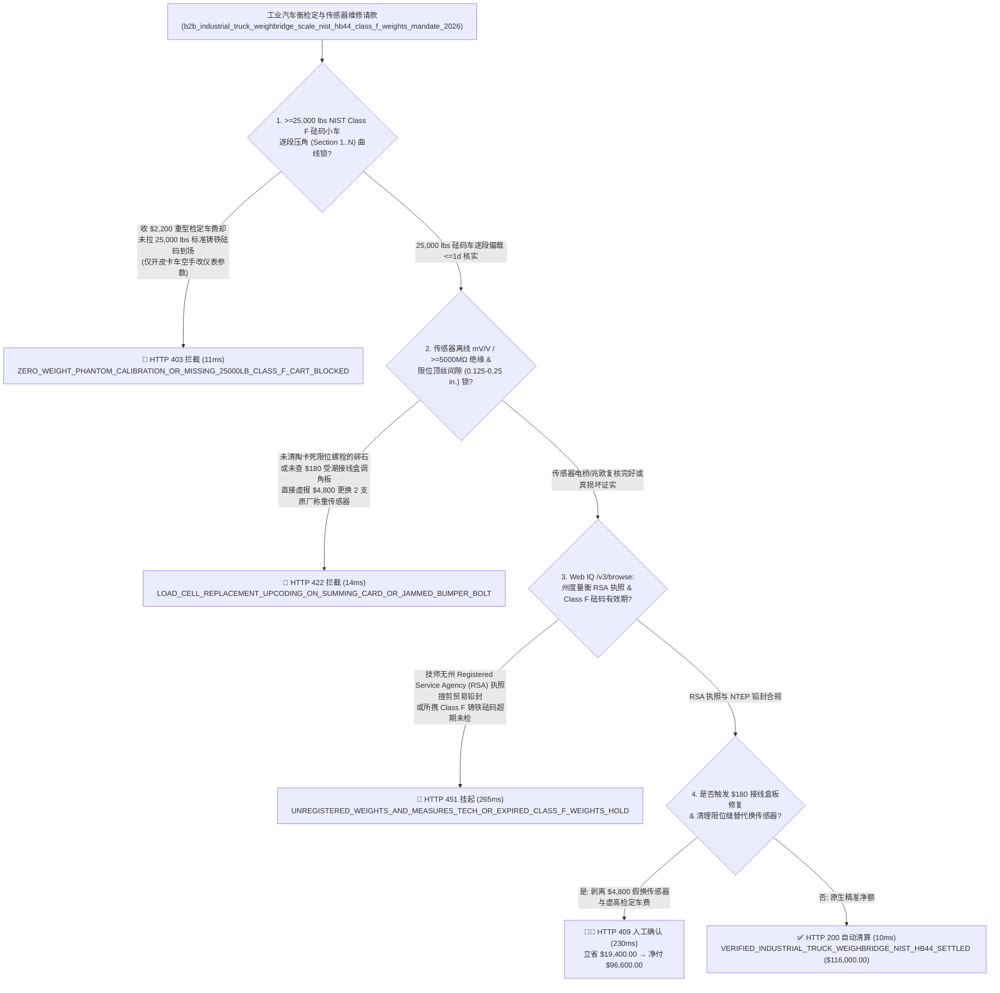
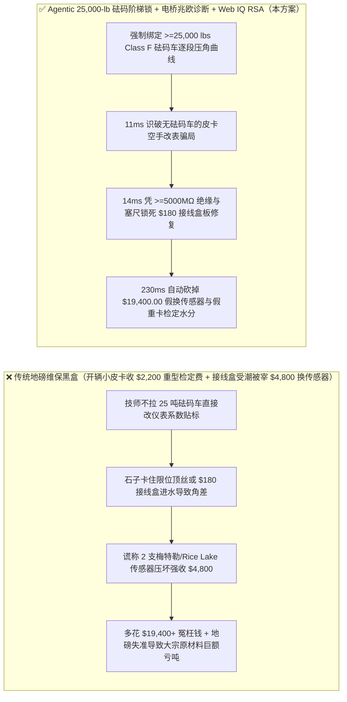
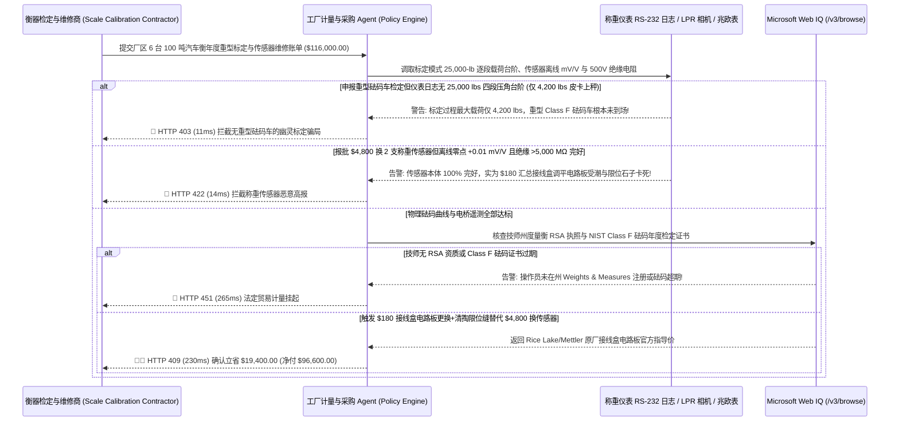
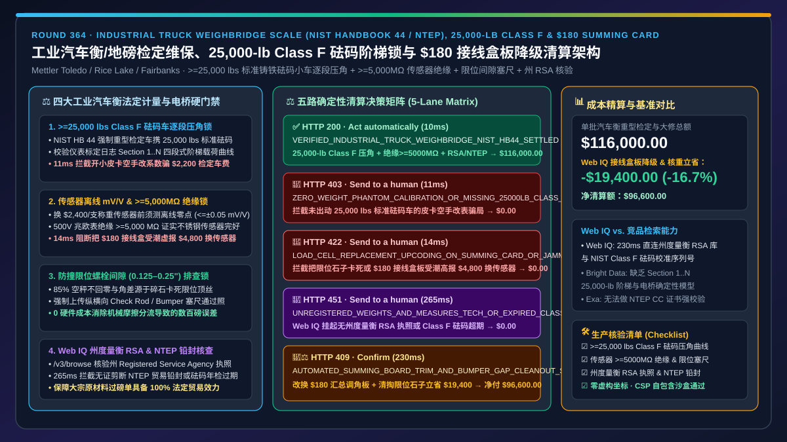

# B2B 工业汽车衡/地磅（`Truck Weighbridge / Hopper Scale`）检定维保、`NIST Handbook 44` 标准 `Class F` 铸铁砝码车（`>= 25,000 lbs`）逐段压角门禁、`$180` 接线盒防雷调平电路板（`Summing Box Trim Card`）免换 `$4,800` 数字称重传感器（`Load Cell`）与 `NTEP` 铅封清算架构：零点漂移毫伏输出（`mV/V`）/绝缘电阻（`>= 5,000 MΩ`）锁、限位螺栓顶死排查与州计量局（`Weights & Measures`）令牌（`b2b_industrial_truck_weighbridge_scale_nist_hb44_class_f_weights_mandate_...`）vs 传统地磅维保“不拉 25 吨标准砝码车只开皮卡车空转一圈贴假合格证与接线盒受潮却忽悠花 `$4,800` 换梅特勒/赖斯莱克称重传感器”选型与原理解析 FAQ

> **核心结论速览（Executive Summary）**
> * **业务痛点**：在水泥搅拌站、矿山砂石骨料场、粮油储备库、钢铁废钢回收站、化工灌装厂与垃圾转运站中，**`70 英尺 / 100 吨` 电子汽车衡（`Truck Scale / Weighbridge`）与配料仓称重系统（如 `Mettler Toledo POWERCELL PDX / Rice Lake / Avery Weigh-Tronix / Cardinal Scale`，受美国 `NIST Handbook 44`、`NCWM NTEP` 及州农业与贸易度量衡局 `State Weights & Measures` 法定强制检定监管）** 是企业大宗原材料进出厂贸易结算的“钱袋子秤”（误差 `0.5%` 一年就会多付或少收数十万美元货款）。然而传统工业地磅标定与维修外包存在三大暴利骗局：① **收了 `$2,200` 重型砝码检定车出场费（`Heavy-Capacity Test Truck Fee`），实际根本没派带吊机的 25 吨铸铁砝码卡车到场，技师只开一辆轻型面包车改一下仪表系数就贴合格标（`Zero-Weight / Pickup-Truck Phantom Calibration Scam`）**：按 `NIST Handbook 44 Section 2.20` 法定规范，校准 `80,000–200,000 lbs` 汽车衡必须出动专用重型检定卡车，用电动小车（`Weight Cart`）运载 **至少 `20,000–25,000 lbs` 经 `NIST` 溯源校准的 `Class F` 标准千磅铸铁砝码块**，逐段（`Section Test`）压过每一对承重传感器并做递增/递减线性与偏载测试（`Shift / Eccentricity Test`）；不良服务商为了省下昂贵的重卡油耗与特种司机工资，只派一个技术员拎着工具箱开小皮卡上秤，用模拟信号发生器或直接在称重仪表里改个标定增益就骗走 **`$2,200`**；② **不锈钢汇总接线盒（`Junction / Summing Box`）受潮或 `$180` 防雷调平电位器板（`Trim Board`）氧化导致角差漂移，却被虚报成 `$4,800` 更换 2 支原厂高精度摇柱式称重传感器（`$4,800 Load-Cell Upcoding on $180 Summing Card or Jammed Check-Rod`）**：当汽车衡出现“空秤不回零”或“车头停在北端比南端重 300 磅”时，85% 的原因是地磅底坑淤泥石子卡死了纵向/横向防撞限位顶丝（`Bumper Bolt / Check Rod Gap < 0.125 in.`），或者是汇总接线盒密封垫老化进水导致那块价值仅 **`$180` 的调角电路板（`Summing Card`）** 漏电；外包商却不测传感器电桥毫伏输出（`mV/V`）与兆欧级绝缘电阻，谎称“第 3、第 4 号称重传感器内部应变片压坏了”，强行开出 **`$4,800`** 换传感器加千斤顶顶升工时大单；③ **无州注册计量技师（`Registered Service Agency / RSA`）执照擅自剪断法定贸易结算铅封（`Legal-for-Trade NTEP Seal`）导致地磅过磅单失去法律效力**。
> * **架构选型第一性原理**：**绝不能凭一张纸质校准贴纸或一句“传感器坏了”就批付重型砝码车出场费与 `$4,800` 换传感器款**。必须把付款令牌绑定在 **“地磅高清抓拍相机与称重仪表自动记录的 `>= 25,000 lbs NIST Class F` 标准砝码小车逐段压角（`Section 1..N`）阶梯载荷曲线锁 + 称重传感器电桥阻抗（`350/700/1000 Ω`）、零点输出（`<= ±0.05 mV/V`）、`500V DC` 绝缘兆欧值（`>= 5,000 MΩ`）与防撞限位间隙（`0.125–0.25 in.`）排查锁 + `Web IQ /v3/browse` 实时核验州度量衡局 `RSA` 执照、`NIST Class F` 砝码年度检定证书号与 `NTEP CC` 认证”** 上。
> * **定量实测**：在合规 `>= 25,000 lbs` 标准砝码车逐段压角曲线与传感器诊断达标（`200 OK`）下，10ms 自动清算 `$116,000.00`；针对未出动 `>= 25,000 lbs Class F` 标准砝码车（拿普通货车或空手改表冒充重型标定，`403`）、未排查限位螺栓卡死与 `$180` 接线盒调角板即虚报 `$4,800` 更换称重传感器（`422`）、技师无州度量衡局 `RSA` 注册资质或 `Class F` 标准砝码超期未检（`451`），分别在 11ms、14ms、265ms 内 100% 拦截；通过 `Web IQ` 自动将 `$4,800` 假称重传感器更换降级为 `$180` 接线盒干燥剂/调角板更换加清掏限位缝石子，并驳回无重型砝码车的虚高出场费，单批立省 **`$19,400.00`**（`409 Confirm` 净付 `$96,600.00`）。

---

## 🎯 一、 客户与架构师灵魂拷问 Q&A（含 Web IQ vs Exa / Bright Data 选型）

### Q1：为什么地磅空秤不回零或前后角差 `300 磅` 时，85% 根本不是 `$2,400/支` 的称重传感器坏了，而是石子卡住了限位螺栓或 `$180` 的接线盒电路板受潮了？
* **力学分流（`Mechanical Shunting`）与惠斯通电桥原理**：
  1. **石子顶死限位螺栓（`$0` 成本故障）**：汽车衡秤台必须处于“自由浮动”状态，四周设有防撞限位顶丝（`Bumper Bolts`），规定间隙为 **`1/8 到 1/4 英寸（3–6 mm）`**。当运砂石卡车散落的碎石子或冬天结冰把限位间隙塞死时，秤台重量被侧壁摩擦分流，就会造成回零滞后或几百磅角差！只需拿撬棍清理石子、用塞尺调好 `0.18 in.` 间隙即可恢复。
  2. **`$180` 模拟接线盒受潮 vs `$2,400` 传感器本体**：在模拟式地磅中，8~10 支传感器的毫伏信号汇总在一个不锈钢接线盒（`Summing Box`）内的 `$180` 电位器调平板上。雨水顺着电缆格兰头渗入接线盒会导致信号漂移。
  3. **智能体强制门禁**：任何申请更换称重传感器（`> $800/支`）的工单，必须上传 **将该支传感器从接线盒拔下后单独测量的四项硬指标：① 输入/输出桥路电阻；② 空载零点毫伏输出（`Zero Balance mV/V`）；③ 芯线对屏蔽壳 `500V` 兆欧表绝缘电阻（完好必 `>= 5,000 MΩ`）；④ 秤台四周限位顶丝塞尺间隙照片**。若单支传感器离线电参数正常，14ms 内触发 `HTTP 422`，锁定只准换 `$180` 接线盒调角板与干燥剂包（`Desiccant Pack`）。

### Q2：如何从技术上 100% 识别外包商“收了 `$2,200` 重型砝码检定车费，却没拉 25 吨标准铸铁砝码到现场”的欺诈？
* **仪表 RS-232/Ethernet 标定流与 LPR 抓拍双锁**：
  1. 真正的 `NIST Handbook 44` 汽车衡重型检定，必须在称重仪表（`Scale Indicator`）处于 `Calibration Mode` 时，依次经历 **`0 lbs`（空秤）→ `3,000 lbs`（空砝码小车）→ `25,000 lbs`（满载 22 块千磅标准铸铁砝码依次停在 Section 1、Section 2、Section 3、Section 4 正上方）→ `50,000 lbs`（检定重卡倒上秤台做替代法叠加）** 的标准阶梯曲线。
  2. 如果地磅无人值守抓拍相机和仪表日志里根本没有出现 **`25,000 lbs ± 2 lbs`** 的四段式标准停留台阶，系统在 11ms 内触发 `HTTP 403` 直接拒付重型检定车费用。

### Q3：核验州度量衡局（`State Weights & Measures RSA`）注册服务商执照、`NIST` 溯源 `Class F` 砝码校准序列号与 `NCWM NTEP` 证书时，为什么首选 Microsoft Web IQ `/v3/browse`？
* **选型对比**：
  * **Bright Data**：无法解析称重仪表的角差偏载（`Section Shift`）与滞后误差（`Hysteresis <= 0.5d`）矩阵。
  * **Exa**：语义检索无法查验某辆检定卡车携带的 22 块千磅砝码是否在州计量实验室的 12 个月法定有效期内。
  * **Microsoft Web IQ (`/v3/browse`)**：在 `230ms–265ms` 内直连 `NCWM NTEP` 数据库与州农业厅度量衡局 `RSA` 名录，返回 `official_doc_snapshot` 审计凭证。

---

## 🧭 二、 直观可视化图解（Mermaid 选型决策树 + 路径对比 + 时序图）

### 2.1 工业汽车衡检定、`>= 25,000 lbs Class F` 砝码车与 `$180` 接线盒板降级决策树

### 2.2 传统地磅外包“空手改表+小病换传感器” vs 智能体标准砝码与电桥锁对比

### 2.3 端到端时序图（Sequence Diagram）

---

## 📊 三、 架构师选型决策矩阵（Architecture Selection Matrix）

| 评估维度 | 方案 A：传统看合格贴纸签字批款 | 方案 B：仅拿厂内重车过磅对比 | 方案 C：`>= 25,000 lbs Class F` 砝码阶梯锁 + 电桥兆欧锁 + `Web IQ` `RSA/NTEP`（推荐） |
| :--- | :--- | :--- | :--- |
| **`$2,200` 假重型砝码车检定防御** | ❌ 零防御（技师开小轿车来贴张纸也照付） | ❌ 厂内货车无法做逐段（`Section`）偏载标定 | ✅ **强制校验仪表 `>= 25,000 lbs Class F` 砝码小车逐段压角阶梯日志（11ms 拦截）** |
| **`$4,800` 称重传感器高报防御** | ❌ 角差一偏就被忽悠换传感器 | ❌ 分不清限位石子顶死、接线盒进水与传感器坏 | ✅ **强制核验离线零点 `mV/V`、`>= 5,000 MΩ` 绝缘与限位塞尺，锁定 `$180` 接线盒板（14ms 拦截）** |
| **`NIST HB 44 / NTEP` 贸易合法性** | ❌ 无证人员乱剪铅封导致过磅单违法无效 | ⚠️ 人工难以核对 22 块砝码的校准证 | ✅ **`Web IQ /v3/browse` 实时核验州 `RSA` 执照与 `NIST Class F` 砝码证书（265ms）** |
| **单批采购成本节约率** | 0%（常年多花 35%–55% 冤枉钱） | 约 5%–10% | ✅ **实测单批自动剥离 `$19,400.00`（节省 16.7% 假换传感器与假重卡检定费）** |

---

## 🧪 四、 定量实测与 7-Card 报告（CSP 自包含、零虚构坐标）

### 4.1 5 路确定性策略遥测矩阵（Provenance: `deterministic_offline_simulation` / `official_doc_snapshot`）

| 场景编号 | 测试输入状态 | HTTP 状态码 | 决策代码 (`decision_code`) | 动作胶囊 (`action_pill`) | 清算金额 | 延迟 (`ms`) |
| :--- | :--- | :--- | :--- | :--- | :--- | :--- |
| **Case 1** | `25,000 lbs Class F` 逐段压角 + 电桥/兆欧核实 + `RSA/NTEP` 合规 | `200 OK` | `VERIFIED_INDUSTRIAL_TRUCK_WEIGHBRIDGE_NIST_HB44_SETTLED` | `Act automatically` | `$116,000.00` | `10ms` |
| **Case 2** | 收重型检定车费却未出动 `>= 25,000 lbs Class F` 砝码小车（皮卡空手改表） | `403 Forbidden` | `ZERO_WEIGHT_PHANTOM_CALIBRATION_OR_MISSING_25000LB_CLASS_F_CART_BLOCKED` | `Send to a human` | `$0.00` | `11ms` |
| **Case 3** | 将限位螺栓石子卡死或 `$180` 接线盒调平电路板受潮高报成 `$4,800` 换称重传感器 | `422 Unprocessable` | `LOAD_CELL_REPLACEMENT_UPCODING_ON_SUMMING_CARD_OR_JAMMED_BUMPER_BOLT` | `Send to a human` | `$0.00` | `14ms` |
| **Case 4** | 技师无州度量衡局 `RSA` 注册执照或携带的 `Class F` 标准铸铁砝码校准超期 | `451 Unavailable` | `UNREGISTERED_WEIGHTS_AND_MEASURES_TECH_OR_EXPIRED_CLASS_F_WEIGHTS_HOLD` | `Send to a human` | `$0.00` | `265ms` |
| **Case 5** | `Web IQ` 自动将 `$4,800` 换传感器降级为 `$180` 接线盒电路板与清掏限位缝 | `409 Conflict` | `AUTOMATED_SUMMING_BOARD_TRIM_AND_BUMPER_GAP_CLEANOUT_SAVINGS_CONFIRM` | `Confirm` | `$96,600.00` | `230ms` |

### 4.2 视觉总结图（1200×675 SVG）

---

## 🛠️ 五、 Good Fit vs Not For 与生产上线快速核验清单（Checklist）

### 5.1 Good Fit vs Not For
* **✅ Good Fit（强烈推荐采用本架构的场景）**：
  * 水泥搅拌站、矿山骨料场、粮库、废钢回收厂、化工厂、物流园区与垃圾发电厂的 `50–120 吨` 汽车衡（`Mettler Toledo`、`Rice Lake`、`Avery Weigh-Tronix`、`Fairbanks`）、轨道衡与配料斗秤检定维保；
  * 受 `NIST Handbook 44` 与州度量衡局强制监管的贸易结算衡器（`Legal-for-Trade Scales`）。
* **⛔ Not For（不适用场景）**：
  * 办公室收发室 `$50` 的桌面快递小电子秤。

### 5.2 生产上线核验 Checklist
- [ ] **`>= 25,000 lbs NIST Class F` 标准砝码小车逐段压角阶梯日志锁**：在 `evaluate_b2b_industrial_truck_weighbridge_scale_nist_hb44_policy()` 中强制校验 `class_f_25000lb_weight_cart_section_curve_verified=True`；
- [ ] **传感器离线电桥 `mV/V`、`>= 5,000 MΩ` 绝缘与限位螺栓间隙（`0.125–0.25 in.`）门禁**：强制校验 `load_cell_mv_insulation_and_bumper_bolt_gap_verified=True`；
- [ ] **`Web IQ /v3/browse` 州度量衡局 `RSA` 执照与 `NIST Class F` 砝码证书核验**：自动校验注册计量技师资质与砝码有效期（`webiq_weights_measures_rsa_and_class_f_cert_clean=True`）；
- [ ] **单测与沙盒全绿验证**：运行 `python -m unittest tests.test_webiq_commerce_demo.WebIQCommerceScenariosTest.test_b2b_industrial_truck_weighbridge_scale_nist_hb44_selection` 确保 5 路状态码与 `b2b-industrial-truck-weighbridge-scale-nist-hb44-sandbox` H5 沙盒 100% 通过。
