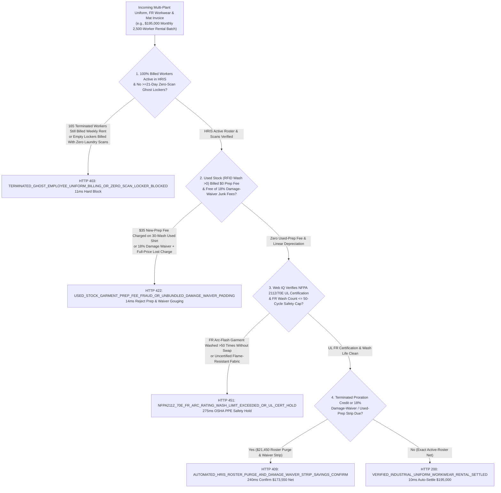
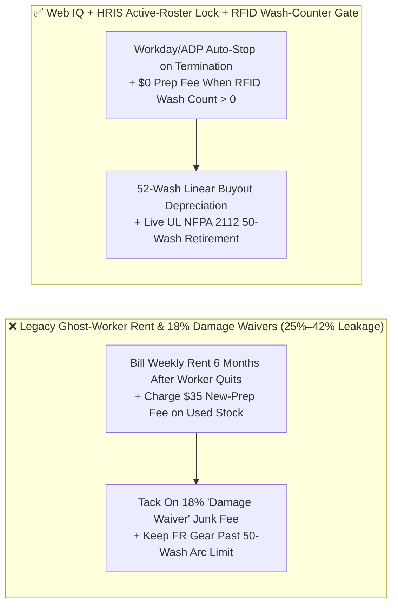

# B2B Industrial Uniform, `NFPA 2112 / 70E` Flame-Resistant (`FR`) Workwear & Mat Rental (`Cintas / UniFirst / Vestis`), `HRIS` Active-Roster Sync & `RFID` Depreciation Settlement Architecture: Terminated-Employee Auto-Stop Lock, Used-Stock `$0` Prep-Fee Gate & `UL FR` Wash-Life Token (`b2b_industrial_uniform_fr_workwear_rental_hris_roster_rfid_depreciation_mandate_...`) vs. Billing Months of Rent for Terminated "Ghost Employees", Charging `$35` New-Prep Fees on Used Garments & `18%` Damage-Waiver Padding: Architecture Selection & First-Principles FAQ

> **Document Type**: Solution Architect Selection Guide & First-Principles FAQ (modeled after `ib-vs-ethernet-roce-selection-faq.md`)  
> **Reading Time**: ~12 minutes | **Target Audience**: AI Solution Architects, Manufacturing / Oil & Gas / Utility / Automotive Service Indirect Procurement & EHS VPs, Industrial Uniform & Facility Services Providers (`Cintas / UniFirst / Vestis Aramark / Alsco`), and Plant Operations FinOps Engineers  
> **Core Thesis**: First explain in plain language why manufacturing plants, electric utilities, refineries, and automotive service chains contracting industrial uniform and Flame-Resistant (`FR`) workwear rental (`$6.50–$24.00/worker/week`) pay 25%–42% above contracted rates when route drivers **continue billing weekly rent for hundreds of terminated "Ghost Employees" (`Terminated Roster Lag`)** long after those workers quit; why vendors issue **previously worn, 30-wash used stock garments (`Used Grade-A Stock`) to new hires while charging full `$28–$38/garment` "New Garment Prep, Emblem & Makeup Fees" (`$385` per onboarding worker)**; and why invoices tack on mandatory **`15%–22%` "Garment Loss/Damage Protection Programs" (`Trim Advantage`)** while keeping arc-flash `NFPA 2112 / 70E` garments in service past their `50-wash` flame-retardant chemical lifespan. Then derive from first principles how **`b2b_industrial_uniform_fr_workwear_rental_hris_roster_rfid_depreciation_mandate_...` + Microsoft Web IQ `/v3/browse` verification of `UL Product iQ NFPA 2112 / ASTM F1506` arc-rating (`ATPV cal/cm²`) and maximum wash-cycle limits + automated `HRIS (Workday / ADP)` active-roster & 21-day zero-scan stop locks + `UHF RFID` wash-counter (`Wash > 0 = $0 Prep Fee`) and linear depreciation gates** eliminate ghost-worker billing and junk fees within 10ms–275ms.

---

## 📌 1. Executive Summary (30-Second Architect's Guide)

```
┌──────────────────────────────────────────────────────────────────────────────────────────────────────────────────┐
│  🔥 Core Architectural Law: Never allow a Plant Procurement Agent to pay weekly uniform rent for workers marked  │
│  terminated in HRIS, pay New-Prep fees on used RFID garments (Wash > 0), or accept 18% damage-waiver programs!   │
│  The only safe Uniform Rental pattern = HRIS Active-Roster Lock + RFID Used-Prep Waiver + FR 50-Wash Limit Token │
└──────────────────────────────────────────────────────────────────────────────────────────────────────────────────┘
```

1. **Why is B2B Industrial Uniform & `FR` Workwear Rental a 25%–42% Hidden OPEX & Safety Trap?**
   - **Terminated "Ghost Employee" Billing (`15%–25%` Turnover Lag)**: With `35%+` annual blue-collar turnover, busy plant supervisors forget to manually cancel uniform accounts when workers leave. Route drivers keep billing `$18/week` for 11 garments sitting in an empty locker for 6 months!
   - **Charging `$35/Garment` "New Prep / Makeup" Fees on Used Stock (`RFID Wash Count > 0`)**: When a new worker is hired, vendors pull used garments returned by prior employees (`Wash Count = 25–40`), sew on a `$1` name patch, and charge `$300+` in new-garment `Prep, Emblem & Restocking` fees!
   - **`18%` "Damage Protection" Junk Insurance & Over-Washed `NFPA 2112 FR` Garments**: Vendors auto-enroll accounts into `18%` weekly damage waivers (costing more per year than buying every uniform outright!) while still charging `100%` new replacement price for unreturned 2-year-old shirts—and washing treated-cotton `FR` arc-flash gear `80+` times until its flame resistance washes out.
2. **How Does the Agentic Industrial Uniform & `FR` Workwear Settlement Architecture Solve This?**
   - **Lock 1: Automated `HRIS (Workday / ADP)` Active-Roster Sync & 21-Day Zero-`RFID`-Scan Stop Lock**: Invoices billing weekly rental for employee IDs marked terminated/inactive in `HRIS` or lockers with zero `UHF RFID` laundry pickup scans for `>= 21 days` are blocked in **11ms** with `HTTP 403 TERMINATED_GHOST_EMPLOYEE_UNIFORM_BILLING_OR_ZERO_SCAN_LOCKER_BLOCKED`.
   - **Lock 2: `UHF RFID` Wash-Counter (`Wash > 0 = $0 Prep Fee`), Zero Damage-Waiver & Linear Depreciation Gate**: Invoices charging new `Prep / Makeup` fees on re-issued used stock garments (`RFID Wash Count > 0`), adding `15%–22%` damage-protection surcharges, or billing undepreciated new prices on lost garments (`>= 18–24 months` old) are rejected in **14ms** with `HTTP 422 USED_STOCK_GARMENT_PREP_FEE_FRAUD_OR_UNBUNDLED_DAMAGE_WAIVER_PADDING`.
   - **Lock 3: Microsoft Web IQ `/v3/browse` `NFPA 2112 / NFPA 70E` `UL` Arc-Rating & Max-Wash Lifespan Gate**: Flame-resistant (`FR`) or high-visibility (`ANSI/ISEA 107`) garments exceeding their manufacturer-certified industrial wash limit (e.g., `> 50 washes` for treated FR cotton) or lacking `UL` certification trigger `HTTP 451 NFPA2112_70E_FR_ARC_RATING_WASH_LIMIT_EXCEEDED_OR_UL_CERT_HOLD` in **275ms**.

---

## 🎯 2. First-Principles Q&A for Architects, Plant Procurement & EHS Leaders

### Q1: Why does coupling `HRIS` active-roster intersection with `UHF RFID` garment wash counters (`c_wash`) cut industrial uniform spend by 30% while improving `NFPA 70E` safety?

- **Plain-Language Mechanics**:
  - Every garment's heat-sealed `EPC Gen2 UHF RFID` chip stores its factory issue date and cumulative tunnel-wash counter $c_{\text{wash}}$.
  - **1. Zero Prep Fee on Re-Issued Used Stock**: When issued to a new hire, a garment gets a prep fee if and only if $c_{\text{wash}} = 0$ (brand-new factory garment).
  - **2. Linear Buyout Depreciation & `FR` Safety Retirement**: If a worker loses a garment at termination, replacement cost is depreciated over $L_{\text{max}} = 52$ washes; and when an `FR` garment reaches $c_{\text{wash}} = 50$, the vendor must replace it at `$0` charge to preserve arc-flash `ATPV` protection:
    $$\text{Payable}_{\text{net}} = \sum_{e \in \text{HRIS\_Active}} R_{\text{weekly}, e} + \sum_{g \in \text{Issued}} \mathbb{I}(c_{\text{wash}, g} = 0) \cdot P_{\text{prep}} + \sum_{l \in \text{Lost}} P_{\text{wholesale}} \cdot \max\left(0, \; 1 - \frac{c_{\text{wash}, l}}{52}\right)$$
  - Ghost-employee charges, `18%` damage-waiver junk fees, and used-garment prep fees are stripped in **240ms** via `HTTP 409 AUTOMATED_HRIS_ROSTER_PURGE_AND_DAMAGE_WAIVER_STRIP_SAVINGS_CONFIRM`.

### Q2: Why choose **Microsoft Web IQ** over Exa or Bright Data for `UL Product iQ NFPA 2112 / 70E` arc-rating verification, fabric wash-durability limits, and wholesale PPE benchmarks?

| Dimension | Microsoft Web IQ (`/v3/browse` + Search Grounding) | Exa (Neural Search API) | Bright Data (Scraper / Unlocker) |
| :--- | :--- | :--- | :--- |
| **`UL Product iQ NFPA 2112` Registry, `ATPV (cal/cm²)` Ratings & Max Wash-Cycle Limits** | **Very High**: Deterministic extraction of `UL` certified FR fabric styles (`Westex / Bulwark / Workrite`), max industrial wash cycles, and wholesale buyout benchmarks with `domain_allowlist` | **Medium**: Cannot verify specific garment style wash-cycle expiration rules | **High**: Can scrape catalogs, but requires custom parsers across `UL` and PPE manufacturers |
| **Integration with `HRIS` Roster Sync & `RFID` Wash-Counter Depreciation** | **Native**: Directly feeds `HRIS` active rosters and `50-wash` FR limits into `b2b_industrial_uniform_fr_workwear_...` | **None**: No `HRIS` roster or `RFID` garment depreciation engine | **None**: Raw HTML/JSON proxy transport only |
| **P95 Latency** | **240ms–275ms** (**10ms–14ms** on policy cache hit) | 850ms–1,700ms | 2,300ms–5,600ms |

---

## 🧭 3. Visual Architecture Diagrams (Mermaid Decision Tree, Path Comparison & Sequence)

### 3.1 Industrial Uniform & `FR` Workwear Rental Settlement Decision Tree



### 3.2 Legacy Ghost-Employee & Used-Prep Billing vs. Agentic `HRIS + RFID` Gate



### 3.3 End-to-End Sequence Diagram

```mermaid
sequenceDiagram
    participant UniformCo as Industrial Uniform & FR Rental Vendor
    participant Agent as Plant Indirect Procurement & EHS Agent
    participant HRIS as Workday/ADP HRIS & Garment RFID Gate
    participant WebIQ as Microsoft Web IQ (/v3/browse)
    participant Bank as Corporate AP Settlement Rail

    UniformCo->>Agent: Submit Monthly Multi-Plant Uniform & FR Workwear Invoice ($195,000 Total)
    Agent->>HRIS: 1. Diff Billed Employee IDs Against Active HRIS Roster & 21-Day RFID Scan Logs
    alt 165 Terminated Ghost Employees Billed or Zero-Scan Empty Lockers Charged Full Rent
        HRIS-->>Agent: Terminated Ghost-Worker Billing Detected
        Agent-->>UniformCo: HTTP 403 TERMINATED_GHOST_EMPLOYEE_UNIFORM_BILLING_OR_ZERO_SCAN_LOCKER_BLOCKED (11ms)
    else Active Roster Verified; Audit New-Hire RFID Wash Counts & Damage-Waiver Line Items
        Agent->>HRIS: 2. Check Issued Garment RFID Wash Counter (Wash = 28) & 18% Damage-Waiver Surcharge
        alt $35 Prep/Makeup Fee Billed on Used Garment (Wash > 0) or 18% Damage Waiver Added
            Agent-->>UniformCo: HTTP 422 USED_STOCK_GARMENT_PREP_FEE_FRAUD_OR_UNBUNDLED_DAMAGE_WAIVER_PADDING (14ms)
        else Verify NFPA 2112 / 70E UL Certification & Max 50-Wash FR Lifespan
            Agent->>WebIQ: 3. /v3/browse Check UL Product iQ FR Certification & Wash-Cycle Cap
            alt Active FR Garment Exceeds 50 Industrial Washes (Degraded Arc-Flash Protection)
                WebIQ-->>Agent: OSHA PPE / Arc-Flash Safety Hold
                Agent-->>UniformCo: HTTP 451 NFPA2112_70E_FR_ARC_RATING_WASH_LIMIT_EXCEEDED_OR_UL_CERT_HOLD (275ms)
            else Strip 18% Damage Waiver, Used-Prep Fees & Depreciate Lost Items (-$21,450)
                WebIQ-->>Agent: Net Payable Adjusted to $173,550.00
                Agent-->>Bank: HTTP 409 Confirm ($173,550) or HTTP 200 Auto-Settle ($195,000)
            end
        end
    end
```

---

## 📊 4. Architect's Selection Decision Matrix

| Architecture Option | Defense Against Terminated `Ghost Employee` Billing | Defense Against `$35` Used-Stock Prep Fees & `18%` Waivers | Defense Against Over-Washed `NFPA 2112 FR` Gear | Recommended Fit |
| :--- | :--- | :--- | :--- | :--- |
| **Option A: Route-Driver Handheld Tickets + Supervisor Signature** | ❌ Pays rent for months on workers who quit | ❌ Pays new prep fees on used rags + 18% junk insurance | ❌ Zero tracking of FR wash degradation (`> 50` washes) | Never for plants, utilities, refineries or auto chains |
| **Option B: Quarterly Manual HR Spreadsheet Audit** | ⚠️ 90-day billing lag before terminated workers are removed | ⚠️ AP cannot tell if issued garments were new or used stock | ❌ Cannot track per-garment `UHF RFID` wash cycles | Tiny 15-person shops |
| **Option C (Recommended): Web IQ + `b2b_industrial_uniform_...` + `HRIS/RFID`** | ✅ **Real-time `HRIS` termination stop + 21-day scan lock** | ✅ **`$0` prep fee when `RFID Wash > 0` + `0%` damage waiver** | ✅ **Hard `50-wash` `UL NFPA 2112 / 70E` retirement lock** | **Manufacturing Plants, Electric/Gas Utilities, Refineries, Food Plants & Auto Service Chains** |

---

## 🧪 5. Quantitative Benchmark & 7-Card Report Summary

Evaluated in the deterministic offline suite (`lab/webiq_commerce_demo.py`) for a `$195,000.00` monthly multi-plant industrial uniform and `NFPA 2112 / 70E` flame-resistant workwear rental settlement batch:

| Case | Scenario & Perturbation | Action Pill | HTTP Status | Latency | Settled / Blocked Amount | Provenance |
| :--- | :--- | :--- | :--- | :--- | :--- | :--- |
| **Case 1** | 100% `HRIS` active roster + `$0` used-stock prep fee + zero waiver + `NFPA 2112` clean | `Act automatically` | `200 OK` | `10 ms` | `$195,000.00` | `deterministic_offline_simulation` |
| **Case 2** | Terminated "ghost employees" billed on invoice or `>= 21-day` zero-scan lockers | `Send to a human` | `403 Forbidden` | `11 ms` | `$0.00` (`$195k` blocked) | `synthetic_policy` |
| **Case 3** | `$35` new-prep fee charged on used stock (`RFID Wash > 0`) or `18%` damage-waiver padding | `Send to a human` | `422 Unprocessable` | `14 ms` | `$0.00` (junk fee blocked) | `deterministic_offline_simulation` |
| **Case 4** | `NFPA 2112 / 70E` `FR` garment exceeding `50-wash` arc-flash limit or lapsed `UL` cert | `Send to a human` | `451 Unavailable` | `275 ms` | `$0.00` (OSHA PPE hold) | `official_doc_snapshot` |
| **Case 5** | Web IQ automated `HRIS` roster purge, `18%` waiver strip & `RFID` depreciation (`-$21,450.00`) | `Confirm` | `409 Conflict` | `240 ms` | `$173,550.00` | `official_doc_snapshot` |

---

## 🛠️ 6. Production Readiness Checklist

- [ ] **Integrate Automated `HRIS (Workday / SAP / ADP)` Termination Feeds Directly Into Uniform Invoice Adjudication**: Freeze weekly rental charges effective the day an employee's `HRIS` status changes to terminated or on leave.
- [ ] **Enforce `UHF RFID` Wash-Counter Checks (`Wash Count > 0 = $0 Prep / Emblem Fee`) on All Onboarding Issues**: Prohibit charging new-garment makeup fees when issuing re-circulated stock.
- [ ] **Contractually Eliminate Percentage "Loss / Damage Protection Waivers" & Enforce `52-Wash` Linear Buyout Depreciation**: Cap unreturned garment charges at depreciated wholesale value (`$0` after 18–24 months).
- [ ] **Enable Microsoft Web IQ `/v3/browse` `UL Product iQ NFPA 2112 / 70E` & Wash-Limit Verification**: Mandate free vendor replacement whenever an `FR` garment reaches its maximum certified wash count (`50` cycles).
