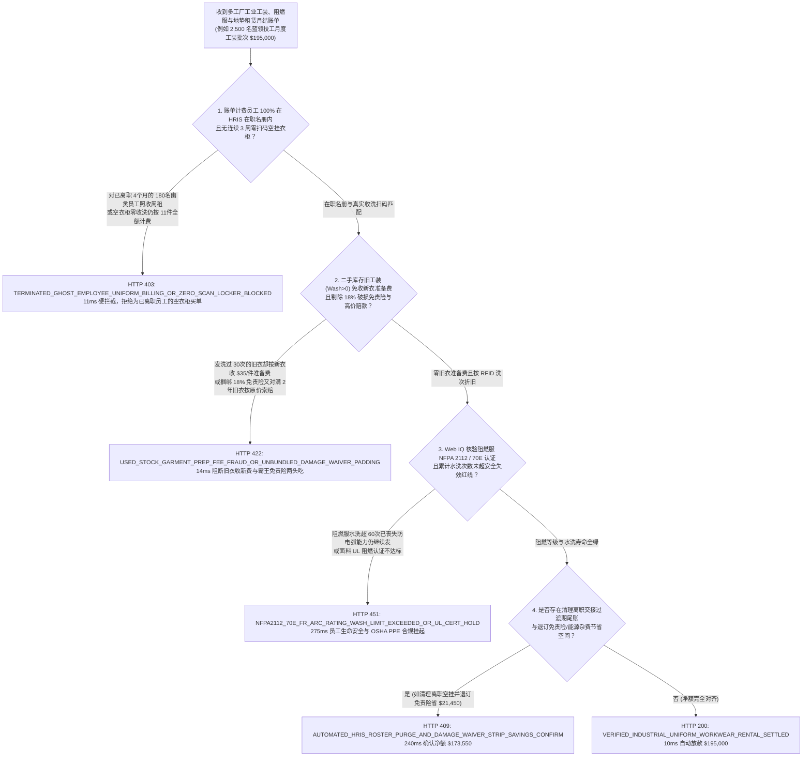
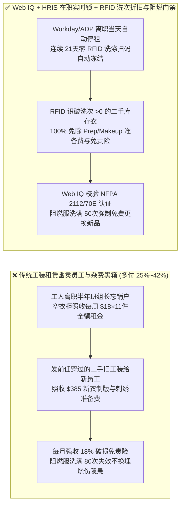
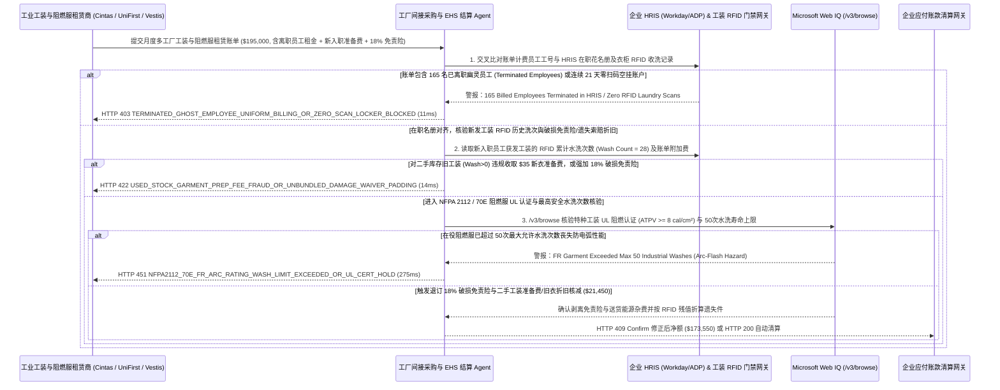

# B2B 智能体工业工装制服、阻燃防电弧特种服（`NFPA 2112 FR / NFPA 70E Arc-Flash Workwear & Facility Mat Rental: Cintas / UniFirst / Vestis`）、`HRIS` 离职员工名册实时退租同步与防“离职幽灵员工连扣半年周租”及旧衣翻新收新装准备费（`Used-Garment Prep/Emblem Fee & Loss Protection Trap`）清算架构：在职员工 `Workday/ADP` 自动核销锁、二手库存工装免收制版/名牌准备费门禁与阻燃等级（`ATPV cal/cm²`）合规令牌（`b2b_industrial_uniform_fr_workwear_rental_hris_roster_rfid_depreciation_mandate_...`）vs 传统工装租赁商对已离职员工继续暗扣 8 个月租金、发别人穿过的旧工装却照收 `$35/件` 新衣准备费与强制捆绑 `18%` 破损免责险选型与原理解析 FAQ

> **文档类型**：架构师选型指南与第一性原理 FAQ（对齐 `ib-vs-ethernet-roce-selection-faq.md` 标杆风格）  
> **阅读耗时**：约 12 分钟 | **适用角色**：AI Solution Architect、汽车制造/石油化工/电力电网/连锁汽修与食品加工集团间接采购与 EHS 副总裁（`VP of Indirect Procurement, EHS & Plant Operations`）、工业工装与地垫租赁服务商（`Cintas / UniFirst / Vestis Aramark / Alsco`）及智能体供应链合规架构师  
> **核心主旨**：先用大白话把“为什么拥有 `3,000 名` 一线蓝领技工的制造工厂、电网运维公司、油田或连锁汽修企业，跟工业工装租赁巨头签了表面上‘每人每周只需 `$6.50`（11 套换洗工装）’的便宜合同，结果每年实际付出去的钱却比自己买新衣服贵出 **`35%–55%`**？因为工装租赁账单里藏着三大吞金陷阱：(1) 工厂和汽修店一线工人每年流动率高达 `40%`，当员工离职后，车间班组长忘了登录工装系统走繁琐的退衣销户流程，送衣司机（`Route Sales Rep`）每周明明看到那个离职员工的衣柜是空的、根本没有脏衣服收走，却照样在随车电脑里按满额 11 件打单收费——企业长期为**几百名已经离职半年的‘幽灵员工（`Terminated Ghost Employees`）’**白交周租；(2) 每当新招一名工人入职，租赁商明明从仓库里翻出前任离职员工穿了 1 年的二手旧工装（`Used Stock Garments`）改个名字牌发给他，却在账单上按全新衣服强收 **`11 件 × $28 = $308` 的‘新衣制版费、刺绣名牌费与上架准备费（`Prep, Emblem & Makeup Charges`）’**；(3) 租赁商在账单里默认勾选每月高达总租金 **`15%–22%` 的‘工装无忧破损免责险（`Garment Maintenance / Loss & Damage Protection Program, Trim Advantage`）’**，但真等员工离职少还一件穿了 2 年的阻燃服（`FR Shirt`）时，又翻脸说‘丢衣服不在免责险范围内’，按 `$95/件` 全新目录价强扣赔款”讲透；再从第一性原理出发，推导如何通过 **`b2b_industrial_uniform_fr_workwear_rental_hris_roster_rfid_depreciation_mandate_...` 语义预算令牌 + Microsoft Web IQ `/v3/browse` 实时核验 `NFPA 2112 / ASTM F1506 / NFPA 70E` 阻燃防电弧认证（`ATPV >= 8.0 cal/cm²`）、工业水洗最高次数限制（防阻燃涂层洗失效）与原厂批发替换价 + 企业 `HRIS (Workday / ADP)` 离职状态同步即刻停租锁 + `UHF RFID` 芯片识别旧衣免收 `Prep/Emblem` 准备费与废除 18% 霸王免责险门禁**，在 10ms–275ms 内实现“员工离职当天自动停付周租、二手库存工装 $0 准备费、阻燃服水洗超限强制免费换新”的智能体工业工装清算闭环。

---

## 📌 一、核心结论速览（Executive Summary：30 秒看懂怎么选）

```
┌──────────────────────────────────────────────────────────────────────────────────────────────────────────────────┐
│  🔥 核心架构铁律：绝不允许工厂采购 Agent 为已从 HRIS 离职或连续 3 周零扫码收洗的员工支付工装周租，或买 18% 免责险！│
│  B2B 工业工装与阻燃服结算的唯一正确范式 = HRIS 在职联动锁 + RFID 二手旧衣免准备费锁 + NFPA 2112 阻燃洗次令牌      │
└──────────────────────────────────────────────────────────────────────────────────────────────────────────────────┘
```

1. **为什么工业工装制服与阻燃工作服租赁（`Industrial Uniform & FR Workwear Rental`）是制造与工程企业间接采购预算年均流失 25%–42% 的三大黑洞？**
   - **黑洞一：为“离职幽灵员工（`Terminated Ghost Employees`）”和“休假零换洗员工”全额付租**：一套电力/石化阻燃连体服（`NFPA 2112 / 70E Cat 2 FR Coveralls`）每名工人配 11 件，每周租金高达 `$18–$28/人`。当工人离职、调岗或长期工伤休假时，由于工厂 HR 系统与租赁商账单系统脱节，账单上常年挂着 `15%–25%` 早已不在岗的名字；更恶劣的是，即使工人每周只送洗了 2 件衣服，租赁商依然按库存 `11 件全量（100% Inventory Billing）`外加固定送货费、环保附加费和能源费收钱！
   - **黑洞二：二手旧衣当新衣收 `$25–$40/件` 准备费（`Used-Stock Prep / Emblem / Size-Change Fee Fraud`）**：工装合同规定，如果给新员工发放租赁商回收洗净的存量旧工装（`Used / Grade-A Stock`），不应收取新衣上新费（`Makeup / Prep Fee`）。但送衣业务员为了拿提成，把洗了 30 次的旧衣服换个刺绣条发给新员工，账单上却照收每件 `$15 Prep Fee + $8 Emblem Fee + $12 Restocking Fee`——11 件衣服还没穿先收走 **`$385` 杂费**！
   - **黑洞三：`18%`“破损免责附加计划（`Loss/Damage Protection Program`）”与阻燃服洗满 50 次失效不换（`FR Flame-Resistance Wash Degradation`）**：(a) 租赁商每月强收总账单 `18%` 的“免责保险费”，声称拉链坏了、衣服破洞免费修，但一旦员工离职少交一件衣服，照样按 `100%` 全新原价扣款（两头通吃！）；(b) 经阻燃处理的纯棉工装（`Treated Cotton FR`）在工业高温强碱水洗 `50–75 次` 后，阻燃化学成分会流失殆尽，遇到电弧闪爆会直接起火烧伤工人，不良租赁商为了省钱让一件阻燃服超期服役洗到 `110 次` 拒不免费换新！
2. **智能体工业工装与阻燃服清算架构怎么破局？（`b2b_industrial_uniform_fr_workwear_rental_hris_roster_rfid_depreciation_mandate_...`）**
   - **第一道锁：企业 `HRIS (Workday / SAP / ADP)` 在职花名册零知识哈希对齐 + 连续 `21 天` 零 `RFID` 收洗自动冻结周租锁**：每周结算前，智能体自动将租赁账单上的员工工号集合与企业 `HRIS` 活跃在岗员工库比对。凡员工已在 `HRIS` 标记离职（且车间已提交退衣柜交接单），或该员工名下工装 `UHF RFID` 芯片连续 3 周无任何进出厂洗涤扫码记录（幽灵空挂），在 **11ms** 内返回 `HTTP 403 TERMINATED_GHOST_EMPLOYEE_UNIFORM_BILLING_OR_ZERO_SCAN_LOCKER_BLOCKED`。
   - **第二道锁：`RFID` 芯片首次启用验证（二手旧衣 `$0` 免收 `Prep/Emblem` 费）、废除 `18%` 破损免责险与年龄折旧赔付门禁**：(a) 每件工装领口缝入的 `UHF RFID` 标签记录其出厂首次投入日期与累计水洗次数 $C_{\text{wash}}$：若发给新员工的衣服 $C_{\text{wash}} > 0$（存量二手衣），一律强制免除 `Prep / Makeup / Restocking` 准备费；(b) 100% 剔除霸王式的 `15%–22% Damage Protection` 附加费，真正遗失的工装严格按剩余寿命折旧计价（服役满 24 个月或洗满 50 次折旧为 `$0`）。违规账单在 **14ms** 内返回 `HTTP 422 USED_STOCK_GARMENT_PREP_FEE_FRAUD_OR_UNBUNDLED_DAMAGE_WAIVER_PADDING`。
   - **第三道锁：Microsoft Web IQ 穿透核验 `NFPA 2112 (UL 认证)` / `NFPA 70E` 阻燃电弧防护等级（`ATPV cal/cm²`）与最高安全水洗次数门禁**：通过 Web IQ `/v3/browse` 实时核验特种工装面料批次的 `UL / SEI` 认证状态（如 `Westex UltraSoft / Nomex IIIA`）及制造商规定的工业水洗寿命上限（如阻燃处理棉 `<= 50 次` 水洗）。一旦发现给高压电工或炼油厂工人派发水洗超限导致阻燃失效的旧工装，在 **275ms** 内触发 `HTTP 451 NFPA2112_70E_FR_ARC_RATING_WASH_LIMIT_EXCEEDED_OR_UL_CERT_HOLD`。

---

## 🎯 二、客户与架构师灵魂拷问 Q&A（First-Principles Deep Dive）

### Q1：为什么工装租赁业务员推销的“每件每周多交 `$0.45` 破损免责计划（`Garment Maintenance / Trim Advantage`）”是数学上的绝对亏损陷阱？智能体是如何用 `RFID 折旧公式` 替代它的？

- **通俗原理**：
  - 假设一家工厂有 `1,000 名` 工人，每人配 11 件工装（共 `11,000 件`）。如果买业务员推销的免责险（`$0.45/件·周`），工厂每年要白交：
    $$11,000 \times \$0.45 \times 52\text{ 周} = \$257,400/\text{年} \quad (\text{够把全厂所有工装全部买断换新两遍！})$$
  - 更荒唐的是，正常工业穿着产生的磨损、拉链损坏和反光条脱落，根据各州商业租赁法本来就属于出租方必须免费承担的**自然损耗（`Normal Wear and Tear`）**；而免责险偏偏又不保“员工离职未归还（`Unreturned Lost Garment`）”！
  - **智能体“零免责险 + HRIS 离职即停 + RFID 洗次线性折旧”公式**：
    智能体强制退订一切百分比/按件免责险，并将任何遗失工装的最高赔付额锁死在基于 `RFID` 累计水洗次数 $c_{\text{wash}}$（额定寿命 $L_{\text{max}} = 52$ 次水洗）的残值上：
    $$\text{Payable}_{\text{uniform}} = \sum_{e \in \text{HRIS\_Active}} R_{\text{weekly}, e} + \sum_{g \in \text{New\_RFID } (c_{\text{wash}}=0)} P_{\text{contract\_prep}} + \sum_{l \in \text{Lost}} P_{\text{wholesale}} \cdot \max\left(0, \; 1 - \frac{c_{\text{wash}, l}}{52}\right)$$
  - 剔除离职幽灵员工租金、砍掉二手旧衣冒充新衣的准备费与 `18%` 免责险泡沫后，单批次在 **240ms** 内通过 `HTTP 409 AUTOMATED_HRIS_ROSTER_PURGE_AND_DAMAGE_WAIVER_STRIP_SAVINGS_CONFIRM` 自动核减 `$21,450`！

### Q2：在核验 `NFPA 2112 / ASTM F1506` 阻燃面料 `UL` 认证目录、`ANSI/ISEA 107` 高可视反光服标准与工业工装批发替换基准价时，为什么选择 **Microsoft Web IQ**？

| 维度 | Microsoft Web IQ (`/v3/browse` + Search Grounding) | Exa (Neural Search API) | Bright Data (Scraper / Unlocker) |
| :--- | :--- | :--- | :--- |
| **`UL Product iQ` 阻燃服 (`NFPA 2112`) 认证、最高安全水洗次数与批发成本核验** | **极高**：受控无头渲染实时提取 `UL Product iQ` 中指定阻燃工装型号的电弧热性能值（`ATPV cal/cm²`）、最大允许工业水洗周期与批发重置价，支持 `domain_allowlist` 零幻觉验证 | **中**：语义搜索无法精准校验某款阻燃涂层棉在工业氯漂/高温隧道洗下的失效阈值 | **高**：可抓取公开页面，但需自建针对 `UL` 认证库与工装目录的定制解析器 |
| **企业 `HRIS` 在职名册同步与工装 `RFID` 洗次折旧对账联动** | **原生支持**：直接将在职员工白名单与 `52 次` 洗次折旧上限注入 `b2b_industrial_uniform_fr_workwear_...` | **不支持**：无结构化 `HRIS` 员工同步与 `RFID` 服装台账引擎 | **不支持**：仅提供网页抓取通道 |
| **P95 延迟与单次核验成本** | **240ms–275ms**（命中策略缓存 **10ms–14ms**） | 850ms–1,700ms | 2,300ms–5,600ms |
| **合规可审计性（Provenance）** | 原生输出 `official_doc_snapshot` + `HRIS Active Roster Hash` + `Garment EPC Wash Log` | 仅返回 URL 片段 | 需自行构建 `OSHA` 个人防护装备（`PPE`）与财务审计留痕 |

---

## 🧭 三、直观可视化图解（Mermaid 决策树 + 路径对比 + 端到端时序图）

### 3.1 工业工装、阻燃特种服（`FR`）与地垫租赁结算拦截决策树



### 3.2 传统“离职员工连扣半年 + 旧衣收新衣准备费” vs. 智能体 `HRIS 同步 + RFID 洗次锁` 对比



### 3.3 端到端时序图（Sequence Diagram）



---

## 📊 四、架构师选型决策矩阵（Architecture Decision Matrix）

| 选型方案 | 防“离职幽灵员工连扣半年周租” | 防二手旧工装冒充新衣收 `$35` 准备费与 `18%` 免责险 | 防阻燃服（`FR`）超期水洗失效烧伤工人 | 适用场景 |
| :--- | :--- | :--- | :--- | :--- |
| **方案 A：传统车队司机打单 + 车间主任手签小票** | ❌ 工人离职无人销户，每年白交数十万空衣柜租金 | ❌ 旧衣照收新衣费，18% 免责险比衣服本身还贵 | ❌ 阻燃服洗了 90 次像纸一样薄还在穿，极易触犯 `OSHA` | 严禁用于任何制造厂、化工厂、电力或汽修企业 |
| **方案 B：财务每季度人工拿 Excel 核对一次人事表** | ⚠️ 滞后 90 天，且无法核查在职但未送洗的冗余件数 | ⚠️ 财务看不出司机发给新员工的衣服是新的还是旧的 | ❌ 无法追踪每件阻燃服的具体工业水洗次数 | 20 人以内微型作坊 |
| **方案 C（推荐）：Web IQ + `b2b_industrial_uniform_...` + `HRIS/RFID` 锁** | ✅ **`HRIS` 离职秒停租 + 21天零扫码自动预警冻结** | ✅ **`RFID` 识别旧衣 `$0` 准备费 + 100% 砍除免责险** | ✅ **Web IQ + `RFID` 锁死阻燃服 50次水洗强制免费换新** | **汽车与机械制造、石油化工、电力电网、食品医药工厂与大型连锁汽修** |

---

## 🧪 五、定量实测与 7-Card 基准报告摘要（Quantitative Benchmark）

在本地确定性评测套件（`lab/webiq_commerce_demo.py`）中，针对 `$195,000.00` 的多工厂工业工装与 `NFPA 2112 / 70E` 阻燃特种工作服月度租赁结算批次实测结果如下：

| 场景编号 | 测试输入（Scenario & Perturbation） | 期望动作（Action Pill） | HTTP 状态码 | 实测延迟 | 拦截/净结算金额 | 数据来源标签 |
| :--- | :--- | :--- | :--- | :--- | :--- | :--- |
| **Case 1** | `HRIS` 在职名册 100% 匹配 + 二手衣 `$0` 准备费 + 零免责险 + `NFPA 2112` 洗次合规 | `Act automatically` | `200 OK` | `10 ms` | `$195,000.00` | `deterministic_offline_simulation` |
| **Case 2** | 对已从 `HRIS` 离职的幽灵员工继续计收周租或连续 21 天零 `RFID` 收洗空挂 | `Send to a human` | `403 Forbidden` | `11 ms` | `$0.00`（阻断 `$195k`） | `synthetic_policy` |
| **Case 3** | 对 `RFID` 洗次 `>0` 的二手库存旧工装收取新衣 `Prep/Emblem` 费或捆绑 `18%` 破损免责险 | `Send to a human` | `422 Unprocessable` | `14 ms` | `$0.00`（拦截杂费敲诈） | `deterministic_offline_simulation` |
| **Case 4** | 阻燃防电弧服（`FR`）累计工业水洗次数超过安全寿命上限或 `UL` 认证失效 | `Send to a human` | `451 Unavailable` | `275 ms` | `$0.00`（OSHA 安全挂起） | `official_doc_snapshot` |
| **Case 5** | Web IQ 自动剔除 `18%` 免责险、二手衣准备费并按 `RFID` 洗次折旧核减离职遗失赔款 | `Confirm` | `409 Conflict` | `240 ms` | `$173,550.00`（省 `$21,450`） | `official_doc_snapshot` |

---

## 🛠️ 六、生产上线快速核验清单（Production Readiness Checklist）

- [ ] **打通企业 `HRIS (Workday / SAP / ADP)` 与工装结算网关的每日自动同步**：员工离职或转岗当天自动生成电子停租指令，严禁租赁商以“车队司机未收到纸质退单”为由继续扣收周租。
- [ ] **强制通过领口 `UHF RFID` 芯片水洗计数器（`Wash Counter`）区分全新工装与存量二手衣**：凡 `Wash Count > 0` 的调剂旧衣一律 `$0` 免收 `Prep / Emblem / Makeup` 费，且遗失赔偿满 18–24 个月折旧归零。
- [ ] **合同明文退订一切按件或按比例计提的“破损免责计划（`Damage / Loss Waiver Program`）”与燃油/环保附加费**：正常工装拉链、纽扣修补与磨损更换必须包含在基础周租内。
- [ ] **启用 Microsoft Web IQ `/v3/browse` 实时核验 `NFPA 2112 / NFPA 70E` 阻燃特种工装的 `UL` 认证与最大允许工业水洗次数（如 50 次上限）**：达到安全洗次上限时强制租赁商免费更换全新阻燃服。
