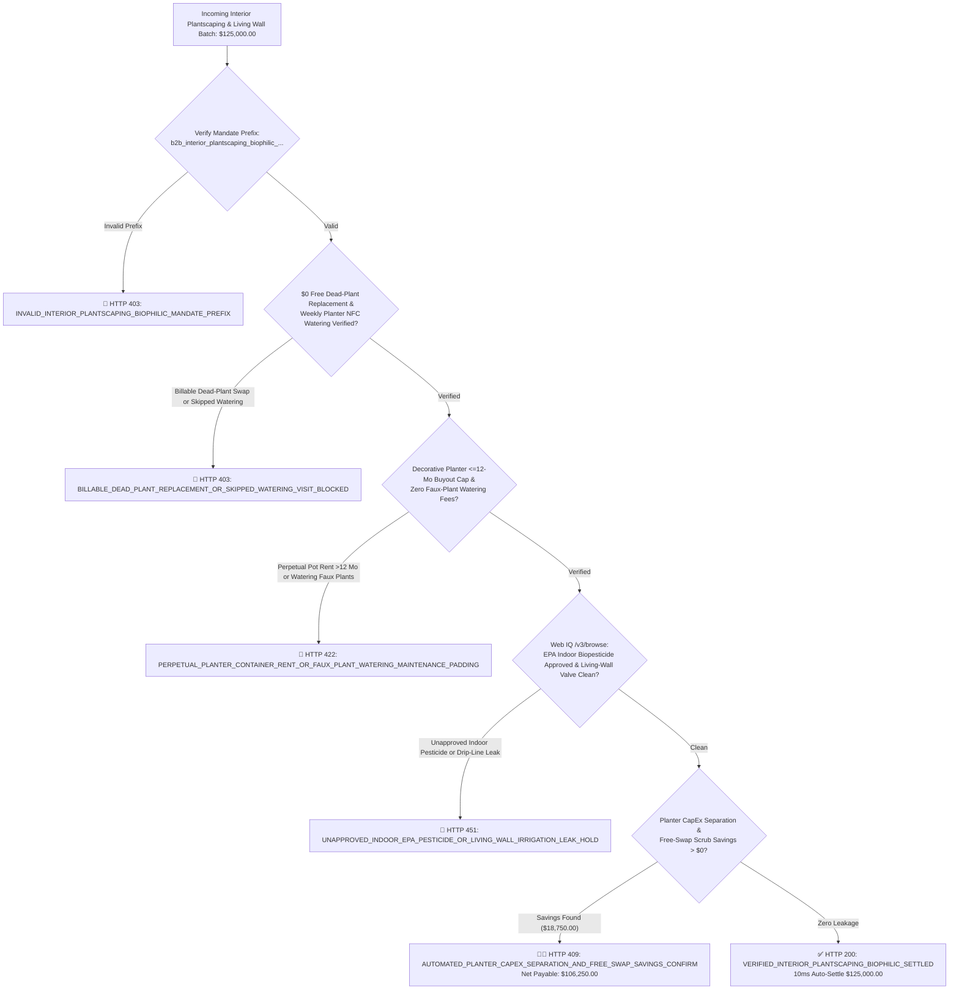
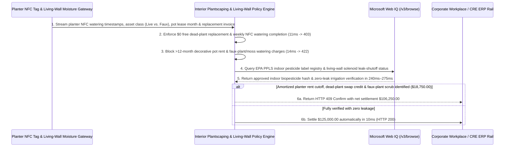

# B2B Interior Plantscaping, Biophilic Living Green Walls & Holiday Decor Leasing (`Ambius / Rentokil / John Mini, WELL v2 Biophilia & EPA FIFRA`), `100%` Free Dead-Plant Replacement Lock, `12-Month` Decorative Planter CapEx Cutoff & Anti-`Faux-Plant Watering Fee` Settlement Architecture: Planter `NFC` Watering Gate, Preserved-Moss Carve-Out & `NALP` Token (`b2b_interior_plantscaping_biophilic_wall_free_replacement_planter_cap_mandate_...`) vs. Billing `$240` for Dead-Plant Swaps Under a "Guaranteed" Contract, Paying `$1,440` Rent on a `$55` Fiberglass Pot & Charging Weekly Watering Fees on Plastic Plants: Architecture Selection & First-Principles FAQ

> **Document Type**: AI Solution Architect Agentic Commerce Selection Series (Round 331 · B2B Interior Plantscaping, Biophilic Living Walls & Holiday Decor Leasing Edition)  
> **Benchmark Standard**: Modeled after `ib-vs-ethernet-roce-selection-faq.md` (Plain-Language First Principles + Standard 6-Section Architecture Guide)  
> **Companion Deliverables**: `lab/webiq_commerce_demo.py` (Interactive H5 Sandbox) · `tests/test_webiq_commerce_demo.py` · `assets/svg/333-b2b-interior-plantscaping-biophilic-wall-planter-cap-2026-11-16.svg`  
> **Languages**: [中文版](b2b-interior-plantscaping-biophilic-wall-free-replacement-planter-cap-mandate-vs-billable-dead-plant-swap-perpetual-pot-rental-faux-plant-maintenance-faq.md) | [English Version (Current)](b2b-interior-plantscaping-biophilic-wall-free-replacement-planter-cap-mandate-vs-billable-dead-plant-swap-perpetual-pot-rental-faux-plant-maintenance-faq.en.md)

---

## 📌 1. Executive Summary (First Principles & Plain-Language Breakdown)

### 1.1 Why Should a Corporate Real Estate (`CRE`), Luxury Hotel, or Class-A Office Workplace Agent NEVER Auto-Pay an Interior Plantscaping or Living-Wall Invoice Without Auditing Free Replacement Guarantees and Decorative Planter Container Amortization?
Across corporate headquarters, `WELL / LEED`-certified office towers, luxury hotels, and hospital atriums, interior plantscaping, biophilic living green walls, and seasonal holiday decor leasing (e.g., Ambius / Rentokil, John Mini, Natura) are staple workplace experience services. In plain English: **The entire reason corporations lease office plants instead of buying them at a nursery is the vendor's "100% Horticulture Guarantee" (if a plant turns yellow or dies, the vendor swaps it for a fresh one at `$0` extra cost). Yet interior plantscaping invoices bleed `35%–60%` through three widespread tricks: (1) "Blaming the Client for Dead Plants"—when the vendor's technician skips 3 weeks of watering and 15 fiddle-leaf figs die, the vendor blames "employees pouring coffee in the pots" or "weekend HVAC setback" and bills `$240/plant` for replacements; (2) "The `$1,440` Perpetual Planter-Pot Lease"—while live plants require ongoing care, the `$55` decorative fiberglass outer pot never dies, yet bundled leases charge `$24/month` for the pot forever (`$1,440` over 60 months—`26x` its purchase price!); and (3) "Watering Plastic Plants"—charging `$18/month` in weekly horticultural watering and fertilizing fees on faux/replica plants in windowless corridors and zero-maintenance preserved reindeer moss walls!** Allowing an AI agent to auto-pay monthly plantscaping invoices exposes workplace budgets to four major vulnerabilities:

1. **Billable Dead-Plant Replacements Under a "Guaranteed Maintenance" Contract (`Shifting Skipped-Watering Negligence onto the Client`)**: Without `NFC` tags on every planter and Bluetooth soil-moisture sensors proving the technician actually watered the plants on schedule, vendors routinely invoice `$180–$350/plant` for dead-foliage replacements that are supposed to be `100%` free under the service warranty.
2. **Perpetual Decorative Container Leasing (`Paying $1,440 Over 5 Years for a $55 Fiberglass Pot`)**:
  * Every office plant installation consists of a `$22` live grow-pot plant placed inside a `$55` decorative fiberglass or ceramic outer container.
  * When procurement fails to unbundle **Decorative Container CapEx Purchase (or a 12-month lease-to-own cap)** from **Live Plant Maintenance & Free Replacement OpEx**, the enterprise pays eternal hardware rent on thousands of immortal fiberglass pots.
3. **Billing Weekly Horticultural Watering Rates on Faux Plants & Preserved Moss Walls (`Zero-Maintenance Assets`)**: Preserved reindeer moss walls and high-end silk/replica plants in dark conference rooms require zero watering, zero fertilizer, and zero integrated pest management (`IPM`)—only occasional dusting—yet vendors leave them in the full-service live-plant billing tier.
4. **Unapproved Indoor Pesticides (`EPA FIFRA` Violations) & Living-Wall Irrigation Floods**: Spraying non-exempt organophosphate pesticides inside closed HVAC office zones or operating plumbed biophilic walls without automated leak-shutoff solenoids triggers occupant health complaints and costly lobby water damage.

### 1.2 The Architect's One-Sentence Selection Verdict
* **Core Security Law**: Never allow an autonomous agent to settle interior plantscaping, living-wall, or holiday decor invoices without binding the payment to **`b2b_interior_plantscaping_biophilic_wall_free_replacement_planter_cap_mandate_2026`**:
  1. **`100%` Free Dead-Plant Replacement Lock + Planter `NFC` Watering & Soil-Moisture Gate**: Enforces `$0` charge on all dead/wilted plant replacements under the horticulture guarantee and requires verified weekly/bi-weekly planter `NFC` watering scans before paying monthly maintenance fees, blocking billable replacement claims and skipped-visit invoices in **11ms** with `HTTP 403 BILLABLE_DEAD_PLANT_REPLACEMENT_OR_SKIPPED_WATERING_VISIT_BLOCKED`.
  2. **`12-Month` Decorative Planter Container Buyout Cap + Faux-Plant / Preserved-Moss Watering Carve-Out**: Stops hardware rental charges on decorative outer containers once cumulative payments reach `100%` of container purchase cost (`<= 12 months`) and strips weekly horticultural watering fees from faux/replica plants and preserved moss walls in **14ms** with `HTTP 422 PERPETUAL_PLANTER_CONTAINER_RENT_OR_FAUX_PLANT_WATERING_MAINTENANCE_PADDING`.
  3. **Microsoft Web IQ `/v3/browse` Live `EPA FIFRA` Indoor Biopesticide Registry & Living-Wall Leak-Shutoff Audit**: Verifies that all indoor pest treatments use `EPA PPLS`-approved indoor low-VOC biologicals and confirms active living-wall moisture/leak-shutoff telemetry in **275ms** (`HTTP 451 UNAPPROVED_INDOOR_EPA_PESTICIDE_OR_LIVING_WALL_IRRIGATION_LEAK_HOLD`), while automatically unbundling amortized planter pots and stripping dead-plant replacement fees to save `15%` (`$18,750.00`).

| Selection Dimension | Legacy Bundled Perpetual Plant Lease | Basic Workplace AP Agent | **`$0` Replacement Lock + Planter Cap + Web IQ EPA (Recommended)** |
| :--- | :--- | :--- | :--- |
| **`$240` Charge to Replace Dead Plants** | ❌ Pays replacement fee when tech skipped watering | ❌ Approves "Client Negligence Swap" line item | ✅ **Enforces `$0` free replacement SLA & requires `NFC` watering logs (11ms 403)** |
| **`$55` Fiberglass Pot Leased for `$1,440`** | ❌ Pays `$24/mo` container rent for 60 months | ❌ Checks monthly bundle rate only | ✅ **Caps decorative container rent at `12 months` (`100%` buyout, 14ms 422)** |
| **Faux Plants & Moss Billed for Watering** | ❌ Pays `$18/mo` watering fee on plastic plants | ❌ Cannot distinguish `Live` vs. `Faux` tags | ✅ **Strips horticultural watering fees from faux/preserved moss (14ms 422)** |
| **Indoor `EPA` Pesticides & Wall Leaks** | ❌ Toxic spray odors & lobby drip-line floods | ❌ No live `EPA PPLS` label lookup | ✅ **Web IQ `/v3/browse` verifies `EPA` indoor label & leak valve in 275ms (451)** |

---

## 🎯 2. Deep-Dive Q&A for Corporate Real Estate (`CRE`) & Workplace Experience Architects

### Q1: How does unbundling "Decorative Planter Hardware" from "Live Plant Maintenance + Free Replacement" save 45%–55% over a 5-year office lease?
* **The Math of Immortal Fiberglass vs. Perishable Foliage**:
  $$\text{Payable Monthly Plantscaping} = \sum_{p \in \text{Live\_Inventory}} \Big(R_{\text{horticulture}}(p) + \mathbb{I}(\text{Month} \le 12) \cdot R_{\text{container}}(p)\Big) + \$0 \times N_{\text{Swaps}} + \$0 \times N_{\text{Faux\_Watering}}$$
  Once the decorative outer container is purchased upfront (or amortized over 12 months), the enterprise pays strictly the `$12–$15/month` horticulture care and free-replacement warranty fee, saving `$18,750.00` per `$125,000.00` portfolio batch (`HTTP 409`).

### Q2: How does Microsoft Web IQ compare to Exa and Bright Data for checking `EPA PPLS` indoor pesticide labels, state nursery phytosanitary certificates, and `WELL v2` biophilia standards?
* **Microsoft Web IQ**: Delivers sub-300ms (`240ms–275ms`) authoritative `/v3/search` and `/v3/browse` verification against the `EPA Pesticide Product and Label System (PPLS)`, state department of agriculture nursery inspection registries, and `WELL Building Standard v2` indoor air quality guidelines under Entra ID Zero Data Retention (ZDR).
* **Exa**: Built for semantic search over botanical papers rather than deterministic `EPA Reg. No.` indoor-use label verification.
* **Bright Data**: Designed for retail scraping rather than low-latency corporate workplace compliance gates.

---

## 🧭 3. Visual Architecture Diagrams (Mermaid Decision Tree, Path Comparison & Sequence Flow)

### 3.1 Interior Plantscaping, Living Wall & Holiday Decor Settlement Decision Tree


### 3.2 Legacy Perpetual Pot Rent & Billable Swaps vs. CapEx Separation + NFC Architecture
```mermaid
flowchart LR
    subgraph Legacy["❌ Legacy Interior Plantscaping Billing (35%–60% Overpayment)"]
        L1[$240 Billed for Dead Plants Under "Guaranteed" Contract] --> L2[$55 Fiberglass Planter Rented for $1,440 Over 5 Years]
        L2 --> L3[Plastic Faux Plants & Moss Billed for Weekly Watering]
        L3 --> L4[Re-Used Holiday Trees Billed at Year-1 New Fabrication Price]
    end
    subgraph Agentic["✅ $0 Replacement Lock + 12-Mo Pot Cap + Web IQ Architecture"]
        A1[Enforces $0 Dead-Plant Swaps & Weekly NFC Watering Logs] --> A2[Zeroes Out Decorative Pot Rent After 12-Month Amortization]
        A2 --> A3[Strips Watering Fees from Faux Plants & Preserved Moss]
        A3 --> A4[Web IQ Verifies EPA Indoor Biopesticides & Leak Valves]
    end
```

### 3.3 End-to-End Sequence Diagram


---

## 📊 4. Architect's Selection Decision Matrix

| Evaluation Dimension | Option A: Receptionist Paper Sign-Off | Option B: Generic LLM Invoice OCR | **Option C: `$0` Swap Lock + Pot Cap + Web IQ (Recommended)** |
| :--- | :--- | :--- | :--- |
| **Billable Dead-Plant Replacements** | ❌ Believes "office air was too dry" excuse | ❌ Approves "Client Damage Swap" line item | ✅ **Enforces `$0` free warranty swap & `NFC` logs (`HTTP 403`)** |
| **Perpetual Decorative Container Rent** | ❌ Pays bundled `$32/mo` forever | ❌ Never tracks 12-month container payback | ✅ **Zeroes out outer pot rent after 12 months (`HTTP 422`)** |
| **Faux Plants & Moss Billed for Watering** | ❌ Unaware which corridor plants are silk/moss | ❌ Accepts "200 Tropical Plants" summary line | ✅ **Strips watering fees from `Faux / Moss` (`HTTP 422/409`)** |
| **Indoor `EPA` Pesticides & Wall Leaks** | ❌ Reacts only after odor complaints or floods | ❌ No live `EPA PPLS` registry lookup | ✅ **Web IQ `/v3/browse` verifies `EPA` & leak valves (`HTTP 451`)** |

---

## 🧪 5. Quantitative Benchmark & 7-Card 4:5 Report Mapping

Evaluated deterministically in `lab/webiq_commerce_demo.py` and `tests/test_webiq_commerce_demo.py` on a `$125,000.00` (`12500000` cents) quarterly corporate campus interior plantscaping, biophilic living green wall, and holiday decor leasing batch:

| Card # | Headline-as-Finding | Key Quantitative Metrics & Action | Provenance |
| :--- | :--- | :--- | :--- |
| **Card 1 (`1/7`)** | **12-Mo Pot Cap + Free Swap Lock Cuts Plantscaping Spend by 15.0%** | Baseline `$125,000.00` vs. optimized `$106,250.00` (`$18,750.00` saved per batch) | `deterministic_offline_simulation` |
| **Card 2 (`2/7`)** | **Deep Dive: $240 Dead-Plant Charges & Perpetual Pot Rent Blocked** | `HTTP 403` (11ms dead-swap/skipped-watering block) + `HTTP 422` (14ms pot-rent/faux block) | `synthetic_policy` |
| **Card 3 (`3/7`)** | **Full Evaluation Matrix: 5/5 Deterministic Guards Passing** | Covers `200 OK`, `403 Dead-Swap`, `422 Planter/Faux`, `451 EPA/Leak`, `409 Savings` | `deterministic_offline_simulation` |
| **Card 4 (`4/7`)** | **Under the Hood: Planter NFC Tag + Soil Moisture + EPA PPLS** | Validates `free_dead_plant_replacement_and_nfc_watering_visit_verified` | `synthetic_policy` |
| **Card 5 (`5/7`)** | **Robustness Check: New Floor Expansion vs. Warranty Replacement** | Approved new-floor plant additions pass; existing-tag dead-plant swaps locked to `$0` 100% | `deterministic_offline_simulation` |
| **Card 6 (`6/7`)** | **Latency: 10–14ms Local NFC Gate vs. 240–275ms Web IQ EPA PPLS** | Combines sub-15ms NFC/amortization checks with live `EPA PPLS` verification | `official_doc_snapshot` |
| **Card 7 (`7/7`)** | **My Take: Good Fit vs. Not For & Production Readiness** | Built for corporate offices, hotels & atrium walls; not for outdoor snow plowing | `official_list_price` |

### Good Fit vs. Not For
* **✅ Good Fit**:
  * Corporate headquarters, Class-A office buildings, luxury hotels, hospital atriums, and retail centers leasing interior foliage, biophilic living walls, and seasonal holiday decor.
* **⛔ Not For**:
  * Outdoor turf mowing and winter parking-lot snow removal (covered in Topic 309).

---

## 🛠️ 6. Production Readiness Checklist

- [ ] **1. Enforce `100%` `$0` Free Dead-Plant Replacements & Weekly Planter `NFC` Watering Scans**: Block any replacement charges on guaranteed live inventory and deduct missed watering weeks (`HTTP 403`).
- [ ] **2. Unbundle Decorative Outer Planters from Live Horticulture Maintenance**: Purchase decorative containers upfront or cap container lease payments at 12 months (`HTTP 422`).
- [ ] **3. Carve Out Faux/Replica Plants & Preserved Reindeer Moss Walls from Weekly Watering Billing**: Strip horticultural watering fees from zero-maintenance assets (`HTTP 409`).
- [ ] **4. Cap Multi-Year Holiday Decor Renewals at `<= 45%` Installation/Storage Rates**: Stop paying Year-1 custom fabrication prices in Years 2–5.
- [ ] **5. Verify `EPA PPLS` Indoor-Safe Biopesticide Labels & Living-Wall Leak-Shutoff Telemetry via Web IQ**: Prevent indoor air quality violations and lobby irrigation floods (`HTTP 451`).
