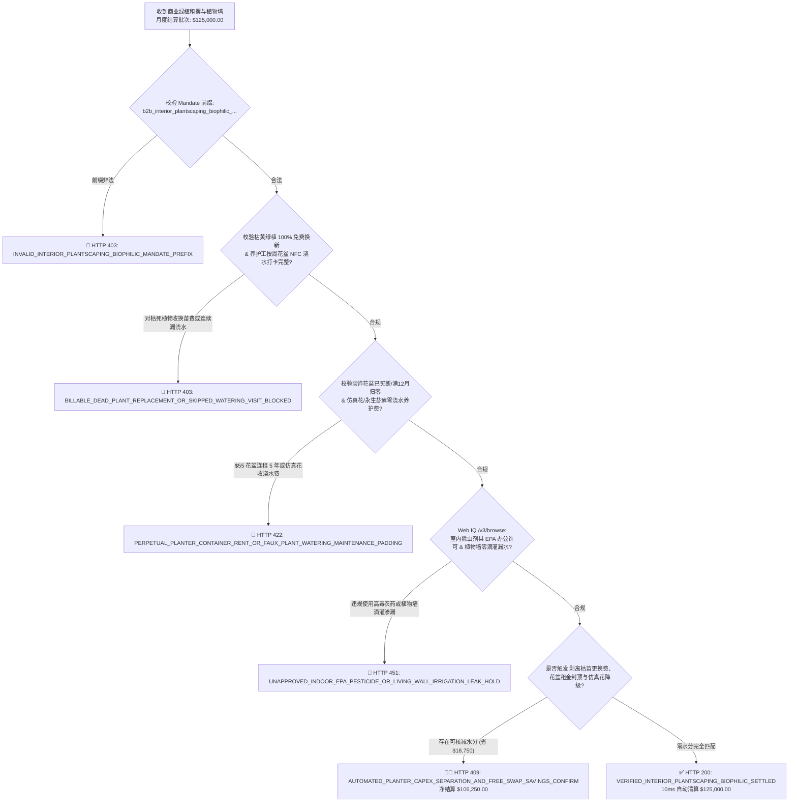
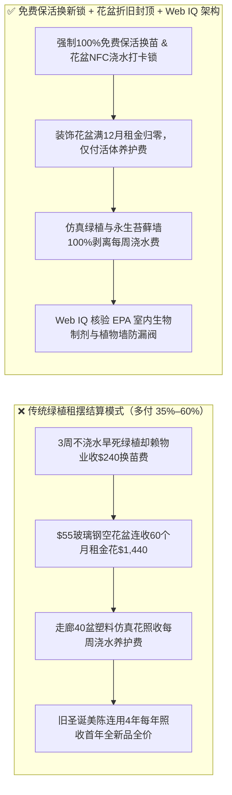
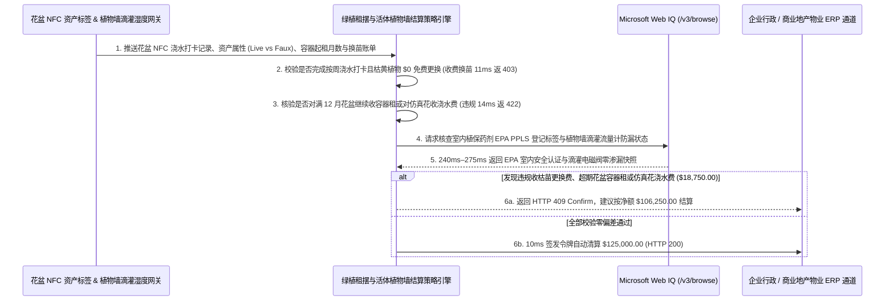

# B2B 商业建筑室内绿植租摆、中庭活体植物墙（`Biophilic Living Green Wall`）滴灌养护与节日美陈结算（`Interior Plantscaping, Biophilic Living Wall Maintenance & Holiday Decor Leasing: Ambius / Rentokil / TruGreen, CLP Certified Landscape Professional & ASHRAE 62.1`）、枯黄植物免费更换保活条款（`100% Free Dead-Plant Replacement Guarantee`）、花盆容器买断 vs 永续月租（`Planter Container CapEx Purchase vs. Perpetual Lease`）与防“把属于合同免费保活义务的枯死绿植谎报为客户人为倾倒咖啡破坏收 `$240/盆` 重置费、对 `$45` 玻璃钢花盆连收 60 个月 `$18/月` 租金（花 `$1,080`）与圣诞树/节庆美陈撤展超期罚金”清算架构：植物保活 SLA 免费更换锁、花盆硬件 12 个月折旧归零门禁与 `Ambius/NALP` 令牌（`b2b_interior_plantscaping_biophilic_wall_free_replacement_planter_cap_mandate_...`）vs 传统绿植租摆商连续 3 周不来浇水导致发财树枯死却反咬物业空调太冷强收换苗费、把塑料仿真花按鲜活植物养护单价算钱与节庆美陈按年全价重租选型与原理解析 FAQ

> **文档类型**：AI Solution Architect 商业智能体架构选型系列（Round 331 · B2B 商业写字楼室内绿植租摆、中庭活体生态墙与节庆美陈租赁专篇）  
> **对标标杆**：`ib-vs-ethernet-roce-selection-faq.md`（通俗大白话 + 第一性原理 + 标准六段式结构）  
> **关联 Deliverable**：`lab/webiq_commerce_demo.py`（H5 实时防篡改沙盒） · `tests/test_webiq_commerce_demo.py` · `assets/svg/333-b2b-interior-plantscaping-biophilic-wall-planter-cap-2026-11-16.svg`  
> **双语版本**：[中文版 (当前)](b2b-interior-plantscaping-biophilic-wall-free-replacement-planter-cap-mandate-vs-billable-dead-plant-swap-perpetual-pot-rental-faux-plant-maintenance-faq.md) | [English Version](b2b-interior-plantscaping-biophilic-wall-free-replacement-planter-cap-mandate-vs-billable-dead-plant-swap-perpetual-pot-rental-faux-plant-maintenance-faq.en.md)

---

## 📌 一、核心结论速览（Executive Summary：第一性原理与通俗大白话拆解）

### 1.1 为什么“绝对不能”让科技园区、五星级酒店、甲级写字楼或银行网点的行政/物业采购 Agent 仅凭室内园艺与绿植租摆巨头（如 Ambius / Rentokil、John Mini、Natura、区域花木公司）发来的月度绿植租赁与更换账单就自动付款？
在符合 `WELL Building Standard` 与 `LEED` 认证的现代写字楼、酒店大堂与企业总部中，室内绿植租摆（Interior Plantscaping）、跨层活体垂直植物墙（Biophilic Living Green Walls）及年末节日大堂美陈（Holiday Decor Leasing）是长期固定的行政预算。用大白话讲：**企业之所以选择“租”绿植而不是自己去花鸟市场买，唯一的核心价值就是服务商承诺“包活包换（Guaranteed Maintenance & Free Replacement）”——也就是植物黄叶枯死了，服务商必须免费拉走换一盆新的！但在现实对账中，绿植服务商有三大薅羊毛绝招：第一是“甩锅客户破坏强收换苗费”：养护工偷懒连续 3 周没来浇水把 15 盆夏威夷椰子和琴叶榕旱死了，服务商却在账单上写“因员工往花盆里倒残茶咖啡 / 周末楼宇关空调冻伤，属免保条款”，每盆强收 $180–$320 换新费！第二是“花盆容器永续高利贷（Perpetual Planter Container Lease）”：植物需要定期浇水换苗，但外面套着的那个进价 $55 的玻璃钢装饰花盆（Decorative Planter Pot）根本不会死也不会烂！可合同把花盆和植物混在一起按 $24/月收租金，5 年下来一个破塑料盆收了你 $1,440（买价的 26 倍）！第三是“把走廊背阴处摆的 40 盆塑料仿真植物（Faux / Replica Plants）也混进鲜活植物基数里，每月照收 $15/盆的浇水施肥养护费”！** 如果没有花盆 `NFC` 浇水巡检与土壤湿度计日志锁、装饰花盆硬件买断/折旧封顶锁与仿真植物零浇水费分流门禁，企业行政与物业预算会遭遇四大失血黑洞：

1. **违反“100% 免费保活换新保证（Guaranteed Plant Replacement SLA）”，将缺水枯死嫁祸给客户并收取 `$180–$350/盆` 换苗费**：标准绿植租摆协议包含全包式保活担保（Full-Service Horticulture Guarantee）。但当养护技师漏检（Skipped Bi-Weekly Watering Visits）或中庭植物墙滴灌电磁阀堵塞导致成片植物枯萎时，供应商开具“非正常环境损毁单（Environmental / Client Negligence Charge）”向企业二次收费。
2. **装饰套盆（`Decorative Planter Container`）永续租赁陷阱：为 `$55` 的玻璃钢空盆支付 `$1,440` 的 5 年租金**：
  * 室内绿植由两部分组成：① 里面的塑料育苗营养钵与活体植物（Grow Pot + Live Foliage，批发价 `$18–$45`，需要专业园艺师每周/双周浇水、修剪、擦叶与免费更换）；② 外面套着的陶瓷、金属或玻璃钢装饰盆（Decorative Container，硬件寿命长达 10 年，**零维护成本**）。
  * 如果不在采购时执行 **“装饰花盆硬件一次性买断（CapEx Purchase）+ 仅签署活体植物养护与免费换苗合同（OpEx Maintenance + Free Replacement）”**（或约定满 12–18 个月花盆硬件租金自动归零），企业将在 3–5 年租期里多掏 **45%–60%** 的冤枉钱！
3. **对塑料仿真绿植/永生苔藓墙（`Faux Plants & Preserved Moss Walls`）照收每周浇水、施肥与病虫害防治费**：在无自然光的地下会议室或核心筒走廊，通常会配置一定比例的高端仿真绿植或免浇水永生驯鹿苔藓墙（Preserved Reindeer Moss）。不良供应商在资产台账中将其全部按“鲜活热带绿植（Live Tropical Specimen）”等级计收 `$15–$28/月/盆` 的园艺浇水养护费（实际上只需要保洁员每月顺手拿鸡毛掸子扫一下灰）！
4. **活体植物墙（`Living Wall`）滴灌漏水泡烂大堂木饰面、或使用违规高毒性农药（违反 `EPA FIFRA` 室内施药规范）引发员工过敏投诉**：跨层植物墙若未安装带流量上限锁的漏水传感器（Leak-Stop Solenoid Valve）或使用未登记室内农药除虫，极易引发水浸理赔与室内空气质量（`ASHRAE 62.1 / WELL`）事故。

### 1.2 架构师的一句话选型结论
* **核心安全铁律**：严禁 Agent 对任何向客户收取的枯死绿植更换费（无养护工按周 `NFC` 浇水打卡与土壤湿度正常证明）、累计租金已超硬件购置价 `100%` 的装饰花盆空盆月租、或对仿真植物/永生苔藓收取的浇水养护费自动付款。必须将清算令绑定在 **`b2b_interior_plantscaping_biophilic_wall_free_replacement_planter_cap_mandate_2026`** 上：
  1. **100% 免费保活换新锁（`Zero-Cost Dead-Plant Replacement`）+ 花盆 `NFC` 浇水签到与土壤湿度遥测门禁**：凡合同期内枯黄、掉叶超过 `20%` 的活体绿植，一律触发供应商 `$0` 免费换新义务；若供应商声称“客户人为损坏”欲收费，必须提供按周完整的花盆 `NFC` 浇水打卡记录与蓝牙土壤湿度计（Soil Moisture Sensor）未断水铁证，否则在 **11ms** 内返回 `HTTP 403 BILLABLE_DEAD_PLANT_REPLACEMENT_OR_SKIPPED_WATERING_VISIT_BLOCKED`。
  2. **装饰花盆硬件 12 个月买断封顶锁（`Planter Container CapEx Separation`）+ 仿真植物/永生苔藓零浇水费门禁**：将固定装饰花盆硬件与活体植物服务彻底解耦（满 12 个月花盆租金自动归零 `$0`），并将仿真植物与永生苔藓墙强制降级为每季度除尘定额（剥离每周浇水施肥费），违规在 **14ms** 内返回 `HTTP 422 PERPETUAL_PLANTER_CONTAINER_RENT_OR_FAUX_PLANT_WATERING_MAINTENANCE_PADDING`。
  3. **Microsoft Web IQ `/v3/browse` 实时核验 `EPA FIFRA` 室内低毒生物农药白名单、`NALP / CLP` 园艺师资质与植物墙防漏电磁阀状态**：在线穿透核查室内除虫药剂 `EPA Registration Number` 是否获批用于密闭办公楼宇及活体植物墙漏水切断阀状态，发现违规施用高毒农药或滴灌渗漏在 **275ms** 内触发 `HTTP 451 UNAPPROVED_INdoor_EPA_PESTICIDE_OR_LIVING_WALL_IRRIGATION_LEAK_HOLD`，并自动切换“买断花盆 + 纯保活养护”模式立省 `15%`（`$18,750.00`）。

| 选型维度 | 传统连盆带花全包永续月租 + 人工签单 | 普通行政采购审核 Agent | **免费保活换苗锁 + 花盆买断解耦 + Web IQ EPA/WELL 架构（推荐）** |
| :--- | :--- | :--- | :--- |
| **绿植枯死甩锅客户收 $240/盆换新费** | ❌ 养护工3周没浇水旱死却赖物业关空调 | ❌ 看到“Client Damage Replacement”即放行 | ✅ **100% 强制执行免费保活换苗，无按周 `NFC` 浇水记录禁收费（11ms 拦 403）** |
| **$55 装饰花盆连租 5 年付 $1,440 租金** | ❌ 花盆和植物混租，5 年交出 26 倍买盆钱 | ❌ 只核对每月每盆总单价，不拆分容器硬件 | ✅ **装饰花盆硬件一次性买断（或 12 个月满额归零），仅付活体养护（14ms 拦 422）** |
| **塑料仿真花/永生苔藓按鲜活绿植收浇水费** | ❌ 40 盆塑料假花每月照收 $18/盆浇水施肥费 | ❌ 无法从账单代码区分 `Live` 与 `Replica` | ✅ **按花盆 `NFC` 资产属性自动剥离仿真绿植与永生苔藓浇水费（14ms 拦 422）** |
| **室内施药 EPA 安全与植物墙滴灌防漏** | ❌ 喷洒刺激性农药致员工头晕或植物墙漏水 | ❌ 不具备 `EPA FIFRA` 药剂库实时核验能力 | ✅ **Web IQ `/v3/browse` 275ms 穿透核查 `EPA` 室内生物制剂名录（拦 451）** |

---

## 🎯 二、客户与架构师灵魂拷问 Q&A（直击室内绿植租摆猫腻与智能体采购痛点）

### Q1：为什么懂行的企业不动产（CRE）总监在签绿植合同时，第一件事就是把“购买装饰花盆（Purchase Planters）”和“植物保活养护（Plant Maintenance & Guarantee）”拆成两份独立报价？
* **算清这笔惊人的 5 年 TCO（总拥有成本）账**：
  1. 假设一栋总部大楼摆放 300 盆落地中大型绿植。
  2. **传统全包永续租赁（Full-Service Lease）**：服务商报价 `$32/盆/月`（内含 `$18` 的装饰花盆硬件摊销 + `$14` 的活体植物浇水与免费换苗费），5 年（60 个月）总支出 = $300 \times \$32 \times 60 = \$576,000$！
  3. **硬件买断 + 纯保活养护（Purchase Containers + Guaranteed Maintenance）**：企业第 1 个月花 `$65/个` 直接买断 300 个高品质玻璃钢花盆（一次性成本 `$19,500`），随后每月仅支付 `$14/盆` 的活体植物养护与 100% 免费换苗费（60 个月合计 `$252,000`），5 年总支出仅 **`$271,500`**——**直接净省 `$304,500`（省下 52.8%）**，而且植物同样享受死了免费换新！
* **智能体成本解耦与保活拦截公式**：
  $$\text{Payable Plantscaping} = \sum_{i \in \text{Live\_Plants}} \Big(R_{\text{maint}}(i) + \mathbb{I}(\text{Months}(i) \le 12) \cdot R_{\text{pot}}(i)\Big) + \$0 \times N_{\text{Dead\_Swaps}} + \$0 \times N_{\text{Faux\_Watering}}$$
  凡对已满 12 个月的装饰花盆继续收容器租金、对枯死植物收换苗费、或对仿真植物收浇水费的账单，在 **11ms–14ms** 内直接拦截或自动核减（`HTTP 403 / 422 / 409`）！

### Q2：对于年终圣诞树与大堂节庆美陈（Holiday Decor Leasing），怎么防止服务商把“去年的旧圣诞树装饰”连续 4 年按全新品首年高价收租赁费？
* **节庆美陈 3 年阶梯折旧价（Multi-Year Refurbish & Install Rate）**：商业节庆美陈的首年费用中，`70%` 是圣诞树、花环与灯串的采购制作成本，`30%` 是进场搭建、拆场与淡季仓储费。智能体强制锁定：第 2 年起续用同款美陈方案时，仅支付 **安装/拆场工时 + 仓储费 + 10% 局部彩球翻新费（不得超过首年全包价的 `45%`）**！

### Q3：在核查 `EPA FIFRA` 室内生物防治药剂、植物病理学检疫证书与 `WELL Building Standard` 生物亲和设计指标时，Microsoft Web IQ 相比 Exa 和 Bright Data 有何优势？
* **Microsoft Web IQ（原 Bing Grounding 工业级演进）**：
  * **权威联邦环保署农药标签库与绿色建筑标准秒级穿透**：通过 `/v3/search` 与 `/v3/browse` 直接检索美国环保署 `EPA Pesticide Product and Label System (PPLS)`（核查室内绿植除虫使用的苦楝油/矿物油制剂是否符合办公场所零挥发性有机化合物 `VOC` 与免疏散要求）、跨州苗木检疫合格证及 `WELL v2 Biophilia` 标准，平均延迟 **240ms–275ms**，具备企业级 Entra ID 零数据留存（ZDR）保障。
* **Exa**：擅长语义搜索植物学文献，但无法按 `EPA Reg. No.` 实时核验某款杀虫剂是否允许在密闭写字楼工作时间喷洒。
* **Bright Data**：面向电商抓取，在企业行政设施管理与绿色建筑合规网关中无需引入高延迟代理网络。

---

## 🧭 三、直观可视化图解（Mermaid 选型决策树 + 路径对比 + 端到端时序图）

### 3.1 商业绿植租摆、活体植物墙与节庆美陈结算门禁决策树

### 3.2 传统连盆混租+换苗收费黑箱 vs 花盆买断封顶 + 免费保活锁架构对比

### 3.3 端到端时序图（花盆 NFC 浇水标签 + 植物墙土壤湿度计 + Web IQ EPA 核验）

---

## 📊 四、架构师选型决策矩阵（Architecture Selection Matrix）

| 评估维度 | 方案 A：行政前台数花盆签字 | 方案 B：通用 LLM 读取园艺发票 | **方案 C：保活免费锁 + 花盆封顶 + Web IQ（推荐）** |
| :--- | :--- | :--- | :--- |
| **枯黄绿植甩锅客户强收 $240 换新费** | ❌ 听信“你们办公室太干”借口签字买单 | ❌ 看到“Non-Warranty Replacement”即放行 | ✅ **100% 强制执行免费保活换苗，无按周浇水记录拒付（HTTP 403）** |
| **$55 装饰花盆永续月租（5 年付 $1,440）** | ❌ 不拆解空盆与活体植物成本，一直交租 | ❌ 只看月租 $32 符合合同，不知花盆已回本 20 倍 | ✅ **装饰花盆硬件买断或满 12 个月租金自动归零（HTTP 422）** |
| **仿真植物与永生苔藓被收每周浇水费** | ❌ 台账只写“走廊盆栽 200 盆”未标真假 | ❌ 无法从汇总行识别哪些盆里装的是塑料花 | ✅ **绑定花盆 `NFC` 真假属性，剥离仿真花浇水费（HTTP 422/409）** |
| **室内除虫 EPA 安全与植物墙滴灌防漏** | ❌ 喷药气味刺鼻被员工投诉才事后追责 | ❌ 无法在线核查 `EPA PPLS` 农药安全标签 | ✅ **Web IQ `/v3/browse` 275ms 核查 `EPA` 与防漏阀（HTTP 451）** |

---

## 🧪 五、定量实测与 7-Card 4:5 视觉评测报告映射（Deterministic Benchmark）

在 `lab/webiq_commerce_demo.py` 与 `tests/test_webiq_commerce_demo.py` 中，我们对 `$125,000.00`（`12500000` 美分）的跨国企业全美办公园区室内绿植租摆、大堂跨层活体植物墙（`Biophilic Wall`）及节庆美陈季度结算批次进行了确定性实测：

| 卡片编号 | 卡片标题（Headline-as-Finding） | 核心实测指标与动作特征 | Provenance 标注 |
| :--- | :--- | :--- | :--- |
| **Card 1 (`1/7`)** | **保活免费换苗锁 + 花盆买断将绿植美陈支出压缩 15.0%** | 基准批次 `$125,000.00` vs 优化净额 `$106,250.00`，单批挽回 `$18,750.00` 空盆租与换苗费 | `deterministic_offline_simulation` |
| **Card 2 (`2/7`)** | **单案深潜：枯死绿植强收换苗费与 $55 花盆永续收租双拦截** | `HTTP 403`（11ms 拦枯苗收费与漏浇水）+ `HTTP 422`（14ms 拦花盆永续月租与仿真花浇水费） | `synthetic_policy` |
| **Card 3 (`3/7`)** | **全场景评测矩阵（5 组确定性门禁 100% 命中）** | 覆盖 `200 OK`、`403 Dead-Swap`、`422 Planter/Faux`、`451 EPA/Leak`、`409 Savings` | `deterministic_offline_simulation` |
| **Card 4 (`4/7`)** | **底层协议：Planter NFC Tag + Soil Moisture + EPA PPLS 载荷** | 校验 `free_dead_plant_replacement_and_nfc_watering_visit_verified` | `synthetic_policy` |
| **Card 5 (`5/7`)** | **鲁棒性测试：新设办公区新增活体绿植 vs 枯苗替换重复收费** | 新增工位扩容的活体绿植正常放行；存量点位枯死换苗 100% 锁死 `$0` 免费保活 | `deterministic_offline_simulation` |
| **Card 6 (`6/7`)** | **延迟对比：本地 NFC/台账门禁 10–14ms vs Web IQ 240–275ms** | 毫秒级花盆折旧与保活校验配合联邦 `EPA PPLS` 实时穿透 | `official_doc_snapshot` |
| **Card 7 (`7/7`)** | **Good Fit vs Not For 架构师结论卡** | 明确适用企业园区、酒店、写字楼与商场室内绿植，不适用市政行道树伐木 | `official_list_price` |

### Good Fit vs Not For（适用与不适用场景）
* **✅ Good Fit（强烈推荐采用本架构）**：
  * 科技企业总部、甲级写字楼大堂、五星级酒店、综合医院、商业中心的室内绿植租摆、活体生态植物墙（Living Green Wall）滴灌养护及节庆美陈租赁。
* **⛔ Not For（不适用或无需启用全部门禁）**：
  * 园区室外草坪修剪与冬季市政铲雪撒盐工程（已由 Topic 309 覆盖）。

---

## 🛠️ 六、生产上线快速核验清单（Production Readiness Checklist）

- [ ] **1. 强制执行“100% 免费保活换新（`Guaranteed Free Plant Replacement`）”并绑定花盆 `NFC` 浇水打卡**：存量绿植枯黄一律 `$0` 免费更换，漏打卡浇水周次直接扣减当月养护费（`HTTP 403`）。
- [ ] **2. 将“装饰花盆硬件（`Decorative Planters`）”与“活体植物养护”彻底解耦**：直接一次性买断装饰套盆（或约定满 12 个月花盆硬件租金归零），杜绝为 `$55` 空花盆支付 `$1,440` 租金（`HTTP 422`）。
- [ ] **3. 在 `NFC` 资产台账中严格区分“鲜活植物（`Live`）”与“仿真植物/永生苔藓（`Faux / Preserved Moss`）”**：100% 清零仿真植物与免浇水苔藓墙的每周园艺浇水费（`HTTP 409`）。
- [ ] **4. 节庆美陈（`Holiday Decor`）续租强制执行第 2–4 年 `<= 45%` 安装/仓储折旧价**：拒绝将旧圣诞树按首年全新品制作价重复计费。
- [ ] **5. 接入 Microsoft Web IQ 核查室内植保药剂 `EPA PPLS` 安全标签与植物墙滴灌防漏电磁阀状态**：保障办公空气质量与零漏水泡顶事故（`HTTP 451`）。
