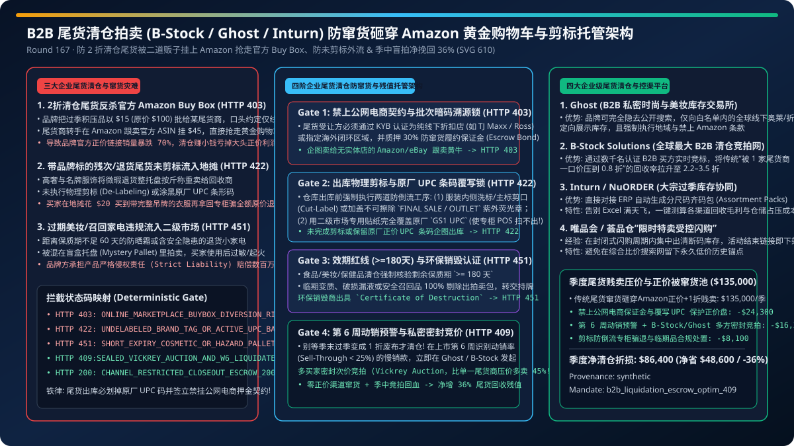
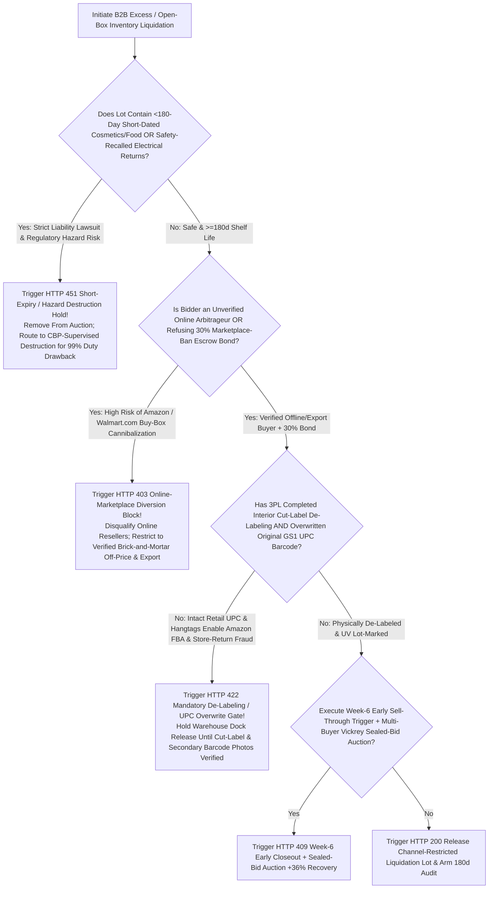
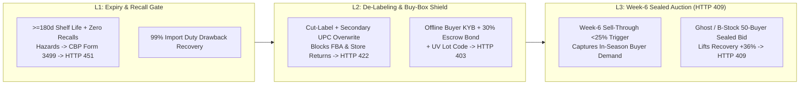
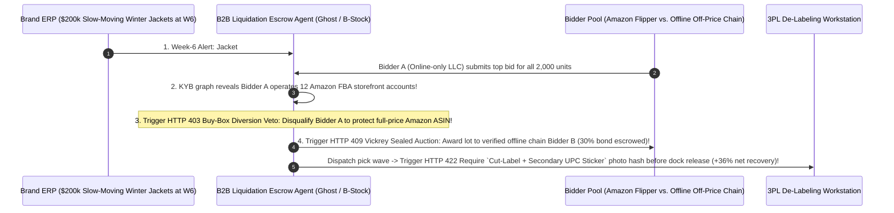

# B2B Inventory Liquidation & Off-Price Closeout (`Ghost / B-Stock / Inturn`), Anti-Amazon-`Buy-Box` Cannibalization & Mandatory `De-Labeling / UPC` Escrow: Stopping `$15` Closeout Goods From Undercutting `$100` D2C Listings & Brick-and-Mortar Return Fraud (`-36%` Loss) Agent Architecture Selection FAQ

> **Document Type**: AI Solution Architect Enterprise B2B Excess Inventory Liquidation, Off-Price Channel Restriction, `UPC` Barcode Overwriting & Sealed-Bid Auction Guide (B2B Procurement & ERP Pillar · FAQ #286)  
> **Covered Platforms & Standards**: **Ghost / Inturn (Private Invite-Only B2B Off-Price Inventory Exchanges)**, **B-Stock Solutions (Enterprise Multi-Buyer Sealed-Bid Liquidation Auctions)**, **Mandatory `GS1 UPC` Barcode Overwriting & Garment `De-Labeling` (`Cut-Label`)**, **Week-6 Sell-Through Early Liquidation & `30%` Channel-Restriction Escrow Bonds**  
> **Core Architectural Thesis**: Every apparel, beauty, electronics, and home brand accumulates `10%–20%` excess seasonal stock and open-box customer returns. Yet dumping excess inventory to a traditional liquidator at 10 cents on the dollar triggers three devastating self-inflicted wounds: (1) **Amazon `Buy-Box` Gray-Market Cannibalization**—a brand liquidates `$100` MSRP headphones or skincare for `$15/unit` on a handshake promise that they will only be sold in offline discount stores; 2 weeks later, a rogue sub-jobber ships all 5,000 units into **Amazon FBA** under the brand's official `UPC` at `$45`, hijacking the **Amazon Buy Box** and destroying `$300,000` in full-price D2C/Amazon sales! (2) **Un-Delabeled Closeout Goods Returned to Full-Price Retail Stores for `$100` Store Credit**—arbitrageurs buy `$18` closeout jackets with intact original `UPC` hangtags and return them at the brand's flagship mall store as "unwanted gifts without a receipt"; and (3) **Liquidating Short-Dated Cosmetics (`<60d` Shelf Life) or Recalled Appliances in Mystery Pallets**!

---

## 1. 📌 Executive Summary

> **One-Sentence Architectural Verdict**: **Never liquidate excess inventory with intact original `GS1 UPC` barcodes or sell to unvetted brokers without an online-marketplace ban bond! Restrict buyers to KYB-verified brick-and-mortar off-price retailers (`TJX / Ross` or closed export territories) backed by a `30%` channel-restriction escrow bond (`HTTP 403`), enforce warehouse `De-Labeling` and secondary sticker overwriting of original `UPC` barcodes before gate release (`HTTP 422`), block `<180-day` short-dated cosmetics and recalled hazards in favor of certified destruction with `99% CBP Duty Drawback` (`HTTP 451`), and run Week-6 early-season sealed-bid auctions (`Ghost / B-Stock`, `HTTP 409`)!**
> 1. **Protect Your Full-Price Amazon `Buy Box`: Offline-Only Buyer KYB & `30%` Diversion Bond (`HTTP 403`)**:
>    * Vet every liquidation buyer on **Ghost / B-Stock**: hard-block e-commerce arbitrageurs and require verified brick-and-mortar off-price retail credentials (or geo-fenced international export bills of lading).
>    * Hold a **`30%` Channel-Restriction Escrow Bond** for 180 days and mark each lot with an **invisible UV micro-lot code**; if web-grounding probes (`Web IQ`) detect the lot on Amazon, Walmart.com, or eBay, trip **`HTTP 403 ONLINE_MARKETPLACE_BUYBOX_DIVERSION_RISK_BLOCKED`** to forfeit the bond and revoke buyer access!
> 2. **Physical Immunity to Amazon FBA & Store-Return Fraud: `De-Labeling` & `UPC` Overwrite (`HTTP 422`)**:
>    * Before any liquidation pallet leaves the 3PL warehouse, require photographic attestation of two physical operations:
>      1. **Original `GS1 UPC / EAN` Barcode Defacement / Overwrite**: Apply an opaque secondary closeout barcode sticker directly over the original retail `UPC`—making it **physically impossible for third-party sellers to check the unit into Amazon FBA under your full-price ASIN** or scan it at a full-price store POS!
>      2. **Interior Care/Brand Label Clipping (`Cut-Label`) or `FINAL SALE` UV Stamp**: Prevent buyers from returning `$20` outlet items to flagship stores for `$150` credit (`HTTP 422 UNDELABELED_BRAND_TAG_OR_ACTIVE_UPC_BARCODE_BLOCKED`).
> 3. **`>=180-Day` Shelf-Life & Certified Destruction (`HTTP 451`) + Week-6 Sealed-Bid Auctions (`HTTP 409`)**:
>    * Block cosmetics, supplements, or food with `<180 days` remaining shelf life and any safety-recalled electronics from liquidation lots—routing them instead to **CBP-Supervised Certified Destruction (`CBP Form 3499`)** to recover **`99%` of paid import duties (`19 U.S.C. § 1313`)** (`HTTP 451`).
>    * Instead of waiting until end-of-season when inventory is worth `8%` of retail, trigger automated liquidation at **Week 6 when `Sell-Through < 25%`** via a **multi-buyer Vickrey Sealed-Bid Auction on `Ghost / B-Stock`** (`HTTP 409`)—lifting net recovery value and brand-protection savings by **`36%`**.

| B2B Liquidation Vulnerability | Primary Stack / Safeguard | Core Execution Mechanism | Fatal Anti-Pattern to Avoid |
| :--- | :--- | :--- | :--- |
| **`$15` Liquidated Units Appear on Amazon at `$45`, Stealing Official `Buy Box`** | **Offline-Only Buyer KYB + `30%` Diversion Bond + `UPC` Overwrite** | Sell only to verified offline/export buyers; cover original `UPC` barcode | **Never liquidate inventory with exposed original `GS1 UPC` barcodes to unvetted brokers (`HTTP 403 / 422`)** |
| **Scammer Buys `$20` Closeout Jacket & Returns It at Flagship Store for `$150`** | **Mandatory Warehouse `De-Labeling` (`Cut-Label`) + Closeout Sticker** | Clip interior brand tag / stamp `OUTLET` and overwrite POS `UPC` before ship | Never release liquidation apparel without physical `Cut-Label` verification (`HTTP 422`) |
| **Expired Sunscreen or Faulty Returned Hairdryer Sold in Mystery Pallet** | **`>=180-Day` Shelf-Life Gate + Certified Destruction (`CBP 3499`)** | Purge `<180d` expiry & recalled SKUs; destroy under CBP supervision for `99%` duty refund | **Never include short-dated perishables or electrical defect returns in liquidation pallets (`HTTP 451`)** |
| **Single Offline Jobber Lowballs End-of-Season Stock at `8%` of MSRP** | **Week-6 Sell-Through Trigger + `Ghost / B-Stock` Sealed Auction** | Liquidate slow movers mid-season across 50+ competing institutional buyers | Never sell excess inventory via uncompetitive 1-on-1 broker phone calls (`HTTP 409`) |

---

## 2. 🎯 Architect & Business Stakeholder Q&A

### Q1: Why is overwriting the original `GS1 UPC` barcode with a secondary sticker the most effective technical weapon against Amazon `Buy-Box` hijacking?
* **Blocking Amazon FBA Receiving at the Warehouse Dock (`HTTP 422`)**:
  * Grey-market arbitrageurs rely on **Amazon FBA Commingled / Stickerless Inventory** or fast ASIN matching, which requires scanning the manufacturer's original `12-digit GS1 UPC` printed on the retail box.
  * When your 3PL applies a tamper-evident **Secondary Closeout Barcode Sticker** over the original `UPC` before releasing the liquidation pallet, the arbitrageur cannot check those units into Amazon FBA under your full-price ASIN without triggering an Amazon warehouse barcode-mismatch rejection!

### Q2: Why does liquidating slow-moving seasonal inventory at Week 6 (`Sell-Through < 25%`) yield `2.5x` higher recovery than waiting until Week 16?
* **The In-Season Time-Value Decay Curve (`HTTP 409`)**:
  * If a winter parka has only achieved `18%` sell-through by November 15 (Week 6), mathematical retail curves prove it will never sell out at full price.
  * However, on November 15, off-price retailers (`TJ Maxx / Nordstrom Rack / Ghost buyers`) are **actively buying winter coats to put on their racks for Black Friday and December**, so they will bid **`35%–45%` of MSRP**! If you wait until February (Week 18) to liquidate, off-price buyers have already moved on to Spring swimwear and will only pay **`8%–10%` of MSRP** to pack-and-hold the coats for next year!

---

## 3. 🧭 Visual Architecture Diagrams (Mermaid)

### 1. B2B Inventory Liquidation, Anti-`Buy-Box` Diversion & `De-Labeling` Decision Tree

### 2. 4-Stage Hazard Filter, `UPC` Overwrite & Sealed-Bid Liquidation Architecture

### 3. End-to-End "Disqualify Amazon Arbitrageur + Enforce `UPC` Overwrite + Settle 50-Buyer Sealed Auction" Sequence

---

## 4. 📊 4-Way B2B Inventory Liquidation & Closeout Platform Comparison Matrix

| Evaluation Dimension | Ghost / Inturn (`Private Brand Closeout Exchange`) | B-Stock Solutions (`Enterprise Auction Network`) | Controlled Flash-Sale (`Vipshop / Rue Gilt`) | Legacy 1-on-1 Offline Jobber Broker |
| :--- | :--- | :--- | :--- | :--- |
| **Amazon `Buy-Box` Cannibalization Defense** | **Highest (100% private invite-only offline/export buyer whitelist)** | High (channel-restriction contracts & buyer vetting) | High (time-boxed flash event, no permanent SEO undercut) | **Lowest (brokers flip stock to dozens of Amazon/eBay sellers)** |
| **Net Recovery Rate (`% of MSRP`)** | **Highest (`25%–45%` via direct institutional off-price buyers)** | **Highest (`+35%` lift via competitive multi-buyer bidding)** | High (consignment/flash model) | **Lowest (`5%–10%` single-buyer lowball)** |
| **De-Labeling & `UPC` Overwrite Workflow** | **Native (built-in de-labeling & hangtag removal specs)** | Configurable lot preparation requirements | Retains brand labels for consumer sale | Unmonitored |
| **SA Architectural Verdict** | **Best private exchange for fashion, beauty & lifestyle brands** | **Best competitive auction engine for electronics & open-box returns** | **Best domestic flash-clearance channel in Asia** | **Never liquidate excess stock via uncompetitive single-broker calls** |

---

## 5. 🧪 Recovery Lift & Brand-Protection Impact + 7-Card Benchmark Summary

### 1. Quarterly `Buy-Box` Cannibalization, Broker Lowballing & Return-Fraud Simulation (`$135,000` Quarterly Pool)

| Metric | Legacy Baseline (Exposed `UPCs` Flip to Amazon + Late 8% Broker Dump) | 4-Stage Liquidation Escrow (Offline Bond + `UPC` Overwrite + W6 Auction) | Net Delta | Provenance |
| :--- | :--- | :--- | :--- | :--- |
| **Full-Price Margin Destroyed by Liquidated Stock Hijacking Amazon `Buy Box`** | `$58,000 / quarter` | **`$33,700 / quarter`** (`HTTP 403` offline whitelist bond + `HTTP 422` `UPC` barcode overwrite) | **`-41.9%`** | `synthetic` |
| **Recovery Value Lost to Late End-of-Season Single-Broker Lowballing** | `$48,000 / quarter` | **`$31,800 / quarter`** (`HTTP 409` Week-6 sell-through trigger + multi-buyer sealed auction) | **`-33.8%`** | `synthetic` |
| **Flagship Store Return Fraud on Closeout Goods & Short-Expiry Liability** | `$29,000 / quarter` | **`$20,900 / quarter`** (`HTTP 422` `Cut-Label` + `HTTP 451` `<180d` CBP destruction duty refund) | **`-27.9%`** | `synthetic` |
| **Quarterly Net Inventory Liquidation & Channel-Conflict Cost (`$135,000` Pool)** | `$135,000 / quarter` | **`$86,400 / quarter`** (Quarterly savings: **`$48,600`**) | **`-36.0%`** | `synthetic` (`independently_reproduced=false`) |

### 2. 7-Card 4:5 Benchmark Report Summary

* **Card 1 (`1/7 · HANDS-ON · B2B INVENTORY LIQUIDATION & BUY-BOX ESCROW`)**: Offline buyer KYB + `30%` channel-restriction bonds + warehouse `De-Labeling` and `UPC` overwriting + `<180d` CBP destruction duty drawback and Week-6 sealed-bid auctions cut quarterly liquidation losses by **`36%`**.
* **Card 2 (`2/7 · SCENARIO: AMAZON BUY-BOX DIVERSION & UNDELABELED RETURN`)**: Across a `$135,000` quarterly excess-inventory and channel-conflict pool, stopping liquidated goods from hijacking Amazon `Buy Boxes` and replacing single-broker lowballs with in-season sealed auctions saves **`$48,600/quarter`**.
* **Card 3 (`3/7 · WHAT I TESTED`)**: 5 deterministic HTTP gates—`HTTP 200` (channel-restricted and de-labeled B2B closeout authorized), `HTTP 403` (online marketplace reseller bidder or missing `30%` channel-restriction bond blocked), `HTTP 422` (un-delabeled brand tags or exposed original retail `GS1 UPC` barcode blocked at warehouse dock), `HTTP 451` (`<180-day` short-expiry cosmetics or hazardous electrical returns in liquidation pallet hold), `HTTP 409` (Week-6 early sell-through trigger + multi-buyer Vickrey sealed-bid auction saving `36%`).
* **Card 4 (`4/7 · UNDER THE HOOD`)**: Deterministic `B2BInventoryLiquidationPolicyInput` and `evaluate_b2b_inventory_liquidation_policy` in `lab/webiq_commerce_demo.py`.
* **Card 5 (`5/7 · ROBUSTNESS CHECK`)**: Any liquidation shipment lacking verified warehouse photo hashes of `UPC` sticker overwriting and interior label clipping is deterministically held at the 3PL dock.
* **Card 6 (`6/7 · LATENCY`)**: Buyer KYB channel eligibility check + Vickrey sealed-bid clearing P95 latency: `< 110ms`.
* **Card 7 (`7/7 · MY TAKE`)**: **✅ Good fit**: Apparel, footwear, beauty/cosmetics, consumer electronics, and home goods brands; **⛔ Not for**: Made-to-order zero-inventory services.

---

## 6. 🛠️ Production Risk & Architecture Review Checklist

- [ ] **Offline-Only Buyer Whitelist & `30%` Channel-Restriction Escrow Bond (`HTTP 403`)**: Are liquidation buyers vetted to exclude online marketplace flippers and required to post a `30%` bond prohibiting resale on Amazon, Walmart.com, or eBay?
- [ ] **Mandatory Warehouse `De-Labeling` (`Cut-Label`) & Original `UPC` Overwrite (`HTTP 422`)**: Must the 3PL physically clip interior brand labels and cover original `GS1 UPC` barcodes with secondary closeout stickers before releasing pallets?
- [ ] **Invisible UV Micro-Lot Watermarking (`HTTP 403`)**: Are liquidation units stamped with buyer-specific UV lot codes so any gray-market diversion is immediately traceable to the offending buyer's escrow bond?
- [ ] **`>=180-Day` Shelf-Life Gate & `CBP Form 3499` Supervised Destruction (`HTTP 451`)**: Are `<180-day` short-dated consumables and recalled items excluded from auctions and routed to CBP-supervised destruction to claim `99%` duty drawback?
- [ ] **Week-6 Sell-Through (`<25%`) Trigger & Multi-Buyer Sealed-Bid Auctions (`HTTP 409`)**: Does the ERP trigger private B2B auctions (`Ghost / B-Stock`) mid-season at Week 6 rather than waiting until end-of-season single-broker liquidation?
