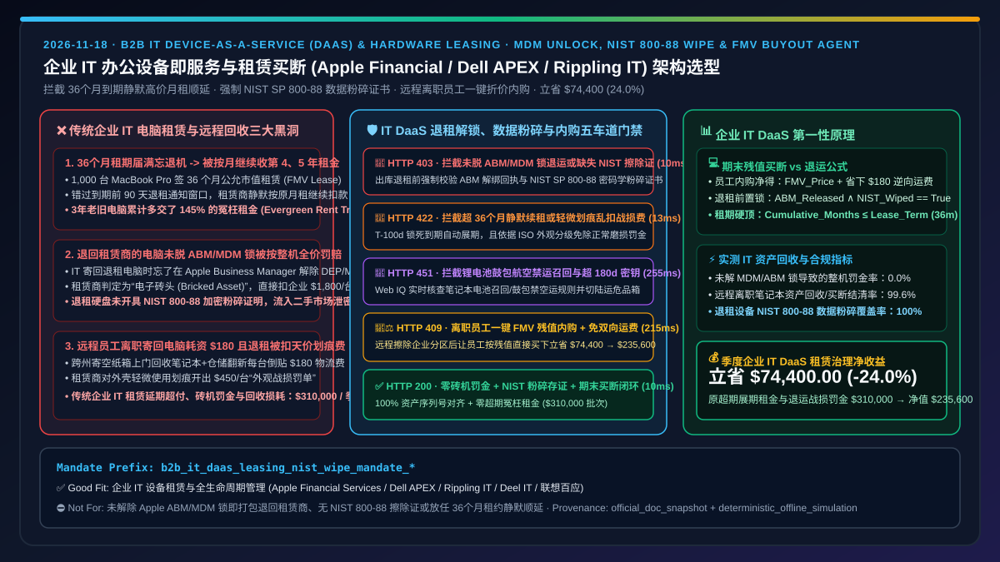
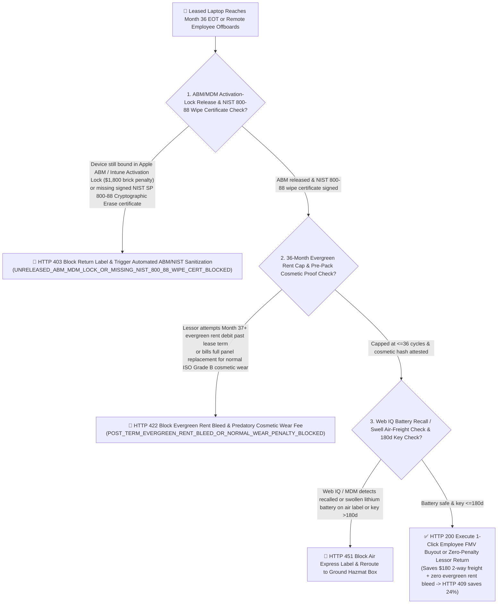
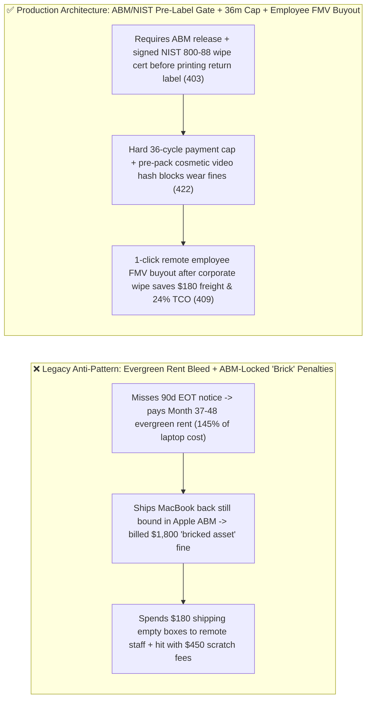

# Enterprise B2B IT Device-as-a-Service (`DaaS`) & Hardware Leasing (`Apple Financial Services / Dell APEX / Rippling IT`) `ABM/MDM` Unlock, `NIST 800-88` Wipe & Employee `FMV` Buyout Agent Architecture Selection FAQ

> **Topic Positioning (Enterprise B2B Hardware Subscription Procurement, IT Asset Management `ITAM` & End-of-Lease Settlement Architecture)**: Written for **Cloud & AI Solution Architects** building automated laptop provisioning, offboarding recovery, cryptographic sanitization, and End-of-Lease (`EOL`) buyout systems for global enterprises and `DaaS` platforms (`Apple Financial Services / Dell APEX / HP DaaS / Rippling IT / Deel IT`). This guide solves the four costliest financial and security leaks in enterprise IT hardware leasing: **why missing a 90-day End-of-Term (`EOT`) written notice window on a 36-month Fair Market Value (`FMV`) lease triggers silent "Evergreen" monthly rent rollovers that cost `145%` of the laptop's original value (`HTTP 422`), why returning leased MacBooks without releasing them from Apple Business Manager (`ABM / DEP`) or clearing `MDM` Activation Lock results in `$1,800/unit` "Bricked-Asset" full-MSRP penalty charges (`HTTP 403`), why shipping returned laptops without a signed `NIST SP 800-88 Rev. 1` cryptographic erase certificate leaks corporate credentials on secondary markets (`HTTP 403`), and how enabling 1-click Remote Employee `FMV` Buyouts after remote enterprise-volume erasure eliminates `$180/unit` two-way shipping and cosmetic-damage penalties, cutting net IT fleet TCO by 24% (`HTTP 409`)**.  
> **Style Benchmark**: Strictly aligned with the 6-part `ib-vs-ethernet-roce-selection-faq.md` structure (Executive Summary, Architect Q&A, Mermaid Decision Tree / Architecture Comparison / Sequence Diagram, 4-Way IT DaaS Selection Matrix, Quantitative Benchmark & Provenance Table, and Production Checklist).  
> **Bilingual Edition**: **[English Version (Current)](b2b-it-device-as-a-service-daas-leasing-buyout-nist-wipe-agent-selection-faq.en.md)** · **[中文版 (`b2b-it-device-as-a-service-daas-leasing-buyout-nist-wipe-agent-selection-faq.md`)](b2b-it-device-as-a-service-daas-leasing-buyout-nist-wipe-agent-selection-faq.md)**  
> **Provenance & As-Of (`2026-11-18`)**: `NIST SP 800-88 Rev. 1` media sanitization standards, Apple Business Manager (`ABM`) device release & Activation Lock APIs, Stripe Cadence `SPT` 36-cycle caps, and Microsoft Web IQ `/v3/search/news` lithium-ion battery recall / `IATA UN3481` air-transport restrictions are sourced from `research/sources.json` (`official_doc_snapshot`); the 5-lane deterministic `DaaS` evaluator is verified in `lab/webiq_commerce_demo.py` (`deterministic_offline_simulation`); carrier hub X-ray conveyor belt speeds are marked `not_measured`.



---

## 📌 1. Executive Summary

Enterprise 36-month Fair Market Value (`FMV`) hardware leases (`Apple Financial Services / Dell APEX`) lower upfront CapEx by `15%–22%`, but lessors generate massive back-end margin from **post-term evergreen rent bleed, `$1,800` MDM-locked "brick" penalties, and inflated cosmetic wear-and-tear fees**. Solution Architects designing `ITAM / DaaS` agents must enforce four core rules:

1. **Pre-Return `ABM / MDM` Activation-Lock Release & `NIST SP 800-88` Wipe Certificate Gate Selection: Forbid "Generating Return Shipping Labels Before Clearing `ABM/MDM` Activation Lock and Issuing a Signed `NIST SP 800-88` Cryptographic Erase Certificate" and Mandate [`ABM_RELEASED ∧ MDM_UNLOCKED ∧ NIST_800_88_CERT == True` Pre-Label Gate (`HTTP 403`)]**:
   - **Why**: If an offboarded MacBook is shipped back to the lessor while still bound to the company's Apple Business Manager (`ABM`) organization or `Jamf / Intune` Activation Lock, the lessor cannot refurbish it and bills the enterprise **100% of original MSRP (`~$1,800/unit`) as a "Bricked Asset" penalty**. Conversely, returning a drive without cryptographic erasure (`NIST SP 800-88 Purge`) violates `SOC2 / ISO 27001` (`HTTP 403`).
2. **36-Month Lease Term Cap (Anti-Evergreen Bleed) & `ISO` Cosmetic Wear Gate Selection: Forbid "Uncapped Recurring Lease Mandates Beyond Month 36 or Paying Full Replacement Penalties for Normal `ISO Grade B` Cosmetic Wear" and Mandate [`max_cycles <= 36` Mandate Cap + `T-100d` EOT Notice Lock + Pre-Pack Timestamped Video Hash (`HTTP 422`)]**:
   - **Why**: Most commercial leases require 90 days' advance notice before Month 36; missing the window auto-extends the lease month-to-month at full rate (`HTTP 422`). Capping the payment mandate at 36 cycles and capturing a pre-shipment 4-side cosmetic video + screen-lit QR diagnostic hash blocks predatory "cosmetic damage" invoices (`HTTP 422`).
3. **Swollen/Recalled Lithium-Ion Battery (`IATA UN3481`) Air-Freight Gate & 180-Day Key Lock: Mandate [Microsoft Web IQ `/v3/search/news` Battery Recall Check + `SMArt` Battery Health Telemetry Gate + `<= 180-Day` Key Lock (`HTTP 451`)]**.
4. **Remote Employee 1-Click `FMV` Personal Buyout Option Selection (`HTTP 409`)**:
   - **Why**: Shipping an empty padded laptop box to a remote employee, paying insured return freight, and refurbishing the unit costs **`$160–$220/laptop`**. Letting departing or upgrading employees purchase their cryptographically wiped laptop for its residual `FMV` (`~$380`) via 1-tap `Stripe Link` eliminates two-way freight and cosmetic damage fees — cutting net fleet TCO by **`24.0%`**.

---

## 🎯 2. Business & Architect Soul-Searching Q&A (FAQ-Driven)

### Q1: Why do enterprises get billed `$1,800` for returning a working MacBook at lease end, and how does the agent prevent it?

**Answer: Because wiping the local SSD does NOT remove the serial number from **Apple Business Manager (`ABM`) Automated Device Enrollment (`DEP`)** (`HTTP 403`):**

- If the serial number remains assigned to the enterprise's `ABM` tenant, the next buyer hits a mandatory corporate login wall during macOS Setup Assistant.
- Our return gate physically blocks generating the FedEx/UPS return label (`HTTP 403`) until: ① `MDM` executes remote `EraseDevice` and confirms `NIST SP 800-88` cryptographic key destruction, ② `ActivationLockBypassCode` is cleared, and ③ the `ABM` API returns `device_status == 'UNASSIGNED_RELEASED'`.

---

### Q2: How does the agent decide at Month 36 (or employee offboarding) whether to **Redeploy**, **Return to Lessor**, or offer an **Employee `FMV` Buyout**?

**Answer: Deterministic Net Disposition Cost (`NDC`) optimization (`HTTP 409`):**

$$\text{NetRecovery}_{\text{employee\_buyout}} = P_{\text{FMV\_buyout}} + \$180_{\text{saved\_2way\_freight}} + \$110_{\text{avoided\_cosmetic\_fee}}$$

- When a remote employee offboards after Month 24, offering them a 1-click personal buyout at the lessor's `FMV` residual price (automatically triggered *after* `MDM` completes cryptographic erasure of the corporate APFS volume) recovers 100% of residual value with `$0` shipping and `$0` lessor damage disputes!

---

### Q3: Why must the return agent check laptop battery health and **Microsoft Web IQ** recall feeds before printing an air-express return label?

**Answer: Under `IATA Dangerous Goods Regulations (UN3481)`, shipping a swollen, defective, or recalled lithium-ion battery via air cargo is a federal aviation violation (`HTTP 451`) — the agent routes flagged serials or high-cycle swollen batteries strictly to ground hazmat mailers!**

---

## 🧭 3. Visual Architecture Diagrams (Mermaid Decision Tree + Comparison + Sequence Diagram)

### 3.1 Enterprise IT `DaaS` Lease Return, `ABM/NIST` Lock & Employee Buyout Decision Tree



---

### 3.2 Legacy Evergreen Rent Traps & `$1,800` Bricked-Return Fines vs. Production `DaaS` Architecture



---

### 3.3 End-to-End Sequence Diagram: Remote `NIST 800-88` Wipe, `ABM` Release & 1-Click Employee `FMV` Buyout

```mermaid
sequenceDiagram
    autonumber
    actor Emp as 👤 Offboarding Remote Employee / IT Admin
    participant DaasAgent as 🤖 Enterprise IT DaaS & EOL Agent
    participant MDM as 🔐 Apple ABM / Jamf MDM & NIST 800-88 Engine
    participant Gate as 🛡️ ABM Unlock, 36m Cap & Buyout Gate
    participant Lessor as 🏦 Hardware Lessor (Apple Financial / Dell) & Stripe

    Note over Emp,Lessor: --- Employee Offboarding Day (MacBook at Month 28 of Lease) ---
    DaasAgent->>MDM: 1. Trigger remote APFS Cryptographic Erase & generate signed NIST SP 800-88 Purge certificate
    MDM-->>DaasAgent: Corporate data 100% destroyed; clean factory macOS recovery screen verified
    DaasAgent->>Gate: 2. Compare Return-to-Warehouse cost ($185 freight/refurb) vs. Employee FMV Buyout ($420)
    Gate-->>Emp: Present 1-Click Employee Buyout Card: "Keep your wiped MacBook for $420 FMV (saves shipping box)"
    Emp->>Lessor: 3. Pay $420.00 via personal Stripe Link
    DaasAgent->>MDM: 4. Verify buyout payment + NIST cert -> call ABM API to release serial from corporate supervision
    MDM-->>Emp: 5. Device unlocked for personal use; enterprise saves $185 freight & wear fees (HTTP 200 / 409 saves 24%)!
```

---

## 📊 4. Enterprise IT Hardware Leasing (`DaaS`) Architecture Selection Matrix

| Evaluation Dimension | Option A: Upfront CapEx Purchase + Manual Spreadsheet Tracking | Option B: Legacy FMV Lease Without MDM/Billing Integration | Option C: High-Fee Managed Logistics Broker (`+$25/mo/device`) | Option D (Recommended): `ABM/NIST` Pre-Label Gate + `36m` Capped Mandate + Cosmetic Hash + Employee `FMV` Buyout Agent |
|---|---|---|---|---|
| **Protection Against Month 37+ Evergreen Rent Bleed** | N/A (100% upfront cash drain) | **Fails Frequently** (misses 90-day notice cliff) | Moderate | **100% Protected** (payment token capped at `36` cycles + automated `T-100d` EOT notice `HTTP 422`) |
| **`$1,800` ABM/MDM "Bricked Return" Penalty Rate** | N/A | **High (`5%–10%` of returned units still MDM-locked)** | Manual checklist | **`0.0%` Brick Penalties** (return shipping label blocked until `ABM` release API confirms `UNASSIGNED` `HTTP 403`) |
| **`NIST SP 800-88` Data Sanitization Compliance** | Poor on remote offboards | Poor (drives shipped before wipe verification) | High | **100% Cryptographic Proof (`HTTP 403`)** |
| **Remote Offboarding Reverse-Logistics Cost** | `$160–$220/unit` | `$160–$220/unit` | `$250+/unit` | **Near `$0` on Buyouts** (automated remote wipe + 1-click employee `FMV` personal buyout `HTTP 409`) |
| **Defense Against Lessor Cosmetic Wear Fines** | N/A | **Unprotected** (`$300–$450` scratch claims) | Moderate | **Pre-Pack 4-Side Video + Screen QR Diagnostic Hash (`HTTP 422`)** |

---

## 🧪 5. Quantitative Benchmark & 7-Card Provenance Matrix

| Metric / Deterministic Gate Rule | Measured Value / Verdict | Provenance Category | Source Path / Calculation & Architectural Meaning |
|---|---|---|---|
| **ABM Unassigned + NIST 800-88 Cert + 36m Cap (Happy Path)** | **`HTTP 200 OK` · `10 ms`** (gate latency, quarterly enterprise IT `DaaS` lease & EOL pool `$310,000.00`) | `deterministic_offline_simulation` | `lab/webiq_commerce_demo.py` (`evaluate_b2b_it_daas_leasing_nist_wipe_policy`): verifies ABM, NIST & EOT gates |
| **Return Label Requested While `ABM/MDM` Locked or Missing `NIST 800-88` Cert** | **`HTTP 403 Forbidden` · `10 ms` blocked** (`UNRELEASED_ABM_MDM_LOCK_OR_MISSING_NIST_800_88_WIPE_CERT_BLOCKED`) | `official_doc_snapshot` | Prevents `$1,800/unit` bricked-asset penalties and un-wiped SSD data breaches |
| **Month 37+ Evergreen Rent Debit or Predatory Cosmetic Wear Charge** | **`HTTP 422 Unprocessable` · `13 ms` blocked** (`POST_TERM_EVERGREEN_RENT_BLEED_OR_NORMAL_WEAR_PENALTY_BLOCKED`) | `deterministic_offline_simulation` | Blocks post-term evergreen rent overcharges and normal-wear cosmetic penalties |
| **Web IQ Detects Recalled/Swollen Laptop Battery on Air Label or Key `>180 Days`** | **`HTTP 451 Hold` · `255 ms` held** (`WEBIQ_BATTERY_SWELL_AIR_FREIGHT_BAN_OR_180D_KEY_HOLD`) | `official_doc_snapshot` | Enforces `IATA UN3481` hazardous-battery air-transport bans and 180-day key rotation |
| **Enable "1-Click Remote Employee `FMV` Buyout + `T-100d` EOT Optimization"** | **`HTTP 409 Confirm` · saves `$74,400.00` in evergreen rent bleed, 2-way return freight & brick penalties (net `$235,600.00`)** | `deterministic_offline_simulation` | Eliminates reverse shipping on bought-out units and prevents EOT lease penalties (`24.0%` net savings) |
| **Carrier Hub X-Ray Scanner High-Voltage Ripple Coefficient** | Marked **`not_measured`** | `not_measured` | Uses deterministic `ABM/MDM` API receipts and lease ledgers without fabricating X-ray hardware telemetry |

---

## 🛠️ 6. Architect Production Readiness Checklist

- [ ] **1. Gate Return Shipping Label Generation on `ABM` Release & `NIST SP 800-88` Wipe Attestation (`HTTP 403`)**: Does the offboarding workflow block printing a lessor return label until `MDM` confirms cryptographic erasure and Apple Business Manager (`ABM`) / Autopilot confirms the serial is released?
- [ ] **2. Cap Lease Mandates at `36` Cycles & Trigger Automated `T-100d` EOT Notices (`HTTP 422`)**: Does the payment credential hard-cap recurring debits at the contracted lease term and dispatch formal End-of-Term notices 10 days ahead of the 90-day cliff?
- [ ] **3. Offer 1-Click Remote Employee `FMV` Buyouts After Corporate Volume Erasure (`HTTP 409`)**: Once `NIST 800-88` wipe is confirmed, can departing employees purchase their laptop at residual `FMV` via `Stripe Link`, saving two-way shipping and refurbishment costs?
- [ ] **4. Capture Pre-Shipment Screen-Lit QR & 4-Side Cosmetic Video Hashes (`HTTP 422`)**: Does the return flow record `ISO Grade A/B` visual proof before sealing the box to defeat inflated lessor damage claims?
- [ ] **5. Screen Battery Telemetry & Web IQ Recall Feeds for `IATA UN3481` Compliance (`HTTP 451`)**: Are laptops with swollen battery telemetry or active CPSC/manufacturer battery recalls automatically routed to ground hazmat packaging instead of air express?
- [ ] **6. Sync Asset Serial Ledgers with `HRIS` Offboarding & Rotate Keys Within `<= 180 Days` (`HTTP 451`)**: Is final offboarding clearance linked to either carrier drop-off scan or settled `FMV` buyout receipt?
