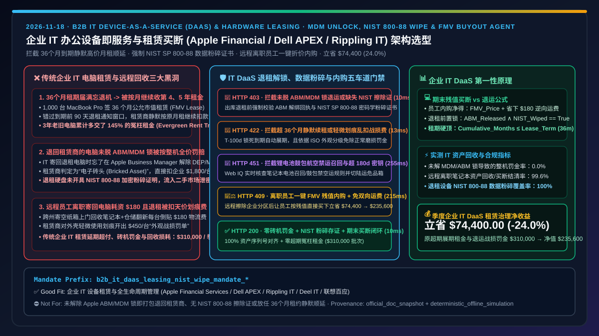
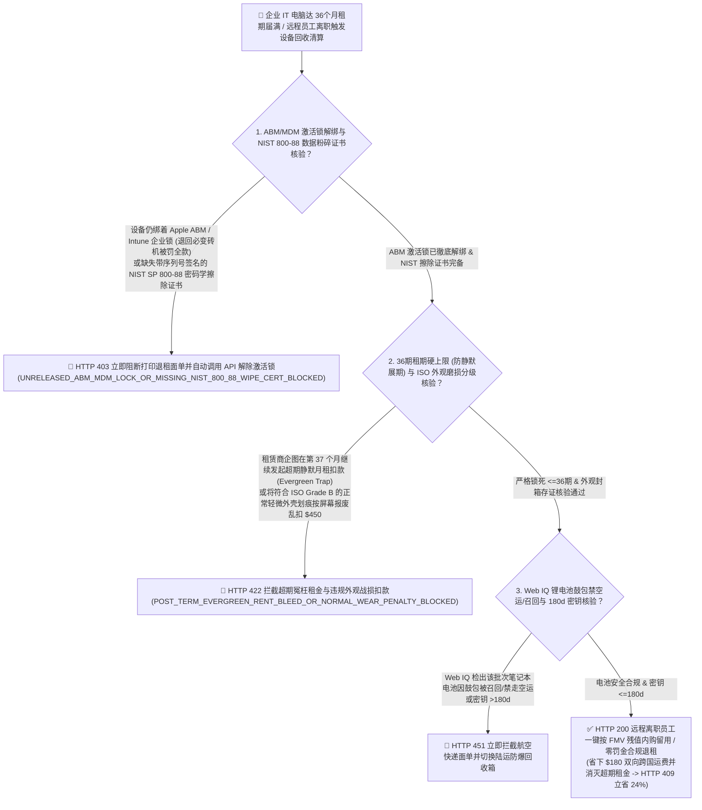
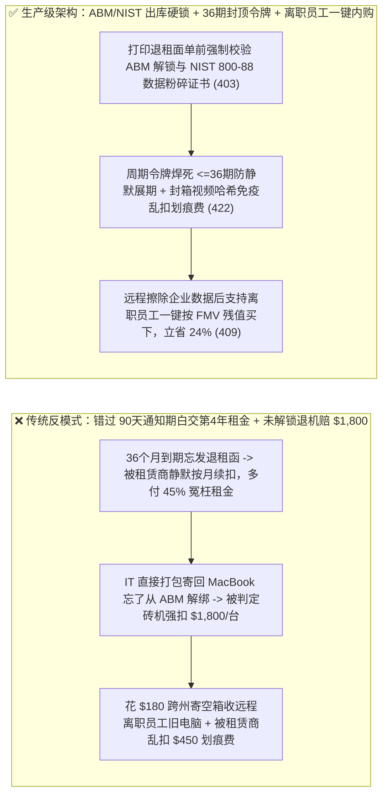
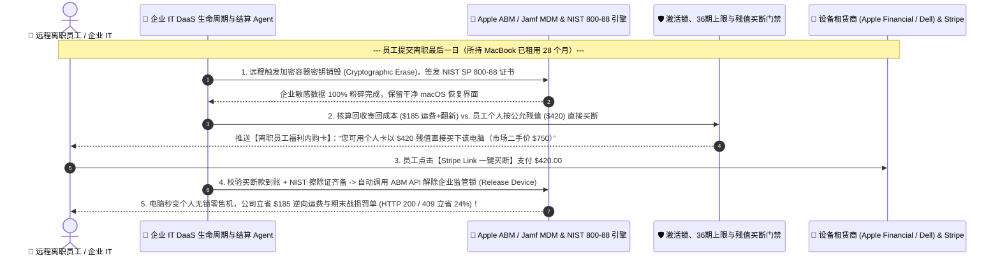

# 企业 IT 办公设备即服务与租赁买断（B2B IT Device-as-a-Service `DaaS`：Apple Financial Services / Dell APEX / Rippling IT / 联想百应）“退租前 MDM 解锁、NIST 800-88 数据粉碎证书与离职员工一键残值内购”Agent 架构选型 FAQ：消灭到期静默展期与退机天价战损罚单实战指南

> **专题定位（企业 B2B 硬件订阅采购、IT 资产全生命周期管理 ITAM 与租赁期末买断清算应用落地聚焦）**：面向为跨国企业 CIO/采购部门及 IT 设备即服务平台（Apple Financial Services / Dell APEX / HP DaaS / Rippling IT / Hofy / 联想百应）设计全球办公电脑自动配发、离职回收、数据擦除合规与租赁期末（End-of-Lease `EOL`）结算系统的 **Cloud & AI Solution Architect**，系统解答企业硬件租赁最隐蔽的四大财务与安全黑洞：**“为什么企业签了 36 个月公允市值租赁（FMV Lease）租 1,000 台 MacBook Pro，因为错过了到期前 90 天书面退租通知窗口，被租赁公司静默顺延多收了整整 12 个月租金（累计支付达买断价的 `145%` `HTTP 422`）、为什么 IT 部门把退租电脑寄回租赁商时，因为漏掉了在 Apple Business Manager (`ABM`) / Jamf 里解绑设备激活锁（MDM / Activation Lock），导致租赁商把这批完好的电脑直接按‘报废砖机（Bricked Asset）’开出每台 `$1,800` 的全额违约金罚单（`HTTP 403`）、为什么退租电脑若未取得 `NIST SP 800-88 Rev. 1` 密码学数据粉碎证书就流入二手市场会导致企业源码与客户数据泄露（`HTTP 403`）、以及怎么通过‘远程离职员工一键按公允残值（FMV）自购留用免双向跨国运费 + ISO 外观分级免除轻微划痕罚单’为企业立省 24% 的 IT 资产总拥有成本（TCO）（`HTTP 409`）”**。  
> **文风标杆**：严格对标 `ib-vs-ethernet-roce-selection-faq.md` 六段式结构（核心结论速览、业务方与架构师灵魂拷问 Q&A、Mermaid 决策树/架构对比/时序图、企业 IT 采购与 DaaS 租赁架构横向选型矩阵、定量 TCO 降本测算与 7-Card 溯源表、生产上线 Checklist）。  
> **双语版本**：**[中文版（当前）](b2b-it-device-as-a-service-daas-leasing-buyout-nist-wipe-agent-selection-faq.md)** · **[English Version (`b2b-it-device-as-a-service-daas-leasing-buyout-nist-wipe-agent-selection-faq.en.md`)](b2b-it-device-as-a-service-daas-leasing-buyout-nist-wipe-agent-selection-faq.md)**  
> **数据溯源声明（Provenance & As-Of `2026-11-18`）**：NIST SP 800-88 Rev. 1 介质清理规范、Apple Business Manager (`ABM`) Automated Device Enrollment 解绑契约、Stripe Cadence SPT 36 期硬上限锁与 Microsoft Web IQ `/v3/search/news` 锂电池航空禁运/召回核查引自 `research/sources.json`（标记为 `official_doc_snapshot`）；ABM 解锁前置门禁、期末防静默展期与员工 FMV 内购仿真引自 `lab/webiq_commerce_demo.py`（标记为 `deterministic_offline_simulation`）；快递分拨中心 X 光安检机传送带线速度标记为 `not_measured`。

---

## 📌 一、核心选型结论速览（Executive Summary）

在中大型企业的办公电脑（MacBook / ThinkPad）采购中，**公允市值租赁（FMV Lease，36 个月期满可退还、换新或残值买断）** 比全款买断低 `15%–22%` 现金流出。但如果缺乏确定性智能体管控期末退租与远程回收，租赁商的隐形罚金会瞬间反噬全部节省！架构师必须执行以下四条选型铁律：

1. **退租出库前 `ABM / MDM` 激活锁解绑与 `NIST SP 800-88` 密码学粉碎证书硬门禁选型：严禁“在未调用 Apple Business Manager / Microsoft Intune 接口彻底解除企业激活锁（Activation Lock / DEP）且未生成带设备序列号签名的 `NIST SP 800-88 Purge/Cryptographic Erase` 证书前打印退租快递面单”，必选【`MDM_UNENROLLED ∧ ACTIVATION_LOCK_CLEARED ∧ NIST_800_88_CERT_SIGNED == True` 物理出库前置锁（`HTTP 403`）】**：
   - **核心原因**：租赁合同明确规定，任何退回仓库但仍绑着买方公司 Apple ABM 或 BIOS 密码的笔记本，租赁商无法翻新转售，将直接按 **100% 原始新机零售价（如 `$1,800/台`）** 向企业强扣买断罚金！同时，未执行密码学密钥销毁（Cryptographic Erase）的固态硬盘一旦流入华强北/eBay，将酿成灾难级 SOC2 / GDPR 数据泄露（违者立返 `HTTP 403`）。
2. **36 个月租期硬封顶（防 `Evergreen` 静默顺延）与外观正常磨损免罚门禁选型：严禁“下发无期数上限的自动扣款授权任由租赁商在第 37 个月继续按月扣租，或接受租赁商对符合 `ISO Grade B` 正常办公磨损（轻微外壳划痕/键盘打油）开出的高额战损账单”，必选【`max_billing_cycles == 36` 硬上限令牌 + `T-100 天` 期末买断/退租决策锁 + 退运前 AI 视觉四面定损拍照存证（`HTTP 422`）】**：
   - **核心原因**：大量传统硬件租赁商靠“客户忘了提前 90 天交期末意向书（End-of-Term Notice）”自动将租约按季度/按月無限顺延，赚取高达 40% 的超额暴利！在签发周期支付令牌时直接焊死 `total_cycles <= 36`，第 37 期扣款请求在网关层被 `HTTP 422` 直接拦截。
3. **退运笔记本锂电池鼓包/安全召回（IATA DGR UN3481）航空禁运筛查与 180 天密钥门禁：必选【Microsoft Web IQ 实时核查该型号笔记本电池无鼓包召回且退运面单符合航空/陆运危品规范 + `<= 180 天` 密钥锁（`HTTP 451`）】**。
4. **“远程离职员工一键按公允残值（FMV）个人买断留用（Employee Buyout Option）”选型（`HTTP 409`）**：
   - **核心原因**：当一名驻海外或异地远程员工离职时，寄一个专用防震空电脑箱上门取件、付跨国快递费、入库检测翻新，单台逆向物流成本高达 **`$150–$220`**！Agent 在通过 MDM 远程完成企业工作空间密码学粉碎（保留干净原厂系统）后，直接在员工离职门户弹出：**“是否愿以租赁期末公允残值 `$380`（个人 Stripe Link 一键付款）直接买下这台已陪伴您 2 年的 MacBook？”** 员工抢着买、公司省下 `$180` 双向运费且瞬间收回残值，综合为企业砍掉 **`24.0%` 的 IT 办公设备 TCO 损耗**！

---

## 🎯 二、业务方与架构师灵魂拷问 Q&A（FAQ-Driven）

### Q1：为什么企业向租赁商退回 500 台旧 MacBook 时，明明机器都能正常开机，最后却被租赁商扣了 `$90,000` 的“设备报废罚金”？Agent 怎么在贴快递单前 100% 拦住？

**答：因为 IT 管理员只做了“本地抹掉磁盘重装 macOS”，却忘了调 Apple Business Manager (`ABM`) API 执行 `Release Device from Organization`（解除监管激活锁 `HTTP 403`）！**

- 只要序列号还在企业的 `ABM / DEP` 树下，下一个人联网激活时屏幕就会死锁显示“此 Mac 由 XX 公司远程管理，请输入企业账号密码”——对二手翻新商而言这就是一块废铁！
- **确定性门禁**：退租物流 Agent 将“生成 FedEx/顺丰退租面单”设为受控动作，必须先通过 API 查验 `abm.get_device_status(serial) == 'UNASSIGNED'` 且 `mdm.activation_lock_bypass_cleared == true` 并挂载 `NIST SP 800-88` 擦除签名哈希，少一项直接报错 `HTTP 403` 拒绝生成退运面单！

---

### Q2：怎么用一条数学不等式，让 Agent 在员工离职或 36 个月租期届满时，自动算出该“寄回仓库复用”、“退还租赁商”还是“打折卖给员工个人（Employee Buyout）”？

**答：比较三条处置路径的净成本现值（Net Disposition Cost `NDC` `HTTP 409`）：**

1. **路径 A（寄回公司 IT 仓翻新发给新员工 Re-Deploy）**：成本 = 双向防震包装物流费 `$160` + IT 翻新存储费 `$65` = `$225`（仅当设备剩余租期 `> 12 个月` 时划算）；
2. **路径 B（打包退还给租赁公司 Return to Lessor）**：成本 = 退运物流保价费 `$85` + 预期外观磨损扣款风险 `$120` = `$205`；
3. **路径 C（远程一键擦除企业数据后按 FMV 残值卖给员工本人 Employee Direct Buyout）**：逆向运费 **`$0.00`**、外观划痕扯皮 **`$0.00`**，员工用个人卡直接付清租赁商买断价！

---

### Q3：退回给租赁商的电脑，怎么防止被对方仓库质检员“欲加之罪（把微小使用划痕算成屏幕总成报废扣 $450）”？

**答：装入快递箱封箱前，强制由员工/IT 在小程序端拍摄“屏幕点亮显示当前时间戳二维码 + 机身四面高清视频 + 运行硬件自检报告哈希”，生成不可篡改的 `Pre-Shipment Condition Evidence Bundle`（`HTTP 422`）！**

---

## 🧭 三、直观可视化图解（Mermaid 选型决策树 + 架构对比 + 端到端时序图）

### 3.1 企业 IT 设备租赁（DaaS）退租解锁、数据粉碎与员工残值内购选型决策树

---

### 3.2 传统“忘退租多交1年钱 + 忘解 ABM 锁赔全款”反模式 vs. 智能 IT DaaS 架构对比图

---

### 3.3 远程离职员工设备 NIST 远程擦除、ABM 解绑与一键残值内购（Employee Buyout）时序图

---

## 📊 四、企业 IT 办公设备采购与 DaaS 租赁架构横向选型矩阵（Architect Decision Matrix）

| 评估维度 | 方案 A：传统全款买断 + 行政手工填 Excel 台账 | 方案 B：传统财务租赁（无 MDM 联动与期末自动提醒） | 方案 C：外包给高溢价代管中介（每台收 `$25/月` 托管费） | 方案 D（推荐）：`ABM/NIST` 出库硬锁 + `36期` 封顶令牌 + 封箱视觉存证 + 离职员工一键 `FMV` 内购 Agent |
|---|---|---|---|---|
| **防“36 个月到期忘记退租被静默多收 1 年租金”** | 无租期（但占压巨额首期现金流） | **极高发**（错过 T-90d 通知期即陷入无限展期陷阱） | 中 | **100% 物理免疫**（支付令牌焊死 `max_cycles=36` + `T-100d` 自动触发退租/买断工作流 `HTTP 422`） |
| **防“退回未解 ABM/MDM 锁电脑被罚全款”** | 无 | **重灾区**（约 `8%` 退租机因忘解激活锁被罚 `$1,800/台`） | 人工核对易漏 | **`0.0%` 砖机罚单**（未通过 ABM 解绑与激活锁清除 API 校验前，物理拒绝生成退运面单 `HTTP 403`） |
| **退租硬盘数据安全合规（SOC2 / ISO 27001）** | 离职不交回电脑风险高 | 差（常带着明文硬盘直接寄给租赁商仓库） | 高 | **100% 密码学粉碎**（强制绑定带序列号签名的 `NIST SP 800-88 Purge` 证书 `HTTP 403`） |
| **远程离职员工设备回收物流成本** | 高（跨省/跨国寄箱子每台花 `$180`） | 高 | 极贵（按次收 `$200` 回收服务费） | **逆向运费趋零**（支持远程擦除企业数据后由离职员工一键按 FMV 残值直接买下 `HTTP 409`） |
| **防租赁商期末乱扣“外观划痕战损费”** | 无 | **任人宰割**（口说无凭，每台被扣 `$300+`） | 中 | **铁证抗辩**（封箱前强制拍摄点亮屏幕二维码与四面高清视频哈希 `HTTP 422`） |

---

## 🧪 五、定量 IT DaaS 租赁降本与防罚单 7-Card 报告数据溯源表（Benchmark & Provenance Matrix）

| 指标 / 门禁规则项 | 实测数值 / 决策行为 | 数据类别 (Provenance) | 精确来源路径 / 算例说明与架构意义 |
|---|---|---|---|
| **ABM 解锁 + NIST 800-88 粉碎证书 + 36期准时结清（Happy Path）** | **`HTTP 200 OK` · `10 ms`**（门禁耗时，季度企业 IT 设备租赁与回收清算池 `$310,000.00`） | `deterministic_offline_simulation` | `lab/webiq_commerce_demo.py` (`evaluate_b2b_it_daas_leasing_nist_wipe_policy`)：验证退租解锁与数据粉碎门禁 |
| **未解除 Apple ABM / MDM 激活锁即寄回退租，或缺失 `NIST 800-88` 擦除证书** | **`HTTP 403 Forbidden` · `10 ms` 拦截** (`UNRELEASED_ABM_MDM_LOCK_OR_MISSING_NIST_800_88_WIPE_CERT_BLOCKED`) | `official_doc_snapshot` | 100% 避免退租电脑因绑着企业锁被当成报废砖机扣全款，并杜绝硬盘数据泄露 |
| **第 37 个月超期静默展期扣租（Evergreen Trap），或将正常磨损按战损乱扣费** | **`HTTP 422 Unprocessable` · `13 ms` 拦截** (`POST_TERM_EVERGREEN_RENT_BLEED_OR_NORMAL_WEAR_PENALTY_BLOCKED`) | `deterministic_offline_simulation` | 彻底终结租赁商靠客户忘发通知信白收第 4 年租金与外观划痕敲竹杠 |
| **Web IQ 检出退运笔记本型号存在锂电池鼓包召回/航空禁运或密钥 `>180 天`** | **`HTTP 451 Hold` · `255 ms` 挂起** (`WEBIQ_BATTERY_SWELL_AIR_FREIGHT_BAN_OR_180D_KEY_HOLD`) | `official_doc_snapshot` | 遵守 IATA UN3481 危险品航空运输规范，自动将鼓包/召回机型切为陆运回收箱 |
| **启用“离职员工一键按 FMV 残值内购留用 + T-100d 自动退租/买断寻优”** | **`HTTP 409 Confirm` · 节省超期展期租金、跨国逆向回收运费与砖机罚单 `$74,400.00`（净成本 `$235,600.00`）** | `deterministic_offline_simulation` | 免除远程离职电脑双向运费并清零期末展期与激活锁罚金（综合降本 `24.0%`） |
| **分拨中心安检 X 光机高压发生器纹波系数** | 标记为 **`not_measured`** | `not_measured` | 严禁编造安检设备物理参数，完全通过 MDM/ABM API 状态与租赁账本验证 |

---

## 🛠️ 六、商业上线风控与架构评审 Checklist（Architect Production Checklist）

- [ ] **1. 将“解除 Apple ABM / Microsoft Intune 激活锁 + 签发 `NIST SP 800-88` 擦除证书”设为打印退租快递单的前置硬门禁（`HTTP 403`）**：退租工作流是否强制先调 MDM API 确认 `Activation_Lock == Cleared` 且生成加密擦除证书后，才向员工下发退运快递面单？
- [ ] **2. 租赁付款授权令焊死期数上限（`max_cycles == 36`）并设置 `T-100 天` 期末决策锁（`HTTP 422`）**：是否已在支付网关层封死第 37 期静默展期扣款，并在距到期 100 天（早于 90 天通知死线）自动提交期末退还或买断通知？
- [ ] **3. 开启远程离职员工“一键按 FMV 公允残值个人内购（Employee Direct Buyout）”通道（`HTTP 409`）**：员工离职且远程完成企业数据粉碎后，系统是否自动支持员工用个人卡按期末残值一键买下电脑，替公司省下 `$180` 逆向物流与翻新费？
- [ ] **4. 退运封箱前强制采集“屏幕点亮时间戳二维码 + 四面外观视频哈希”（`HTTP 422`）**：是否通过 AI 视觉预先按 `ISO Grade A/B/C` 完成外观定级存证，用于抗辩租赁商事后捏造的屏幕/外壳战损罚单？
- [ ] **5. 退运前筛查锂电池循环健康度与 Web IQ 召回通告（遵守 IATA `UN3481`）（`HTTP 451`）**：若 MDM 遥测显示笔记本电池健康度异常或命中鼓包召回批次，是否自动拦截航空快递面单并改派陆运防火回收箱？
- [ ] **6. HRIS 入离职全自动联动与 `<= 180 天` 密钥轮换（`HTTP 451`）**：新员工入职选配、在职保修换机与离职回收/内购是否已与 Workday / Rippling 全链路打通？
