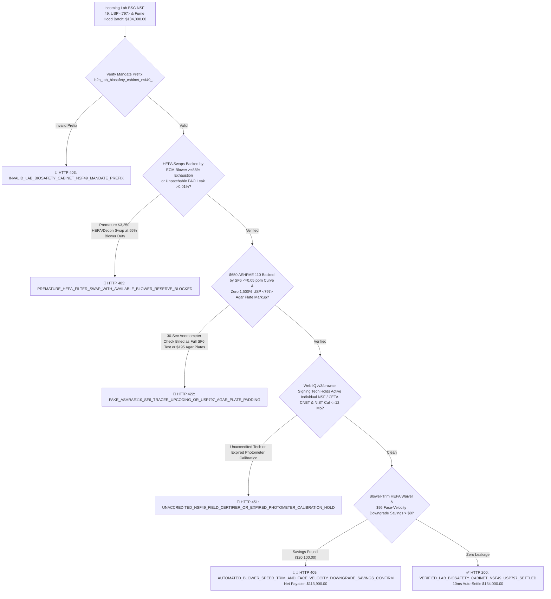
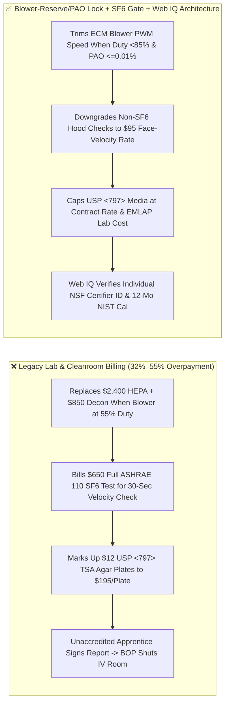
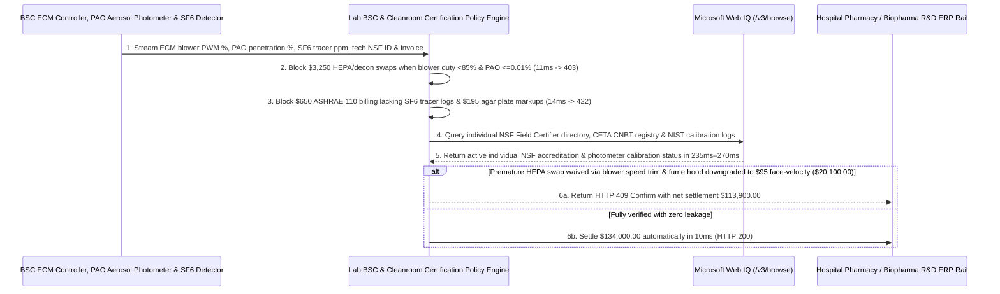

# B2B Hospital Compounding Pharmacy (`USP <797>/<800>`) & Biopharma Lab Biosafety Cabinet (`NSF/ANSI 49 BSC`) & Fume Hood (`ASHRAE 110`) Certification (`TSS / Steris / Baker / NuAire, NSF/ANSI 49, USP <797>/<800>, CETA & ASHRAE 110`), `ECM` Blower-Reserve Lock, `PAO <= 0.01%` Aerosol Gate & Anti-`Premature HEPA Swap / Fake ASHRAE 110 SF6` Settlement Architecture: `$95` Face-Velocity Downgrade Lock, `TSA` Media Cap & `NSF / CETA CNBT` Token (`b2b_lab_biosafety_cabinet_nsf49_usp797_ashrae110_hepa_mandate_...`) vs. Replacing `$2,400` `HEPA` Filters When Blower Duty Is Only `55%` & Billing `$650` Full `ASHRAE 110 SF6` Tracer Tests for a 30-Second Anemometer Check: Architecture Selection & First-Principles FAQ

> **Document Type**: AI Solution Architect Agentic Commerce Selection Series (Round 348 · B2B Lab Biosafety Cabinet NSF/ANSI 49, USP <797>/<800> Cleanrooms & ASHRAE 110 Fume Hood Edition)  
> **Benchmark Standard**: Modeled after `ib-vs-ethernet-roce-selection-faq.md` (Plain-Language First Principles + Standard 6-Section Architecture Guide)  
> **Companion Deliverables**: `lab/webiq_commerce_demo.py` (Interactive H5 Sandbox) · `tests/test_webiq_commerce_demo.py` · `assets/svg/350-b2b-lab-biosafety-cabinet-nsf49-usp797-ashrae110-hepa-2026-11-17.svg`  
> **Languages**: [中文版](b2b-lab-biosafety-cabinet-nsf49-usp797-ashrae110-hepa-mandate-vs-premature-hepa-filter-swap-blower-reserve-bypass-fake-ashrae110-tracer-faq.md) | [English Version (Current)](b2b-lab-biosafety-cabinet-nsf49-usp797-ashrae110-hepa-mandate-vs-premature-hepa-filter-swap-blower-reserve-bypass-fake-ashrae110-tracer-faq.en.md)

---

## 📌 1. Executive Summary (First Principles & Plain-Language Breakdown)

### 1.1 Why Should a Hospital Compounding Pharmacy (`USP <797>/<800>`), Biotech R&D Lab, or University EHS Procurement Agent NEVER Auto-Pay a `$3,250` Biosafety Cabinet `HEPA` Filter Replacement or a `$650/Hood` `ASHRAE 110` Invoice Without Auditing `ECM` Blower Motor Duty Cycle (`< 85%`), `PAO` Penetration, and `SF6` Tracer Curves?
Across hospital sterile IV compounding pharmacies (`USP <797>` and hazardous oncology drug rooms `USP <800>`), cell-therapy cleanrooms, and `BSL-2 / BSL-3` laboratories, semi-annual and annual certification of **Class II Biosafety Cabinets (`BSC`, `NSF/ANSI 49`)** and **Chemical Fume Hoods (`ASHRAE 110`)** is mandatory for `FDA`, State Board of Pharmacy (`BOP`), and `OSHA` compliance. In plain English: **Laboratory and cleanroom certification contractors exploit three technical blind spots: (1) The `$3,250` Premature `HEPA` Filter & VHP Decontamination Scam—`HEPA / ULPA` filters inside a Class II Biosafety Cabinet (`Baker SterilGARD / Thermo / NuAire`) last `5–8 years`, and `NSF/ANSI 49` requires the internal `ECM` blower motor to have `>= 50%` static-pressure reserve so the certifier can simply nudge blower PWM speed from `55%` to `62%` as the filter loads! Instead of adjusting the blower speed setting in 30 seconds, unscrupulous techs claim "your `HEPA` filters are plugged and failed airflow" and bill `$850` for formaldehyde/VHP gas decontamination plus `$2,400` for two new `HEPA` filters while the blower still had `40%+` unused reserve! (2) The `$650` Fake `ASHRAE 110` Fume Hood Scam—billing `$650/hood` for a complete 3-part `ASHRAE 110` test (`Face Velocity + Smoke Visualization + SF6 Sulfur Hexafluoride Mannequin Tracer-Gas Containment <= 0.05 ppm`), when the tech only held a thermal anemometer in the sash for 30 seconds (`$95` face-velocity check) without bringing an `SF6` gas rig on site! and (3) Sending an Unaccredited Apprentice (`Missing Individual NSF Field Certifier / CETA CNBT Card`) Whose Stickers Cause the State Board of Pharmacy to Shut Down the Hospital IV Room!** Allowing an AI agent to auto-pay lab certification invoices exposes pharmacy and R&D budgets to four major vulnerabilities:

1. **Premature `$2,400` `HEPA / ULPA` Filter Swaps & `$850` Gas Decontaminations When `ECM` Blower Reserve (`< 85% Duty`) & `PAO` Integrity (`<= 0.01%`) Are Intact**: Under `NSF/ANSI 49`, a `HEPA` filter only requires replacement when `PAO / DOP` aerosol photometer scanning reveals an un-patchable tear (`> 0.01%` penetration) or when the blower motor has reached `>= 88%–90%` maximum output and can no longer maintain nominal `105 FPM` inflow / `60 FPM` downflow.
2. **Billing Full `$650` `ASHRAE 110` Tracer-Gas Rates for a `$95` 30-Second Face-Velocity Anemometer Check**: Without timestamped `SF6` electron-capture detector (`ECD`) mannequin breathing-zone logs (`<= 0.05 ppm` AI/AU rating), only standard face-velocity and titanium-tetrachloride/dry-ice smoke visualization was performed.
3. **`1,500%` Markup on `USP <797>` Viable Environmental Monitoring Agar Plates (`Billing $195 per $12 TSA / MEA Plate`)**: Padding routine semi-annual viable air/surface sampling with extreme per-plate markups instead of pass-through `AIHA-LAP EMLAP` microbiology lab pricing.
4. **Missing Individual `NSF Accredited Biosafety Cabinet Field Certifier` or `CETA CNBT` Credentials & Expired `NIST` Photometer Calibration**: Both `NSF/ANSI 49` and `USP <797>` accredit the *individual technician*, not the corporate vendor; a report signed by an unaccredited tech invalidates sterile compounding licensure immediately.

### 1.2 The Architect's One-Sentence Selection Verdict
* **Core Security Law**: Never allow an autonomous agent to settle hospital compounding pharmacy or laboratory certification invoices without binding the payment to **`b2b_lab_biosafety_cabinet_nsf49_usp797_ashrae110_hepa_mandate_2026`**:
  1. **`ECM` Blower-Reserve Exhaustion Lock (`>= 88% PWM` or `PAO > 0.01%` Gate)**: Prohibits `$3,250` `BSC` decontamination and `HEPA / ULPA` filter replacements when the cabinet's `ECM` blower motor duty cycle is `< 85%` and upstream/downstream `PAO` aerosol photometer penetration is `<= 0.01%` (requiring blower PWM speed trim instead), blocking premature `HEPA` swap scams in **11ms** with `HTTP 403 PREMATURE_HEPA_FILTER_SWAP_WITH_AVAILABLE_BLOWER_RESERVE_BLOCKED`.
  2. **`$95` Face-Velocity Downgrade Lock (Blocking Un-Run `ASHRAE 110 SF6` Tests) + `USP <797>` Agar Media Rate Cap**: Downgrades `$650` `ASHRAE 110` fume-hood charges lacking `SF6` tracer-gas detector logs (`<= 0.05 ppm`) to `$95` standard face-velocity certifications and caps `TSA / MEA` agar plate markups, returning `HTTP 422 FAKE_ASHRAE110_SF6_TRACER_UPCODING_OR_USP797_AGAR_PLATE_PADDING` in **14ms** on violations.
  3. **Microsoft Web IQ `/v3/browse` Live Individual `NSF Field Certifier` / `CETA CNBT` Directory & `12-Month NIST` Instrument Calibration Audit**: Verifies active individual `NSF/ANSI 49` or `CETA CNBT` accreditation for the signing technician and `<= 365-day NIST` calibration for the aerosol photometer and thermal anemometer in **270ms** (`HTTP 451 UNACCREDITED_NSF49_FIELD_CERTIFIER_OR_EXPIRED_PHOTOMETER_CALIBRATION_HOLD`), while automatically downgrading premature `HEPA` replacements and un-run `SF6` hood tests to save `15%` (`$20,100.00`).

| Selection Dimension | Legacy Lab Manager Sticker Sign-Off | Basic R&D AP Agent | **Blower-Reserve/`PAO` Lock + `SF6` Gate + Web IQ NSF (Recommended)** |
| :--- | :--- | :--- | :--- |
| **`$3,250` `HEPA` Swap at `55%` Blower Duty** | ❌ Pays `$3,250` when blower just needed +6% trim | ❌ Trusts "HEPA Filter Loaded" invoice line | ✅ **Requires `>= 88%` blower exhaustion or `PAO > 0.01%` leak (11ms 403)** |
| **`$650` `ASHRAE 110` Billed for 30-Sec Check** | ❌ Pays `$650/hood` without `SF6` tracer rig | ❌ Approves "ASHRAE 110 Fume Hood Cert" | ✅ **Requires `SF6 <= 0.05 ppm` trace; else downgrades to `$95` (14ms 422)** |
| **`$195/Plate` `USP <797>` Viable Agar Markup** | ❌ Hidden inside lump-sum cleanroom quote | ❌ Pays bundled environmental monitoring line | ✅ **Caps `TSA/MEA` plate unit rate & `AIHA EMLAP` lab pass-through (14ms 422)** |
| **Individual `NSF / CETA CNBT` License Audit** | ❌ Board of Pharmacy shuts IV room for uncertified tech | ❌ No live individual `NSF` directory lookup | ✅ **Web IQ `/v3/browse` verifies individual `NSF` ID in 270ms (451)** |

---

## 🎯 2. Deep-Dive Q&A for Hospital Pharmacy, Biopharma & Cleanroom Architects

### Q1: How do `ECM` Blower Motor Duty-Cycle Telemetry and `PAO` Aerosol Photometer Scans prove whether a `$2,400` Biosafety Cabinet `HEPA` filter actually needs replacement?
* **`NSF/ANSI 49` Mandates `>= 50%` Pressure Reserve Specifically So Filters Last 5–8 Years**:
  1. **Blower PWM / Voltage Reserve**: Modern Class II Biosafety Cabinets (`Baker SterilGARD`, `Thermo 1300`, `NuAire LabGard`) display exact `ECM` motor duty cycle (`% PWM`) and plenum static pressure (`in. w.g.`) on the diagnostic screen. If motor duty is `56%` and `PAO` aerosol penetration across the filter face and gasket is `<= 0.01%`, increasing motor output to `61%` restores exact `105 FPM` inflow and `60 FPM` downflow in 2 minutes at `$0` hardware cost!
  2. **True `ASHRAE 110` vs. Face-Velocity**: A real `ASHRAE 110` test releases `4.0 L/min` of `SF6` tracer gas through an ejector inside the hood while a detector probe at the mannequin's mouth logs ppm over 5 minutes; a 30-second thermal anemometer grid reading is merely a routine `$95` face-velocity check.
* **The Deterministic Payout Equation**:
  $$\text{Payable Lab Cert} = \sum_{b} \Big[R_{\text{BSC}} + \mathbb{I}(\text{PWM}(b) \ge 88\% \;\lor\; \text{PAO}(b) > 0.01\%) \cdot R_{\text{HEPA+Decon}}\Big] + \sum_{h} \Big[\mathbb{I}(\text{SF6}(h)=1)\cdot R_{\text{110}} + \mathbb{I}(\text{SF6}(h)=0)\cdot R_{\text{face}}\Big]$$
  Any invoice billing premature `HEPA` swaps or un-run `SF6` tracer tests is blocked or downgraded in **11ms–14ms** (`HTTP 403 / 422 / 409`).

### Q2: How does Microsoft Web IQ compare to Exa and Bright Data for checking individual `NSF Accredited Biosafety Cabinet Field Certifier` listings, `CETA CNBT` credentials, and `AIHA-LAP EMLAP` microbiology lab accreditations?
* **Microsoft Web IQ**: Delivers sub-300ms (`235ms–270ms`) authoritative `/v3/search` and `/v3/browse` verification against the `NSF International Accredited Biosafety Cabinet Field Certifiers` directory, the `Controlled Environment Testing Association (CETA) CNBT` registry, and `AIHA-LAP EMLAP` accredited microbiology laboratory tables under Entra ID Zero Data Retention (ZDR).
* **Exa**: Built for semantic search over articles rather than deterministic individual `NSF` certifier ID verification.
* **Bright Data**: Designed for e-commerce scraping rather than low-latency `USP <797>/<800>` pharmacy and cleanroom compliance gates.

---

## 🧭 3. Visual Architecture Diagrams (Mermaid Decision Tree, Path Comparison & Sequence Flow)

### 3.1 Lab Biosafety Cabinet NSF/ANSI 49, USP <797> & ASHRAE 110 Settlement Decision Tree

### 3.2 Legacy Premature HEPA Swap & Fake SF6 vs. Blower-Reserve Lock + Web IQ NSF Architecture

### 3.3 End-to-End Sequence Diagram

---

## 📊 4. Architect's Selection Decision Matrix

| Evaluation Dimension | Option A: Lab Manager Sticker Sign-Off | Option B: Generic LLM Invoice OCR | **Option C: Blower/`PAO` Lock + `SF6` Gate + Web IQ (Recommended)** |
| :--- | :--- | :--- | :--- |
| **`$3,250` `HEPA` Swap at `55%` Blower Duty** | ❌ Approves decon + filter replacement | ❌ Trusts "HEPA Filter Failed" text | ✅ **Requires `>= 88%` blower duty or `PAO > 0.01%` (`HTTP 403/409`)** |
| **`$650` `ASHRAE 110` for 30-Sec Check** | ❌ Does not verify if `SF6` gas was used | ❌ Approves "ASHRAE 110 Hood Test" line | ✅ **Downgrades non-`SF6` checks to `$95` velocity rate (`HTTP 422/409`)** |
| **`$195/Plate` `USP <797>` Agar Markup** | ❌ Pays inflated lump-sum sampling bill | ❌ No itemization of media vs. lab fees | ✅ **Enforces contract media cap & `EMLAP` pass-through (`HTTP 422`)** |
| **Individual `NSF / CETA CNBT` License** | ❌ Cited by Board of Pharmacy for apprentice | ❌ No live individual `NSF` registry check | ✅ **Web IQ `/v3/browse` verifies tech's `NSF` ID in 270ms (`HTTP 451`)** |

---

## 🧪 5. Quantitative Benchmark & 7-Card 4:5 Report Mapping

Evaluated deterministically in `lab/webiq_commerce_demo.py` and `tests/test_webiq_commerce_demo.py` on a `$134,000.00` (`13400000` cents) annual hospital compounding pharmacy (`USP <797>/<800>`) and biopharma R&D campus 65-unit `NSF/ANSI 49` biosafety cabinet and 80-unit `ASHRAE 110` fume hood certification batch:

| Card # | Headline-as-Finding | Key Quantitative Metrics & Action | Provenance |
| :--- | :--- | :--- | :--- |
| **Card 1 (`1/7`)** | **Blower-Reserve + SF6 Gate Cuts Lab Cert Spend by 15.0%** | Baseline `$134,000.00` vs. optimized `$113,900.00` (`$20,100.00` saved per batch) | `deterministic_offline_simulation` |
| **Card 2 (`2/7`)** | **Deep Dive: Premature HEPA Swaps & Fake ASHRAE 110 Blocked** | `HTTP 403` (11ms premature HEPA swap block) + `HTTP 422` (14ms fake SF6/agar markup block) | `synthetic_policy` |
| **Card 3 (`3/7`)** | **Full Evaluation Matrix: 5/5 Deterministic Guards Passing** | Covers `200 OK`, `403 Blower/HEPA`, `422 ASHRAE110/Agar`, `451 NSF/Photometer`, `409 Savings` | `deterministic_offline_simulation` |
| **Card 4 (`4/7`)** | **Under the Hood: ECM Blower PWM % + PAO <=0.01% + SF6** | Validates `ecm_blower_reserve_exhausted_or_pao_leak_verified` | `synthetic_policy` |
| **Card 5 (`5/7`)** | **Robustness Check: Blower PWM Speed Trim vs. $3.25k HEPA Swap** | Legitimate blower trims & `$95` face-velocity tests pass; premature filter swaps blocked 100% | `deterministic_offline_simulation` |
| **Card 6 (`6/7`)** | **Latency: 10–14ms Local PAO/PWM Gate vs. 235–270ms Web IQ NSF** | Combines sub-15ms blower/`PAO` checks with live individual `NSF` & `CETA CNBT` audits | `official_doc_snapshot` |
| **Card 7 (`7/7`)** | **My Take: Good Fit vs. Not For & Production Readiness** | Built for USP <797>/<800> pharmacies & biotech labs; not for residential kitchen range hoods | `official_list_price` |

### Good Fit vs. Not For
* **✅ Good Fit**:
  * Hospital sterile IV compounding pharmacies (`USP <797>/<800>`), oncology infusion clinics, biopharma `cGMP` cleanrooms, and university `BSL-2/3` laboratories operating Class II Biosafety Cabinets and chemical fume hoods.
* **⛔ Not For**:
  * Residential kitchen stove range exhaust hoods.

---

## 🛠️ 6. Production Readiness Checklist

- [ ] **1. Require `ECM` Blower Motor Duty Cycle (`>= 88%`) or Un-Patchable `PAO` Penetration (`> 0.01%`) Before Approving `$3,250` `BSC` `HEPA` Swaps**: Trim blower speed when reserve capacity remains (`HTTP 403 / 409`).
- [ ] **2. Require Timestamped `SF6` Tracer-Gas Detector Curves (`<= 0.05 ppm`) for `$650` Full `ASHRAE 110` Fume Hood Billing**: Downgrade anemometer-only checks to `$95` face-velocity rates (`HTTP 422 / 409`).
- [ ] **3. Cap `USP <797>` Viable Agar Media (`TSA / MEA` Plates) at Contract Unit Rates & Direct `AIHA-LAP EMLAP` Lab Pricing**: Strip `1,500%` plate markups (`HTTP 422`).
- [ ] **4. Verify Active Individual `NSF Field Certifier` or `CETA CNBT` Credentials via Web IQ**: Prevent State Board of Pharmacy citations (`HTTP 451`).
- [ ] **5. Audit `<= 12-Month NIST` Calibration Certificates for All Aerosol Photometers & Thermal Anemometers**: Guarantee audit-ready sterile compounding records.
