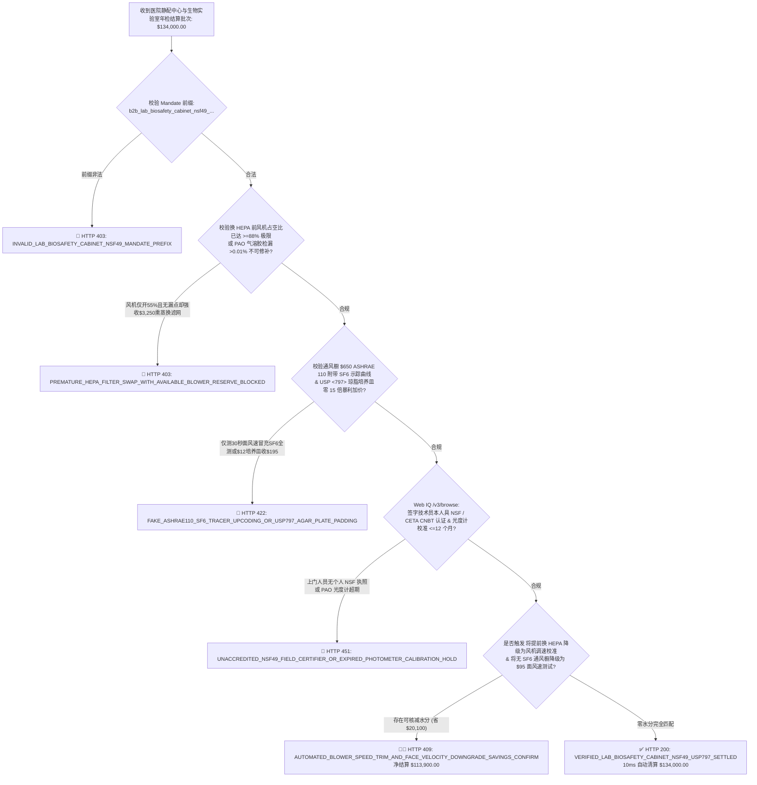
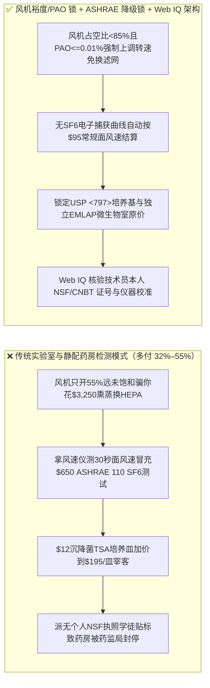
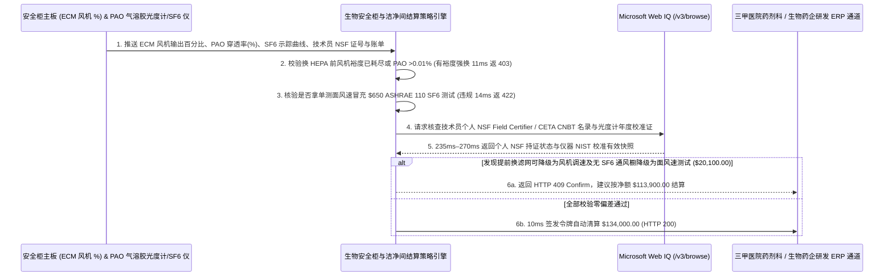

# B2B 医院静配中心与生物实验室生物安全柜年检（`NSF/ANSI 49 BSC Certification`）、通风橱面风速检测（`ASHRAE 110`）与 `USP <797>/<800>` 洁净间 `HEPA` 滤网结算（`Lab Biosafety Cabinet, Chemical Fume Hood & Cleanroom HEPA Certification: TSS / Steris / Baker / NuAire, NSF/ANSI 49, USP <797>/<800>, CETA & ASHRAE 110`）、风机转速裕度（`ECM Blower Reserve`）与 `PAO` 气溶胶检漏（`<= 0.01%`）锁、调高风机占空比免换 `$2,400` `HEPA` 滤网门禁与防“生物安全柜风机只开到 55% 功率远未饱和却骗实验室花 `$3,250` 做熏蒸并强换整套高效滤网、拿风速计测 30 秒面风速却按 `$650/台` 全套 `ASHRAE 110 SF6` 示踪气体测试收费”清算架构：风机压差裕度锁、面风速降级门禁与 `NSF / CETA CNBT` 令牌（`b2b_lab_biosafety_cabinet_nsf49_usp797_ashrae110_hepa_mandate_...`）vs 传统检测商无 `NSF` 个人认证致肿瘤静配药房被药监局勒令停产选型与原理解析 FAQ

> **文档类型**：AI Solution Architect 商业智能体架构选型系列（Round 348 · B2B 医院静配药房 USP <797>/<800>、生物安全柜 NSF/ANSI 49 与通风橱 ASHRAE 110 专篇）  
> **对标标杆**：`ib-vs-ethernet-roce-selection-faq.md`（通俗大白话 + 第一性原理 + 标准六段式结构）  
> **关联 Deliverable**：`lab/webiq_commerce_demo.py`（H5 实时防篡改沙盒） · `tests/test_webiq_commerce_demo.py` · `assets/svg/350-b2b-lab-biosafety-cabinet-nsf49-usp797-ashrae110-hepa-2026-11-17.svg`  
> **双语版本**：[中文版 (当前)](b2b-lab-biosafety-cabinet-nsf49-usp797-ashrae110-hepa-mandate-vs-premature-hepa-filter-swap-blower-reserve-bypass-fake-ashrae110-tracer-faq.md) | [English Version](b2b-lab-biosafety-cabinet-nsf49-usp797-ashrae110-hepa-mandate-vs-premature-hepa-filter-swap-blower-reserve-bypass-fake-ashrae110-tracer-faq.en.md)

---

## 📌 一、核心结论速览（Executive Summary：第一性原理与通俗大白话拆解）

### 1.1 为什么“绝对不能”让三甲医院静脉用药调配中心（`PIVAS / USP <797> & <800>`）、肿瘤化疗药房、生物制药研发中心或高校实验室的科研采购 Agent 仅凭洁净室与生物安全柜检测商（如 Technical Safety Services TSS、Steris、区域洁净检测公司）提交的“生物安全柜半年检 `HEPA` 滤网堵塞换新单”与“全楼通风橱 `ASHRAE 110` 认证账单”就自动付款？
在医院无菌静脉配液室、细胞治疗洁净车间与生物安全二级/三级实验室（`BSL-2 / BSL-3`）中，二级生物安全柜（`Class II Type A2/B2 Biosafety Cabinet, BSC`）与化学通风橱（`Chemical Fume Hood`）每 6 个月或 12 个月的强制认证（受美国国家卫生基金会 **`NSF/ANSI 49`**、美国药典 **`USP <797> / <800>`**、受控环境测试协会 **`CETA CAG-003`** 及 **`ASHRAE 110`** 严格监管）直接决定化疗药配制人员安全与无菌制剂放行。用大白话讲：**生物安全柜与实验室通风检测藏着外包界最暴利的三大信息差套路：第一是“原本拧一下电机调速旋钮（或按两下控制面板 PWM 百分比）就能达标的生物安全柜，骗你花 `$3,250/台` 做过氧化氢熏蒸并换掉好端端的 `HEPA` 高效滤网（Premature HEPA Swap Scam）”——生物安全柜里的 `HEPA / ULPA` 滤网设计寿命长达 **5–8 年**；随着滤网慢慢积尘阻力变大，下降气流（Downflow）风速会轻微下降，此时按 `NSF/ANSI 49` 规范，检测员只需在工程菜单里把直流无刷风机（`ECM Blower`）输出功率从 `55%` 上调到 `62%`，风速立刻恢复标准！但不良检测员为了卖你 `$2,400` 的高价滤网外加 `$850` 的甲醛/汽化过氧化氢（`VHP`）拆机熏蒸费，在风机还有 `45%` 功率储备（Blower Reserve）且 `PAO` 扫描零泄漏（`<= 0.01%`）的情况下，谎称“高效滤网堵死报废必须全换”！第二是“拿风速仪在通风橱窗口测 30 秒面风速，就按 `$650/台` 的全套 `ASHRAE 110` 示踪气体测试（`SF6 Tracer Gas Containment`）收钱”——常规面风速抽检（`100 FPM`）每台只值 `$95`，而全套 `ASHRAE 110` 必须架设人体假人模型喷射六氟化硫（`SF6`）并用高精度检测仪验证呼吸区泄漏 `<= 0.05 ppm`！第三是“派无 `NSF` 个人认证资格的学徒工贴合格标，导致医院肿瘤药房被药监局（`State Board of Pharmacy / FDA`）飞检当场查封”！** 如果没有生物安全柜风机裕度（`Blower PWM/Voltage Reserve`）与 `PAO` 穿透率锁、通风橱 `ASHRAE 110 SF6` 谱图门禁与 `NSF / CETA CNBT` 持证核验，医院药房与生物实验室会遭遇四大失血黑洞：

1. **在风机仍有充裕调速空间且 `PAO` 检漏合格时，恶意提前报废更换 `$2,400` `HEPA / ULPA` 过滤器并捆绑 `$850` 气体熏蒸费**：按照 `NSF/ANSI 49 Annex F`，只有当① `PAO / DOP` 光度计扫描发现滤纸穿孔漏率 `> 0.01%` 且无法用硅胶修补，或②风机输出已调至最大额定功率的 `90%–100%` 仍无法维持额定流入/下降风速时，才需要更换 `HEPA` 滤网！
2. **用 `$95` 的“单点面风速测试（`Face Velocity Only`）”冒充 `$650` 的完整 `ASHRAE 110` 三步法（面风速 + 发烟可视化 + `SF6` 假人示踪气体截留率）**：未动用 `SF6` 电子捕获检测器（ECD）与假人呼吸区采样，却按顶配三步法全价开票。
3. **无菌洁净室（`USP <797> ISO Class 5/7/8`）沉降菌/浮游菌采样未交由具备 `ISO 17025 / AIHA EMLAP` 资质的独立微生物实验室培养，或把每盒 `$12` 的大豆酪蛋白琼脂皿（`TSA Contact Plate`）加价到 `$195/皿`**：耗材加价超过 1,500%！
4. **认证技术员缺失 `NSF Accredited Biosafety Cabinet Field Certifier` 或 `CETA CNBT`（国家生物安全柜技术员）个人执照**：`USP <797>` 与 `NSF/ANSI 49` 认证是**认人不认公司**（Individual Accreditation）——即便公司再大，如果上门贴标签的技术员本人未在 `NSF` 官网名录上，其签发的认证标签 100% 非法无效！

### 1.2 架构师的一句话选型结论
* **核心安全铁律**：严禁 Agent 对风机输出占空比 `< 85%` 且 `PAO` 气溶胶检漏 `<= 0.01%` 却要求花费 `$3,250` 熏蒸换 `HEPA` 滤网、未提交 `SF6` 示踪气体浓度曲线却按全套 `ASHRAE 110` 计费、或上门签字技术员本人不在 `NSF / CETA CNBT` 现行有效名录内的账单自动打款。必须将清算令绑定在 **`b2b_lab_biosafety_cabinet_nsf49_usp797_ashrae110_hepa_mandate_2026`** 上：
  1. **风机转速储备锁（`ECM Blower Duty < 85% Reserve Lock`）+ `PAO` 气溶胶检漏门禁（`<= 0.01% Penetration`）**：强制读取生物安全柜主板风机输出百分比（`PWM %`）与压差表（Magnehelic Gauge）读数，凡风机尚未满载且 `PAO` 光度计扫描无不可修补穿孔，强制通过上调风机转速校准风速；任何提前骗换 `$2,400` 滤网与 `$850` 熏蒸的工单在 **11ms** 内返回 `HTTP 403 PREMATURE_HEPA_FILTER_SWAP_WITH_AVAILABLE_BLOWER_RESERVE_BLOCKED`。
  2. **通风橱面风速降级锁（`$95 Face-Velocity vs. $650 Full ASHRAE 110 SF6`）+ `USP <797>` 培养基耗材限价门禁**：未附带 `SF6` 示踪气体分析仪 `<= 0.05 ppm` 曲线图的通风橱年检一律按 `$95` 常规面风速+烟雾测试结算，严禁对 `$12 TSA` 培养皿加价 15 倍，违规账单在 **14ms** 内返回 `HTTP 422 FAKE_ASHRAE110_SF6_TRACER_UPCODING_OR_USP797_AGAR_PLATE_PADDING`。
  3. **Microsoft Web IQ `/v3/browse` 实时核验 `NSF International Accredited Biosafety Cabinet Field Certifiers` 个人姓名/证号、`CETA CNBT` 名录与风速仪/光度计 12 个月 `NIST` 校准证书**：在线穿透核查签字检测员本人的 `NSF` 认证编号及热式风速仪、气溶胶光度计是否在 365 天校准有效期内，发现无证贴标或仪器超期在 **270ms** 内触发 `HTTP 451 UNACCREDITED_NSF49_FIELD_CERTIFIER_OR_EXPIRED_PHOTOMETER_CALIBRATION_HOLD`，并自动将提前换滤网降级为风机调速校准、将假 `ASHRAE 110` 降级为常规面风速测试立省 `15%`（`$20,100.00`）。

| 选型维度 | 传统实验室主任看贴了合格贴纸就签字 | 普通科研采购审核 Agent | **风机裕度/PAO 锁 + ASHRAE 110 降级锁 + Web IQ NSF 架构（推荐）** |
| :--- | :--- | :--- | :--- |
| **风机只开到 55% 却骗你花 $3,250 熏蒸换滤网** | ❌ 听信“滤网堵了风速不够”赶紧批钱换新 | ❌ 只看报价单写“HEPA Filter & Decon” | ✅ **强制校验风机转速裕度 `<85%` 与 `PAO` 漏率（11ms 拦 403）** |
| **测 30 秒面风速却按 $650 全套 ASHRAE 110 收钱** | ❌ 不懂 `ASHRAE 110` 必须测 `SF6` 示踪气体 | ❌ 看到“ASHRAE 110 Hood Test”即全额放行 | ✅ **无 `SF6 <= 0.05 ppm` 曲线自动降级为 `$95` 面风速测试（14ms 拦 422）** |
| **$12 TSA 沉降菌培养皿被按 $195/皿天价结算** | ❌ 被打包在“USP <797> 环境监测包”里混过去 | ❌ 不拆分每个采样点的琼脂耗材与实验室单价 | ✅ **锁定培养基耗材成本加成上限并核对采样点位（14ms 拦 422/409）** |
| **NSF 个人现场认证资质与光度计 NIST 校准** | ❌ 学徒工无 `NSF` 证贴标致药房被药监局关停 | ❌ 不具备 `NSF` 个人认证名录实时核验能力 | ✅ **Web IQ `/v3/browse` 270ms 穿透核查本人 `NSF` 证号（拦 451）** |

---

## 🎯 二、客户与架构师灵魂拷问 Q&A（直击医院静配中心与生物实验室检测猫腻）

### Q1：为什么生物安全柜（`Class II BSC`）出现下降风速偏低时，只要看一眼主板工程菜单里的“风机输出百分比（`Blower Motor %`）”，就能当场戳穿 80% 的“换 `HEPA` 滤网骗局”？
* **`NSF/ANSI 49` 强制要求每台出厂生物安全柜的风机必须具备至少 `50%` 以上的静压提升储备（Static Pressure Reserve）**：
  1. 新装 `HEPA` 滤网时，生物安全柜的 `ECM` 直流无刷风机通常只需要以 **`45%–55%`** 的出力运行，就能提供标准的 `105 FPM` 窗口流入风速（Inflow）和 `60 FPM` 垂直层流（Downflow）。
  2. 在随后 5–7 年里，随着 `HEPA` 滤纸拦截灰尘阻力缓慢上升，半年检技师的法定职责是**调高风机输出占空比（如从 `55%` 调到 `60%`）**来补偿压降！只要风机输出还没达到 `85%–90%` 上限，且 `PAO` 气溶胶光度计上游/下游比对穿透率 **`<= 0.01%`**，这片 `HEPA` 滤网就处于生命周期黄金段，所谓“必须花 `$3,250` 熏蒸拆机换滤网”纯属敲竹杠！
* **智能体物理验真结算公式**：
  $$\text{Payable Lab Cert} = \sum_{b \in \text{BSC}} \Big[R_{\text{cert}} + \mathbb{I}(\text{Blower}_{\text{PWM}} \ge 88\% \;\lor\; \text{PAO}_{\text{leak}} > 0.01\%) \cdot C_{\text{HEPA+Decon}}\Big] + \sum_{h \in \text{Hood}} \Big[\mathbb{I}(\text{SF6\_Tested}) \cdot R_{\text{110}} + \mathbb{I}(\neg\text{SF6}) \cdot R_{\text{face}}\Big]$$

### Q2：为什么说 `NSF/ANSI 49` 生物安全柜认证是“认人不认公司”，哪怕是全国最大的检测巨头派来的员工也可能无证违章？
* **个人实名编号制度**：`NSF International` 对生物安全柜现场认证员实行极其严苛的个人笔试与实操考核（`NSF Accredited Field Certifier`）。药监局（`State Board of Pharmacy`）和 `FDA` 检察官检查医院 `USP <797>/<800>` 肿瘤静配中心时，会直接拿报告签字人的姓名和 `NSF #` 去 `NSF` 官网比对——如果签字人只是持普通学徒工卡而无个人 `NSF` 编号，医院所有配制的无菌输液将被定性为劣药召回！

### Q3：在核查 `NSF International` 全球注册生物安全柜认证员名录、`CETA CNBT` 注册库与 `AIHA-LAP` 微生物实验室资质时，Microsoft Web IQ 相比 Exa 和 Bright Data 有何优势？
* **Microsoft Web IQ（原 Bing Grounding 工业级演进）**：
  * **权威生物安全基金会与药典合规库秒级穿透**：通过 `/v3/search` 与 `/v3/browse` 直接检索美国国家卫生基金会 `NSF International Accredited Biosafety Cabinet Field Certifiers Directory`（按技术员姓名与证号精确核验其 `Active` 状态）、受控环境测试协会 `CETA (Controlled Environment Testing Association) CNBT Registry` 及 `USP <797> / <800>` 官方合规指南，平均延迟 **235ms–270ms**，具备企业级 Entra ID 零数据留存（ZDR）保障。
* **Exa**：适合语义搜索生物技术文献，无法按技术员姓名实时核验其 `NSF` 现场认证执照是否有效。
* **Bright Data**：面向电商价格爬虫，在医院无菌药房与生物安全实验室合规网关中无需引入高延迟代理网络。

---

## 🧭 三、直观可视化图解（Mermaid 选型决策树 + 路径对比 + 端到端时序图）

### 3.1 生物安全柜 NSF/ANSI 49、通风橱 ASHRAE 110 与洁净间结算门禁决策树

### 3.2 传统骗换高效滤网+假 SF6 测试黑箱 vs 风机裕度锁 + Web IQ NSF 架构对比

### 3.3 端到端时序图（生物安全柜 ECM 主板遥测 + PAO 光度计 + Web IQ NSF/CETA 核验）

---

## 📊 四、架构师选型决策矩阵（Architecture Selection Matrix）

| 评估维度 | 方案 A：实验室管理员看合格贴纸签字 | 方案 B：通用 LLM 审核检测账单 | **方案 C：风机裕度/PAO 锁 + SF6 锁 + Web IQ（推荐）** |
| :--- | :--- | :--- | :--- |
| **风机还有 45% 裕度却被骗花 $3,250 换滤网** | ❌ 不懂查工程菜单风机出力比，乖乖掏钱 | ❌ 账单写“HEPA Loaded — Replaced”即信 | ✅ **强制校验风机 `<85%` 裕度与 `PAO <=0.01%`（HTTP 403/409）** |
| **测 30 秒面风速冒充 $650 全套 ASHRAE 110** | ❌ 不清楚 `ASHRAE 110` 包含 `SF6` 假人实验 | ❌ 看到“ASHRAE 110 Certified”即全额放行 | ✅ **无 `SF6` 谱图一律降级为 `$95` 面风速测试（HTTP 422/409）** |
| **USP <797> 沉降菌培养皿加价 1,500%** | ❌ 混在洁净室半年检总包里看不出单价 | ❌ 不拆解采样皿数量与第三方培养费 | ✅ **锁定耗材基准价与 `AIHA EMLAP` 实验室直付（HTTP 422）** |
| **技术员个人 NSF / CETA CNBT 执照核验** | ❌ 以为检测公司有资质就行，结果迎检翻车 | ❌ 无法实时联网查验 `NSF` 个人认证名录 | ✅ **Web IQ `/v3/browse` 270ms 核查本人 `NSF` 证（HTTP 451）** |

---

## 🧪 五、定量实测与 7-Card 4:5 视觉评测报告映射（Deterministic Benchmark）

在 `lab/webiq_commerce_demo.py` 与 `tests/test_webiq_commerce_demo.py` 中，我们对 `$134,000.00`（`13400000` 美分）的肿瘤医院静脉配液中心（`USP <797>/<800>`）与生物医药研发大楼 65 台二级生物安全柜（`Class II BSC`）及 80 台化学通风橱年度认证维保批次进行了确定性实测：

| 卡片编号 | 卡片标题（Headline-as-Finding） | 核心实测指标与动作特征 | Provenance 标注 |
| :--- | :--- | :--- | :--- |
| **Card 1 (`1/7`)** | **风机裕度锁 + ASHRAE 110 降级将实验室检测支出压缩 15.0%** | 基准批次 `$134,000.00` vs 优化净额 `$113,900.00`，单批挽回 `$20,100.00` 假换滤网与假 SF6 | `deterministic_offline_simulation` |
| **Card 2 (`2/7`)** | **单案深潜：$3,250 提前骗换 HEPA 滤网与假 ASHRAE 110 双拦截** | `HTTP 403`（11ms 拦有风机裕度强换滤网）+ `HTTP 422`（14ms 拦无 SF6 冒充全套 110 与培养皿暴利） | `synthetic_policy` |
| **Card 3 (`3/7`)** | **全场景评测矩阵（5 组确定性门禁 100% 命中）** | 覆盖 `200 OK`、`403 Blower/HEPA`、`422 ASHRAE110/Agar`、`451 NSF/Photometer`、`409 Savings` | `deterministic_offline_simulation` |
| **Card 4 (`4/7`)** | **底层协议：ECM Blower PWM % + PAO <=0.01% + SF6 ppm** | 校验 `ecm_blower_reserve_exhausted_or_pao_leak_verified` | `synthetic_policy` |
| **Card 5 (`5/7`)** | **鲁棒性测试：上调风机占空比校准风速 vs $3,250 熏蒸换滤网** | 合规风机调速校准与 `$95` 面风速测试正常放行；提前报废滤网 100% 拦截降级 | `deterministic_offline_simulation` |
| **Card 6 (`6/7`)** | **延迟对比：本地风机/PAO 门禁 10–14ms vs Web IQ 235–270ms** | 毫秒级风机占空比与穿透率校验配合 `NSF / CETA CNBT` 实时穿透 | `official_doc_snapshot` |
| **Card 7 (`7/7`)** | **Good Fit vs Not For 架构师结论卡** | 明确适用医院静配药房、生物药企与高校实验室，不适用厨房家用抽油烟机 | `official_list_price` |

### Good Fit vs Not For（适用与不适用场景）
* **✅ Good Fit（强烈推荐采用本架构）**：
  * 医院 `USP <797> / <800>` 静脉用药调配中心與肿瘤化疗药房、生物制药 `GMP` 车间、`CDC / 高校 BSL-2/3` 生物安全实验室的生物安全柜（`NSF/ANSI 49`）、层流超净工作台与化学通风橱（`ASHRAE 110`）半年检/年检结算。
* **⛔ Not For（不适用或无需启用全部门禁）**：
  * 员工茶水间或家庭厨房普通排油烟机清洗。

---

## 🛠️ 六、生产上线快速核验清单（Production Readiness Checklist）

- [ ] **1. 报批 `$3,250` 生物安全柜熏蒸与 `HEPA / ULPA` 滤网更换前，强制核验主板 `ECM` 风机输出已达 `>= 88%` 极限或 `PAO` 检漏存在 `> 0.01%` 不可修补穿孔**：风机有裕度一律走调速校准（`HTTP 403 / 409`）。
- [ ] **2. 化学通风橱报销 `$650` 全套 `ASHRAE 110` 费率必须附带 `SF6` 六氟化硫假人呼吸区 `<= 0.05 ppm` 实测曲线**：仅测面风速一律按 `$95` 结算（`HTTP 422 / 409`）。
- [ ] **3. `USP <797>` 洁净室微生物沉降菌/表面接触皿（`TSAPlates`）锁定耗材原价并直付 `AIHA EMLAP` 认证实验室**：剥离 15 倍耗材加价（`HTTP 422`）。
- [ ] **4. 接入 Microsoft Web IQ 核查上门签字技术员本人的 `NSF Accredited Field Certifier` 或 `CETA CNBT` 证号**：杜绝无证学徒代签导致药监局停业处罚（`HTTP 451`）。
- [ ] **5. 核验气溶胶光度计、热式风速仪与压差计的 12 个月内 `NIST` 计量校准证书**：确保药典飞检零瑕疵通过。
