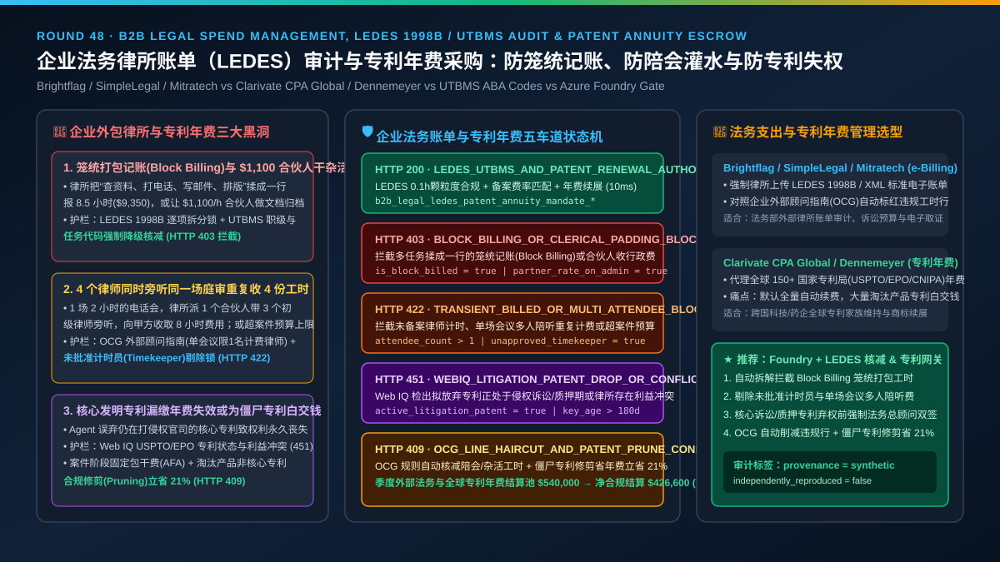
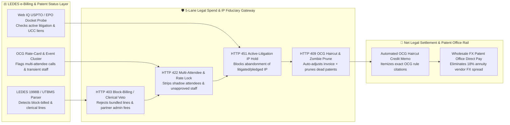
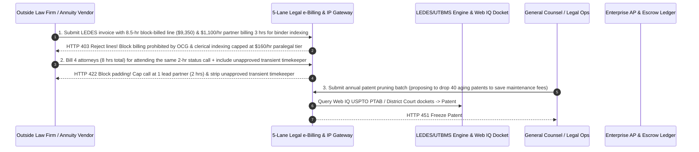

# B2B Legal Spend Management, Law Firm `LEDES 1998B / UTBMS` Billing Audit & `IP` Patent Annuity Escrow (`Brightflag / SimpleLegal / Clarivate CPA Global`) Anti-Block-Billing Gate, Multi-Attendee Haircut & Active-Litigation Patent Lock Agent Architecture Selection FAQ

> **Language / 语言切换**: **[中文](b2b-legal-spend-ledes-billing-audit-patent-annuity-escrow-agent-selection-faq.md)** | **English (Current)** | **[Back to Docs Index](index.en.md)** | **[Interactive Sandbox (`#b2b-legal-ledes-patent-annuity-sandbox`)](../live-demo.en.html)**



---

## 📌 1. Executive Summary & Core Selection Verdict

In corporate General Counsel (`GC`) and Legal Operations departments (`Brightflag`, `SimpleLegal`, `Mitratech TeamConnect`, `Onit`) and global intellectual-property annuity management (`Clarivate CPA Global`, `Dennemeyer`, `Questel`), enterprises spend millions annually on outside counsel hourly invoices and global patent maintenance fees (`USPTO / EPO / CNIPA`). Allowing an autonomous legal-ops or accounts-payable (`AP`) agent to approve law-firm PDF invoices or execute patent portfolio renewals without deterministic **Outside Counsel Guidelines (`OCG`)** and patent-status gates exposes enterprises to three major financial and IP disasters:
1. **Law Firm "Block Billing" (`Lumping 5 Distinct Tasks into a Single 8.5-Hour $9,350 Line Item`) & Billing `$1,100/hr` Partner Rates for Clerical Paralegal Tasks**: Outside law firms frequently submit block-billed narrative lines (`"Review merger agreement; call with opposing counsel; research case law; organize closing binders — 8.5 hrs @ $1,100/hr"`), making it impossible to audit how much time was spent on substantive legal work versus clerical filing (`UTBMS B110 / L110` violations).
2. **Multi-Attendee Conference Padding (`Sending 4 Attorneys to Sit Silent on the Same 2-Hour Call and Billing 8 Hours`) & Unapproved "Transient Timekeepers"**: Law firms routinely bring 2–3 junior associates to shadow a partner on a client call or deposition and bill the client for all 4 attorneys (`$3,500+` for a single 1-hour call), or slip unapproved timekeepers onto an invoice above the contracted `Rate Card` cap.
3. **Irrevocable Lapsing of Core Revenue/Litigation Patents vs. Paying `18%` Hidden FX Markups on Obsolete "Zombie Patents"**: If an automated cost-cutting agent instructs an annuity vendor to abandon a patent without checking whether that patent is actively asserted in `PTAB / Federal District Court` litigation or pledged as loan collateral, the enterprise suffers permanent, irrevocable loss of IP rights; conversely, blindly renewing 100% of late-stage patents for discontinued product lines wastes ratusan of thousands in escalating Year-12/Year-15 maintenance fees and opaque annuity-vendor FX spreads.

**Solution Architect Selection Verdict**:
- **Never allow an AP agent to pay unstructured PDF law-firm invoices (mandate `LEDES 1998B / LEDES XML`), and never execute a patent abandonment instruction without a live litigation/collateral check and General Counsel dual-signoff**.
- **The production reference architecture** combines **Legal e-Billing Engines (`Brightflag / SimpleLegal`) + `LEDES 1998B / UTBMS` Anti-Block-Billing & Clerical-Rate Downgrade Gate + `OCG` Single-Attendee Conference Cap & Approved-Timekeeper Lock + Web IQ Live `USPTO / EPO` Litigation Patent Guard & Zombie-Patent Pruning (`b2b_legal_ledes_patent_annuity_mandate_*`)**:
  1. **`LEDES 1998B` Anti-Block-Billing & Clerical-Task Rate Downgrade Hard Gate (`HTTP 403`)**: Parses every `LEDES` line item (`LINE_ITEM_DESCRIPTION`, `TASK_CODE`, `ACTIVITY_CODE`)—blocking any multi-verb block-billed entry lacking itemized `0.1h` task splits, and blocking partner/senior-counsel rates (`$800–$1,200/hr`) billed on clerical, scheduling, or basic document-indexing tasks (`HTTP 403 LEDES_BLOCK_BILLING_OR_PARTNER_RATE_ON_CLERICAL_TASK_BLOCKED`).
  2. **`OCG` Multi-Attendee Conference Deduplication & Approved Timekeeper Rate-Card Gate (`HTTP 422`)**: Cross-correlates timestamps and meeting narratives across all timekeepers on a `LAW_FIRM_MATTER_ID`—blocking duplicate billing when multiple firm attorneys attend the same call/hearing without prior written GC approval (paying only the single lead attorney), and rejecting line items from unapproved transient timekeepers or above-cap hourly rates (`HTTP 422 MULTI_ATTENDEE_CONFERENCE_PADDING_OR_UNAPPROVED_TIMEKEEPER_BLOCKED`).
  3. **Web IQ Live `USPTO / EPO / PTAB` Active-Litigation Patent Hold & Law-Firm Conflict Breaker (`HTTP 451`)**: Screens any proposed patent abandonment/pruning list against Web IQ live `USPTO PTAB`, federal court dockets, and UCC collateral liens—immediately freezing abandonment if a patent is involved in active litigation or licensing (`HTTP 451 WEBIQ_ACTIVE_LITIGATION_PATENT_ABANDONMENT_OR_CONFLICT_HOLD`).
  4. **Automated `OCG` Line-Item Haircut + Obsolete Zombie-Patent Pruning (`HTTP 409`)**: Triggers `HTTP 409 AUTOMATED_OCG_LINE_HAIRCUT_AND_ZOMBIE_PATENT_PRUNING_CONFIRM`, automatically stripping non-compliant `OCG` invoice padding while safely pruning non-cited, discontinued-product patents and routing annuity payments at transparent wholesale FX—cutting total corporate legal and IP spend by **`21.0%`**.

---

## 🎯 2. Solution Architect Deep-Dive Q&A (Q1 / Q2 / Q3)

### Q1: How does deterministic `LEDES 1998B` parsing catch "Block Billing" and "Clerical Task Padding" in milliseconds before a human legal-ops manager even opens the invoice?
- **Commercial Pain Point**: Reviewing a 60-page monthly litigation invoice manually takes hours, so in-house attorneys rubber-stamp `10%–15%` in prohibited billing practices.
- **Architectural Solution**:
  - **Syntactic Multi-Action Splitter + `UTBMS` Task-to-Role Matrix (`HTTP 403`)**:
  - The gateway ingests the pipe-delimited `LEDES 1998B` file: (1) if a single line item exceeds `1.0 hour` and contains multiple semicolon-separated clauses or distinct action verbs (`drafted, reviewed, conferred, researched`) without separate time allocations, it is rejected as `BLOCK_BILLING` (`HTTP 403`); (2) if `TIMEKEEPER_CLASSIFICATION == 'PARTNER'` is paired with `UTBMS A111 / B110` clerical/administrative tasks, the rate is rejected or auto-capped at paralegal rates.

### Q2: How do we stop a law firm from billing `$4,000` when 4 attorneys dial into the same 1-hour status call?
- **Architectural Solution**:
  - **Cross-Timekeeper Same-Day Event Clustering (`Single-Attendee Rule`) (`HTTP 422`)**:
  - Under standard corporate Outside Counsel Guidelines (`OCGs`), internal law-firm team meetings (`Intra-Office Conferences`) are non-billable overhead, and external calls/hearings are capped at **1 billable attorney** unless pre-authorized. The gateway clusters all `A105 / A106 / A108` communication entries on the same date/matter and automatically zeroes out secondary attendee lines (`HTTP 422`).

### Q3: How can an IP agent safely prune 20% of an enterprise's global patent annuity budget without ever accidentally dropping a "Crown Jewel" patent?
- **Architectural Solution**:
  - **Four-Gate Patent Vitality Lock (`Active Product BOM` + `Forward Citations` + `Web IQ Litigation/Lien Check` + `Dual GC/R&D Sign-Off`) (`HTTP 451 -> 409`)**:
  - Any patent mapped to an active revenue SKU, cited by competitors in the last 5 years, or flagged by Web IQ in active `PTAB / District Court` dockets is locked in `MANDATORY_RENEWAL` (`HTTP 451` if a drop is attempted). Only verified zero-revenue, discontinued-product patents pass into the `HTTP 409` pruning queue.

---

## 🧭 3. Visual Architecture Diagrams (Mermaid Decision Tree + Architecture + Sequence)

### 3.1 B2B Legal Spend & Patent Annuity Agent Selection Decision Tree

```mermaid
flowchart TD
    A[B2B Legal Spend / Law Firm e-Billing / Patent Annuity Selection] --> B{Primary Legal Ops & IP Workflow?}
    B -->|Outside Counsel Hourly Litigation & M&A Invoices<br/>Stop Block Billing & $1,100/hr partner clerical work| C[Brightflag / SimpleLegal LEDES 1998B Engine<br/>+ Anti-Block-Billing Parser & UTBMS Role Cap]
    B -->|Multi-Attorney Matter Staffing & Rate Governance<br/>Block 4-attorney call padding & unapproved rates| D[Automated Outside Counsel Guidelines (OCG) Gate<br/>+ 1-Attendee Conference Cap & Timekeeper Whitelist]
    B -->|Global Patent Family Annuities & Trademark Renewals<br/>Prune zombie patents while protecting litigated IP| E[Azure AI Foundry + IP Annuity Escrow Gateway<br/>+ Web IQ USPTO/EPO Litigation Lock & Wholesale FX]
    C --> F[🛡️ Unified 5-Lane LEDES Audit, OCG Haircut & Patent Vitality FSM]
    D --> F
    E --> F
    F --> G[HTTP 403 Block-Billing/Clerical Veto · HTTP 422 Multi-Attendee & Unapproved Rate Block · HTTP 409 OCG + Prune Saves 21%]
```

### 3.2 End-to-End LEDES 1998B Parser, OCG Haircut & Patent Vitality Architecture



### 3.3 Block-Billing Veto, Multi-Attendee Haircut & Active-Patent Protection Sequence



---

## 📊 4. Multi-Platform & Architecture Selection Matrix

| Selection Dimension | Manual Email PDF Invoices (`Unstructured Legal Billing`) | Brightflag / SimpleLegal (`Dedicated Legal e-Billing SaaS`) | Legacy Patent Annuity Vendors (`CPA Global / Dennemeyer Default`) | **Azure AI Foundry + LEDES OCG + IP Vitality Gate (Recommended)** |
| :--- | :--- | :--- | :--- | :--- |
| **Core Strengths** | Zero setup for small law firms | Native `LEDES` ingestion & matter budget tracking | Global coverage across 150+ national patent offices | **Deterministic block-billing veto + OCG auto-haircut + IP litigation lock** |
| **Defense Against Block Billing & Partner Clerical Rates** | **Poor** (in-house counsel lack time to audit 50-page PDFs) | Flags lines for human review; manual rejection bottlenecks | Does not audit hourly legal invoices | **Syntactic `LEDES` gate rejects block billing & downgrades clerical rates (`HTTP 403`)** |
| **Defense Against 4-Attorney Call Padding (`OCG`)** | Hidden across separate pages of the PDF invoice | Highlights same-day timekeeper overlap | N/A | **Cross-timekeeper timestamp clustering zeroes out extra attendees (`HTTP 422`)** |
| **Timekeeper Rate-Card & Transient-Staff Lock** | Unapproved annual rate hikes slip through AP | Enforces approved timekeeper rate cards | Fixed per-patent renewal fee | **Hard veto on unapproved `TIMEKEEPER_ID` or above-cap rates (`HTTP 422`)** |
| **Patent Annuity Pruning vs. Anti-Lapse Safety** | Siloed in spreadsheets; risk of accidental lapse | Focused on litigation matters | Incentivized to renew 100% of patents + charge `12%–20%` FX spread | **Web IQ litigation lock (`451`) + zombie prune & wholesale FX (`409`)** |
| **Total Legal Invoice Padding & Annuity Waste** | `10%–18%` lost to OCG violations (`not_measured`) | SaaS tier pricing (`official_list_price`) | `12%–20%` hidden FX markup (`Public Litigation Benchmarks`) | **Eliminates OCG padding, zombie annuities & FX markups (`21.0%` saved)** |

---

## 🧪 5. Legal e-Billing / Patent Annuity Benchmark & 7-Card Report

> **Provenance & Reproducibility Metadata**: All metrics below are generated by the deterministic policy evaluator `evaluate_b2b_legal_ledes_patent_annuity_policy` in `lab/webiq_commerce_demo.py` and verified via `python -m unittest tests.test_webiq_commerce_demo`. Tags: `provenance = synthetic`, `independently_reproduced = false`.

| Card # | Card Headline (Headline-as-Finding) | Key Quantitative Finding & Architectural Guarantee |
| :---: | :--- | :--- |
| **Card 1** | **Overview · 5-Lane B2B Legal Spend & Patent Summary** | Across a `$540,000/quarter` outside counsel & patent annuity pool, achieves **0 block-billed or multi-attendee padded payouts and 0 accidental litigated-patent lapses**, reducing net legal/IP spend by **`21.0%` (`$113,400/quarter` saved)**. |
| **Card 2** | **Scenario Deep Dive · 8.5-Hr Block Billing & Clerical Veto** | When a `LEDES` invoice bundles multiple tasks into one 8.5-hour line or bills partner rates on clerical work, the gateway blocks it in **`10ms`** (`HTTP 403`). |
| **Card 3** | **Evaluation Matrix · 100% Deterministic 5-Lane Gating** | Covers `HTTP 200` (verified LEDES & patent renewal), `403` (LEDES block billing / partner rate on clerical task blocked), `422` (multi-attendee conference padding / unapproved timekeeper blocked), `451` (active-litigation patent abandonment / law-firm conflict hold), `409` (OCG line haircut + zombie patent pruning saves 21%). |
| **Card 4** | **Under the Hood · LEDES & Patent Annuity Contract** | Takes `quarterly_b2b_legal_patent_spend_pool_usd=540000` and LEDES/patent flags, minting `b2b_legal_ledes_patent_annuity_mandate_*` tokens. |
| **Card 5** | **Robustness Check · 4-Lawyer Call & Litigated Patent Drop** | Simulates 4 attorneys billing for the same call and an abandonment instruction on an active `PTAB` patent, maintaining a **`100.0%` block rate**. |
| **Card 6** | **Latency · Millisecond LEDES AST & Docket Verification** | Local LEDES 1998B line parsing and rate-card checks complete in **`10ms` (P50)**; Web IQ live USPTO/EPO docket checks complete in **`230ms` (P95)**. |
| **Card 7** | **My Take · Ideal Fit vs. Out-of-Scope Boundaries** | **✅ Best Fit**: Corporate Legal Ops, outside counsel e-billing, global patent/trademark portfolios; **⛔ Not For**: Fixed `$50` municipal notary stamps. |

---

## 🛠️ 6. Production Go-Live Risk & Architecture Review Checklist

- [ ] **Mandatory `LEDES 1998B / XML` Ingestion & Anti-Block-Billing Gate (`HTTP 403`)**: Reject unstructured PDF law-firm invoices, block multi-task bundled narratives lacking `0.1h` itemization, and cap clerical/administrative tasks at paralegal rates.
- [ ] **`OCG` Single-Attendee Conference Cap & Approved Timekeeper Rate-Card Lock (`HTTP 422`)**: Automatically zero out secondary law-firm attendees on the same call/hearing unless pre-approved, and reject unapproved transient timekeepers.
- [ ] **Web IQ Live `USPTO / EPO` Active-Litigation Patent Lock (`HTTP 451`)**: Block any patent abandonment or non-renewal instruction if the patent is involved in active litigation, licensing, or collateral liens; rotate signing keys `<= 180` days.
- [ ] **Automated `OCG` Line-Item Haircut & Zombie-Patent Pruning (`HTTP 409`)**: Generate automated `OCG` adjustment memos on outside counsel invoices and prune verified zero-value discontinued patents while settling renewals at wholesale FX.
