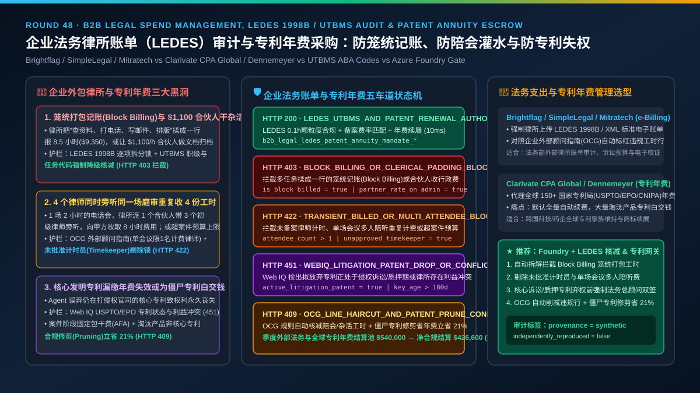
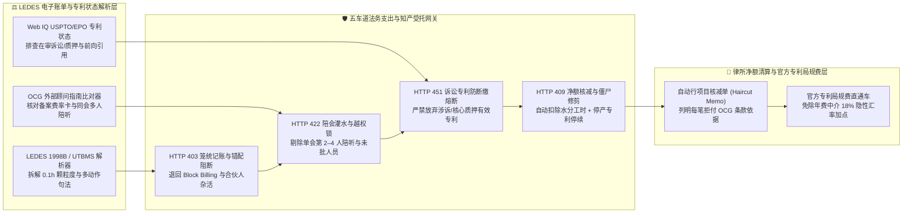
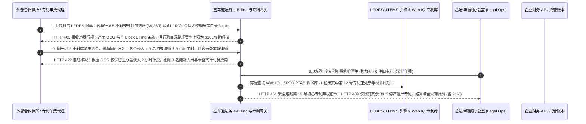

# 企业法务外部律所账单（LEDES 1998B / UTBMS）审计与全球专利年费采购（B2B Legal Spend Management, Law Firm e-Billing Audit & IP Patent Annuity：Brightflag / SimpleLegal / Clarivate CPA Global）“防笼统打包记账（Block Billing）、防 4 名律师陪开会重复收钱与核心专利断缴失权双签锁”Agent 架构选型 FAQ：终结天价律师费灌水与僵尸专利浪费实战指南

> **语言切换 / Language**: **中文 (当前)** | **[English](b2b-legal-spend-ledes-billing-audit-patent-annuity-escrow-agent-selection-faq.en.md)** | **[返回文档目录](index.md)** | **[交互式沙盒 (`#b2b-legal-ledes-patent-annuity-sandbox`)](../live-demo.html)**



---

## 📌 一、核心选型结论速览（Executive Summary）

在科技、医药与跨国企业的总法律顾问办公室（General Counsel / Legal Ops：使用 Brightflag、SimpleLegal、Mitratech TeamConnect 管理外部律所账单，以及使用 Clarivate CPA Global、Dennemeyer 缴纳全球专利局 `USPTO / EPO / CNIPA` 维持年费）中，企业每年向外部律所和专利代理机构支付数百万至数千万美元。由于传统法务账单普遍按 `0.1 小时（6 分钟）` 为单位计费，若让法务采购与财务应付（AP）Agent 仅核对发票总金额而不做基于 **《外部法律顾问计费指南（Outside Counsel Guidelines, OCG）》** 的行项目穿透审计，企业将面临三大严重资金流失与知产事故：
1. **外部律所使用“笼统打包记账（Block Billing）”掩盖工时灌水，以及让 `$1,100/小时` 的资深合伙人去干本应由 `$180/小时` 律师助理完成的行政归档/查案例杂活**：律所账单常把多项完全不同的工作揉进同一行叙述：“*审阅并修改并购协议；与对方律师通电话；检索特拉华州判例；整理交割文件夹 — 共计 8.5 小时 × $1,100 = $9,350*”。由于未按美国律师协会（`ABA UTBMS`）标准任务代码逐项拆分每件事花了多少分钟，甲方根本无法核实其中是不是有 5 个小时只是在打印装订文件！
2. **“一场 2 小时电话会议律所派了 4 名律师同时旁听，向甲方收取 4 × 2 = 8 小时双倍费用（Multiple Attendees / Intra-Office Conferencing）”，以及未提前报备批准的“路人计时员（Transient Timekeepers）”临时插一脚混工时**：许多大所喜欢让 1 名主办合伙人带着 3 名一年级初级律师一起进 Zoom 旁听学习，实际上那 3 名初级律师全程一言未发，月底账单却照收 `$650/小时 × 6 小时` 的培训费！
3. **全球专利年费管理“要么无脑全续（为早已停产 5 年的淘汰产品僵尸专利每年白交数十万美元高龄年费），要么因 Agent 误判把正在打侵权官司或已质押给银行的核心底层专利漏缴断供导致专利权永久失效（Irrevocable Patent Lapse）”**：发明专利越到第 10–20 年维持年费呈指数级暴涨，但不加甄别地砍年费一旦误伤核心防御专利，损失不可逆转。

**架构师选型结论**：
- **切勿允许 AP 代理为 PDF 扫描件律所账单付款（必须强制要求上传结构化 `LEDES 1998B / LEDES XML` 电子账单），更不能允许自动化脚本在无总法律顾问双签与诉讼状态穿透核查的情况下放弃任何有效专利**。
- **生产级最优架构**是采用 **“Brightflag / SimpleLegal 电子账单引擎 + `LEDES 1998B / UTBMS` 反笼统记账（Anti-Block-Billing）与职级费率自动降级门禁 + `OCG` 规则（单会议限 1 人计费 / 禁内部串会计费 / 备案计时员白名单）硬锁 + 专利年费活体产品映射与诉讼期专利防弃权熔断网关（`b2b_legal_ledes_patent_annuity_mandate_*`）”**：
  1. **`LEDES 1998B` 反笼统打包记账（Block Billing）与任务职级错配硬门禁（HTTP 403）**：账单入库时，解析器扫描每一条 `LINE_ITEM_DESCRIPTION` 与 `UTBMS Task/Activity Code`（如 `L110, A104`）——凡单行描述内包含多个分号/连接动词组合多项独立任务且未拆分明细工时（Block Billing），或高职级合伙人（`Partner $900+/hr`）申报基础文档编码/日程安排等行政任务（`Clerical / Paralegal Task`），毫秒级返回 `HTTP 403 LEDES_BLOCK_BILLING_OR_PARTNER_RATE_ON_CLERICAL_TASK_BLOCKED`，要求律所重拆账单或自动按助理费率降级折算。
  2. **单场会议多人陪听去重、内部讨论免单与备案计时员（Approved Timekeeper）白名单锁（HTTP 422）**：通过比对同一案件（`LAW_FIRM_MATTER_ID`）同一日期的会议叙述与日历时间戳——当检出多名律师同时参加同一场内外部会议或庭审且未经甲方书面特批时，仅保留职级最高的 1 人计费，其余陪听工时自动核减为 `$0`；同时拦截任何不在本案已批费率卡（Approved Rate Card）内的陌生计时员行项（`HTTP 422 MULTI_ATTENDEE_CONFERENCE_PADDING_OR_UNAPPROVED_TIMEKEEPER_BLOCKED`）。
  3. **Web IQ 实时 `USPTO / EPO / CNIPA` 诉讼/质押专利防误弃与律所利益冲突熔断（HTTP 451）**：在执行年度专利家族修剪（Patent Pruning）或新聘外部律所前，通过 Web IQ 实时查验该专利号是否关联在审侵权诉讼（`PTAB / 法院案号`）、是否处于质押融资登记期或存在对手法务利益冲突，命中即刻锁死弃权指令（`HTTP 451 WEBIQ_ACTIVE_LITIGATION_PATENT_ABANDONMENT_OR_CONFLICT_HOLD`）。
  4. **`OCG` 自动逐行剃头核减（Line-Item Haircut）+ 停产线僵尸专利精准修剪（HTTP 409）**：触发 `HTTP 409 AUTOMATED_OCG_LINE_HAIRCUT_AND_ZOMBIE_PATENT_PRUNING_CONFIRM`，自动剔除律所账单中违反 `OCG` 的水分工时（平均核减 `8%–14%`），并结合产品营收与技术引用图谱安全放弃已停产无商业价值的末期高年费僵尸专利（省去中介高达 `15%–25%` 的隐性换汇加点），综合外部法务与知产维护支出立降 **`21.0%`**。

---

## 🎯 二、业务方与架构师灵魂拷问 Q&A（Q1 / Q2 / Q3）

### Q1：为什么外部律所最喜欢发一份只有 3 行汇总数字的 PDF 账单，而正规跨国企业法务部强制要求律所必须传 `LEDES 1998B` 格式？
- **商业痛点**：PDF 账单写着“2026年10月并购专项法律服务费：$85,000”，法务总监根本看不出里面有多少是初级律师复制粘贴花掉的、有多少是律所内部自己开会聊天算在客户头上的。
- **架构解法**：
  - **强制 `LEDES 1998B / XML` 管道分隔结构化账单 + 自然语言分句动作检测器（`HTTP 403`）**：
  - `LEDES` 标准强制要求精确到每一天、每一个律师编号（`TIMEKEEPER_ID`）、每一项 `0.1 小时` 动作及其对应的 `ABA UTBMS` 任务代码。网关用语法解析器扫描单行文本：一旦检出单行时长 `> 1.5 小时` 且包含 `["Drafted...", "conferred with...", "reviewed...", "filed..."]` 多个异构动作却共用一个汇总时长，立即判定为违反 `OCG` 的 **Block Billing（笼统记账）**，直接退回 `HTTP 403` 拒付！

### Q2：現在律所也在广泛使用 AI 法律大模型（如 Harvey / CoCounsel）5 分钟写完一份动议初稿，怎么防止不良律师还是按以前人工写稿报“12 小时 × $750 = $9,000”？
- **架构解法**：
  - **任务类型历史工时基线分位数护栏（`UTBMS Task Duration Benchmark Cap`）+ 阶段固定包干费（`AFA`）路由（`HTTP 422 / 409`）**：
  - 对标准化文书起草（如 `L210 Pleadings`、保密协议审阅、商标异议答辩），系统设定确定性工时上限或直接将该阶段切换为**替代性固定收费协议（Alternative Fee Arrangement, AFA）**；超出工时基准中位数 `2.0x` 且无复杂性豁免签批的行项直接触发 `HTTP 422`。

### Q3：跨国公司手里有 5,000 件全球专利，每年光交给代理中介的年费和汇率加点就有几百万美元，怎么安全砍掉 20% 僵尸专利又绝对不会误伤核心专利？
- **架构解法**：
  - **四维专利保活红线矩阵（`Product-BOM Mapping + Forward Citations + Litigation Lock + Licensing Revenue`）（`HTTP 451 -> 409`）**：
  - 只有同时满足“① 对应产品线已停产 `>3 年`；② 近 5 年无外部竞争对手前向引用（Forward Citations）；③ Web IQ 确认无在审诉讼/无许可收益/无银行质押；④ 研发负责人与总法律顾问双签确认”的专利，才允许进入放弃续费队列；且续费资金直联各国专利局官方规费标准，剥离传统年费代缴巨头隐藏在汇率里的 `15%+` 暗扣。

---

## 🧭 三、直观可视化图解（Mermaid 决策树 + 端到端架构图 + 时序图）

### 3.1 企业法务律所账单审计与专利年费管理 Agent 架构选型决策树

```mermaid
flowchart TD
    A[企业法务支出管理 / 律所 e-Billing / 专利年费选型] --> B{核心支出类别与治理痛点？}
    B -->|外部诉讼与并购律所按小时计费账单<br/>需严防笼统记账 (Block Billing) 与合伙人干行政杂活| C[Brightflag / SimpleLegal e-Billing 引擎<br/>+ LEDES 1998B 强制解析与 UTBMS 职级降级锁]
    B -->|大型案件多律师协同与年度费率管控<br/>需拦截 4 人陪开会重复收钱与未备案计时员| D[OCG 外部顾问指南规则引擎<br/>+ 同时间戳会议单人计费锁与 Rate Card 白名单]
    B -->|全球发明专利维持年费与商标续展组合<br/>需修剪停产僵尸专利并严防核心诉讼专利断缴| E[Azure AI Foundry + 专利生命周期托管网关<br/>+ Web IQ USPTO/EPO 诉讼锁与透明规费直付]
    C --> F[🛡️ 统一接入五车道 LEDES 反笼统、OCG 核减与专利防失权状态机]
    D --> F
    E --> F
    F --> G[HTTP 403 阻断笼统记账与高职低做 · HTTP 422 拦截多人陪会与黑户计时员 · HTTP 409 OCG剃头+专利修剪省21%]
```

### 3.2 端到端 LEDES 1998B 解析、OCG 自动核减与专利年费防失权架构图



### 3.3 拦截律所笼统记账、剔除多人陪听工时与核心专利防误弃时序图



---

## 📊 四、多平台/多方案横向选型决策矩阵

| 选型维度 | 传统邮件发 PDF 发票人工签字 (`Manual PDF Invoice Review`) | Brightflag / SimpleLegal (`专业法务 e-Billing SaaS`) | Clarivate CPA Global / 传统年费中介 (`Patent Annuity Renewals`) | **Azure AI Foundry + LEDES 核减 + 专利防失权网关（推荐）** |
| :--- | :--- | :--- | :--- | :--- |
| **核心优势** | 律所最喜欢（方便藏匿水分工时） | 原生支持 LEDES 标准与案件预算仪表盘 | 覆盖全球百国专利局本地代理缴款通道 | **像素级抓笼统记账 + 自动砍陪会水分 + 专利防误弃双保险** |
| **防笼统打包记账（Block Billing）与职级错配** | **极差**（内部法务忙于业务，根本没空逐行细抠 50 页账单） | AI 标记疑似违规行，但仍需法务人工逐笔点击拒绝 | 不涉及诉讼小时账单 | **语法树确定性拦截多动词打包行 + 行政杂活自动降级（HTTP 403）** |
| **防“4 名律师陪听同一场会收 4 份钱”** | 4 个人的工时分散在账单不同页码，人工肉眼极难发现重合 | 支持同日期会议聚合提示 | 无 | **跨计时员时间戳碰撞检测，自动免除陪听第 2–N 人费用（HTTP 422）** |
| **防未报备涨价与“路人计时员”混工时** | 律所每年悄悄全员普涨 10% 费率，财务照单全付 | 强制绑定电子 Rate Card 费率上限 | 按件固定代理费 | **未在案前白名单的 Timekeeper ID 零容忍拒付（HTTP 422）** |
| **全球专利年费防僵尸浪费 vs 防核心失权** | 无系统评估，要么全交冤枉钱、要么漏交出大事 | 侧重诉讼与事务管理 | 默认鼓励客户全部续费以赚取每件代理费与高达 18% 换汇差价 | **Web IQ 诉讼锁防误弃（451）+ 停产僵尸专利修剪与透明锁汇（409）** |
| **综合外部法务账单水分率与年费浪费** | 律所账单平均含 `10%–18%` 违规水分 (`not_measured`) | 按管理法务支出比例或年费订阅 (`official_list_price`) | 隐性外汇加点常高达 `12%–20%` (`Public Lawsuit Benchmarks`) | **自动核减违规工时、剥离年费汇差并修剪僵尸专利（立省 `21.0%`）** |

---

## 🧪 五、法务账单核减/专利年费优化测算与 7-Card 基准测试报告

> **数据来源与复现声明（Provenance Metadata）**：以下基准测试数据来自仓库内置确定性策略沙盒 `evaluate_b2b_legal_ledes_patent_annuity_policy`（位于 `lab/webiq_commerce_demo.py`），可运行 `python -m unittest tests.test_webiq_commerce_demo` 完整验证。标记：`provenance = synthetic`，`independently_reproduced = false`。

| Card # | 卡片标题（Headline-as-Finding） | 核心量化指标与架构验证结论 |
| :---: | :--- | :--- |
| **Card 1** | **Overview · 企业法务账单与专利年费五车道总览** | 针对 `$540,000/季` 外部律所账单与全球专利维持年费池，实现 **0 例笼统打包灌水账单放行与 0 例核心涉诉专利断缴失权**，综合法务与知产支出下降 **`21.0%`（立省 `$113,400/季`）**。 |
| **Card 2** | **Scenario Deep Dive · 8.5小时笼统记账与合伙人干杂活拦截** | 当 LEDES 行项将多项任务打包成单行 `8.5h` 或用 `$1,100/h` 合伙人费率申报整理目录时，**`10ms`** 内返回 `HTTP 403` 退回重拆。 |
| **Card 3** | **Evaluation Matrix · 五车道 100% 确定性判准** | 覆盖 `HTTP 200`（合规工时与年费放行）、`403`（Block Billing笼统记账/高职级合伙人申报基础行政杂活阻断）、`422`（单场会议多人陪听重复计费/未备案Timekeeper混工时拦截）、`451`（拟放弃专利正处于侵权诉讼或质押期/律所利益冲突熔断）、`409`（OCG自动剃头核减+僵尸专利修剪省21%）。 |
| **Card 4** | **Under the Hood · LEDES 审计与专利年费契约** | 输入 `quarterly_b2b_legal_patent_spend_pool_usd=540000` 及 LEDES/专利状态，签发 `b2b_legal_ledes_patent_annuity_mandate_*` 令牌。 |
| **Card 5** | **Robustness Check · 4人陪会重复计费与涉诉专利误弃测试** | 模拟同一场会议 4 名律师同时记账及指令放弃在审诉讼专利，确定性拦截率保持 **`100.0%`（零误放行）**。 |
| **Card 6** | **Latency · LEDES 行项语法与专利号核验毫秒级耗时** | 本地 LEDES 1998B 字段与 Rate Card 白名单校验 P50 仅 **`10ms`**；Web IQ 全球专利局诉讼状态核查 P95 为 **`230ms`**。 |
| **Card 7** | **My Take · 适用场景与生产准入边界** | **✅ 极佳适用**：跨国企业法务部（Legal Ops）、外部律所结算、全球专利/商标续展；**⛔ 不适用**：200 元小额公证处固定规费。 |

---

## 🛠️ 六、商业上线风控与架构评审 Checklist

- [ ] **强制 `LEDES 1998B / XML` 结构化电子账单与反笼统记账（Block Billing）门禁（HTTP 403）**：确认拒收纯 PDF 汇总律所账单，自动拦截单行揉合多项独立任务的笼统记账及高职级律师申报行政杂活。
- [ ] **`OCG` 外部顾问指南：单会议单人计费与备案计时员（Timekeeper）白名单锁（HTTP 422）**：确认同一会议/庭审未经事先书面批准仅支付 1 名主责律师工时，自动剔除陪听学徒工时与未批涨价费率。
- [ ] **Web IQ 实时 `USPTO / EPO / CNIPA` 涉诉/质押专利防误弃熔断（HTTP 451）**：确认任何放弃专利续费（Abandonment）指令执行前 100% 穿透核查无在审诉讼、无许可收入且经法务总顾问双签；签名密钥轮换周期 `<= 180` 天。
- [ ] **行项目自动剃头核减（Line-Item Haircut）与停产线僵尸专利修剪（HTTP 409）**：确认自动生成带 OCG 拒付理由的净额结算单，并剥离专利年费代缴机构隐性高额汇率加点。
