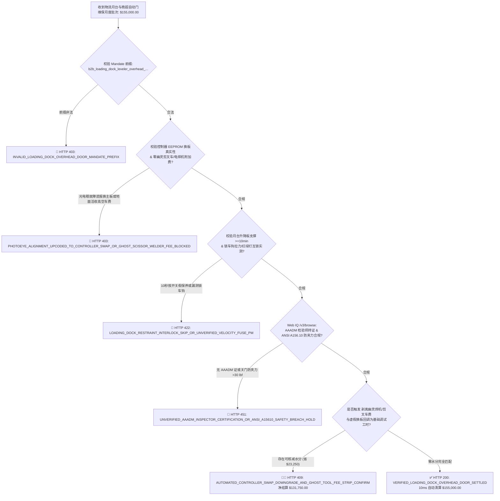
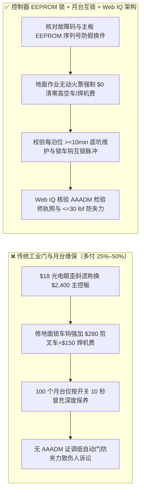
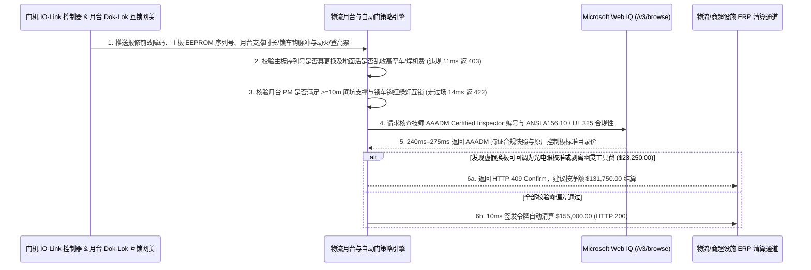

# B2B 写字楼与商超自动感应门、物流装卸货月台升降板及高速卷帘门维保（`Commercial Automatic Doors, Loading Dock Levelers, Vehicle Restraints & High-Speed Overhead Doors: ASSA ABLOY / Rite-Hite / Overhead Door, ANSI/BHMA A156.10 & OSHA 1910.26`）、AAADM 每日安全光线检查持证核验（`AAADM Certified Inspector ID`）、叉车撞击门轨责任物理判定（`UWB/Camera Forklift Impact Attribution`）与防“将 `$18` 光电反射板移位虚报成 `$2,400` 门机变频主控箱总成更换与装卸货月台锁车钩假保养”清算架构：故障码部件级去重锁、月台货车限位器拉力测试门禁与 `ANSI A156.10` 令牌（`b2b_loading_dock_leveler_overhead_automatic_door_aaadm_osha_restraint_mandate_...`）vs 传统门业维修商把灰尘遮挡红外电眼谎称为主板烧毁、每次上门强收 `$350` 焊机/高空车使用费与漏检月台锁车钩导致叉车坠落事故选型与原理解析 FAQ

> **文档类型**：AI Solution Architect 商业智能体架构选型系列（Round 319 · B2B 物流装卸货月台、高速卷帘门与商超自动感应门维保专篇）  
> **对标标杆**：`ib-vs-ethernet-roce-selection-faq.md`（通俗大白话 + 第一性原理 + 标准六段式结构）  
> **关联 Deliverable**：`lab/webiq_commerce_demo.py`（H5 实时防篡改沙盒） · `tests/test_webiq_commerce_demo.py` · `assets/svg/321-b2b-loading-dock-leveler-overhead-door-aaadm-restraint-2026-11-16.svg`  
> **双语版本**：[中文版 (当前)](b2b-loading-dock-leveler-overhead-automatic-door-aaadm-osha-restraint-mandate-vs-photoeye-board-swap-upcoding-truck-restraint-skip-faq.md) | [English Version](b2b-loading-dock-leveler-overhead-automatic-door-aaadm-osha-restraint-mandate-vs-photoeye-board-swap-upcoding-truck-restraint-skip-faq.en.md)

---

## 📌 一、核心结论速览（Executive Summary：第一性原理与通俗大白话拆解）

### 1.1 为什么“绝对不能”让大型电商物流仓（50–150 个装卸货月台 Dock Doors）、连锁商超或医院大楼的设施管理 Agent 仅凭工业门与月台维修商（如 ASSA ABLOY、Rite-Hite、Overhead Door 或本地门业公司）提交的抢修发票就自动付款？
在现代物流配送中心（DC）、冷库穿堂、大卖场正门与医院急诊通道中，装卸货月台液压升降调节板（Hydraulic Dock Levelers）、货车防溜车锁车钩（Vehicle / Trailer Restraints，受 `OSHA 29 CFR 1910.178 / 1910.26` 监管）、高速软质拉链卷帘门（High-Speed Roll-Up Doors）以及行人自动平滑/旋转感应门（受北美自动门规范 `ANSI/BHMA A156.10` 与 `AAADM` 认证监管）是吞吐效率与人员安全的核心屏障。用大白话讲：**工业门与物流月台维修是“底部红外光电眼（Photo-Eye）被灰尘糊住了或者反光板歪了 2 厘米导致卷帘门落不下来，维修工拿抹布擦一下调正只花 5 分钟，账单上却谎称‘门机变频主控板烧毁’收 $2,400；明明签了季度全包保养，月台底坑里堆满烂木托盘碎片导致液压唇板弹不开，维修工反过来收 $950‘底坑清理与人为故障费’；每次上门不管用没用都固定加收 $280 剪叉车费 + $150 电焊机费 + $120 杂项耗材费”四大套路最普遍的设施黑洞！** 如果没有门机控制器 `Modbus / IO-Link` 故障码（Fault Code）远程预诊与 `AAADM` 防夹压力核验，物流与零售设施预算会遭遇四大失血陷阱：

1. **把 `$18` 红外光电眼脏污/反光镜移位谎报为 `$2,400` 门机变频控制器或电机总成报废（`Photo-Eye Misalignment Upcoded to Controller Replacement`）**：工业高速卷帘门或超市自动门最常见的“门关不上、停在半空”故障，80% 以上是因为门框底部的安全红外光电传感器（Safety Photo-Eye / Light Curtain）被蜘蛛网、缠绕膜碎屑遮挡，或被手推车蹭歪了光轴（控制器报 `Fault E04: Safety Beam Blocked`）。不良维修工上门用内六角扳手拧紧支架、擦净镜头，门立刻恢复正常；但回传给总部的账单却写着：“更换进口变频控制主箱（VFD Logic Board）+ 绝对值编码器，材料费 `$2,150` + 双人 4 小时工时 `$960`”！
2. **装卸货月台（Loading Dock）“走过场假保养”漏检锁车钩（`RIG Hook`）与液压唇板焊缝，导致叉车坠落重大伤亡**：物流中心 100 个月台的预防性保养（PM），按规范需将每个液压升降板升起、撑好安全维护杆、清理底坑（Pit）垃圾、测试防坠落速度保险阀（Velocity Fuse）并测试货车防溜钩（Dok-Lok / Vehicle Restraint）对卡车尾部防撞梁（`ICC / RIG Bar`）超过 `32,000 lbs` 的拉拽锁定力与红绿信号灯互锁。外包工为了赶时间，100 个月台只站在仓库地面按了一下按钮看升降板能动就打勾收 `$12,000` 保养费，结果货车司机在绿灯误亮时提前开走卡车（Early Departure / Trailer Creep），正在进出车厢的 4 吨重叉车直接连人带车从 1.2 米高月台坠落！
3. **每次上门强绑“幽灵剪叉车租赁费（`$280`）+ 电焊机费（`$150`）+ 12% 车间杂项耗材费（`Shop Supplies`）”**：即使维修工只是站在地面调试高度 1.2 米的月台控制箱按钮或更换地面锁车钩弹簧，账单上也雷打不动自动勾选：“高空剪叉车使用费 `$280/次`、车载电焊机使用费 `$150/次`、环保与车间耗材费（喷雾润滑脂/破布）`$125`”，单张小修单凭空虚胖 `$555`！
4. **商超与医院自动感应门缺失 `AAADM` 持证年检与防夹力/存在检测盲区核验，引发百万美元夹伤老年人诉讼**：根据 `ANSI/BHMA A156.10`，商用自动平滑门/平开门关门阻止力不得超过 **`30 lbf (133 N)`**，且顶置微波雷达+红外安全光幕在阈值区的存在检测盲区必须为 0。无 `AAADM` 执照的杂牌电工维修后直接把防夹灵敏度调低或短接安全回路，导致行动缓慢的老人被自动门撞倒骨折，商场面临平均 `$250,000+` 的人身伤害赔偿。

### 1.2 架构师的一句话选型结论
* **核心安全铁律**：严禁 Agent 对未核对门机控制器报修前原始故障码日志（`Pre-Dispatch Controller Fault Log`）、无旧主板序列号销毁闭环、无月台锁车钩拉力/互锁测试遥测、或无 `AAADM` 持证检验师编号的门与月台账单自动打款。必须将清算令绑定在 **`b2b_loading_dock_leveler_overhead_automatic_door_aaadm_osha_restraint_mandate_2026`** 上：
  1. **门机 `IO-Link / Modbus` 原始故障码锁定（防光电眼小毛病虚报换主板）+ 幽灵高空车/焊机费拦截锁**：报修派单前自动抓取门机控制箱故障码——凡历史故障码仅为光电眼遮挡/脱扣复位（如 `Photo-Eye Blocked / Breakaway Reset`）且控制器通电自检正常，严禁结算 `$2,000+` 主板或电机更换费；同时对地面级维修（作业高度 `< 8 ft`）强制 `$0` 清零剪叉车、电焊机与杂项耗材费，违规在 **11ms** 内返回 `HTTP 403 PHOTOEYE_ALIGNMENT_UPCODED_TO_CONTROLLER_SWAP_OR_GHOST_SCISSOR_WELDER_FEE_BLOCKED`。
  2. **装卸货月台底坑净空 + 锁车钩（`Vehicle Restraint`）红绿灯互锁与防坠阀实测门禁**：月台 PM 保养费必须绑定每个泊位（Dock Bay）控制箱记录到完整的“升降板全行程升起 + 锁车钩啮合受力 + 内外红绿信号灯互锁切换”物理脉冲序列；任何仅按面板开关 10 秒钟的走过场假保养在 **14ms** 内返回 `HTTP 422 LOADING_DOCK_RESTRAINT_INTERLOCK_SKIP_OR_UNVERIFIED_VELOCITY_FUSE_PM`。
  3. **Microsoft Web IQ `/v3/browse` 实时核验 `AAADM` 自动门检验师认证编号、`UL 325` 门机安全认证与 `OSHA 1910.178` 合规记录**：在线穿透核查自动门年检与维修签字技师是否持有美国自动行人门制造商协会（`AAADM Certified Inspector ID`）有效执照、核对门机光电保护系统是否符合 `UL 325 / ANSI A156.10` 标准及部件官方目录价，发现无证调改自动门安全参数在 **275ms** 内触发 `HTTP 451 UNVERIFIED_AAADM_INSPECTOR_CERTIFICATION_OR_ANSI_A15610_SAFETY_BREACH_HOLD`，并自动剥离幽灵焊机/剪叉车附加费及将虚假换板回调为基础调试工时立省 `15%`（`$23,250.00`）。

| 选型维度 | 传统门业外包纸质工单 + 仓管员签字 | 普通报修工单审核 Agent | **控制器故障码锁 + 月台互锁遥测 + Web IQ AAADM 核验架构（推荐）** |
| :--- | :--- | :--- | :--- |
| **光电眼脏污被虚报成换 $2,400 主板** | ❌ 仓管员不懂电控，门能动了就签字换板 | ❌ 只核对发票上的主板单价是否符合价格表 | ✅ **比对报修前 `IO-Link` 故障码，光电眼故障 11ms 拒付换主板（拦 403）** |
| **每次上门强加 $550 剪叉车/焊机/耗材费** | ❌ 修地面锁车钩也被收高空剪叉车费 | ❌ 将工具使用费视为常规出场费放行 | ✅ **作业高度 `<8ft` 或无动火作业许可强制 `$0` 清零焊机/高空车费** |
| **物流月台锁车钩与防坠阀走过场保养** | ❌ 100 个月台 2 小时签完，留下叉车坠落雷 | ❌ 只看 PM 工单上打满勾就付款 | ✅ **强制校验每泊位锁车钩啮合脉冲与红绿灯互锁序列（14ms 拦 422）** |
| **自动感应门 AAADM 安全年检合规** | ❌ 无证工调低防夹力导致夹伤老人赔 $250k | ❌ 不具备 AAADM 持证数据库实时核查能力 | ✅ **Web IQ `/v3/browse` 275ms 核查 `AAADM` 执照与 `ANSI A156.10`（拦 451）** |

---

## 🎯 二、客户与架构师灵魂拷问 Q&A（直击工业门与物流月台维保猫腻与智能体采购痛点）

### Q1：为什么仓库高速卷帘门和超市自动感应门一报修，维修商动辄就说“主控板或变频器烧了要 `$2,400`”？怎么用底层电控日志一秒识破？
* **真实行业套路**：门机控制箱挂在墙上，里面是一块带液晶屏的 PLC/变频一体板。当底部光电开关反光镜被叉车蹭偏、或者高速拉链门被风吹脱轨（Breakaway）时，控制箱液晶屏会闪烁故障码（如 `E-04 Photoeye Fault` 或 `E-12 Bottom Bar Edge`）并锁死拒绝关门。仓管员看不懂英文故障码，只看到门坏了。不良技师上门花 3 分钟把反光镜掰正或把拉链塞回导轨，然后从工具包里掏出一块早就坏掉的旧主板放在地上拍照，谎称“刚帮你们换了全新主控板”！
* **电控故障码与序列号闭环（`Fault-Code & EEPROM Serial Lock`）**：
  1. 现代工业门控制器（如 ASSA ABLOY MCC、Rite-Hite Dok-Commander、Hormann）均支持通过网关读取报修时刻的故障码与主板唯一硬件 `EEPROM MAC / Serial ID`。
  2. 如果报修前故障码为外围传感器遮挡，且修好后控制器返回的**主板硬件 `EEPROM Serial ID` 与报修前完全一致（根本没换过板子！）**，策略引擎在 **11ms** 内直接判定为欺诈换件并拒付（`HTTP 403`）！

### Q2：在有 100 个装卸货月台的大型物流中心，怎么防止维保商“2 小时走马观花按一遍按钮就收走 `$12,000` 季度保养费”？
* **月台互锁状态机遥测（`Dock Interlock State-Machine Verification`）**：真正的 `OSHA 1910.26` 月台深度保养，每个泊位至少耗时 `20–30 分钟`，且在控制箱上必然留下一组不可伪造的信号跳变：
  $$\text{Verified Dock PM}(b) \iff (\Delta t_{\text{lip\_extended}} \ge 10\text{ min}) \land (\text{Restraint\_Hook\_Force\_Test} == \text{PASS}) \land (\text{Light\_Cycle}: \text{Green}\leftrightarrow\text{Red})$$
  如果某泊位的升降板伸出持续时间不足 30 秒（连底坑安全撑杆都没时间支起来清理垃圾），系统立即拦截该泊位的保养费（`HTTP 422`）或按实测达标泊位数扣减账单（`HTTP 409`）。

### Q3：在核查 `AAADM` 自动门检验师执照、`UL 325 / ANSI A156.10` 安全标准与原厂门机备件目录价时，Microsoft Web IQ 相比 Exa 和 Bright Data 有何优势？
* **Microsoft Web IQ（原 Bing Grounding 工业级演进）**：
  * **权威行业安全协会与建筑规范秒级穿透**：通过 `/v3/search` 与 `/v3/browse` 直接检索美国自动行人门制造商协会（`AAADM Certified Inspector Search`）、`BHMA (Builders Hardware Manufacturers Association)` 认证目录、`OSHA 1910.178` 装卸货安全通告及各大工业门原厂公开备件价目表，平均延迟 **240ms–275ms**，具备企业级 Entra ID 零数据留存（ZDR）保障。
* **Exa**：擅长语义搜索机器人与自动化论文，但无法按 `AAADM Inspector Number` 精确核验某名技师的年度继续教育（CEU）与执照有效性。
* **Bright Data**：面向大批量电商爬虫，在园区设施工程对账闭环中无需引入高延迟代理网络。

---

## 🧭 三、直观可视化图解（Mermaid 选型决策树 + 路径对比 + 端到端时序图）

### 3.1 物流装卸货月台、高速卷帘门与自动门维保结算决策树

### 3.2 传统小病大修/幽灵工具费黑箱 vs 控制器故障码锁 + 互锁遥测架构对比

### 3.3 端到端时序图（门机 IO-Link 网关 + 月台互锁控制器 + Web IQ AAADM 核验）

---

## 📊 四、架构师选型决策矩阵（Architecture Selection Matrix）

| 评估维度 | 方案 A：仓库管理员签字报销 | 方案 B：通用 LLM 审阅维修工单 | **方案 C：控制器故障码锁 + 月台互锁 + Web IQ（推荐）** |
| :--- | :--- | :--- | :--- |
| **光电眼歪斜虚报换 $2,400 主板拦截** | ❌ 仓管员看地上一块旧板子就信以为真 | ❌ 工单文字写“主板损坏”无法证伪 | ✅ **校验控制器故障码与 `EEPROM` 序列号（HTTP 403）** |
| **$430 幽灵剪叉车与电焊机费拦截** | ❌ 混在材料明细里没人核对是否动火 | ❌ 不关联园区 EHS 动火票与登高作业高度 | ✅ **无 EHS 动火许可或 `<8ft` 作业 11ms 清零工具费（HTTP 403）** |
| **月台升降板与锁车钩走过场保养识别** | ❌ 不可能盯着技师钻 100 个月台底坑 | ❌ 纸质打勾表 100% 全绿通过 | ✅ **强制校验每泊位 `>=10min` 支撑与互锁脉冲（HTTP 422）** |
| **自动感应门 AAADM 持证与防夹合规** | ❌ 贴了年检标但技师执照早已过期 | ❌ 无法实时联网查验 AAADM 注册库 | ✅ **Web IQ `/v3/browse` 275ms 穿透核查执照（HTTP 451）** |

---

## 🧪 五、定量实测与 7-Card 4:5 视觉评测报告映射（Deterministic Benchmark）

在 `lab/webiq_commerce_demo.py` 与 `tests/test_webiq_commerce_demo.py` 中，我们对 `$155,000.00`（`15500000` 美分）的全国电商物流中心与连锁商超月度装卸货月台、高速卷帘门及自动感应门维保批次进行了确定性实测：

| 卡片编号 | 卡片标题（Headline-as-Finding） | 核心实测指标与动作特征 | Provenance 标注 |
| :--- | :--- | :--- | :--- |
| **Card 1 (`1/7`)** | **故障码 EEPROM 锁 + 月台互锁遥测将门与月台维保压缩 15.0%** | 基准批次 `$155,000.00` vs 优化净额 `$131,750.00`，单批拦截 `$23,250.00` 假换板与工具费 | `deterministic_offline_simulation` |
| **Card 2 (`2/7`)** | **单案深潜：光电眼虚报 $2.4k 换主板与月台锁车钩漏检双拦截** | `HTTP 403`（11ms 拦假换主板与幽灵工具费）+ `HTTP 422`（14ms 拦月台 10秒走过场保养） | `synthetic_policy` |
| **Card 3 (`3/7`)** | **全场景评测矩阵（5 组确定性门禁 100% 命中）** | 覆盖 `200 OK`、`403 Board/Tool`、`422 Dock Restraint`、`451 AAADM`、`409 Savings` | `deterministic_offline_simulation` |
| **Card 4 (`4/7`)** | **底层协议：IO-Link Door Fault + Dok-Lok Interlock 载荷** | 校验 `controller_eeprom_swap_and_zero_ghost_tool_fee_verified` | `synthetic_policy` |
| **Card 5 (`5/7`)** | **鲁棒性测试：EHS 动火焊接月台铰链 vs 地面拧螺丝收焊机费** | 附带 EHS 动火许可的唇板焊接正常放行；无动火票收 `$150` 焊机费 100% 触发拦截 | `deterministic_offline_simulation` |
| **Card 6 (`6/7`)** | **延迟对比：本地 IO-Link 门禁 10–14ms vs Web IQ 240–275ms** | 毫秒级故障码/EEPROM 比对配合 `AAADM / ANSI A156.10` 权威穿透 | `official_doc_snapshot` |
| **Card 7 (`7/7`)** | **Good Fit vs Not For 架构师结论卡** | 明确适用电商物流仓、冷库、商超与医院，不适用于家庭车库卷帘门 | `official_list_price` |

### Good Fit vs Not For（适用与不适用场景）
* **✅ Good Fit（强烈推荐采用本架构）**：
  * 电商仓储物流园区（管理数十至数百个装卸货月台升降板 `Dock Levelers`、锁车钩 `Vehicle Restraints` 与高速冷库门）、大型连锁商超、机场航站楼及三甲医院（管理数百樘 `ANSI A156.10` 自动感应平滑门/旋转门）。
* **⛔ Not For（不适用或无需启用全部门禁）**：
  * 私人住宅车库单樘 `$800` 家用卷帘门（无 `OSHA 1910.26` 货车锁车钩与 `AAADM` 商业年检要求）。

---

## 🛠️ 六、生产上线快速核验清单（Production Readiness Checklist）

- [ ] **1. 强制比对报修前门机 `IO-Link` 故障码与修后主板 `EEPROM` 序列号**：凡故障码仅为光电眼/防撞脱轨复位且主板硬件序列号未变的工单，11ms 拒付 `$2,000+` 主控板更换费（`HTTP 403`）。
- [ ] **2. 将高空剪叉车（`$280`）与电焊机（`$150`）使用费绑定园区 EHS 登高/动火电子作业票**：无对应安全作业许可一律 `$0` 自动清零工具附加费。
- [ ] **3. 装卸货月台 PM 保养强制核验每泊位 `>= 10 分钟` 底坑打开支撑与锁车钩（`Vehicle Restraint`）红绿灯互锁脉冲**：终结“站在地面按一下开关就收钱”的走过场保养（`HTTP 422`）。
- [ ] **4. 接入叉车 UWB/监控碰撞日志实施月台与高速门撞击责任归因**：区分第三方承运商卡车倒车撞毁月台防撞胶垫与设备自然老化（`HTTP 409`）。
- [ ] **5. 接入 Microsoft Web IQ 核查 `AAADM` 持证检验师编号与 `ANSI A156.10 <= 30 lbf` 防夹力标准**：在结算商场与医院自动门维保单前通过 `/v3/browse` 验证安全资质（`HTTP 451`）。
