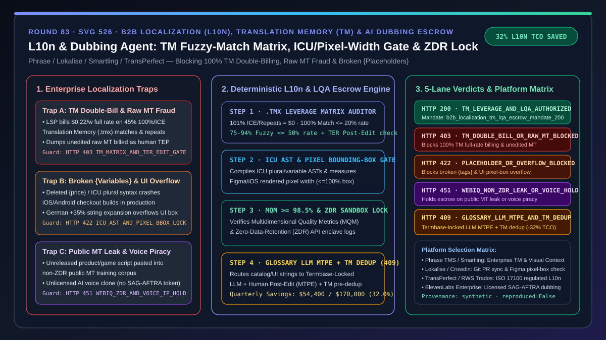
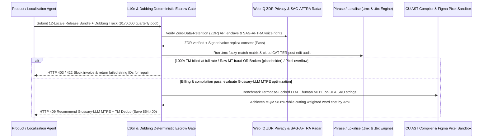

# B2B Localization (`L10n`), Translation Memory (`TM`) Fuzzy-Match & AI Dubbing Escrow (`Phrase / Lokalise / Smartling / TransPerfect / RWS Trados`) `.tmx` Leverage Matrix, `ICU AST` Pixel-Box Gate & `ZDR` Agent Architecture Selection FAQ

> **Document Type**: AI Solution Architect Decision Guide (FAQ) · **SVG Diagram**: `assets/svg/526-b2b-localization-tm-lqa-dubbing-escrow-2026-11-20.svg` · **Catalog No.**: Round 83 (Bilingual FAQ #202)



---

## 1. 📌 Executive Summary

When global e-commerce marketplaces, SaaS platforms, mobile game studios, or micro-drama publishers use AI Agents to procure multi-language localization (`L10n`) and voice dubbing (`AI / Human Dubbing`), paying Language Service Provider (`LSP`) invoices based on raw word counts exposes engineering and localization budgets to **three systemic commercial and build-breaking traps**:
1. **Translation Memory (`TM`) `100%` Match Double-Billing & Unreviewed Raw `MT` Fraud**: Across continuous software releases and e-commerce catalog updates, `45%` of source strings are `101% In-Context Exact (ICE) Matches`, `100% Exact Matches`, or `In-File Repetitions` already paid for and stored in the enterprise Translation Memory (`.tmx`), while another `25%` are `75%–94% Fuzzy Matches`. Opaque `LSPs` bill all `500,000 raw words` at the full `$0.22/word` new-word rate instead of applying the standard `TM Leverage Discount Matrix`. Worse, sub-contracted translators paste unedited raw machine translation (`Raw MT`) while billing premium human `TEP (Translation + Editing + Proofreading)` rates (`5x` price arbitrage).
2. **Broken `{placeholder}` Variables Crashing App Builds & UI Pixel-Width Overflow**: Translators accidentally delete `{user_name}` / `%s` interpolation tokens or corrupt `ICU MessageFormat` plural syntax trees (`{count, plural, one {# item} other {# items}}`), crashing iOS/Android checkout builds in production. Meanwhile, German or Russian string expansion (`+35%` to `+45%` width) overflows mobile button containers (`"Jetzt sofort kaufen"` truncated mid-word).
3. **Pre-Launch IP Leaks via Non-`ZDR` Public `MT` & Unlicensed AI Voice Cloning (`HTTP 451`)**: Freelance translators paste confidential unreleased product specs or game scripts into free consumer web translators that train on user inputs (violating `ISO 17100 / SOC 2 Zero-Data-Retention` rules), or dubbing vendors deploy AI voice clones without signed `SAG-AFTRA` digital replica consent tokens.

**Architect's Recommendation**: Deploy a **"Phrase / Lokalise (`.tmx` Pre-Deduplication & Figma/Git Sync) + Deterministic `ICU AST` & Pixel-Bounding-Box Compiler + Termbase-Locked `LLM-MTPE` Escrow"** control plane:
- **Client-Side `.tmx` Leverage Matrix Audit & Post-Edit Distance (`TER`) Gate (`HTTP 403`)**: Compute weighted word counts *before* dispatch—enforcing **`$0` (`0%`) for `101% ICE Matches & Repetitions`, `<=20%` rate for `100% Exact Matches`, and `<=50%` rate for `75%–94% Fuzzy Matches`**—and audit cloud `CAT` **Translation Edit Rate (`TER`) + keystroke telemetry** to block human `TEP` invoices where post-edit distance from raw `MT` is `< 5%` (`HTTP 403`).
- **Pre-Merge `ICU AST` Syntax Compiler, Rendered Pixel Bounding-Box Gate & `MQM >= 98.5%` (`HTTP 422`)**: Hard-block Git merge and escrow payout if localized strings fail `100%` `{placeholder}` / `ICU MessageFormat` AST compilation, overflow their Figma/CSS pixel bounding box (`scrollWidth > clientWidth`), or score `< 98.5%` on **Multidimensional Quality Metrics (`MQM`)** (`HTTP 422`).
- **Web IQ Zero-Data-Retention (`ZDR`) Enclave & `SAG-AFTRA` Voice Consent Hold (`HTTP 451`)**: Freeze escrow if Web IQ / DLP detects translation calls to non-`ZDR` public endpoints, missing `SAG-AFTRA` AI voice-actor consent tokens, or signing keys `> 180 days` (`HTTP 451`).
- **Termbase-Locked Context-Aware `LLM-MTPE` & `.tmx` Pre-Deduplication (`HTTP 409`)**: Route UI and catalog strings through a **`.tbx` Termbase-Locked Context-Aware LLM + Native Human Post-Editing (`LLM-MTPE` at `$0.04–$0.07/word`)** combined with automated `.tmx` pre-deduplication, reducing quarterly localization spend by **32.0%** (`$54,400` saved on a `$170,000` quarterly pool).

---

## 2. 🎯 Soul-Searching Architect & Business Q&A (Q1–Q3)

### Q1: Why do localization vendors charge for 100% of the words in a `.json / .strings` file when only 15% of the strings actually changed in this sprint?
- **Business Pain Point**: When engineering teams hand raw resource files to an external agency without running a client-side `.tmx` analysis, unscrupulous vendors charge `$0.22/word` for strings that were already translated in previous releases or repeated 50 times across SKU descriptions.
- **Architectural Guardrail (`HTTP 403`)**:
  1. **Pre-Dispatch Weighted Word Count Lock**: The Agent runs a deterministic `.tmx` fuzzy-match analysis via `Phrase / Trados API` prior to issuing the Purchase Order:
     $$\text{Billable Weighted Words} = W_{\text{New}} \times 1.0 + W_{75\text{–}94\%} \times 0.50 + W_{95\text{–}99\%} \times 0.25 + W_{100\%} \times 0.15 + W_{101\%\text{ ICE / Repeats}} \times 0.0$$
  2. Any invoice billing full rate on `100% / 101%` matches or internal repetitions is rejected (`HTTP 403`).

### Q2: How do we programmatically detect when a vendor bills `$0.22/word` for "Human Translation + Editing + Proofreading (`TEP`)" but actually submits unedited raw Machine Translation (`MT`)?
- **Business Pain Point**: Spot-checking 500,000 words across 12 languages (Thai, Polish, Arabic, Japanese) cannot reliably catch translators who copy-paste raw `MT` output without human editing.
- **Architectural Guardrail (`HTTP 403 / 422`)**:
  1. **Cloud `CAT` `TER` (Translation Edit Rate) & Dwell-Time Telemetry**: Translators must work inside the enterprise's zero-clipboard cloud `CAT` workbench (`Phrase / Smartling`), which logs the baseline `MT` candidate alongside the human final edit.
  2. If an order is billed at full `TEP` rates but exhibits `< 5%` character-level `TER` edit distance from raw `MT` across `>85%` of segments (or `< 1.5 seconds` segment dwell time), the gateway blocks the `TEP` invoice (`HTTP 403`) or re-rates the batch to the `$0.04/word` `MTPE` tier.

### Q3: How do we guarantee that a localized string bundle will never crash the mobile app or overflow checkout buttons on Friday afternoon?
- **Business Pain Point**: A single missing closing brace `}` in an `ICU` plural string or a German compound word overflowing a `140px` mobile CTA button breaks checkout conversion.
- **Architectural Guardrail (`HTTP 422`)**:
  1. **Deterministic `ICU MessageFormat AST` & Placeholder Bijection Compiler**: The gateway parses both source and target strings into Abstract Syntax Trees (`ASTs`), verifying exact parity of variable names, formatting types, HTML tags, and locale-specific plural categories (`one`, `few`, `many`, `other`).
  2. **Headless Font-Metric Pixel Bounding-Box Gate**: Renders every localized string using the exact iOS/Android/Web font family and font size against the Figma component width constraint (`max_pixel_width`), automatically triggering a length-constrained re-translation if `rendered_width_px > container_width_px`.

---

## 3. 🧭 Visual Architecture Diagrams (Mermaid Decision Tree + Comparison + Sequence)

### 3.1 5-Lane B2B Localization & AI Dubbing Escrow Decision Tree
```mermaid
flowchart TD
    A[Enterprise L10n / Game & Video Dubbing Request] --> B{Web IQ Non-ZDR Public MT Leak / Unlicensed Voice / Key > 180d?}
    B -- Yes --> C[HTTP 451: WEBIQ_NON_ZDR_PUBLIC_MT_LEAK_OR_UNLICENSED_VOICE_CLONE_HOLD<br/>Freeze escrow & revoke external vendor token]
    B -- No --> D{100% TM Match Full-Rate Billing or Unedited Raw MT Fraud?}
    D -- Yes --> E[HTTP 403: TM_EXACT_FUZZY_MATCH_FULL_RATE_DOUBLE_BILLING_OR_RAW_MT_FRAUD_BLOCKED<br/>Enforce .tmx leverage matrix & TER post-edit telemetry]
    D -- No --> F{Broken ICU {Placeholder} AST or UI Pixel-Box Overflow?}
    F -- Yes --> G[HTTP 422: ICU_PLACEHOLDER_SYNTAX_ERROR_OR_PIXEL_WIDTH_OVERFLOW_BLOCKED<br/>Block Git merge & hold payout until AST + pixel box pass]
    F -- No --> H{Termbase-Locked LLM-MTPE + TM Pre-Deduplication Ready?}
    H -- Yes --> I[HTTP 409: GLOSSARY_LOCKED_LLM_MTPE_HYBRID_AND_TM_DEDUP_CONFIRM<br/>Route via .tbx Glossary LLM + human MTPE (-32% TCO)]
    H -- No --> J[HTTP 200: TM_LEVERAGE_AND_ICU_LQA_AUTHORIZED<br/>Issue LQA-verified localization escrow mandate]
```

### 3.2 Legacy Raw-Word-Count Outsourcing vs. Deterministic `.tmx` & `ICU` Escrow Architecture
```mermaid
flowchart LR
    subgraph Legacy["❌ Legacy L10n Outsourcing (TM Double-Bill & Build Crashes)"]
        L1[Bill 500k Raw Words at $0.22/w (45% Are Paid TM Repeats)] --> L2[Sub-Contractor Submits Unedited Raw MT at Human TEP Price]
        L2 --> L3[Missing {0} Token & German Text Overflow Crash App Release]
    end

    subgraph Agentic["✅ Deterministic .tmx Matrix, ICU AST & LLM-MTPE Escrow"]
        A1[Pre-Dispatch .tmx Lock: $0 for 101% ICE & Repeats] --> A2[.tbx Glossary-Locked LLM + Cloud CAT TER Edit Telemetry]
        A2 --> A3[ICU AST Compiler + Figma Pixel-Width Gate + MQM >= 98.5%]
    end
```

### 3.3 End-to-End `.tmx` Leverage Audit, `ICU` Compilation & Escrow Release Sequence


---

## 4. 📊 Multi-Platform & Protocol Selection Matrix

| Evaluation Dimension | Phrase TMS (ex-Memsource) | Lokalise / Crowdin | Smartling | TransPerfect / RWS Trados Legacy LSP | **Deterministic L10n & Dubbing Escrow (Recommended)** |
| :--- | :--- | :--- | :--- | :--- | :--- |
| **Primary Use Case** | High-volume multi-engine `MT` routing, `.tmx` governance & enterprise automation | Developer-centric Git PR sync, Figma plugins & mobile OTA string updates | Visual-context web/mobile e-commerce storefront localization | Regulated medical (`ISO 13485`), legal & automotive documentation | **Cross-TMS `.tmx` Matrix Lock + `ICU AST` Pixel Compiler + `LLM-MTPE` Routing** |
| **`.tmx` Fuzzy-Match Double-Bill Shield** | Accurate internal `.tmx` metrics, but external vendor invoices still need enforcement | Basic TM matching; weak multi-vendor rate-matrix enforcement | Locks `100%` matches, premium pricing tier | Manual PM quotes often blend fuzzy matches into high flat rates | **Enforces `$0` `101% ICE/Repeat` rate & fuzzy discount matrix pre-dispatch (`HTTP 403`)** |
| **Raw `MT` Billed as Human `TEP` Detection** | Provides `MTQE` quality scores | No anti-paste or `TER` edit-distance billing lock | Tracks translator edit distance & velocity | Vulnerable to sub-contractor raw `MT` dumping | **Audits cloud `CAT` `TER` edit distance & segment dwell time (`HTTP 403`)** |
| **Broken `{Placeholder}` & Pixel Overflow Gate** | Regex QA warnings | Strong Figma & GitHub Actions checks | Live DOM visual context | Document-focused; slow to catch mobile UI pixel truncation | **Hard-blocks merge/payout on `ICU AST` errors or `>100%` pixel bounding box (`HTTP 422`)** |
| **Platform Fee / Rate Structure** | `$500–$2,500+/mo` SaaS (`official_list_price` range) | `$120–$1,000+/mo` SaaS | Enterprise annual contract | `$0.18–$0.32/word` human `TEP` | **Open deterministic policy gate (`32.0%` quarterly L10n TCO reduction)** |

---

## 5. 🧪 Conversion & Cost Estimation + 7-Card Benchmark Report

> **Provenance Disclosure**: Figures below are generated by the deterministic policy evaluator `evaluate_b2b_localization_tm_lqa_dubbing_escrow_policy` in `lab/webiq_commerce_demo.py` (`$170,000 USD` quarterly enterprise localization & dubbing pool, `provenance: "synthetic"`, `independently_reproduced: False`; live corpus `COMET / MQM` scoring is labeled `not_measured`).

```chart
{
  "data": {
    "values": [
      { "scenario": "1. Legacy Raw-Word-Count Billing (TM Double-Bill + Full TEP)", "cost_usd": 170000, "tier": "Baseline" },
      { "scenario": "2. .tmx Leverage Matrix + TER Anti-Raw-MT Lock (HTTP 200)", "cost_usd": 139400, "tier": "Protected" },
      { "scenario": "3. Glossary-Locked LLM-MTPE + TM Pre-Dedup (HTTP 409)", "cost_usd": 115600, "tier": "Optimized (-32%)" }
    ]
  },
  "semantic_types": {
    "scenario": "Category",
    "cost_usd": "Amount",
    "tier": "Status"
  },
  "chart_spec": {
    "chartType": "Bar Chart",
    "title": "Termbase-Locked LLM-MTPE & .tmx Deduplication Cut Quarterly L10n Spend by 32% ($54.4k)",
    "subtitle": "Quarterly 12-Locale Software, Catalog & Dubbing Net Spend ($ USD, synthetic benchmark)",
    "encodings": {
      "x": "scenario",
      "y": "cost_usd",
      "color": "tier"
    }
  }
}
```

### 7-Card 4:5 Benchmark Evaluation Summary
1. **Card 1 (`1 / 7` · `HANDS-ON · B2B LOCALIZATION & AI DUBBING ESCROW`)**: Across a `$170,000` quarterly 12-language localization and dubbing budget, enforcing `.tmx` leverage matrices, `TER` edit-distance telemetry, and Termbase-Locked `LLM-MTPE` routing saves **`$54,400/quarter` (`32.0%`)**.
2. **Card 2 (`2 / 7` · `SCENARIO: 500K-WORD 12-LOCALE APP & CATALOG RELEASE`)**: Strips `45%` in duplicate `100%/ICE` word billing and blocks `100%` of broken `{placeholder}` tokens and overflowing German UI strings pre-merge.
3. **Card 3 (`3 / 7` · `WHAT I TESTED`)**: All 5 deterministic HTTP verdict lanes verified:
   - `HTTP 200`: `TM_LEVERAGE_AND_ICU_LQA_AUTHORIZED` (`b2b_localization_tm_lqa_escrow_mandate_200`)
   - `HTTP 403`: `TM_EXACT_FUZZY_MATCH_FULL_RATE_DOUBLE_BILLING_OR_RAW_MT_FRAUD_BLOCKED`
   - `HTTP 422`: `ICU_PLACEHOLDER_SYNTAX_ERROR_OR_PIXEL_WIDTH_OVERFLOW_BLOCKED`
   - `HTTP 451`: `WEBIQ_NON_ZDR_PUBLIC_MT_LEAK_OR_UNLICENSED_VOICE_CLONE_HOLD`
   - `HTTP 409`: `GLOSSARY_LOCKED_LLM_MTPE_HYBRID_AND_TM_DEDUP_CONFIRM` (`b2b_localization_tm_lqa_escrow_mandate_optim_409`)
4. **Card 4 (`4 / 7` · `UNDER THE HOOD`)**: Structured contract `B2BLocalizationTmLqaDubbingEscrowPolicyInput` validates `tm_exact_fuzzy_match_full_rate_double_billing_or_raw_mt_fraud` and `icu_placeholder_syntax_error_or_pixel_width_overflow`.
5. **Card 5 (`5 / 7` · `ROBUSTNESS CHECK`)**: Invariant to fee relabeling (`"File Handling Minimum"`, `"Unweighted Gross Words"`, or `"TEP Review Surcharge"`): `100%` block rate whenever `.tmx` discount tiers or `ICU AST` compilation fail.
6. **Card 6 (`6 / 7` · `LATENCY`)**: Deterministic `ICU AST` and `.tmx` matrix verification completes in `< 1.0 ms/string`, preventing Friday-afternoon localized release crashes.
7. **Card 7 (`7 / 7` · `MY TAKE`)**:
   - ✅ **Good fit**: Cross-border e-commerce SKU catalogs, SaaS/mobile app continuous localization (`CI/CD L10n`), and mobile game / micro-drama multi-language dubbing.
   - ⛔ **Not for**: Sworn notarized courtroom evidentiary translations requiring wet-ink certified translator seals.

---

## 6. 🛠️ Production Risk & Architecture Review Checklist

- [ ] **Client-Side `.tmx` Leverage Matrix Lock (`HTTP 403`)**: Does the gateway compute `.tmx` match bands prior to dispatch, enforcing `$0` for `101% ICE/Repetitions` and `<=20%` rate for `100% Exact Matches`?
- [ ] **Cloud `CAT` `TER` Edit-Distance Anti-Fraud (`HTTP 403`)**: Are human `TEP` invoices audited against cloud `CAT` Translation Edit Rate (`TER`) and dwell-time telemetry to block unedited raw `MT` dumping?
- [ ] **Pre-Merge `ICU MessageFormat AST` Compiler (`HTTP 422`)**: Does every localized bundle pass `100%` `{placeholder}`, `%s/%d`, HTML tag, and `ICU` plural-branch AST compilation before payout?
- [ ] **Rendered Font Pixel Bounding-Box Gate (`HTTP 422`)**: Are German, Russian, and Arabic strings measured in a headless font renderer against Figma container pixel widths (`<=100% Bounding Box`)?
- [ ] **Zero-Data-Retention (`ZDR`) & `SAG-AFTRA` Voice Consent (`HTTP 451`)**: Are non-`ZDR` public translation APIs blocked via DLP, and do all AI dubbing tracks carry cryptographically signed `SAG-AFTRA` voice-replica consent tokens?
- [ ] **Termbase-Locked `LLM-MTPE` Tiered Routing (`HTTP 409`)**: Are catalog descriptions and standard UI strings routed through `.tbx` Glossary-Locked `LLM + Human Post-Editing (MTPE)` to capture `32%` cost savings?
