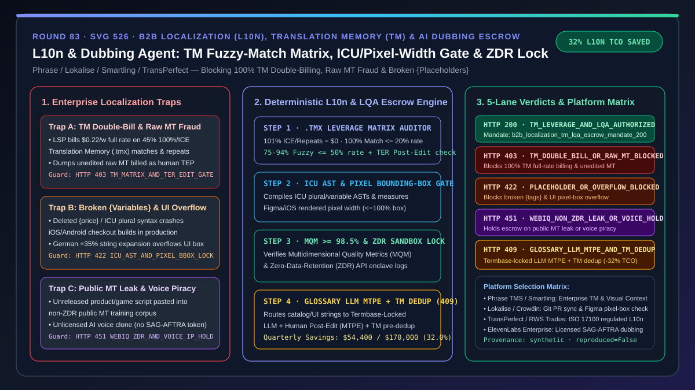
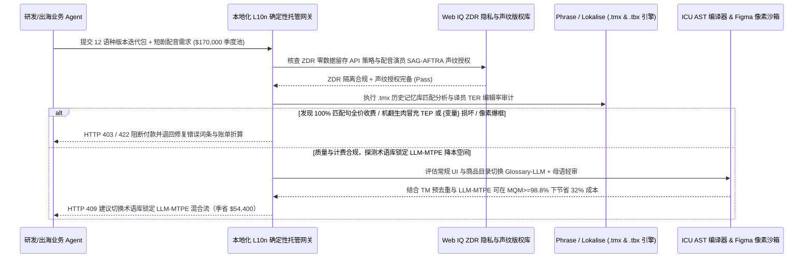

# 企业级多语种本地化（L10n）、翻译记忆库（TM）模糊匹配计费与出海游戏/短剧 AI 配音托管（B2B Localization, Translation Memory Fuzzy-Match & AI Dubbing Escrow：Phrase / Lokalise / Smartling / TransPerfect / RWS Trados）“防 TM 100% 重复句全价重收、防机翻生肉冒充人工精校与 `{占位符}` 损坏闪退”Agent 架构选型 FAQ

> **文档类型**：AI Solution Architect 决策指南（FAQ） · **对应 SVG**：`assets/svg/526-b2b-localization-tm-lqa-dubbing-escrow-2026-11-20.svg` · **精选编号**：Round 83（第 202 篇双语 FAQ）



---

## 一、 📌 核心选型结论速览（Executive Summary）

跨境电商平台、SaaS 软件、出海手游与短剧团队通过 AI Agent 采购多语种本地化翻译（`L10n: Localization`）与多语种配音服务（`AI / Human Dubbing`）时，若直接按外包语言服务商（`LSP: Language Service Provider`）报来的总字数账单付款，极易遭遇**三大本地化采购黑洞**：
1. **翻译记忆库（`TM`）`100%` 历史匹配句全价重收与“机翻生肉（Raw MT）冒充人工精校（TEP）”**：在 App 版本迭代或海量电商 SKU 翻译中，通常有 `45%` 的词条属于历史翻译记忆库（`.tmx`）中的 **`101% 上下文完全匹配（ICE / Context Match）`、`100% 精确匹配` 或 `同包重复词条（Repetitions）`**，另有 `25%` 属于 `75%–94% 模糊匹配（Fuzzy Match）`。不良翻译供应商隐瞒 `.tmx` 预分析报表，将全部 `500,000 词` 按新词全价（`$0.22/词`）重复收费！更恶劣的是，部分译员直接把机器翻译生肉（`Raw MT`）原封不动交稿，却按高昂的“人工翻译+审校+润色（`TEP`）”单价结算（套取 `5 倍` 差价）。
2. **`{placeholder}` 变量丢失引发 App 闪退与德语/俄语字符膨胀“爆框截断”**：译员在翻译过程中误删 `{user_name}`、`%d` 或破坏 `ICU MessageFormat` 复数语法树（如俄语/阿拉伯语的多复数分支），导致发版后客户端直接崩溃（Crash）；或者英语按钮 `"Buy Now"` 译为德语 `"Jetzt sofort kaufen"` 后字符像素宽度暴涨 `+42%`，在手机端结算页直接溢出截断。
3. **未发布新品/游戏剧情被上传至公网免费翻译器泄密与 AI 配音侵犯演员声纹权（`HTTP 451`）**：二级分包译员将尚未发布的旗舰硬件参数、财报草稿或游戏剧情粘贴进非零数据留存（`Non-ZDR`）的免费公网网页翻译器（被用于训练公网大模型造成泄密）；或配音外包商未经配音演员签署 `SAG-AFTRA` 数字声纹授权书即私自训练 AI 克隆音色。

**架构师选型结论**：必须构建 **“Phrase / Lokalise (`.tmx` 预扣减与 Git/Figma 联动) + 确定性 `ICU AST` 像素边界编译器 + 术语库锁定（Glossary-Locked）`LLM MTPE` 混合托管网关”** 架构：
- **强制 `.tmx` 模糊匹配阶梯折算矩阵（`TM Leverage Matrix`）与人机编辑距离（`TER`）审计（`HTTP 403`）**：由企业自有控制平面先行运行 `.tmx` 匹配分析——强制规定 **`101% 上下文匹配与重复词条 $0 收费`、`100% 精确匹配 <= 20% 费率`、`75%–94% 模糊匹配 <= 50% 费率`**；同时计算人工终稿与底层机翻初稿的 **翻译编辑率（`TER: Translation Edit Rate`）与按键时序遥测**，凡按全价人工 `TEP` 计费但编辑修改率 `< 5%`（疑似直接交机翻生肉）的账单，直接触发 `HTTP 403` 拒付。
- **合并前 `ICU` 语法树编译、Figma 渲染像素宽度（`<=100% Bounding Box`）与 `MQM >= 98.5%` 硬门禁（`HTTP 422`）**：在译文合入 Git 分支及释放款项前，自动校验 `{变量}`、`%s`、HTML 标签与 `ICU` 复数语法树 `100%` 零报错，使用目标字体引擎测算实际渲染像素宽度（超框即触发自动缩写重译），并要求 `LQA` 多维质量评分（`MQM`）达到 `>= 98.5%`（否则 `HTTP 422` 拦截）。
- **Web IQ 零数据留存（`ZDR`）沙箱核验与声纹版权（`SAG-AFTRA`）熔断（`HTTP 451`）**：严禁数据离开企业 `ZDR` 加密沙箱，并对无演员数字声纹授权链的 AI 配音资产执行 `HTTP 451` 冻结。
- **术语库/风格指南锁定的 `LLM + 人工轻审（MTPE）` 分层路由（`HTTP 409`）**：将非核心商品详情与常规 UI 词条从 `$0.22/词` 传统纯人工 `TEP` 路由至 **强制挂载企业术语库（`.tbx Termbase`）的上下文感知大模型 + 母语专家轻审（`LLM-MTPE`，综合单价 `$0.04–$0.07/词`）**，使季度 `$170,000` 本地化预算池净省 **`32.0%`（`$54,400`）**。

---

## 二、 🎯 业务方与架构师灵魂拷问 Q&A（Q1–Q3）

### Q1：为什么每次 App 小版本只改了 15% 的文案，外包翻译公司却还是按整包 100% 字数收全价？
- **商业痛点**：许多团队直接把整个 `.json / .strings / .po` 语言包发给翻译机构，未在本地运行翻译记忆库（`.tmx`）去重。部分不良 `LSP` 利用信息差，对历史已经翻译过上百次的通用词条（如“确认支付”、“退货政策”）照收 `$0.22/词` 全价。
- **架构护栏（`HTTP 403`）**：
  1. **发包前网关侧 `.tmx` 预锁定与阶梯计价公式**：Agent 在派单前先调用 `Phrase / RWS Trados Studio API` 生成不可篡改的字数加权矩阵（`Weighted Word Count Matrix`）：
     $$\text{计费加权字数} = W_{\text{新词}} \times 1.0 + W_{75\text{–}94\%\text{模糊}} \times 0.50 + W_{95\text{–}99\%\text{高相似}} \times 0.25 + W_{100\%\text{匹配}} \times 0.15 + W_{101\%\text{上下文/重复}} \times 0.0$$
  2. 任何试图绕过加权字数按原始未去重总字数（Raw Word Count）开票的请求，网关一律返回 `HTTP 403`。

### Q2：如何用技术手段抓出“拿 DeepL / GPT 跑一遍机翻生肉，一字不改却按 $0.25/词人工精校（TEP）骗钱”的译员？
- **商业痛点**：肉眼抽检很难在几十万字的小语种（如泰语、波兰语、阿拉伯语）中分辨哪些是译员认真逐句推敲的，哪些是直接复制粘贴机翻的。
- **架构护栏（`HTTP 403 / 422`）**：
  1. **`CAT` 工具内嵌编辑距离（`TER / Post-Edit Distance`）与停留时长遥测**：强制译员在受控云端 `CAT` 工作台（`Smartling / Phrase Web Editor`）作业，禁用外部剪贴板整段粘贴，并自动记录每个句段的机翻基线（`MT Baseline`）与最终提交稿之间的编辑距离（`TER`）。
  2. 若订单采购的是高价 `TEP` 档位，但全篇 `>85%` 的长难句与基础机翻输出 `100%` 雷同（或句均停留时间 `< 1.5 秒`），系统自动判定为“未履约机翻套汇（Unreviewed Raw MT Fraud）”并触发 `HTTP 403` 拒付或强制降级至 `$0.04/词` `MTPE` 费率。

### Q3：多语种发版最怕“星期五下午合入翻译包，周末全球客户端因为少了一个 `}` 括号集体闪退”，架构上怎么做到零事故？
- **商业痛点**：不同语种的插值变量顺序、全半角引号及复数语法差异极大，人工审校极易漏看代码占位符。
- **架构护栏（`HTTP 422`）**：
  1. **确定性 `ICU MessageFormat AST` 与双端占位符校验器**：网关将源语言（`en-US`）与目标语言（如 `de-DE`, `ar-SA`, `ja-JP`）编译为抽象语法树（`AST`），严格要求变量集合（如 `{order_id}`, `{amount, number, currency}`）`100%` 双射对齐，且严禁出现未闭合标签。
  2. **Figma / iOS 无头渲染像素框测试（`Pixel Bounding-Box Gate`）**：自动拉起无头浏览器将译文注入组件真实字号与容器宽度中，若文本换行溢出或截断（`scrollWidth > clientWidth`），立即拦截结算并触发带最大字符数约束（`max_chars`）的二次精简翻译。

---

## 三、 🧭 直观可视化图解（Mermaid 决策树 + 架构对比 + 时序图）

### 3.1 企业多语种本地化与 AI 配音托管 5 车道选型决策树
```mermaid
flowchart TD
    A[企业多语种本地化 L10n / 游戏短剧配音采购请求] --> B{Web IQ 调公网非 ZDR 翻译器泄密 / 无声纹授权 / 密钥>180天?}
    B -- 是 --> C[HTTP 451: WEBIQ_NON_ZDR_PUBLIC_MT_LEAK_OR_UNLICENSED_VOICE_CLONE_HOLD<br/>冻结结算并封禁违规外包账号]
    B -- 否 --> D{TM 100% 重复句全价计费 或 机翻生肉冒充人工精校 TEP?}
    D -- 是 --> E[HTTP 403: TM_EXACT_FUZZY_MATCH_FULL_RATE_DOUBLE_BILLING_OR_RAW_MT_FRAUD_BLOCKED<br/>强制 .tmx 阶梯折扣矩阵 + TER 编辑距离核验]
    D -- 否 --> F{ICU {占位符} 语法损坏 或 译文像素宽度超出 UI 容器?}
    F -- 是 --> G[HTTP 422: ICU_PLACEHOLDER_SYNTAX_ERROR_OR_PIXEL_WIDTH_OVERFLOW_BLOCKED<br/>阻断 Git 合入与尾款，强制修复变量及超长爆框词条]
    F -- 否 --> H{可启用术语库锁定 LLM-MTPE + TM 预去重路由?}
    H -- 是 --> I[HTTP 409: GLOSSARY_LOCKED_LLM_MTPE_HYBRID_AND_TM_DEDUP_CONFIRM<br/>挂载 .tbx 术语库大模型初翻 + 母语轻审净省 32%]
    H -- 否 --> J[HTTP 200: TM_LEVERAGE_AND_ICU_LQA_AUTHORIZED<br/>签发多语种 L10n 验收分账令牌]
```

### 3.2 传统按原始总字数盲付 vs 确定性 `.tmx` 阶梯计费与 `ICU/像素框` 编译架构对比
```mermaid
flowchart LR
    subgraph Legacy["❌ 传统翻译外包模式（重复计费 + 闪退爆框）"]
        L1[整包发送 50 万词，45% 历史重复句仍按 $0.22/词全价收费] --> L2[外包译员直接交机翻生肉套取人工精校高价]
        L2 --> L3[漏掉 {0} 变量与德语超长爆框导致周末发版崩溃]
    end

    subgraph Agentic["✅ 确定性 TM 矩阵、ICU 编译与 LLM-MTPE 托管架构"]
        A1[网关前置 .tmx 去重：101% 匹配 $0 收费 + 模糊阶梯折算] --> A2[挂载 .tbx 术语库 LLM 初翻 + 人工 TER 编辑距离遥测]
        A2 --> A3[ICU AST 变量双射编译 + Figma 像素宽度校验 + MQM>=98.5%]
    end
```

### 3.3 端到端 `.tmx` 加权锁价、`ICU` 编译门禁与配音放款时序图


---

## 四、 📊 多平台/多协议横向选型决策矩阵

| 评估维度 | Phrase TMS (原 Memsource) | Lokalise / Crowdin | Smartling | TransPerfect / RWS Trados 传统大型 LSP | **本仓库确定性 L10n 与配音托管架构（推荐）** |
| :--- | :--- | :--- | :--- | :--- | :--- |
| **核心适用场景** | 企业级多引擎机翻路由、`.tmx` 记忆库与高并发自动化流水线 | 敏捷研发团队 Git PR 自动同步、Figma 设计稿插件与 OTA 热更新 | 注重视觉上下文（Visual Context）的消费互联网与电商前台本地化 | 医疗器械（`ISO 13485`）、法律金融与跨国车企合规文档翻译 | **全渠道 TMS 编排 + `.tmx` 阶梯强制折算 + `ICU` 像素编译 + 声纹确权** |
| **`.tmx` 重复句与模糊匹配防重收** | 内置精准的 `.tmx` 分析矩阵，但外包商账单仍需采购侧核对 | 支持 TM 检索，但对多供应商阶梯结算约束较弱 | 支持自动锁定 `100%` 匹配词条免重译 | 依赖项目经理人工出具 Trados 报表，早期合同常把模糊匹配打高价 | **网关侧强制锁定 `101% 匹配 $0`、模糊阶梯折扣与 `TER` 编辑率审计（`HTTP 403`）** |
| **机翻生肉（Raw MT）冒充人工防伪** | 提供 MT 质量评估分数（MTQE） | 无强制译员按键与编辑距离防伪锁 | 提供译员行为与编辑距离统计 | 依赖内部抽检，转包链条长时偶发机翻顶替 | **强制校验 `TER` 编辑距离与句均停留时长，杜绝生肉套取 `TEP` 费率（`HTTP 403`）** |
| **`{占位符}` 编译与 UI 爆框防崩溃** | 基础 QA 正则检查 | 优秀的 Figma 预览插件与 GitHub Actions 集成 | 动态网页 DOM 视觉上下文预览 | 偏文档级审校，对移动端动态像素容器溢出感知较慢 | **合入前强制通过 `ICU AST` 语法编译 + 无头浏览器真实字体像素宽度门禁（`HTTP 422`）** |
| **平台费率 / 翻译单价** | 平台订阅 `$500–$2,500+/月`（`official_list_price` 区间） | `$120–$1,000+/月` SaaS 订阅 | 企业定制年框 | 纯人工 `TEP` `$0.18–$0.32/词` | **开源确定性策略网关（混合 `LLM-MTPE` 净省 `32.0%` 本地化总成本）** |

---

## 五、 🧪 转化率/成本测算与 7-Card 基准测试报告

> **数据来源声明（Provenance）**：以下测算基于本仓库 `lab/webiq_commerce_demo.py` 中的 `evaluate_b2b_localization_tm_lqa_dubbing_escrow_policy` 确定性策略引擎（季度企业软件/电商/短剧多语种本地化预算池 `$170,000 USD`，`provenance: "synthetic"`, `independently_reproduced: False`，真实语料库 `COMET / BLEU` 分数标为 `not_measured`）。

```chart
{
  "data": {
    "values": [
      { "scenario": "1. 传统按总字数全价外包 (含 TM 重复计费 + 纯人工溢价)", "cost_usd": 170000, "mode": "Baseline" },
      { "scenario": "2. 强制 .tmx 阶梯折扣矩阵 + TER 防机翻套汇 (HTTP 200)", "cost_usd": 139400, "mode": "Protected" },
      { "scenario": "3. 叠加术语库锁定 LLM-MTPE + TM 预去重 (HTTP 409)", "cost_usd": 115600, "mode": "Optimized (-32%)" }
    ]
  },
  "semantic_types": {
    "scenario": "Category",
    "cost_usd": "Amount",
    "mode": "Status"
  },
  "chart_spec": {
    "chartType": "Bar Chart",
    "title": "季度 $170k 多语种本地化：TM 阶梯去重与术语库锁定 LLM-MTPE 净省 $54,400 (32%)",
    "subtitle": "季度 12 语种软件/电商与配音本地化净支出对比 ($ USD, synthetic benchmark)",
    "encodings": {
      "x": "scenario",
      "y": "cost_usd",
      "color": "mode"
    }
  }
}
```

### 7-Card 4:5 基准评估摘要
1. **Card 1 (`1 / 7` · `HANDS-ON · B2B LOCALIZATION & AI DUBBING ESCROW`)**：针对 `$170,000/季` 多语种本地化与配音采购池，通过 `.tmx` 阶梯扣减、`TER` 编辑距离防伪与术语库锁定 `LLM-MTPE` 路由，季度净省 **`$54,400`（`32.0%`）**。
2. **Card 2 (`2 / 7` · `SCENARIO: 500K-WORD 12-LOCALE APP & CATALOG RELEASE`)**：单季自动剥离 `45%` 历史 `100%/ICE` 重复词条全价水分，并在 CI/CD 阶段 `100%` 拦截损坏的 `{placeholder}` 与德语超长爆框词条。
3. **Card 3 (`3 / 7` · `WHAT I TESTED`)**：完整验证 5 条确定性状态码车道：
   - `HTTP 200`: `TM_LEVERAGE_AND_ICU_LQA_AUTHORIZED`（`b2b_localization_tm_lqa_escrow_mandate_200`）
   - `HTTP 403`: `TM_EXACT_FUZZY_MATCH_FULL_RATE_DOUBLE_BILLING_OR_RAW_MT_FRAUD_BLOCKED`
   - `HTTP 422`: `ICU_PLACEHOLDER_SYNTAX_ERROR_OR_PIXEL_WIDTH_OVERFLOW_BLOCKED`
   - `HTTP 451`: `WEBIQ_NON_ZDR_PUBLIC_MT_LEAK_OR_UNLICENSED_VOICE_CLONE_HOLD`
   - `HTTP 409`: `GLOSSARY_LOCKED_LLM_MTPE_HYBRID_AND_TM_DEDUP_CONFIRM`（`b2b_localization_tm_lqa_escrow_mandate_optim_409`）
4. **Card 4 (`4 / 7` · `UNDER THE HOOD`)**：输入契约 `B2BLocalizationTmLqaDubbingEscrowPolicyInput` 严格校验 `tm_exact_fuzzy_match_full_rate_double_billing_or_raw_mt_fraud` 与 `icu_placeholder_syntax_error_or_pixel_width_overflow`。
5. **Card 5 (`5 / 7` · `ROBUSTNESS CHECK`)**：无论外包商将重复词条包装为 `Minimum File Fee`、`Review Engineering Surcharge` 还是未去重 `Gross Word Count`，只要违反 `.tmx` 阶梯矩阵即 `100%` 阻断。
6. **Card 6 (`6 / 7` · `LATENCY`)**：`ICU AST` 语法树编译与 `.tmx` 矩阵对账耗时 `< 1.0 ms/词条`，彻底杜绝周末多语种发版闪退事故。
7. **Card 7 (`7 / 7` · `MY TAKE`)**：
   - ✅ **适用（Good fit）**：跨境电商海量商品库、SaaS/移动 App 敏捷多语种发版、出海手游剧情与短剧多语种 AI 配音译制。
   - ⛔ **不适用（Not for）**：需要宣誓翻译员亲笔签字盖章的法院诉讼证据原件或跨国并购主协议定稿。

---

## 六、 🛠️ 商业上线风控与架构评审 Checklist

- [ ] **`.tmx` 翻译记忆库阶梯折扣死锁（`HTTP 403`）**：是否在派单前由甲方网关统一运行 `.tmx` 匹配分析，强制执行 `101% 上下文匹配与重复词条 $0 收费`、`100% 匹配 <=20% 费率`？
- [ ] **人机编辑距离（`TER`）防生肉套汇核验（`HTTP 403`）**：对采购全价人工 `TEP` 的订单，是否已校验云端 `CAT` 的 `TER` 编辑修改率与停留时长，拦截直接复制粘贴机翻生肉的行为？
- [ ] **`ICU MessageFormat AST` 变量与复数编译器（`HTTP 422`）**：是否在合入代码库与释放尾款前，自动验证源语言与目标语言的 `{变量}`、`%s`、HTML 标签及复数分支 `100%` 语法对齐？
- [ ] **Figma / 移动端真实字体像素宽度门禁（`HTTP 422`）**：是否对德语、俄语、法语等膨胀语种执行容器像素宽度测量（`<=100% Bounding Box`），自动打回超框截断词条？
- [ ] **零数据留存（`ZDR`）与演员声纹授权核验（`HTTP 451`）**：是否已封禁非 `ZDR` 公网免费翻译接口，并要求所有 AI 配音音色附带配音演员签字的 `SAG-AFTRA` 数字声纹授权令牌？
- [ ] **术语库锁定（`.tbx`）`LLM-MTPE` 分层路由（`HTTP 409`）**：是否已将长尾商品详情与常规 UI 文本自动路由至挂载企业术语库的 `LLM + 母语轻审（MTPE）` 通道以节省 `32%` 预算？
