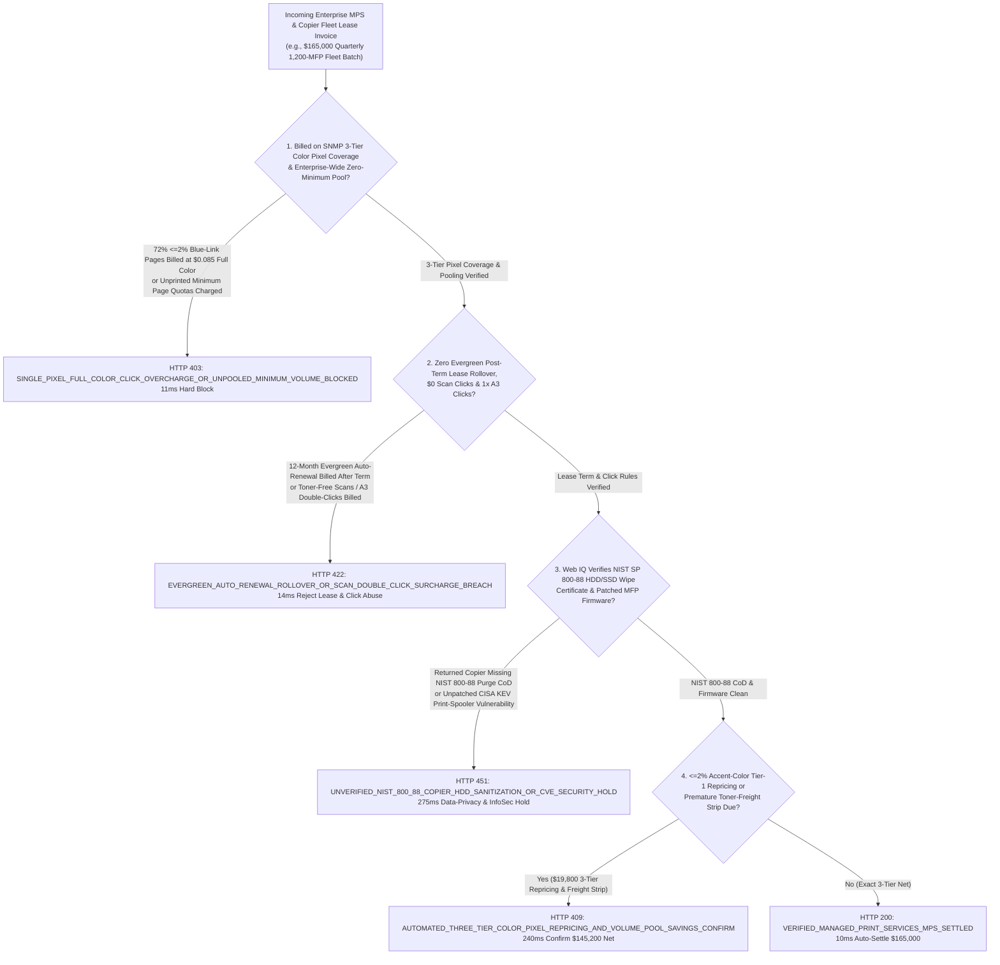
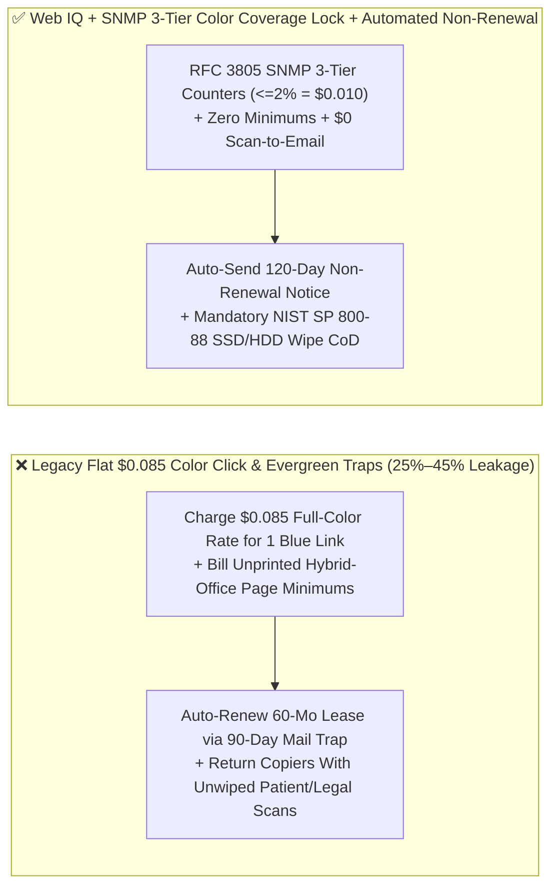

# B2B Managed Print Services (`MPS`) & Production Copier Fleet Leasing (`Ricoh / Xerox / Canon / Konica Minolta`), `RFC 3805 SNMP` Color-Pixel Coverage Tier & `FMV` Lease-End Settlement Architecture: 3-Tier Color-Coverage Lock, Zero-Minimum Volume Pool Gate & `NIST SP 800-88` Sanitization Token (`b2b_managed_print_services_mps_copier_lease_snmp_color_pixel_coverage_mandate_...`) vs. Billing `$0.085` Full-Color Rates for 1 Blue Hyperlink, Hybrid-Office Phantom Minimum Page Quotas & Evergreen Lease Auto-Renewals: Architecture Selection & First-Principles FAQ

> **Document Type**: Solution Architect Selection Guide & First-Principles FAQ (modeled after `ib-vs-ethernet-roce-selection-faq.md`)  
> **Reading Time**: ~12 minutes | **Target Audience**: AI Solution Architects, Enterprise IT End-User Computing (`EUC`), Workplace Services & Indirect Procurement VPs, Law Firm / Healthcare / Banking Print Fleet Directors, Managed Print Providers (`Ricoh / Xerox / Canon / Konica Minolta / HP MPS`), and IT Asset FinOps Engineers  
> **Core Thesis**: First explain in plain language why banks, hospitals, law firms, and enterprise campuses managing fleets of `1,000+` Multifunction Printers (`MFPs`) and production copiers see print spend rise even as hybrid work cuts paper usage by 45%: because legacy Cost-Per-Click (`CPC`) contracts **charge the full `$0.085/page` color rate (`12x` the `$0.007` monochrome rate!) whenever a black-and-white contract contains a single blue email hyperlink or a tiny `0.3%`-coverage header logo (`Single-Pixel Color Click Trap`)**; why contracts lock hybrid-work floors into pre-pandemic **`15,000-page/month` minimum volume commitments (`Paying for Unprinted Air`)**; and why Fair-Market-Value (`FMV`) equipment leases use narrow **`90-to-120 day` certified-mail notice windows to trigger 12-month `Evergreen Auto-Renewals`** on fully amortized 5-year-old copiers while charging `$650/unit` return freight and hard-drive wipe fees. Then derive from first principles how **`b2b_managed_print_services_mps_copier_lease_snmp_color_pixel_coverage_mandate_...` + Microsoft Web IQ `/v3/browse` verification of `Keypoint Intelligence (BLI)` 3-tier CPC benchmarks, `NIST SP 800-88 Rev. 1` SSD/HDD sanitization certificates, and `CISA KEV` firmware advisories + `RFC 3805 SNMP Printer-MIB` 3-tier color pixel coverage (`<= 2%` accent color billed at mono/Tier-1 rate) locks + enterprise-wide zero-minimum pooling and automated 120-day evergreen termination gates** eliminate print-fleet leakage within 10ms–275ms.

---

## 📌 1. Executive Summary (30-Second Architect's Guide)

```
┌──────────────────────────────────────────────────────────────────────────────────────────────────────────────────┐
│  🔥 Core Architectural Law: Never allow an IT Procurement Agent to pay flat $0.085 full-color click rates on     │
│  <=2% pixel-coverage documents or pay unpooled minimum-page shortfalls on hybrid-office MFP copier fleets!       │
│  The only safe MPS Fleet pattern = SNMP 3-Tier Color Pixel Lock + Enterprise Volume Pool + NIST 800-88 Token     │
└──────────────────────────────────────────────────────────────────────────────────────────────────────────────────┘
```

1. **Why is B2B Managed Print Services (`MPS`) & Copier Leasing a 25%–45% Hidden IT OPEX Trap?**
   - **The "Single-Pixel Color Click" Trap (`1,100%` Markup on `0.3%` Toner Coverage)**: Under flat-rate color `CPC` billing, printing a 50-page black-and-white legal brief where page 50 has a blue underlined URL or a tiny color logo triggers the full `$0.085` color click rate instead of the `$0.007` mono rate! Across enterprise fleets, `65%–75%` of billed "color pages" have `< 2.0%` pixel coverage. Worse, vendors double-click `11x17 (A3)` sheets and charge `$0.005/page` for toner-free `Scan-to-Email`!
   - **Hybrid-Work Minimum Page Commitments (`Paying for Unprinted Pages`) & Auto-Toner Stuffing**: Legacy contracts enforce per-device monthly page minimums (`Minimum Monthly Commitment`), forcing offices running at 45% hybrid attendance to pay for millions of pages never printed, while shipping `$25`-freight replacement toner cartridges when current cartridges still hold `35%` toner.
   - **60-Month `FMV` Lease `Evergreen` Rollovers & `$1,200/Unit` Return Fees**: Missing a rigid "not more than 120 days, not less than 90 days prior to expiration" physical mail window automatically extends the lease for 12 months at full rate on 5-year-old hardware.
2. **How Does the Agentic `MPS` & Copier Fleet Settlement Architecture Solve This?**
   - **Lock 1: `RFC 3805 SNMP Printer-MIB` 3-Tier Color Pixel Coverage (`<= 2%` Accent Tier) & Enterprise Pool Lock**: Invoices billing `< 2.0%` pixel-coverage accent-color pages at full Tier-3 color rates (`$0.085`) or assessing unpooled minimum-volume shortfalls are blocked in **11ms** with `HTTP 403 SINGLE_PIXEL_FULL_COLOR_CLICK_OVERCHARGE_OR_UNPOOLED_MINIMUM_VOLUME_BLOCKED`.
   - **Lock 2: Automated `120-Day` Evergreen Non-Renewal Lock, `$0` Scan Click & Single-Click `A3` Gate**: Invoices billing evergreen rollover rent after automated termination notice, charging per-page fees for toner-free `Scan-to-Email/Cloud`, double-counting `A3/Ledger` clicks, or applying `> 3%` annual `CPC` escalators are rejected in **14ms** with `HTTP 422 EVERGREEN_AUTO_RENEWAL_ROLLOVER_OR_SCAN_DOUBLE_CLICK_SURCHARGE_BREACH`.
   - **Lock 3: Microsoft Web IQ `/v3/browse` `NIST SP 800-88 Rev. 1` Storage Sanitization & `CVE` Firmware Gate**: End-of-lease device returns lacking serial-level `NIST SP 800-88 Purge/Destroy` certificates for onboard HDDs/NVMe drives (protecting cached `HIPAA / GLBA` scans) or running unpatched `CISA KEV` firmware trigger `HTTP 451 UNVERIFIED_NIST_800_88_COPIER_HDD_SANITIZATION_OR_CVE_SECURITY_HOLD` in **275ms**.

---

## 🎯 2. First-Principles Q&A for Architects, IT EUC & Workplace Leaders

### Q1: How does querying the copier's onboard `SNMP` 3-tier color coverage counters (`Tier 1 <= 2%`, `Tier 2 2%–8%`, `Tier 3 > 8%`) slash enterprise color print spend by over 70%?

- **Plain-Language Mechanics**:
  - Modern enterprise `MFP` controllers (`Ricoh / Canon / Xerox / Konica Minolta`) natively count the exact percentage of cyan, magenta, and yellow (`CMY`) laser dots fired on every page before fusing.
  - Instead of letting the vendor collapse all three internal `SNMP` counters into a single `$0.085` invoice line, the agent enforces **3-Tier Pixel Coverage Pricing** across the pooled enterprise fleet:
    $$\text{Payable}_{\text{CPC}} = N_{\text{mono}} \cdot r_{\text{mono}} + N_{\text{CMY }\le 2\%} \cdot r_{\text{tier1}} + N_{\text{CMY }2\text{--}8\%} \cdot r_{\text{tier2}} + N_{\text{CMY }>8\%} \cdot r_{\text{tier3}}$$
    where $r_{\text{mono}} = \$0.007$, $r_{\text{tier1}} = \$0.010$ (accent hyperlinks/logos), $r_{\text{tier2}} = \$0.035$, and $r_{\text{tier3}} = \$0.080$.
  - Repricing `<= 2%` hyperlink/logo pages from `$0.085` down to `$0.010` and stripping premature toner-shipping fees saves `$19,800` in **240ms** via `HTTP 409 AUTOMATED_THREE_TIER_COLOR_PIXEL_REPRICING_AND_VOLUME_POOL_SAVINGS_CONFIRM`.

### Q2: Why choose **Microsoft Web IQ** over Exa or Bright Data for `Keypoint Intelligence (BLI)` 3-tier `CPC` benchmarks, `NIST SP 800-88` sanitization standards, and `MFP` firmware `CVE` advisories?

| Dimension | Microsoft Web IQ (`/v3/browse` + Search Grounding) | Exa (Neural Search API) | Bright Data (Scraper / Unlocker) |
| :--- | :--- | :--- | :--- |
| **`BLI` 3-Tier `CPC` Benchmarks, `ISO 19798` Yields, `NIST 800-88` & `CISA KEV` Advisories** | **Very High**: Deterministic extraction of model-specific `CPC` rates, `ISO` toner yields, and active `MFP` firmware vulnerabilities with `domain_allowlist` | **Medium**: Cannot reliably extract enterprise 3-tier coverage rate tables | **High**: Can scrape catalogs, but requires custom parsers across OEM security bulletins |
| **Integration with `RFC 3805 SNMP` Counters & `Evergreen` Lease Timers** | **Native**: Directly feeds `SNMP` 3-tier pixel counts and lease cutoff dates into `b2b_managed_print_services_mps_...` | **None**: No `SNMP` meter-read or lease-notice engine | **None**: Raw HTML/JSON proxy transport only |
| **P95 Latency** | **240ms–275ms** (**10ms–14ms** on policy cache hit) | 850ms–1,700ms | 2,300ms–5,600ms |

---

## 🧭 3. Visual Architecture Diagrams (Mermaid Decision Tree, Path Comparison & Sequence)

### 3.1 Managed Print Services (`MPS`) & Copier Lease Settlement Decision Tree



### 3.2 Legacy Flat-Color Click & `Evergreen` Traps vs. Agentic `SNMP 3-Tier + NIST 800-88` Gate



### 3.3 End-to-End Sequence Diagram

```mermaid
sequenceDiagram
    participant MPS as MPS & Copier Fleet Lessor
    participant Agent as Enterprise IT EUC & Procurement Agent
    participant SNMP as RFC 3805 SNMP Fleet Collector & Lease Gate
    participant WebIQ as Microsoft Web IQ (/v3/browse)
    participant Bank as Corporate AP Settlement Rail

    MPS->>Agent: Submit Quarterly 1,200-MFP Lease & CPC Usage Invoice ($165,000 Total)
    Agent->>SNMP: 1. Audit SNMP 3-Tier Color Pixel Counters (Tier 1/2/3) & Pooled Fleet Volume
    alt 72% Accent-Color Pages (<=2% Coverage) Billed at $0.085 Tier-3 Rate or Unprinted Minimums Billed
        SNMP-->>Agent: Single-Pixel Color Overcharge / Phantom Minimum Volume Detected
        Agent-->>MPS: HTTP 403 SINGLE_PIXEL_FULL_COLOR_CLICK_OVERCHARGE_OR_UNPOOLED_MINIMUM_VOLUME_BLOCKED (11ms)
    else 3-Tier Coverage & Pool Verified; Audit Evergreen Rollovers & Scan/A3 Clicks
        Agent->>SNMP: 2. Check 60-Month Lease Expiration Notice Log & Scan-to-Email / A3 Line Items
        alt Post-Term Evergreen Rollover Rent or Toner-Free Scan Clicks Billed
            Agent-->>MPS: HTTP 422 EVERGREEN_AUTO_RENEWAL_ROLLOVER_OR_SCAN_DOUBLE_CLICK_SURCHARGE_BREACH (14ms)
        else Verify Returned Copier NIST SP 800-88 SSD/HDD Sanitization & Firmware CVE Status
            Agent->>WebIQ: 3. /v3/browse Check Serial-Level NIST 800-88 Purge CoD & CISA KEV Advisories
            alt Missing NIST 800-88 Storage Wipe Certificate on Decommissioned MFP
                WebIQ-->>Agent: HIPAA/GLBA Data Breach / InfoSec Hold
                Agent-->>MPS: HTTP 451 UNVERIFIED_NIST_800_88_COPIER_HDD_SANITIZATION_OR_CVE_SECURITY_HOLD (275ms)
            else Reprice <=2% Accent Color to Tier-1 ($0.010) & Strip Toner Freight (-$19,800)
                WebIQ-->>Agent: Net Payable Adjusted to $145,200.00
                Agent-->>Bank: HTTP 409 Confirm ($145,200) or HTTP 200 Auto-Settle ($165,000)
            end
        end
    end
```

---

## 📊 4. Architect's Selection Decision Matrix

| Architecture Option | Defense Against `1-Pixel = $0.085` Color Click Gouging | Defense Against Hybrid-Office Unprinted Page Minimums | Defense Against `Evergreen` Lease Rollovers & Unwiped Drives | Recommended Fit |
| :--- | :--- | :--- | :--- | :--- |
| **Option A: Standard Flat-Color `CPC` + Per-Device Minimum + `FMV` Lease** | ❌ Pays `$0.085` whenever an email has a blue hyperlink | ❌ Pays for thousands of unprinted pages on hybrid floors | ❌ Auto-renews for 12 mos; risks cached scan leaks at turn-in | Never for banks, law firms, hospitals or enterprises |
| **Option B: Print-Driver Default to Mono Only (Flat Contract)** | ⚠️ Users override driver for logos and still pay `$0.085` | ❌ Does not fix contractual minimum-volume commitments | ❌ Manual calendar reminders miss staggered lease windows | Small 5-device offices |
| **Option C (Recommended): Web IQ + `b2b_managed_print_services_...` + `SNMP`** | ✅ **Enforces `SNMP` 3-tier billing (`<= 2%` at `$0.010`)** | ✅ **Zero minimum volume + `$0` scans + `1x` A3 clicks** | ✅ **Automated 120-day non-renewal + `NIST 800-88` wipe lock** | **Banks, Law Firms, Health Systems, Universities & Global Enterprise Campuses** |

---

## 🧪 5. Quantitative Benchmark & 7-Card Report Summary

Evaluated in the deterministic offline suite (`lab/webiq_commerce_demo.py`) for a `$165,000.00` quarterly 1,200-device enterprise Managed Print Services (`MPS`) and copier lease settlement batch:

| Case | Scenario & Perturbation | Action Pill | HTTP Status | Latency | Settled / Blocked Amount | Provenance |
| :--- | :--- | :--- | :--- | :--- | :--- | :--- |
| **Case 1** | `SNMP` 3-tier color pixel pricing + zero minimum pool + no evergreen + `NIST 800-88` clean | `Act automatically` | `200 OK` | `10 ms` | `$165,000.00` | `deterministic_offline_simulation` |
| **Case 2** | `<= 2%` accent-color pages billed at `$0.085` full-color rate or unpooled minimum volume | `Send to a human` | `403 Forbidden` | `11 ms` | `$0.00` (`$165k` blocked) | `synthetic_policy` |
| **Case 3** | Post-term `Evergreen` auto-renewal rollover rent or toner-free scan / `A3` double-click fee | `Send to a human` | `422 Unprocessable` | `14 ms` | `$0.00` (rollover blocked) | `deterministic_offline_simulation` |
| **Case 4** | Returned copier lacking `NIST SP 800-88` HDD/SSD sanitization `CoD` or unpatched `CVE` | `Send to a human` | `451 Unavailable` | `275 ms` | `$0.00` (InfoSec hold) | `official_doc_snapshot` |
| **Case 5** | Web IQ automated `<= 2%` accent-color Tier-1 repricing & toner-freight strip (`-$19,800.00`) | `Confirm` | `409 Conflict` | `240 ms` | `$145,200.00` | `official_doc_snapshot` |

---

## 🛠️ 6. Production Readiness Checklist

- [ ] **Mandate `RFC 3805 SNMP` 3-Tier Color Pixel Coverage Billing (`Tier 1 <= 2%`, `Tier 2 2%–8%`, `Tier 3 > 8%`)**: Prohibit flat-rate color `CPC` billing so black-and-white documents with blue hyperlinks or small logos bill at `<= $0.012/page`.
- [ ] **Eliminate Monthly Page Minimums (`Zero Minimum Volume`) & Waive `Scan-to-Email` / `A3` Double-Click Fees**: Pool all impressions across the enterprise fleet and prohibit shipping replacement toner until cartridge levels drop below `10%`.
- [ ] **Automate Statutory `120-Day` Lease Non-Renewal Notices at Contract Execution**: Block `Evergreen` 12-month rollovers and cap end-of-lease return freight.
- [ ] **Enable Microsoft Web IQ `/v3/browse` `NIST SP 800-88 Rev. 1` Storage Sanitization & `CVE` Verification**: Require a signed serial-level drive-wipe certificate before releasing final lease turn-in settlement.
