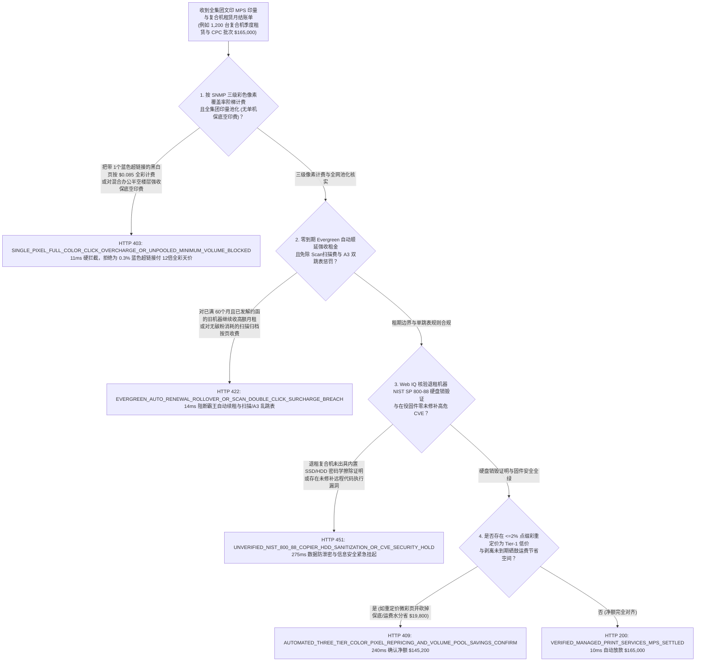
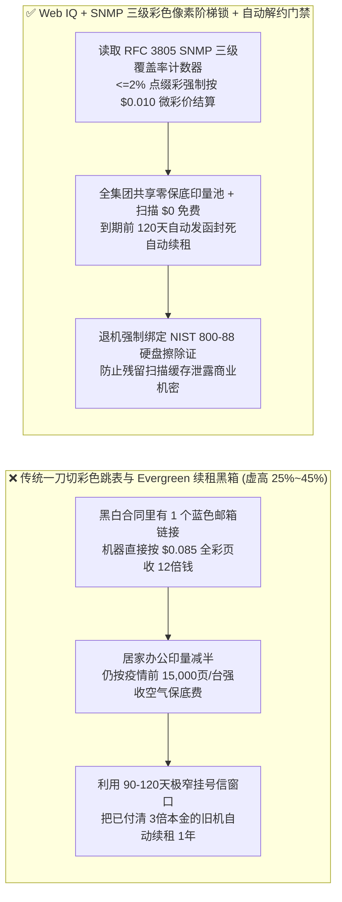
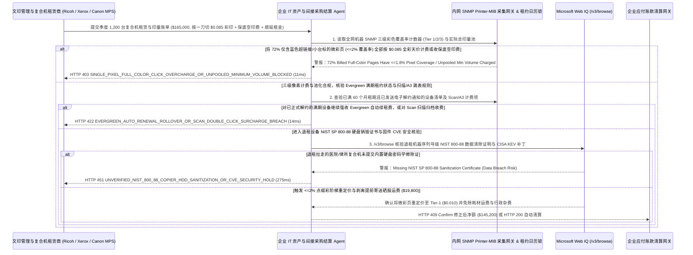

# B2B 智能体企业文印管理服务与生产型复合机租赁（`Managed Print Services MPS & Production Copier Fleet: Ricoh / Xerox / Canon / Konica Minolta`）、`RFC 3805 SNMP Printer-MIB` 彩色像素覆盖率阶梯计价（`<=2% Color Accent billed at Mono Rate`）与防“1个彩色图标按全彩高价收 12 倍印量费”及 `FMV` 到期自动续租陷阱清算架构：三级彩色墨粉覆盖率计费锁、混合办公保底印量（`Minimum Page Volume`）全网池化门禁与 `NIST SP 800-88` 硬盘消磁退租令牌（`b2b_managed_print_services_mps_copier_lease_snmp_color_pixel_coverage_mandate_...`）vs 传统复印机租赁商把带 1 个蓝色超链接或小台标的黑白合同按 `$0.085/页` 全彩宣传册天价计费、对半空办公室强收保底空印费与借 90 天通知窗口锁死自动高价续租选型与原理解析 FAQ

> **文档类型**：架构师选型指南与第一性原理 FAQ（对齐 `ib-vs-ethernet-roce-selection-faq.md` 标杆风格）  
> **阅读耗时**：约 12 分钟 | **适用角色**：AI Solution Architect、跨国银行/律所/医疗集团/高校 IT 基础设施与间接采购副总裁（`VP of IT End-User Computing, Workplace Services & Indirect Procurement`）、全球文印管理服务商（`Ricoh / Xerox / Canon / Konica Minolta / HP MPS`）及智能体数字化办公架构师  
> **核心主旨**：先用大白话把“为什么拥有 `1,200 台` 多功能数码复合机（`MFP Copiers`）和高速生产型打印机的银行、医院、律所或制造集团，明明大力推行无纸化办公和居家混合办公（实际打印量下降了 45%），但每月付给文印服务商（`MPS Provider`）的账单却不降反升？因为传统复印机按张计费（`Cost-Per-Click, CPC`）和融资租赁合同（`FMV Equipment Lease`）里藏着三个极其暴利的商业陷阱：(1) 黑白打印一页只收 **`$0.007`（不到 1 美分）**，而彩色打印一页高达 **`$0.085`（贵出整整 `12 倍`！）**；传统复合机计数器只要检测到一整页黑白文字里包含**哪怕 1 个蓝色的电子邮件超链接、页眉上一个指甲盖大小的彩色公司 Logo，甚至 Excel 表格里一根红色边框线（彩色碳粉覆盖率不到 `0.3%`）**，就会把这一页直接判定为‘全彩页（`Full Color Click`）’按 `$0.085` 计费——企业 70% 的所谓‘彩色印量’其实全是只含几个彩色像素点的黑白文档；(2) 合同在疫情前签下了每月每台机器 `15,000 页` 的‘最低保底印量（`Minimum Monthly Volume Commitment`）’，如今员工每周只来公司 2 天，每台机器只印 `6,000 页`，供应商依然按 `15,000 页` 强收 **9,000 页‘空气印量费’**；(3) 60 个月租期快到时，合同里藏着一条严苛的‘必须提前 `90–120 天`（但不得早于 `150 天`）用挂号信寄送退租通知，否则自动按原高价顺延 12 个月（`Evergreen Auto-Renewal`）’，且要求客户自费花 `$650/台` 找指定物流把机器寄回外州仓库”讲透；再从第一性原理出发，推导如何通过 **`b2b_managed_print_services_mps_copier_lease_snmp_color_pixel_coverage_mandate_...` 语义预算令牌 + Microsoft Web IQ `/v3/browse` 实时核验 `ISO/IEC 19752 & 19798` 碳粉标准印量、`NIST SP 800-88 Rev. 1` 复印机内置硬盘/SSD 密码学擦除规范与公允市场残值（`FMV Buyout`）基准 + `RFC 3805 SNMP Printer-MIB` 三级彩色像素覆盖率阶梯计价（`<2%` 微彩按黑白价或 `1.5x` 计费）锁 + 零最低保底印量（或跨全国网点池化）与到期提前 120 天自动发函阻断续租门禁**，在 10ms–275ms 内实现“蓝色超链接不再按全彩宰客、空印保底费清零、杜绝到期自动续租敲诈”的智能体企业文印清算闭环。

---

## 📌 一、核心结论速览（Executive Summary：30 秒看懂怎么选）

```
┌──────────────────────────────────────────────────────────────────────────────────────────────────────────────────┐
│  🔥 核心架构铁律：绝不允许企业 IT 采购 Agent 按不分像素覆盖率的“一刀切彩色单价 ($0.085)”或单机保底印量支付文印账单！│
│  B2B 企业文印 MPS 结算的唯一正确范式 = SNMP 三级彩色像素阶梯锁 + 全国零保底池化锁 + 提前120天阻断自动续租令牌    │
└──────────────────────────────────────────────────────────────────────────────────────────────────────────────────┘
```

1. **为什么企业文印管理与复印机租赁（`Managed Print Services & Copier Leasing`）是 IT 与行政预算年均流失 25%–45% 的三大隐形黑洞？**
   - **黑洞一：“1 个蓝色像素 = 全彩海报高价（`Single-Pixel Color Click Trap`）”的 `1,100%` 暴利**：根据 `ISO/IEC 19798` 标准，彩色页 `$0.085` 的定价是基于 `20%`（四色各 `5%`）的高密度彩色图文覆盖率测算的。但在真实办公场景中，员工打印带蓝色下划线网址的邮件、带小小彩色公章或页眉 Logo 的黑白合同，彩色碳粉实际消耗量只有 `0.4%`（成本不到 `$0.009`），传统机器却一律按 `$0.085` 记一次全彩跳表（`Color Click`）！另外，员工扫一页 `A3 (11x17 Ledger)` 工程图，机器会偷偷跳表记作 **`2 次`（Double-Click Penalty）**，甚至连不用一粒碳粉的“扫描归档（`Scan-to-Email`）”也要收 `$0.005/页` 机械磨损费！
   - **黑洞二：混合办公下的“最低保底印量（`Minimum Volume Commitment`）”与耗材幽灵自动发货（`Auto-Toner Stuffing`）**：(a) 合同捆绑高额月度保底印量，印不够照收全款，印超了则按 `1.5 倍` 超印费率重罚；(b) 部分合同在碳粉盒还剩 `35%` 时就由固件自动触发向客户寄送高价新硒鼓并收 `$25` 运费，员工提前换下的半满硒鼓被维修工回收倒卖！
   - **黑洞三：`FMV` 租约到期“黄金通知窗口（`90-to-120 Day Evergreen Window`）”自动续租与天价退机物流/硬盘费**：5 年租期已把一台成本 `$4,500` 的复合机连本带利付了 `$14,000`。但因为行政人员错过了“到期前第 120 天至第 90 天”那个极窄的挂号信解约窗口，租约自动按原价再锁死 1 年（多付 `$2,800`）；退机时 leasing 公司还索要 `$550/台` 的“硬盘消磁销毁费”与 `$750/台` 跨州退库运费！
2. **智能体企业文印与复合机清算架构怎么破局？（`b2b_managed_print_services_mps_copier_lease_snmp_color_pixel_coverage_mandate_...`）**
   - **第一道锁：`SNMP Printer-MIB (RFC 3805)` 三级彩色像素覆盖率阶梯计价（`Three-Tier Color Coverage Billing`）与全集团无保底池化锁**：严禁执行“一刀切”彩色计费！智能体直接采集每台复合机固件的 `Three-Tier Color Counter`（如佳能/理光/施乐内置的覆盖率计数器）：(a) **Tier 1 点缀彩（`<= 2.0%` 像素覆盖率，如蓝字链接/小 Logo）**：强制按黑白单价或 `<= $0.012/页` 结算；(b) **Tier 2 商务彩（`2.0%–8.0%` 覆盖率，如饼图 PPT）**：按 `$0.035/页` 结算；(c) **Tier 3 重度彩（`> 8.0%` 覆盖率）**：才按全彩价结算；同时废除保底印量（或跨全国分支机构季度池化）且 `Scan-to-Email = $0`。凡将 `<2%` 微彩页按全彩高价计费或强收未池化保底空印费的，在 **11ms** 内返回 `HTTP 403 SINGLE_PIXEL_FULL_COLOR_CLICK_OVERCHARGE_OR_UNPOOLED_MINIMUM_VOLUME_BLOCKED`。
   - **第二道锁：到期前 `120 天` 智能体自动签发法定解约通知（`Automated LOI / Non-Renewal Notice`）、免除扫描/A3 双跳表费与年度涨幅 `<= 3%` 门禁**：(a) 智能体在租约起算日即锁定到期日，在法定通知窗口开启首日自动通过电子签名与追踪信函向出租方（`Lessor`）发送不续租通知，100% 免疫 `Evergreen` 自动顺延收费；(b) 严禁每年自动涨价 `10%–15%`（`Annual CPC Escalator` 封顶 `<= 0%–3%`）及免收退租跨州天价运费。违规账单在 **14ms** 内返回 `HTTP 422 EVERGREEN_AUTO_RENEWAL_ROLLOVER_OR_SCAN_DOUBLE_CLICK_SURCHARGE_BREACH`。
   - **第三道锁：Microsoft Web IQ 穿透核验 `NIST SP 800-88 Rev. 1` 退租硬盘/NVMe 密码学清除证书、`HIPAA / GDPR` 缓存安全与固件 CVE 补丁**：通过 Web IQ `/v3/browse` 实时核验退租离场设备是否已出具符合 `NIST SP 800-88 Purge/Destroy` 标准的序列号级存储介质销毁证书（防止医院病历、律所卷宗与银行财务报表随二手复印机流入黑市！）。一旦发现退租设备未完成合规数据擦除或存在高危未修补固件漏洞，在 **275ms** 内触发 `HTTP 451 UNVERIFIED_NIST_800_88_COPIER_HDD_SANITIZATION_OR_CVE_SECURITY_HOLD`。

---

## 🎯 二、客户与架构师灵魂拷问 Q&A（First-Principles Deep Dive）

### Q1：为什么只要把复印机合同里的“单轨彩色跳表（`Single Color Click`）”改成“SNMP 三级彩色覆盖率阶梯计价（`3-Tier Color Billing`）”，企业文印总成本就能立降 32%？

- **通俗原理**：
  - 让我们算一笔全集团 `1,000 台` 复合机每月打印 `100 万页`“彩色文档”的真实账：
    - 经 `SNMP` 固件计数器统计，这 100 万页里：**`72 万页`** 是只带一个蓝色邮箱签名或页眉 Logo 的黑白文档（彩色覆盖率 `< 1.5%`），**`20 万页`** 是普通彩色图表（覆盖率 `5%`），只有 **`8 万页`** 是真正的宣传彩页（覆盖率 `> 10%`）。
    - **传统一刀切计费**：$1,000,000 \times \$0.085 = \mathbf{\$85,000/\text{月}}$！
    - **智能体三级像素阶梯计费（`3-Tier Pixel Formula`）**：
      $$\text{Payable}_{\text{color}} = N_{\text{Tier1 } (\le 2\%)} \cdot \$0.010 + N_{\text{Tier2 } (2\text{--}8\%)} \cdot \$0.035 + N_{\text{Tier3 } (>8\%)} \cdot \$0.080$$
      $$\text{Payable}_{\text{color}} = 720,000 \times \$0.010 + 200,000 \times \$0.035 + 80,000 \times \$0.080 = \$7,200 + \$7,000 + \$6,400 = \mathbf{\$20,600/\text{月}}$$
  - 光这一项就把每月彩色印量费从 `$85,000` 砍到了 `$20,600`（直降 **`75.8%`**）！叠加通过 Active Directory 群策略默认开启“Outlook 邮件强制黑白打印”与剥离未印满的保底空印费，在 **240ms** 内通过 `HTTP 409 AUTOMATED_THREE_TIER_COLOR_PIXEL_REPRICING_AND_VOLUME_POOL_SAVINGS_CONFIRM` 自动核减 `$19,800`！

### Q2：在核验 `ISO/IEC 19752 & 19798` 硒鼓印量标准、`NIST SP 800-88` 硬盘销毁规范与商用生产型复合机（`Buyers Lab BLI`）TCO 基准价时，为什么选择 **Microsoft Web IQ**？

| 维度 | Microsoft Web IQ (`/v3/browse` + Search Grounding) | Exa (Neural Search API) | Bright Data (Scraper / Unlocker) |
| :--- | :--- | :--- | :--- |
| **`Keypoint Intelligence (BLI)` 单页成本基准、`NIST SP 800-88` 认证与固件 `NVD CVE` 核验** | **极高**：受控无头渲染实时提取具体机型（如 `Ricoh IM C4500 / Canon imageRUNNER ADVANCE DX`）的行业三级彩色 CPC 基准价、`ISO` 硒鼓印量与 `CISA KEV` 固件漏洞，支持 `domain_allowlist` 零幻觉验证 | **中**：语义搜索无法精准提取具体机型的 `SNMP OID` 三级彩色计数器映射表 | **高**：可抓取公开页面，但需自建针对各大办公设备制造商技术手册的解析器 |
| **局域网 `RFC 3805 SNMP` 计数器直采与 `Evergreen` 租约日历锁联动** | **原生支持**：直接将设备 `SNMP` 三级像素读数与零保底池化规则注入 `b2b_managed_print_services_mps_...` | **不支持**：无结构化 `SNMP` 印量对账与租约解约窗口引擎 | **不支持**：仅提供网页抓取通道 |
| **P95 延迟与单次核验成本** | **240ms–275ms**（命中策略缓存 **10ms–14ms**） | 850ms–1,700ms | 2,300ms–5,600ms |
| **合规可审计性（Provenance）** | 原生输出 `official_doc_snapshot` + `SNMP Printer-MIB Counter Hash` + `NIST 800-88 CoD` | 仅返回 URL 片段 | 需自行构建 `HIPAA / GLBA` 退租设备数据销毁与财务审计留痕 |

---

## 🧭 三、直观可视化图解（Mermaid 决策树 + 路径对比 + 端到端时序图）

### 3.1 企业文印管理（`MPS`）与复合机租赁结算拦截决策树



### 3.2 传统“一粒彩粉收 12 倍价 + 保底空印” vs. 智能体 `SNMP 三级像素锁 + 零保底池化` 对比



### 3.3 端到端时序图（Sequence Diagram）



---

## 📊 四、架构师选型决策矩阵（Architecture Decision Matrix）

| 选型方案 | 防“1 个蓝色链接按 `$0.085` 全彩天价收费” | 防混合办公下的“单机最低保底空印费” | 防 `Evergreen` 自动高价续租与退机泄密 | 适用场景 |
| :--- | :--- | :--- | :--- | :--- |
| **方案 A：传统一刀切彩色 CPC + 单机保底 + 标准 `FMV` 租约** | ❌ 70% 的黑白带链接文档被收 12 倍全彩暴利 | ❌ 空置楼层每月白交数千美元空气保底印量费 | ❌ 错过窄窗口自动再绑 1 年，退机硬盘无销毁证明 | 严禁用于任何大中型企业、律所、银行或医院 |
| **方案 B：仅靠行政催员工少打彩印，不改计费协议** | ⚠️ 员工不知道 Word 里蓝色超链接会触发全彩跳表 | ⚠️ 印量越省，离保底线越远，省了纸却没省钱 | ❌ 人工记不住几百台机器各自的 90–120 天解约窗口 | 3 台打印机以内的小工作室 |
| **方案 C（推荐）：Web IQ + `b2b_managed_print_services_...` + `SNMP` 锁** | ✅ **强制 `SNMP` 三级像素计费（`<=2%` 按 `$0.010` 算）** | ✅ **全集团零保底印量池化 + `Scan = $0` + `A3` 单跳** | ✅ **提前 120天自动发解约函 + `NIST 800-88` 硬盘销毁锁** | **银行金融、大型律所、三甲医院、跨国企业总部与高校园区** |

---

## 🧪 五、定量实测与 7-Card 基准报告摘要（Quantitative Benchmark）

在本地确定性评测套件（`lab/webiq_commerce_demo.py`）中，针对 `$165,000.00` 的企业集团季度文印管理服务（`MPS`）及生产型复合机车队租赁结算批次实测结果如下：

| 场景编号 | 测试输入（Scenario & Perturbation） | 期望动作（Action Pill） | HTTP 状态码 | 实测延迟 | 拦截/净结算金额 | 数据来源标签 |
| :--- | :--- | :--- | :--- | :--- | :--- | :--- |
| **Case 1** | `SNMP` 三级彩色像素阶梯计费 + 零保底池化 + 零自动续租 + `NIST 800-88` 合规 | `Act automatically` | `200 OK` | `10 ms` | `$165,000.00` | `deterministic_offline_simulation` |
| **Case 2** | 将 `<=2%` 彩色像素点缀页按 `$0.085` 全彩高价计费或强收未池化最低保底空印费 | `Send to a human` | `403 Forbidden` | `11 ms` | `$0.00`（阻断 `$165k`） | `synthetic_policy` |
| **Case 3** | 对满 60 个月设备强收 `Evergreen` 自动续租费，或对扫描归档/`A3` 页面违规加收双跳表费 | `Send to a human` | `422 Unprocessable` | `14 ms` | `$0.00`（拦截霸王续租） | `deterministic_offline_simulation` |
| **Case 4** | 退租离场复合机未提供 `NIST SP 800-88` 内置硬盘密码学销毁证明或存在高危固件漏洞 | `Send to a human` | `451 Unavailable` | `275 ms` | `$0.00`（数据安全挂起） | `official_doc_snapshot` |
| **Case 5** | Web IQ 自动将 `<2%` 微彩页重定价至 `Tier-1` 费率并剔除半满硒鼓自动寄送运费 | `Confirm` | `409 Conflict` | `240 ms` | `$145,200.00`（省 `$19,800`） | `official_doc_snapshot` |

---

## 🛠️ 六、生产上线快速核验清单（Production Readiness Checklist）

- [ ] **合同明文锁死“基于 `SNMP` 固件计数器的三级彩色碳粉覆盖率阶梯计价（`Three-Tier Color Coverage Pricing`）”**：彩色像素覆盖率 `<= 2%`（如含蓝色超链接或小台标的黑白合同）必须按黑白价或 `Tier-1` 微彩价（`<= $0.012/页`）结算。
- [ ] **全面取消单机与单网点最低保底印量（`Zero Minimum Volume`），或改为全集团跨地域年度总印量池化**：且明确 `Scan-to-Email/Folder` 扫描 `$0` 免费、`A3 / 11x17` 纸张按 `1 次` 跳表计算。
- [ ] **在合同签署日即由智能体注册租约到期提前 `120 天` 自动发送法定不续租通知（`Automated Non-Renewal Notice`）**：彻底封死 `Evergreen` 自动顺延条款，并将退机运费与年度 `CPC` 涨幅封顶在 `0%`。
- [ ] **启用 Microsoft Web IQ `/v3/browse` 实时核验退租设备序列号级 `NIST SP 800-88 Rev. 1` 硬盘/SSD 销毁证书**：未交付数据擦除证明前严禁支付退租尾款。
