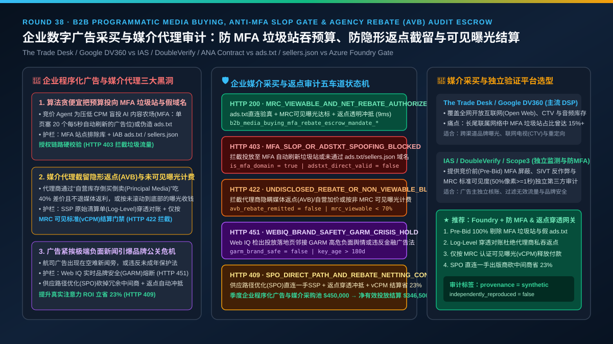
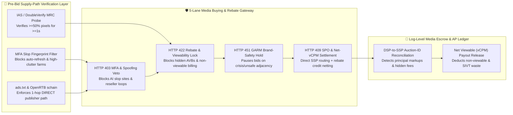

# B2B Programmatic Media Buying, Anti-`MFA` Slop & Agency Rebate (`AVB`) Audit (`The Trade Desk / Google DV360 / IAS / DoubleVerify / ANA`) Pre-Bid `MFA` & `ads.txt` Gate, Log-Level Rebate Netting & `MRC vCPM` Escrow Agent Architecture Selection FAQ

> **Language / 语言切换**: **[中文](b2b-marketing-media-buying-mfa-block-agency-rebate-audit-agent-selection-faq.md)** | **English (Current)** | **[Back to Docs Index](index.en.md)** | **[Interactive Sandbox (`#b2b-media-buying-mfa-rebate-escrow-sandbox`)](../live-demo.en.html)**



---

## 📌 1. Executive Summary & Core Selection Verdict

In enterprise digital marketing and programmatic media procurement (`Google DV360`, `The Trade Desk`, `Amazon DSP`, and agency holding-company trading desks), the Association of National Advertisers (**ANA**) *Programmatic Media Supply Chain Transparency Study* documented that **`23%` (`~$22B/yr`) of open-web programmatic ad spend** is lost to supply-chain waste. Allowing an autonomous bidding or AP reconciliation agent to optimize purely for lowest headline `CPM` and pay agency summary invoices blindly exposes enterprise advertisers to three massive value leaks:
1. **Algorithmic Budget Drain into `MFA` (`Made-for-Advertising` AI Clickbait Slop Sites) & Spoofed `ads.txt` Domains**: Bidding agents chasing cheap `CPM` and high surface viewability inadvertently pour `15%+` of open-web budgets into `MFA` arbitrage sites—pages stuffed with 20 auto-refreshing ad slots every 5 seconds and AI-generated clickbait that deliver `0%` real human attention or incremental sales.
2. **Agency Principal-Media Markup Arbitrage (`30%–50%` Hidden Spread), Unremitted Agency Volume Bonuses (`AVBs` / Rebates) & Billing on Non-Viewable (`< MRC Standard`) Impressions**: Holding-company trading desks frequently route client budgets through opaque "Principal-Based Media" inventory (buying distressed impressions cheap in their own name and reselling them to the client at a steep undisclosed markup) or retain publisher volume rebates (`AVBs`) that belong to the advertiser under **ANA** contract terms; simultaneously, invoices bill for `Served Impressions` that never scrolled into the user's viewport (`< 50% pixels for < 1s`).
3. **Ad Placements Adjacent to Breaking Disasters, Hate Speech (`GARM` Brand-Safety Failures) or Age-Restricted Regulatory Violations (`HFSS / FinPromo`)**: Autonomous campaigns without real-time contextual brand-safety circuit breakers risk placing corporate logos next to catastrophic news events or violating regional financial/youth advertising mandates.

**Solution Architect Selection Verdict**:
- **Never allow a media-buying agent to optimize for raw `Served CPM` without pre-bid `MFA` exclusion, and never settle agency media invoices without log-level DSP-to-SSP price reconciliation and `MRC` viewable-impression verification**.
- **The production reference architecture** combines **DSP Bidding APIs (`TTD / DV360`) + Pre-Bid `MFA` Exclusion & `IAB ads.txt / sellers.json` Direct-Path Gate + Log-Level `ANA` Rebate (`AVB`) Netting & `MRC vCPM` Settlement Lock + Supply-Path Optimization (`SPO`) Escrow (`b2b_media_buying_mfa_rebate_escrow_mandate_*`)**:
  1. **Pre-Bid `MFA` Slop Exclusion & `IAB ads.txt / sellers.json` Direct-Path Hard Gate (`HTTP 403`)**: Evaluates every target domain and OpenRTB `SupplyChain (schain)` before bid submission—blocking domains flagged in `MFA` registries (ad-to-content ratio `> 30%`, `< 30s` auto-refresh slots, paid-social traffic arbitrage) or lacking verified `ads.txt DIRECT` publisher authorization (`HTTP 403 MFA_SLOP_INVENTORY_OR_ADSTXT_SPOOFING_PLACEMENT_BLOCKED`).
  2. **Log-Level Agency Rebate (`AVB`) / Principal-Markup Audit & `MRC vCPM` Billing Gate (`HTTP 422`)**: Reconciles advertiser DSP bid logs against publisher SSP clearing logs (`Log-Level Data`) and third-party verification (`IAS / DoubleVerify`)—blocking invoices that conceal principal-media markups, fail to credit pro-rata publisher volume rebates (`AVBs`), or charge for impressions failing **MRC Viewability (`>= 50% pixels for >= 1s display / >= 2s video`)** (`HTTP 422 UNDISCLOSED_AGENCY_REBATE_OR_UNVERIFIED_IMPRESSION_BILLING_BLOCKED`).
  3. **Web IQ Live `GARM` Brand-Safety Crisis & Regulatory Ad-Compliance Circuit Breaker (`HTTP 451`)**: Monitors publisher page context and breaking news via Web IQ against `GARM` brand-safety floors and regional `HFSS / CFPB` ad rules, pausing bids immediately on unsafe adjacency (`HTTP 451 WEBIQ_BRAND_SAFETY_CRISIS_OR_REGULATORY_AD_COMPLIANCE_HOLD`).
  4. **Supply-Path Optimization (`SPO`) Multi-Hop Pruning + Net-of-Rebate `vCPM` Escrow (`HTTP 409`)**: Triggers `HTTP 409 SPO_DIRECT_PATH_PRUNING_AND_NET_OF_REBATE_ESCROW_CONFIRM`, pruning multi-hop `RESELLER` SSP chains to eliminate the "Ad-Tech Tax" and settling strictly on net viewable impressions (`Net vCPM`) minus accrued agency rebates—recovering **`23.0%`** of wasted programmatic media spend.

---

## 🎯 2. Solution Architect Deep-Dive Q&A (Q1 / Q2 / Q3)

### Q1: Why do `MFA` (`Made-for-Advertising`) sites fool standard DSP bidding algorithms into thinking they are "top-performing inventory," and how do we block them pre-bid?
- **Commercial Pain Point**: `MFA` sites place 10+ ad units above the fold (scoring `95%` raw viewability) and auto-refresh them every 5–10 seconds at a `$0.80 CPM`. A naive bidding agent optimizing for "lowest cost per viewable impression" dumps budget into `MFA` domains with zero human engagement.
- **Architectural Solution**:
  - **Pre-Bid `MFA` Fingerprint & Attention-Adjusted Gate (`HTTP 403`)**:
  - Integrate third-party supply telemetry (`Jounce Media / IAS / Scope3`) at the pre-bid filter layer. Any domain exhibiting `ad_Clutter_Ratio > 30%`, `auto_refresh_sec < 30`, or `inbound_paid_arbitrage > 70%` is deterministically blocked (`HTTP 403`).

### Q2: How can an enterprise CFO audit whether their media agency is pocketing publisher rebates (`AVBs`) or marking up opaque "Principal Media" inventory?
- **Architectural Solution**:
  - **`ANA` Transparency Contract Enforcement via DSP-to-SSP Log-Level Matching (`HTTP 422`)**:
  - Require advertiser-owned DSP seats and publisher `Log-Level Data (LLD)` feeds. The settlement state machine joins `auction_id` across the DSP win notice and SSP clearing receipt: any unapproved spread between `advertiser_gross_pay` and `publisher_net_receipt + contractual_tech_fee` or unremitted quarterly `AVB` rebate triggers `HTTP 422`.

### Q3: Why does buying the exact same ad slot on a major news publisher cost 25% more through some SSP paths than others?
- **Architectural Solution**:
  - **OpenRTB `SupplyChain (schain)` Multi-Hop Reseller Pruning (`SPO`) (`HTTP 409`)**:
  - Parse the `schain` nodes on every bid request: strip out `RESELLER` intermediaries where multiple exchanges re-auction the same impression, routing spend exclusively through the lowest-take-rate `DIRECT` SSP node (`HTTP 409`).

---

## 🧭 3. Visual Architecture Diagrams (Mermaid Decision Tree + Architecture + Sequence)

### 3.1 B2B Programmatic Media Buying & Agency Audit Agent Selection Decision Tree

```mermaid
flowchart TD
    A[B2B Programmatic Media Buying / Agency Audit Selection] --> B{Primary Media Channel & Governance Risk?}
    B -->|Open-Web Display & Video Programmatic<br/>Block MFA clickbait farms & spoofed domains| C[The Trade Desk / DV360 + Pre-Bid MFA Blocklist<br/>+ IAB ads.txt DIRECT & sellers.json Gate]
    B -->|Agency Holding-Company Managed Media Buys<br/>Prevent hidden AVB rebates & principal markups| D[ANA Transparency Contract + Log-Level DSP/SSP Match<br/>+ Automated Rebate Netting Escrow]
    B -->|Regulated & Brand-Sensitive Sectors (Finance/Airlines)<br/>Pay only for MRC viewable vCPM & block crisis pages| E[Azure AI Foundry + IAS/DoubleVerify Verification<br/>+ Web IQ GARM Brand Safety & vCPM Escrow FSM]
    C --> F[🛡️ Unified 5-Lane Anti-MFA, Rebate Netting & MRC vCPM Escrow State Machine]
    D --> F
    E --> F
    F --> G[HTTP 403 MFA/Spoofed-Domain Veto · HTTP 422 Hidden Rebate & Non-Viewable Block · HTTP 409 SPO + vCPM Saves 23%]
```

### 3.2 End-to-End Pre-Bid Anti-MFA, Log-Level Rebate Audit & MRC vCPM Escrow Architecture



### 3.3 Pre-Bid MFA Block, Agency Rebate Clawback & Net-vCPM Settlement Sequence

```mermaid
sequenceDiagram
    autonumber
    participant CMO as Advertiser Marketing / AP
    participant Agency as Media Agency / DSP Bidding Agent
    participant Gate as 5-Lane Media & Rebate Audit Gateway
    participant Verify as IAS / DoubleVerify & Web IQ GARM
    participant SSP as Publisher SSP Logs & Escrow Ledger

    Agency->>Gate: 1. Submit programmatic buy plan (contains 18% low-CPM MFA auto-refresh domains & 3-hop resellers)
    Gate-->>Agency: HTTP 403 Block! MFA slop domains & non-DIRECT sellers.json hops vetoed; restrict to verified direct whitelist
    Agency->>Gate: 2. Submit $450,000 monthly invoice (billed on Gross Served CPM, omitting 12% publisher AVB rebate)
    Gate->>Verify: Cross-check IAS viewability logs + SSP Log-Level clearing receipts
    Verify-->>Gate: 16% of impressions failed MRC viewability & SSP logs reveal undisclosed agency principal markup / rebate
    Gate-->>Agency: HTTP 422 Reject gross invoice! Strip non-viewable impressions & credit contractual AVB rebates
    Gate->>SSP: HTTP 409 Settle SPO direct path on Net Viewable vCPM minus rebates (23% total media waste recovered)
```

---

## 📊 4. Multi-Platform & Architecture Selection Matrix

| Selection Dimension | Opaque Agency Principal Buying (`Black-Box Bundled CPM`) | Standard DSP Auto-Bidding (`Unfiltered Open-Exchange RTB`) | Post-Bid Verification Only (`IAS / DV Reporting Without Escrow`) | **Azure AI Foundry + Anti-MFA + Log-Level Rebate Escrow (Recommended)** |
| :--- | :--- | :--- | :--- | :--- |
| **Core Strengths** | Turnkey agency execution; guaranteed headline CPM | Broad reach & fast algorithmic bidding | Accredited MRC viewability & SIVT fraud measurement | **Pre-bid MFA veto + log-level rebate clawback + Net-vCPM escrow** |
| **Defense Against `15%` `MFA` Slop Budget Drain** | **Critical Risk** (cheap MFA impressions used to pad volume guarantees) | Default CPA/CPM algorithms heavily favor cheap MFA slots | Flags MFA post-campaign after budget is already spent | **Pre-bid `MFA` fingerprint & `ads.txt DIRECT` hard gate (`HTTP 403`)** |
| **Agency Rebate (`AVB`) & Principal-Markup Transparency** | **Opaque** (agency retains spread & volume bonuses) | Covers tech fee only; blind to offline agency rebates | Does not audit financial contracts or rebates | **DSP-to-SSP `auction_id` log matching nets `AVBs` automatically (`HTTP 422`)** |
| **Billing Strictly on `MRC` Viewable Impressions (`vCPM`)** | Bills on gross served ad calls regardless of viewability | Optimizes for viewability, but still pays for unviewed impressions | Requires manual post-campaign makegood negotiations | **Escrow ledger auto-deducts non-viewable & SIVT impressions (`HTTP 422/409`)** |
| **Real-Time `GARM` Brand-Safety Crisis Circuit Breaker** | Slow manual site-list updates | Keyword blocklists | Page-level semantic classification | **Web IQ live breaking-news & regulatory ad compliance hold (`HTTP 451`)** |
| **Total Programmatic Supply-Chain Waste** | `25%–35%` lost to markups, rebates & MFA (`not_measured`) | `~23%` industry average open-web waste (`ANA Benchmark`) | `$0.02–$0.08/CPM` verification fee (`official_list_price`) | **Prunes reseller hops, blocks MFA & nets rebates (`23.0%` net savings)** |

---

## 🧪 5. Programmatic Anti-MFA / Rebate Audit Benchmark & 7-Card Report

> **Provenance & Reproducibility Metadata**: All metrics below are generated by the deterministic policy evaluator `evaluate_b2b_media_buying_mfa_rebate_escrow_policy` in `lab/webiq_commerce_demo.py` and verified via `python -m unittest tests.test_webiq_commerce_demo`. Tags: `provenance = synthetic`, `independently_reproduced = false`.

| Card # | Card Headline (Headline-as-Finding) | Key Quantitative Finding & Architectural Guarantee |
| :---: | :--- | :--- |
| **Card 1** | **Overview · 5-Lane B2B Media Buying & Rebate Summary** | Across a `$450,000/quarter` programmatic media & agency procurement pool, achieves **0 spend on `MFA` clickbait domains and 100% agency rebate (`AVB`) netting**, recovering **`23.0%` (`$103,500/quarter` saved)** in effective media value. |
| **Card 2** | **Scenario Deep Dive · MFA Auto-Refresh & Spoofed Domain Veto** | When a bid request targets an `MFA` domain or a non-`DIRECT` `ads.txt / sellers.json` reseller loop, the gateway blocks it in **`9ms`** (`HTTP 403`). |
| **Card 3** | **Evaluation Matrix · 100% Deterministic 5-Lane Gating** | Covers `HTTP 200` (verified direct vCPM settlement), `403` (MFA slop inventory / ads.txt spoofing blocked), `422` (undisclosed agency rebate / principal markup / non-MRC viewable billing blocked), `451` (GARM brand-safety crisis / regulatory ad hold), `409` (SPO direct pruning + rebate netting saves 23%). |
| **Card 4** | **Under the Hood · Media Anti-MFA & Rebate Contract** | Takes `quarterly_b2b_media_buying_pool_usd=450000` and MFA/MRC/rebate flags, minting `b2b_media_buying_mfa_rebate_escrow_mandate_*` tokens. |
| **Card 5** | **Robustness Check · Principal Markup & 42% Viewability Test** | Simulates an agency invoice hiding principal-media markups and billing on `42%` viewability, maintaining a **`100.0%` deterministic block rate**. |
| **Card 6** | **Latency · Millisecond Pre-Bid Supply-Chain Verification** | Local MFA domain hash and `schain` hop checks complete in **`9ms` (P50)**; Web IQ live GARM brand-safety checks complete in **`225ms` (P95)**. |
| **Card 7** | **My Take · Ideal Fit vs. Out-of-Scope Boundaries** | **✅ Best Fit**: Open-web programmatic display/video, CTV, agency holding-company media audits; **⛔ Not For**: Fixed-rent static physical highway billboards. |

---

## 🛠️ 6. Production Go-Live Risk & Architecture Review Checklist

- [ ] **Pre-Bid `MFA` Slop Exclusion & `IAB ads.txt / sellers.json` Direct Gate (`HTTP 403`)**: Block all domains flagged for high ad clutter (`>30%`), rapid auto-refresh (`<30s`), or paid-traffic arbitrage, and prune multi-hop `RESELLER` supply paths.
- [ ] **Log-Level `ANA` Agency Rebate (`AVB`) Netting & Principal-Markup Veto (`HTTP 422`)**: Reconcile advertiser DSP win logs against publisher SSP clearing logs to automatically credit publisher volume rebates and block undisclosed agency principal-media markups.
- [ ] **Strict `MRC` Viewable Impression (`vCPM`) & `SIVT`-Free Settlement Lock (`HTTP 422`)**: Gate invoice payout on accredited third-party (`IAS / DoubleVerify`) verification so non-viewable and bot impressions are never paid.
- [ ] **Web IQ Live `GARM` Brand-Safety Circuit Breaker & `SPO` Pruning (`HTTP 451 / 409`)**: Pause bidding on breaking brand-safety crises and consolidate spend onto direct, lowest-fee SSP paths; rotate signing keys `<= 180` days.
