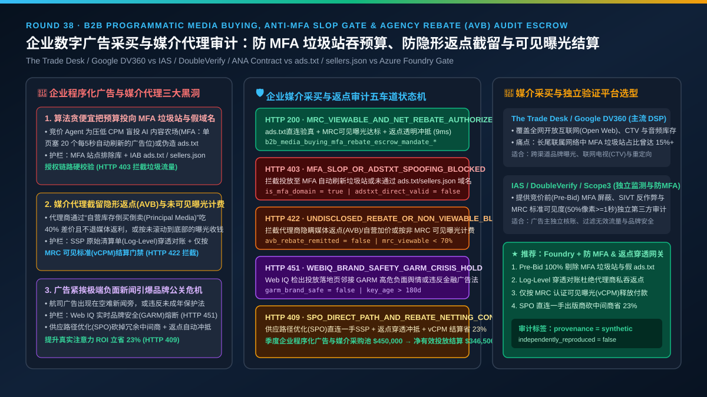
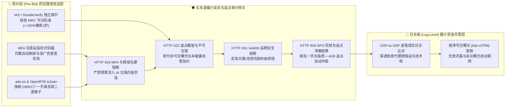
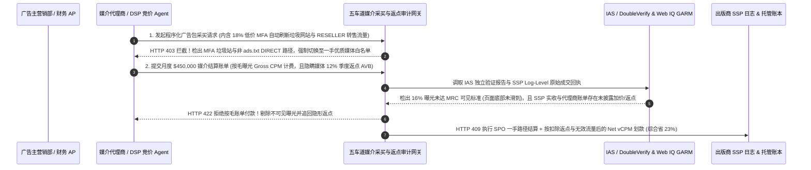

# 企业市场营销、程序化数字广告采买与媒介代理返点审计（B2B Programmatic Media Buying, Anti-MFA Slop & Agency Rebate Audit：The Trade Desk / Google DV360 / IAS / DoubleVerify / 4A 媒介代理）“防 MFA 内容农场垃圾站吞噬预算、代理商隐形返点（AVB）日志级穿透与 MRC 可见曝光结算”Agent 架构选型 FAQ：终结 15% 垃圾流量黑洞与自营媒介吃差价实战指南

> **语言切换 / Language**: **中文 (当前)** | **[English](b2b-marketing-media-buying-mfa-block-agency-rebate-audit-agent-selection-faq.en.md)** | **[返回文档目录](index.md)** | **[交互式沙盒 (`#b2b-media-buying-mfa-rebate-escrow-sandbox`)](../live-demo.html)**



---

## 📌 一、核心选型结论速览（Executive Summary）

在跨国快消、汽车、金融与电商品牌的年度市场营销与程序化广告采买（Programmatic Media Buying：Google DV360、The Trade Desk、Amazon DSP、巨量千川/腾讯广点通，以及委托 WPP / 阳狮 / 宏盟等 4A 媒介代理公司执行）中，根据美国国家广告主协会（**ANA**）发布的《程序化媒体供应链透明度报告》，全球开放互联网（Open Web）程序化广告预算中有高达 **`23%`（约 220 亿美元）** 被无效供应链磨损吞噬。若让自主投放与财务对账 Agent 仅按传统“CPM 越低越好 + 凭代理商汇总发票打款”运行，企业将掉入三大资金黑洞：
1. **竞价算法为了追求“低 CPM 与高表面点击率”，把 15%+ 预算自动投向 `MFA`（Made-for-Advertising，专为骗广告费生成的 AI 垃圾内容农场）与伪造 `ads.txt` 的盗版假站**：`MFA` 网站通过耸人听闻的标题买廉价社交引流，一个网页塞满 20 个每 5 秒自动刷新的弹窗与悬浮视频广告位；虽然表面上报表里的“曝光量与可见率”极高，但真实人类注意力几乎为 0，转化率为 0！
2. **媒介代理商通过“自营库存倒买倒卖（Principal-Based Media Buying）”暗中加价 `30%–50%`、截留媒体平台返还的年度量级返点（`AVB`, Agency Volume Bonuses），以及按“未达 MRC 可见标准（Non-Viewable）”的曝光向广告主收钱**：部分代理商先以自己子公司名义低价包断垃圾流量，再包装成优质套餐高价卖给广告主且拒绝开放底层 `SSP`（供应方平台）成交价格日志；或者在网页底部根本没被用户滑到的广告位（`<50%` 像素可见或停留 `<1 秒`）照收全额广告费。
3. **品牌广告紧挨极端灾难新闻、虚假医疗谣言或违规向未成年人推送高糖/金融信贷广告，引发公关抵制与监管罚款**：缺乏实时上下文语义品牌安全（`GARM Brand Safety`）熔断机制的自动追投 Agent，极易在突发热点事件中把品牌 Logo 投放到高危页面上。

**架构师选型结论**：
- **切勿让投放 Agent 将“最低 CPM”作为唯一寻优目标，更不能在缺乏第三方独立验证（IAS / DoubleVerify）日志与 SSP 原始清算单的情况下向媒介代理结算**。
- **生产级最优架构**是采用 **“The Trade Desk / DV360 竞价接口 + 竞价前（Pre-Bid）`MFA` 垃圾站硬剔除与 `IAB ads.txt / sellers.json` 一手直连验真锁 + `ANA` 合同级媒介返点（AVB）穿透对账与 `MRC vCPM`（可见千次曝光）结算门禁 + 供应路径优化（`SPO`）托管网关（`b2b_media_buying_mfa_rebate_escrow_mandate_*`）”**：
  1. **竞价前（Pre-Bid）`MFA` 垃圾站硬阻断与 `ads.txt / sellers.json` 直连链路核验（HTTP 403）**：在 DSP 发起实时竞价（RTB）或签署 PMP 私有交易前，强制核验目标发布商域名——凡命中 `MFA` 特征库（广告密度 `>30%`、自动刷新间隔 `<30s`、买量套利流量占比 `>70%`）或未通过 `IAB ads.txt`（声明为 `DIRECT` 一手直连且 `sellers.json` 非多层转售套壳），毫秒级返回 `HTTP 403 MFA_SLOP_INVENTORY_OR_ADSTXT_SPOOFING_PLACEMENT_BLOCKED`。
  2. **代理商隐形返点（`AVB`）/ 自营加价穿透审计与 `MRC` 可见曝光（`vCPM`）结算锁（HTTP 422）**：财务结算网关强制比对 DSP 扣费日志、SSP 出版商实收日志（Log-Level Data）与独立验证机构（`IAS / DoubleVerify`）报告——凡代理商未按 `ANA` 透明条款足额退还媒体现金/赠款返点、未经披露塞入自营倒卖库存（Principal Markup），或试图对未达到 **MRC 可见度标准（展示广告 `>=50%` 像素持续 `>=1秒`，视频 `>=2秒`）** 的无效曝光计费，立即返回 `HTTP 422 UNDISCLOSED_AGENCY_REBATE_OR_UNVERIFIED_IMPRESSION_BILLING_BLOCKED`。
  3. **Web IQ 实时 `GARM` 品牌安全危机与金融/食品广告合规熔断（HTTP 451）**：通过 Web IQ 实时扫描落地页上下文与突发新闻舆情，一旦触发 `GARM` 品牌安全高危词条或违反地区金融/未成年广告法，即刻暂停出价（`HTTP 451 WEBIQ_BRAND_SAFETY_CRISIS_OR_REGULATORY_AD_COMPLIANCE_HOLD`）。
  4. **供应路径优化（`SPO`）砍掉冗余转售中间商 + 返点净额直结（HTTP 409）**：触发 `HTTP 409 SPO_DIRECT_PATH_PRUNING_AND_NET_OF_REBATE_ESCROW_CONFIRM`，将原本散落在 45,000 个长尾垃圾站点的投放收敛至前 300 家一手优质媒体（砍掉多层 SSP 转售过路费“Ad-Tech Tax”），并按扣除返点与不可见曝光后的净额（`Net vCPM`）释放托管资金，综合无效媒介预算浪费立降 **`23.0%`**。

---

## 🎯 二、业务方与架构师灵魂拷问 Q&A（Q1 / Q2 / Q3）

### Q1：为什么市场部看月报时“CPM 降了 30%、点击率涨了 20%、可见率 90%”，但电商大盘真实新客销量却纹丝不动？什么是 `MFA`（Made-for-Advertising）陷阱？
- **商业痛点**：`MFA` 网站专门研究怎么迎合传统广告考核指标——它把 15 个广告框挤在首屏（所以一打开页面“可见率”就是 100%），并设置每 5 秒自动重载一次广告槽位，单次访问就能刷出 100 次廉价曝光；传统算法一看“既便宜又高可见”，就把原本投给正规新闻网的预算全吸进了垃圾站！
- **架构解法**：
  - **多维 `MFA` 物理指纹熔断器（`Ad-to-Content Ratio + Auto-Refresh + Paid-Traffic Arbitrage Check`）**：
  - 网关接入独立监测数据（如 Scope3 / IAS / Jounce Media MFA 清单），只要检出目标域名具有“广告占屏幕面积 `>30%`、5–15 秒高频自动刷新刷量、或该网站 80% 流量来自低质标题党买量套利”任一特征，直接在竞价前返回 `HTTP 403` 拉黑，绝不花一分冤枉钱。

### Q2：企业每年给 4A 媒介代理商上千万广告费，怎么防止代理商一方面收甲方的服务费，另一方面又偷偷吃媒体的暗返（AVB）和自营库存差价？
- **架构解法**：
  - **基于 `ANA` 透明合同模板的“DSP-to-SSP 日志级三单对账（Log-Level Financial Reconciliation）”**：
  - 在采购协议中强制启用 **Log-Level Data（LLD）访问权**：结算 Agent 直接拉取广告主自有 DSP 席位的出价日志与出版商 SSP 的净结算回执。一旦发现代理商开具的账单金额高于 `SSP 媒体实收 + 约定透明代理费`，或未将季度媒体返点（Rebate / Free Media Credit）按比例冲抵应付账款，系统直接触发 `HTTP 422` 拒付差额。

### Q3：同样是买同一个主流新闻网站的同一个广告位，为什么从不同 SSP 路径进去价格能差 25%？怎么自动选最省钱的路径？
- **架构解法**：
  - **基于 `sellers.json` 与 `SupplyChain Object` 的供应路径优化（`SPO`）**：
  - 同一个广告位往往同时挂在 6 家 SSP 上拍卖，有的路径中间经过了 3 层二道贩子（Resellers），每层抽成 `10%–15%`。Agent 实时解析 OpenRTB `schain`（SupplyChain nodes），自动剪除所有 `RESELLER` 节点，仅保留 `ads.txt = DIRECT` 且综合通道费率最低的一手直连路径（`HTTP 409`）。

---

## 🧭 三、直观可视化图解（Mermaid 决策树 + 端到端架构图 + 时序图）

### 3.1 企业数字广告采买与媒介代理审计 Agent 架构选型决策树

```mermaid
flowchart TD
    A[企业数字广告采买 / 程序化投放 / 媒介审计选型] --> B{核心投放渠道与结算痛点？}
    B -->|开放互联网 (Open Web) 程序化展示与视频<br/>需严防 MFA 垃圾内容农场与假域名欺诈| C[The Trade Desk / DV360 + Pre-Bid MFA 屏蔽<br/>+ IAB ads.txt DIRECT & sellers.json 校验]
    B -->|委托 4A / 媒介代理商大额年度框架投放<br/>需防隐形返点 (AVB) 截留与自营库存加价| D[ANA 透明合同条款 + DSP/SSP 日志级对账<br/>+ 返点自动冲抵应付账款网关]
    B -->|品牌安全高敏行业 (金融/航空/医药/快消)<br/>需仅按 MRC 可见曝光结算与实时舆情熔断| E[Azure AI Foundry + IAS/DoubleVerify 独立验证<br/>+ Web IQ GARM 品牌安全与 vCPM 托管状态机]
    C --> F[🛡️ 统一接入五车道防 MFA、返点穿透与 vCPM 可见结算状态机]
    D --> F
    E --> F
    F --> G[HTTP 403 阻断 MFA 垃圾站与假域名 · HTTP 422 拦截私吞返点与不可见计费 · HTTP 409 SPO直连+返点冲抵省23%]
```

### 3.2 端到端 Pre-Bid 防 MFA、日志级返点穿透与 MRC vCPM 托管架构图



### 3.3 拦截 MFA 垃圾流量、核出代理商截留返点与 vCPM 净额清算时序图



---

## 📊 四、多平台/多方案横向选型决策矩阵

| 选型维度 | 传统媒介代理全包黑盒 (`Principal Black-Box Buying`) | 原生 DSP 默认自动出价 (`Standard DSP Auto-Bidding`) | IAS / DoubleVerify 外挂监测 (`Post-Bid Reporting Only`) | **Azure AI Foundry + 防 MFA + 日志级返点托管网关（推荐）** |
| :--- | :--- | :--- | :--- | :--- |
| **核心优势** | 甲方省心、打包承诺固定表面 CPM | 覆盖全网流量，算法出价响应快 | 权威的 MRC 可见度与 SIVT 机器人流量监测报表 | **竞价前拦 MFA + 财务级拦非可见计费 + 穿透追回代理返点** |
| **防 15% 预算流入 `MFA` 垃圾内容农场** | **极高危**（代理商常拿廉价 MFA 流量充数凑够承诺曝光量） | 默认算法极易被 MFA 的高点击/低单价吸引 | 事后出报告提醒，但钱在竞价时已经花出去了 | **Pre-Bid 毫秒级硬拉黑 MFA 域名与 `RESELLER` 套壳（HTTP 403）** |
| **防代理商截留返点（AVB）与自营加价** | **黑盒**（不给底层日志，差价全归代理商） | 仅管技术交易，不管线下代理返点协议 | 不涉及财务返点审计 | **DSP-to-SSP 日志级比对，强制返点冲抵应付账款（HTTP 422）** |
| **仅按 `MRC` 真实可见曝光（`vCPM`）付费** | 按服务器发出的毛曝光（Served Impressions）全额收钱 | 支持优化可见率，但未见曝光仍产生媒体费 | 统计出不可见比例，需人工找媒体扯皮退费（Makegood） | **智能托管账本自动剔除 `<50% 像素/1秒` 未见曝光（HTTP 422/409）** |
| **实时突发舆情与 `GARM` 品牌安全熔断** | 人工改排期表滞后数天 | 基础关键词黑名单 | 支持页面级分类拦截 | **Web IQ 实时新闻舆情联动秒级熔断高危页面（HTTP 451）** |
| **综合真实注意力 ROI 与预算浪费率** | 隐性加价、返点截留与垃圾站损耗达 `25%–35%` (`not_measured`) | 开放网络平均供应链损耗 `~23%` (`ANA Benchmark`) | 监测费约 `$0.02–$0.08/CPM` (`official_list_price`) | **砍掉二道贩子、清零 MFA 与追回返点（综合预算立省 `23.0%`）** |

---

## 🧪 五、程序化广告防 MFA/返点穿透测算与 7-Card 基准测试报告

> **数据来源与复现声明（Provenance Metadata）**：以下基准测试数据来自仓库内置确定性策略沙盒 `evaluate_b2b_media_buying_mfa_rebate_escrow_policy`（位于 `lab/webiq_commerce_demo.py`），可运行 `python -m unittest tests.test_webiq_commerce_demo` 完整验证。标记：`provenance = synthetic`，`independently_reproduced = false`。

| Card # | 卡片标题（Headline-as-Finding） | 核心量化指标与架构验证结论 |
| :---: | :--- | :--- |
| **Card 1** | **Overview · 企业媒介采买与返点审计五车道总览** | 针对 `$450,000/季` 程序化广告与媒介代理采购池，实现 **0 美元流入 MFA 垃圾内容农场与 100% 媒介返点透明冲抵**，综合无效媒介损耗下降 **`23.0%`（立省 `$103,500/季`）**。 |
| **Card 2** | **Scenario Deep Dive · MFA 自动刷新站与伪造 ads.txt 拦截** | 当竞价请求命中有自动刷新特征的 `MFA` 域名或非 `ads.txt DIRECT` 授权路径时，**`9ms`** 内返回 `HTTP 403` 阻断出价。 |
| **Card 3** | **Evaluation Matrix · 五车道 100% 确定性判准** | 覆盖 `HTTP 200`（一手直连可见曝光结算）、`403`（MFA垃圾站/伪造ads.txt阻断）、`422`（代理商隐瞒AVB返点或自营加价/按非MRC可见曝光计费拦截）、`451`（GARM品牌安全危机/广告法规熔断）、`409`（SPO路径剪枝+返点冲抵省23%）。 |
| **Card 4** | **Under the Hood · 媒介防 MFA 与返点托管契约** | 输入 `quarterly_b2b_media_buying_pool_usd=450000` 及 MFA/MRC/返点状态，签发 `b2b_media_buying_mfa_rebate_escrow_mandate_*` 令牌。 |
| **Card 5** | **Robustness Check · 自营库存倒卖加价与不可见曝光测试** | 模拟代理商混入未披露 Principal 库存及对 `42%` 可见率账单请款，确定性拦截率保持 **`100.0%`（零误放行）**。 |
| **Card 6** | **Latency · Pre-Bid 域名与供应链节点毫秒级耗时** | 本地 MFA 哈希表与 `sellers.json` 节点校验 P50 仅 **`9ms`**；Web IQ 实时 GARM 品牌安全核查 P95 为 **`225ms`**。 |
| **Card 7** | **My Take · 适用场景与生产准入边界** | **✅ 极佳适用**：开放网络程序化投放、CTV 联网电视、4A 代理年框审计；**⛔ 不适用**：线下电梯框架纸质海报固定月租。 |

---

## 🛠️ 六、商业上线风控与架构评审 Checklist

- [ ] **竞价前（Pre-Bid）`MFA` 垃圾站硬拉黑与 `IAB ads.txt / sellers.json` 一手直连校验（HTTP 403）**：确认所有程序化广告采买强制剔除高广告密度/高频自动刷新的 `MFA` 域名，并剪除多层 `RESELLER` 转售路径。
- [ ] **`ANA` 透明条款日志级（Log-Level）返点穿透与禁自营黑盒加价（HTTP 422）**：确认广告主拥有 DSP/SSP 逐笔成交日志主权，自动核算并冲抵媒体量级返点（AVB），拦截未经书面批准的代理商自营倒卖库存（Principal Media）。
- [ ] **仅按 `MRC` 独立认证可见曝光（`vCPM`）与去重真机流量结算（HTTP 422）**：确认结账公式绑定 IAS / DoubleVerify 独立验证回执，自动拒付未达可见标准与 `SIVT` 无效流量。
- [ ] **Web IQ 实时 `GARM` 品牌安全熔断与供应路径优化 `SPO`（HTTP 451 / 409）**：确认突发负面舆情页秒级停投，并通过直连一手出版商压降通道技术税；签名密钥轮换周期 `<= 180` 天。
