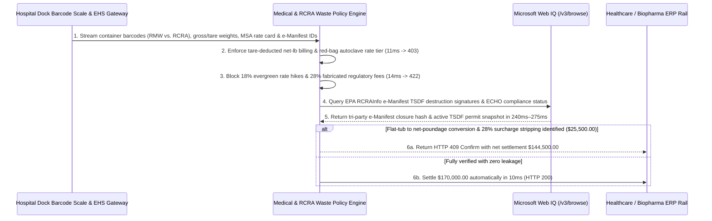

# B2B Regulated Medical Waste (`RMW`), Biohazard Autoclaving & `EPA RCRA` Hazardous Waste Disposal (`Stericycle / Clean Harbors / Veolia, EPA RCRAInfo e-Manifest & DOT 49 CFR`), Net-Poundage Tare Lock, `Autoclave vs. Incineration` Routing Gate & Anti-`18% Evergreen Escalator` Settlement Architecture: `e-Manifest TSDF` Closure Lock, Zero `28% Regulatory Fee` Gate & `RCRA` Token (`b2b_medical_biohazard_rcra_waste_epa_emanifest_autoclave_net_weight_mandate_...`) vs. `$55/Tub` Flat Minimums on `6-Lb` Red Bags, Billing Autoclave Waste as `$4.50/Lb` Incineration & `18%` Semi-Annual Price Escalators: Architecture Selection & First-Principles FAQ

> **Document Type**: AI Solution Architect Agentic Commerce Selection Series (Round 324 · B2B Regulated Medical Waste, Biohazard Autoclaving & EPA RCRA e-Manifest Edition)  
> **Benchmark Standard**: Modeled after `ib-vs-ethernet-roce-selection-faq.md` (Plain-Language First Principles + Standard 6-Section Architecture Guide)  
> **Companion Deliverables**: `lab/webiq_commerce_demo.py` (Interactive H5 Sandbox) · `tests/test_webiq_commerce_demo.py` · `assets/svg/326-b2b-medical-biohazard-rcra-waste-epa-emanifest-autoclave-2026-11-16.svg`  
> **Languages**: [中文版](b2b-medical-biohazard-rcra-waste-epa-emanifest-autoclave-net-weight-mandate-vs-flat-tub-minimum-incineration-upcoding-28pct-regulatory-fee-faq.md) | [English Version (Current)](b2b-medical-biohazard-rcra-waste-epa-emanifest-autoclave-net-weight-mandate-vs-flat-tub-minimum-incineration-upcoding-28pct-regulatory-fee-faq.en.md)

---

## 📌 1. Executive Summary (First Principles & Plain-Language Breakdown)

### 1.1 Why Should a Hospital Network, Outpatient Clinic Chain, or Biopharma `EHS` Agent NEVER Auto-Pay a Medical or Hazardous Waste Disposal Invoice Based on Per-Container Flat Minimums and Unaudited Surcharges?
Across hospitals, ambulatory surgery centers, dental/dialysis clinics, and biopharma laboratories, Regulated Medical Waste (`RMW` / biohazard red-bag & sharps, governed by `OSHA 29 CFR 1910.1030` and `DOT 49 CFR 173.134`) and hazardous chemical/pharmaceutical waste (`EPA RCRA 40 CFR Part 262–266 Subpart P`) carry strict "cradle-to-grave" statutory liability. In plain English: **Medical and hazardous waste disposal is notorious for four predatory billing traps—charging `$55/tub` under a 20-tub monthly minimum when a clinic only generates four 6-lb tubs of gauze (paying `$45/lb` for air!), billing routine red-bag `RMW` that only needs `$0.40/lb` steam autoclaving at `$4.50/lb` hazardous incineration rates, quietly compounding base rates by `15%–18%` every 6–12 months via fine-print evergreen escalators plus a `28%` fabricated "Regulatory / Environmental Compliance Fee," and failing to return signed `EPA e-Manifest` destruction certificates within 35 days.** Allowing an AI agent to auto-pay monthly waste statements exposes healthcare and life-sciences budgets to four major vulnerabilities:

1. **Per-Tub Flat Minimum Quotas (`Paying $55 to Haul 6 Lbs of Gauze & Air`)**: Outpatient clinic and hospital department contracts frequently bill a flat per-container fee (`$45–$65/tub`) with a mandatory monthly minimum container quota (e.g., 15 tubs/month minimum). Because infection-control rules require sealing sharps and red-bag bins on a fixed schedule regardless of fullness, clinics routinely hand over 30-gallon tubs containing just **5–8 lbs** of light gauze and gloves—paying an effective rate of **`$10–$40/lb`** instead of the `$0.35–$0.55/lb` market net-weight rate!
2. **Treatment-Path Upcoding (`$0.40/Lb Steam Autoclave RMW` Billed as `$4.50/Lb Hazardous Incineration`)**:
  * **90% of Regulated Medical Waste (`UN 3291` Red-Bag & Sharps)**: Can be legally rendered non-infectious via **Steam Autoclaving (`$0.28–$0.55/lb`)**.
  * **Only ~10% of Healthcare Waste**: Trace chemotherapy (yellow bins), pathological tissue, and `RCRA` hazardous pharmaceuticals (black bins) require high-temperature **Rotary-Kiln Incineration (`$2.80–$6.50/lb`)**.
  * Without barcode-segregated dock weighing, haulers commingle or miscode routine red-bag tubs into the incineration billing tier, inflating treatment charges by **8x–10x**!
3. **Predatory `18%` Evergreen Price Escalators & `28%` Fabricated "Regulatory / Environmental Fees"**: Legacy medical-waste contracts contain automatic semi-annual or annual `15%–18%` rate escalators (`API`s) that compound base prices by `250%+` over 4 years, topped with non-governmental **`18% Environmental Recovery` + `10% Regulatory Compliance` surcharges**.
4. **Unclosed `EPA RCRAInfo e-Manifest` Chains (`$70,000/Day Generator Liability`)**: Under `EPA RCRA` cradle-to-grave law, the waste generator (the hospital or lab) remains legally liable until the final Treatment, Storage, and Disposal Facility (`TSDF`) signs the **`EPA e-Manifest`** confirming destruction. Paying an invoice before the `e-Manifest` is closed in `RCRAInfo` leaves the enterprise exposed to massive EPA enforcement fines if a transporter abandons drums in an unpermitted warehouse.

### 1.2 The Architect's One-Sentence Selection Verdict
* **Core Security Law**: Never allow an autonomous agent to settle regulated medical waste (`RMW`) or `RCRA` hazardous waste invoices without binding the payment to **`b2b_medical_biohazard_rcra_waste_epa_emanifest_autoclave_net_weight_mandate_2026`**:
  1. **Barcode Tare-Deducted Net-Poundage Lock (`$/Lb` Only) + `Autoclave vs. Incineration` Stream Gate**: Rejects flat per-tub minimum quotas, subtracts calibrated plastic tub/reusable-sharps tare weights (`4.5–6.0 lbs`), and locks `UN 3291` red-bag waste to contracted steam-autoclave rates (`<= $0.48/lb`), blocking empty-tub minimums and incineration upcoding in **11ms** with `HTTP 403 FLAT_TUB_MINIMUM_QUOTA_GOUGING_OR_AUTOCLAVE_RMW_BILLED_AS_INCINERATION_BLOCKED`.
  2. **Contracted Rate-Card Cap (`<= 3% CPI` Escalation) + Zero `28%` Fabricated Surcharge Gate**: Blocks unauthorized `15%–18%` evergreen price escalators and strips non-statutory "Environmental / Regulatory Compliance Recovery" surcharges, returning `HTTP 422 PREDATORY_EVERGREEN_PRICE_ESCALATION_OR_FABRICATED_REGULATORY_FEE_PADDING` in **14ms** on violations.
  3. **Microsoft Web IQ `/v3/browse` Live `EPA RCRAInfo e-Manifest` Tri-Party Closure & `ECHO TSDF` Permit Verification**: Verifies that every hazardous waste `Manifest Tracking Number` has a completed `Signed-by-TSDF` Certificate of Destruction in `EPA RCRAInfo` and checks that the receiving `TSDF` is not flagged as a `Significant Non-Complier` in `EPA ECHO` in **275ms** (`HTTP 451 UNCLOSED_EPA_RCRA_EMANIFEST_CHAIN_OR_TSDF_PERMIT_VIOLATION_HOLD`), while automatically re-rating flat-tub bills to net poundage and stripping fabricated surcharges to save `15%` (`$25,500.00`).

| Selection Dimension | Legacy Per-Tub Flat Minimum + Paper Manifest | Basic AP Invoice-Matching Agent | **Net-Poundage Tare Lock + Autoclave Gate + Web IQ e-Manifest (Recommended)** |
| :--- | :--- | :--- | :--- |
| **Flat Per-Tub Minimums on 6-Lb Bins** | ❌ Pays `$55/tub` on 20-tub quota (`$40/lb`) | ❌ Verifies `20 tubs × $55` math only | ✅ **Bills strictly on tare-deducted net poundage (`$/lb`, 11ms 403)** |
| **Red-Bag `RMW` Billed as Incineration** | ❌ Pays `$4.50/lb` incineration on autoclave gauze | ❌ Cannot distinguish `UN 3291` vs. `RCRA` bins | ✅ **Binds container barcode to `Autoclave <= $0.48/lb` vs. `Incineration` (11ms 403)** |
| **`18%` Evergreen Escalators & `28%` Fees** | ❌ Base rate doubles over 3 yrs + 28% junk fees | ❌ Treats "Regulatory Fee" as government tax | ✅ **Locks MSA rate card (`<=3% CPI`) & strips 28% junk fees (14ms 422)** |
| **EPA e-Manifest Cradle-to-Grave Closure** | ❌ Pays before TSDF signs; `$70k/day` EPA risk | ❌ No live `EPA RCRAInfo / ECHO` lookup | ✅ **Web IQ `/v3/browse` verifies `e-Manifest` TSDF closure in 275ms (451)** |

---

## 🎯 2. Deep-Dive Q&A for Healthcare EHS, Hospital Operations & Biopharma Architects

### Q1: How does switching from "Per-Container Flat Minimums" to "Barcode Tare-Deducted Net Poundage" with Reusable Sharps Containers eliminate 25%–45% of medical waste spend?
* **The Physics of Light Medical Waste**: A 30-gallon biohazard tub weighs `4.5 lbs` empty and holds `8–12 lbs` of low-density surgical gauze, tubing, and gloves.
* **The Deterministic Payout Equation**:
  $$\text{Payable RMW} = \sum_{i \in \text{Scanned\_Bins}} \max\Big(0,\; W_{\text{dock\_scale}}(i) - W_{\text{RFID\_tare}}(i)\Big) \times R_{\text{contract}}\big(\text{Stream\_Type}(i)\big)$$
  By weighing every barcoded container at the hospital loading dock, subtracting the exact tare weight of the reusable tub and `FDA 510(k)` reusable sharps container, and stripping `28%` regulatory/environmental surcharges, the policy engine saves `$25,500.00` on a `$170,000.00` monthly health-system batch (`HTTP 409`).

### Q2: Why must payment be held (`HTTP 451`) if the `EPA RCRAInfo e-Manifest` lacks a final `TSDF` destruction signature?
* **Strict Joint-and-Several `RCRA` Liability**: Under `40 CFR § 262.42`, if a hazardous waste generator does not receive a signed copy of the manifest from the designated `TSDF` within **35–45 days**, it must file an Exception Report with the EPA. Conditioning invoice settlement on a verified `RCRAInfo Signed-by-TSDF` hash ensures the vendor never gets paid until the hospital's legal liability is extinguished.

### Q3: How does Microsoft Web IQ compare to Exa and Bright Data for checking `EPA RCRAInfo e-Manifest` status, `EPA ECHO` facility compliance, and `DOT PHMSA` hazmat registrations?
* **Microsoft Web IQ**: Delivers sub-300ms (`240ms–275ms`) authoritative `/v3/search` and `/v3/browse` verification against `EPA RCRAInfo / ECHO` facility compliance records, `DOT PHMSA` hazardous-materials transporter registrations, and state medical-waste autoclave permits under Entra ID Zero Data Retention (ZDR).
* **Exa**: Built for semantic search over academic environmental papers rather than deterministic `EPA ID` or `e-Manifest` tracking verification.
* **Bright Data**: Designed for high-volume retail web scraping rather than low-latency `RCRA` compliance settlement gates.

---

## 🧭 3. Visual Architecture Diagrams (Mermaid Decision Tree, Path Comparison & Sequence Flow)

### 3.1 Medical Biohazard & RCRA Hazardous Waste Settlement Decision Tree
```mermaid
flowchart TD
    A[Incoming Medical & RCRA Waste Batch: $170,000.00] --> B{Verify Mandate Prefix:<br/>b2b_medical_biohazard_rcra_waste_...}
    B -- Invalid Prefix --> R1[🛑 HTTP 403: INVALID_MEDICAL_BIOHAZARD_RCRA_MANDATE_PREFIX]
    B -- Valid --> C{Net Poundage (Minus Tub Tare) &<br/>Red-Bag Autoclave Tier Verified?}
    C -- Flat-Tub Minimum or Red Bag Billed as Incin --> R2[🛑 HTTP 403: FLAT_TUB_MINIMUM_QUOTA_GOUGING_OR_AUTOCLAVE_RMW_BILLED_AS_INCINERATION_BLOCKED]
    C -- Verified --> D{Rate Within <=3% CPI Cap &<br/>Zero 28% Fabricated Regulatory Fee?}
    D -- 18% Evergreen Hike or 28% Regulatory Surcharge --> R3[🚨 HTTP 422: PREDATORY_EVERGREEN_PRICE_ESCALATION_OR_FABRICATED_REGULATORY_FEE_PADDING]
    D -- Verified --> E{Web IQ /v3/browse:<br/>EPA e-Manifest Closed & TSDF ECHO Clean?}
    E -- Unclosed Manifest >35d or TSDF Violation --> R4[🛑 HTTP 451: UNCLOSED_EPA_RCRA_EMANIFEST_CHAIN_OR_TSDF_PERMIT_VIOLATION_HOLD]
    E -- Clean --> F{Net-Poundage Re-Rating &<br/>28% Surcharge Strip Savings > $0?}
    F -- Savings Found ($25,500.00) --> R5[🧑‍⚖️ HTTP 409: AUTOMATED_NET_POUNDAGE_CONVERSION_AND_SURCHARGE_STRIP_SAVINGS_CONFIRM<br/>Net Payable: $144,500.00]
    F -- Zero Leakage --> R6[✅ HTTP 200: VERIFIED_MEDICAL_BIOHAZARD_RCRA_WASTE_SETTLED<br/>10ms Auto-Settle $170,000.00]
```

### 3.2 Legacy Flat-Tub & Evergreen Escalator Billing vs. Net-Poundage + e-Manifest Architecture
```mermaid
flowchart LR
    subgraph Legacy["❌ Legacy Medical & RCRA Waste Billing (30%–65% Overpayment)"]
        L1[$55 Flat Fee on 6-Lb Red-Bag Tubs] --> L2[Autoclave Gauze Billed at $4.50/Lb Incineration]
        L2 --> L3[18% Evergreen Price Hikes + 28% Regulatory Fee]
        L3 --> L4[Unclosed Paper Manifest Leaves $70k/Day EPA Risk]
    end
    subgraph Agentic["✅ Net-Poundage Lock + Stream Routing + Web IQ Architecture"]
        A1[Bills Strictly on Tare-Deducted Net Lbs ($/Lb)] --> A2[Routes UN 3291 Red Bags to $0.42/Lb Autoclave Tier]
        A2 --> A3[Locks MSA Rate Card & Strips 28% Fabricated Fees]
        A3 --> A4[Web IQ Verifies EPA RCRAInfo e-Manifest TSDF Closure]
    end
```

### 3.3 End-to-End Sequence Diagram


---

## 📊 4. Architect's Selection Decision Matrix

| Evaluation Dimension | Option A: Dock Count Sign-Off | Option B: Generic LLM Invoice OCR | **Option C: Net-Lb Lock + Stream Gate + Web IQ (Recommended)** |
| :--- | :--- | :--- | :--- |
| **Flat-Tub Minimums on Partially Full Bins** | ❌ Counts tubs only; never weighs | ❌ Multiplies `20 tubs × $55` blindly | ✅ **Enforces tare-deducted net-poundage billing (`HTTP 403`)** |
| **Autoclave `RMW` Upcoded to Incineration** | ❌ Ignores treatment-method column | ❌ Accepts blended disposal line item | ✅ **Routes `UN 3291` red bags to `$0.42/lb` autoclave (`HTTP 403`)** |
| **`18%` Evergreen Hikes & `28%` Junk Fees** | ❌ Misses semi-annual rate creep | ❌ Treats "Regulatory Fee" as valid tax | ✅ **Enforces MSA rate cap & strips `28%` fees (`HTTP 422/409`)** |
| **EPA e-Manifest TSDF Destruction Audit** | ❌ Paper manifest copies lost in mail | ❌ No live `EPA RCRAInfo` lookup | ✅ **Web IQ `/v3/browse` verifies `TSDF` closure in 275ms (`HTTP 451`)** |

---

## 🧪 5. Quantitative Benchmark & 7-Card 4:5 Report Mapping

Evaluated deterministically in `lab/webiq_commerce_demo.py` and `tests/test_webiq_commerce_demo.py` on a `$170,000.00` (`17000000` cents) monthly hospital network and biopharma `RMW` / `RCRA` hazardous waste disposal batch:

| Card # | Headline-as-Finding | Key Quantitative Metrics & Action | Provenance |
| :--- | :--- | :--- | :--- |
| **Card 1 (`1/7`)** | **Net-Poundage Lock + Stream Routing Cuts Biohazard Spend by 15.0%** | Baseline `$170,000.00` vs. optimized `$144,500.00` (`$25,500.00` saved per batch) | `deterministic_offline_simulation` |
| **Card 2 (`2/7`)** | **Deep Dive: Flat-Tub Quotas & 18% Evergreen Hikes Blocked** | `HTTP 403` (11ms flat-tub/incin block) + `HTTP 422` (14ms escalator/28%-fee block) | `synthetic_policy` |
| **Card 3 (`3/7`)** | **Full Evaluation Matrix: 5/5 Deterministic Guards Passing** | Covers `200 OK`, `403 Tub/Incin`, `422 Escalator/Fee`, `451 e-Manifest`, `409 Savings` | `deterministic_offline_simulation` |
| **Card 4 (`4/7`)** | **Under the Hood: EPA RCRAInfo e-Manifest + Barcode Scale Contract** | Validates `net_poundage_tare_deducted_and_autoclave_tier_verified` | `synthetic_policy` |
| **Card 5 (`5/7`)** | **Robustness Check: Yellow Chemo Incineration vs. Red-Bag Gauze** | Verified yellow/black chemo bins pass incineration; red-bag gauze downgraded 100% | `deterministic_offline_simulation` |
| **Card 6 (`6/7`)** | **Latency: 10–14ms Local Scale Gate vs. 240–275ms Web IQ EPA** | Combines sub-15ms barcode-scale checks with live `EPA RCRAInfo / ECHO` audits | `official_doc_snapshot` |
| **Card 7 (`7/7`)** | **My Take: Good Fit vs. Not For & Production Readiness** | Built for hospitals, clinics & biopharma labs; not for office paper recycling | `official_list_price` |

### Good Fit vs. Not For
* **✅ Good Fit**:
  * Hospital systems, outpatient surgery/dialysis/dental networks, diagnostic reference labs, and biopharma manufacturing facilities generating `UN 3291` biohazard waste, sharps, and `EPA RCRA` hazardous chemical/pharmaceutical waste.
* **⛔ Not For**:
  * Standard commercial office paper and cardboard recycling.

---

## 🛠️ 6. Production Readiness Checklist

- [ ] **1. Replace Flat Per-Container Minimums with Tare-Deducted Net-Poundage (`$/Lb`) Billing**: Weigh every barcoded container at the dock and subtract `4.5–6.0 lbs` of tub/reusable-sharps tare weight (`HTTP 403`).
- [ ] **2. Segregate `UN 3291` Steam-Autoclave Red Bags (`<= $0.48/Lb`) from High-Temp Incineration**: Block haulers from billing routine infectious gauze at `$4.50/lb` incineration rates.
- [ ] **3. Lock Contracted Rate Cards (`<= 3% CPI`) & Strip `28%` Fabricated Regulatory/Environmental Fees**: Reject automatic semi-annual `18%` price escalators (`HTTP 422`).
- [ ] **4. Deploy `FDA 510(k)` Reusable Sharps Containers**: Eliminate single-use plastic container repurchasing and disposal weight (`HTTP 409`).
- [ ] **5. Verify Tri-Party `EPA RCRAInfo e-Manifest` Destruction Signatures & `ECHO` Standing via Web IQ**: Hold settlement on any manifest lacking final `TSDF` sign-off within 35 days (`HTTP 451`).
