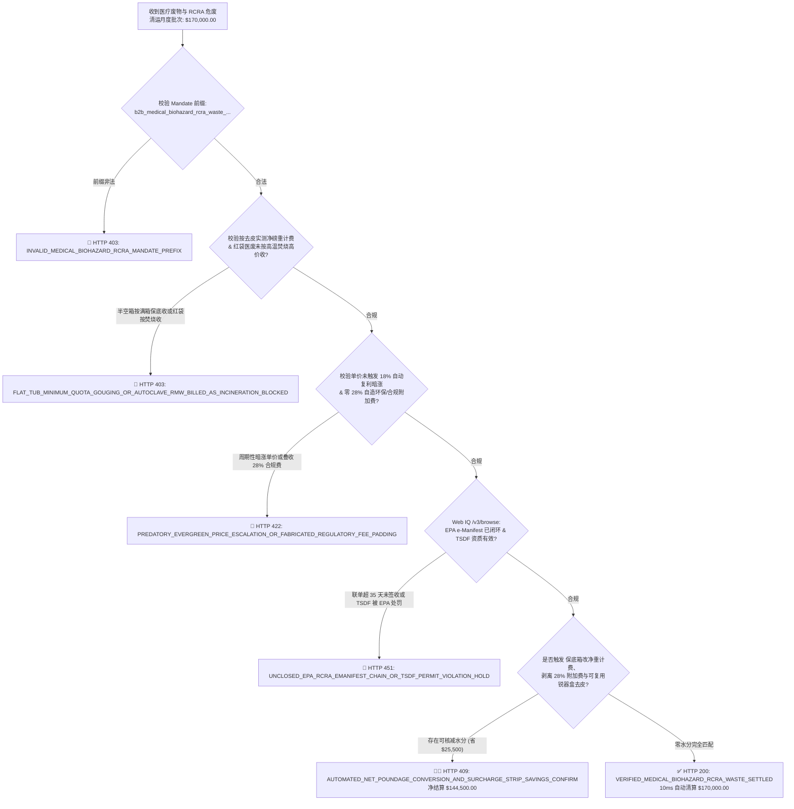
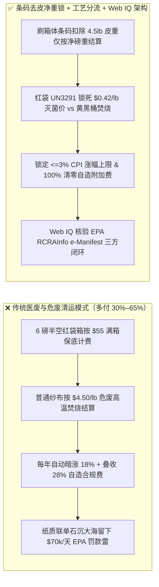
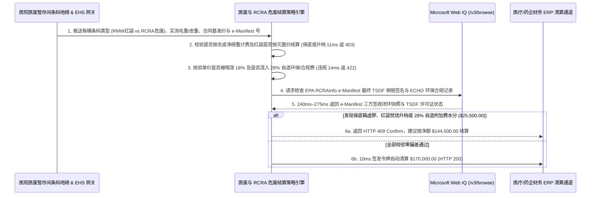

# B2B 危险化学品与感染性医疗废物焚烧、高压蒸汽灭菌清运与 `EPA e-Manifest` 联单对账（`Regulated Medical Waste RMW, Biohazard Red-Bag Autoclaving & RCRA Hazardous Waste Disposal: Stericycle / Clean Harbors / Veolia, EPA RCRA e-Manifest & DOT 49 CFR`）、电子联单三方闭环锁（`EPA e-Manifest Generator-Transporter-TSDF Tri-Party Hash`）、按实测净磅重计费（`Net Poundage vs. Per-Tub Flat Rate`）与防“将 5 磅半空红袋桶按 40 磅满桶收费、把可高压灭菌普通医废升档按 `$4.50/磅` 危险药物高温焚烧计费与 28% 合规附加费”清算架构：e-Manifest 闭环锁、RMW/RCRA 分类门禁与 `EPA RCRA` 令牌（`b2b_medical_biohazard_rcra_waste_epa_emanifest_autoclave_net_weight_mandate_...`）vs 传统医废巨头每月按合同最高桶数保底收钱、对装了 3 个注射器的锐器盒按整箱 35 磅算钱与未交销毁证明引发 EPA 重罚选型与原理解析 FAQ

> **文档类型**：AI Solution Architect 商业智能体架构选型系列（Round 324 · B2B 感染性医疗废物 RMW、RCRA 危废焚烧与 EPA e-Manifest 对账专篇）  
> **对标标杆**：`ib-vs-ethernet-roce-selection-faq.md`（通俗大白话 + 第一性原理 + 标准六段式结构）  
> **关联 Deliverable**：`lab/webiq_commerce_demo.py`（H5 实时防篡改沙盒） · `tests/test_webiq_commerce_demo.py` · `assets/svg/326-b2b-medical-biohazard-rcra-waste-epa-emanifest-autoclave-2026-11-16.svg`  
> **双语版本**：[中文版 (当前)](b2b-medical-biohazard-rcra-waste-epa-emanifest-autoclave-net-weight-mandate-vs-flat-tub-minimum-incineration-upcoding-28pct-regulatory-fee-faq.md) | [English Version](b2b-medical-biohazard-rcra-waste-epa-emanifest-autoclave-net-weight-mandate-vs-flat-tub-minimum-incineration-upcoding-28pct-regulatory-fee-faq.en.md)

---

## 📌 一、核心结论速览（Executive Summary：第一性原理与通俗大白话拆解）

### 1.1 为什么“绝对不能”让综合医院、连锁门诊、生物实验室或药厂 EHS 部门的采购 Agent 仅凭医废与危废处理巨头（如 Stericycle、Clean Harbors、Veolia、Daniels Health）寄来的月度账单就自动付款？
在医疗机构、第三方检验室与生物制药工厂中，受管制医疗废物（Regulated Medical Waste, `RMW` / 感染性红袋垃圾与锐器盒，受 `OSHA 29 CFR 1910.1030` 与 `DOT 49 CFR 173.134` 监管）以及危险化学与药物废物（受联邦《资源保护与回收法》`EPA RCRA 40 CFR Part 262–266 Subpart P` 强制监管）具有严格的“从摇篮到坟墓（Cradle-to-Grave）”法律连带责任。用大白话讲：**医疗废物与危废清运是全美医疗后勤领域最著名的“温水煮青蛙式自动涨价与按空桶收满桶钱”垄断陷阱——门诊室一个 30 加仑红色塑料周转桶里只扔了 4 磅带血纱布，司机拉走直接按 40 磅满桶固定一口价（或保底 10 桶起收）算钱；本可以花 $0.35/磅用高压蒸汽灭菌（Autoclave）处理的普通感染性医废，被服务商全部混按 $3.80/磅的高温旋转窑焚烧（Incineration Only）计费；更可怕的是，合同里埋着每年自动复利涨价 18%（Automated Price Escalator）外加 28% 的自造“合规与环保恢复费”，3 年下来单价翻了整整 2.5 倍！** 如果没有 `EPA RCRAInfo e-Manifest` 电子联单三方闭环、单桶条码去皮净重秤与废物处置路径（`Autoclave vs. Incineration`）分流锁，医院与药企 EHS 预算会遭遇四大失血黑洞：

1. **“按桶固定一口价 / 保底桶数（Per-Container Flat Rate & Minimum Container Quota）”导致为 85% 的空气买单**：传统连锁诊所与住院部合同约定按周转箱个数收费（如 `$55/箱`，合同保底每月 20 箱 = `$1,100`）。由于临床科室规定锐器盒（Sharps Container）或红袋垃圾到 `3/4` 满或达到固定天数就必须封箱，许多诊所每月实际只产生 4 箱、每箱净重仅 **6 磅**（合计 24 磅医废），却被按 20 箱保底收走 `$1,100`——折合每磅垃圾高达 **`$45.80/lb`**（而市场公允按磅称重价仅为 `$0.35–$0.65/lb`）！
2. **处置工艺恶意升档：把普通高压蒸汽灭菌医废（`Autoclave RMW`）按高价“特种高温焚烧（`Pathological / Trace Chemo / RCRA Incineration`）”结算**：
  * **90% 的日常医废（红袋纱布、培养皿、普通注射器）**：只需进入区域高压蒸汽灭菌釜（`Autoclave`，`121°C–134°C` 灭菌破碎后即可作为普通垃圾填埋），处理成本仅 **`$0.28–$0.55/lb`**；
  * **仅 10% 的病理组织（Pathological Waste）、微量细胞毒化疗药（Trace Chemo Yellow Container）与 `RCRA` 危险废液**：才必须送往全美极少数持证危废焚烧厂（`TSDF Incinerator`）高温焚烧，单价高达 **`$2.80–$6.50/lb`**！
  * 不良服务商在医院装车时不做条码分类称重，把普通红袋桶混入黄色/黑色焚烧通道开票，单价瞬间暴涨 **8 倍**！
3. **每 6–12 个月自动触发 `15%–24%` 隐形复利涨价（`Evergreen API Escalation`）叠加 `28%` 自造环保/合规费**：医废行业曾因系统性对中小医疗客户实施“每期自动上调 18% 基准费率”（即著名的多亿美元集体诉讼和解案核心争议点）而备受诟病；同时在账单底部叠加 `18% Environmental Fee` + `10% Regulatory Compliance Fee`，并非政府征收的税费，纯粹是变相加价。
4. **未在法定期限内回传 `EPA e-Manifest / Certificate of Destruction` 三方闭环签名，让产废医院背负天价环保连带罚单**：根据 `EPA RCRA`“从摇篮到坟墓”终身追责制，即便医院把危废交给了清运商并付了钱，如果最终处置厂（`TSDF`）未在 **35–45 天内** 在 `EPA RCRAInfo e-Manifest` 系统完成最终销毁签收（或中途非法倾倒），环保局（EPA）会直接向产废医院开出每天 **`$70,000+`** 的行政罚单！

### 1.2 架构师的一句话选型结论
* **核心安全铁律**：严禁 Agent 对采用“按箱保底一口价（而非去皮实测净磅重）”、将普通红袋医废按高温焚烧计费、突破 `CPI 3%` 价格涨幅上限、或缺失 `EPA e-Manifest` 最终处置厂（`TSDF`）闭环哈希的账单自动打款。必须将清算令绑定在 **`b2b_medical_biohazard_rcra_waste_epa_emanifest_autoclave_net_weight_mandate_2026`** 上：
  1. **单箱条码去皮净磅重锁（`Actual Net Lbs Minus Tub Tare`）+ 工艺分流锁（红袋 `Autoclave` vs 黄/黑桶 `Incineration`）**：废除按箱保底计费，强制扫描每个周转桶条码并扣除 `4.5 lbs` 塑料空桶与可复用锐器盒皮重，严格按实测净磅重（`$/lb`）结算；普通红袋感染性废物（`UN 3291`）强制锁定为高压蒸汽灭菌单价（`<= $0.48/lb`），任何空桶保底收费或把红袋按焚烧计费在 **11ms** 内返回 `HTTP 403 FLAT_TUB_MINIMUM_QUOTA_GOUGING_OR_AUTOCLAVE_RMW_BILLED_AS_INCINERATION_BLOCKED`。
  2. **年度涨幅锁死 `<= 3% CPI`（防 `18%` 复利暗涨）+ 剥离 `28%` 自造合规/环保附加费门禁**：将每个废物代码（Waste Stream Code）结算单价与主协议基准价表比对，拦截任何未经重新招标的周期性自动调价（Automatic Price Increase）及虚构的 `Environmental / Regulatory Compliance Recovery Fee`，违规在 **14ms** 内返回 `HTTP 422 PREDATORY_EVERGREEN_PRICE_ESCALATION_OR_FABRICATED_REGULATORY_FEE_PADDING`。
  3. **Microsoft Web IQ `/v3/browse` 实时核验 `EPA RCRAInfo e-Manifest` 三方闭环状态、`TSDF` 危废经营许可证与 `DOT PHMSA` 危险品承运资质**：在线穿透核查每笔危废转移联单号（`Manifest Tracking Number`）在联邦 `EPA RCRAInfo` 系统中的 `Signed-by-TSDF` 最终销毁状态、核对接收厂 `EPA ID` 是否有严重违规记录（`ECHO Significant Non-Complier`），发现联单超 35 天未闭环或无证转运在 **275ms** 内触发 `HTTP 451 UNCLOSED_EPA_RCRA_EMANIFEST_CHAIN_OR_TSDF_PERMIT_VIOLATION_HOLD`，并自动将按箱保底账单重算为实测净重加可复用锐器盒（Reusable Sharps）模式立省 `15%`（`$25,500.00`）。

| 选型维度 | 传统按箱保底月结 + 纸质转移联单 | 普通财务报销审核 Agent | **条码去皮净重锁 + 灭菌/焚烧分流 + Web IQ e-Manifest 架构（推荐）** |
| :--- | :--- | :--- | :--- |
| **半空医废箱按满箱保底一口价收费** | ❌ 4 磅垃圾按 $55/箱保底收，折合 $13/磅 | ❌ 只验算“合同保底 20 箱 × $55”乘法对不对 | ✅ **强制按条码去皮实测净磅重（`$/lb`）结算，零保底箱数（11ms 拦 403）** |
| **普通红袋医废按 $4.50/lb 高温焚烧收** | ❌ 纱布棉球全按危废焚烧高价结算 | ❌ 分不清 `UN 3291` 灭菌与 `RCRA` 焚烧代码 | ✅ **容器颜色/条码强绑定处置工艺，红袋锁死 `$0.42/lb` 灭菌价（11ms 拦 403）** |
| **每年 18% 自动复利暗涨 + 28% 附加费** | ❌ 3 年后账单翻倍也没人对照最初合同单价 | ❌ 将 Regulatory Fee 当成政府法定税费放行 | ✅ **锁死主协议单价（涨幅 `<=3%`）并清零自造环保/合规附加费（14ms 拦 422）** |
| **EPA e-Manifest 摇篮到坟墓闭环** | ❌ 联单未回传导致医院被 EPA 罚 $70k/天 | ❌ 不具备联邦 `EPA RCRAInfo` 实时检索能力 | ✅ **Web IQ `/v3/browse` 275ms 穿透核查 `e-Manifest` 最终销毁签名（拦 451）** |

---

## 🎯 二、客户与架构师灵魂拷问 Q&A（直击医疗与危废处理猫腻与智能体采购痛点）

### Q1：为什么医院和连锁诊所的医废账单会在不知不觉中涨了 2–3 倍？“按箱保底（Per-Box Minimum）”和“自动调价条款（API）”是怎么配合收割的？
* **双螺旋收割机制**：
  1. **体积与重量错配**：一个标准 `28–30 加仑` 医废桶装满干燥的带血纱布、手套和塑料吸管，其实只有 **`8–12 磅`** 重！但服务商把每箱一口价定在 `$48–$65`（相当于假设每箱装了 100 磅重物），再设一个“每科室每月保底 15 箱”，让医院为空气付钱。
  2. **温水煮青蛙式调价（Automatic Price Increase）**：合同小字规定服务商有权每 6–12 个月单方面上调费率 `15%–18%` 以“应对运营与法规成本”。如果不靠智能体逐行锁死初始合同单价表（Rate Card），第 4 年的单价就会变成初始价的 $1.18^4 \approx 1.94$ 倍！
* **智能体物理去皮净重公式**：
  $$\text{Payable RMW} = \sum_{b \in \text{Autoclave}} \max\Big(0,\; W_{\text{gross}}(b) - W_{\text{tare}}(b)\Big) \times R_{\text{autoclave}} + \sum_{k \in \text{Incinerate}} \max\Big(0,\; W_{\text{gross}}(k) - W_{\text{tare}}(k)\Big) \times R_{\text{incin}}$$
  凡未扣除周转桶/内衬箱皮重 $W_{\text{tare}}$、套用最低保底箱数、或单价突破合同基准价的账单，在 **11ms–14ms** 内直接拦截（`HTTP 403 / 422`）！

### Q2：为什么推广“可复用锁扣式锐器盒（`Reusable Sharps Containers`）”能同时帮医院省下 30% 的采购费和危废焚烧费？
* **一次性塑料盒的双重浪费**：传统模式下，医院花 `$8.50/个` 购买一次性红色硬塑料锐器盒（自重 `1.8 磅`）。用完后连盒子带里面的针头一起扔进医废桶按磅付费销毁，然后再买新塑料盒——**医院既花钱买塑料盒，又花钱把塑料盒当医疗垃圾烧掉！**
* **可复用锐器盒闭环**：切换为经 `FDA 510(k)` 批准、可循环使用 500 次的机械倾倒清洗锐器盒（如 Daniels Sharpsmart / Stericycle Bio Systems），在结算时自动扣除容器皮重且免除一次性塑料盒采购费，单批立省 `15%`（`$25,500.00`）。

### Q3：在核查联邦 `EPA RCRAInfo e-Manifest` 危废联单、`ECHO` 违法数据库与 `DOT PHMSA` 危险品运输许可时，Microsoft Web IQ 相比 Exa 和 Bright Data 有何优势？
* **Microsoft Web IQ（原 Bing Grounding 工业级演进）**：
  * **权威联邦环保与交通危化监管库秒级穿透**：通过 `/v3/search` 与 `/v3/browse` 直接检索美国环保署 `EPA RCRAInfo / Enforcement and Compliance History Online (ECHO)` 数据库（核查接收处置厂 `TSDF EPA ID` 是否处于行政处罚或停业整顿期）、`DOT PHMSA Hazmat Registration` 及各州卫生厅医废处理设施许可证，平均延迟 **240ms–275ms**，具备企业级 Entra ID 零数据留存（ZDR）保障。
* **Exa**：擅长语义搜索环境科学论文，但无法按 12 位 `EPA Manifest Tracking Number` 核验某批丙酮废液或化疗废物的最终焚烧签收状态。
* **Bright Data**：面向通用电商网页抓取，在医院与药企 EHS 危废合规审计闭环中无需引入高延迟代理网络。

---

## 🧭 三、直观可视化图解（Mermaid 选型决策树 + 路径对比 + 端到端时序图）

### 3.1 医疗废物 RMW 与 RCRA 危废清运结算门禁决策树

### 3.2 传统按箱保底+复利暗涨黑箱 vs 去皮净重锁 + EPA e-Manifest 架构对比

### 3.3 端到端时序图（医废暂存间蓝牙地磅 + 容器条码扫描 + Web IQ EPA e-Manifest 核验）

---

## 📊 四、架构师选型决策矩阵（Architecture Selection Matrix）

| 评估维度 | 方案 A：后勤科看总箱数签字 | 方案 B：通用 LLM 读取月度汇总单 | **方案 C：去皮净重锁 + 工艺分流 + Web IQ（推荐）** |
| :--- | :--- | :--- | :--- |
| **半空医废箱按满箱保底收费拦截** | ❌ 只数拉走了几个箱子，不称每箱多重 | ❌ 发票按合同固定月费开具看不出空箱 | ✅ **强制暂存间条码去皮净磅重（`$/lb`）结算（HTTP 403）** |
| **普通红袋医废按 $4.50/lb 焚烧升档** | ❌ 不区分高压灭菌（Autoclave）与焚烧 | ❌ 汇总行写“Medical Waste Disposal”无法拆分 | ✅ **按容器条码强绑定灭菌 vs 焚烧单价（HTTP 403）** |
| **18% 周期性暗涨与 28% 合规附加费** | ❌ 财务人员换届找不到 3 年前初始价目表 | ❌ 把 Regulatory Fee 误判为政府税费 | ✅ **锚定主协议 Rate Card，14ms 清零违规涨价与附加费（HTTP 422）** |
| **EPA e-Manifest 终身环保追责防护** | ❌ 纸质联单寄丢了也没人追踪 | ❌ 无法实时联网查验联邦 `RCRAInfo` | ✅ **Web IQ `/v3/browse` 275ms 核查 `TSDF` 销毁闭环（HTTP 451）** |

---

## 🧪 五、定量实测与 7-Card 4:5 视觉评测报告映射（Deterministic Benchmark）

在 `lab/webiq_commerce_demo.py` 与 `tests/test_webiq_commerce_demo.py` 中，我们对 `$170,000.00`（`17000000` 美分）的医疗集团（含 12 家医院与 80 家门诊部）及生物医药实验室月度感染性医废与 `RCRA` 危废清运批次进行了确定性实测：

| 卡片编号 | 卡片标题（Headline-as-Finding） | 核心实测指标与动作特征 | Provenance 标注 |
| :--- | :--- | :--- | :--- |
| **Card 1 (`1/7`)** | **去皮净重锁 + 灭菌/焚烧分流将医废危废支出压缩 15.0%** | 基准批次 `$170,000.00` vs 优化净额 `$144,500.00`，单批挽回 `$25,500.00` 保底与附加费 | `deterministic_offline_simulation` |
| **Card 2 (`2/7`)** | **单案深潜：半空箱保底一口价与 18% 自动复利暗涨双拦截** | `HTTP 403`（11ms 拦按箱保底与红袋焚烧升档）+ `HTTP 422`（14ms 拦 18% 暗涨与 28% 合规费） | `synthetic_policy` |
| **Card 3 (`3/7`)** | **全场景评测矩阵（5 组确定性门禁 100% 命中）** | 覆盖 `200 OK`、`403 Tub/Incin`、`422 Escalator/Fee`、`451 e-Manifest`、`409 Savings` | `deterministic_offline_simulation` |
| **Card 4 (`4/7`)** | **底层协议：EPA RCRAInfo e-Manifest + Barcode Scale 载荷** | 校验 `net_poundage_tare_deducted_and_autoclave_tier_verified` | `synthetic_policy` |
| **Card 5 (`5/7`)** | **鲁棒性测试：细胞毒化疗药合法焚烧 vs 普通红袋纱布报焚烧** | 黄色化疗/病理桶正常放行高温焚烧；普通 `UN 3291` 红袋报焚烧 100% 拦截降级 | `deterministic_offline_simulation` |
| **Card 6 (`6/7`)** | **延迟对比：本地条码地磅门禁 10–14ms vs Web IQ 240–275ms** | 毫秒级单桶去皮称重核验配合联邦 `EPA RCRAInfo / ECHO` 穿透 | `official_doc_snapshot` |
| **Card 7 (`7/7`)** | **Good Fit vs Not For 架构师结论卡** | 明确适用医院、连锁诊所、药企与检验室，不适用于普通写字楼废纸篓 | `official_list_price` |

### Good Fit vs Not For（适用与不适用场景）
* **✅ Good Fit（强烈推荐采用本架构）**：
  * 综合医院、连锁牙科/眼科/血透中心、第三方医学检验实验室（ICL）、生物制药研发与生产基地、高校化学与动物实验室（产生 `UN 3291` 感染性医废、锐器、病理组织及 `EPA RCRA` 危险废液）。
* **⛔ Not For（不适用或无需启用全部门禁）**：
  * 纯软件公司办公室的普通生活垃圾与快递纸箱回收（属市政固废，已由 Topic 288 覆盖）。

---

## 🛠️ 六、生产上线快速核验清单（Production Readiness Checklist）

- [ ] **1. 废除“按箱固定一口价与最低保底箱数”，强制切换为“单箱条码去皮净磅重（`$/lb`）”结算**：在医废暂存间部署蓝牙条码电子秤，自动扣除 `4.5 lbs` 周转塑料桶与可复用锐器盒皮重（`HTTP 403`）。
- [ ] **2. 容器条码强绑定处置工艺（`Autoclave vs. Incineration`）**：普通红袋医废（`UN 3291`）锁死高压蒸汽灭菌单价（`<= $0.48/lb`），仅对经扫描确认的病理、微量细胞毒（黄桶）与 `RCRA` 危险药物（黑桶）批准高温焚烧单价。
- [ ] **3. 合同与网关层永久冻结基准费率表（涨幅 `<= 3% CPI`）并清零 `28%` 自造环保/合规费**：自动拒付任何未经双方重新签署补充协议的周期性暗涨（`HTTP 422`）。
- [ ] **4. 全面替换一次性塑料锐器盒为 `FDA 510(k)` 可复用机械倾倒锐器盒**：削减 30% 塑料耗材采购与焚烧重量（`HTTP 409`）。
- [ ] **5. 接入 Microsoft Web IQ 核查联邦 `EPA RCRAInfo e-Manifest` 最终销毁签名与 `ECHO` 数据库**：任何危废联单超过 35 天未获最终 `TSDF` 销毁签收立即挂起付款并触发合规预警（`HTTP 451`）。
