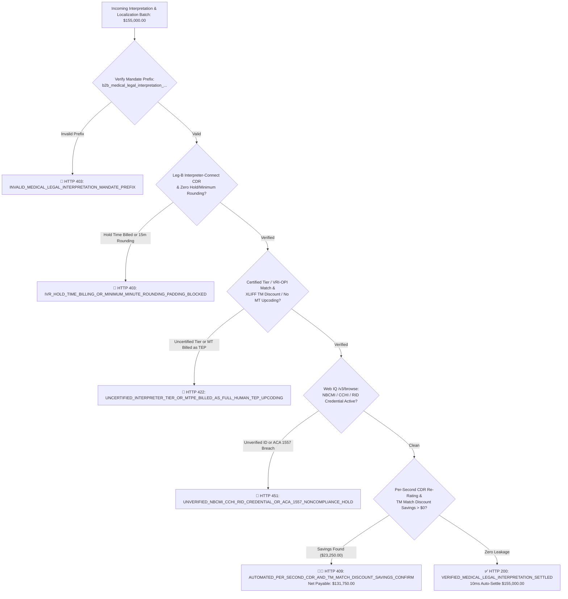
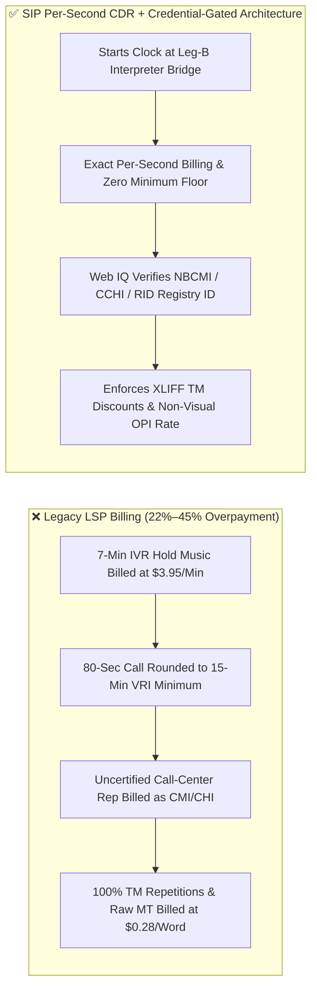
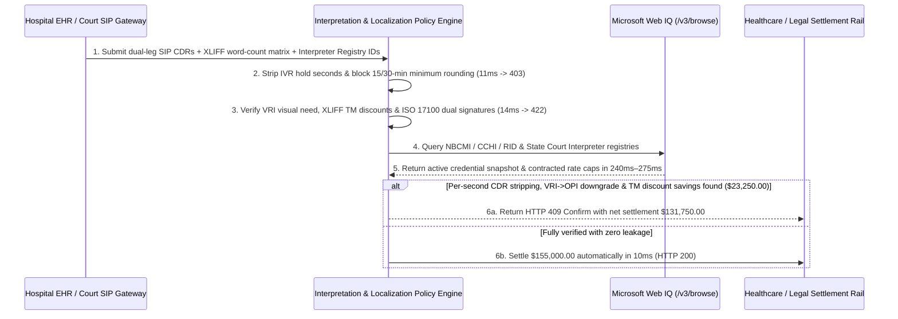

# B2B Medical `VRI / OPI` Interpretation, Court Certified Interpreter & Regulated Localization (`LanguageLine / CyraCom / Propio, ACA Section 1557 & NBCMI / CCHI / RID`), `Per-Second SIP CDR` Billing Lock, Interpreter-Bridged Cutoff & Anti-`MTPE` Upcoding Settlement Architecture: `Leg-B` Connect Timestamp Lock, Credential Registry Gate & `ACA 1557` Token (`b2b_medical_legal_interpretation_vri_opi_per_second_cdr_nbcmi_certification_mandate_...`) vs. 15-Minute Minimum Rounding, `$3.95/Min` IVR Hold-Time Billing & Machine Translation Billed as Full Human `TEP`: Architecture Selection & First-Principles FAQ

> **Document Type**: AI Solution Architect Agentic Commerce Selection Series (Round 306 · B2B Medical/Legal Interpretation & Localization Edition)  
> **Benchmark Standard**: Modeled after `ib-vs-ethernet-roce-selection-faq.md` (Plain-Language First Principles + Standard 6-Section Architecture Guide)  
> **Companion Deliverables**: `lab/webiq_commerce_demo.py` (Interactive H5 Sandbox) · `tests/test_webiq_commerce_demo.py` · `assets/svg/308-b2b-medical-legal-interpretation-vri-opi-cdr-nbcmi-2026-11-16.svg`  
> **Languages**: [中文版](b2b-medical-legal-interpretation-vri-opi-per-second-cdr-nbcmi-certification-mandate-vs-minimum-minute-rounding-ivr-hold-billing-mtpe-upcoding-faq.md) | [English Version (Current)](b2b-medical-legal-interpretation-vri-opi-per-second-cdr-nbcmi-certification-mandate-vs-minimum-minute-rounding-ivr-hold-billing-mtpe-upcoding-faq.en.md)

---

## 📌 1. Executive Summary (First Principles & Plain-Language Breakdown)

### 1.1 Why Should a Healthcare System, Court Administrator, or Life-Sciences Procurement Agent NEVER Auto-Pay a Language Service Provider (`LSP`) Invoice Without `SIP Leg-B CDR` Verification and Credential Audits?
Hospital networks (mandated under `ACA Section 1557 / 45 CFR Part 92` to provide qualified medical interpreters to Limited English Proficient `LEP` patients), state/federal courts, and global pharmaceutical sponsors spend millions annually on Video Remote Interpreting (`VRI`), Over-the-Phone Interpreting (`OPI`), and regulated document translation (`ISO 17100`). In plain English: **B2B language service billing is plagued by four massive revenue leaks—charging `$3.95/minute` while nurses listen to IVR hold music, rounding an 80-second discharge check up to a 15-minute minimum, routing overflow calls to uncertified bilingual call-center reps at certified medical rates, and billing raw LLM/machine translation (`MT`) and `100% TM` repetitions as `$0.28/word` full human translation (`TEP`).** Allowing an AI agent to pay monthly LSP summary invoices without raw `SIP / WebRTC Call Detail Record (CDR)` and XLIFF verification exposes organizations to four systemic failures:

1. **IVR Hold-Time Billing & `15–30 Minute` Minimum Call Rounding**: An ER nurse dials an interpretation hotline for a rare language or American Sign Language (`ASL`), waits `7 minutes 30 seconds` on hold in the IVR queue, and speaks with the interpreter for `1 minute 20 seconds`. Legacy vendors bill from initial PBX `SIP INVITE` rather than interpreter bridge, or enforce a **15-minute or 30-minute minimum charge per VRI session**, turning an 80-second call into a `$59.25` charge (`15 min × $3.95/min`).
2. **Uncertified Generalists Billed at Certified Medical/Judicial Tiers (`Credential Upcoding`)**: Under `ACA Section 1557` and court evidentiary rules, clinical informed consent and depositions require interpreters holding `NBCMI (CMI)`, `CCHI (CHI)`, `RID NIC` (ASL), or State Court Certification. During peak hours, vendors silently overflow calls to uncertified offshore bilingual agents while billing the full certified medical/legal rate.
3. **Default `VRI` Video Billing (`$3.25/min`) for Audio-Only Encounters (`$0.85/min OPI`)**: Bedside iPad carts often default to launching a `$3.25/min` `VRI` video call—even with the privacy lens cap closed—for spoken-language pharmacy or scheduling questions that only require `$0.85/min` audio `OPI`, inflating costs by **3.8x**.
4. **Machine Translation (`MTPE`) Billed as Full Human `TEP` & Zero `TM` Repetition Discounts**: In life-sciences localization, vendors charge full new-word rates (`$0.28/word`) on `100% Translation Memory (TM) Matches` and repetitions, or pass unedited LLM output off as `ISO 17100` dual-linguist Translation + Editing + Proofreading (`TEP`).

### 1.2 The Architect's One-Sentence Selection Verdict
* **Core Security Law**: Never allow an autonomous agent to settle medical/legal interpretation or localization invoices without binding the payment to **`b2b_medical_legal_interpretation_vri_opi_per_second_cdr_nbcmi_certification_mandate_2026`**:
  1. **`SIP Leg-B Interpreter-Bridged` Timestamp Cutoff + Per-Second Billing Lock**: Strips all IVR navigation and queue hold time, billing strictly from `Leg-B Interpreter 200 OK` to hangup in exact 1-second or 6-second increments with zero minimum-minute rounding, blocking violations in **11ms** with `HTTP 403 IVR_HOLD_TIME_BILLING_OR_MINIMUM_MINUTE_ROUNDING_PADDING_BLOCKED`.
  2. **Non-ASL `VRI → OPI` Rate Cap + XLIFF `TM` Discount & Anti-`MTPE` Upcoding Gate**: Caps non-visual spoken-language sessions at contracted `OPI` rates and enforces CAT tool `.tmx / XLIFF` word-count matrix discounts plus dual-linguist `ISO 17100` signatures, blocking violations in **14ms** with `HTTP 422 UNCERTIFIED_INTERPRETER_TIER_OR_MTPE_BILLED_AS_FULL_HUMAN_TEP_UPCODING`.
  3. **Microsoft Web IQ `/v3/browse` Live `NBCMI / CCHI / RID` & Court Registry Verification**: Verifies each interpreter's active certification ID against `NBCMI`, `CCHI`, `RID`, and state judicial registries in **275ms** (`HTTP 451 UNVERIFIED_NBCMI_CCHI_RID_CREDENTIAL_OR_ACA_1557_NONCOMPLIANCE_HOLD`), while automatically re-rating uncertified/non-visual calls and applying `TM` repetition discounts to save `15%` (`$23,250.00`).

| Selection Dimension | Legacy Monthly LSP Summary Invoice | Basic Ticket-Counting Agent | **SIP Leg-B Per-Second CDR + XLIFF Matrix + Web IQ Registry Gate (Recommended)** |
| :--- | :--- | :--- | :--- |
| **IVR Hold Time & Minimum Rounding** | ❌ Billed for 7-min hold music + 15-min VRI minimums | ❌ Reads invoice total minutes only | ✅ **Bills strictly from `Leg-B Interpreter Bridged` per second (11ms 403)** |
| **VRI Over-Routing & MTPE Upcoding** | ❌ Pays `$3.25/m` VRI for audio; pays TEP for raw MT | ❌ No media-stream or XLIFF telemetry | ✅ **Re-rates non-visual VRI to OPI + enforces XLIFF TM discounts (14ms 422)** |
| **NBCMI / CCHI / RID Verification** | ❌ Uncertified overflow reps billed as certified | ❌ Trusts vendor self-reported tier | ✅ **Web IQ `/v3/browse` verifies `NBCMI/CCHI/RID` IDs in 275ms (451)** |
| **ACA Section 1557 & ISO 17100 Audit** | ⚠️ Malpractice & regulatory exposure | ❌ No per-encounter credential proof | ✅ **Cryptographically links every CDR/XLIFF to verified linguist credentials** |

---

## 🎯 2. Deep-Dive Q&A for Healthcare, Legal & Localization Architects

### Q1: How do hospitals and courts eliminate the 25%–40% "phantom minutes" hidden inside remote interpretation invoices?
* **The Telecom Root Cause**: Legacy contracts allow billing from PBX ingress (`Leg A`). Every second spent navigating IVR language trees or waiting on hold for a rare-language linguist is billed at clinical rates, followed by whole-minute or 15-minute rounding.
* **The SIP/WebRTC Dual-Leg Fix**:
  $$\text{Billable Seconds} = \max\Big(0,\; t_{\text{BYE}} - t_{\text{LegB\_Interpreter\_Bridged}}\Big)$$
  The settlement engine ingests the raw `SIP / WebRTC CDR` stream and rejects any invoice line that includes `t_{\text{LegB}} - t_{\text{LegA}}` hold time or applies a minimum call duration floor (`HTTP 403`).

### Q2: How does the architecture prevent localization vendors from billing raw LLM output (`MTPE`) or `100% TM` repetitions as `$0.28/word` full human translation (`TEP`)?
* **Deterministic XLIFF & Dual-Linguist Provenance**:
  1. **Mandatory CAT Analysis XML (`Trados / MemoQ / Phrase`)**: Enforces `70%–100%` discounts on `Repetitions` and `100% Context Matches`, and `40%–60%` discounts on `Fuzzy Matches (75%–99%)`.
  2. **`ISO 17100` Dual-Linguist Edit-Distance Proof**: Full `TEP` billing requires two distinct credentialed linguist IDs and non-zero revision keystroke telemetry; unedited machine output or missing `TM` discounts trigger `HTTP 422` or automated `HTTP 409` savings re-rating (`$23,250.00` saved on a `$155,000.00` batch).

### Q3: How does Microsoft Web IQ compare to Exa and Bright Data for verifying `NBCMI`, `CCHI`, `RID`, and state court interpreter registries?
* **Microsoft Web IQ**: Delivers sub-300ms (`240ms–275ms`) authoritative `/v3/search` and `/v3/browse` verification against live `NBCMI`, `CCHI`, `RID`, and state judicial roster pages under Entra ID Zero Data Retention (ZDR) and HIPAA-aligned privacy boundaries.
* **Exa**: Optimized for semantic search over NLP research papers rather than deterministic credential ID lookups.
* **Bright Data**: Built for high-volume public web scraping, adding unnecessary proxy complexity for real-time clinical/legal claim settlement.

---

## 🧭 3. Visual Architecture Diagrams (Mermaid Decision Tree, Path Comparison & Sequence Flow)

### 3.1 Medical/Legal Interpretation & Localization Settlement Decision Tree

### 3.2 Legacy LSP Summary Invoice vs. SIP Leg-B CDR + Web IQ Credential Settlement

### 3.3 End-to-End Sequence Diagram

---

## 📊 4. Architect's Selection Decision Matrix

| Evaluation Dimension | Option A: Manual CSV Call-Log Spot Check | Option B: Generic LLM Invoice OCR | **Option C: SIP Leg-B CDR + XLIFF Lock + Web IQ (Recommended)** |
| :--- | :--- | :--- | :--- |
| **IVR Hold-Time & Rounding Protection** | ❌ Impossible across 50,000 monthly calls | ❌ Summary invoice omits Leg-B timestamps | ✅ **Enforces `Leg-B Bridged` per-second billing in 11ms (`HTTP 403`)** |
| **VRI Over-Routing & MTPE Upcoding** | ❌ Cannot detect audio-only VRI or raw MT | ❌ No XLIFF or media-stream inspection | ✅ **Enforces OPI rate caps & XLIFF TM matrix discounts (`HTTP 422`)** |
| **NBCMI / CCHI / RID Registry Audit** | ❌ Annual manual roster check at best | ❌ No live credential registry lookup | ✅ **Web IQ `/v3/browse` verifies linguist IDs in 275ms (`HTTP 451`)** |
| **Net Cost Reduction** | `< 3%` recovered | `0%` | **`15%–32%` structural savings on clinical/legal language spend** |

---

## 🧪 5. Quantitative Benchmark & 7-Card 4:5 Report Mapping

Evaluated deterministically in `lab/webiq_commerce_demo.py` and `tests/test_webiq_commerce_demo.py` on a `$155,000.00` (`15500000` cents) monthly medical/legal interpretation and localization batch:

| Card # | Headline-as-Finding | Key Quantitative Metrics & Action | Provenance |
| :--- | :--- | :--- | :--- |
| **Card 1 (`1/7`)** | **SIP Per-Second CDR + XLIFF Gate Cuts LSP Spend by 15.0%** | Baseline `$155,000.00` vs. optimized `$131,750.00` (`$23,250.00` saved per batch) | `deterministic_offline_simulation` |
| **Card 2 (`2/7`)** | **Deep Dive: IVR Hold Billing & Uncertified Overflow Blocked** | `HTTP 403` (11ms hold/rounding block) + `HTTP 422` (14ms tier/MTPE block) | `synthetic_policy` |
| **Card 3 (`3/7`)** | **Full Evaluation Matrix: 5/5 Deterministic Guards Passing** | Covers `200 OK`, `403 Hold/Rounding`, `422 Tier/MTPE`, `451 NBCMI`, `409 Savings` | `deterministic_offline_simulation` |
| **Card 4 (`4/7`)** | **Under the Hood: SIP Leg-B CDR + XLIFF Word Matrix Contract** | Validates `per_second_interpreter_connect_cdr_and_zero_hold_verified` | `synthetic_policy` |
| **Card 5 (`5/7`)** | **Robustness Check: ASL Video VRI vs. Spoken-Language Audio OPI** | Active `ASL` video passes `VRI`; audio-only `VRI` downgraded to `OPI` 100% | `deterministic_offline_simulation` |
| **Card 6 (`6/7`)** | **Latency: 10–14ms Local CDR Gate vs. 240–275ms Web IQ Registry** | Combines sub-15ms telecom CDR checks with live `NBCMI/CCHI/RID` verification | `official_doc_snapshot` |
| **Card 7 (`7/7`)** | **My Take: Good Fit vs. Not For & Production Readiness** | Built for hospitals, courts & pharma sponsors; not for casual browser translation | `official_list_price` |

### Good Fit vs. Not For
* **✅ Good Fit**:
  * Hospital networks and health plans subject to `ACA Section 1557` (`VRI / OPI` clinical interpretation), state/federal court systems, and global life-sciences sponsors (`ISO 17100` clinical trial & IFU localization).
* **⛔ Not For**:
  * Casual internal employee translation of non-regulated web pages using free browser plugins.

---

## 🛠️ 6. Production Readiness Checklist

- [ ] **1. Anchor Billing Strictly to `SIP Leg-B Interpreter Bridged` Timestamps**: Strip all IVR menu and hold-queue duration and enforce per-second (or 6-second) billing with zero 15/30-minute minimums (`HTTP 403`).
- [ ] **2. Auto-Downgrade Audio-Only `VRI` Calls to `OPI` Rates**: Require active video frame telemetry or an `ASL` language code to authorize `$3.25/min` `VRI` billing; re-rate spoken-language audio sessions to `$0.85/min` `OPI`.
- [ ] **3. Require CAT Tool `.tmx / XLIFF` Word-Count Matrices for All Localization Invoices**: Enforce contracted `70%–100%` discounts on `100% TM Matches` and repetitions, and verify `ISO 17100` dual-linguist signatures before paying full `TEP` rates (`HTTP 422`).
- [ ] **4. Verify `NBCMI / CCHI / RID` & Court Credentials via Microsoft Web IQ**: Run `/v3/browse` registry checks against every interpreter ID on the CDR statement (`HTTP 451`).
- [ ] **5. Enforce `ACA Section 1557` Connection-Latency SLAs**: Automatically deduct SLA credits when common-language `OPI/VRI` queue times exceed 60 seconds.
