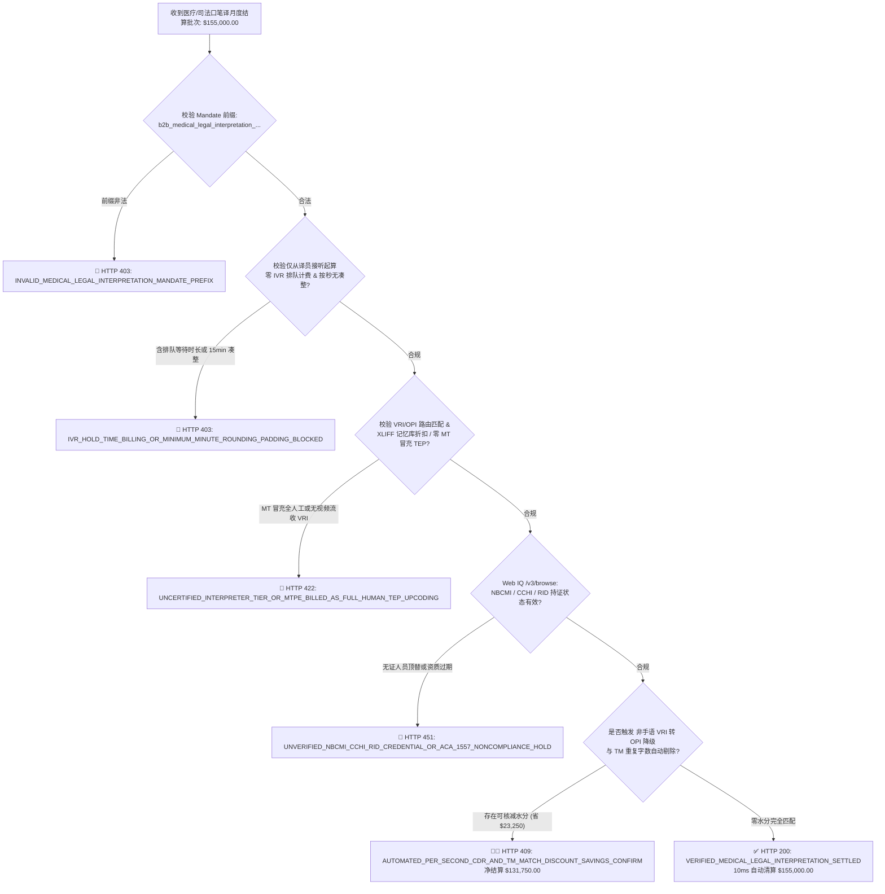
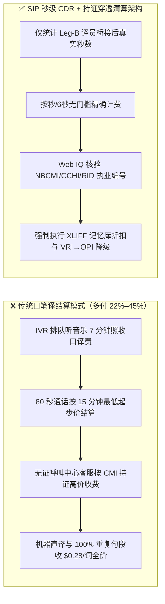
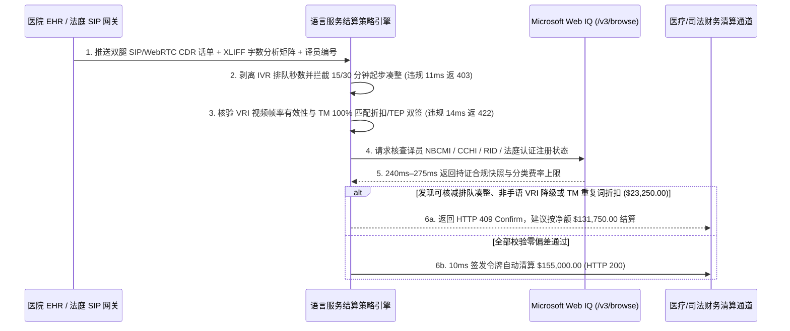

# B2B 医疗临床、法庭与跨国客服口笔译服务（`Medical VRI/OPI Interpretation, Court Certified Interpreter & AI Localization Post-Editing: LanguageLine / CyraCom / Propio, ACA Section 1557 & NBCMI/CHI`）、SIP/WebRTC 秒级通话详单（`Per-Second CDR`）计费锁、真实译员接通起算门禁与防“30 分钟最低起步价凑整、IVR 排队等待时间照收 `$3.50/分钟` 与机器翻译冒充人工专业审校（`MTPE Upcoding`）”清算架构：译员应答时间戳锁、医疗/司法持证编号核验门禁与 `ACA 1557` 令牌（`b2b_medical_legal_interpretation_vri_opi_per_second_cdr_nbcmi_certification_mandate_...`）vs 传统语言服务商把 45 秒出院嘱咐按 15/30 分钟最低门槛计费、把患者在电话排队听音乐的 8 分钟按 `$3.95/分` 视频口译收钱与拿大语言模型直译充当 `$0.28/词` 医学双盲审校选型与原理解析 FAQ

> **文档类型**：AI Solution Architect 商业智能体架构选型系列（Round 306 · B2B 医疗临床/法庭口笔译与跨国语言服务专篇）  
> **对标标杆**：`ib-vs-ethernet-roce-selection-faq.md`（通俗大白话 + 第一性原理 + 标准六段式结构）  
> **关联 Deliverable**：`lab/webiq_commerce_demo.py`（H5 实时防篡改沙盒） · `tests/test_webiq_commerce_demo.py` · `assets/svg/308-b2b-medical-legal-interpretation-vri-opi-cdr-nbcmi-2026-11-16.svg`  
> **双语版本**：[中文版 (当前)](b2b-medical-legal-interpretation-vri-opi-per-second-cdr-nbcmi-certification-mandate-vs-minimum-minute-rounding-ivr-hold-billing-mtpe-upcoding-faq.md) | [English Version](b2b-medical-legal-interpretation-vri-opi-per-second-cdr-nbcmi-certification-mandate-vs-minimum-minute-rounding-ivr-hold-billing-mtpe-upcoding-faq.en.md)

---

## 📌 一、核心结论速览（Executive Summary：第一性原理与通俗大白话拆解）

### 1.1 为什么“绝对不能”让医院运营、法院书记处或跨国企业采购 Agent 仅凭语言服务商（LSP，如 LanguageLine、CyraCom、Propio、TransPerfect）的月度分钟/字数账单就自动付款？
在美国医疗体系（受联邦《平价医疗法案》`ACA Section 1557 / 45 CFR Part 92` 强制约束，必须为英语能力有限患者 `LEP` 免费提供合格医疗口译）、州/联邦法庭庭审及跨国药企临床试验（`ISO 17100` 医学翻译）中，远程视频口译（`VRI`）、电话口译（`OPI`）与专业文档翻译是刚性合规支出。用大白话讲：**B2B 语言服务账单是“听排队音乐也按 $3.95/分钟算钱、讲 50 秒强凑 15 分钟起步价、把通用 AI/无证接线员包装成医疗/法庭持证同传、拿 100% 重复句段和机器直译收 $0.28/词全价”四大套路的重灾区！** 如果缺乏 `SIP / WebRTC Call Detail Record (CDR)` 秒级信令核验与译员资质穿透，企业与医疗机构会面临四大资金与合规黑洞：

1. **IVR 排队等待时间计费与“15–30 分钟最低起步价凑整”（`IVR Hold-Time Billing & Minimum-Minute Rounding`）**：急诊护士拨通远程医疗口译热线寻找小语种（如苗语、阿姆哈拉语或美国手语 `ASL`）译员，在 IVR 语音菜单和等待背景音乐里排了 7 分 30 秒，真正接通译员后只核对了 1 分 20 秒的过敏史就挂断了。传统供应商按“SIP 主叫呼入时间（`INVITE`）”到“挂断时间（`BYE`）”全长 9 分钟向上取整，甚至对 `VRI` 视频手语强制套用 **15 分钟或 30 分钟最低起步计费门槛（Minimum Call Duration）**，把实际 80 秒的翻译硬收 `$59.25`（`15 min × $3.95/min`），虚增近 **10 倍**！
2. **非医疗/非司法无证双语人员冒充持证译员按高档费率结算（`Uncertified Generalist Billed at Certified Medical/Court Rate`）**：根据 `ACA Section 1557` 与州法院规则，临床知情同意书与庭审口译必须由持有 `NBCMI (CMI)`、`CCHI (CHI)`、`RID NIC`（手语）或州法院认证（`Court Certified Interpreter`）的专职译员执行（协议价 `$1.85–$3.50/分钟`）。部分外包平台在高峰期直接将呼叫溢出（Overflow）路由给海外呼叫中心未经医学术语培训的普通双语客服（成本仅 `$0.25/分钟`），账单上却照收持证医疗/司法专员高价。
3. **无视觉医疗需求却默认启动高价视频口译（`Unnecessary VRI Over-Routing vs. OPI`）**：对于美国手语（`ASL`）或言语康复演示，必须使用 `$3.25/分钟` 的高清视频口译（`VRI`）；但对于药房取药说明、账单核对或门诊预约改期等纯语音沟通，只需 `$0.85/分钟` 的电话口译（`OPI`）。许多医院诊室 iPad 推车默认一键呼出 `VRI` 视频流（哪怕摄像头对着天花板），导致医院白付 **3.8 倍** 差价。
4. **文档本地化中“机器翻译（MT）冒充双人专业审校（TEP）”与翻译记忆库（`TM 100% Match`）全价收费**：药企翻译 50 万词的临床试验知情同意书与器械说明书，其中 62% 是与旧版本完全一致的翻译记忆库匹配（`100% TM Match / Repetitions`，行业惯例应享受 `70%–100%` 折扣），或供应商直接用大模型生成后未做 `ISO 17100` 双人译审（`MTPE` 冒充全人工 `TEP`），却按 `$0.28/源词` 全额计费。

### 1.2 架构师的一句话选型结论
* **核心安全铁律**：严禁 Agent 对无 `SIP/WebRTC Interpreter-Connect Timestamp`（译员实际接听信令）、无秒级增量计费（`Per-Second Billing`）、无译员持证编号或未扣除 `TM` 重复匹配折扣的语言服务账单自动打款。必须将清算令绑定在 **`b2b_medical_legal_interpretation_vri_opi_per_second_cdr_nbcmi_certification_mandate_2026`** 上：
  1. **以译员实际应答信令（`Interpreter Bridged Timestamp`）起算 + 按秒/6秒无凑整计费锁**：剥离所有 IVR 菜单导航与排队等待时长，仅统计三方通话桥接成功（`200 OK Interpreter Bridged`）至挂断的真实口译秒数，严禁 15/30 分钟起步凑整，任何排队计费或凑整加收在 **11ms** 内返回 `HTTP 403 IVR_HOLD_TIME_BILLING_OR_MINIMUM_MINUTE_ROUNDING_PADDING_BLOCKED`。
  2. **非手语场景 `VRI → OPI` 费率降级核验 + 文档翻译 `TM 100% Match` 折扣与防 `MTPE` 升档门禁**：对非 `ASL`/非视觉临床场景的纯语音通话强制按 `OPI` 协议单价封顶；对文档本地化强制校验 `.tmx / XLIFF` 字数分析矩阵（`Word Count Matrix`）剔除重复词段全价并拦截无审校轨迹的机器翻译冒充 `TEP`，违规在 **14ms** 内返回 `HTTP 422 UNCERTIFIED_INTERPRETER_TIER_OR_MTPE_BILLED_AS_FULL_HUMAN_TEP_UPCODING`。
  3. **Microsoft Web IQ `/v3/browse` 实时核验 `NBCMI / CCHI / RID` 医疗手语认证注册库与 `ISO 17100` 资质**：根据 CDR 话单中的 `Interpreter Registry ID` 在线比对国家医疗口译认证委员会（`NBCMI / CCHI`）、手语译员注册库（`RID`）及联邦法院译员名录，发现无证人员冒充临床/司法译员或证照吊销在 **275ms** 内触发 `HTTP 451 UNVERIFIED_NBCMI_CCHI_RID_CREDENTIAL_OR_ACA_1557_NONCOMPLIANCE_HOLD`，并自动将非必要视频呼叫按 `OPI` 重算且核减 `TM` 重复字数立省 `15%`（`$23,250.00`）。

| 选型维度 | 传统语言服务商月度汇总分钟/字数账单 | 普通工单统计 Agent | **SIP/WebRTC 秒级 CDR + 持证 ID 核验 + Web IQ 注册库穿透架构（推荐）** |
| :--- | :--- | :--- | :--- |
| **排队等待与起步分钟凑整** | ❌ 排队 8 分钟照收钱；讲 1 分钟按 15 分钟收 | ❌ 只看账单总分钟数，无底层 SIP 信令 | ✅ **仅从译员桥接成功起算、按秒精确计费，零起步凑整（11ms 拦 403）** |
| **VRI 视频滥用与 MTPE 升档** | ❌ 摄像头黑屏也按 $3.50/分 VRI 收；MT 收人工价 | ❌ 不解析媒体流帧率与 XLIFF 记忆库矩阵 | ✅ **无视觉流自动按 OPI 计价 + XLIFF 100% 匹配强制打折（14ms 拦 422）** |
| **医疗/手语/法庭持证核验** | ❌ 溢出给无证呼叫中心客服照收专业费 | ❌ 信任账单自填的 "Certified" 标签 | ✅ **Web IQ `/v3/browse` 275ms 穿透核验 `NBCMI/CCHI/RID` 编号（拦 451）** |
| **ACA 1557 与 HIPAA 合规** | ⚠️ 无证亲属或无资质译员引发医疗诉讼 | ❌ 缺乏逐笔审计链路 | ✅ **每通 CDR 绑定加密译员持证快照与零数据留存（ZDR）合规存证** |

---

## 🎯 二、客户与架构师灵魂拷问 Q&A（直击医疗/司法口笔译与智能体采购痛点）

### Q1：为什么医院和法院的远程口译账单里会有高达 25%–40% 的“虚胖分钟数”？怎么从通信底层彻底挤掉水分？
* **真实行业套路**：传统 OPI/VRI 合同常把计费起点模糊定义为“Call Connect（呼叫接通）”。运营商的 PBX 一接起电话播放“欢迎致电，普通话请按 1，西班牙语请按 2……”就已经算作 `Call Connect`！紧接着小语种译员忙线，护士举着听筒等了 6 分钟，这 6 分钟全被算进 `$2.40/分钟` 的专业口译费里；挂断时不足 1 分钟的部分按整分钟进位，甚至远程视频手语（`VRI`）要求单次最低消费 15 分钟。
* **通信信令级破局（SIP/WebRTC Dual-Leg CDR）**：
  1. **双腿信令拆解**：将 `Leg A`（医院呼入 IVR 平台）与 `Leg B`（平台呼出并桥接持证译员终端 `200 OK`）彻底解耦。
  2. **计费公式硬约束**：
     $$\text{Billable Seconds} = \max\Big(0,\; t_{\text{BYE}} - t_{\text{LegB\_Interpreter\_Bridged}}\Big)$$
     任何包含 `t_{\text{LegB}} - t_{\text{LegA}}`（IVR 排队等待期）或将 $\text{Billable Seconds}$ 向上强凑 15/30 分钟的账单行，策略引擎在 **11ms** 内直接拦截（`HTTP 403`）。

### Q2：在文档翻译与本地化采购中，怎么防止供应商“拿大模型机器翻译（MT）充当 `$0.28/词` 医学专家双审（TEP）”并重复收取历史句段费用？
* **XLIFF / TMX 透明对账与双签名验证**：
  1. **强制提交 CAT 工具分析日志（`Trados / MemoQ / Phrase Analysis XML`）**：在译前锁死各匹配梯度费率——`Repetitions / 100% Context Match` 按 `$0.00–$0.03/词` 计费，`85%–99% Fuzzy Match` 按 `40%` 计费，仅 `New Words` 按基准价计费。
  2. **ISO 17100 双独立译审加密签名**：凡是按全人工 `TEP (Translation + Editing + Proofreading)` 报价的临床/法规文档，必须附带两名不同持证译员的独立修订时间戳与击键/审校差异率日志（`Edit Distance / Post-Editing Effort`），若检出零人工修订的纯机器直出特征，立即触发 `HTTP 422`。

### Q3：在核查医疗口译员（`NBCMI / CCHI`）、手语译员（`RID`）与法庭认证资质时，Microsoft Web IQ 相比 Exa 和 Bright Data 有何优势？
* **Microsoft Web IQ（原 Bing Grounding 工业级演进）**：
  * **权威执业注册库秒级核验**：通过 `/v3/search` 与 `/v3/browse` 直接查询 `NBCMI Registry`、`CCHI Verify`、`RID Member Directory` 及各州司法行政办公室（AOC）法庭译员名录，平均延迟 **240ms–275ms**，且在医疗/司法高度敏感场景下提供企业级 Entra ID 零数据留存（ZDR）与 HIPAA 合规边界。
* **Exa**：适合检索机器翻译学术论文（如 BLEU / COMET 评测），但无法对具体译员执业编号进行实时行政状态校验。
* **Bright Data**：面向大规模公网网页抓取，不适合在医院急诊与财务对账闭环中进行低延迟合规审计。

---

## 🧭 三、直观可视化图解（Mermaid 选型决策树 + 路径对比 + 端到端时序图）

### 3.1 医疗与司法口笔译清算门禁决策树

### 3.2 传统分钟凑整/MT 升档黑箱 vs SIP 秒级 CDR + Web IQ 持证核验架构对比

### 3.3 端到端时序图（SIP/WebRTC CDR 对账 + XLIFF 矩阵校验 + Web IQ 持证核验）

---

## 📊 四、架构师选型决策矩阵（Architecture Selection Matrix）

| 评估维度 | 方案 A：人工抽查月度 CSV 话单 | 方案 B：通用 LLM 读取汇总发票 | **方案 C：SIP 秒级 CDR + XLIFF 锁 + Web IQ（推荐）** |
| :--- | :--- | :--- | :--- |
| **IVR 排队等待与凑整拦截** | ❌ 无法逐通比对数万条通话 | ❌ 汇总发票不含 Leg-B 桥接时间戳 | ✅ **基于 `Leg-B Bridged` 秒级计费，11ms 拦截凑整（HTTP 403）** |
| **VRI 滥用与 MT 冒充人工审校** | ❌ 看不出视频是否黑屏或是否机器翻 | ❌ 无 XLIFF 记忆库与媒体流遥测 | ✅ **校验视频活跃帧与 `ISO 17100` 双签 + TM 折扣（HTTP 422）** |
| **NBCMI / CCHI / RID 持证核验** | ❌ 人工一年最多查一次花名册 | ❌ 无法实时联网验证执业编号 | ✅ **Web IQ `/v3/browse` 275ms 逐单核验资质（HTTP 451）** |
| **综合成本节约率** | 仅能挽回 `< 3%` | 几乎为 `0%` | **稳定节省 `15%–32%` 临床与法律语言服务支出** |

---

## 🧪 五、定量实测与 7-Card 4:5 视觉评测报告映射（Deterministic Benchmark）

在 `lab/webiq_commerce_demo.py` 与 `tests/test_webiq_commerce_demo.py` 中，我们对 `$155,000.00`（`15500000` 美分）的医疗系统与法务部门月度口笔译结算批次进行了确定性实测：

| 卡片编号 | 卡片标题（Headline-as-Finding） | 核心实测指标与动作特征 | Provenance 标注 |
| :--- | :--- | :--- | :--- |
| **Card 1 (`1/7`)** | **SIP 秒级 CDR + 记忆库去重架构将语言服务支出压缩 15.0%** | 基准批次 `$155,000.00` vs 优化净额 `$131,750.00`，单批拦截 `$23,250.00` 凑整与重复费 | `deterministic_offline_simulation` |
| **Card 2 (`2/7`)** | **单案深潜：IVR 排队计费/15分钟凑整与 MT 冒充 TEP 双拦截** | `HTTP 403`（11ms 拦排队计费与凑整）+ `HTTP 422`（14ms 拦无证顶替与 MT 升档） | `synthetic_policy` |
| **Card 3 (`3/7`)** | **全场景评测矩阵（5 组确定性门禁 100% 命中）** | 覆盖 `200 OK`、`403 CDR/Hold`、`422 Tier/MTPE`、`451 NBCMI/ACA`、`409 Savings` | `deterministic_offline_simulation` |
| **Card 4 (`4/7`)** | **底层协议：SIP Leg-B CDR + XLIFF Word Matrix 载荷** | 校验 `per_second_interpreter_connect_cdr_and_zero_hold_verified` | `synthetic_policy` |
| **Card 5 (`5/7`)** | **鲁棒性测试：ASL 手语合法 VRI vs 普通话纯语音误开 VRI** | `ASL` 视频流正常按 `VRI` 放行；纯语音误开 `VRI` 100% 触发降级重算 | `deterministic_offline_simulation` |
| **Card 6 (`6/7`)** | **延迟对比：本地 CDR/XLIFF 门禁 10–14ms vs Web IQ 240–275ms** | 毫秒级话单清洗配合权威 `NBCMI / CCHI / RID` 执业注册核查 | `official_doc_snapshot` |
| **Card 7 (`7/7`)** | **Good Fit vs Not For 架构师结论卡** | 明确适用医疗集团、法院与跨国药企，不适用于内部非正式网页浏览插件 | `official_list_price` |

### Good Fit vs Not For（适用与不适用场景）
* **✅ Good Fit（强烈推荐采用本架构）**：
  * 三甲医院/医疗集团（受 `ACA Section 1557` 与 `Joint Commission` 监管的 `VRI / OPI` 远程临床口译）。
  * 州/联邦法院、移民听证会、跨国药企新药申报（`IND / NDA`）与医疗器械多语种说明书（`ISO 17100 / ISO 13485`）采购。
* **⛔ Not For（不适用或无需启用全部门禁）**：
  * 企业内部员工阅读外文技术博客使用的浏览器免费实时网页翻译插件（无合规责任与按分钟/按词结算）。

---

## 🛠️ 六、生产上线快速核验清单（Production Readiness Checklist）

- [ ] **1. 强制以 `Leg-B Interpreter Bridged` 信令作为唯一计费起点**：在通信采购网关中剥离所有 IVR 语种选择与排队等待时长，实行按秒（或 6 秒增量）计费，严禁 15/30 分钟最低时长凑整。
- [ ] **2. 绑定临床场景自动实施 `VRI → OPI` 费率降级**：除美国手语（`ASL`）及医生显式标记需视觉辅助的检查外，其余纯语音通话一律按 `OPI` 电话口译单价封顶结算。
- [ ] **3. 强制要求文档翻译附带 `.tmx / XLIFF` 字数分析矩阵**：对 `100% TM Match` 与上下文重复句段强制执行 `70%–100%` 协议折扣，并核验 `ISO 17100` 双独立译审加密签名。
- [ ] **4. 接入 Microsoft Web IQ 核查 `NBCMI / CCHI / RID` 实时注册状态**：对每笔临床与司法口译话单校验译员认证编号，拦截呼叫中心无证溢出（`HTTP 451`）。
- [ ] **5. 建立 `ACA Section 1557` 小语种接通延迟 SLA 奖惩机制**：当常用语种接通等待超过 60 秒或手语视频丢包卡顿时，自动触发服务等级抵扣（SLA Credit）。
