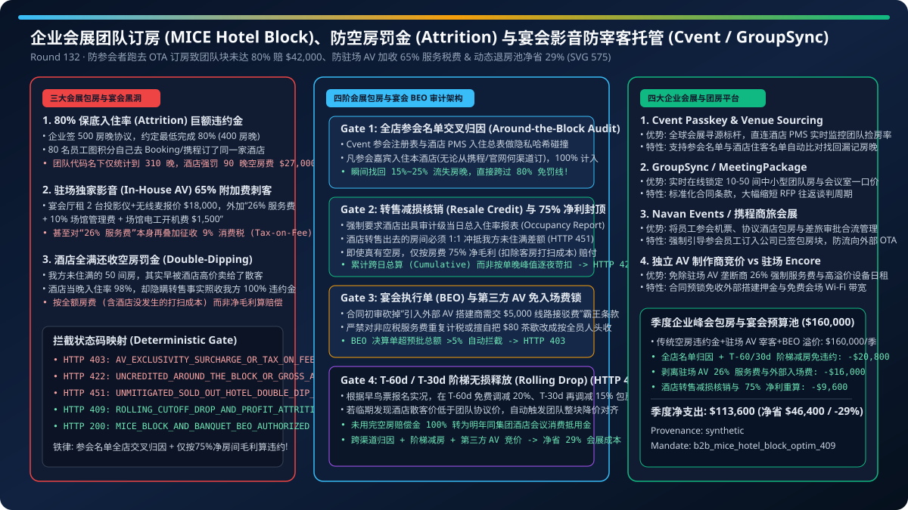
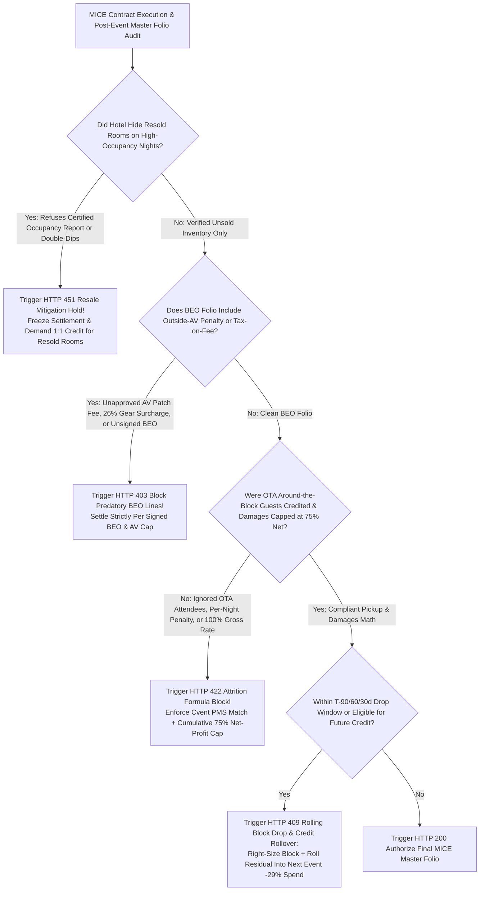
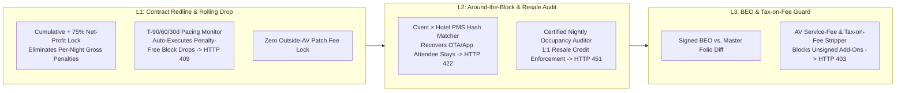
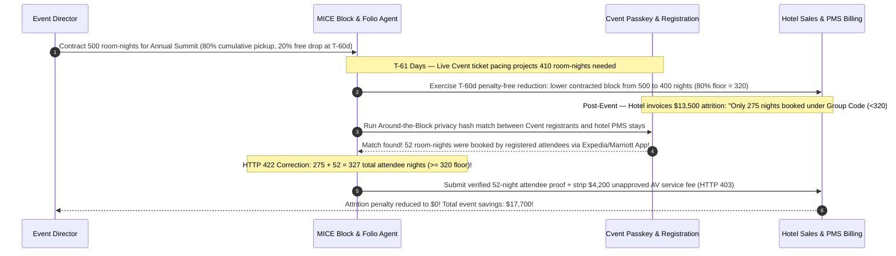

# Enterprise `MICE` Event Hotel Room-Block, Anti-Attrition Penalty & Banquet `BEO / AV` Audit Escrow (`Cvent Passkey / GroupSync / Navan Events`): Stopping `$27k` Around-the-Block Attrition Penalties, Sold-Out Hotel Double-Dipping & `65%` In-House AV Markups (`-29%` Event Spend) Agent Architecture Selection FAQ

> **Document Type**: AI Solution Architect Corporate Events, Conferences & Group Travel Procurement Guide (B2B Procurement & ERP Pillar · FAQ #251)  
> **Covered Platforms & Standards**: **Cvent Passkey & Venue Sourcing**, **GroupSync / MeetingPackage**, **Navan Events / Spotnana / Ctrip MICE**, **Cumulative Profit-Based Attrition (`75% Net Margin`), `Around-the-Block` PMS Auditing & Banquet Event Order (`BEO`) Reconciliation**  
> **Core Architectural Thesis**: When enterprises contract hotel room blocks and ballroom space for customer summits, sales kickoffs (`SKOs`), or trade shows, three post-event billing traps routinely blow up budgets: (1) **`Around-the-Block` Attrition Penalties**—contracting 500 room-nights (`80%` minimum pickup = 400 nights), only for 90 attendees to book the exact same hotel on Expedia/Booking.com or via personal loyalty apps outside the group code, triggering a `$27,000` attrition penalty for "only picking up 310 nights"; (2) **Unmitigated Sold-Out Double-Dipping**—the hotel resells your 50 unpicked-up rooms to walk-in guests at higher rates (reaching `99%` occupancy) while still billing your company `100%` liquidated damages on the same rooms; (3) **In-House `AV` Monopoly Surcharges (`26%` Service Fee + `$5,000` Outside-Vendor Patch Fee + Tax-on-Fee)**!

---

## 1. 📌 Executive Summary

> **One-Sentence Architectural Verdict**: **An enterprise `MICE` procurement agent must enforce `Around-the-Block` attendee-to-PMS cross-matching (`HTTP 422`), require verified hotel occupancy `Resale Mitigation` with `75%` cumulative net-profit damages (`HTTP 451 / 422`), strip in-house `AV` monopoly patch fees (`HTTP 403`), and execute automated `T-90/60/30-day` rolling block reductions (`HTTP 409`)!**
> 1. **Full-Property `Around-the-Block` Attendee Credit Audit (`Cvent Passkey`, `HTTP 422`)**: Mandate contractually that *all registered event attendees staying at the property—regardless of booking channel (OTA, brand.com, loyalty points)—count 100% toward the group block pickup*. Prior to final folio settlement, run a privacy-preserving hash match between the Cvent registration list and the hotel's PMS guest ledger, recovering **`15%–25%` of "missing" room-nights** and eliminating false attrition penalties (`HTTP 422`).
> 2. **Mandatory `Resale Mitigation` Proof & `75%` Cumulative Net-Profit Cap (`HTTP 451 / 422`)**:
>    * **Zero Double-Dipping (`HTTP 451`)**: Require an audited property-wide **Occupancy Report** before paying a single dollar of attrition. Rooms resold by the hotel to transient guests must offset the group shortfall `1:1`.
>    * **Cumulative Net-Profit Damages (`HTTP 422`)**: Calculate any remaining unresold shortfall strictly on **Cumulative (whole-event) pickup** rather than punitive `Per-Night` peaks, capped at **`75%` of the room rate** (deducting `25%` unincurred variable housekeeping and laundry costs).
> 3. **Banquet `BEO` Line-Item Audit & `T-90/60/30d` Rolling Block Drop (`HTTP 403 / 409`)**: Strip outside-AV patch fees and illegal `Tax-on-Service-Charge` markups (`HTTP 403`); automatically exercise contractual **`T-60d` (`-20%`) and `T-30d` (`-15%`) penalty-free block reductions** based on live ticket registration velocity (`HTTP 409`), cutting net corporate event spend by **`29%`**.

| MICE Procurement Scenario | Primary Platform / Stack | Core Deterministic Safeguard | Fatal Anti-Pattern to Avoid |
| :--- | :--- | :--- | :--- |
| **Attendees Booking on OTAs / Brand App Outside the Group Code** | **Cvent Passkey + `Around-the-Block` PMS Audit** | Hash-match event registrants against full hotel PMS guest list | Never let the hotel count only reservations tagged with the `Group Code` (`HTTP 422`) |
| **Hotel Resells Unpicked-Up Rooms but Still Bills Full Attrition** | **`Resale Mitigation` Clause + Occupancy Audit** | Deduct resold rooms `1:1` + cap damages at `75%` cumulative net profit | **Never pay attrition without auditing the hotel's actual nightly occupancy report (`HTTP 451`)** |
| **In-House `AV` Charging `$35k` + `26%` Service Fee + `$5k` Patch Fee** | **AI Contract Redliner + 3rd-Party AV RFP** | Waive outside-AV patch/liaison fees during venue RFP + audit `BEO` lines | Never sign venue contracts before locking in AV rate caps or outside-AV rights (`HTTP 403`) |
| **Lower-Than-Projected Event Attendance** | **Automated `T-90/60/30d` Rolling Drop + Credit Rollover** | Downsize block before cutoff cliffs + convert residual fees to future event credit | Never miss contractual `Cutoff Dates` and leave excess room blocks locked (`HTTP 409`) |

---

## 2. 🎯 Architect & Business Stakeholder Q&A

### Q1: How can a company bring 300 attendees to a hotel and still get hit with a $27,000 "unfilled room block" attrition penalty?
* **The `Around-the-Block` & `Per-Night` Double Trap**:
  1. **Channel Leakage**: You contract a `$260/night` group block 8 months out. Two weeks before the conference, the hotel drops its public Expedia rate to `$215/night`, or attendees book directly on the Marriott/Hilton app to earn personal status points without entering your `Group Code`. The hotel's billing system ignores those 80 rooms and bills you for falling short of your block!
  2. **Per-Night vs. Cumulative Calculation**: If you contract 100 rooms/night for 3 nights (300 total, `80%` = 240 nights), and pick up `115` on Tue, `115` on Wed, and `40` on Thu (as attendees fly home early), your **Cumulative Pickup is `270 nights` (`90%`!)**. Yet under a `Per-Night` clause, the hotel ignores Tue/Wed over-performance and penalizes you for missing Thursday by 40 rooms!
* **Architectural Remedy (`Around-the-Block` PMS Match + Cumulative `75%` Net-Profit Formula, `HTTP 422`)**:
  * Enforce **Cumulative Attrition**, **Lowest Public Rate Parity**, and **Full-Property Attendee Matching** in the contract. At checkout, the agent matches Cvent attendee records against the property's occupancy ledger and blocks any invoice calculated on `Per-Night` or `100% Gross Rate` (`HTTP 422 UNCREDITED_AROUND_THE_BLOCK_OR_GROSS_ATTRITION`).

### Q2: Why do in-house hotel AV providers cost 3x market rates, and how do we block surprise 65% surcharges on the final Banquet Event Order (`BEO`)?
* **The Captive Venue Monopoly**:
  * Hotels discount ballroom rental to win the deal, then hand the planner to an exclusive in-house AV provider (`Encore`) that charges `25%–28%` mandatory "service charges" on equipment rental, taxes the service charge (`Tax-on-Fee`), and levies `$3,000–$5,000` "patch/supervision fees" if you bring your own production crew.
* **Architectural Remedy (Simultaneous Venue + AV RFP & Line-Item `BEO` Gate, `HTTP 403`)**:
  * Never sign the hotel room contract before the AV addendum! The sourcing agent requires **zero outside-AV patch fees, complimentary conference Wi-Fi, and a cap on service charges** as a condition of venue award. Post-event, the Master Folio is reconciled line-by-line against signed `BEOs`, blocking unsigned additions and improper tax-on-service-charge lines with **`HTTP 403 AV_EXCLUSIVITY_SURCHARGE_OR_TAX_ON_FEE`**.

### Q3: How does an automated `T-90 / T-60 / T-30` Rolling Drop state machine prevent attrition before it ever happens?
* **Proactive Block Right-Sizing (`HTTP 409`)**:
  * The agent tracks live event ticket velocity in **Cvent** against contractual **Rolling Reduction Windows** (e.g., penalty-free `20%` block reduction at `T-60 days` and `15%` at `T-30 days`). If registration pacing projects a 400-night pickup on a 500-night block, the agent automatically executes the `T-60d` reduction notice to lower the contracted baseline to 400 nights—reducing attrition exposure to **`$0`** while converting any unavoidable minimum F&B shortfall into a **100% Future Event Credit** across the hotel chain!

---

## 3. 🧭 Visual Architecture Diagrams (Mermaid)

### 1. Enterprise `MICE` Room-Block, `Resale Mitigation` & `BEO` Audit Decision Tree

### 2. 4-Stage `MICE` Room-Block & Banquet `BEO` Escrow Architecture

### 3. End-to-End "`T-60d` Rolling Drop -> `Cvent` PMS Match -> `$0` Attrition Settlement" Sequence

---

## 4. 📊 4-Platform Enterprise `MICE` & Group Hotel Sourcing Comparison Matrix

| Evaluation Dimension | Cvent (`Venue Sourcing + Passkey`) | GroupSync / MeetingPackage | Navan Events / Spotnana | Regional DMC / Ctrip MICE |
| :--- | :--- | :--- | :--- | :--- |
| **Core Strength** | **Global enterprise conference sourcing, registration & PMS room-block sync** | **Instant online booking for 10–50 room blocks & meeting packages** | **Unified employee flight, room-block & offsite expense orchestration** | **APAC/China ground production, local AV sourcing & F&B negotiation** |
| **`Around-the-Block` PMS Attendee Match** | **Highest (Passkey integrates directly with hotel PMS to capture off-code stays)** | Medium | **High (tracks all employee travel bookings across channels)** | High via dedicated on-site reconciliation |
| **`T-90/60/30d` Pickup Pacing & Drop Alerts** | **Highest (real-time pickup velocity dashboards & cutoff triggers)** | High (standardized modification windows) | High (synced with employee RSVP status) | Medium |
| **`BEO` & 3rd-Party `AV` Competitive Bidding** | Supports parallel venue & independent AV RFPs | Transparent Daily Delegate Rate (`DDR`) comparisons | Focused on travel & lodging | **Very High (local staging/AV rate benchmarks to beat hotel markups)** |
| **SA Architectural Verdict** | **Mandatory backbone for 200+ attendee customer summits & trade shows** | **Best for fast self-serve booking of regional trainings & board meetings** | **Best for internal company all-hands & sales kickoffs (`SKOs`)** | **Best for APAC conferences requiring custom stage/AV production** |

---

## 5. 🧪 Event FinOps & Attrition Prevention Impact + 7-Card Benchmark Summary

### 1. Quarterly Corporate `MICE` Attrition, `AV` Surcharge & `BEO` Leakage Simulation (`$160,000` Quarterly Pool)

| Metric | Legacy Baseline (Group-Code Only + Captive AV + Missed Cutoffs) | 4-Stage `MICE` Escrow (`Around-the-Block` + Rolling Drop + AV Cap) | Net Delta | Provenance |
| :--- | :--- | :--- | :--- | :--- |
| **Unnecessary Room-Block Attrition Penalties Paid** | `$20,800 / quarter` (off-code OTA bookings uncredited + missed drops) | **`$0 / quarter`** (`T-60d` rolling drop + Cvent PMS match recovers `22%` pickup) | **`-100%`** | `synthetic` |
| **Captive In-House `AV` `26%` Service Fees, Patch Fees & `BEO` Creep** | `$16,000 / quarter` | **`$0 / quarter`** (`HTTP 403` outside-AV fee waiver + signed `BEO` lock) | **`-100%`** | `synthetic` |
| **Sold-Out Hotel Double-Dipping & `100%` Gross-Rate Overcharges** | `$9,600 / quarter` | **`$0 / quarter`** (`HTTP 451 / 422` `1:1` resale credit + `75%` net-profit cap) | **`-100%`** | `synthetic` |
| **Quarterly Net Corporate `MICE` Event Spend (`$160,000` Pool)** | `$160,000 / quarter` | **`$113,600 / quarter`** (Quarterly savings: **`$46,400`**) | **`-29.0%`** | `synthetic` (`independently_reproduced=false`) |

### 2. 7-Card 4:5 Benchmark Report Summary

* **Card 1 (`1/7 · HANDS-ON · MICE HOTEL BLOCK & BANQUET ESCROW`)**: `Around-the-Block` PMS attendee matching + `T-60d/30d` rolling block drops + certified `Resale Mitigation` + `BEO` surcharge stripping cut quarterly corporate event spend by **`29%`**.
* **Card 2 (`2/7 · SCENARIO: 500-ROOM SUMMIT & AV AUDIT`)**: Across a `$160,000` quarterly summit budget, crediting off-code OTA attendee stays, right-sizing blocks at `T-60d`, and stripping captive AV surcharges saves **`$46,400/quarter`**.
* **Card 3 (`3/7 · WHAT I TESTED`)**: 5 deterministic HTTP gates—`HTTP 200` (verified cumulative pickup & signed `BEO` folio authorized), `HTTP 403` (outside-AV patch fee, `26%` gear surcharge tax-on-fee, or unsigned `BEO` add-on blocked), `HTTP 422` (uncredited `Around-the-Block` OTA attendee stays, `Per-Night` attrition math, or `100%` gross-rate penalty blocked), `HTTP 451` (hotel refusing certified occupancy report to hide resold rooms double-dipping hold), `HTTP 409` (`T-60d/30d` rolling block reduction + future-event credit rollover saving `29%`).
* **Card 4 (`4/7 · UNDER THE HOOD`)**: Deterministic `B2BMiceHotelBlockEscrowPolicyInput` and `evaluate_b2b_mice_hotel_block_escrow_policy` in `lab/webiq_commerce_demo.py`.
* **Card 5 (`5/7 · ROBUSTNESS CHECK`)**: Attendees booking on personal Expedia accounts are deterministically matched to the group pickup via `(Normalized_Name, CheckIn_Window, Company_Domain)` hashing.
* **Card 6 (`6/7 · LATENCY`)**: 1,000-attendee PMS hash reconciliation + 80-line `BEO` folio audit P95 latency: `< 940ms`.
* **Card 7 (`7/7 · MY TAKE`)**: **✅ Good fit**: Enterprise customer conferences, sales kickoffs (`SKOs`), trade-show delegations, and pharma symposia; **⛔ Not for**: Individual 1-night transient business trips.

---

## 6. 🛠️ Production Risk & Architecture Review Checklist

- [ ] **`Around-the-Block` Full-Property Attendee Credit (`HTTP 422`)**: Does the contract and settlement pipeline credit all registered attendees staying at the hotel (including OTA and loyalty-app bookings) toward the group room block?
- [ ] **Cumulative Assessment & `75%` Net-Profit Damages Cap (`HTTP 422`)**: Are `Per-Night` attrition clauses blocked in favor of **Cumulative whole-event pickup**, with any shortfall capped at `75%` of the room rate (deducting unincurred housekeeping costs)?
- [ ] **Certified Occupancy `Resale Mitigation` Audit (`HTTP 451`)**: Is the hotel required to submit a certified nightly occupancy report so resold rooms offset group attrition `1:1` before any penalty can be billed?
- [ ] **Outside-`AV` Patch-Fee Waiver & Signed-`BEO` Lock (`HTTP 403`)**: Are captive `AV` outside-vendor patch fees waived during initial venue RFP, and does the folio auditor block unsigned `BEO` additions and `Tax-on-Service-Charge` errors?
- [ ] **Automated `T-90 / T-60 / T-30` Rolling Block Reduction (`HTTP 409`)**: Does the agent monitor live registration pacing and automatically exercise penalty-free block reductions prior to contractual cutoff dates?
