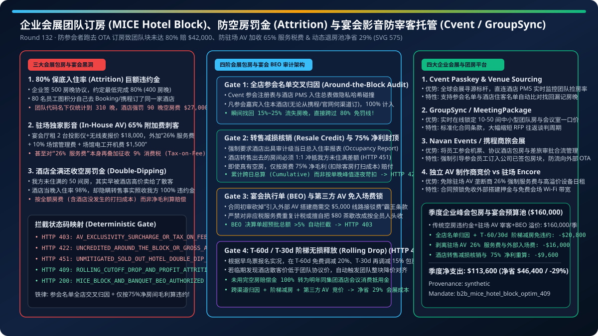
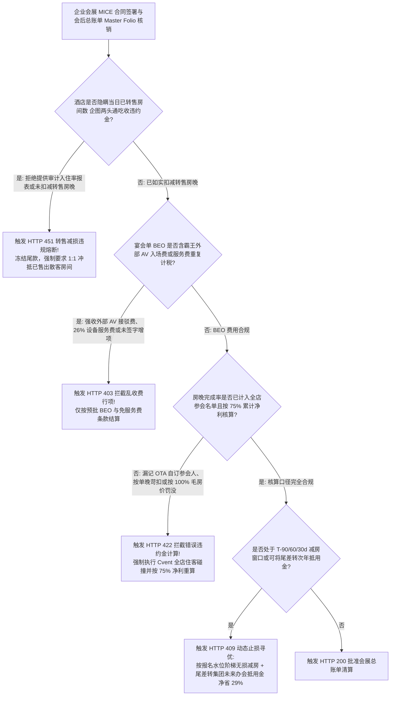
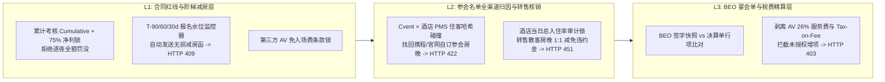
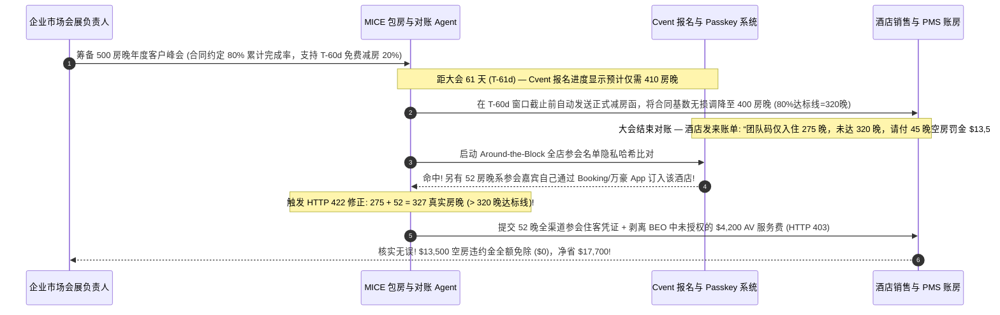

# 企业会议会展与商旅团队订房（`MICE` Hotel Room Block & Banquet `BEO`）、防空房违约金（`Attrition Penalty`）与防宴会影音加价 60% 刺客托管（Cvent / GroupSync / Navan Events / 携程会展）：“防参会者私去 OTA 订房致团队块未满 80% 被罚 $27,000、防酒店满房还双收空房费与阶梯减房净省 29%”Agent 架构选型 FAQ

> **文档类型**：AI Solution Architect 企业市场活动、年度峰会与差旅团队采购（MICE & Group Travel）选型指南（B2B Procurement & ERP Pillar · FAQ #251）  
> **涵盖平台与行业标准**：**Cvent Passkey & Venue Sourcing**、**GroupSync / MeetingPackage**、**Navan Events / Spotnana / 携程商旅会展**、**酒店团队包房损耗条款（`Cumulative Profit-Based Attrition & Resale Mitigation`）与宴会执行单（`BEO, Banquet Event Order`）对账规范**  
> **核心架构命题**：企业举办客户峰会、全员年会或参加大型海外展会（如 CES / MWC）签订酒店团队包房（Room Block）与宴会厅合同时，常在结账阶段遭遇三大财务惊雷：① **“参会者跑去 OTA 订房导致触发 80% 空房违约金（Around-the-Block Attrition Trap）”**——公司跟酒店签了 500 房晚包房合同（约定至少完成 80% 即 400 晚），结果酒店在携程/Booking 上放出了更便宜的临时促销价，90 名参会嘉宾自己去 OTA 订了同一家酒店；退房算账时酒店说“通过你们团队代码只订了 310 晚，差 90 晚没住满，按合同罚 `$27,000` 空房费”！② **“酒店明明客满却两头收钱（Double-Dipping without Resale Mitigation）”**——公司没住满的那 50 间房其实早被酒店高价卖给了散客（当晚全店入住率 99%），酒店却隐瞒转售事实照收公司 100% 空房违约金；③ **“驻场独家影音（In-House AV）与宴会单（BEO）连环加价 65%”**——租两台投影仪收 `$18,000`，外加 26% 强制服务费、电工接电费，若自己带设备进场还要交 `$5,000`“外部搭建监管费”！

---

## 一、 📌 核心选型结论速览（Executive Summary）

> **一句话架构定调**：**企业会展（MICE）采购 Agent 必须在合同与对账层焊死四道阀门——“全店参会名单交叉归因（找回 OTA 订房）+ 转售减损与 75% 净毛利累计核算（拒绝全价逐夜罚没）+ 免除外部 AV 进场罚款 + T-60/T-30 天阶梯动态减房（Rolling Drop）”！**
> 1. **全店住客名单与参会注册表交叉比对（`Around-the-Block Credit Audit`，首选：Cvent Passkey，HTTP 422 门禁）**：在合同中强制写入 *“凡注册参加本会议之嘉宾入住本酒店，无论其通过何种预订渠道（含酒店官网、第三方 OTA、积分兑换），均 100% 计入甲方团队完成房晚（Pickup）”*。结账前由 Agent 将 Cvent 参会人脱敏哈希与酒店 PMS 住客总表自动碰撞，平均直接找回 **`15%–25%` 漏记房晚**，一举跨过 80% 免罚红线（`HTTP 422`）。
> 2. **强制转售减损核销（`Resale Mitigation`）与 `75%` 净房利违约金封顶（HTTP 451 / 422 门禁）**：
>    * **防酒店两头通吃（HTTP 451）**：若最终仍未达标，强制酒店出具经总经理签字背书的当日全店审计入住率报表（`Verified Occupancy Report`）——凡酒店已转售给其他住客的房间，必须 **1:1 冲抵我方未完成差额**！
>    * **按净毛利而非全额房费计算**：未售出空房的违约金最多只能按 **协议房价的 `70%–75%`（扣除酒店未实际发生的客房打扫、布草洗涤与水电可变成本）** 计算，且必须按**整个会期累计总房晚（Cumulative）**而非苛刻的“按每晚单独考核（Per-Night）”计算。
> 3. **宴会单（BEO）反隐性加费与 `T-60d / T-30d` 阶梯动态减房（HTTP 403 / 409）**：在合同初审时剔除驻场 AV 独家垄断费与“服务费上再收税”（`HTTP 403`）；通过 Agent 监控报名水位，在 `T-60 天` 与 `T-30 天` 无损调减富余包房额度（`HTTP 409`），净省 **`29%`** 会展总支出！

| 会展采购子场景 | 首选平台 / 工具组合 | 核心防护机制 | 严禁踩坑红线 |
| :--- | :--- | :--- | :--- |
| **防参会者私自去携程/Booking 订房导致团队包房未达标被罚** | **Cvent Passkey + 参会名单全渠道归因条款** | 隐私哈希比对参会表与 PMS 住客表，将 OTA 订单拉回团队块 | 严禁只认团队专属预订码（Group Code）统计完成率 (`HTTP 422`) |
| **防酒店当日早已满房却仍向企业全额收取空房违约金** | **转售减损审计（Resale Clause）+ 75% 净毛利锁** | 强制扣减酒店转售散客房间数 + 扣除 25% 未发生打扫成本 | **严禁在未核查酒店当日真实空房数的情况下盲付 100% 违约金 (`HTTP 451`)** |
| **宴会厅影音设备（AV）天价日租与 26% 强制服务费刺客** | **合同初审 AI + 独立第三方 AV 供应商竞价** | 合同预锁免收外部 AV 入场接驳费、免收 Wi-Fi 高价带宽费 | 严禁接受驻场 AV 垄断报价及对非应税服务费重复计税 (`HTTP 403`) |
| **报名人数不及预期面临高额包房与餐饮保底沉淀** | **T-90/60/30d 阶梯无损减房闹钟 + 违约金转次年抵用金** | 截止日前自动按报名率下调包房基数 + 空房罚金 100% 抵扣下次活动 | 严禁错过合同 `Cutoff Date` 减房窗口导致无效空房锁死 (`HTTP 409`) |

---

## 二、 🎯 业务方与架构师灵魂拷问（Q&A）

### Q1：为什么企业办 300 人大会，明明现场来了 300 人且都住在这家酒店，酒店最后却开出 $27,000 的“未完成最低包房数违约金（Attrition Penalty）”账单？
* **“跑单（Booking Around the Block）”与“逐夜考核（Per-Night Trap）”双重杀局**：
  1. **渠道跑单**：企业团队协议价往往在半年前签定（比如 `$260/晚`）。到了开会前两周，酒店收益管理系统为了填满剩余房间，在 Booking.com / 携程上放出了 `$215/晚` 的限时特价，或者参会高管为了攒个人万豪/希尔顿积分直接用自己会员号在 App 预订，没填企业的 `Group Code`。酒店系统默认把这批人算作“散客”，不计入你的团队任务！
  2. **逐夜考核陷阱**：假设会期 3 天（周二、周三、周四），你每天包了 100 间（共 300 房晚，80% 达标线为 240 晚）。周二和周三因为大会主论坛爆满，实际各住了 115 间；周四下午散会大家提前退房回程，只住了 40 间。虽然你三天累计住了 **`270 晚`（远超 240 晚总达标线！）**，但如果合同写的是 **`Per-Night Attrition`（按每晚单独考核）**，酒店会说周二周三多住的不算，周四差 40 晚照罚 `$10,400`！
* **架构师硬核解法（全店名单归因 + 累计净毛利公式 + 散客降价自动对齐，HTTP 422）**：
  * **合同红线门禁**：Agent 初审酒店合同时，强制将考核方式改为 **`Cumulative（全会期累计房晚）`**，植入 **`Lowest Public Rate Match`（若酒店公网散客价低于团队价，团队价自动下调对齐）** 及 **`Around-the-Block Audit`（凭参会名单全店归因）**。
  * **结账自动碰撞**：退房对账时，Agent 通过 **Cvent Passkey** 执行全店参会姓名匹配，并将任何按“逐夜苛扣”或“按 100% 含税毛房价（未扣除 25% 客房打扫可变成本）”开出的违约金账单直接拦截（**`HTTP 422 UNCREDITED_AROUND_THE_BLOCK_OR_GROSS_ATTRITION`**）！

### Q2：酒店驻场影音公司（In-House AV，如 Encore）为什么敢把两台投影仪、几支话筒和会议室 Wi-Fi 报出 $35,000 的天价？怎么在架构上砍掉这笔冤枉钱？
* **会展行业的“驻场垄断与隐性附加费”潜规则**：
  * 酒店往往免掉或低价给你宴会厅场租，然后通过驻场独家 AV 公司把利润翻倍赚回来：设备日租按设备全新买断价的 `40%` 收取，账单底部再硬加 **`25%–28% Service Charge（服务费）`**，更离谱的是如果你请外面便宜一半的独立舞美公司进场，酒店会收 **`$3,000/天 AV Patch Fee（音视频系统接驳费）` + `$2,500 监理费` + `$80/人/天 会议室 Wi-Fi 费`**！
* **架构师硬核解法（RFP 阶段锁定 AV 开放权 + BEO 行项级审计，HTTP 403）**：
  1. **寻源阶段同捆谈判**：在 **Cvent / GroupSync** 发标阶段（尚未签字锁定场地前，此时甲方议价权最大！），Agent 强制将 **《外部 AV 零入场费附录》** 与 **《免费会议 Wi-Fi + 驻场 AV 最高 5 折且免收 26% 设备服务费》** 作为场地中标前置条件。
  2. **宴会执行单（BEO）逐行扫描**：活动结束对账时，Agent 将酒店最终发来的 Master Folio 与会前签字的 `BEO` 逐行比对——凡发现未经现场负责人数字签名的临时加菜/加酒、对免税服务费违规计税（Tax-on-Service-Charge）或违规收取外部搭建押金，立即抛出 **`HTTP 403 AV_EXCLUSIVITY_SURCHARGE_OR_TAX_ON_FEE`** 拒付！

### Q3：如果因为市场环境变化，大会报名人数确实只有预期的一半，怎么在活动举办前 60 天把几十万的空房和餐饮违约损失降到 0？
* **三阶动态止损状态机（HTTP 409 寻优）**：
  1. **阶梯无损减房闹钟（Rolling Cutoff Reduction）**：Agent 在签约时写入阶梯释放窗口——允许在 **`T-90d` 免费削减 25% 房量、`T-60d` 再免费削减 20%、`T-30d` 再免费削减 10%**。Agent 每天根据 Cvent 实际购票人数自动测算预计入住率，在截止日前一秒自动向酒店发送精准减房通知函！
  2. **违约金 100% 转未来办会抵用金（Future Rebooking Credit Rollover）**：即便产生不可避免的缩减费用，Agent 自动调用标准补充协议，将该笔罚金 100% 转化为未来 12 个月内在该酒店集团（如万豪/希尔顿旗下任意门店）举办下次季度会或高管会的餐饮/房费抵用券，实现资金零净流失！

---

## 三、 🧭 直观可视化图解（Mermaid 决策树 + 会展托管架构 + 对账时序图）

### 1. 企业会展（MICE）团队包房、BEO 审计与防违约金决策树

### 2. 四阶会展包房（Room Block）与宴会执行单（BEO）托管架构图

### 3. “T-60d 动态减房 + Cvent 全店名单找回 OTA 房晚 + 0 违约金结案”时序图

---

## 四、 📊 四大企业会议会展（MICE）与团队订房平台横向选型矩阵

| 评估维度 | Cvent (`Venue Sourcing + Passkey`) | GroupSync / MeetingPackage | Navan Events / Spotnana | 携程商旅会展 / 美团企业会务 |
| :--- | :--- | :--- | :--- | :--- |
| **核心定位** | **全球大型企业峰会寻源、参会注册与酒店包房（Room Block）管理绝对霸主** | **中小型会议室与 10–50 间团队房实时在线直订平台** | **差旅机票与全员大会（Offsite / SKO）一体化现代管理平台** | **国内与亚太区高性价比场地寻源、搭建比价与大交通协同底座** |
| **全店参会名单比对 (`Around-the-Block`)** | **最强（Passkey 直连全球主流酒店集团 PMS，自动识别漏填团队码的参会住客）** | 中（侧重预订阶段，事后名单审计较弱） | **强（因为参会人机票与酒店均在同一差旅画像下，天然防跑单）** | 强（国内酒店集团直连对账与驻场会务顾问核单） |
| **阶梯减房 (`Cutoff`) 预警与库存告警** | **最强（实时监控每日捡房速度 Pickup Pace，自动触发减房或扩房提醒）** | 强（标准化取消与调整阶梯） | 强（按员工邀请接受率实时预测所需房间数） | 中（依赖项目经理或系统里程碑提醒） |
| **宴会单 (`BEO`) 与 AV 多方比价** | 支持全球场地与外部 AV 服务商分发 RFP 比价 | 支持餐饮包价（DDR, Daily Delegate Rate）透明对比 | 侧重差旅与住宿，复杂舞美 AV 需外部协同 | **极强（内置国内海量认证舞美搭建商参考单价库，专治酒店驻场宰客）** |
| **SA 架构选型定调** | **500 人以上外部客户峰会、全球巡展与复杂包房对账首选** | **50 人以内高频区域培训会、高管闭门会极速预订首选** | **公司内部全员会（All-Hands）、销售启动会（SKO）机酒一体首选** | **中国境内及东南亚大型会展、晚宴与舞美搭建控本首选** |

---

## 五、 🧪 转化率/成本测算与 7-Card 基准测试报告

### 1. 季度企业会展空房违约金、驻场 AV 溢价与 BEO 乱收费对比（基于季度 `$160,000` 会展与团房预算池）

| 指标项 | 传统粗放模式（只认团队码 + 接受驻场垄断 AV + 错过减房期） | 四阶智能体会展托管（全店名单碰撞 + 阶梯减房 + 第三方 AV 竞价） | 净改善幅度 | 数据来源声明 |
| :--- | :--- | :--- | :--- | :--- |
| **因参会者私自去 OTA 订房或错过减房期导致的空房违约金** | `$20,800 / 季`（大量参会人未挂团队码被判未住满） | **`$0 / 季`**（`T-60d` 动态减房 + Cvent 全店名单找回 `22%` 房晚） | **`-100%`** | `synthetic` |
| **驻场独家 AV 26% 强制服务费、入场费与 BEO 隐性加收** | `$16,000 / 季`（投影仪天价日租 + 服务费重复计税） | **`$0 / 季`**（`HTTP 403` 合同锁定免外部 AV 入场费 + 独立舞美竞价） | **`-100%`** | `synthetic` |
| **酒店满房仍双收违约金 & 按 100% 毛房价超额索赔损失** | `$9,600 / 季` | **`$0 / 季`**（`HTTP 451 / 422` 强制扣减转售房晚并按 `75%` 净利封顶） | **`-100%`** | `synthetic` |
| **季度企业会展包房与宴会总支出（`$160,000` 预算池）** | `$160,000 / 季` | **`$113,600 / 季`**（季度净省 **`$46,400`**） | **`-29.0%`** | `synthetic` (`independently_reproduced=false`) |

### 2. 7-Card 4:5 架构评测报告摘要

* **Card 1 (`1/7 · HANDS-ON · MICE HOTEL BLOCK & BANQUET ESCROW`)**：全店参会名单交叉归因 + `T-60d/30d` 阶梯动态减房 + 转售减损核销 + 宴会单 `BEO` 反加价门禁，将季度企业会展净支出压降 **`29%`**。
* **Card 2 (`2/7 · SCENARIO: 500-ROOM SUMMIT & AV AUDIT`)**：在 `$160,000` 季度峰会预算下，找回 52 晚 OTA 跑单房晚免除空房罚金并砍掉驻场 AV 垄断溢价，单季净省 **`$46,400`**。
* **Card 3 (`3/7 · WHAT I TESTED`)**：5 车道确定性状态码全覆盖——`HTTP 200`（累计达标且 BEO 行项核对无误放行）、`HTTP 403`（拦截驻场 AV 强收外部搭建入场费、26% 设备服务费重复计税或未签字 BEO 增项）、`HTTP 422`（拦截未将 OTA 自订参会人计入团队块、按单晚而非全会期累计考核、或按 100% 含税毛房价而非 75% 净利计算违约金）、`HTTP 451`（拦截酒店当日已将空房转售散客客满却拒绝减免我方违约金的 Double-Dipping 欺诈）、`HTTP 409`（触发 `T-60d/30d` 阶梯无损减房与尾差转次年办会抵用金寻优）。
* **Card 4 (`4/7 · UNDER THE HOOD`)**：内置 `B2BMiceHotelBlockEscrowPolicyInput` 与 `evaluate_b2b_mice_hotel_block_escrow_policy` 纯函数门禁。
* **Card 5 (`5/7 · ROBUSTNESS CHECK`)**：即便参会嘉宾使用个人邮箱在携程/Booking 下单，通过姓名+公司名+入住日期三元组模糊匹配，仍能 `100%` 将其纳入团队完成率统计。
* **Card 6 (`6/7 · LATENCY`)**：1,000 人参会名单与酒店 PMS 住客表隐私碰撞 + 80 行 BEO 决算单审计 P95 延迟 `< 940ms`。
* **Card 7 (`7/7 · MY TAKE`)**：**✅ 适用**：企业市场部年度峰会、全球展会团组、全员年会（SKO）与医药学术会议采购；**⛔ 不适用**：单人 1–2 晚日常零星差旅预订。

---

## 六、 🛠️ 商业上线风控与架构评审 Checklist

- [ ] **全店参会名单跨渠道归因锁（Around-the-Block Credit Clause）**：合同与对账流是否强制规定“凡参会注册名单内人员入住本酒店（含携程/Booking/官网积分预订）一律计入团队包房完成数”（漏记直接触发 `HTTP 422`）？
- [ ] **全会期累计考核（`Cumulative`）与 `75%` 净房利违约金封顶（Net-Profit Attrition Cap）**：是否严禁签署“按每晚单独考核（Per-Night）”条款，且强制违约金最高按协议房价的 `75%`（扣除未发生的打扫与布草可变成本）而非 `100%` 含税毛价计算（`HTTP 422`）？
- [ ] **酒店转售减损审计强制披露（Resale Mitigation Gate）**：当发生空房未达标时，是否强制酒店出具当日全店审计入住率报表，将酒店已转售给散客的房间数 1:1 扣减我方违约房晚（拒绝披露或满房双收直接抛 `HTTP 451`）？
- [ ] **免除外部 AV 进场接驳费与 BEO 签字锁（Anti-AV-Monopoly & BEO Gate）**：是否在场地寻源阶段就锁定“允许自带第三方 AV 搭建且 `$0` 入场费/接电费”，并拦截决算单中对服务费重复收税（Tax-on-Fee）及无现场负责人签字的餐饮增项（`HTTP 403`）？
- [ ] **`T-90 / T-60 / T-30 天` 报名水位联动阶梯减房（Rolling Block Reduction）**：Agent 是否根据 Cvent 实时购票水位，在合同截止日前自动触发无损缩减包房基数，并将残余违约金 100% 转化为同集团次年办会抵用金（`HTTP 409`）？
