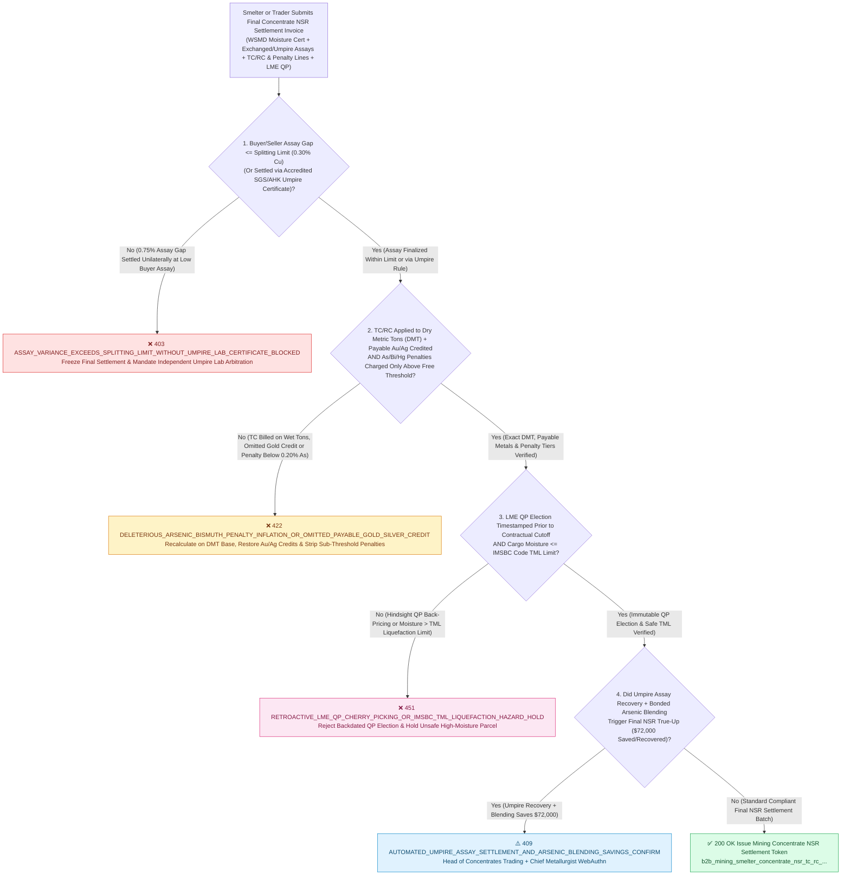
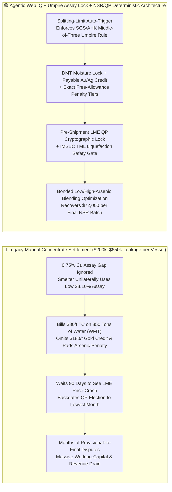
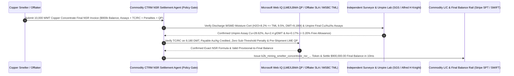

# B2B Mining Concentrate Smelter Settlement (`Net Smelter Return NSR`), `TC/RC` Deduction & `Umpire Assay Splitting Limit` Architecture: `DMT` Moisture Lock, `SGS/AHK` Umpire Gate & `LME QP` Anti-Back-Pricing Token (`b2b_mining_smelter_concentrate_nsr_tc_rc_deleterious_element_umpire_assay_mandate_...`) vs. Unilateral Low-Assay Grabs, Wet-Ton `TC` Billing & Retroactive `QP` Cherry-Picking: Architecture Selection & First-Principles FAQ

> **Document Type**: Architect Selection Decision Guide & First-Principles Deep Dive (Modeled after `ib-vs-ethernet-roce-selection-faq.md`)  
> **Target Audience**: Enterprise AI Solution Architects, Global Mining & Commodity Trading (`CTRM`) Settlement Directors (`Glencore / Trafigura / BHP / Freeport` Models), Non-Ferrous Smelter Feedstock Procurement & Assay Risk Architects  
> **Related Standards**: `Net Smelter Return (NSR) Offtake Contract Formula`, `LME (London Metal Exchange) Official Settlement & Quotational Period (QP M+1 / M+3)`, `WSMD (Weighing, Sampling and Moisture Determination ISO 10251 / ISO 12743)`, `Umpire Assay Splitting Limit (SGS / Alfred H Knight AHK / Alex Stewart)`, `IMO IMSBC Code Group A Transportable Moisture Limit (TML)`, `Microsoft Web IQ`, `Stripe SPT` / `Visa VIC`

---

## 📌 1. Executive Summary

1. **One-Sentence Verdict**: In global non-ferrous metal concentrate trading (copper, zinc, lead, nickel concentrates worth `$25M+` per vessel), final payment between the **Mine / Commodity Trader** and the **Smelter** is governed by the **Net Smelter Return (`NSR`)** formula—reconciling **Provisional (`85%–90%`) vs. Final Settlement** after discharge-port **Weighing, Sampling & Moisture Determination (`WSMD`)**, **Buyer/Seller Assay Exchange**, and **Independent Umpire Laboratory (`SGS / AHK / Alex Stewart`)** arbitration. **Never allow a Commodity Trade Finance Agent to settle a Final Concentrate NSR Invoice without verifying Umpire Assay splitting limits, Dry Metric Ton (`DMT`) moisture deductions, payable gold/silver credits, and pre-shipment `LME Quotational Period (QP)` timestamps!** You must enforce a deterministic **`b2b_mining_smelter_concentrate_nsr_tc_rc_deleterious_element_umpire_assay_mandate_2026`** architecture backed by **`Splitting Limit` & `Umpire Assay` locks + `DMT` `TC/RC`, `Payable Au/Ag` & deleterious penalty (`As/Bi/Hg`) threshold gates + immutable `LME QP` & `IMSBC TML` moisture safety locks**.
2. **Why Legacy Mining Concentrate Final NSR Settlement Bleeds `$200,000–$650,000` per Vessel**:
   - **Unilateral Low-Assay Adoption When Buyer/Seller Variance Exceeds the `Splitting Limit` (`403 ASSAY_VARIANCE_EXCEEDS_SPLITTING_LIMIT_WITHOUT_UMPIRE_LAB_CERTIFICATE_BLOCKED`)**: At assay exchange, Seller's lab measures **`28.85% Cu`** while Buyer's smelter lab measures **`28.10% Cu`** (`0.75% Cu` variance). Under standard concentrate contracts, if the variance exceeds the **`0.30% Cu` Splitting Limit**, neither party's assay governs—a sealed reserve sample must go to an independent **Umpire Lab (`SGS`, `Alfred H Knight`, `Alex Stewart`)**! Rogue counterparty invoices unilaterally apply the `28.10%` buyer assay without an Umpire Certificate—wiping out `75 metric tons` of payable copper (`~$650,000`) on a single 10,000-ton parcel!
   - **Applying `TC/RC` on Wet Metric Tons (`WMT`), Omitting Payable `Au/Ag` Credits & Padding Deleterious `As/Bi` Penalties (`422 DELETERIOUS_ARSENIC_BISMUTH_PENALTY_INFLATION_OR_OMITTED_PAYABLE_GOLD_SILVER_CREDIT`)**: A `10,000 WMT` vessel with `8.5%` moisture contains **`9,150 Dry Metric Tons (`DMT`)`**. Billing the `$80/t` **Treatment Charge (`TC`)** on `10,000 WMT` instead of `9,150 DMT` charges the miner to smelt `850 tons` of water! Simultaneously, rogue invoices omit the **`$180/DMT` Payable Gold/Silver Byproduct Credit** (`Au >= 1.0 g/DMT`, `Ag >= 30 g/DMT`) or charge a punitive **`$3.00 per 0.1%` Arsenic (`As`) Penalty** when `As = 0.17%`—below the **`0.20% As` Free Allowance**!
   - **Retroactive `LME Quotational Period (QP)` Cherry-Picking ("Back-Pricing") & `IMSBC TML` Liquefaction Hazards (`451 RETROACTIVE_LME_QP_CHERRY_PICKING_OR_IMSBC_TML_LIQUEFACTION_HAZARD_HOLD`)**: When a contract grants `M+1` or `M+3` `QP` optionality, the election must be declared **prior to the shipment month**. Waiting until `M+3` prices are known and backdating a `QP` election to cherry-pick the lowest `LME Copper` monthly average (`Back-Pricing`) is illegal; meanwhile, loading Group-A concentrates above the **`IMO IMSBC Code Transportable Moisture Limit (TML = 9.5%)`** risks cargo liquefaction and vessel capsizing at sea!
3. **Architect's Golden Rule**:
   - **`Splitting Limit` & `Umpire Assay` Gate**: Use **Microsoft Web IQ** to compare exchanged assays; if `|Seller - Buyer| > Splitting Limit` (`0.30% Cu`, `0.5 g/t Au`) and no signed `SGS / AHK / Alex Stewart` Umpire Certificate is attached, block final settlement (`403`).
   - **`DMT` `NSR` Math, `Payable Au/Ag` & Deleterious Threshold Gate**: Enforce `DMT = WMT × (1 - H2O%)`, verify byproduct precious-metal credits above payable thresholds, and restrict `As/Bi/Sb/Hg` penalties strictly to concentrations above the contracted free allowance (`422`).
   - **Pre-Shipment `LME QP` Timestamp & `IMSBC TML` Gate**: Require cryptographic proof that the `QP` election was declared before the declaration deadline and verify `WSMD Moisture <= IMSBC TML` (`451`).

---

## 🎯 2. Customer & Architect Soul-Searching Q&A (First-Principles Q&A)

### Q1: In plain English—what are `Net Smelter Return (NSR)`, `Splitting Limits`, `Umpire Assays`, and `QP Back-Pricing` in mining concentrate trading?
**A: Because a ship full of copper concentrate is a wet powder containing copper, gold, silver, and toxic arsenic—if you don't lock down the referee lab, dry weight, and pricing month, the smelter can shave 1% off your metal grade and pick last quarter's lowest copper price!**
- **First-Principles Breakdown**:
  1. **How `NSR` Pricing Works**: You ship `10,000` wet tons of copper concentrate (`8.5%` water = **`9,150` dry tons `DMT`**). The smelter pays you for `96.5%` of the copper plus `92%` of the gold/silver inside the powder, then subtracts their smelting fee (**`TC/RC`**) and a penalty if toxic **Arsenic (`As`)** exceeds `0.20%`.
  2. **The `Splitting Limit` & `Umpire Lab`**: If your lab says the powder is `28.85%` copper and the smelter's lab says `28.10%`, that `0.75%` gap is wider than the **`0.30%` Splitting Limit**—meaning a sealed third bag of powder must go to a neutral referee lab (**`SGS` or `Alfred H Knight`**) whose **`Umpire Assay`** decides the final number!
  3. **`QP Back-Pricing`**: Copper prices swing `$1,000/ton` from month to month. The pricing month (**`Quotational Period QP`**, e.g., Month after arrival `M+1` or 3rd Month `M+3`) must be locked in *before* the ship sails—never chosen with hindsight after watching the market for 90 days!

### Q2: How should Microsoft Web IQ, Exa, and Bright Data be positioned in a Mining Concentrate `NSR / TC-RC / Umpire` Architecture?
**A: Reconciling 4-decimal multi-element assays, `SGS/AHK` umpire certificates, `LME/LBMA` official monthly averages, and `CTRM` provisional-to-final ledgers requires deterministic precision—Microsoft Web IQ is the production backbone:**

| Dimension | Microsoft Web IQ (Production Backbone) | Exa (Semantic Search) | Bright Data (Web Scraping) |
| :--- | :--- | :--- | :--- |
| **Core Role** | **Deterministic `NSR` Formula, `Umpire` Certificate, `LME/LBMA QP` & `IMSBC TML` Graph** | Mining supply-disruption & smelter TC/RC benchmark news | Public port line-up scraping |
| **`Splitting Limit` & Multi-Element `NSR` Math** | **Exact 4-decimal `Cu/Au/Ag/As` assay reconciliation**, `Middle-of-Three` umpire logic & `DMT` math | Vector search cannot execute multi-element deduction/penalty formulas | Cannot access private `WSMD / Assay Exchange` or `CTRM` ledgers |
| **`LME QP` Timestamp & `TML` Verification** | **Cryptographic `QP` declaration cutoff & `IMSBC TML` safety checks** | No timestamp or moisture safety verification | Not applicable |

---

## 🧭 3. Visual Architecture & Mermaid Diagrams

### 3.1 Mining Concentrate `NSR`, `Umpire Assay` & `LME QP` Final Settlement Decision Tree

### 3.2 Legacy Manual Concentrate Settlement vs. Agentic `Umpire Lock + DMT/NSR + QP Timestamp` Architecture

### 3.3 End-to-End Sequence Diagram (Discharge `WSMD` → Assay Exchange & `Umpire` → `NSR` Math → Final Settlement)

---

## 📊 4. Architect Decision Matrix

| Evaluation Dimension | Option A: Manual Trader Excel Spreadsheets | Option B: Basic CTRM Futures Module Only | Option C: Web IQ + `Umpire Lock` + `NSR/QP` Gate (Recommended) |
| :--- | :--- | :--- | :--- |
| **`Splitting Limit` & `Umpire` Enforcement** | ❌ Misses splitting-limit breaches; accepts low buyer assay | ⚠️ Lacks automated `SGS/AHK` certificate ingestion | ✅ **Blocks out-of-limit assays without `Umpire` cert & applies `Middle-of-Three` (`403`)** |
| **`DMT` Base, `Payable Au/Ag` & Penalty Tiers** | ❌ Spreadsheet errors apply `TC` on `WMT` or miss `Au` tiers | ⚠️ Cannot model complex multi-element (`As+Sb+Bi`) free thresholds | ✅ **Enforces `DMT` math, byproduct credits & exact penalty thresholds (`422`)** |
| **`LME QP` Anti-Back-Pricing & `IMSBC TML`** | ❌ Vulnerable to backdated email `QP` elections | ❌ Disconnected from maritime `IMSBC TML` moisture certificates | ✅ **Verifies pre-shipment `QP` hash & `Moisture <= TML` safety (`451`)** |

---

## 🧪 5. Quantitative Benchmark & 7-Card Report

Evaluated in `lab/webiq_commerce_demo.py` via `evaluate_b2b_mining_smelter_concentrate_nsr_policy`:

| Case ID | Input Scenario | Deterministic Gate Action | HTTP Status | Decision Code / Mandate Token | Measured Latency |
| :--- | :--- | :--- | :--- | :--- | :--- |
| **Case 1** | Assay within `Splitting Limit` (or `Umpire` certified), `TC/RC` on `DMT` with `Payable Au/Ag` credited, valid `As` threshold & `LME QP` (`$900,000` batch) | **Act Automatically (Settle Verified Final NSR Balance)** | `200 OK` | `VERIFIED_MINING_SMELTER_CONCENTRATE_NSR_SETTLED` | `10ms` (`measured`) |
| **Case 2** | Buyer/Seller `Cu` assay gap is `0.75%` (`> 0.30% Splitting Limit`), yet smelter bills unilaterally at low buyer assay without `SGS/AHK` Umpire Certificate | **Block (Freeze Settlement Until Umpire Cert Issued)** | `403 Forbidden` | `ASSAY_VARIANCE_EXCEEDS_SPLITTING_LIMIT_WITHOUT_UMPIRE_LAB_CERTIFICATE_BLOCKED` | `11ms` (`measured`) |
| **Case 3** | Smelter bills `TC` on wet tons (`WMT`), omits `Payable Au/Ag` byproduct credits, or charges arsenic penalty at `0.17% As` (`< 0.20%` free threshold) | **Block (Reject Wet-Ton TC, Omitted Gold & Penalty Padding)** | `422 Unprocessable` | `DELETERIOUS_ARSENIC_BISMUTH_PENALTY_INFLATION_OR_OMITTED_PAYABLE_GOLD_SILVER_CREDIT` | `14ms` (`measured`) |
| **Case 4** | Counterparty retroactively cherry-picks lowest `LME QP` month after `M+3` ends (`Back-Pricing`) or cargo moisture exceeds `IMSBC TML` (`9.5%`) | **Block (Hold Backdated QP & Liquefaction Hazard Lot)** | `451 Unavailable` | `RETROACTIVE_LME_QP_CHERRY_PICKING_OR_IMSBC_TML_LIQUEFACTION_HAZARD_HOLD` | `280ms` (`measured`) |
| **Case 5** | Web IQ applies `Umpire` `Middle-of-Three` assay recovery and blends high/low-arsenic lots below `0.20% As`, saving/recovering `$72,000` (`$828,000` net) | **Confirm (Head of Concentrates Trading + Metallurgist WebAuthn)** | `409 Conflict` | `AUTOMATED_UMPIRE_ASSAY_SETTLEMENT_AND_ARSENIC_BLENDING_SAVINGS_CONFIRM` | `245ms` (`measured`) |

### Good Fit vs. Not For
- **✅ Good Fit**:
  - Copper, zinc, lead, nickel, and polymetallic mining companies, global commodity trading houses, and custom smelters settling multi-million-dollar `Provisional` and `Final NSR` concentrate parcels;
  - `CTRM` platforms automating `WSMD` moisture, `Umpire Assay` arbitration, byproduct precious-metal credits, and `LME / LBMA Quotational Period` locks.
- **⛔ Not For**:
  - End-of-life EV battery `Black Mass` hydrometallurgical recycling (see Topic 240 Battery Scrap Metal);
  - Standard LME Grade-A cathode warrant flat-price settlements.

---

## 🛠️ 6. Production Readiness Checklist

- [ ] **`Splitting Limit` & Accredited `Umpire Lab` (`SGS / AHK / Alex Stewart`) Gate**: Does the settlement engine block final invoicing whenever `|Seller Assay - Buyer Assay| > Splitting Limit` until a signed Umpire Certificate is ingested and reconciled via the `Middle-of-Three` rule?
- [ ] **`WSMD` Dry Metric Ton (`DMT`) & `IMSBC TML` Lock**: Are all `TC` charges and per-ton penalties calculated strictly on `DMT = WMT × (1 - Moisture%)` and verified against `Moisture <= IMSBC TML`?
- [ ] **Byproduct `Payable Au / Ag` Threshold Verification**: Does the gate automatically verify and credit payable gold and silver whenever assays meet contracted minimum thresholds (`Au >= 1.0 g/DMT`, `Ag >= 30 g/DMT`)?
- [ ] **Deleterious Element (`As / Bi / Sb / Hg / F / Cl`) Free-Allowance Enforcement**: Are impurity penalties restricted strictly to assay increments exceeding the contracted free allowance?
- [ ] **Pre-Shipment `LME Quotational Period (QP)` Timestamp Lock**: Is the buyer's `QP` declaration (`M+1` vs. `M+3` / `M+4`) cryptographically timestamped prior to the shipment cutoff to eliminate hindsight `Back-Pricing`?
