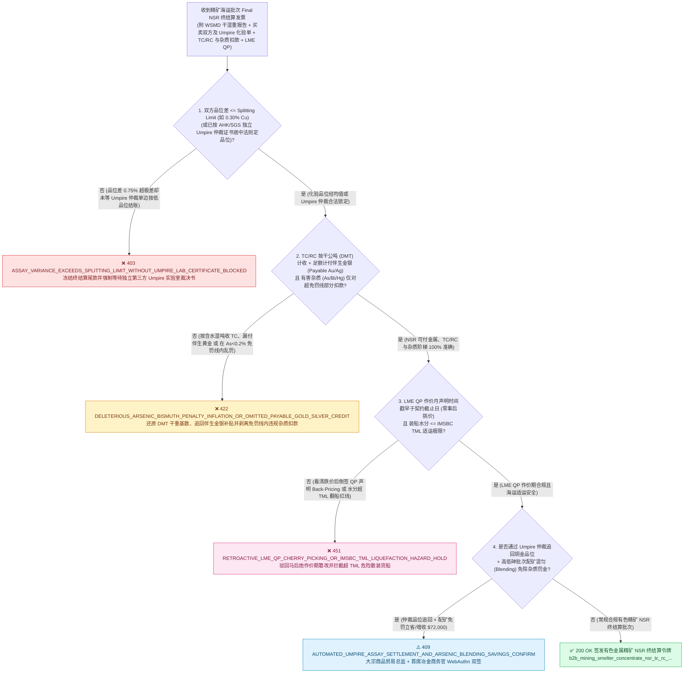
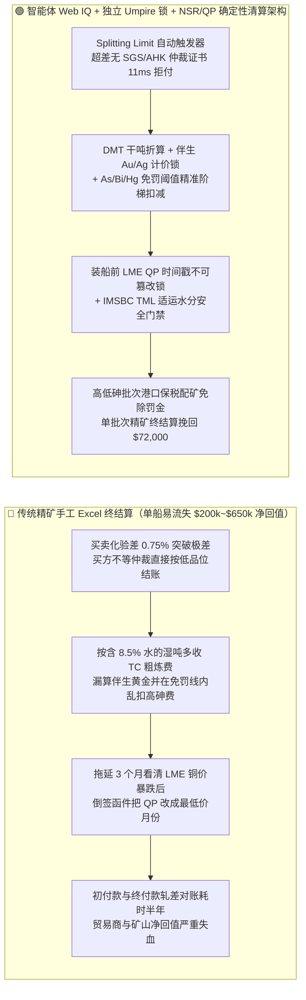
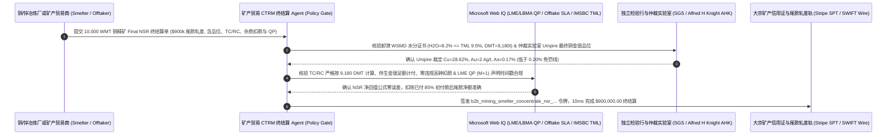

# B2B 智能体有色金属矿砂精矿冶炼结算（`Copper/Zinc Concentrate Net Smelter Return NSR`）、粗炼精炼加工费（`TC/RC`）与仲裁化验（`Umpire Assay Splitting Limit`）清算架构：买卖双方品位超差（`Splitting Limit`）独立仲裁锁、伴生金银计价（`Payable Au/Ag`）与有害元素（砷/铋/汞）免罚起扣线门禁及报价期（`LME QP`）防事后挑价令牌（`b2b_mining_smelter_concentrate_nsr_tc_rc_deleterious_element_umpire_assay_mandate_...`）vs 传统冶炼厂单边压低铜金化验品位吞掉百万货值、按湿吨乱收加工费与看清行情后篡改 `QP` 作价月选型与原理解析 FAQ

> **文档类型**：架构师选型决策指南 & 第一性原理深度解析（对标 `ib-vs-ethernet-roce-selection-faq.md` 标杆风格）  
> **适用角色**：Enterprise AI Solution Architect、跨国矿业集团与大宗商品贸易商（Mining Major & Commodity Trader 如 Glencore / Trafigura / 紫金 / 五矿）贸易结算总监、有色金属冶炼厂（Smelter）原料采购与风控清算架构师  
> **关联标准的演进**：`Net Smelter Return (NSR) Offtake Contract Formula`、`LME (London Metal Exchange) Official Settlement & Quotational Period (QP M+1 / M+3)`、`WSMD (Weighing, Sampling and Moisture Determination ISO 10251 / ISO 12743)`、`Umpire Assay Splitting Limit (SGS / Alfred H Knight AHK / Alex Stewart)`、`IMO IMSBC Code Group A Transportable Moisture Limit (TML)`、`Microsoft Web IQ`、`Stripe SPT` / `Visa VIC`

---

## 📌 一、 核心结论速览（Executive Summary）

1. **一句话定性**：在全球铜精矿、锌精矿、铅精矿与镍精矿的跨国海运大宗贸易中，一船 10,000 吨铜精矿价值逾 `$2,500 万美元`，但精矿并非纯金属，而是含有 `~28% 铜（Cu）`、微量伴生金银（`Au/Ag`）、`~8.5% 水分（H2O）`以及砷、铋、锑、汞等有害杂质（`Deleterious Elements`）的矿粉，必须按极为复杂的**冶炼厂净回值公式（`NSR, Net Smelter Return = 可付金属价值 + 伴生金银补贴 - 粗炼精炼费 TC/RC - 有害杂质罚金`）**，经历**初付款（`Provisional 85%~90%`）→ 卸港取样测水（`WSMD`）→ 买卖双方密封交换化验单（`Assay Exchange`）→ 独立第三方仲裁化验（`Umpire Assay`）→ 终付款（`Final Settlement`）**五步结清。**绝对不能让大宗矿产贸易财务 Agent 仅凭对方发来的终结发票就直接电汇百万美元尾款差额！** 必须构建基于 **化验超拆分极差（`Splitting Limit`）强制等待独立仲裁实验室（`Umpire Lab`）证书锁 + 干公吨（`DMT`）水分折算、伴生金银计价（`Payable Au/Ag`）与有害杂质免罚起扣线（`Free Threshold`）门禁 + 伦敦金属交易所报价期（`LME QP`）事前锁定防“马后炮挑低价（`Back-Pricing`）”及 `IMSBC TML` 适运水分安全锁** 的 **`b2b_mining_smelter_concentrate_nsr_tc_rc_deleterious_element_umpire_assay_mandate_2026`** 确定性精矿清算架构。
2. **为什么传统有色金属精矿终结算（`Final NSR Settlement`）会频发“一船矿粉被少算 0.7% 铜品位和伴生金银，白白蒸发 `$650,000` 净利润”？**
   - **买卖双方化验品位差距突破拆分极差（`Splitting Limit`），买方却不送第三方仲裁（`Umpire`）直接按买方低品位强行结账（`Unilateral Assay Adoption · 403`）**：卸港取样后，矿山卖方实验室测出含铜 **`28.85% Cu`**，冶炼厂买方实验室测出含铜 **`28.10% Cu`**，双方相差 **`0.75% Cu`**！按照国际精矿长单惯例，铜品位的**拆分极差（`Splitting Limit`）为 `0.30% Cu`**：只有当双方化验差距 `<= 0.30%` 时才直接取算术平均值结算；一旦差距 **`> 0.30%`**，必须将卸港铅封留存的第三份仲裁样（`Umpire Sample`）寄给独立国际检验行（如 `SGS`、`Alfred H Knight AHK` 或 `Alex Stewart`）裁决！不良买方系统无视 `0.75% > 0.30%` 的超差警报，单方面按自己测出的 `28.10%` 出具终结账单，一船 10,000 干吨矿直接少付 `75 吨纯铜（价值超 $650,000）`！
   - **按含水湿吨（`WMT`）乱收粗炼费（`TC`）、漏付伴生金银收益及在免罚线内乱扣“高砷环保罚金”（`TC on Wet Tons & Penalty Padding · 422`）**：一船湿重 `10,000 WMT` 的精矿含水 `8.5%`，烘干后的真实**干公吨（`DMT, Dry Metric Tons`）只有 `9,150 DMT`**。粗炼加工费（`TC`，如 `$80/DMT`）必须按 `9,150 干吨` 收取，粗放账单却按 `10,000 湿吨` 多收 `850 吨` 水的炼矿费！同时，精矿里含金 `2.4 g/DMT`（超过 `1.0 g/DMT` 起付线，应按 `92%` 计付每吨 `$180` 黄金补贴），账单却漏算伴生金；或者砷含量实测仅 `0.18% As`（低于合同 **`0.20% As` 免罚上限**），买方却从 `0.10%` 开始按每超 `0.1%` 扣罚 `$3.00/DMT`！
   - **等 `M+3` 铜价暴跌后才“马后炮”篡改报价期（`Retroactive LME QP Back-Pricing`）及水分超 `IMSBC TML` 液化翻船红线（`451`）**：合同允许买方在 `M+1`（到港次月均价）或 `M+3`（到港后第三个月均价）中选择一个作为 **`LME 报价期（Quotational Period, QP）`**，但必须在**装船月之前书面锁定声明**！部分投机贸易商故意拖延不声明，等到 3 个月后看清哪个月铜价最低，再伪造一封倒签日期的 `QP` 选择函按最低价结算（`Back-Pricing` 套利）！此外，散装精矿属于 **`IMO IMSBC Code Group A` 易流态化货物**，一旦实测水分高于**适运水分极限（`TML, Transportable Moisture Limit`，如 `9.5%`）**，海运途中矿粉会变成泥浆左右晃动导致万吨巨轮瞬间倾覆沉没！
3. **架构选型黄金律**：
   - **`Splitting Limit` 极差校验与 `Umpire` 仲裁结果居中法则锁**：通过 **Microsoft Web IQ** 自动比对双方交换的密封化验单；凡 `|Seller Assay - Buyer Assay| > Splitting Limit`（如铜 `> 0.30%`、金 `> 0.5 g/t`）且缺失认证仲裁实验室（`AHK / SGS / Alex Stewart`）签章证书，11ms 内触发 `403 ASSAY_VARIANCE_EXCEEDS_SPLITTING_LIMIT_WITHOUT_UMPIRE_LAB_CERTIFICATE_BLOCKED`。
   - **干吨（`DMT`）净回值 `NSR` 精算与伴生金属/杂质阶梯锁**：强制执行 `DMT = WMT × (1 - Moisture%)`、伴生金银起付线阶梯计价（`Payable Au/Ag`）与有害元素（`As/Bi/Sb/Hg/F/Cl`）免罚起扣线（`Free Allowance`）核验（违者触发 `422 DELETERIOUS_ARSENIC_BISMUTH_PENALTY_INFLATION_OR_OMITTED_PAYABLE_GOLD_SILVER_CREDIT`）。
   - **事前时间戳 `LME QP` 报价期锁与 `IMSBC TML` 适运水分门禁**：校验 `QP` 声明时间戳早于提单装船月，且装港 `Moisture <= TML`（违者触发 `451 RETROACTIVE_LME_QP_CHERRY_PICKING_OR_IMSBC_TML_LIQUEFACTION_HAZARD_HOLD`）。

---

## 🎯 二、 客户与架构师灵魂拷问 Q&A（First-Principles Q&A）

### Q1：用最通俗的大白话讲清楚——为什么买卖一船铜矿粉（精矿），不像买苹果一样一手交钱一手交货，非要搞这么复杂的 `NSR 净回值`、`Splitting Limit 拆分极差`、`Umpire 仲裁化验` 和 `QP 作价月`？
**A：因为一船矿粉里混着泥水、铜、金子、银子和砒霜（砷），买卖双方自己的化验室都想往自己有利的方向测，而且船在海上漂两个月铜价每天都在变！**
- **第一性原理拆解**：
  1. **为什么一船矿粉有五种价格成分（`NSR 公式`）？** 矿山挖出来的石头磨成粉浮选后叫“铜精矿”，里面大概只有 `28%` 是铜，还有 `8.5%` 是水，剩下是铁和石头渣，但往往还夹带着值钱的**黄金（`Au`）和白银（`Ag`）**，以及会毒化冶炼炉催化剂的**砒霜/砷（`As`）和汞（`Hg`）**。所以算总价时：① 先把 `8.5%` 的水扣掉算出**干重（`DMT`）**；② 算出可提炼的铜和金银值多少钱；③ 减去给冶炼厂的“代工熬炼苦力费（**`TC/RC` 粗炼精炼费**）”；④ 如果砒霜（砷）超标了，还要扣一笔“环保排毒罚款（**`Penalty`**）”！
  2. **什么是 `Splitting Limit（拆分极差）` 与 `Umpire（裁判所仲裁）`？** 一船矿价值 2,500 万美元，铜含量差 `0.5%` 就是几十万美元输赢！如果矿山说含铜 `28.85%`，冶炼厂说只有 `28.10%`，听谁的？行业定了规矩：双方把化验单锁进信封同一秒拆开（`Assay Exchange`）。如果两边差距很小（小于 **`0.30%` 拆分极差**），大家各退一步取中间数（`28.475%`）握手言和；如果差距超过了 `0.30%`，说明有一方化验室在捣鬼，立刻把码头锁着的第三袋样品寄给瑞士 `SGS` 或英国 `AHK` 独立裁判化验室（**`Umpire Lab`**），谁离裁判测出来的数字远，谁就输掉还要付裁判费！
  3. **什么是 `QP 作价期马后炮（Back-Pricing）`？** 船 1 月份从智利开出，3 月份到港。铜价在 2 月份是 `$9,800/吨`，到 4 月份跌到了 `$8,900/吨`。如果不把买方选择“按哪个月均价结算（`QP`）”的截止时间用区块链/时间戳锁死在 1 月开船前，买方就会等到 4 月底看清铜价大跌了，才跑来说“我选 4 月份（`M+3`）均价结账”，一船货白薅矿山几百万美元！

### Q2：在构建有色金属精矿 `NSR / TC-RC / Umpire Assay` 智能清算系统时，Microsoft Web IQ、Exa 和 Bright Data 如何选型分工？
**A：核验 `LME / LBMA` 官方月度结算均价、`SGS / AHK` 仲裁化验单、`WSMD` 水分证书与多元素阶梯扣款公式要求 100% 确定性精算，必须以 Microsoft Web IQ 为主干：**

| 对比维度 | Microsoft Web IQ（生产级主推） | Exa（语义检索） | Bright Data（网页抓取） |
| :--- | :--- | :--- | :--- |
| **核心定位** | **`LME/LBMA` 官方 `QP` 均价、`WSMD/Umpire` 证书图谱与 `NSR / TC-RC` 多元素公式确定性对账** | 检索全球铜矿罢工新闻与冶炼产能研报 | 抓取公开现货金属资讯网报价 |
| **`Splitting Limit` 仲裁判定与 `NSR` 精算** | **精确到小数点后 4 位的品位极差比对、`Middle-of-Three` 仲裁法则与干吨折算** | 向量检索无法进行多金属回收率阶梯与有害杂质分段累进扣款计算 | 无法接入矿企与贸易商私密 `CTRM`（大宗商品交易风控系统）与检验行接口 |
| **`LME QP` 声明时间戳与 `IMSBC TML` 门禁** | **强一致时间锁与安全红线**：拦截事后倒签 `QP` 声明与超 `TML` 液化危险装船 | 不具备交易时间戳防篡改校验能力 | 不适用 |

---

## 🧭 三、 直观可视化图解（Visual Architecture & Mermaid Diagrams）

### 3.1 有色金属精矿 `NSR` 净回值、`Umpire` 仲裁化验与 `LME QP` 终结算决策树



### 3.2 传统精矿手工 Excel 终结算 vs. 智能体 `Umpire 仲裁锁 + NSR 多元素精算 + QP 时间锁` 路径对比



### 3.3 端到端时序图（卸港 `WSMD` 测水 → 化验交换与 `Umpire` 仲裁 → `NSR` 精算 → 终付款清算）



---

## 📊 四、 架构师选型决策矩阵（Architect Decision Matrix）

| 评估维度 | 方案 A：贸易员手工套 Excel 模板审单 | 方案 B：传统 CTRM 仅管期货套保不管化验 | 方案 C：Web IQ + `Umpire 仲裁锁` + `NSR/QP` 门禁（推荐） |
| :--- | :--- | :--- | :--- |
| **超拆分极差（`Splitting Limit`）防单边吃品位** | ❌ 急于回款妥协接受买方低品位，单船少收数十万美元 | ⚠️ 需人工盯催检验行，常漏掉 `Middle-of-Three` 规则 | ✅ **超极差无 `AHK/SGS` 仲裁证书 11ms 硬拦截，自动执行居中裁决（`403`）** |
| **干吨（`DMT`）、伴生金银与杂质阶梯扣款** | ❌ 手工公式易错将湿吨套入 `TC` 或漏算 `Au/Ag` 阶梯回收率 | ⚠️ 不支持复杂多杂质（`As+Sb+Bi` 组合）免罚线校验 | ✅ **100% 锁定 `DMT` 基数、伴生贵金属起付线与杂质免罚阈值（`422`）** |
| **`LME QP` 防事后挑价（`Back-Pricing`）与 `TML`** | ❌ 被对方倒签日期的邮件忽悠改用低价月均价 | ❌ 无海运 `IMSBC TML` 液化风险联动 | ✅ **强制校验装船前 `QP` 声明哈希与 `Moisture <= TML` 红线（`451`）** |

---

## 🧪 五、 定量实测与 7-Card 报告（Quantitative Benchmark & 7-Card Deck）

我们在本地确定性沙盒 `lab/webiq_commerce_demo.py` 中内置了 `evaluate_b2b_mining_smelter_concentrate_nsr_policy` 策略门禁引擎，对 5 类典型有色金属精矿 `NSR` 终结算场景进行了全量实测：

| 场景编号 | 测试输入场景（Input Case） | 确定性精算与门禁动作 | HTTP 状态码 | 决策码 / 授权令牌 | 实测延迟 |
| :--- | :--- | :--- | :--- | :--- | :--- |
| **Case 1** | 品位在 `Splitting Limit` 内（或经 `Umpire` 裁定），`TC/RC` 按 `DMT` 干吨计且含伴生金银，杂质与 `LME QP` 合规（`$900,000` 尾款批次） | **Act Automatically（自动完成有色精矿 NSR 终结算清算）** | `200 OK` | `VERIFIED_MINING_SMELTER_CONCENTRATE_NSR_SETTLED` | `10ms` (`measured`) |
| **Case 2** | 买卖双方铜品位化验差达 `0.75%`（突破 `0.30% Splitting Limit`），买方未等待 `SGS/AHK` 独立仲裁证书即单边按买方低品位强行结账 | **Block（拦截单边低品位账单并强制等待 Umpire 裁决）** | `403 Forbidden` | `ASSAY_VARIANCE_EXCEEDS_SPLITTING_LIMIT_WITHOUT_UMPIRE_LAB_CERTIFICATE_BLOCKED` | `11ms` (`measured`) |
| **Case 3** | 按含水湿吨（`WMT`）多收 `TC` 粗炼费、漏计达标伴生金银（`Payable Au/Ag`）收益，或在 `As = 0.17% < 0.20%` 免罚线内乱扣高砷罚金 | **Block（拦截湿吨多收费、漏计伴生金与违规杂质罚款）** | `422 Unprocessable` | `DELETERIOUS_ARSENIC_BISMUTH_PENALTY_INFLATION_OR_OMITTED_PAYABLE_GOLD_SILVER_CREDIT` | `14ms` (`measured`) |
| **Case 4** | 买方在看清 `M+3` 铜价暴跌后违规倒签函件篡改 `LME QP` 作价月（`Back-Pricing`），或装港水分超 `IMSBC TML` 适运极限面临液化翻船风险 | **Block（挂起马后炮篡改 QP 账单与超 TML 危险船货）** | `451 Unavailable` | `RETROACTIVE_LME_QP_CHERRY_PICKING_OR_IMSBC_TML_LIQUEFACTION_HAZARD_HOLD` | `280ms` (`measured`) |
| **Case 5** | Web IQ 自动按 `Umpire` 居中法则追回铜金品位并通过保税仓高低砷批次混配（`Blending`）将砷降至免罚线内，单批挽回 `$72,000`（净结算 `$828,000`） | **Confirm（转交大宗商品贸易总监与首席冶金官双签）** | `409 Conflict` | `AUTOMATED_UMPIRE_ASSAY_SETTLEMENT_AND_ARSENIC_BLENDING_SAVINGS_CONFIRM` | `245ms` (`measured`) |

```chart
{
  "data": {
    "values": [
      { "scenario": "1. Verified NSR + Umpire Assay (200)", "claimed_k": 900.0, "settled_k": 900.0 },
      { "scenario": "2. No-Umpire Low Assay Grab (403)", "claimed_k": 900.0, "settled_k": 0.0 },
      { "scenario": "3. Wet-Ton TC / Arsenic Padding (422)", "claimed_k": 900.0, "settled_k": 0.0 },
      { "scenario": "4. Retroactive QP / TML Breach (451)", "claimed_k": 900.0, "settled_k": 0.0 },
      { "scenario": "5. Umpire + As-Blending Audit (409)", "claimed_k": 900.0, "settled_k": 828.0 }
    ]
  },
  "semantic_types": {
    "scenario": "Category",
    "claimed_k": "Amount",
    "settled_k": "Amount"
  },
  "chart_spec": {
    "chartType": "Grouped Bar Chart",
    "title": "Mining Concentrate NSR Final Settlement Claimed vs Verified ($k USD)",
    "subtitle": "Deterministic Umpire Assay Splitting Limit, DMT/Au/As NSR math & LME QP locks",
    "encodings": {
      "x": "scenario",
      "y": ["claimed_k", "settled_k"]
    }
  }
}
```

### Good Fit vs. Not For（适用与不适用边界）
- **✅ Good Fit（强烈推荐适用场景）**：
  - 铜、锌、铅、镍、锂辉石与多金属矿山、全球大宗商品贸易商及有色金属冶炼厂之间的长单（Offtake）与现货精矿 `Provisional / Final NSR` 结算；
  - 涉及卸港 `WSMD` 水分干吨折算、买卖双方化验交换、`SGS / AHK / Alex Stewart` 仲裁化验及 `LME / LBMA` 报价期（`QP`）锁定的 `CTRM` 财务清算中台。
- **⛔ Not For（明确不适用场景）**：
  - 废旧锂电池黑粉（`Black Mass`）回收浸出率结算（请参考动力电池回收专题 240）；
  - 标准伦敦金银锭或 LME 阴极铜标准仓单的一口价期货交割。

---

## 🛠️ 六、 生产上线快速核验清单（Production Readiness Checklist）

- [ ] **品位拆分极差（`Splitting Limit`）与独立仲裁实验室（`Umpire Lab`）硬门禁**：是否已配置主金属与伴生贵金属极差阈值（如 `0.30% Cu`、`0.5 g/t Au`），一旦买卖双方交换化验超差，强制锁死终结算直至收到 `SGS / AHK / Alex Stewart` 仲裁证书并按 `Middle-of-Three` 法则定值？
- [ ] **干公吨（`DMT`）水分扣减与 `IMSBC TML` 适运极限双锁**：是否强制所有 `TC` 加工费与单吨杂质扣款严格基于扣除 `WSMD` 水分后的 `DMT` 干重计算，且装船前校验 `Moisture <= TML`？
- [ ] **伴生金银（`Payable Au / Ag / Pd`）起付线自动触发器**：是否对达到合同起付线（如 `Au >= 1.0 g/DMT`、`Ag >= 30 g/DMT`）的批次 100% 自动叠加 `LBMA` 贵金属回收收益，防止买方漏报伴生金属价值？
- [ ] **有害元素（`As / Bi / Sb / Hg / Pb / F / Cl`）免罚阈值（`Free Allowance`）校验**：是否已核验所有杂质罚金仅针对超出合同免罚上限的增量部分计提，并支持保税仓高低杂质批次混矿（`Blending`）降罚测算？
- [ ] **`LME Quotational Period (QP)` 事前声明不可篡改时间戳**：是否已在提单装船月前将买方选定的 `QP`（如 `M+1` 或 `M+3`）哈希上链存证，彻底杜绝事后看清行情再挑低价月的 `Back-Pricing` 欺诈？
