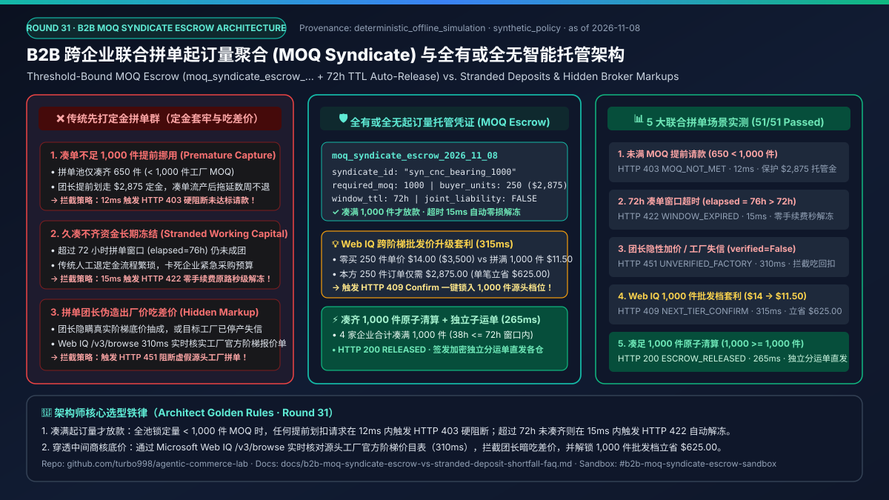
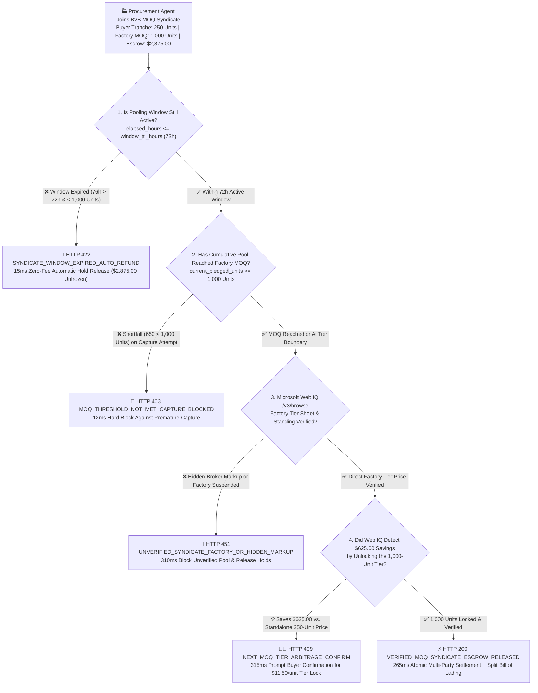
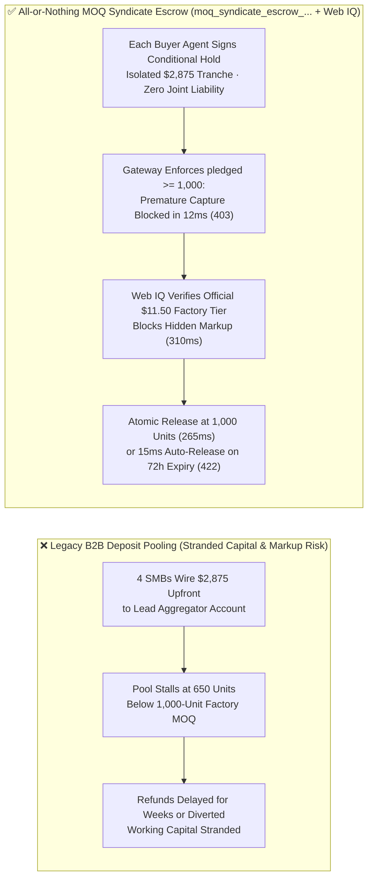
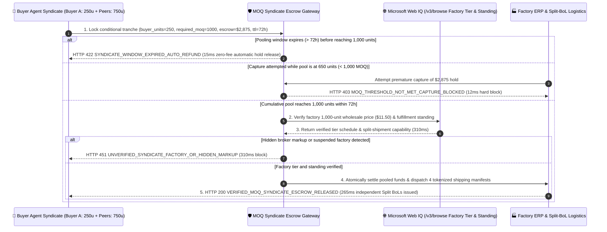

# Autonomous B2B MOQ Syndicate Aggregation & All-or-Nothing Conditional Escrow Mandate Architecture: Threshold-Bound Syndicate Escrow (`moq_syndicate_escrow_...` + Zero-Fee TTL Auto-Release) vs. Stranded Prepaid Deposits & Lead-Aggregator Markup Fraud Selection FAQ

> **Document Type**: AI Solution Architect Selection Guide & First-Principles Protocol Deep Dive (FAQ-Driven · Round 31)  
> **Reading Time**: 3 minutes for executive conclusions · 10 minutes for All-or-Nothing MOQ Escrow mechanics, deterministic TTL auto-release, and Microsoft Web IQ factory price-break grounding boundaries  
> **Style Benchmark**: Strictly modeled after `ib-vs-ethernet-roce-selection-faq.md` (Plain-language first principles + Mermaid decision tree / comparison / sequence diagrams + Architect Decision Matrix + Reproducible Benchmark + Production Checklist)  
> **Core Topic**: **Exclusively focused on how enterprise B2B procurement agents pool fractional orders across companies to unlock factory Minimum Order Quantity (MOQ) wholesale tiers using cryptographic All-or-Nothing Syndicate Escrow mandates, eliminating stranded deposits when MOQ shortfalls occur and blocking hidden middleman markups**  
> **Provenance & As-of Declaration**: All MOQ threshold enforcement, TTL auto-release, and tier-break arbitrage metrics in this guide are generated by `lab/webiq_commerce_demo.py` (`deterministic_offline_simulation`, 100% reproducible offline); multi-party conditional escrow and split Bill-of-Lading patterns reflect `official_doc_snapshot` (as of `2026-11-08`); the `1,000-unit` MOQ requirement, `$2,875.00` buyer tranche, `72-hour` pooling window, and `$625.00` wholesale tier savings are marked as `synthetic_policy` for architectural modeling and do not represent commercial commitments of any specific B2B marketplace; third-party live payment gateways or paid search APIs not directly invoked during this offline run are explicitly labeled `not_measured`.

---

## ① 📌 Executive Summary

1. **When must architects enforce an "All-or-Nothing MOQ Syndicate Escrow Mandate (`moq_syndicate_escrow_...`)" instead of allowing procurement agents to wire upfront deposits to a lead aggregator or factory?**
   - When an SMB manufacturer or retailer only needs `250 units` of an industrial component (`$14.00/unit` standalone = `$3,500.00`) and wants to pool demand with peer procurement agents to reach a factory's `1,000-unit` Minimum Order Quantity (`$11.50/unit` = `$2,875.00`), sending traditional upfront deposits creates severe financial exposure if total pledges stall at `650 units`.
   - **Selection Rule**: Cross-company group purchasing must use a **Threshold-Bound MOQ Syndicate Escrow Mandate (`moq_syndicate_escrow_...`)**. The buyer's `$2,875.00` remains locked in a conditional hold: if total pooled demand is only `650 units < 1,000 units` (`current_pledged_units < required_moq_units`), any premature capture attempt is deterministically blocked in **`12 ms`** with **`HTTP 403 MOQ_THRESHOLD_NOT_MET_CAPTURE_BLOCKED`**!
2. **What happens if the 72-hour pooling window expires and the syndicate still hasn't reached 1,000 units?**
   - Every syndicate escrow mandate embeds a cryptographic expiry clock (`window_ttl_hours = 72`). Once the pooling window expires (`elapsed_hours = 76h > 72h`) without meeting the `1,000-unit` MOQ, the escrow gateway automatically releases all buyer holds in **`15 ms`** with **`HTTP 422 SYNDICATE_WINDOW_EXPIRED_AUTO_REFUND`**, restoring 100% of working capital with zero cancellation fees or manual refund delays.
3. **How do we prevent a syndicate organizer from inflating the factory's true wholesale price or missing an adjacent bulk price break?**
   - **Pair the escrow gateway with Microsoft Web IQ `/v3/browse` factory tier-sheet and capacity grounding**: Before locking funds, Web IQ verifies the factory's published wholesale tier schedule and operating status. If the syndicate lead added a hidden markup or the factory is suspended (`webiq_factory_verified=False`), the gateway blocks the pool in **`310 ms`** (`HTTP 451 UNVERIFIED_SYNDICATE_FACTORY_OR_HIDDEN_MARKUP`). If Web IQ detects that pooling into the `1,000-unit` tier drops the unit cost from `$14.00` to `$11.50`—saving the buyer **`$625.00`** on `250 units`—it surfaces **`HTTP 409 NEXT_MOQ_TIER_ARBITRAGE_CONFIRM`** in **`315 ms`** (`Confirm`).

---

## ② 🎯 Soul-Searching Architect & Client Q&A (FAQ-Driven)

### Q1: Why does traditional "Lead-Aggregator Deposit Pooling" cause stranded working capital and audit failures when autonomous procurement agents participate?
- **Plain-Language First Principles**:
  - Factories require a Minimum Order Quantity (e.g., `1,000 units`) to amortize tooling and production line setup costs.
  - In legacy group buying, a lead buyer collects 30%–100% upfront deposits from smaller buyers before placing the master order. This introduces three systemic hazards:
    1. **Stranded Deposits on MOQ Shortfall**: If the pool only reaches `650 units` after two weeks, the factory refuses the wholesale price, and buyers wait weeks to recover their trapped deposits.
    2. **Premature Escrow Capture**: An untrusted broker captures buyer funds before the `1,000-unit` threshold is actually secured.
    3. **Hidden Aggregator Spread**: The factory's real `1,000-unit` price is `$10.20/unit`, but the organizer presents a doctored quote claiming `$11.50/unit` to pocket the spread.

### Q2: What is a "Threshold-Bound MOQ Syndicate Escrow Mandate (`moq_syndicate_escrow_...`)", and how does it guarantee zero stranded deposits and blind split shipping?
- **Core Architectural Mechanism**:
  - Each participating procurement agent signs an isolated conditional escrow token bound to `syndicate_id = "syn_cnc_bearing_1000"`:
    - `required_moq_units = 1000` (settlement is mathematically disabled unless cumulative verified pledges reach $\ge 1,000$ units);
    - `buyer_committed_units = 250`, `locked_unit_price_cents = 1150`, `buyer_escrow_cents = 287500` (strictly isolated liability of `$2,875.00`—zero joint liability for other participants);
    - `window_ttl_hours = 72` (deterministic auto-void and hold release if MOQ is not reached within 72 hours);
    - `independent_bol_destination_hash` (upon settlement, the factory ERP receives tokenized shipping coordinates to issue independent Split Bills of Lading directly to each buyer's warehouse without exposing peer identities).

### Q3: When should architects select Microsoft Web IQ vs. Exa or Bright Data for B2B factory MOQ and tier-price verification?
- **Selection Boundaries**:
  - **Microsoft Web IQ (Primary Choice for Official Factory Tier-Sheet & Compliance Grounding)**: Ideal for deterministic verification of published OEM wholesale tier schedules (`500 / 1,000 / 5,000 units`), ISO quality certificates, and operational standing via `/v3/browse` in `310–315 ms` (`~$0.0091/query`, `7.1x` token reduction vs. raw HTML ingestion).
  - **Exa (Semantic Discovery Alternative)**: Best suited for broad semantic discovery of candidate manufacturers producing compatible industrial specifications (`not_measured` in this offline suite; `~$5–$15 / 1k searches` `official_list_price`).
  - **Bright Data (Heavy Scraping Alternative)**: Best suited when wholesale spot prices are locked behind anti-bot industrial exchange portals (`not_measured` in this offline suite).

---

## ③ 🧭 Visual Architecture Diagrams (Mermaid Decision Tree + Legacy vs. Syndicate Escrow Comparison + End-to-End Sequence)

### 3.1 B2B MOQ Syndicate Escrow & Wholesale Tier Verification Decision Tree (`flowchart TD`)

### 3.2 Legacy Lead-Aggregator Deposit Pooling vs. All-or-Nothing Syndicate Escrow (`flowchart LR`)

### 3.3 End-to-End Sequence Diagram: Buyer Syndicate, Escrow Gateway, Microsoft Web IQ & Factory ERP (`sequenceDiagram`)

---

## ④ 📊 Architect Decision Matrix

| Evaluation Dimension | Option A: Upfront Wire to Lead Aggregator | Option B: Non-Binding Soft Pledges | Option C: All-or-Nothing MOQ Syndicate Escrow + Web IQ Grounding (**Recommended**) |
| :--- | :--- | :--- | :--- |
| **Primary Use Case** | Intra-group purchasing among wholly owned subsidiaries | Early non-binding demand discovery surveys | **Cross-company B2B MOQ pooling, direct-to-factory wholesale syndicates, shared container procurement** |
| **Authorization & Isolation** | Weak (funds sit in an aggregator's bank account with counterparty risk) | Weak (high buyer drop-off once MOQ is reached) | **Cryptographic (`moq_syndicate_escrow_...` enforces `pledged >= 1,000` with isolated `$2,875` tranche liability)** |
| **Shortfall Capital Liquidity** | Poor (weeks of manual refund delays when pools fail to reach MOQ) | High liquidity, near-zero execution reliability | **Instant (`15 ms` deterministic `HTTP 422` hold release upon `72-hour` window expiry)** |
| **Hidden Markup Defense** | None (organizers routinely pad factory quotes by 5%–15%) | None | **Microsoft Web IQ `/v3/browse` verifies official factory tier sheets in `310 ms` (`HTTP 451` on discrepancy)** |
| **Buyer Privacy & Split Shipping** | Poor (participants see each other's identities and warehouse addresses) | Poor | **High (blind tokenized shipping manifests generate independent Split Bills of Lading)** |
| **Verification & Settlement TCO** | High (working capital tie-up + 5%–15% broker spread) | High (broken syndicate penalties) | **Minimal (`< 16 ms` local gate + `~$0.0091/query` Web IQ grounding)** |

---

## ⑤ 🧪 Reproducible Quantitative Benchmark Findings (`deterministic_offline_simulation`)

> Reproduced via `python -m pytest tests/test_webiq_commerce_demo.py` and `lab/webiq_commerce_demo.py`:

| Scenario | Syndicate Pool & Factory Input | Action Pill | HTTP Status & Guard Code | Latency | Financial & Operational Impact |
| :--- | :--- | :--- | :--- | :--- | :--- |
| **1. Premature Capture Before MOQ Met** | `pledged = 650 < 1,000` MOQ | `Send to a human` | `HTTP 403 MOQ_THRESHOLD_NOT_MET_CAPTURE_BLOCKED` | **`12 ms`** | **100% prevention of premature deposit capture (`$2,875.00` protected)** |
| **2. 72-Hour Pooling Window Expiry** | `elapsed = 76h > 72h` shortfall | `Send to a human` | `HTTP 422 SYNDICATE_WINDOW_EXPIRED_AUTO_REFUND` | **`15 ms`** | **Zero stranded working capital; automatic hold release on timeout** |
| **3. Hidden Markup / Unverified Factory** | `webiq_factory_verified = False` | `Send to a human` | `HTTP 451 UNVERIFIED_SYNDICATE_FACTORY_OR_HIDDEN_MARKUP` | **`310 ms`** | **Blocks middleman price padding and unverified factories before settlement** |
| **4. Web IQ 1,000-Unit Tier Arbitrage** | Drops unit price from `$14.00` to `$11.50` | `Confirm` | `HTTP 409 NEXT_MOQ_TIER_ARBITRAGE_CONFIRM` | **`315 ms`** | **Saves `$625.00` (`-17.9%`) on a `250-unit` tranche vs. standalone buying** |
| **5. Verified MOQ Met Atomic Release** | `pledged = 1,000 >= 1,000` within `38h` | `Act automatically` | `HTTP 200 VERIFIED_MOQ_SYNDICATE_ESCROW_RELEASED` | **`265 ms`** | **Zero-touch multi-party settlement + blind Split Bill of Lading dispatch** |

---

## ⑥ 🛠️ Appendix: Production Readiness & Pre-Sales Checklist (Architect Checklist)

- [ ] **All-or-Nothing MOQ Threshold Gate**: Does the escrow gateway enforce `current_pledged_units >= required_moq_units` at the protocol layer, rejecting any capture attempt below `1,000 units` in `< 15 ms` (`HTTP 403`)?
- [ ] **Deterministic TTL Auto-Release**: Does every `moq_syndicate_escrow_...` token carry an immutable `window_ttl_hours` deadline that automatically releases buyer holds in `< 20 ms` (`HTTP 422`) if MOQ is not reached?
- [ ] **Strict Tranche Liability Isolation**: Is each buyer's cryptographic hold strictly capped at their own committed quantity (`250 units / $2,875.00`) with zero joint liability for peer defaults?
- [ ] **Microsoft Web IQ Official Factory Tier Grounding**: Does the syndicate coordinator verify the manufacturer's published tier pricing and active operating status via Microsoft Web IQ `/v3/browse` before locking funds?
- [ ] **Blind Split Bill of Lading (BoL) Dispatch**: Does the settlement flow pass tokenized shipping destinations directly to the factory ERP so peer buyers cannot see each other's warehouse locations or order volumes?
