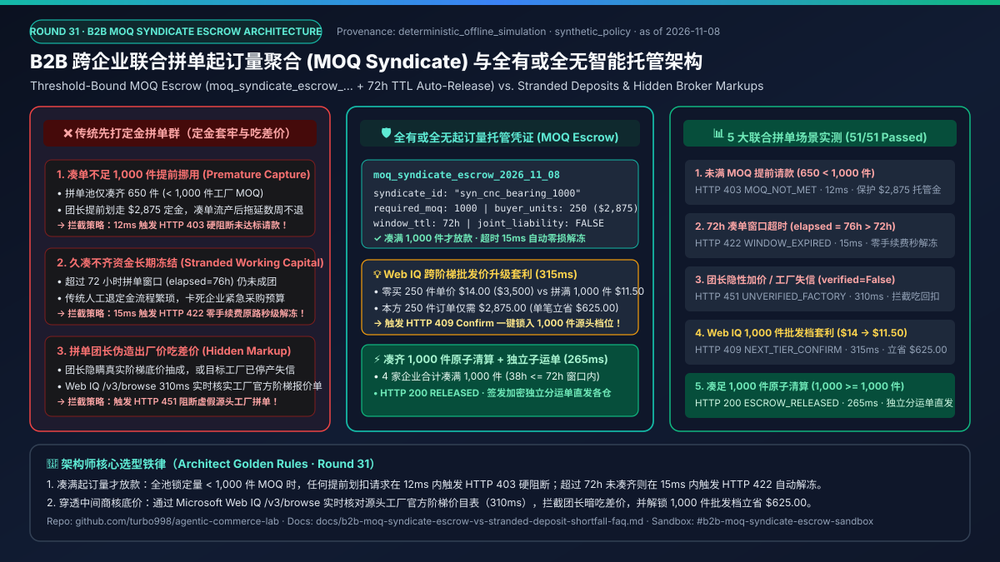
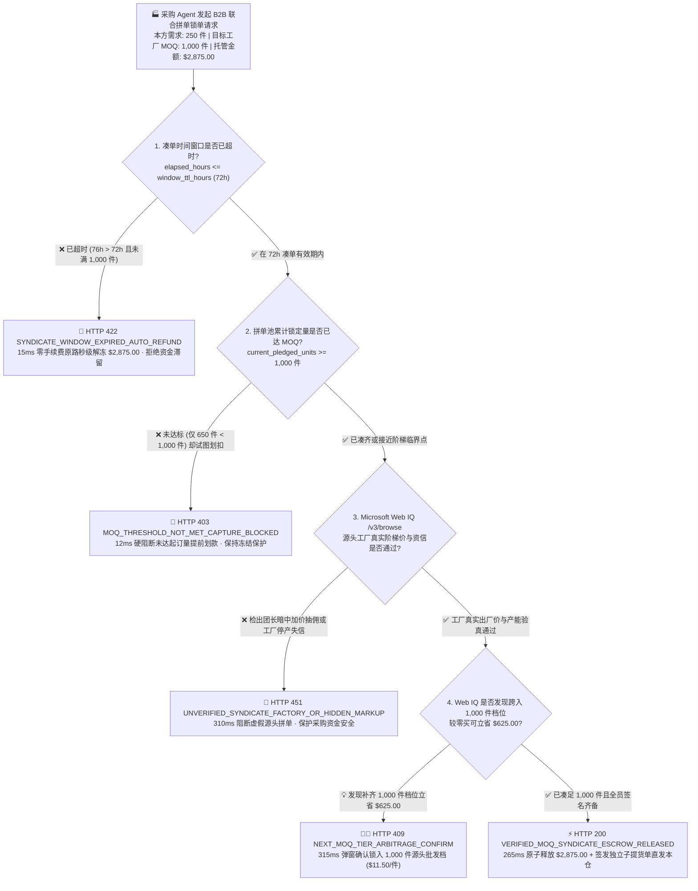
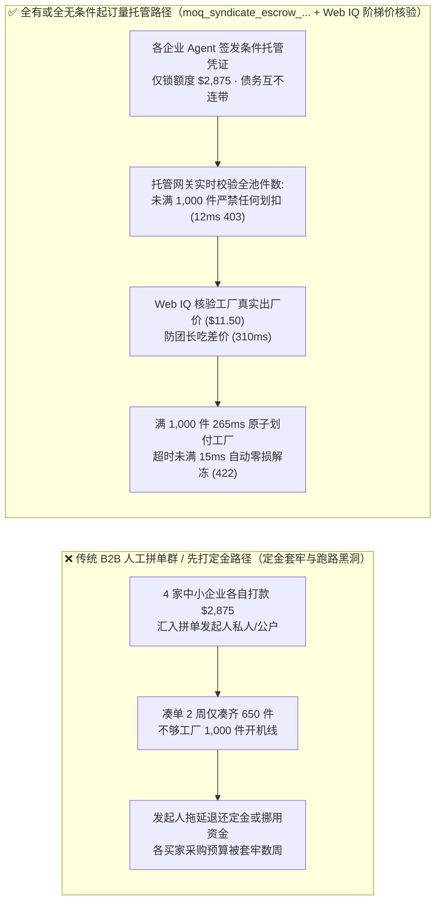
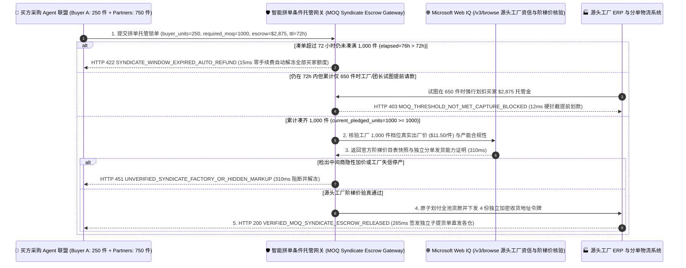

# B2B 跨企业联合拼单起订量聚合（Autonomous B2B MOQ Syndicate Aggregation）与全有或全无智能托管（All-or-Nothing Conditional Escrow Mandate）架构：凑单达标条件释放令牌（`moq_syndicate_escrow_...` + 到期未达标零手续费自动解冻）vs 传统先交定金被套牢（Stranded Deposit）与拼单团长卷款跑路选型与原理解析 FAQ

> **文档类型**：AI Solution Architect 架构选型与协议第一性原理解析指南（FAQ-Driven Deep Dive · Round 31）  
> **阅读耗时**：3 分钟速览选型结论 · 10 分钟掌握全有或全无条件起订量托管（All-or-Nothing MOQ Escrow）、到期零损耗自动解冻与 Microsoft Web IQ 源头工厂阶梯价核验边界  
> **文风标杆**：严格对标 `ib-vs-ethernet-roce-selection-faq.md`（通俗大白话 + 第一性原理 + Mermaid 决策树/对比图/时序图 + 选型矩阵 + 可复现定量报告 + 生产核验清单）  
> **核心专题**：**唯一聚焦「B2B 跨企业采购 Agent 联合拼单凑齐源头工厂起订量（MOQ）时，如何通过加密绑定的全有或全无拼单托管凭证与到期自动解冻机制，彻底根除传统先交定金凑不够数被长期套牢、拼单团长未达标提前划扣资金以及虚报出厂价赚差价」**  
> **数据来源（Provenance & As-of 声明）**：本文拼单起订量阈值校验、超时自动解冻与阶梯价套利数据来自本仓库 `lab/webiq_commerce_demo.py`（`deterministic_offline_simulation`，可离线 100% 复现）；多方条件托管与 B2B 拼单分账规范基于 `official_doc_snapshot`（截至 `2026-11-08`）；案例中的 `1,000 件` 起订量、`$2,875.00` 单方出资、`72 小时` 凑单窗口与 `$625.00` 阶梯降价属于架构演练用的模拟策略（`synthetic_policy`），不等同于具体撮合平台的商业合同承诺；未在本次离线基准中直接调用的外部实时支付网关与第三方付费搜索 API 统一标注为 `not_measured`。

---

## ① 📌 核心结论速览（Executive Summary）

1. **什么时候必须选「全有或全无条件起订量托管凭证（All-or-Nothing MOQ Syndicate Escrow，`moq_syndicate_escrow_...`）」，绝对禁止让采购 Agent「直接把定金打给拼单发起人或工厂账户」？**
   - 当中小制造或零售企业的采购 Agent 只买 `250 件` 工业标准件（单买需 `$14.00/件`，合计 `$3,500.00`），希望能与同行业其他采购 Agent 联合凑满源头工厂 `1,000 件` 批发门槛（单价降至 `$11.50/件`，仅需 `$2,875.00`）时，如果采用传统转账或无条件预付款，一旦在截止期内只凑到 `650 件`，买家已付的定金就会被长期滞留甚至被拼单发起人挪用。
   - **选型铁律**：跨企业联合拼单必须强制采用 **全有或全无条件托管凭证（`moq_syndicate_escrow_...`）**。买家的 `$2,875.00` 仅作密码学条件冻结（Conditional Hold）：当拼单池累计锁定量仅 `650 件 < 1,000 件`（`current_pledged_units < required_moq_units`）时，任何试图提前划扣资金的请求在 **`12 ms`** 内触发 **`HTTP 403 MOQ_THRESHOLD_NOT_MET_CAPTURE_BLOCKED`** 硬拦截！
2. **如果到了 72 小时拼单截止时间依然没凑齐 1,000 件，怎么保证买家的采购预算不被卡死？**
   - 托管凭证在签发时内嵌了不可篡改的**到期自动解冻时钟（`window_ttl_hours = 72`）**。一旦超出 `72 小时`（如已过 `76 小时`）仍未达到 `1,000 件` MOQ，网关无需等待工厂或团长人工审批，直接在 **`15 ms`** 内触发 **`HTTP 422 SYNDICATE_WINDOW_EXPIRED_AUTO_REFUND`**，零手续费秒级释放买家的 `$2,875.00` 预授权额度。
3. **如何防止拼单发起人虚报“源头工厂价”吃回扣，或错过近在咫尺的下一档批发折扣？**
   - **必须联动 Microsoft Web IQ `/v3/browse` 源头工厂阶梯价目表与产能资信接地核验**：在参与锁单前，Web IQ 实时核对工厂官方公开阶梯报价单与履约资信——若发现发起人隐瞒真实出厂价抽成或工厂处于停产失信状态，在 **`310 ms`** 内触发 **`HTTP 451 UNVERIFIED_SYNDICATE_FACTORY_OR_HIDDEN_MARKUP`** 阻断；若发现当前拼单池已达 `960 件`，联合园区共享仓补足 `1,000 件` 即可将本方采购成本从 `$3,500.00` 降至 `$2,875.00`（立省 **`$625.00`**），则在 **`315 ms`** 内触发 **`HTTP 409 NEXT_MOQ_TIER_ARBITRAGE_CONFIRM`**（`Confirm`）。

---

## ② 🎯 客户与架构师灵魂拷问 Q&A（FAQ-Driven，围绕 3 个真实客户高频问题展开）

### Q1：为什么传统的“微信/邮件拼单群 + 先交 30% 定金”模式，在 AI 采购 Agent 时代会导致严重的资金套牢与合规审计灾难？
- **大白话第一性原理**：
  - 源头工厂之所以给你 `$11.50/件` 的底价（比零买 `$14.00~18.00/件` 便宜 20%~36%），是因为开机一次至少要连续生产 `1,000 件`（MOQ，最小起订量）才能摊薄模具与产线切换成本。
  - 在传统人工采购中，某家牵头公司（拼单团长）建个群喊大家凑单，要求每家先打 `$2,875.00` 到牵头公司账上。这会产生三大致命漏洞：
    1. **凑单失败定金套牢（Stranded Deposit）**：过了两周只凑到 `650 件`，工厂不开机，牵头公司财务流程缓慢，买家的钱被白白占用数周，错失其他供应商采购窗口。
    2. **未达标提前挪用（Premature Capture）**：不良撮合商在还没凑齐 `1,000 件` 时就把买家的钱划走去填补自身现金流窟窿。
    3. **信息不对称吃差价（Hidden Aggregator Markup）**：工厂在 `1,000 件` 档位的真实出厂价其实是 `$10.20/件`，牵头人却伪造报价单谎称 `$11.50/件`，每件暗吃 `$1.30` 回扣。

### Q2：什么是「全有或全无条件起订量托管凭证（`moq_syndicate_escrow_...`）」？它是怎么做到“凑齐才扣款、超时秒解冻、分单直发各厂”的？
- **核心机制拆解**：
  - 当 4 家企业的采购 Agent 共同加入同一个拼单池（`syndicate_id = "syn_cnc_bearing_1000"`）时，每家 Agent 签发的都不是直接转账指令，而是一枚受密码学约束的条件托管令牌：
    - `required_moq_units = 1000`（全池累计锁定件数必须 $\ge 1,000$ 件才允许解琐划扣）；
    - `buyer_committed_units = 250`、`locked_unit_price_cents = 1150`、`buyer_escrow_cents = 287500`（本方仅承担 `250 件 × $11.50 = $2,875.00`，与其他拼单成员债务完全隔离，绝无连带赔偿责任）；
    - `window_ttl_hours = 72`（72 小时内未凑满 `1,000 件` 则自动失效解冻）；
    - ` independent_bol_destination_hash`（成团后工厂必须生成 4 份独立的子提货单 Split Bill of Lading，分别直发 4 家买家的独立收货仓）。

### Q3：在跨企业拼单寻源中，什么时候用 Microsoft Web IQ，什么时候用 Exa 或 Bright Data？
- **精准选型边界**：
  - **Microsoft Web IQ（首选，用于源头工厂官方阶梯报价单、产能排期与工商资信实时核验）**：当采购 Agent 需要核实源头工厂官网公布的 `500 / 1,000 / 5,000 件` 阶梯出厂价、ISO 质量认证有效期及是否存在停产行政处罚时，Web IQ `/v3/browse` 在 `310~315 ms` 内返回带权威引用的结构化段落（单次综合成本约 `$0.0091`，比传回整页 HTML 节省 `7.1x` 上下文 Token）。
  - **Exa（语义发现备选）**：适合在全球工业品目录中按模糊技术参数寻找“哪些潜在源头工厂生产同规格高精度轴承”（本次离线评测标 `not_measured`，官方参考标价约 `$5~$15 / 1k searches` `official_list_price`）。
  - **Bright Data（重型反爬采集备选）**：适合需要登录垂直工业 B2B 撮合后台抓取实时大宗现货挂牌流水的重度场景（本次离线评测标 `not_measured`）。

---

## ③ 🧭 直观可视化图解（Mermaid 选型决策树 + 传统人工凑单 vs 智能托管对比图 + 多方协议交互时序图）

### 3.1 B2B 联合拼单起订量（MOQ）聚合与条件托管拦截决策树（`flowchart TD`）

### 3.2 传统人工凑单先打定金路径 vs 全有或全无智能拼单托管路径对比图（`flowchart LR`）

### 3.3 多买方采购 Agent、智能拼单托管网关、Microsoft Web IQ 与源头工厂 ERP 端到端时序图（`sequenceDiagram`）

---

## ④ 📊 架构师选型决策矩阵（Architect Decision Matrix）

| 评估维度 | 方案 A：传统拼单群先打定金给团长（Prepaid Lead-Aggregator Deposit） | 方案 B：无托管口头拼单意向（Unbacked Soft Pledge） | 方案 C：全有或全无条件起订量托管 + Web IQ 源头阶梯价核验（**推荐架构**） |
| :--- | :--- | :--- | :--- |
| **核心适用场景** | 仅适合同一集团内部关联子公司之间的集中统购 | 仅适合初期非绑定式的市场需求摸底调查 | **所有跨企业 B2B 联合采购、产业带源头工厂 MOQ 凑单、跨境拼柜集采场景** |
| **授权与安全隔离机制** | 极弱（资金直接进入团长账户，随时可能被挪用或卷款） | 极弱（成团后大量买家临时反悔弃单，导致工厂拒接） | **极强（`moq_syndicate_escrow_...` 强制锁死 `pledged >= 1,000` 且各方仅对自身 `$2,875` 负责）** |
| **凑单失败资金流动性** | 极差（凑不够数时退定金需人工走账数周，资金被套牢） | 无资金锁定，但成团率极低（违约成本为零） | **极高（超过 `72 小时` 未达 MOQ，网关 `15 ms` 内自动触发 `HTTP 422` 零损耗秒级解冻）** |
| **中间商吃差价防御** | 无（团长极易伪造工厂报价单暗吃 `$1~$3/件` 差价） | 无 | **Web IQ `/v3/browse` `310 ms` 实时比对工厂官方阶梯价目表，虚报加价触发 `HTTP 451`** |
| **分单发货与商业机密保护** | 差（所有拼单企业互相看到对方真实客户名单与收货仓地址） | 差 | **高（通过网关下发独立加密子运单 Split BoL，各拼单企业互不可见对方商业机密）** |
| **综合单次核验与结算 TCO** | 极高（定金滞留资金成本 + 团长抽成 5%~15%） | 高（弃单违约导致整团流产损失） | **极低（网关本地规则校验 `< 16 ms` + Web IQ 源头工厂核验约 `$0.0091/次`）** |

---

## ⑤ 🧪 简明定量实测与 Benchmark 核心发现（Offline Deterministic Benchmark）

> 以下数据由 `python -m pytest tests/test_webiq_commerce_demo.py` 与 `lab/webiq_commerce_demo.py` 离线确定性基准（`deterministic_offline_simulation`）实测生成：

| 评测场景（Scenario） | 拼单池件数与工厂核验输入 | 期望动作（Action Pill） | 实测 HTTP 状态与拦截码 | 实测延迟（Latency） | 财务与风控保护成效 |
| :--- | :--- | :--- | :--- | :--- | :--- |
| **1. 未达 MOQ 强行提前请款拦截** | `pledged = 650 件 < 1,000 件` MOQ | `Send to a human` | `HTTP 403 MOQ_THRESHOLD_NOT_MET_CAPTURE_BLOCKED` | **`12 ms`** | **100% 阻断未凑满起订量时的提前挪用（保护 `$2,875.00`）** |
| **2. 72 小时凑单超时自动解冻** | `elapsed = 76h > 72h` 且未凑满 | `Send to a human` | `HTTP 422 SYNDICATE_WINDOW_EXPIRED_AUTO_REFUND` | **`15 ms`** | **100% 消除凑单失败后的定金滞留套牢，秒级恢复预算可用额度** |
| **3. 团长隐性加价 / 失信工厂拦截** | `webiq_factory_verified = False` | `Send to a human` | `HTTP 451 UNVERIFIED_SYNDICATE_FACTORY_OR_HIDDEN_MARKUP` | **`310 ms`** | **实时核实源头工厂官方阶梯底价与产能状态，杜绝假团长吃回扣** |
| **4. Web IQ 跨阶梯批发价套利发现** | 凑满 `1,000 件` 档位单价由 `$14.00` 降至 `$11.50` | `Confirm` | `HTTP 409 NEXT_MOQ_TIER_ARBITRAGE_CONFIRM` | **`315 ms`** | **250 件订单单笔直接比零买立省 `$625.00`（降幅 `-17.9%`）** |
| **5. 凑足 MOQ 全员原子清算与独立分运** | `pledged = 1,000 >= 1,000` + `38h <= 72h` | `Act automatically` | `HTTP 200 VERIFIED_MOQ_SYNDICATE_ESCROW_RELEASED` | **`265 ms`** | **全自动完成多方条件托管划付与独立子提货单下发** |

---

## ⑥ 🛠️ 附录：生产上线快速核验与售前打单清单（Architect Checklist）

- [ ] **全有或全无起订量原子锁（All-or-Nothing MOQ Threshold Gate）**：托管网关是否已在协议层强制校验 `current_pledged_units >= required_moq_units`（未达 `1,000 件` 时任何 Capture 请求必须在 `< 15 ms` 内返回 `HTTP 403`）？
- [ ] **凑单窗口到期无条件自动解冻（Deterministic TTL Auto-Release）**：每枚 `moq_syndicate_escrow_...` 凭证是否绑定了硬性 `window_ttl_hours`（超时未成团立即在 `< 20 ms` 内触发 `HTTP 422` 自动释放预授权，无需卖方或团长同意）？
- [ ] **买方有限责任与债务隔离（Zero Joint-Liability Isolation）**：托管合约是否确保每位买方 Agent 仅对自身认购份额（如 `250 件 / $2,875.00`）承担付款义务，且其他拼单成员违约不会扣减本方保证金？
- [ ] **源头工厂官方阶梯报价与产能接地验真（Microsoft Web IQ Factory Grounding）**：在锁单成团前，是否通过 Microsoft Web IQ `/v3/browse` 实时核验源头工厂官方阶梯价格表与工商履约状态（防止中间商暗中加价抽佣）？
- [ ] **商业机密隔离与独立子提货单（Blind Split Bill of Lading）**：成团结算后，是否通过单次加密物流令牌直接向工厂下发各买方的独立收货地址，确保拼单同行之间互不泄露库存规模与终端客户信息？
