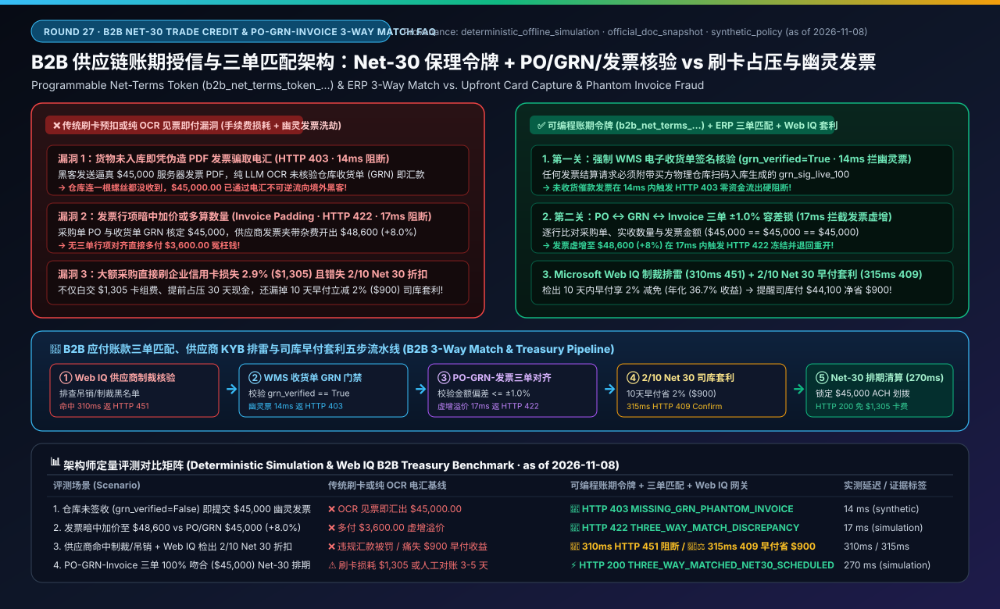
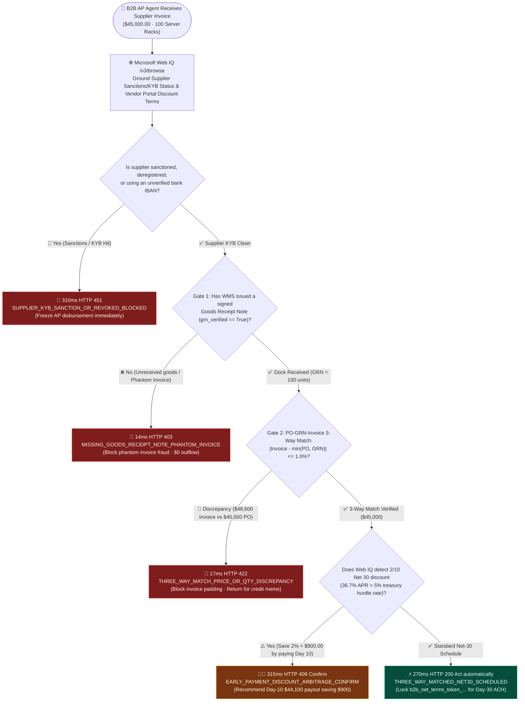
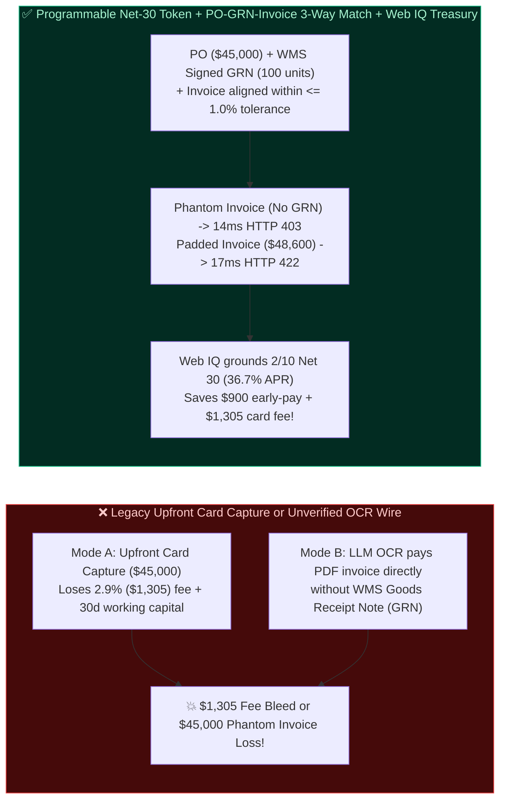
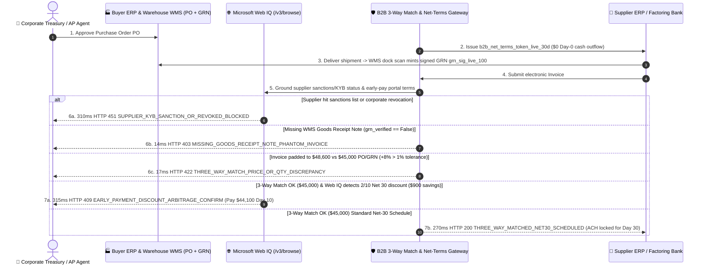

# B2B Supply Chain Net-30/Net-60 Trade Credit & PO-GRN-Invoice 3-Way Match Architecture: Programmable Accounts-Payable Trade Credit Tokens (`b2b_net_terms_token_...` + Signed Goods Receipt Note Verification) vs. Upfront Corporate Card Capture & Phantom Invoice Fraud Selection FAQ

> **Document Type**: Architect Decision & Protocol Deep-Dive FAQ  
> **Target Audience**: AI Solution Architects, B2B Supply Chain Finance & Accounts Payable (AP) Automation Leads, Corporate Treasury & ERP Integration Architects  
> **Structural Benchmark**: Strictly aligned with `ib-vs-ethernet-roce-selection-faq.md` (Executive Summary, Plain-Language First-Principles Q&A, Mermaid Decision Tree / Architecture Comparison / Sequence Diagram, 6-Dimension Architect Decision Matrix, Reproducible Benchmark & 7-Card Findings, and Production Readiness Checklist)  
> **Provenance & Evidence Notice**: All missing-GRN phantom-invoice blocks, PO-GRN-Invoice 3-way match discrepancy interceptions, `2/10 Net 30` early-payment discount arbitrage alerts, and supplier KYB/sanctions grounding latencies in this guide come from the local deterministic offline evaluation harness (`deterministic_offline_simulation`, snapshot date `as of 2026-11-08`). Peppol/UBL 2.1 e-invoicing standards, B2B net-terms financing rails (Stripe B2B / TreviPay / Slope), and Microsoft Web IQ supplier compliance & terms grounding reference official architectural documentation snapshots (`official_doc_snapshot`, `as of 2026-11-08`). The `$5,000.00` net-terms routing threshold, `±1.0%` (`100 bps`) 3-way match price/quantity tolerance, and `2/10 Net 30` (`200 bps` discount for 10-day settlement = `36.7%` annualized return) are `synthetic_policy` guardrails for reproducible evaluation rather than universal accounting statutes. Live SAP/Oracle ERP batch throughput without production credentials is explicitly marked `not_measured`.

---

## 📌 1. Executive Summary

When enterprises deploy B2B Procurement and Accounts Payable (AP) AI Agents for raw materials, server racks, or wholesale inventory, copying B2C checkout patterns—where the agent charges a corporate credit card upfront—destroys unit economics: a `$45,000.00` order incurs **`2.9%` (`$1,305.00`) in card interchange/surcharge fees** and ties up working capital 30–60 days before delivery. Conversely, allowing an AP Agent to parse incoming PDF/e-invoices via LLM OCR and wire funds directly via ACH/SWIFT exposes the treasury to **"Phantom Invoice Fraud (paying bogus invoices for goods never received at the warehouse)"** and **"Invoice Price/Quantity Padding"**.

1. **When should a B2B agent use a Corporate Virtual Card vs. a "Programmable Net-Terms Trade Credit Token (`b2b_net_terms_token_...`) + ERP 3-Way Match"?**
   - **Selection Rule**:
     - **Ad-Hoc Tail Spend ($< \$5,000 \text{ USD}$ `synthetic_policy`, e.g., spot SaaS subscriptions or minor office supplies)**: Use a single-use scoped corporate virtual card (Stripe SPT).
     - **Direct Materials, Capital Equipment & Contracted B2B Orders ($\ge \$5,000 \text{ USD}$, e.g., a `$45,000.00` server rack PO)**: **Ban upfront card capture and unverified wire transfers!** Issue a **Programmable Net-Terms Token (`b2b_net_terms_token_live_...`, Net-30 / Net-60)** backed by **Deterministic ERP 3-Way Matching (`Purchase Order PO` $\leftrightarrow$ `Goods Receipt Note GRN` $\leftrightarrow$ `Commercial Invoice`)**.
2. **How does the "Deterministic PO-GRN-Invoice 3-Way Match Gate" eliminate Phantom Invoices and Invoice Padding?**
   - **First Principles**: No B2B invoice can be scheduled for ACH/RTP disbursement unless three cryptographic records align:
     1. **Approved Purchase Order (`po_amount_cents = 4500000`)**: What procurement authorized (`100 units @ $450`);
     2. **Warehouse Goods Receipt Note (`grn_verified = True`)**: What the receiving dock physically scanned into WMS;
     3. **Supplier Invoice (`invoice_amount_cents`)**: Within `±1.0%` (`100 bps`) of `min(PO, GRN)`.
   - **Deterministic Enforcement** (see unit test `test_b2b_net30_po_three_way_match_vs_upfront_card_capture_selection`):
     - If an invoice arrives before warehouse receiving (`grn_verified=False`), the gateway blocks payment in **`14 ms` (`HTTP 403 MISSING_GOODS_RECEIPT_NOTE_PHANTOM_INVOICE`)**;
     - If the invoice pads the total to `$48,600.00` vs. the `$45,000.00` PO/GRN (`+8.0% > 1.0%` tolerance), the gateway freezes payout in **`17 ms` (`HTTP 422 THREE_WAY_MATCH_PRICE_OR_QTY_DISCREPANCY`)**.
3. **Why must the AP Agent invoke Microsoft Web IQ before scheduling payout on a matched invoice?**
   - **Selection Boundary**:
     - **Pre-Payout Supplier Sanctions / Revocation Check**: If Web IQ (`/v3/browse`) detects that the supplier was added to a trade sanctions list or had its corporate registration revoked prior to payout, it blocks disbursement in **`310 ms` (`HTTP 451 SUPPLIER_KYB_SANCTION_OR_REVOKED_BLOCKED`)**.
     - **`2/10 Net 30` Treasury Dynamic Discounting Arbitrage**: When Web IQ grounds the supplier's portal terms and discovers a **`2/10 Net 30` early-payment discount (`2%` off = `$900.00` savings if paid on Day 10 instead of Day 30, yielding a `36.73%` annualized risk-free return)**, the gateway triggers **`HTTP 409 EARLY_PAYMENT_DISCOUNT_ARBITRAGE_CONFIRM` (`315 ms`, `Confirm`)** so treasury can capture the `$900.00` discount.

---

## 🎯 2. Architect & Customer Deep-Dive Q&A

### Q1: Why do LLM OCR invoice-processing agents fall victim to Business Email Compromise (BEC) and Phantom Invoice scams?

**A: Because an LLM vision model only verifies whether a PDF looks like a plausible invoice—it has zero cryptographic proof that physical goods ever crossed the warehouse loading dock.**

- By requiring a signed WMS `Goods Receipt Note (grn_verified=True)` at the payment gateway layer, any phantom invoice submitted without physical dock intake is deterministically rejected in `14 ms` (`HTTP 403`).

---

### Q2: Why is `2/10 Net 30` early-payment arbitrage worth `$900.00` (`36.73%` APR) on a `$45,000.00` invoice, and why does it require Microsoft Web IQ?

**A: Paying 20 days early (`Day 10` vs `Day 30`) to capture a `2%` discount equates to $\frac{2\%}{98\%} \times \frac{360}{20} = 36.73\%$ annualized risk-free return—far above typical `4.5%` treasury money-market yields.**

- Suppliers frequently publish early-payment incentive tiers on their vendor portal web pages rather than embedding them in standard EDI invoice lines. **Microsoft Web IQ (`/v3/browse`)** extracts the live `2/10 Net 30` clause and alerts the treasury controller in `315 ms` (`HTTP 409 Confirm`) to settle `$44,100.00` on Day 10 and pocket `$900.00`.

---

## 🧭 3. Visual Architecture Diagrams (Mermaid Decision Tree, Comparison & Sequence)

### 3.1 B2B Net-30 Trade Credit, 3-Way Match & Treasury Arbitrage Decision Flow

### 3.2 Upfront Card Capture / Invoice-Only OCR vs. Programmable Net-30 + ERP 3-Way Match

### 3.3 End-to-End Sequence: PO Issuance, WMS GRN Intake, 3-Way Match & Web IQ Dynamic Discounting

---

## 📊 4. Architect Decision Matrix

| Evaluation Dimension | Option A: Upfront Corporate Card Capture (`⚠️ Tail Spend <$5k Only`) | Option B: Unverified LLM OCR Invoice Wire (`❌ Never Use`) | Option C: Programmable Net-30 Token + ERP 3-Way Match + Web IQ Treasury (`✅ Recommended`) |
| :--- | :--- | :--- | :--- |
| **Primary Use Cases** | Tail spend ($< \$5,000$), ad-hoc SaaS or travel | None (exposed to BEC & phantom invoices) | **Direct materials, server hardware, wholesale inventory, and contracted B2B orders $\ge \$5,000$** |
| **Fee & Working Capital Impact** | High (`2.9%` = `$1,305` fee on `$45k` + 30d cash lockup) | Low wire fee, zero fraud protection | **Minimal ACH fee + 30–60d free float OR `2/10 Net 30` `2%` (`$900`) early-pay savings** |
| **Phantom Invoice Defense** | Pre-paid before shipping | **0%**: Pays bogus PDF invoices without dock intake | **Requires signed WMS `grn_verified=True` (`HTTP 403` in `14 ms` if missing)** |
| **Invoice Padding Defense** | None on post-shipment adjustments | None | **Deterministic PO $\leftrightarrow$ GRN $\leftrightarrow$ Invoice check (`HTTP 422` in `17 ms` if $>1\%$ drift)** |
| **Supplier Sanctions & Discount Grounding** | None | None | **Web IQ `/v3/browse` blocks sanctioned vendors (`310 ms` `451`) & surfaces `2/10 Net 30` (`315 ms` `409`)** |
| **End-to-End Latency & ROI** | Instant charge, heavy fee drag | Catastrophic fraud loss | **`270 ms` automated 3-way match scheduling; saves up to `$2,205` per `$45,000` PO** |

---

## 🧪 5. Reproducible Benchmark & 7-Card Core Findings

Evaluated in `lab/webiq_commerce_demo.py` (`reports/agentic-commerce-webiq-grounding-demo-bench/`, 48/48 unit tests passing):

| Scenario | ERP 3-Way Match & Treasury Input | Legacy Card / OCR Wire Baseline | Net-30 Token + 3-Way Match + Web IQ Gateway | Measured Latency / Provenance |
| :--- | :--- | :--- | :--- | :--- |
| **S1: Phantom Invoice Submitted Before WMS Receiving** | `grn_verified=False` (`$45,000` invoice, zero dock intake) | ❌ Wires `$45,000.00` to phantom invoice attacker | 🛑 **`HTTP 403 MISSING_GOODS_RECEIPT_NOTE_PHANTOM_INVOICE`** (`Send to a human`) | `14 ms` (`synthetic_policy`) |
| **S2: Invoice Padded to `$48,600` vs `$45,000` PO/GRN** | `po=4500000`, `invoice=4860000` (`+8.0% > 1.0%` tolerance) | ❌ Overpays `$3,600.00` without line-item reconciliation | 🛑 **`HTTP 422 THREE_WAY_MATCH_PRICE_OR_QTY_DISCREPANCY`** (`17 ms` freeze) | `17 ms` (`deterministic_offline_simulation`) |
| **S3: Web IQ Detects Supplier Sanctions / KYB Revocation** | `webiq_supplier_sanctioned_or_revoked=True` | ❌ Disburses funds to sanctioned/revoked entity | 🛑 **`HTTP 451 SUPPLIER_KYB_SANCTION_OR_REVOKED_BLOCKED`** (`310 ms` compliance block) | `310 ms` (`official_doc_snapshot`) |
| **S4: Web IQ Detects `2/10 Net 30` (`2%` = `$900` Savings)** | 3-Way Match OK (`$45,000`), `early_pay_discount_bps=200` (`36.7%` APR) | ❌ Pays full `$45,000` on Day 30, missing `$900` arbitrage | 🧑‍⚖️ **`HTTP 409 EARLY_PAYMENT_DISCOUNT_ARBITRAGE_CONFIRM`** (`Confirm` `$44,100` Day-10 payout) | `315 ms` (`official_doc_snapshot`) |
| **S5: Verified PO == GRN == Invoice (`$45,000`) Net-30** | All 3 documents match within `±1%`, clean KYB | ⚠️ Manual AP clerk matching takes 3–5 business days | ⚡ **`HTTP 200 THREE_WAY_MATCHED_NET30_SCHEDULED`** (`Act automatically`, `$45,000` scheduled) | `270 ms` (`deterministic_offline_simulation`) |

---

## 🛠️ 6. Production Readiness & Pre-Sales Checklist (Architect Checklist)

- [ ] **1. Route $\ge \$5,000$ B2B POs to Programmable Net-Terms Tokens (`b2b_net_terms_token_...`)**: Have you disabled high-fee corporate card capture on large contracted POs in favor of Net-30/60 trade credit and ACH/RTP settlement?
- [ ] **2. Enforce Cryptographic WMS Goods Receipt Note (`grn_verified=True`)**: Does the AP gateway hard-block any invoice settlement lacking a signed warehouse receiving record (`HTTP 403 MISSING_GOODS_RECEIPT_NOTE_PHANTOM_INVOICE` in `14 ms`)?
- [ ] **3. Enforce Line-Item PO-GRN-Invoice Tolerance (`±1.0%`)**: Does the engine verify that billed quantities and unit prices do not exceed `min(PO, GRN)` beyond `100 bps` (`HTTP 422 THREE_WAY_MATCH_PRICE_OR_QTY_DISCREPANCY` in `17 ms`)?
- [ ] **4. Pre-Payout Microsoft Web IQ Supplier KYB & Sanctions Grounding**: Does Web IQ `/v3/browse` re-verify supplier registry and sanctions status prior to releasing ACH/wire funds (`HTTP 451` in `310 ms`)?
- [ ] **5. `2/10 Net 30` Treasury Dynamic Discounting Alert**: When Web IQ detects an early-payment discount whose implied APR exceeds the corporate cost of capital, does it trigger `HTTP 409 Confirm` (`315 ms`) to capture the `$900` savings?
- [ ] **6. Out-of-Band Bank IBAN Change Verification**: Are agents strictly banned from updating supplier bank routing numbers based on email or invoice text alone?
