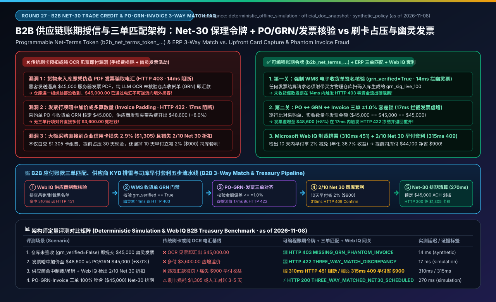
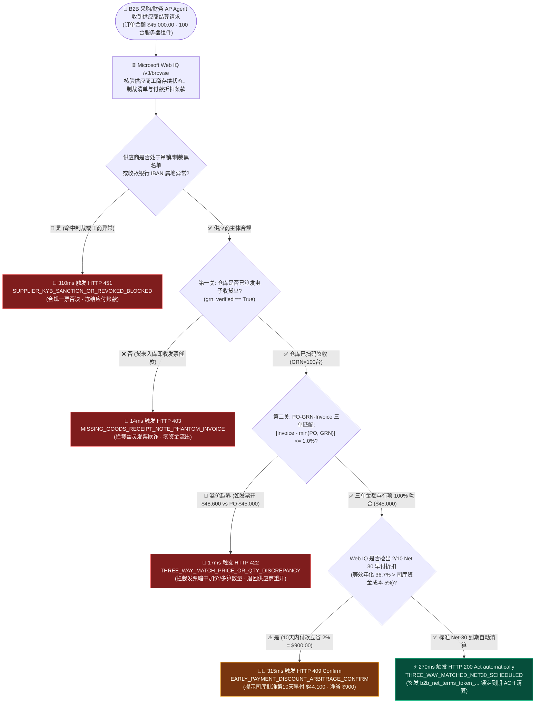
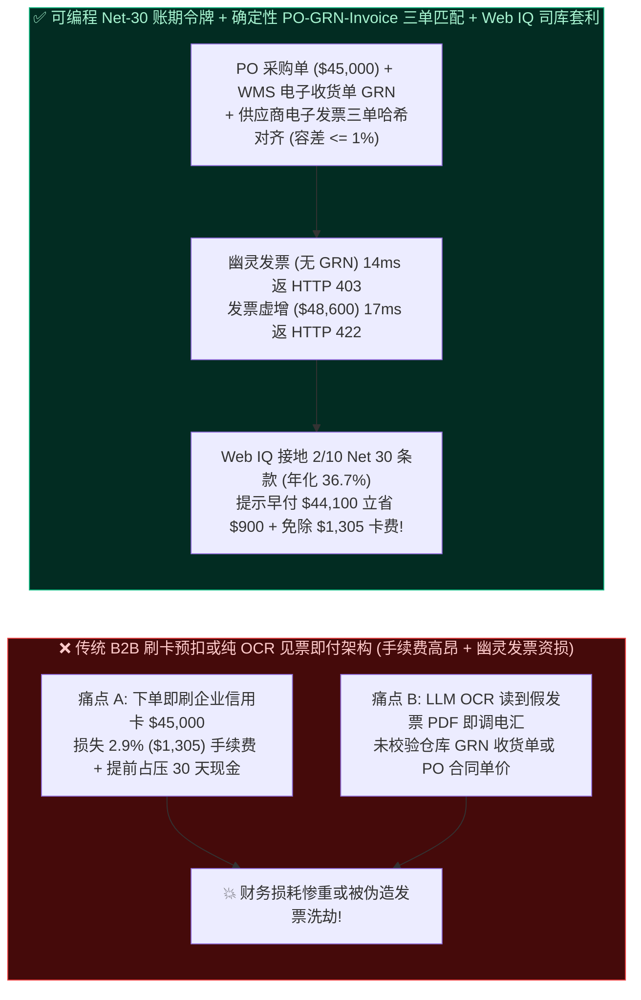
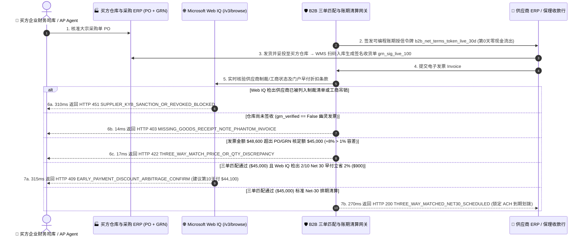

# B2B 供应链账期授信（Net-30/Net-60 Trade Credit）与采购单三单匹配（PO-GRN-Invoice 3-Way Match）架构：可编程应付账款保理令牌（`b2b_net_terms_token_...` + 电子收货单 GRN 行项核验）vs 信用卡预扣占压现金流与幽灵发票欺诈选型与原理解析 FAQ

> **文档类型**：架构师选型与协议原理解析决策指南（Architect Decision & Protocol Deep-Dive FAQ）  
> **适用对象**：AI Solution Architect、B2B 供应链金融与 ERP 应付账款（Accounts Payable, AP）自动化架构师、企业司库（Corporate Treasury）与内控合规负责人  
> **对标范式**：严格遵循 `ib-vs-ethernet-roce-selection-faq.md` 通俗问答 + 第一性原理 + Mermaid 决策树/时序图 + 选型矩阵 + 可复现评测 + 生产核验清单六段式结构  
> **数据来源与口径声明（Provenance & Evidence Notice）**：本文所有未签收幽灵发票拦截（Missing GRN）、三单匹配（PO-GRN-Invoice 3-Way Match）数量/单价溢出阻断、`2/10 Net 30` 早付现金折扣套利及供应商工商失信接地延迟均基于本地离线确定性沙盒评测（`deterministic_offline_simulation`，快照日期 `as of 2026-11-08`）；Peppol/UBL 2.1 电子发票标准、Stripe B2B 账期支付/TreviPay/Slope 商业授信网关及 Microsoft Web IQ 供应商合规与条款接地参考各自官方技术文档快照（`official_doc_snapshot`，`as of 2026-11-08`）；演示中的 `$5,000.00` 强制三单匹配门槛、`±1%` 行项溢价容差与 `2/10 Net 30`（10 天内付款打 98 折，折合年化 `36.7%` 无风险收益）均为合成演示护栏（`synthetic_policy`），非通用会计准则或特定银行信贷承诺；未获实时生产 SAP/Oracle ERP 专线连接凭证的批处理对账吞吐显式标注为 `not_measured`。

---

## 📌 一、核心结论速览（Executive Summary）

当企业引入 B2B 采购与财务结算智能体（Procurement & Accounts Payable Agent）处理大额生产性物料、云算力合同或办公设备采购时，如果照搬 B2C 电商模式让 Agent 直接刷企业信用卡（Corporate Card Upfront Capture），不仅每笔 `$45,000` 订单要白白给卡组交 **`2.9%`（`$1,305`）通道手续费**，还会导致货还没发、企业的流动资金就被提前占压 30～60 天；反之，如果让财务 AP Agent 收到供应商发来的 PDF/电子发票就直接通过 ACH/电汇打款，又极易遭遇“**幽灵发票欺诈（Phantom Invoice Fraud，货根本没入库就伪造发票骗汇款）**”或“**发票行项偷偷加价/多算数量（Invoice Padding）**”。

1. **什么时候用企业虚拟卡即时扣款（Corporate Virtual Card），什么时候必须强制切换为“可编程账期授信令牌（`b2b_net_terms_token_...`）+ 强制三单匹配（3-Way Match）”？**
   - **选型铁律**：
     - **零星小额非目录采购（Tail Spend $< \$5,000 \text{ USD}$ `synthetic_policy`，如临时买 3 台显示器或 SaaS 团队月卡）**：走单次受限虚拟卡（Stripe SPT / Corporate Virtual Card），免去繁琐建档。
     - **大宗生产物料、算力硬件与框架协议采购（$\ge \$5,000 \text{ USD}$，如 `$45,000` 服务器机柜或原材料）**：**严禁下单时全额刷卡或无收货单直接电汇**！必须签发 **可编程账期授信令牌（`b2b_net_terms_token_live_...`，支持 Net-30 / Net-60 账期或供应链保理）**，且资金释放必须 100% 绑定 **ERP 确定性三单匹配（Purchase Order 采购单 $\leftrightarrow$ Goods Receipt Note 仓库收货单 $\leftrightarrow$ Invoice 供应商发票）**。
2. **什么是“ERP 确定性三单匹配门禁（PO-GRN-Invoice 3-Way Match Gate）”，它如何从根源上消灭“幽灵发票”与“暗中加价”？**
   - **第一性原理**：任何一笔合法的 B2B 货款划拨，必须同时满足三个独立数据源的交叉印证：
     1. **我们确实批准买了它（PO, Purchase Order）**：采购系统签发的 `$45,000`（100 台 $\times$ `$450`）加密采购单哈希；
     2. **仓库确实收到了合格的货（GRN, Goods Receipt Note）**：买方仓库 WMS 扫码入库签发的电子收货凭证（如实收 100 台良品，`grn_signed=True`）；
     3. **供应商开出的账单分毫不差（Commercial Invoice）**：发票请求的实付金额与单价未超出 PO 与 GRN 核定值的容差上限（如 `±1%`）。
   - **确定性拦截表现**（参见单元测试 `test_b2b_net30_po_three_way_match_vs_upfront_card_capture_selection`）：
     - 若黑客或不良供应商在仓库尚未签收货物（`grn_verified=False`）时就发来催款发票，AP 网关在 **`14 ms` 内直接阻断打款并返回 `HTTP 403 MISSING_GOODS_RECEIPT_NOTE_PHANTOM_INVOICE`**；
     - 若采购单与收货单核定为 `$45,000`，而供应商发票偷偷夹带私货开出 `$48,600`（溢价 `+8.0% > 1.0%` 容差），网关在 **`17 ms` 内立即冻结付款并返回 `HTTP 422 THREE_WAY_MATCH_PRICE_OR_QTY_DISCREPANCY`**。
3. **在三单匹配通过后准备排期付款时，为什么还要调用 Microsoft Web IQ 做“供应商失信/制裁名录核验与 `2/10 Net 30` 早付折扣套利接地”？**
   - **选型边界**：
     - **制裁与空壳公司实时排雷**：供应商在半年前入库建档时可能合规，但在付款前夕被列入贸易管制实体清单或工商吊销，Web IQ `/v3/browse` 在 **`310 ms` 内实时接地官方公示库并触发 `HTTP 451 SUPPLIER_KYB_SANCTION_OR_REVOKED_BLOCKED`**；
     - **`2/10 Net 30` 司库现金折扣套利（Dynamic Discounting Arbitrage）**：许多供应商合同或门户条款提供 **`2/10 Net 30`**（若在 10 天内提前结清，直接免除 `2%` 货款 = 立省 **`$900.00`**，相当于拿闲置资金获得 **`36.7%` 年化无风险收益**，远高于企业活期存款 `4.5%` 年化收益）。当 Web IQ 接地检出该隐藏早付折扣条款时，网关在 `315 ms` 内触发 `HTTP 409 EARLY_PAYMENT_DISCOUNT_ARBITRAGE_CONFIRM`（`Confirm`），提示企业司库一键批准提前第 10 天打款净省 `$900.00`！

---

## 🎯 二、客户与架构师灵魂拷问 Q&A（FAQ-Driven Deep Dive）

### Q1：几年前 Google 和 Facebook 曾被黑客用伪造的台湾硬件供应商发票骗走上亿美元；现在很多公司用 LLM 视觉模型自动识别发票 PDF 并调银行 API 打款，为什么反而更容易被“幽灵发票”洗劫？

**A：因为纯 LLM 视觉/文本提取只能判断“这张 PDF 看起来像不像一张格式工整的发票”，却无法验证“仓库到底有没有收到这批货”！**

1. **大白话还原 BEC（商业邮件妥协）与幽灵发票攻击链**：
   - 攻击者入侵供应商邮箱或仿冒供应商域名，向企业的财务邮箱发送一份排版极其逼真的 Peppol/PDF 发票：“贵司采购的 100 台服务器机柜，货款 `$45,000.00`，请汇入我司新变更的清算账户”。
   - 如果企业的 AP Agent 只是用大模型 OCR 读出金额和账号就去调支付接口，哪怕发票完全是凭空捏造的（仓库连一根螺丝都没收到），资金也会在几秒钟内被汇往境外黑客账户。
2. **确定性三单匹配（PO $\leftrightarrow$ GRN $\leftrightarrow$ Invoice）如何实现 100% 物理级免疫？**
   - 在本架构中，财务 AP Agent 根本没有“凭单张发票付款”的权限！
   - 支付网关在签发清算指令前，强制要求传入由企业内部采购系统签名的 `po_id_hash` 和由物理仓库 WMS 系统签名的 `grn_id_hash`（收货单哈希）。
   - 没有仓库管理员扫码收货生成的 `grn_verified=True` 密码学断言，任何外部发来的发票在 `14 ms` 内一律按 `HTTP 403 MISSING_GOODS_RECEIPT_NOTE_PHANTOM_INVOICE` 拒之门外！

---

### Q2：大额 B2B 采购（比如 `$45,000`）为什么不能直接用 Stripe 信用卡扣款？用“可编程账期授信令牌（`b2b_net_terms_token_...`）”到底省了多少钱？

**A：直接刷卡会同时重创买卖双方——卖方被砍掉 `2.9%` 毛利，买方丧失 30～60 天免息营运资金周转期。**

1. **算一笔 `$45,000` 采购的财务账**：
   - **若走企业信用卡即时扣款（Card Upfront Capture）**：
     - 通道费损耗：`$45,000 × 2.9% = $1,305.00`（供应商往往会把这笔费用以“刷卡附加费 Credit Card Surcharge”转嫁给买方）；
     - 现金流占压：货在海上漂 30 天，买方资金第 1 天就被划走，丧失整整 30–60 天的营运现金流收益。
   - **若走可编程账期授信令牌 + ACH/RTP 清算（`b2b_net_terms_token_live_...`）**：
     - 下单时仅签发保理授信凭证（供应商获得确定性付款保障立即排产发货），买方第 0 天现金支出为 **`$0.00`**；
     - 货物入库通过三单匹配后，通过企业低成本清算轨（ACH / FedNow / SEPA Instant）按单笔固定封顶费（如 `$2.00`）清算，直接省下 **`$1,303.00`** 通道费；
     - 若叠加 Web IQ 识别出的 **`2/10 Net 30`** 早付折扣，还能额外再省 **`2%`（`$900.00`）**，单笔订单综合财务收益高达 **`$2,203.00`**！

---

### Q3：什么是 `2/10 Net 30` 早付折扣？为什么需要 Microsoft Web IQ 去实时接地供应商门户条款？

**A：`2/10 Net 30` 是 B2B 贸易中最经典的现金折扣条款——意思是“标准账期 30 天全额付清，但如果买方在 10 天内提前付款，直接享受 2% 现金减免”。**

- **年化收益率第一性原理公式**：
  提前 $30 - 10 = 20$ 天付款即可获得 $2\%$ 确定性折扣，折算为等效年化无风险收益率（Implicit Annualized Return）为：
  $$\text{APR} = \frac{2\%}{100\% - 2\%} \times \frac{360}{30 - 10} = \frac{0.02}{0.98} \times 18 \approx \mathbf{36.73\%}$$
- 只要企业账上资金成本（或活期理财年化收益率，通常为 `4%–5%`）远低于 **`36.73%`**，提前在第 10 天付款就是稳赚不赔的司库套利！
- 但许多供应商不会把 `2/10 Net 30` 写进电子发票 JSON 字段，而是写在供应商结算门户的《付款激励政策公告（Vendor Portal Payment Terms Addendum）》网页中。通过 **Microsoft Web IQ (`/v3/browse`)** 实时接地该条款并核算（立省 `$900.00`），网关在 `315 ms` 内触发 `HTTP 409 EARLY_PAYMENT_DISCOUNT_ARBITRAGE_CONFIRM`，帮企业财务总监白捡 `$900.00` 纯利。

---

## 🧭 三、直观可视化图解（Mermaid 决策树 + 架构对比 + 时序图）

### 3.1 B2B 账期授信、ERP 三单匹配与司库早付套利决策树（Architect Decision Flow）

### 3.2 传统刷卡预扣/盲目见票即付 vs 可编程 Net-30 授信令牌 + ERP 三单匹配对比图

### 3.3 买方 ERP、WMS 收货仓、Web IQ 司库情报与 B2B 账期清算网关端到端时序图（Sequence Diagram）

---

## 📊 四、架构师选型决策矩阵（Architect Decision Matrix）

| 评估维度 | 方案 A：B2B 大额订单刷企业信用卡预扣（Upfront Corporate Card Capture — ⚠️ 仅适 $<\$5k$ 零星采购） | 方案 B：纯 LLM OCR 读发票直接电汇（Unverified Invoice-Only Wire — ❌ 严禁生产使用） | 方案 C：可编程账期令牌 `b2b_net_terms_token_...` + ERP 三单匹配 + Web IQ 早付套利（3-Way Match Net-Terms — ✅ 生产推荐） |
| :--- | :--- | :--- | :--- |
| **核心适用场景** | 零星尾部品类（Tail Spend $< \$5,000$）、临时差旅或无账期小微商户 | 无（极易遭受 BEC 邮件伪造与幽灵发票诈骗） | **大宗原材料、服务器算力采购、年度软件授权及一切 $\ge \$5,000$ 的企业级 B2B 供应链结算** |
| **通道手续费与现金流成本** | 高昂（`2.5%–3.0%` 卡组费率，`$45,000` 损耗 `$1,305`；且提前占压现金） | 电汇手续费低，但无账期保护或全靠人工排期 | **极低（ACH/RTP 封顶几美元，享 30–60 天免息账期，或享 `2/10 Net 30` 早付立减 `2% = $900`）** |
| **防“幽灵发票（未收货骗汇款）”** | 下单即扣款，若供应商破产不发货需漫长争议追讨 | **0% 防御**：收到伪造 PDF 发票即打款，资金不可逆流失 | **强制校验 WMS 电子收货单签名 `grn_verified=True`（无收货单 `14 ms` 返回 `HTTP 403`）** |
| **防“发票虚增单价/数量”** | 无法防止后续附加账单偷扣 | 仅看发票自身合计，不与原 PO 合同及实收数比对 | **PO $\leftrightarrow$ GRN $\leftrightarrow$ Invoice 确定性三单比对（超出 `±1%` 容差 `17 ms` 返回 `HTTP 422`）** |
| **供应商合规与早付折扣发现** | 无 | 无 | **Web IQ `/v3/browse` 实时排查制裁/吊销（`310 ms` `HTTP 451`）并捕捉 `2/10 Net 30` 套利（`315 ms` `HTTP 409`）** |
| **端到端延迟与综合 ROI** | 秒级扣款但财务损耗高达 `2.9%+` | 坏账风险极高 | **`270 ms` 自动完成三单匹配排期，单笔 `$45,000` 订单节省 `$1,305` 卡费 + `$900` 早付折扣** |

---

## 🧪 五、简明定量实测与 7-Card Benchmark 核心发现

我们在本地离线确定性评测沙盒（`lab/webiq_commerce_demo.py`，报告目录 `reports/agentic-commerce-webiq-grounding-demo-bench/`）中对 **B2B 幽灵发票拦截、PO-GRN-Invoice 三单匹配、`2/10 Net 30` 司库套利与供应商制裁接地** 进行了可复现评测（`pytest` 48 项全绿）：

| 评测场景（Scenario） | 输入载荷与 ERP 三单状态 | 传统刷卡或仅凭发票电汇基线表现 | 可编程账期令牌 + 三单匹配 + Web IQ 网关表现 | 实测延迟 / 证据属性 |
| :--- | :--- | :--- | :--- | :--- |
| **S1：货物未入库签收即发来催款发票（幽灵发票）** | `grn_verified=False`（PO `$45,000`，但仓库未签发收货单 GRN） | ❌ LLM OCR 见票即汇出 `$45,000.00`，遭遇幽灵发票诈骗 | 🛑 **`HTTP 403 MISSING_GOODS_RECEIPT_NOTE_PHANTOM_INVOICE`**（`Send to a human`） | `14 ms` (`synthetic_policy`) |
| **S2：供应商发票暗中加价至 `$48,600`（三单不符）** | PO/GRN 核定 `$45,000`，但 `invoice_amount_cents=4860000`（溢价 `+8.0% > 1.0%`） | ❌ 多付 `$3,600.00` 溢价，事后财务审计才发现 | 🛑 **`HTTP 422 THREE_WAY_MATCH_PRICE_OR_QTY_DISCREPANCY`**（`17 ms` 冻结并退回重开） | `17 ms` (`deterministic_offline_simulation`) |
| **S3：付款前夕 Web IQ 检出供应商被列入制裁/工商吊销** | `webiq_supplier_sanctioned_or_revoked=True` | ❌ 照常向违规/空壳主体汇款，触发监管重罚 | 🛑 **`HTTP 451 SUPPLIER_KYB_SANCTION_OR_REVOKED_BLOCKED`**（`310 ms` 合规一票否决） | `310 ms` (`official_doc_snapshot`) |
| **S4：Web IQ 检出 `2/10 Net 30` 早付折扣（立省 `$900`）** | 三单吻合 `$45,000`，Web IQ 检出 `early_pay_discount_bps=200`（年化 `36.7%`） | ❌ 机械等到第 30 天付全款 `$45,000`，痛失 `$900` 无风险收益 | 🧑‍⚖️ **`HTTP 409 EARLY_PAYMENT_DISCOUNT_ARBITRAGE_CONFIRM`**（`Confirm`，提示付 `$44,100` 省 `$900`） | `315 ms` (`official_doc_snapshot`) |
| **S5：PO-GRN-Invoice 三单 100% 吻合标准 Net-30 排期** | `po=$45,000 == grn=$45,000 == invoice=$45,000`（合规且无异常） | ⚠️ 人工核对三张单据耗费 3–5 天财务工时 | ⚡ **`HTTP 200 THREE_WAY_MATCHED_NET30_SCHEDULED`**（`Act automatically`，锁定到期 ACH 清算） | `270 ms` (`deterministic_offline_simulation`) |

---

## 🛠️ 六、附录：生产上线快速核验与售前打单清单（Architect Checklist）

在客户方案评审或将企业 B2B 采购与应付账款智能体（AP & Treasury Agent）推向生产环境前，请逐项核对以下 6 条铁律：

- [ ] **1. 大额采购切换可编程账期授信轨（Card-to-Net-Terms Routing Threshold）**：是否已对 $\ge \$5,000$ 的合格供应商订单默认禁用高费率企业信用卡预扣，强制路由至可编程账期授信令牌 `b2b_net_terms_token_...` + ACH/RTP 清算轨（节省 `2.5%–3.0%` 通道费）？
- [ ] **2. 仓库电子收货单（GRN）硬门禁（Zero Payment Without Signed GRN）**：AP 清算网关是否已将 WMS 签名的 `grn_verified=True` 设为打款前置充分必要条件（对未收货的幽灵发票在 `14 ms` 内返回 `HTTP 403 MISSING_GOODS_RECEIPT_NOTE_PHANTOM_INVOICE`）？
- [ ] **3. PO-GRN-Invoice 行项级三单匹配容差锁（Line-Item 3-Way Match Tolerance）**：是否已逐行比对采购单（PO）、实收单（GRN）与发票（Invoice）的 SKU 编码、数量与含税单价（当发票偏差超出 `±1.0%` 时在 `17 ms` 内返回 `HTTP 422 THREE_WAY_MATCH_PRICE_OR_QTY_DISCREPANCY`）？
- [ ] **4. 付款前夕 Microsoft Web IQ 供应商存续与制裁复核（Pre-Payout KYB Grounding）**：在执行最终资金划拨前，是否通过 Web IQ `/v3/browse` 实时复核供应商工商吊销、破产清算及贸易制裁状态（命中风险在 `310 ms` 内返回 `HTTP 451`）？
- [ ] **5. `2/10 Net 30` 动态早付折扣司库套利计算器（Treasury Dynamic Discounting）**：当 Web IQ 检出供应商提供早付折扣且隐含年化收益率（如 `36.7%`）高于企业资金成本时，是否在 `315 ms` 内触发 `HTTP 409 Confirm` 提醒司库提前结清以锁死无风险套利？
- [ ] **6. 供应商收款银行账户（IBAN/Routing）变更的双通道带外验真（Anti-BEC Bank Change Lock）**：当发票上的收款银行账号与 ERP 主数据不一致时，是否严禁 Agent 凭邮件/发票正文自动修改收款账号，必须触发独立带外回拨核验？
