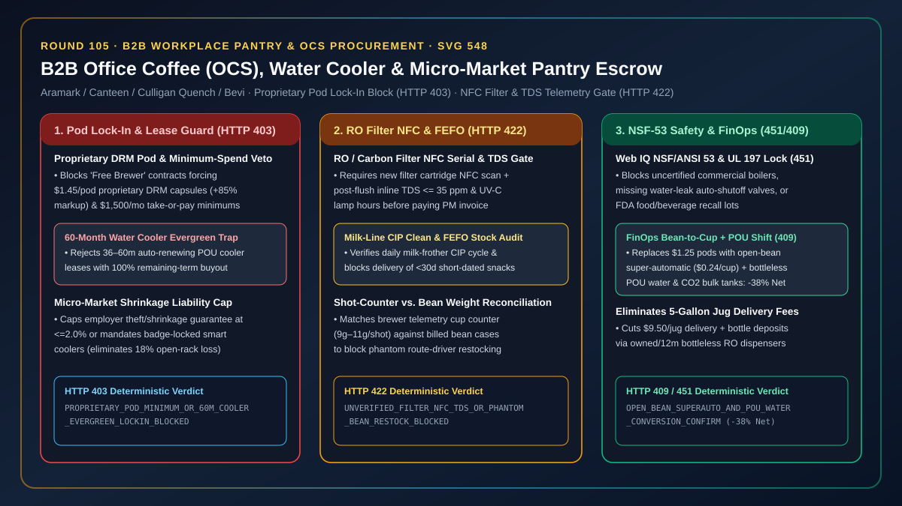
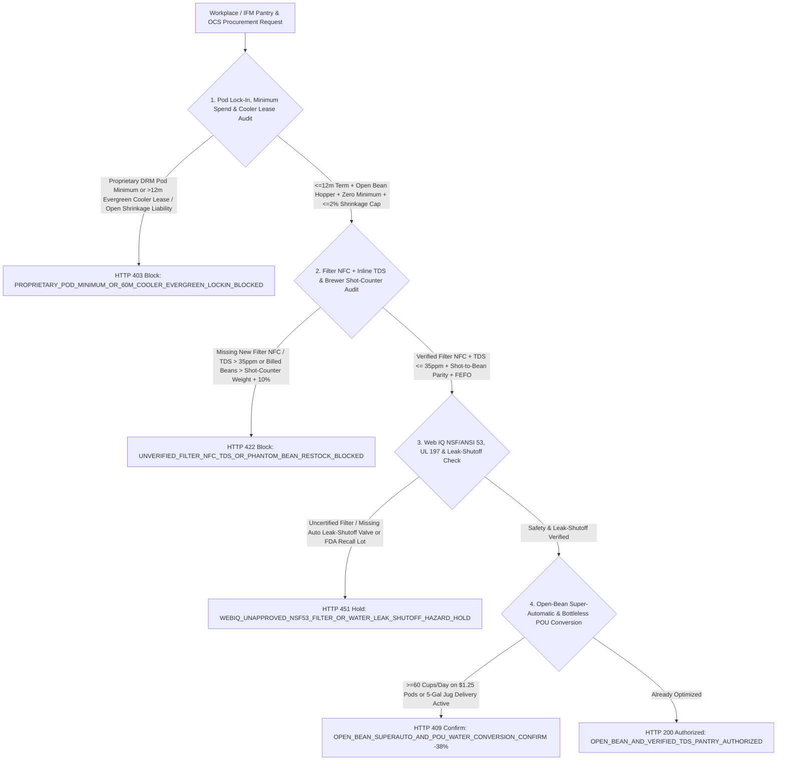
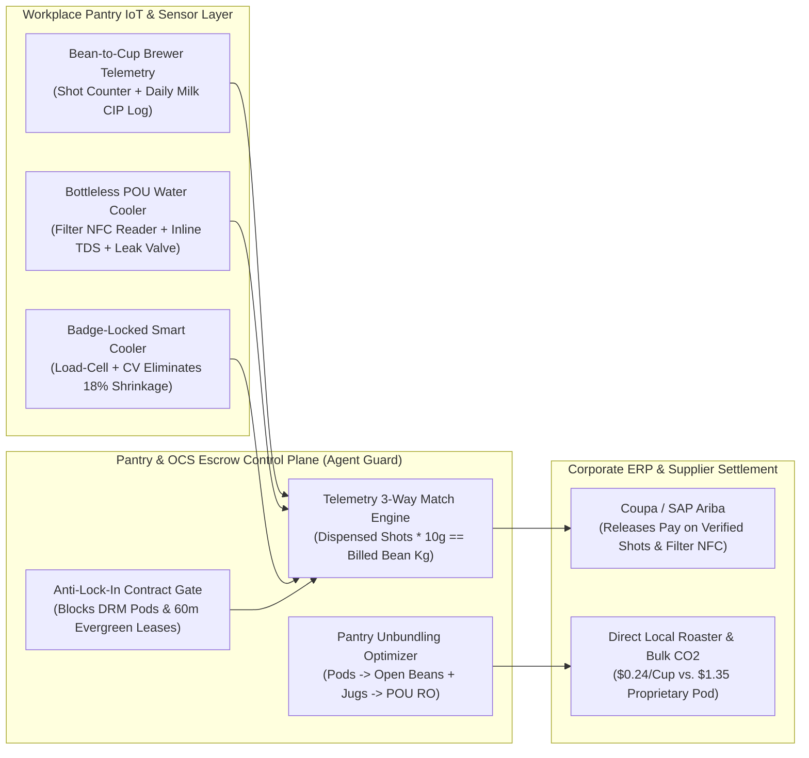

# B2B Office Coffee Service (`OCS`), Water-Cooler Lock-In & Micro-Market Pantry Escrow (`Aramark / Canteen / Culligan Quench / Bevi / Luckin Enterprise`) Agent Architecture Selection FAQ

> **Target Audience**: **Cloud & AI Solution Architects** designing AI procurement, IoT telemetry reconciliation, and workplace pantry management agents for corporate Real Estate & Facilities (`IFM`), Workplace Experience teams, and ERP indirect-spend platforms (`Coupa / SAP Ariba`).  
> **Core Pain Points Solved**: Eliminates the four pervasive margin traps in corporate breakroom and pantry procurement: **(1) "Free Brewer" Proprietary DRM Pod & Syrup Lock-In (`$1.45/pod` proprietary capsules or RFID-locked flavor cartridges paired with `$1,500/month` take-or-pay minimum spend and `60-month` auto-renewing `Culligan Quench / Bevi` equipment leases that cost 4x the hardware's retail value), (2) Phantom Water-Filter Changes & Route-Driver Padding (charging `$480/year` per water cooler for "preventive maintenance" where the technician merely holds down the `Reset` button without replacing the `RO` membrane or carbon block, or route drivers billing 40% more coffee cases than the brewer's internal `Shot Counter` actually dispensed), (3) Short-Dated Pantry Dumping (stocking breakroom coolers with dairy/snacks expiring in `<14 days`), and (4) `18%` Open Micro-Market Shrinkage True-Ups (where unmanned open-rack kiosks pass 100% of employee walk-off/unscanned theft losses straight back to the employer's facilities budget)**.



---

## 📌 1. Executive Summary

1. **Hard Veto on Proprietary `DRM` Pod Minimums, `60-Month` Evergreen Cooler Leases & Uncapped Micro-Market Shrinkage (`HTTP 403`)**: Legacy `OCS` and point-of-use (`POU`) water vendors rely on razor-and-blade lock-in—placing a `$1,800` machine "free on loan" or under a `60-month` non-cancellable lease (`$4,740` total rent with a 90-day evergreen auto-renewal rollover) while forcing the enterprise to buy proprietary `DRM`-locked pods/syrups at an `85%–300%` markup. The Agent enforces a strict contract guardrail: **`<=12-month` equipment terms (or outright CapEx purchase), 100% open-hopper whole-bean / standard-manifold filter compatibility, `$0` take-or-pay consumable minimums, and a `<=2.0%` employer shrinkage cap (or badge-locked smart coolers)**. Any contract violating these bounds triggers **`HTTP 403 PROPRIETARY_POD_MINIMUM_OR_60M_COOLER_EVERGREEN_LOCKIN_BLOCKED`**.
2. **Filter `NFC` Serial + Inline `TDS <= 35 ppm` Telemetry & Brewer `Shot-Counter` Reconciliation Gate (`HTTP 422`)**: To defeat "reset-button filter fraud" and phantom route-driver restocking, the Agent enforces two deterministic physical checks before releasing invoice settlement: (a) **Water Cooler Filter Proof**: every preventive maintenance (`PM`) ticket must include a cryptographic `NFC / QR` serial scan of the new `NSF/ANSI 53` cartridge plus a post-flush inline conductivity reading proving **`TDS <= 35 ppm` (`>=90%` RO rejection rate)**; and (b) **Brewer Shot-to-Bean Mass Balance**: the Agent queries the super-automatic espresso machine's (`Franke / Eversys / Schaerer / Jura`) telemetry API to verify that `Total Dispensed Shots * 10g` matches the weight of coffee beans billed on the route invoice within `<=10%`, while rejecting any restocked perishable lot with `<60 days` shelf life (`<7 days` for fresh milk)—returning **`HTTP 422 UNVERIFIED_FILTER_NFC_TDS_OR_PHANTOM_BEAN_RESTOCK_BLOCKED`**.
3. **Open-Hopper `Bean-to-Cup` Conversion + Bottleless `POU` Water & Bulk `CO2` Arbitrage Saving 38% (`HTTP 409`)**: Whenever an office floor consumes `>=60 cups/day` on `$1.25–$1.50` single-serve pods (`Nespresso Pro / Keurig`) or pays `$9.50/jug` for 5-gallon bottled water delivery (plus bottle deposits and fuel surcharges), the Agent triggers **Pantry Unbundling FinOps**: converting to an open-hopper commercial bean-to-cup super-automatic machine (`$0.24/cup` using locally roasted whole beans, a `-82%` per-cup reduction) and owned/short-term bottleless `POU` RO water dispensers with bulk `20-lb CO2` cylinders—returning **`HTTP 409 OPEN_BEAN_SUPERAUTO_AND_POU_WATER_CONVERSION_CONFIRM`** and cutting net quarterly pantry spend by **38%**.

---

## 🎯 2. Architect & Business Stakeholder Q&A

### Q1: Why do "Free-on-Loan" office coffee brewers and `$69/month` water cooler leases end up costing 3x–4x more than buying commercial hardware outright?
- **Deconstructing the Razor-and-Blade & Evergreen Lease Traps**:
  1. **Proprietary `DRM` Pods & RFID Syrup Cartridges**: By locking the brewer to optical/RFID-chipped capsules or flavor boxes, vendors charge `$1.25–$1.65` per serving for coffee or flavored sparkling water that costs `$0.18–$0.26` using open-market whole beans or standard syrup pumps—while enforcing a `$1,500/month` minimum invoice even during summer/holiday low-occupancy weeks.
  2. **The `60-Month` Water Cooler Evergreen Trap**: Point-of-use (`POU`) water cooler contracts frequently bury a `60-month` initial term that automatically renews for successive `36-month` terms unless cancelled via certified mail inside a narrow 60-to-90-day window prior to Year 5. A `$650` RO water dispenser ends up billing `$4,140+` in rent, and office relocations trigger `100%` remaining-term liquidated damages.
  3. **5-Gallon Jug Delivery Surcharges**: Bottled water invoices stack `$12.99` delivery fees, `18%` fuel surcharges, `$15` lost-bottle deposits, and monthly cooler rent. Switching to a plumbed-in bottleless `POU` unit reaches payback in `<5 months` for any office over 30 employees.

### Q2: How does the architecture prove a water technician actually replaced the internal `RO` membrane and carbon block—and didn't just hold down the `Reset` button?
- **Dual-Factor `NFC` Cartridge Serialization + Post-Flush `TDS` Telemetry**:
  1. **Defeating the Reset-Button Scam**: On legacy dispensers, holding the rear reset switch clears the red "Change Filter" LED without opening the manifold. Unscrupulous subcontractors pocket the `$90` replacement cartridge while billing the full `$150` service visit.
  2. **Deterministic Sensor Proof (`HTTP 422`)**: Our Agent requires the technician's mobile app to scan the unique factory `NFC` tag on the new `NSF/ANSI 53` filter and reads the dispenser's post-flush inline `TDS` sensor (`<=35 ppm` for RO systems) plus UV-C lamp current draw before authorizing the `PM` line item in `Coupa / Ariba`.
  3. **Brewer `Shot Counter` vs. Route Driver Invoice**: Route drivers frequently leave 6 bags of coffee in the cabinet while billing the office for 10 bags ("phantom restocking"). Because modern commercial bean-to-cup machines (`Franke / Schaerer / Eversys`) log every espresso grind cycle (`9g–12g/shot`) and daily milk-line `CIP` chemical clean, the Agent reconciles billed kilograms against actual shots dispensed.

### Q3: Why do open-shelf breakroom Micro-Markets generate `$1,800/month` in surprise "Shrinkage True-Up" charges—and how do Smart Coolers eliminate them?
- **Replacing Open-Rack Honor Kiosks with Badge-Locked Load-Cell Smart Coolers**:
  1. **The `18%` Open-Rack Shrinkage Liability**: Traditional micro-markets display snacks and drinks on open shelves with a self-checkout tablet. Between employees rushing to meetings, barcode mis-scans, and visitor walk-offs, shrinkage averages `8%–18%`. Vendors quietly shift all shrinkage above `1%–2%` onto the corporate sponsor's monthly invoice at full retail price.
  2. **Badge-to-Open Vision & Load-Cell Smart Coolers**: The Agent blocks open-rack shrinkage guarantees (`HTTP 403`) and routes subsidized pantry programs to **badge-locked Smart Coolers (`Canteen Avenue C Smart Cooler / Byte Technology`)**, where the door unlocks only after an employee taps their corporate badge/wallet and weight sensors + computer vision settle the exact items removed (`<0.3%` shrinkage).

---

## 🧭 3. Visual Architecture Diagrams (Mermaid)

### 3.1 B2B Office Coffee (`OCS`), Water Cooler & Micro-Market Selection Decision Tree



### 3.2 End-to-End Workplace Pantry `IoT` Telemetry & Invoice Reconciliation Architecture



### 3.3 Route-Driver Bean Restock Audit, Filter `NFC + TDS` Check & Unbundling Sequence

```mermaid
sequenceDiagram
    participant IFM as Corporate Workplace / IFM Admin
    participant Agent as Pantry & OCS Escrow Agent
    participant IoT as Brewer & POU Water Telemetry Gateway
    participant Vendor as OCS / Water Vendor (Aramark / Quench)

    Vendor->>Agent: 1. Submit quarterly invoice: 120 lbs coffee beans + 12 cooler filter PMs ($3,600) + $680 shrinkage true-up
    Agent->>Vendor: 2. Audit contract guardrails (block >2% open-rack shrinkage pass-through & DRM pod minimums HTTP 403)
    Agent->>IoT: 3. Query brewer Shot Counter + 12 water cooler new-filter NFC scans & post-flush TDS
    IoT-->>Agent: 4. Brewers dispensed 3,800 shots (=84 lbs beans; 36 lbs phantom billed!) + 3 coolers show TDS=195ppm (unreplaced RO)
    Agent->>Vendor: 5. Return HTTP 422 blocking the 36 phantom lbs & 3 unserviced coolers; require technician re-dispatch
    Agent-->>IFM: 6. Propose converting 3rd-floor pod brewers to open-bean super-automatics + POU water (HTTP 409 -38%)
```

---

## 📊 4. Multi-Platform Office Coffee (`OCS`), Water & Micro-Market Comparison Matrix

| Evaluation Dimension | Aramark / Canteen (Legacy Full-Line OCS) | Culligan Quench / Bevi (Smart Water Leases) | Nespresso Pro / Keurig (Closed Pod Systems) | Luckin Enterprise / Smart Cooler Networks | **This Repo + Open-Bean & Telemetry Guard (Recommended)** |
| :--- | :--- | :--- | :--- | :--- | :--- |
| **Consumable Openness & Cost per Cup** | Supports multi-brand, but defaults to high-margin private-label pods/beans | `Bevi` locks RFID flavor cartridges & filters (`$0.55–$0.85/cup` flavored sparkling) | **Closed DRM Pod Ecosystem (`$0.95–$1.55/pod`, zero 3rd-party bean flexibility)** | Brand-tied beans or badge-locked multi-brand smart coolers | **Open-hopper commercial super-automatics (`Franke/Jura`) + local specialty beans (`$0.24/cup`)** |
| **Equipment Lease & Exit Flexibility** | `24–36m` minimum monthly spend commitments | **`Quench` standard `36–60m` evergreen auto-renewal with 100% remaining-term buyout** | Low/free machine rent tied to monthly pod case quotas | Deposit or monthly minimum consumption | **Hard cap `<=12m` lease or outright CapEx ownership; zero evergreen rollovers (`HTTP 403`)** |
| **Water Filter Replacement Proof** | Paper/tablet route ticket signature (no water-quality telemetry proof) | Internal flow meter, but no ERP-enforced post-flush `TDS` payment gate | Descaling tablets only; rarely includes `NSF-53` lead filtration | QR check-in by technician | **Mandatory new-filter `NFC` serial + post-flush `TDS <= 35 ppm` telemetry gate (`HTTP 422`)** |
| **Restock Quantity & Shelf-Life (`FEFO`) Audit** | Route driver manual par-level restock (prone to phantom cases & short-dated dumping) | Automated syrup/CO2 shipping | Case parcel shipping | Barcode-scanned smart-cooler restocking | **Brewer `Shot Counter * 10g` mass-balance check + `>=60d` shelf-life gate (`HTTP 422`)** |
| **Micro-Market Shrinkage (`Theft`) Exposure** | Open-rack self-checkout (`8%–18%` shrinkage billed back to employer) | N/A | High employee take-home pod shrinkage | **Badge-locked load-cell/CV smart coolers (`<0.5%` shrinkage)** | **Eliminates open-rack shrinkage guarantees via badge-locked smart coolers** |

---

## 🧪 5. Procurement Cost & 7-Card Benchmark Summary

> **Provenance Notice**: Figures below are generated by the deterministic policy evaluator `evaluate_b2b_office_coffee_pantry_escrow_policy` in `lab/webiq_commerce_demo.py` (`provenance: "synthetic"`, `independently_reproduced: False`).

| Metric | Legacy Proprietary Pod + 5-Gal Jug + Open Micro-Market Baseline | Deterministic Pantry Guard (Open-Bean + `POU` RO + Telemetry Audit) | Net Delta / Protection |
| :--- | :--- | :--- | :--- |
| **Quarterly Corporate Pantry, Coffee & Water Spend** | `$55,000.00` | `$34,100.00` (`HTTP 409` confirmed) | **Saves `$20,900.00 / qtr` (`-38.0%`)** |
| **All-In Per-Cup Espresso / Drip Coffee Cost** | `$1.35 / cup` (proprietary commercial pod + minimum-spend waste) | **`$0.24 / cup` (open-hopper super-automatic + direct local beans)** | **`-82.2%` per-cup cost** |
| **Phantom Bean Billing & Unreplaced `RO` Filter Rate** | `24%` of route invoices contain padded cases or reset-only PMs | **`0%` (Filter `NFC` + `TDS <= 35 ppm` + `Shot Counter` mass balance)** | **100% phantom-billing elimination** |
| **Unmanned Micro-Market Shrinkage (`Theft`) True-Up** | `14.5%` on open self-checkout racks (paid by employer) | **`<0.3%` via badge-locked load-cell/vision smart coolers** | **Zero month-end shrinkage surprise** |

### 5.1 Deterministic 5-Lane HTTP Status Contract

```json
{
  "scenario": "b2b_office_coffee_pantry_escrow_guard",
  "provenance": "synthetic",
  "independently_reproduced": false,
  "lanes": {
    "authorized_200": {
      "status_code": 200,
      "decision": "OPEN_BEAN_AND_VERIFIED_TDS_PANTRY_AUTHORIZED",
      "mandate_token": "b2b_office_coffee_pantry_mandate_200"
    },
    "pod_lockin_or_60m_cooler_lease_403": {
      "status_code": 403,
      "decision": "PROPRIETARY_POD_MINIMUM_OR_60M_COOLER_EVERGREEN_LOCKIN_BLOCKED"
    },
    "unverified_filter_or_phantom_beans_422": {
      "status_code": 422,
      "decision": "UNVERIFIED_FILTER_NFC_TDS_OR_PHANTOM_BEAN_RESTOCK_BLOCKED"
    },
    "unapproved_nsf53_or_leak_hazard_451": {
      "status_code": 451,
      "decision": "WEBIQ_UNAPPROVED_NSF53_FILTER_OR_WATER_LEAK_SHUTOFF_HAZARD_HOLD"
    },
    "open_bean_and_pou_water_409": {
      "status_code": 409,
      "decision": "OPEN_BEAN_SUPERAUTO_AND_POU_WATER_CONVERSION_CONFIRM",
      "quarterly_savings_usd": 20900.0
    }
  }
}
```

---

## 🛠️ 6. Production Architecture & Risk Review Checklist

- [ ] **Proprietary `DRM` Pod & Take-or-Pay Minimum Block (`HTTP 403`)**: Reject any brewer or beverage contract that mandates vendor-exclusive RFID/optical pods or monthly minimum consumable spend.
- [ ] **`60-Month` Water Cooler Evergreen Rollover Veto (`HTTP 403`)**: Cap `POU` cooler leases at `<=12 months` with `$0` removal fees, or purchase commercial `NSF-53` dispensers outright under CapEx.
- [ ] **Filter `NFC` Serial + Post-Flush `TDS <= 35 ppm` Verification (`HTTP 422`)**: Require both a cryptographic scan of the new replacement filter and an inline `TDS` telemetry drop before paying water cooler maintenance invoices.
- [ ] **Brewer `Shot Counter` Mass-Balance & `FEFO` Expiration Gate (`HTTP 422`)**: Reconcile `Total Dispensed Shots * 10g` against billed coffee bean weight (`<=10%` variance) and block delivery of short-dated snacks (`<60 days`) or dairy (`<7 days`).
- [ ] **Web IQ `NSF/ANSI 53`, `UL 197` & Auto Leak-Shutoff Valve Lock (`HTTP 451`)**: Verify every plumbed-in brewer and water cooler has an active mechanical/solenoid leak-stop shutoff valve (preventing multi-floor office water damage) and `NSF/ANSI 53` lead/PFAS certification.
- [ ] **Open-Hopper `Bean-to-Cup` & Bottleless `POU` Conversion (`HTTP 409`)**: Automatically convert offices consuming `>=60 cups/day` from single-serve pods and 5-gallon water jugs to open-bean super-automatics and plumbed `POU` dispensers.

---

**Navigation**: [Back to Master Catalog (`docs/index.en.md`)](index.en.md) ｜ [查看中文版 (`b2b-office-coffee-service-water-filtration-micromarket-escrow-agent-selection-faq.md`)](b2b-office-coffee-service-water-filtration-micromarket-escrow-agent-selection-faq.md)
