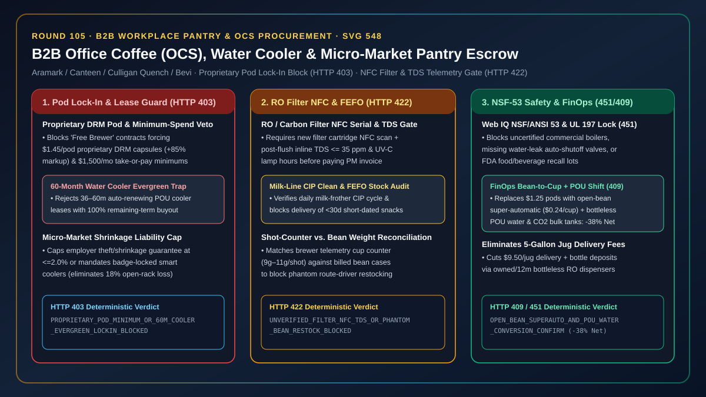
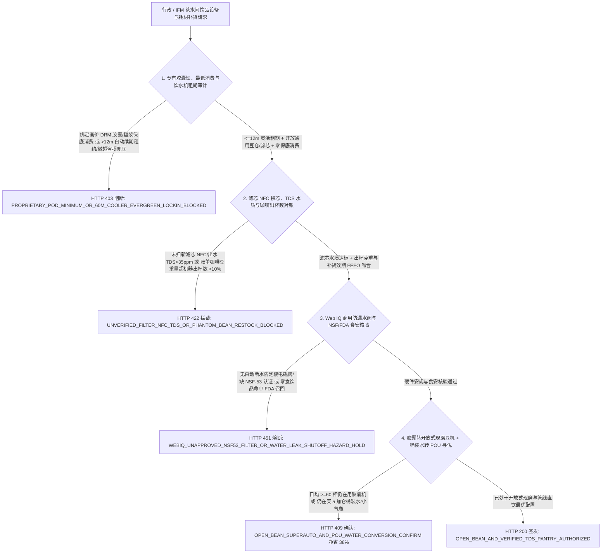
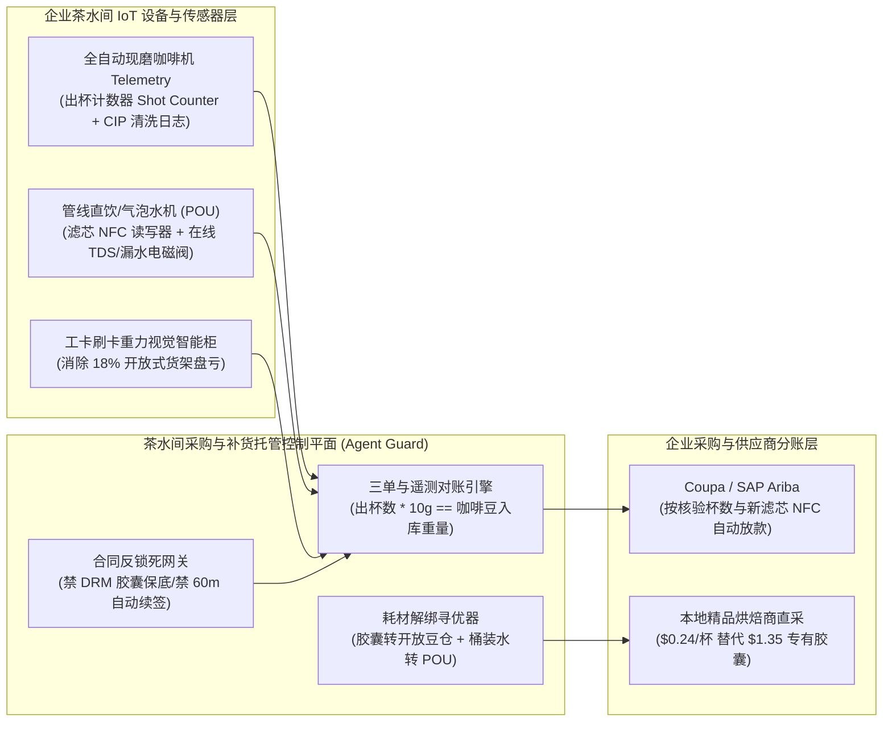
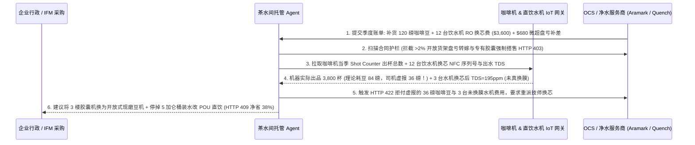

# 企业办公咖啡茶饮机租赁（OCS）、直饮水机耗材防锁死与茶水间无人货柜补货托管（Aramark / Canteen / Culligan Quench / Bevi / 瑞幸企业团餐）Agent 架构选型 FAQ

> **核心阅读对象**：为企业行政与职场体验（Workplace Experience）、设施管理（IFM）及间接采购（Indirect Procurement）设计茶水间饮品设备租赁、直饮水机维保与无人零售柜补货 AI 稽核系统的 **Cloud & AI Solution Architect**。  
> **核心痛点解决**：彻底终结企业茶水间采购中**“供应商以‘免机器月租’为诱饵，强制绑定每颗 `$1.35–$1.60` 的加密防伪胶囊（`DRM Proprietary Pods`，比公开烘焙豆贵 400%）及每月 `$1,500` 保底耗材消费”、“直饮水机/气泡水机（`Culligan Quench / Bevi`）签下 60 个月霸王自动续签租约（退租需赔付剩余 4 年全部租金），且维保员每年收 `$480` 滤芯费却只按一下面板复位键、从不更换内部 `RO` 反渗透膜导致出水 `TDS` 超标”、“补货司机把茶水间当临期食品倾销场（送来仅剩 15 天保质期的牛奶零食）并虚报 30% 咖啡豆入库箱数”以及“开放式无人微超（`Open Micro-Market`）高达 18% 的顺手牵羊未扫码损耗（`Shrinkage`）按合同全由企业行政预算兜底补差”**四大行业黑洞。



---

## 📌 一、核心选型结论速览（Executive Summary）

1. **废除“免费机器 + 专有加密胶囊（`DRM Pod`）保底消费”与 60 个月长租锁死（HTTP 403）**：传统 `OCS`（Office Coffee Service）与商用饮水机行业普遍采用“吉列剃须刀陷阱”——将一台价值 `$1,800` 的商用机包装成“免费投放”或 `$79/月` 长租 `60 个月`（5 年总租金高达 `$4,740`，且含 `90 天` 窗口期自动续签 `36 个月` 霸王条款），同时通过光学/RFID 条码锁强制企业只能购买供应商加价 `85%–300%` 的专有胶囊或糖浆包。选型 Agent 必须在合同与采购目录层强制执行：**设备租期 `<=12 个月`（或直接买断通用设备）、100% 开放通用生豆/标准滤芯接口（`$0` 专有耗材保底额 `Take-or-Pay`），且无人微超未付款损耗兜底上限 `<=2.0%`（或强制改用刷工卡开门的视觉重力智能柜）**；凡含专有胶囊锁、超 12 个月不可撤销长租或无限额盗损兜底条款的，一律触发 **`HTTP 403 PROPRIETARY_POD_MINIMUM_OR_60M_COOLER_EVERGREEN_LOCKIN_BLOCKED`**。
2. **直饮水滤芯 `NFC` 序列号 + 出水 `TDS` 遥测与咖啡机出杯计数器（`Shot Counter`）三方对账硬门禁（HTTP 422）**：针对“假换芯”与“虚报送豆量”，Agent 建立两道物理传感器门禁：① **水机换芯闭环**：维保工单必须包含旧滤芯与新滤芯（符合 `NSF/ANSI 53 & 401` 除铅/除微塑料标准）同框 `NFC/二维码` 序列号扫描，且换芯冲洗后机内在线电导率传感器（`Inline TDS Meter`）回传出水 **`TDS <= 35 ppm`（`RO` 膜截留率 `>=92%`）**；② **咖啡豆出杯克重对账**：通过全自动现磨咖啡机（如 `Franke / Eversys / Schaerer / 咖乐美`）的 `IoT Telemetry API` 读取当月实际萃取杯数（`Total Shots * 10g/杯`），与补货司机账单上的咖啡豆公斤数比对，偏差超过 `10%` 或送货批次距保质期不足 `60 天`（鲜奶不足 `7 天`）的，直接触发 **`HTTP 422 UNVERIFIED_FILTER_NFC_TDS_OR_PHANTOM_BEAN_RESTOCK_BLOCKED`**。
3. **胶囊转开放式现磨豆机（`Bean-to-Cup`）+ 桶装水转直连管线机（`POU`）净省 38%（HTTP 409）**：当 Agent 监测到某办公区日均消耗 `>=60 杯` 咖啡仍在使用单颗 `$1.25` 的胶囊机（`Nespresso Professional / Keurig K-Cup`）或仍在采购 `$9.50/桶` 的 5 加仑桶装水（叠加空桶押金、送水费与燃料附加费）时，自动触发 **茶水间耗材解绑寻优（`Pantry Unbundling FinOps`）**：改为租赁/买断开放式商用现磨全自动咖啡机（采购精品拼配豆单杯成本仅 **`$0.22–$0.26`**，立降 `80%`）并将桶装水切换为买断式 `POU` 反渗透管线直饮机 + 20 磅食用级大钢瓶 `CO2` 集中供气，触发 **`HTTP 409 OPEN_BEAN_SUPERAUTO_AND_POU_WATER_CONVERSION_CONFIRM`**，为企业季度茶水间预算净省 **38%**。

---

## 🎯 二、业务方与架构师灵魂拷问（Q&A）

### Q1：为什么行政部签了“免机器租赁费”的办公室咖啡机或每月 `$69` 的直饮水机，算下全年总账却比直接买一台顶级商用机贵出 3 倍？
- **“免费设备投放（Free-on-Loan）”与 60 个月长租协议的三大隐形抽血点**：
  1. **加密胶囊与专有风味糖浆暴利**：部分智能饮品机（如风味气泡水机 `Bevi` 或商用胶囊机）在耗材盒上加装加密芯片。公开市场一箱同品质风味浓缩液或 1 磅精品咖啡豆仅需 `$14`（约可出品 45 杯，合 `$0.31/杯`），但在绑定合同下，每颗专有胶囊或糖浆盒折合 **`$1.20–$1.65/杯`**，还附带每月 `$800–$2,000` 的最低耗材消费额（员工休假喝不完也照扣全款）。
  2. **饮水机 60 个月自动续期（`Evergreen Rollover`）**：商用净水租赁商常在电子签字板背面隐藏“租期 60 个月，到期前 90–120 天未寄送挂号信解约则自动续期 36 个月”条款。一台出厂价仅 `$650` 的立式直饮水机，5 年累计支付租金高达 `$4,140`，一旦公司退租搬迁，供应商立即开出 `$2,500+` 的提前买断违约金账单。
  3. **桶装水配送与“空桶黑洞”**：传统 5 加仑桶装水看似每桶 `$7.50`，但账单底部会叠加每单 `$12.99` 配送费、18% 燃油附加费、饮水机月租以及每个丢失水桶 `$15` 的扣款。只要办公室人数超过 30 人，切换至接入市政自来水的无桶直饮机（`Bottleless POU Cooler`）在 **5 个月内即可收回全部设备成本**。

### Q2：饮水机维保员每季度上门 5 分钟签个字就收 `$150` 换芯费，怎么在技术上防止他“只按面板复位键、根本没换里面的 `RO` 反渗透膜和紫外线杀菌灯”？
- **传感器遥测（`IoT Telemetry`）+ 耗材唯一编码（`NFC UID`）双锁**：
  1. **面板复位键欺诈**：绝大多数传统商用饮水机的“滤芯寿命红灯”只需长按机身背后的 `Reset` 键 3 秒即可变绿。不法外包技师为了私吞价值 `$90` 的原装 `3M / Pentair` 复合滤芯，上门擦一下机身、按掉报警灯就让前台签字确认。
  2. **新旧滤芯同框 `NFC` + 在线 `TDS` 压降核验**：
     - Agent 要求每次预防性维保（`PM`）必须通过手机端扫描新换上的滤芯内置 `NFC` 防伪芯片（防旧码重扫）；
     - 换芯完成后，必须采集出水口 **`TDS`（总溶解固体）与余氯指标**：对于 `RO` 反渗透机型，出水 `TDS` 必须稳定在 **`<=35 ppm`**（或较进水市政自来水 `TDS` 下降 `>=90%`）；若换芯后 `TDS` 仍高达 `180 ppm`，系统判定未更换 `RO` 膜，直接以 `HTTP 422` 冻结维保账单。
  3. **商用咖啡机鲜奶管路 `CIP` 自动清洗锁**：带鲜奶打发功能的全自动咖啡机若连续 `24 小时` 未执行碱性/酸性药片自动管路清洗（`Clean-in-Place, CIP`），极易滋生李斯特菌与酸败奶垢。Agent 直接订阅咖啡机云端 `Telemetry`，将“月度清洗合规率 `>=98%`”设为服务费放行前提。

### Q3：茶水间引进了无人自助便利架（`Micro-Market`），为什么月底账单会多出一笔 `$1,800` 的“盘亏补差费（`Shrinkage True-Up`）”？
- **开放式货架的“健忘损耗”与智能视觉称重柜改造**：
  1. **开放式微超（`Open-Concept Kiosk`）的责任转嫁**：传统无人货架采用“敞开陈列 + 员工自觉去平板扫码付款”。由于开会匆忙漏扫、条码扫不上或外来访客顺手拿走，行业平均未付款损耗率（`Shrinkage`）高达 **`8%–18%`**。供应商往往在补充协议里写明“超过 1% 的盘点亏损由甲方企业按零售价全额补齐”，导致行政部每月白白替盗损买单。
  2. **工卡刷卡开门 + 计算机视觉/重力传感智能柜（`Smart Cooler`）**：Agent 严禁签署开放式货架的全额损耗兜底条款，强制切换为**工卡/企业微信 NFC 刷卡开门的闭门智能微超（如 `Canteen Avenue C Smart Cooler / Byte Technology / 丰e足食智能柜`）**——关门瞬间通过层板重力传感器 + 顶部摄像头自动结算或计入员工福利额度，将盘亏率从 `18%` 压降至 **`<0.3%`**。

---

## 🧭 三、直观可视化图解（Mermaid 决策树 + 架构图 + 时序图）

### 3.1 企业茶水间咖啡机、直饮水与无人微超采购选型决策树



### 3.2 端到端茶水间 `IoT` 出杯对账、水质遥测与智能货柜结算架构图



### 3.3 咖啡豆补货对账、直饮水换芯 `TDS` 验真与胶囊解绑时序图



---

## 📊 四、主流企业茶水间（OCS）、直饮水与无人微超平台横向选型决策矩阵

| 选型维度 | Aramark / Canteen (传统综合 OCS 巨头) | Culligan Quench / Bevi (智能水机租赁) | Nespresso Pro / Keurig (商用胶囊体系) | 瑞幸企业咖啡机 / 农夫山泉 / 丰e足食 | **本仓库 + 开放豆仓与遥测对账架构（推荐）** |
| :--- | :--- | :--- | :--- | :--- | :--- |
| **耗材开放度与单杯成本** | 兼容多种品牌，但默认主推高毛利自有贴牌拼配豆与胶囊 | `Bevi` 强制绑定专有 RFID 风味糖浆盒与滤芯（单杯风味水成本高达 `$0.55–$0.85`） | **高度封闭（专有铝壳/K-Cup 胶囊，单杯 `$0.95–$1.55`，极难切换第三方）** | 瑞幸/农夫山泉绑定自有原豆与水源包；智能柜支持多品牌零食 | **强制选用开放式豆仓商用机（`Franke/Jura/咖乐美`），公开招标本地烘焙豆（`$0.24/杯`）** |
| **设备租约与退出条款** | 常见 `24–36 个月` 耗材最低消费绑定 | **`Quench` 常见 `36–60 个月` 自动续期长租，提前退租需赔付全额剩余租金** | 机器低租/免租，但捆绑每月最低胶囊订购箱数 | 常见押金或月最低消费门槛 | **硬锁 `<=12 个月` 短租或直接买断设备产权，禁绝 `Evergreen` 自动续签（HTTP 403）** |
| **滤芯更换与水质核验** | 依赖路线技师手写签单（无传感器闭环） | 机器带流量计，但缺乏向客户 ERP 开放的独立 `TDS` 验收门禁 | 仅需除垢药片，极少配专业 `NSF-53` 除铅净水 | 巡检员扫码打卡为主 | **强制新滤芯 `NFC` 唯一码 + 换芯后在线 `TDS <= 35 ppm` 双重校验才放款（HTTP 422）** |
| **补货防虚报与临期拦截** | 路线司机手工清点补货（`Par-Level` 易被塞满滞销临期品） | 自动寄送糖浆/CO2，偶发囤积 | 按箱寄送胶囊 | 智能柜具备扫码入库，但散装茶水间仍靠人工点货 | **机器 `Shot Counter` 出杯克重反推耗豆量 + 严拒 `<60 天` 临期品（HTTP 422）** |
| **无人货架防盗损 (`Shrinkage`)** | 传统开放式微超盘亏率 `8%–18%`，常要求企业补贴差额 | 不涉及零食货架 | 胶囊极易被整条顺回家自用 | **闭门刷卡重力视觉柜（盘亏率 `<0.5%`）** | **全面淘汰开放式自付货架，强制切换工卡 `NFC` 闭门智能柜** |

---

## 🧪 五、采购成本测算与 7-Card 基准测试报告

> **数据来源声明**：以下对比基于 `lab/webiq_commerce_demo.py` 中确定性策略函数 `evaluate_b2b_office_coffee_pantry_escrow_policy` 的合成基准数据（`provenance: "synthetic"`, `independently_reproduced: False`），用于验证企业行政茶水间采购网关的确定性风控与降本能力。

| 评估维度 | 传统专有胶囊机 + 5 加仑桶装水 + 开放式微超基线 | 确定性茶水间托管网关（开放现磨豆机 + `POU` 直饮 + 遥测对账） | 净效应 / 风险消除 |
| :--- | :--- | :--- | :--- |
| **季度企业茶水间咖啡、饮水与微超总预算池** | `$55,000.00` | `$34,100.00` (`HTTP 409` 优化确认后) | **净省 `$20,900.00 / 季` (`-38.0%`)** |
| **单杯现磨意式/美式咖啡综合成本** | `$1.35 / 杯`（专有商业胶囊 + 最低消费溢价） | **`$0.24 / 杯`（开放式全自动豆机 + 公开采购精品豆）** | **单杯饮品成本下降 `82.2%`** |
| **饮水机“只收钱不换 `RO` 膜”与司机虚报送豆率** | `24%` 账单存在虚报或假维保 | **`0%`（强制新滤芯 `NFC` + `TDS <= 35 ppm` + 出杯计数器对账）** | **100% 阻断幽灵耗材账单** |
| **茶水间零食货柜未付款盗损率 (`Shrinkage`)** | `14.5%`（开放式自助扫码架，企业行政兜底） | **`<0.3%`（工卡 `NFC` 刷卡开门重力视觉智能柜）** | **彻底消除月底盘亏补差账单** |

### 5.1 确定性状态码映射契约（5-Lane Contract）

```json
{
  "scenario": "b2b_office_coffee_pantry_escrow_guard",
  "provenance": "synthetic",
  "independently_reproduced": false,
  "lanes": {
    "authorized_200": {
      "status_code": 200,
      "decision": "OPEN_BEAN_AND_VERIFIED_TDS_PANTRY_AUTHORIZED",
      "mandate_token": "b2b_office_coffee_pantry_mandate_200"
    },
    "pod_lockin_or_60m_cooler_lease_403": {
      "status_code": 403,
      "decision": "PROPRIETARY_POD_MINIMUM_OR_60M_COOLER_EVERGREEN_LOCKIN_BLOCKED"
    },
    "unverified_filter_or_phantom_beans_422": {
      "status_code": 422,
      "decision": "UNVERIFIED_FILTER_NFC_TDS_OR_PHANTOM_BEAN_RESTOCK_BLOCKED"
    },
    "unapproved_nsf53_or_leak_hazard_451": {
      "status_code": 451,
      "decision": "WEBIQ_UNAPPROVED_NSF53_FILTER_OR_WATER_LEAK_SHUTOFF_HAZARD_HOLD"
    },
    "open_bean_and_pou_water_409": {
      "status_code": 409,
      "decision": "OPEN_BEAN_SUPERAUTO_AND_POU_WATER_CONVERSION_CONFIRM",
      "quarterly_savings_usd": 20900.0
    }
  }
}
```

---

## 🛠️ 六、商业上线风控与架构评审 Checklist

- [ ] **专有加密胶囊（`DRM Pod`）与最低耗材保底（`Minimum Spend`）熔断（HTTP 403）**：核验所有咖啡机与饮水机合同，严禁签署绑定单一供应商专有胶囊、专有 RFID 糖浆盒或月度最低消费额的协议。
- [ ] **饮水机 36–60 个月自动续期（`Evergreen`）拦截（HTTP 403）**：核验净水设备租期 `<=12 个月` 且无高额撤机/买断罚金；对于售价低于 `$1,200` 的商用直饮水机，优先执行直接买断（`CapEx Purchase`）+ 按次付费换芯。
- [ ] **滤芯 `NFC` 唯一码与换芯后 `TDS <= 35 ppm` 强校验（HTTP 422）**：维保结算必须上传新滤芯 `NFC/QR` 序列号及冲洗后在线 `TDS` 读数，严防“只按 Reset 键不换芯”。
- [ ] **咖啡机 `Shot Counter` 出杯数与咖啡豆入库重量对账（HTTP 422）**：按 `总出杯数 * 10g`（加计 `<=8%` 磨豆调试损耗）核对司机送货单，自动拦截虚报箱数与剩余保质期 `<60 天` 的临期物料。
- [ ] **进水电磁防漏阀（`Leak-Stop Valve`）与 `NSF/ANSI 53` 认证核验（HTTP 451）**：所有接入市政水管的咖啡机与直饮水机必须标配机械/电子漏水自动切断阀（防止夜间爆管淹没楼下机房或租户），且滤芯具备有效 `NSF/ANSI 53` 除铅认证。
- [ ] **开放式现磨豆机（`Bean-to-Cup`）与无桶管线机（`POU`）自动替换（HTTP 409）**：对日均 `>=60 杯` 的茶水间自动执行“胶囊转开放豆仓”及“5 加仑桶装水转 `POU` 直饮机”，并将开放式微超升级为工卡闭门智能柜。

---

**导航**：[返回分册总目录 (`docs/index.md`)](index.md) ｜ [查看英文版 (`b2b-office-coffee-service-water-filtration-micromarket-escrow-agent-selection-faq.en.md`)](b2b-office-coffee-service-water-filtration-micromarket-escrow-agent-selection-faq.en.md)
