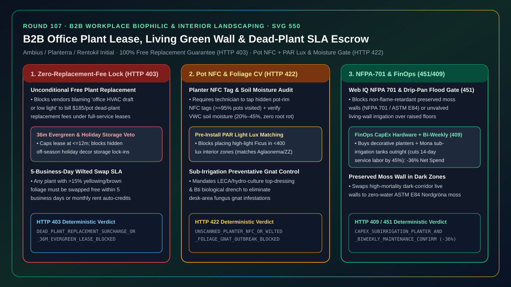
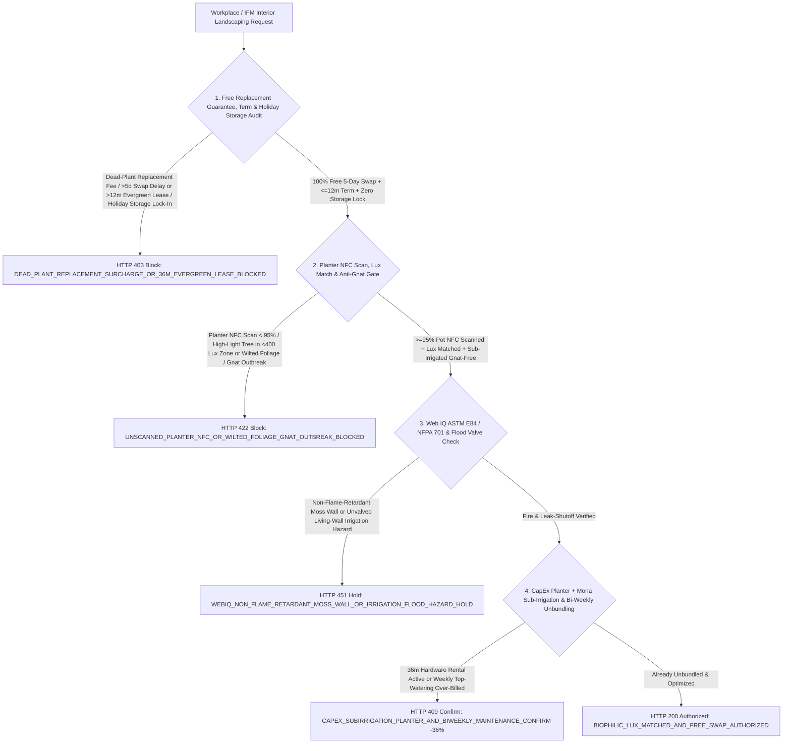
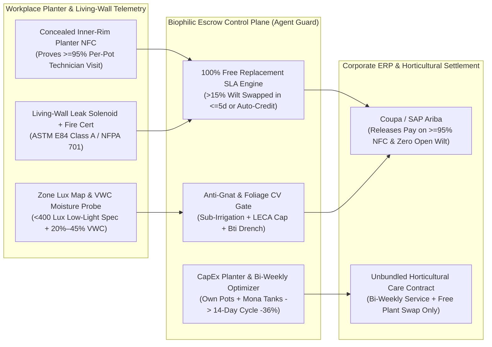
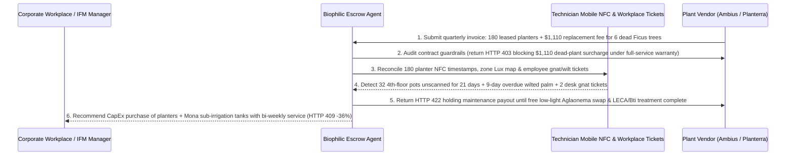

# B2B Office Plant Lease, Biophilic Living Wall & Zero-Dead-Plant Replacement Escrow (`Ambius / Planterra / Rentokil Initial / ForestBox`) Agent Architecture Selection FAQ

> **Target Audience**: **Cloud & AI Solution Architects** designing AI interior-landscaping procurement, IoT planter maintenance verification, and biophilic facility escrow agents for corporate Workplace Experience teams, `WELL / LEED` certified commercial real estate, luxury hotel lobbies, and ERP indirect-spend platforms (`Coupa / SAP Ariba`).  
> **Core Pain Points Solved**: Eliminates the four chronic failure modes in B2B corporate plant leasing and holiday decor contracts: **(1) Dead-Plant Replacement Surcharges & Slow Swaps (vendors leaving yellowed, half-dead Ficus trees in reception for 3 weeks, then blaming "weekend office HVAC setbacks or low indoor light" to bill `$185/pot` replacement fees despite a "full-service" lease), (2) `36–60 Month` Architectural Planter Lease Markups & Holiday Storage Lock-In (paying `$28/month` for 36 months—`$1,008` total—to rent a `$65` fiberglass pot, or getting trapped in year-round off-site storage fees for seasonal holiday trees), (3) Drive-By Watering & Office Fungus Gnat (`Bradysia`) Outbreaks (technicians signing the front-desk logbook while skipping 40% of interior floor planters, or over-drenching topsoil and breeding clouds of fungus gnats around employee monitors), and (4) Unvalved Living-Wall Floods & Non-Flame-Retardant Moss Walls (irrigation leaks ruining raised-floor server cabling or preserved moss walls failing `ASTM E84 / NFPA 701` fire marshal inspections)**.



---

## 📌 1. Executive Summary

1. **Unconditional `100%` Free Plant Replacement Guarantee, `<=5-Business-Day` Swap SLA & `<=12m` Lease Cap (`HTTP 403`)**: The entire economic rationale for leasing office plants rather than buying them at a nursery is transferring mortality risk to the horticultural vendor. The Agent enforces three non-negotiable contract rules: (a) **`100%` Unconditional Free Replacement (`Horticultural Guarantee`)** for any plant exhibiting `>15%` wilted, yellowed, or necrotic foliage within **`<=5 business days`**—prohibiting "office HVAC / lighting" exclusions; (b) a maximum **`<=12-month`** agreement term with zero `36–60m` evergreen rollovers; and (c) all-inclusive seasonal holiday decor pricing with `$0` off-season warehouse storage lock-in. Contracts violating these terms trigger **`HTTP 403 DEAD_PLANT_REPLACEMENT_SURCHARGE_OR_36M_EVERGREEN_LEASE_BLOCKED`**.
2. **Planter-Rim `NFC` Scan (`>=95%`), Pre-Install `PAR / Lux` Light Matching & Sub-Irrigation Anti-Gnat Gate (`HTTP 422`)**: To eliminate "drive-by lobby sign-ins" and office pest complaints, the Agent enforces physical verification before releasing monthly maintenance invoices: (a) **Pre-Install `Lux` Species Matching**: windowless interior zones (`<400 lux`) may only be stocked with certified low-light cultivars (`Zamioculcas ZZ`, `Aglaonema`, `Sansevieria`, `Aspidistra`), blocking high-mortality `Ficus lyrata` placements; (b) **Per-Pot `NFC` Proof-of-Service**: technicians must tap the concealed inner-rim `NFC` tag on **`>=95%`** of leased planters during each cycle while maintaining soil volumetric water content (`VWC`) between `20%–45%`; and (c) **Zero Fungus-Gnat Protocol**: planters must use sub-irrigation reservoirs + `3cm` inorganic `LECA` clay/stone top-dressing and biological `Bti` (`Bacillus thuringiensis israelensis`) treatment. Unscanned pots, unswapped wilted plants, or unresolved gnat tickets trigger **`HTTP 422 UNSCANNED_PLANTER_NFC_OR_WILTED_FOLIAGE_GNAT_OUTBREAK_BLOCKED`**.
3. **Outright `CapEx` Planter + `Mona` Sub-Irrigation Tank Purchase & Bi-Weekly Service Unbundling Saving 36% (`HTTP 409`)**: Legacy vendors bundle 10-year fiberglass/ceramic architectural containers into perpetual monthly rental rates and charge weekly manual top-watering labor. For offices with a `>=18-month` occupancy horizon, the Agent triggers **Horticultural Unbundling FinOps**: purchasing the decorative planters and **`Mona / Lechuza` capillary sub-irrigation tanks** outright under CapEx, safely reducing technician visits from weekly to **bi-weekly (`14-day` sub-irrigation cycle + `100%` plant replacement warranty)**, and converting dark-corridor high-mortality live walls into zero-water `ASTM E84 Class-A` preserved Nordic moss walls—returning **`HTTP 409 CAPEX_SUBIRRIGATION_PLANTER_AND_BIWEEKLY_MAINTENANCE_CONFIRM`** for a **36%** net quarterly savings.

---

## 🎯 2. Architect & Business Stakeholder Q&A

### Q1: Why do vendors still try to bill `$185` replacement charges for dead office plants under a "Full-Service Maintenance" contract?
- **Closing the "Office Environment Exclusion" & Spec-Mismatch Loophole**:
  1. **Deliberate High-Light Staging in Low-Light Zones**: Vendors often stage dramatic high-light trees (`Ficus lyrata` fiddle-leaf figs or `Strelitzia` birds of paradise requiring `1,500–2,500+ lux`) inside `350-lux` interior conference rooms to win the initial walkthrough. When the tree drops its leaves 8 weeks later, the vendor cites fine print excluding "damage caused by insufficient light or weekend HVAC temperature swings."
  2. **Binding Pre-Install `Lux` Survey & 5-Day Auto-Credit SLA**: Because the vendor selects the species for each floor location, our architecture requires a pre-install `Lux` map and shifts `100%` of survival liability onto the vendor. Any wilted plant reported via QR/Slack ticket that is not swapped within `5 business days` automatically deducts pro-rata rent from the monthly invoice.

### Q2: Why do office plants cause clouds of annoying black flies (`Fungus Gnats`) around employee desks—and how does sub-irrigation stop them?
- **The Biology of Over-Watered Peat Moss vs. Capillary Sub-Irrigation**:
  1. **Weekly Top-Drenching Breeds Larvae**: When a hurried technician dumps water onto the top of potting soil once a week so it survives until next Tuesday, the top `3cm` of wet organic peat moss becomes an incubator for fungus gnat (`Bradysia`) eggs.
  2. **`Mona` Sub-Irrigation + Inorganic `LECA` Top Barrier**: The Agent mandates capillary sub-irrigation tanks (watering from the bottom root zone while keeping the top `5cm` of soil bone-dry), topped with `3cm` of inorganic `LECA` expanded clay pebbles or washed river stone and dosed with organic `Bti` larvicide—reducing office gnat complaints to zero.

### Q3: Why do so many `$28,000` lobby Living Green Walls fail or trigger fire-code/water-damage disasters within 24 months?
- **Solenoid Leak-Shutoff Valves & `ASTM E84 / NFPA 701` Fire Compliance**:
  1. **Drip-Line Floods Over Raised Floors**: Plumbed living walls pump hundreds of gallons of nutrient water across vertical felt pockets. A clogged gutter or stuck valve overnight can flood raised-floor server/AV trenches. The Agent blocks any plumbed living wall lacking dual pan leak sensors wired to a normally-closed (`NC`) solenoid shutoff valve (`HTTP 451`).
  2. **Flame-Retardant Certification on Preserved Moss**: In low-light lobbies, preserved reindeer moss walls (`Nordgröna`) eliminate plumbing and lighting costs, but cheap glycerin-treated moss can fail fire inspections. The Agent verifies valid **`ASTM E84 Class A / NFPA 701` (`EN 13501-1 B-s1,d0`)** flame-spread certificates via Web IQ before releasing deposit funds.

---

## 🧭 3. Visual Architecture Diagrams (Mermaid)

### 3.1 B2B Office Plant Lease, Living Wall & Replacement SLA Decision Tree



### 3.2 End-to-End Planter `NFC` Proof-of-Service, `Lux` Matching & CapEx Unbundling Architecture



### 3.3 Monthly Planter `NFC` Audit, 5-Day Free Swap Enforcement & CapEx Conversion Sequence



---

## 📊 4. Multi-Platform B2B Interior Landscaping & Living Wall Comparison Matrix

| Evaluation Dimension | Ambius (Rentokil Global Leader) | Planterra / Regional Architectural | Local Nursery Mom-and-Pop | ForestBox / Digital Plant Platforms | **This Repo + CapEx Planter & NFC Guard (Recommended)** |
| :--- | :--- | :--- | :--- | :--- | :--- |
| **Dead/Wilted Plant Free Swap SLA** | Covered under full service, but often tied to `36–60m` contracts with annual rate escalators | High design quality, but specimen trees often carry environmental exclusions | **Frequent disputes (blames office A/C or light to charge for replacements)** | Standardized tier swaps | **Hard-locks `100%` unconditional free replacement within `<=5 business days` (`HTTP 403`)** |
| **Planter Hardware Ownership vs. Rent** | Bundles containers into `36–60m` monthly rent (pays 8x–12x pot cost) | High container lease markups | Low-end plastic nursery pots | Supports rental or purchase | **Buys architectural pots + `Mona` sub-irrigation tanks outright (`CapEx`) + `<=12m` service (`-36%`)** |
| **Technician Visit Proof & Gnat Control** | Route app check-in at building level (no per-pot ERP payment gate) | Manual technician logs | **High Risk (weekly surface drenching causes root rot & fungus gnats)** | QR code check-ins | **Concealed per-pot `NFC` (`>=95%` scan rate) + sub-irrigation + `LECA` anti-gnat cap (`HTTP 422`)** |
| **Pre-Install `PAR / Lux` Light Matching** | Professional light-meter surveys | Landscape architect specification | Guesswork staging (high-light trees die in interior corridors) | Standardized light-zone catalog | **Mandatory zone `Lux` mapping (`<400 lux` restricted to certified low-light species)** |
| **Living Wall Fire & Flood Safety** | Insured commercial installation | Strong custom engineering | **Lacks `ASTM E84` fire certs & leak shutoff solenoids** | Modular wall units | **Web IQ verifies `ASTM E84 / NFPA 701` flame certs & automatic leak-shutoff valves (`HTTP 451`)** |

---

## 🧪 5. Procurement Cost & 7-Card Benchmark Summary

> **Provenance Notice**: Figures below are generated by the deterministic policy evaluator `evaluate_b2b_office_plant_biophilic_escrow_policy` in `lab/webiq_commerce_demo.py` (`provenance: "synthetic"`, `independently_reproduced: False`).

| Metric | Legacy `36-Month` Bundled Planter Lease + Weekly Top-Watering Baseline | Deterministic Biophilic Guard (`CapEx` Pots + `Mona` Sub-Irrigation + Bi-Weekly `NFC`) | Net Delta / Protection |
| :--- | :--- | :--- | :--- |
| **Quarterly Multi-Site Office Plant & Living-Wall Pool** | `$38,000.00` | `$24,320.00` (`HTTP 409` confirmed) | **Saves `$13,680.00 / qtr` (`-36.0%`)** |
| **Dead-Plant Replacement Fees & Wilted Eyesore Duration** | `18 days` avg delay + `$120–$200/pot` surcharges | **`$0 Surcharges` (`100%` unconditional warranty + `<=5-day` swap SLA)** | **`<1%` wilted plant incidence** |
| **Skipped Interior Planters & Fungus Gnat Complaints** | `22%` interior pots skipped + recurring gnat tickets | **`0%` (`>=95%` per-pot `NFC` scan + sub-irrigation + `LECA/Bti` barrier)** | **100% gnat-free workspace** |
| **Living-Wall Flood & Fire-Marshal Citation Risk** | Unvalved drip lines / uncertified moss | **`100%` leak-shutoff solenoid + `ASTM E84 Class-A` flame certification** | **Zero flood or fire-code liability** |

### 5.1 Deterministic 5-Lane HTTP Status Contract

```json
{
  "scenario": "b2b_office_plant_biophilic_escrow_guard",
  "provenance": "synthetic",
  "independently_reproduced": false,
  "lanes": {
    "authorized_200": {
      "status_code": 200,
      "decision": "BIOPHILIC_LUX_MATCHED_AND_FREE_SWAP_AUTHORIZED",
      "mandate_token": "b2b_office_plant_biophilic_mandate_200"
    },
    "dead_plant_surcharge_or_36m_lease_403": {
      "status_code": 403,
      "decision": "DEAD_PLANT_REPLACEMENT_SURCHARGE_OR_36M_EVERGREEN_LEASE_BLOCKED"
    },
    "unscanned_nfc_or_gnat_outbreak_422": {
      "status_code": 422,
      "decision": "UNSCANNED_PLANTER_NFC_OR_WILTED_FOLIAGE_GNAT_OUTBREAK_BLOCKED"
    },
    "non_flame_moss_or_flood_hazard_451": {
      "status_code": 451,
      "decision": "WEBIQ_NON_FLAME_RETARDANT_MOSS_WALL_OR_IRRIGATION_FLOOD_HAZARD_HOLD"
    },
    "capex_subirrigation_and_biweekly_409": {
      "status_code": 409,
      "decision": "CAPEX_SUBIRRIGATION_PLANTER_AND_BIWEEKLY_MAINTENANCE_CONFIRM",
      "quarterly_savings_usd": 13680.0
    }
  }
}
```

---

## 🛠️ 6. Production Architecture & Risk Review Checklist

- [ ] **Unconditional `100%` Free Plant Replacement & `<=5-Day` Swap Lock (`HTTP 403`)**: Reject any full-service horticultural lease that shifts dead-plant replacement costs onto the client for indoor lighting/HVAC conditions or allows wilted plants to remain on-site longer than 5 business days.
- [ ] **`<=12-Month` Term & All-In Holiday Decor Pricing (`HTTP 403`)**: Block `36–60 month` evergreen leases and off-season holiday decor storage fees.
- [ ] **Per-Pot Inner-Rim `NFC` Scan (`>=95%`) & Pre-Install `Lux` Mapping (`HTTP 422`)**: Require concealed `NFC` tag scans on every planter before invoice payment and restrict `<400 lux` interior zones to certified low-light species.
- [ ] **Capillary Sub-Irrigation + `LECA / Bti` Anti-Gnat Protocol (`HTTP 422`)**: Mandate bottom-watering reservoirs and inorganic `LECA` top-dressing to prevent topsoil dampness and fungus gnat outbreaks.
- [ ] **Web IQ `ASTM E84 / NFPA 701` Fire & Irrigation Solenoid Valve Gate (`HTTP 451`)**: Verify flame-spread certifications on preserved moss/artificial foliage walls and automatic leak-shutoff solenoid valves on plumbed living walls.
- [ ] **Outright `CapEx` Planter Hardware + Bi-Weekly Service Unbundling (`HTTP 409`)**: Purchase architectural containers and `Mona` sub-irrigation tanks outright rather than renting them for 36 months, and transition maintenance to a 14-day bi-weekly cycle.

---

**Navigation**: [Back to Master Catalog (`docs/index.en.md`)](index.en.md) ｜ [查看中文版 (`b2b-office-plant-lease-biophilic-wall-replacement-escrow-agent-selection-faq.md`)](b2b-office-plant-lease-biophilic-wall-replacement-escrow-agent-selection-faq.md)
