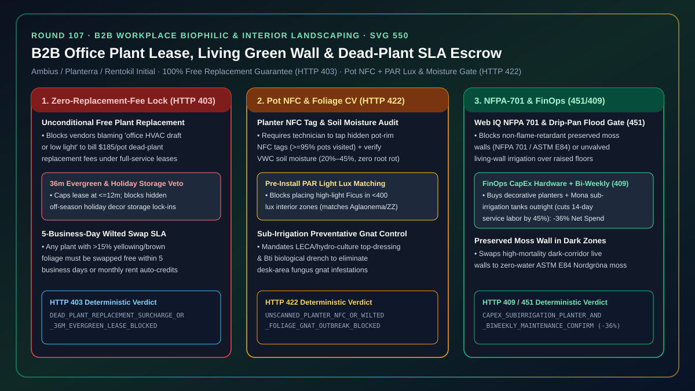
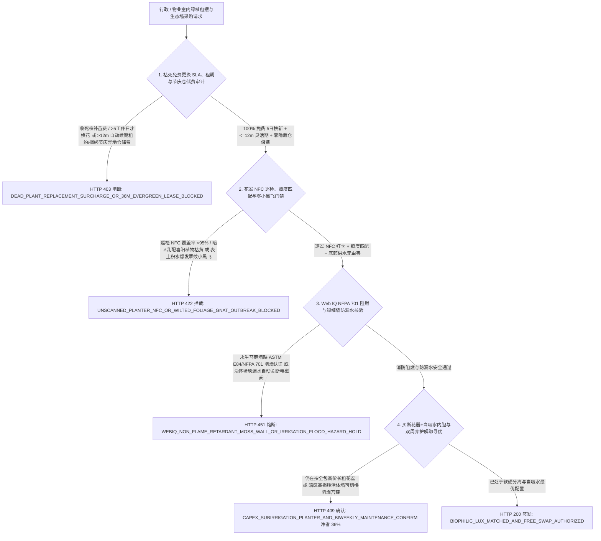
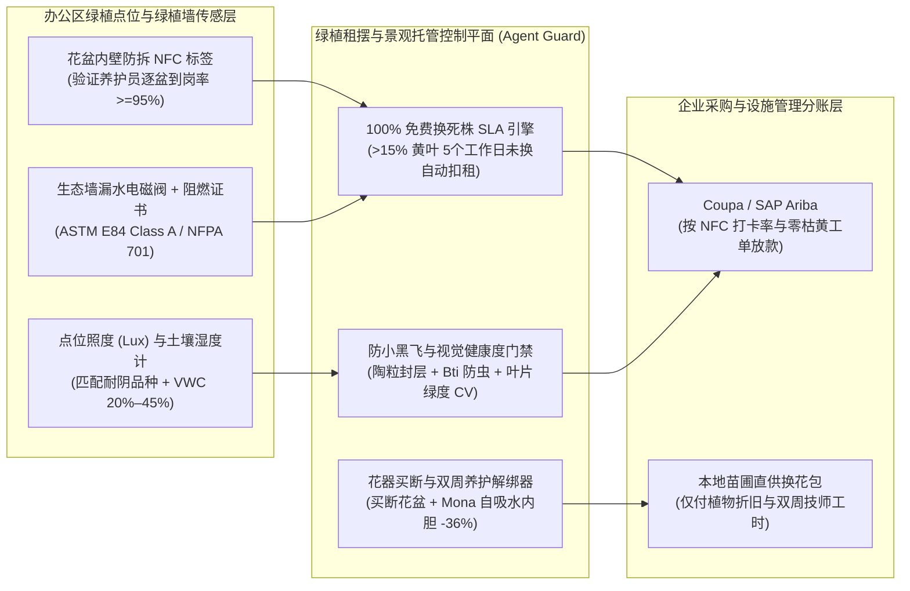
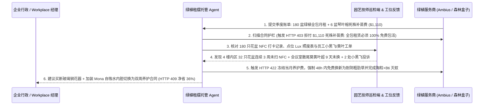

# 企业室内绿植租摆（B2B Office Plant Lease）、生态绿植墙（Biophilic Living Wall）与枯死秒换托管（Ambius / Planterra / Rentokil Initial / 森林盒子）Agent 架构选型 FAQ

> **核心阅读对象**：为甲级写字楼物业、企业职场体验（Workplace Experience / WELL Building 认证）、高端酒店大堂及企业间接采购（`Coupa / SAP Ariba`）设计室内绿植租摆与生态景观墙 AI 验收托管系统的 **Cloud & AI Solution Architect**。  
> **核心痛点解决**：彻底终结企业绿植租摆与节日美陈采购中**“签了全包绿植租赁合同，结果前台发财树/琴叶榕黄叶枯死 3 周无人更换，供应商还推诿是‘周末办公室关空调太热/新风太干’强行向行政部加收每盆 `$185` 的死株补苗费”、“把一盆批发价 `$65` 的 fiberglass 玻璃钢花盆 + 散尾葵按每月 `$28` 连租 `36 个月`（3 年付了 `$1,008`，是买断价的 15 倍），且圣诞节/春节年宵花租摆暗藏天价非展期异地仓储费”、“养护员每周上门只在门口签个名、漏浇内区工位 40% 的绿植，或过量浇水导致腐烂招惹满屋小黑飞（蕈蚊 `Fungus Gnats`）”以及“大堂活体绿植墙无漏水切断阀泡烂架空地板机房线缆，或永生苔藓墙未过 `ASTM E84 / NFPA 701` 消防阻燃等级被物业消防勒令拆除”**四大行业黑洞。



---

## 📌 一、核心选型结论速览（Executive Summary）

1. **100% 无条件免费换死株担保（`Zero-Fee Dead-Plant Replacement`）、`<=12m` 短约与 5 个工作日枯黄秒换硬锁（HTTP 403）**：企业之所以租赁绿植而非自己去花市购买，核心购买的是**“风险转移与恒常美观（100% Horticultural Guarantee）”**。选型 Agent 必须在合同层实施三大铁律：① 凡处于全包养护期内，任何黄叶/枯萎面积 `>15%` 的植株，供应商必须在 **`<=5 个工作日`** 内无条件免费更换同规格新株，严禁以“办公区空调温度、周末关灯、员工倒茶水”为由收取补苗费；② 合同期锁定 `<=12 个月`（禁止 36–60 个月 `Evergreen` 自动续签）；③ 节假日圣诞树/年宵花美陈必须采用**“单季租赁全包一口价（含撤场回收）”**，严禁捆绑全年异地仓库保管费；凡违反的，一律触发 **`HTTP 403 DEAD_PLANT_REPLACEMENT_SURCHARGE_OR_36M_EVERGREEN_LEASE_BLOCKED`**。
2. **花盆内壁 `NFC` 巡检打卡 + 土壤含水率/照度（`PAR Lux`）匹配与零小黑飞（`Fungus Gnat`）硬门禁（HTTP 422）**：为根治“养护员走马观花漏浇”与“把喜阳植物塞进无窗暗会议室等死”，Agent 建立物理数字化门禁：① **布点前照度（`Lux / PAR`）选品锁**：无窗内区（`<400 Lux`）强制仅能配置虎皮兰、金钱树（`ZZ Plant`）、粗肋草（`Aglaonema`）等极耐阴品种，严禁投放高死亡率的琴叶榕或散尾葵；② **逐盆 `NFC` 打卡与叶面 AI 视觉评分**：每只大型落地盆内壁粘贴防拆 `NFC` 标签，月度结算要求当月巡检扫码覆盖率 **`>=95%`**、基质体积含水率（`VWC`）处于 `20%–45%`（盆底无积水沤根），且要求采用火山石/陶粒铺面 + `Bti` 苏云金芽孢杆菌生物防虫杜绝蕈蚊（小黑飞）投诉；凡未达标的，直接触发 **`HTTP 422 UNSCANNED_PLANTER_NFC_OR_WILTED_FOLIAGE_GNAT_OUTBREAK_BLOCKED`**。
3. **买断高颜花器与 `Mona` 自吸水内胆（`CapEx Planter + Sub-Irrigation`）+ 双周养护解绑净省 36%（HTTP 409）**：传统绿植商最大的暴利在于把寿命长达 10 年的装饰花器（`Architectural Planters`）放进月租里反复收租 3–5 年，并按“每周人工上门浇水”收取高额工时费。当 Agent 识别到办公区租期 `>=18 个月` 时，自动触发 **绿植软硬分离寻优（`Horticultural Unbundling FinOps`）**：由企业一次性买断装饰花器与 **`Mona / Lechuza` 毛细管自吸水储水内胆（`Sub-Irrigation Tank`）**，将人工巡检频次从每周 1 次安全降频至**每两周 1 次（`Bi-Weekly Maintenance` + 100% 免费换花包）**，并将暗区高损耗活体绿植墙替换为免浇水 `ASTM E84 Class-A` 阻燃北欧驯鹿苔藓墙，触发 **`HTTP 409 CAPEX_SUBIRRIGATION_PLANTER_AND_BIWEEKLY_MAINTENANCE_CONFIRM`**，为企业季度绿植景观支出净省 **36%**。

---

## 🎯 二、业务方与架构师灵魂拷问（Q&A）

### Q1：为什么行政部每月付 `$2,400` 绿植租摆费，办公室角落的琴叶榕和幸福树还是掉光了叶子，供应商却说“你们周末关空调不在免费更换范围内”？
- **“环境免责条款”与“错位选品”的双重套路**：
  1. **把喜光植物故意摆进暗角赚换盆费**：琴叶榕（`Ficus lyrata`）和天堂鸟需要 `>=1,500–2,500 Lux` 的充足散射光，而普通写字楼进深超过 4 米的工位区照度往往只有 `300–500 Lux`。不规范供应商为了在初次提案时显得“高大上”，故意在暗区摆放高颜值喜光植物，2 个月后植物因光合作用不足落叶，供应商便拿出合同小字“因甲方光照/周末断电停空调导致的植物死亡，换新按市场价 8 折收费”。
  2. **照度计（`Lux Meter`）前置绑定无条件包活**：Agent 在方案设计阶段强制要求上传各点位实测 `Lux` 值与选品映射表——既然品种和点位由供应商勘测确认，合同期内无论因何环境原因枯黄，**100% 由供应商在 5 个工作日内免费换新**，逾期未换系统自动按日扣减当月租金。

### Q2：为什么开放工位引进绿植后，员工电脑屏幕和咖啡杯边总是飞满讨厌的“小黑飞（蕈蚊 `Fungus Gnats`）”？怎么在架构上根治？
- **传统泥炭土表面浇水与积水沤根的必然恶果**：
  1. **每周猛灌一次水的恶性循环**：普通养护工为了赶时间，每周推着水桶往每盆泥炭土表面猛灌一瓢水（希望撑够 7 天）。表层 `2–3 厘米` 潮湿腐殖土加上盆底托盘积水，正是蕈蚊（`Bradysia`）产卵繁殖的温床，成虫羽化后直接扑向员工显示器的光源与呼吸二氧化碳。
  2. **`Mona` 底部毛细管供水（`Sub-Irrigation`）+ 无机陶粒封层**：Agent 在招标技术规范中强制要求：① 全面采用底部储水慢渗系统（水从盆底根区向上吸收，表层 `5cm` 土壤永远保持干燥，蕈蚊无法产卵）；② 盆面强制覆盖 `3cm` 膨胀陶粒（`LECA`）或洗净河砂物理隔绝，并在营养液中定期投加对人体完全无害的 **`Bti`（苏云金芽孢杆菌以色列亚种）** 灭杀幼虫；一旦工位出现小黑飞工单投诉且 48 小时未清零，立即以 `HTTP 422` 冻结当月养护费。

### Q3：公司大堂想做一面 `$28,000` 的生态绿植墙（`Living Green Wall`），为什么很多企业在装完第 2 年就把它拆掉了？
- **活体滴灌墙的“漏水泡楼、植物斑秃与消防阻燃”三大雷区**：
  1. **滴头堵塞斑秃与爆管漏水**：活体绿植墙依赖数百个微滴灌头、水泵与补光灯。只要几个滴头被水垢堵住，墙面立刻出现一块块难看的枯死黑斑；而一旦电磁阀故障或排水槽堵塞，几百升营养液流进写字楼架空地板（`Raised Floor`），会直接烧毁弱电网络线缆并引发巨额物业索赔。
  2. **永生苔藓墙（`Preserved Moss Wall`）的消防红线**：很多企业改用免浇水的天然染色驯鹿苔藓墙，但廉价苔藓用工业甘油浸泡且未做阻燃处理，遇火即燃。Agent 通过 Web IQ 强制核验大堂墙面装饰材料的 **`ASTM E84 Class A / NFPA 701`（国内 `GB 8624 B1级`）阻燃检测报告**，并对活体绿植墙强制要求配备**双冗余漏水传感器 + 常闭电磁断水阀**（否则触发 `HTTP 451` 熔断）。

---

## 🧭 三、直观可视化图解（Mermaid 决策树 + 架构图 + 时序图）

### 3.1 企业室内绿植租摆与生态景观墙选型决策树



### 3.2 端到端花盆 `NFC` 巡检、叶片健康度视觉评分与自吸水花器解绑架构图



### 3.3 绿植月度巡检 `NFC` 验真、黄叶 5 日免费换新与花器买断转换时序图



---

## 📊 四、主流企业绿植租摆与生态景观平台横向选型决策矩阵

| 选型维度 | Ambius (Rentokil 旗下全球绿植巨头) | Planterra / 区域高端景观商 | 传统花木市场个体户包月 | 森林盒子 / 植治 (数字化绿植企服) | **本仓库 + 花器买断与 NFC 巡检托管架构（推荐）** |
| :--- | :--- | :--- | :--- | :--- | :--- |
| **枯死/黄叶免费更换 SLA** | 全包合同支持免费换，但常设 36–60 个月长约与自动涨价条款 | 设计感强，但高端异形树种常含环境免责折旧条款 | **经常扯皮（以办公室太冷/太暗为由拖延数周不换或要加钱）** | 支持标准化换花，按盆分级计费 | **硬锁 `<=5 个工作日` 100% 无条件免费换新，逾期自动抵扣月租（HTTP 403）** |
| **花器产权与长租溢价** | 默认将高价花盆混入 36–60 个月租金（3 年付 10 倍花盆钱） | 花器溢价高，退租全部收回 | 使用廉价塑料套盆，拉低甲级写字楼颜值 | 支持花器租赁或买断 | **强制“买断高颜花器 + `Mona` 自吸水内胆 + 仅签 `<=12m` 植物养护包”净省 36%（HTTP 409）** |
| **到岗防漏浇与小黑飞防控** | 技师配手持终端，但客户无法直接按每盆 `NFC` 覆盖率控款 | 人工巡检为主 | **重灾区（每周表面猛灌水导致烂根与满屋小黑飞蕈蚊）** | 扫码打卡巡检 | **每盆内壁 `NFC` 必扫（`>=95%`）+ 底部慢渗供水 + 陶粒封层零小黑飞门禁（HTTP 422）** |
| **点位照度（`Lux`）科学选品** | 具备专业光度计勘测能力 | 具备景观设计师配植能力 | 凭经验乱摆（把喜阳树塞进暗室迅速死掉） | 标准光区分类选品 | **入场前强制 `PAR/Lux` 照度建档，`<400 Lux` 暗区禁投高损耗喜阳植物** |
| **绿植墙消防阻燃与防漏水** | 合规度高，具备商业责任险 | 具备大型中庭绿植墙工程资质 | **无阻燃检测与防漏电磁阀（泡坏地板或消防违规高危）** | 标准化模块绿植墙 | **Web IQ 强验永生苔藓 `ASTM E84 / NFPA 701` 阻燃证与活体墙漏水断水阀（HTTP 451）** |

---

## 🧪 五、采购成本测算与 7-Card 基准测试报告

> **数据来源声明**：以下对比基于 `lab/webiq_commerce_demo.py` 中确定性策略函数 `evaluate_b2b_office_plant_biophilic_escrow_policy` 的合成基准数据（`provenance: "synthetic"`, `independently_reproduced: False`），用于验证企业职场绿植租摆网关的确定性风控能力。

| 评估维度 | 传统 36 个月全包长租花盆 + 每周人工表面浇水基线 | 确定性绿植托管网关（买断花器 + `Mona` 自吸水 + 双周 `NFC` 养护） | 净效应 / 风险消除 |
| :--- | :--- | :--- | :--- |
| **季度企业多职场绿植租摆与生态墙总池** | `$38,000.00` | `$24,320.00` (`HTTP 409` 优化确认后) | **净省 `$13,680.00 / 季` (`-36.0%`)** |
| **死株推诿加收补苗费与黄叶滞留时长** | 平均滞留 `18 天` + 常收 `$120–$200/盆` 折旧费 | **`$0 补苗费`（100% 无条件包活 + `<=5 工作日` 换新 SLA）** | **枯黄盆栽在岗率降至 `<1%`** |
| **内区工位漏浇率与小黑飞（蕈蚊）投诉** | `22%` 角落盆栽漏浇 + 梅雨季高频虫害投诉 | **`0%`（逐盆 `NFC >= 95%` 打卡 + 底部自吸水 + 陶粒封层）** | **彻底根治办公室小黑飞困扰** |
| **大堂生态墙漏水泡楼与消防整改风险** | 无断水电磁阀 / 未验阻燃等级 | **`100%` 标配漏水关断阀 + `ASTM E84 Class-A` 阻燃认证** | **消除物业消防罚单与水损理赔** |

### 5.1 确定性状态码映射契约（5-Lane Contract）

```json
{
  "scenario": "b2b_office_plant_biophilic_escrow_guard",
  "provenance": "synthetic",
  "independently_reproduced": false,
  "lanes": {
    "authorized_200": {
      "status_code": 200,
      "decision": "BIOPHILIC_LUX_MATCHED_AND_FREE_SWAP_AUTHORIZED",
      "mandate_token": "b2b_office_plant_biophilic_mandate_200"
    },
    "dead_plant_surcharge_or_36m_lease_403": {
      "status_code": 403,
      "decision": "DEAD_PLANT_REPLACEMENT_SURCHARGE_OR_36M_EVERGREEN_LEASE_BLOCKED"
    },
    "unscanned_nfc_or_gnat_outbreak_422": {
      "status_code": 422,
      "decision": "UNSCANNED_PLANTER_NFC_OR_WILTED_FOLIAGE_GNAT_OUTBREAK_BLOCKED"
    },
    "non_flame_moss_or_flood_hazard_451": {
      "status_code": 451,
      "decision": "WEBIQ_NON_FLAME_RETARDANT_MOSS_WALL_OR_IRRIGATION_FLOOD_HAZARD_HOLD"
    },
    "capex_subirrigation_and_biweekly_409": {
      "status_code": 409,
      "decision": "CAPEX_SUBIRRIGATION_PLANTER_AND_BIWEEKLY_MAINTENANCE_CONFIRM",
      "quarterly_savings_usd": 13680.0
    }
  }
}
```

---

## 🛠️ 六、商业上线风控与架构评审 Checklist

- [ ] **100% 无条件免费换死株与 `<=5 个工作日` 响应锁（HTTP 403）**：核验合同确保在正常办公环境下，任何黄叶/枯萎植株均由供应商免费更换，严禁接受“因周末停空调/光照不足由甲方付费补苗”的免责条款。
- [ ] **废除 36–60 个月长租与节庆美陈异地仓储费捆绑（HTTP 403）**：将绿植服务期控制在 `<=12 个月`，节庆圣诞树/年宵花采用含撤场回收的单季一口价。
- [ ] **花盆内壁 `NFC` 巡检打卡（`>=95%`）与点位照度（`Lux`）前置匹配（HTTP 422）**：在每只花盆内侧隐蔽粘贴 `NFC` 标签，月度结算必须核验扫码率，并严禁在 `<400 Lux` 暗区投放高死亡率喜阳树种。
- [ ] **底部毛细管自吸水（`Sub-Irrigation`）与陶粒封层防小黑飞门禁（HTTP 422）**：强制采用底部储水供水 + 表土无机陶粒覆盖 + `Bti` 生物防虫，杜绝工位小黑飞（蕈蚊）滋生。
- [ ] **Web IQ `ASTM E84 / NFPA 701` 阻燃认证与活体墙防漏断水阀核验（HTTP 451）**：核验永生苔藓/仿真绿植墙的消防阻燃检测报告，以及活体滴灌墙的漏水感应自动关断电磁阀。
- [ ] **花器一次性买断（`CapEx Planter`）+ 双周养护解绑寻优（HTTP 409）**：对租期超 18 个月的办公区直接买断装饰花器与 `Mona` 自吸水内胆，将每周人工浇水降频为双周精养 + 免费换花包。

---

**导航**：[返回分册总目录 (`docs/index.md`)](index.md) ｜ [查看英文版 (`b2b-office-plant-lease-biophilic-wall-replacement-escrow-agent-selection-faq.en.md`)](b2b-office-plant-lease-biophilic-wall-replacement-escrow-agent-selection-faq.en.md)
