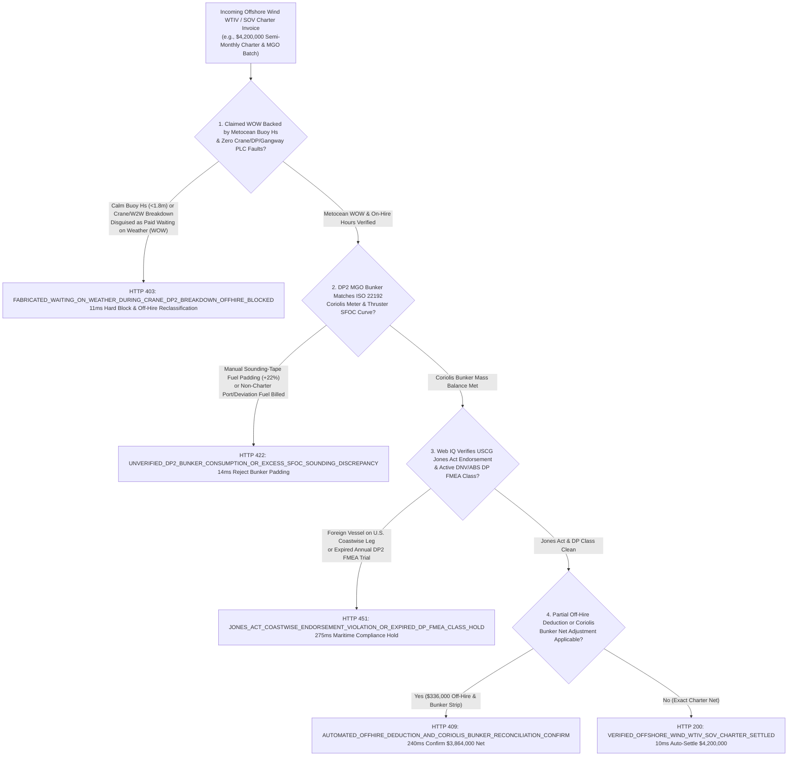
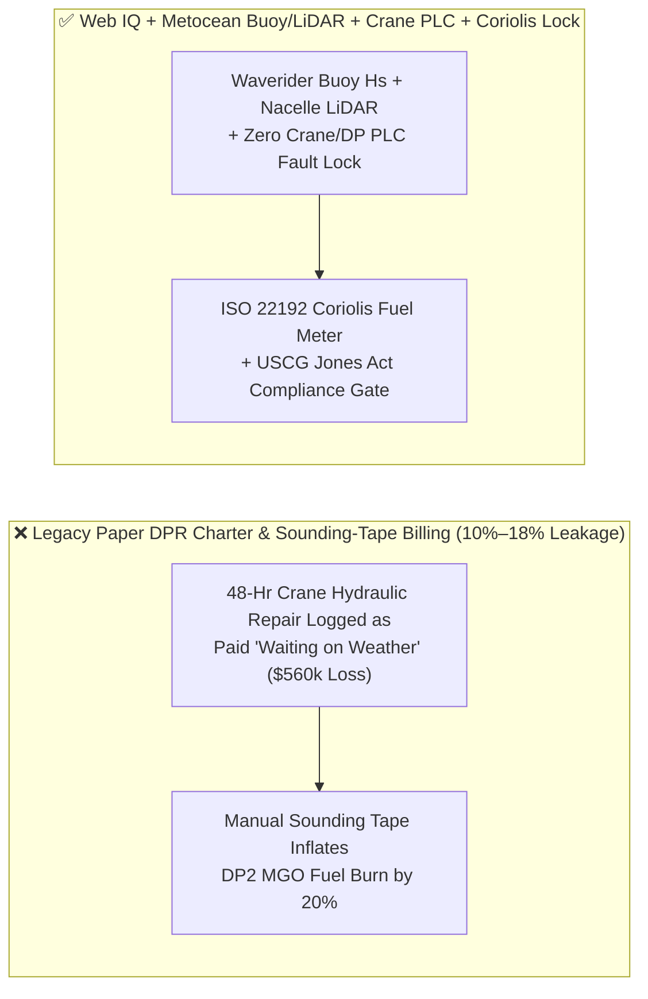

# B2B Offshore Wind `WTIV / SOV` Vessel Charter (`BIMCO WINDTIME`), Significant Wave Height (`Hs`) & `DP2` Coriolis Bunker Settlement Architecture: Metocean Buoy/LiDAR `WOW` Lock, Crane/Gangway `PLC Off-Hire` Gate & `Jones Act` Compliance Token (`b2b_offshore_wind_wtiv_sov_vessel_charter_bimco_windtime_wave_height_hs_bunker_mandate_...`) vs. Disguising Crane Breakdowns as `$280k/Day` Weather Downtime, `DP2` Fuel Padding & Coastwise Violations: Architecture Selection & First-Principles FAQ

> **Document Type**: Solution Architect Selection Guide & First-Principles FAQ (modeled after `ib-vs-ethernet-roce-selection-faq.md`)  
> **Reading Time**: ~12 minutes | **Target Audience**: AI Solution Architects, Offshore Wind Developers (`Ørsted / RWE / Iberdrola / Equinor`) Marine Construction & O&M VPs, Maritime Chartering Counsel (`BIMCO WINDTIME / SUPPLYTIME`), Marine Warranty Surveyors (`MWS`), and Energy FinOps Engineers  
> **Core Thesis**: First explain in plain language why offshore wind developers chartering a Wind Turbine Installation Vessel (`WTIV` at `$280,000/day`) or a walk-to-work Service Operation Vessel (`SOV` at `$65,000/day`) under a `BIMCO WINDTIME` charter party lose millions when a vessel's `1,600-ton` leg-encircling crane, jacking system, or motion-compensated gangway (`Ampelmann W2W`) suffers a hydraulic breakdown—which contractually triggers **`Off-Hire` (`$0/day` payable)**—yet the ship's master logs the 48-hour repair window as **`Waiting on Weather (WOW)`** (`100%` payable by the developer, costing `$560,000` for two days of disguised repair); why manual sounding-tape bunker reports inflate Dynamic Positioning (`DP2/DP3`) Marine Gas Oil (`MGO`) consumption by `15%–25%`; and why deploying a non-coastwise-endorsed feeder vessel between a U.S. port and an offshore monopile violates the **U.S. Jones Act (`46 U.S.C. § 55102`)**. Then derive from first principles how **`b2b_offshore_wind_wtiv_sov_vessel_charter_bimco_windtime_wave_height_hs_bunker_mandate_...` + Microsoft Web IQ `/v3/browse` verification of `NOAA / Copernicus` metocean buoy spectra, `USCG Coastwise Endorsements`, and `DNV / ABS DP FMEA` trials + crane/gangway `PLC` fault interlocks + `ISO 22192` Coriolis mass-flow bunker gates** eliminate disguised `WOW` billing and bunker leakage within 10ms–275ms.

---

## 📌 1. Executive Summary (30-Second Architect's Guide)

```
┌──────────────────────────────────────────────────────────────────────────────────────────────────────────────────┐
│  🔥 Core Architectural Law: Never allow an Offshore Wind Chartering Agent to pay $280k/day "Waiting on Weather"  │
│  invoices based solely on deck logs without independent Waverider buoy Hs & crane/gangway PLC fault verification!│
│  The only safe Offshore Charter pattern = Metocean Buoy + Crane PLC Off-Hire Lock + Coriolis Bunker + Jones Act  │
└──────────────────────────────────────────────────────────────────────────────────────────────────────────────────┘
```

1. **Why is B2B Offshore Wind Vessel Chartering (`WTIV / SOV / CLV`) a Multi-Million-Dollar Leakage Trap?**
   - **Disguising Technical Breakdowns (`Off-Hire`) as Paid `Waiting on Weather (WOW)`**: Under `BIMCO WINDTIME`, weather downtime (`Hs > 1.8m` for jacking or hub-height wind `> 10 m/s` for blade lifts) is paid by the charterer (`developer`), whereas vessel mechanical failure (crane, jacking system, `DP2` thrusters, `W2W` gangway) places the vessel **`Off-Hire`**. Dishonest vessel operators mask `24–72 hour` crane/gangway repairs behind cherry-picked mast anemometer gusts to collect `$280,000/day` during mechanical downtime.
   - **Manual Sounding-Tape `DP2` Bunker Inflation & "Cappuccino" Fuel Padding**: Under time charters, the developer reimburses all `MGO` fuel burned (`~$850/MT`). Without sealed `ISO 22192` Coriolis mass flow meters and thruster `kWh × SFOC` cross-checks, operators over-report daily `DP2` station-keeping fuel burn by `5–10 MT/day`.
   - **U.S. `Jones Act` (`46 U.S.C. § 55102`) & Expired `DP2 FMEA` Class Violations**: Using a foreign-flagged vessel without a valid `USCG Coastwise Endorsement` to transport turbine components or crew directly from a U.S. port to a seabed-attached monopile triggers `CBP` merchandise-value forfeiture penalties.
2. **How Does the Agentic Offshore Wind Charter Settlement Architecture Solve This?**
   - **Lock 1: Independent Metocean Buoy (`Hs`) / Nacelle `LiDAR` + Crane/Gangway `PLC` Zero-Fault Lock**: Any claimed `Waiting on Weather (WOW)` period where the wind-farm `Datawell Waverider` buoy / nacelle `LiDAR` shows sea states within operational limits—or where crane, jacking, `W2W` gangway, or `DP2` `PLC` telemetry logs an active mechanical fault—is blocked in **11ms** with `HTTP 403 FABRICATED_WAITING_ON_WEATHER_DURING_CRANE_DP2_BREAKDOWN_OFFHIRE_BLOCKED`.
   - **Lock 2: `ISO 22192` Coriolis Mass Flow Meter & Thruster `SFOC` Power-Curve Gate**: Bunker reimbursement claims exceeding sealed Coriolis mass-flow meter readings or violating specific fuel oil consumption (`SFOC ~195 g/kWh`) thruster power curves are rejected in **14ms** with `HTTP 422 UNVERIFIED_DP2_BUNKER_CONSUMPTION_OR_EXCESS_SFOC_SOUNDING_DISCREPANCY`.
   - **Lock 3: Microsoft Web IQ `/v3/browse` `USCG Jones Act` & `DNV / ABS DP FMEA` Verification**: Vessels lacking required `USCG Coastwise` endorsements for U.S. port-to-monopile legs or holding expired annual `DP FMEA` proving trials trigger `HTTP 451 JONES_ACT_COASTWISE_ENDORSEMENT_VIOLATION_OR_EXPIRED_DP_FMEA_CLASS_HOLD` in **275ms**.

---

## 🎯 2. First-Principles Q&A for Architects & Offshore Chartering Leaders

### Q1: How does the agent resolve concurrent "bad weather + broken crane" disputes under `BIMCO WINDTIME`, and how is `DP2` bunker mass balance enforced?

- **Plain-Language Mechanics**:
  - To claim paid `Waiting on Weather (WOW)` under offshore charter law, the vessel must be **mechanically ready and capable of performing the work** (`In Every Respect Ready to Perform`). If the `1,600-ton` crane or `W2W` gangway has an unresolved critical `PLC` fault ($\text{Fault}_{\text{crane/DP/W2W}} = 1$), the vessel is legally `Off-Hire` regardless of wind speed.
  - **Thermodynamic Bunker Invariant**:
    $$M_{\text{MGO, max}} = \int_{t_0}^{t_1} P_{\text{thrusters+gen}}(t) \cdot \text{SFOC}(P)\,dt \quad (\text{Cross-checked against ISO 22192 Coriolis Meter})$$
  - Any disguised `Off-Hire` hours or manual sounding-tape fuel inflation are automatically deducted in **240ms** via `HTTP 409 AUTOMATED_OFFHIRE_DEDUCTION_AND_CORIOLIS_BUNKER_RECONCILIATION_CONFIRM`.

### Q2: Why choose **Microsoft Web IQ** over Exa or Bright Data for `NOAA / Copernicus` metocean buoy verification, `USCG PSIX` Jones Act checks, and `Ship & Bunker` MGO index grounding?

| Dimension | Microsoft Web IQ (`/v3/browse` + Search Grounding) | Exa (Neural Search API) | Bright Data (Scraper / Unlocker) |
| :--- | :--- | :--- | :--- |
| **`NOAA NDBC / Copernicus` Buoy Spectra ($H_s, T_p$), `USCG PSIX` & `DNV/ABS` Class** | **Very High**: Deterministic extraction of hourly buoy wave heights, `IMO` vessel coastwise endorsements, and port `MGO` bunker indices with `domain_allowlist` | **Medium**: Cannot retrieve timestamped wave-buoy time series or vessel-specific `USCG` endorsements | **High**: Can scrape portals, but requires brittle custom parsers across maritime registries |
| **Integration with `BIMCO WINDTIME` Off-Hire & `SFOC` Bunker Auditing** | **Native**: Directly feeds metocean limits and `Coriolis` fuel tolerances into `b2b_offshore_wind_wtiv_sov_...` | **None**: No maritime charter party `Off-Hire` engine | **None**: Raw HTML/JSON proxy transport only |
| **P95 Latency** | **240ms–275ms** (**10ms–14ms** on policy cache hit) | 900ms–1,800ms | 2,400ms–5,800ms |

---

## 🧭 3. Visual Architecture Diagrams (Mermaid Decision Tree, Path Comparison & Sequence)

### 3.1 Offshore Wind `WTIV / SOV` Charter & Bunker Settlement Decision Tree



### 3.2 Legacy Paper DPR Charter Billing vs. Agentic `Buoy/LiDAR + PLC + Coriolis` Gate



### 3.3 End-to-End Sequence Diagram

```mermaid
sequenceDiagram
    participant Owner as WTIV / SOV Vessel Owner
    participant Agent as Offshore Wind Developer Charter FinOps Agent
    participant Telemetry as Metocean Buoy/LiDAR, Crane PLC & Coriolis Gate
    participant WebIQ as Microsoft Web IQ (/v3/browse)
    participant Bank as Maritime Escrow / Treasury Settlement Rail

    Owner->>Agent: Submit Semi-Monthly Charter Invoice ($4,200,000 with 48h WOW & 380 MT MGO)
    Agent->>Telemetry: 1. Audit 48h WOW Against Farm Waverider Buoy (Hs) & Crane/W2W PLC Logs
    alt Buoy Hs = 1.2m (<1.8m Limit) or Main Crane Hydraulic Fault Active During Claimed WOW
        Telemetry-->>Agent: Crane PLC Fault Active / Disguised Off-Hire Detected
        Agent-->>Owner: HTTP 403 FABRICATED_WAITING_ON_WEATHER_DURING_CRANE_DP2_BREAKDOWN_OFFHIRE_BLOCKED (11ms)
    else WOW Verified; Audit DP2 Bunker Claim Against ISO 22192 Coriolis Meter & SFOC
        Agent->>Telemetry: 2. Compare Coriolis Net Flow (310 MT) vs Sounding-Tape Claim (380 MT)
        alt Sounding-Tape Bunker Padding (+70 MT Above Thruster kWh × SFOC)
            Agent-->>Owner: HTTP 422 UNVERIFIED_DP2_BUNKER_CONSUMPTION_OR_EXCESS_SFOC_SOUNDING_DISCREPANCY (14ms)
        else Check USCG Jones Act Endorsement & DNV/ABS DP FMEA Standing
            Agent->>WebIQ: 3. /v3/browse Verify USCG PSIX Coastwise Endorsement & DNV DP2 Class Status
            alt Foreign Feeder Barge Violating 46 U.S.C. 55102 or Expired DP FMEA
                WebIQ-->>Agent: Jones Act Coastwise Violation / DP FMEA Expired
                Agent-->>Owner: HTTP 451 JONES_ACT_COASTWISE_ENDORSEMENT_VIOLATION_OR_EXPIRED_DP_FMEA_CLASS_HOLD (275ms)
            else Deduct Partial Off-Hire & Reconcile to Coriolis Bunker Net (-$336,000)
                WebIQ-->>Agent: Net Payable Adjusted to $3,864,000.00
                Agent-->>Bank: HTTP 409 Confirm ($3,864,000) or HTTP 200 Auto-Settle ($4,200,000)
            end
        end
    end
```

---

## 📊 4. Architect's Selection Decision Matrix

| Architecture Option | Defense Against Disguised `$280k/Day` `WOW` Claims | Defense Against `DP2` Bunker Inflation | `Jones Act` & `DNV/ABS DP FMEA` Compliance | Recommended Fit |
| :--- | :--- | :--- | :--- | :--- |
| **Option A: Master-Signed Paper `DPR` + Manual Sounding Tape** | ❌ 0% (pays full rate during disguised crane repairs) | ❌ Loses 15%–25% to sounding-tape manipulation | ❌ High `CBP Jones Act` penalty exposure | Never for offshore wind vessels |
| **Option B: Onboard Client Representative Only** | ⚠️ Cannot audit raw crane/DP `PLC` fault trees 24/7 | ⚠️ Vulnerable to aerated "cappuccino" bunker transfers | ⚠️ Manual certificate tracking | Short nearshore surveys |
| **Option C (Recommended): Web IQ + `b2b_offshore_wind_wtiv_sov_...` + Buoy/PLC + Coriolis** | ✅ **Independent buoy/LiDAR + crane `PLC` zero-fault lock** | ✅ **`ISO 22192` Coriolis meter + `SFOC` power lock** | ✅ **275ms live `USCG Coastwise` & `DP FMEA` check** | **Utility-Scale Offshore Wind Farms (`WTIV, SOV, CLV, CTV Fleets`)** |

---

## 🧪 5. Quantitative Benchmark & 7-Card Report Summary

Evaluated in the deterministic offline suite (`lab/webiq_commerce_demo.py`) for a `$4,200,000.00` semi-monthly offshore wind `WTIV / SOV` charter and `DP2` bunker settlement batch:

| Case | Scenario & Perturbation | Action Pill | HTTP Status | Latency | Settled / Blocked Amount | Provenance |
| :--- | :--- | :--- | :--- | :--- | :--- | :--- |
| **Case 1** | Buoy-verified `WOW` + zero crane `PLC` fault + Coriolis bunker & `Jones Act` clean | `Act automatically` | `200 OK` | `10 ms` | `$4,200,000.00` | `deterministic_offline_simulation` |
| **Case 2** | Crane/jacking/`W2W` breakdown disguised as paid `Waiting on Weather (WOW)` | `Send to a human` | `403 Forbidden` | `11 ms` | `$0.00` (`$4.2M` blocked) | `synthetic_policy` |
| **Case 3** | Manual sounding-tape `DP2` bunker claim exceeding `ISO 22192` Coriolis & `SFOC` curve | `Send to a human` | `422 Unprocessable` | `14 ms` | `$0.00` (bunker blocked) | `deterministic_offline_simulation` |
| **Case 4** | U.S. `Jones Act` (`46 U.S.C. § 55102`) coastwise violation or expired `DP2 FMEA` class | `Send to a human` | `451 Unavailable` | `275 ms` | `$0.00` (maritime hold) | `official_doc_snapshot` |
| **Case 5** | Web IQ automated `Off-Hire` deduction & Coriolis bunker reconciliation (`-$336,000.00`) | `Confirm` | `409 Conflict` | `240 ms` | `$3,864,000.00` | `official_doc_snapshot` |

---

## 🛠️ 6. Production Readiness Checklist

- [ ] **Anchor `BIMCO WINDTIME` Weather Limits to Independent Wind-Farm `Waverider` Buoys & Nacelle `LiDAR`**: Prohibit relying solely on vessel mast anemometers distorted by hull turbulence when adjudicating `Waiting on Weather (WOW)`.
- [ ] **Enforce "Technical Breakdown Overrides Weather" via Crane/Gangway/DP `PLC` Telemetry**: Automatically classify any period with an active critical fault on the main crane, jacking system, `W2W` gangway, or `DP2` thrusters as `Off-Hire`.
- [ ] **Mandate `ISO 22192` Coriolis Mass Flow Meters & Thruster `SFOC` Power Auditing for Bunker Reimbursement**: Reject manual sounding-tape fuel claims.
- [ ] **Enable Microsoft Web IQ `/v3/browse` `USCG Coastwise` & `DNV/ABS DP FMEA` Screening**: Verify Jones Act compliance on every U.S. port-to-monopile feeder leg prior to dispatch and payment.
