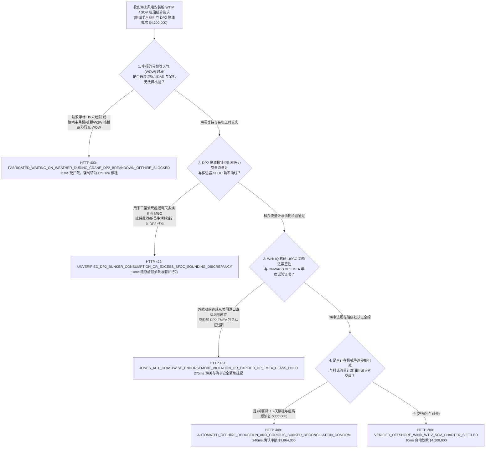
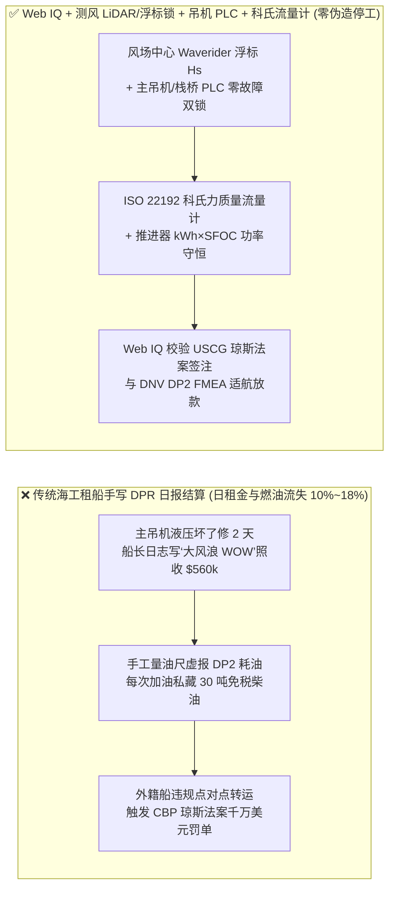
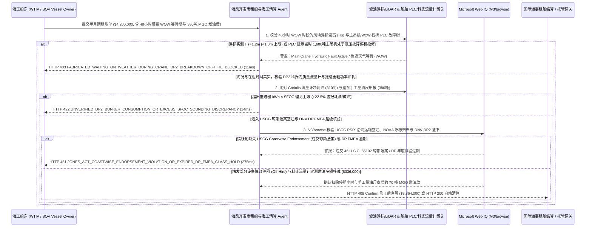

# B2B 智能体海上风电安装船与运维母船租约（`Offshore Wind WTIV / SOV Vessel Charter & BIMCO WINDTIME / SUPPLYTIME`）、有效波高海况窗口（`Significant Wave Height Hs & Hub-Height Wind Speed`）与动力定位燃油（`DP2 / DP3 Coriolis Mass Flow Bunker`）清算架构：测风激光雷达/波浪浮标（`Metocean Buoy`）防伪造恶劣海况停工锁、起重机/主动波浪补偿栈桥（`W2W Gangway`）故障停租（`Off-Hire`）门禁与《琼斯法案》（`46 U.S.C. § 55102 Jones Act`）合规令牌（`b2b_offshore_wind_wtiv_sov_vessel_charter_bimco_windtime_wave_height_hs_bunker_mandate_...`）vs 传统船东将自身吊机液压故障谎报成“海况超标等待期（`WOW`）”照拿 `$280,000/天` 日租金、虚报 `DP2` 悬停柴油消耗与外籍船违规转运选型与原理解析 FAQ

> **文档类型**：架构师选型指南与第一性原理 FAQ（对齐 `ib-vs-ethernet-roce-selection-faq.md` 标杆风格）  
> **阅读耗时**：约 12 分钟 | **适用角色**：AI Solution Architect、海上风电开发商（`Ørsted / RWE / Iberdrola / 三峡新能源`）海工施工与运维副总裁、海事租船（`Offshore Chartering: BIMCO WINDTIME`）法务总监、海洋工程测量与智能体能源结算架构师  
> **核心主旨**：先用大白话把“为什么海上风电开发商以每天 `$280,000`（约 200 万人民币/天）的天价日租金（`Day Rate`）租用自升式风机安装船（`WTIV, Wind Turbine Installation Vessel`）或以 `$65,000/天` 租用带波浪补偿栈桥的运维母船（`SOV, Service Operation Vessel`）时，按照国际航运公会 `BIMCO WINDTIME` 标准合同，如果是因为海上刮大风、起大浪（`Waiting on Weather, WOW`）导致没法吊装叶片或人员无法登塔，开发商（承租人）必须照付 `100%` 日租金；如果是船东自己的 `1,600 吨` 绕桩主吊机液压故障、自升式桩腿（`Jack-up Legs`）卡壳或 `Ampelmann` 六自由度栈桥坏了，则属于停租（`Off-Hire`），船东一分钱日租都拿不到！于是船长在吊机坏掉的那两天，故意在航海日志（`Deck Log`）里写‘阵风超 `12 m/s`、有效波高 $H_s > 2.0\text{ m}$，属恶劣天气停工’，两天就从开发商手里白骗走 `$560,000`、为什么动力定位（`DP2/DP3`）悬停耗油量由租家实报实销时，船东把船员生活用电和私自绕航油耗全算进 `DP` 作业耗油里每天多报 `8 吨` 船用轻柴（`MGO`），以及为什么在美国海域违反《琼斯法案》（`Jones Act`）用非美国建造的驳船运送一箱螺栓就会招致美国海关 `CBP` 按货物价值重罚”讲透；再从第一性原理出发，推导如何通过 **`b2b_offshore_wind_wtiv_sov_vessel_charter_bimco_windtime_wave_height_hs_bunker_mandate_...` 语义预算令牌 + Microsoft Web IQ `/v3/browse` 实时核验机舱激光雷达（`Nacelle LiDAR`）/ 海洋浮标（`NOAA / Metocean Waverider Buoy`）真实波高风速、`USCG / CBP Jones Act` 裁定函与 `IMO CII` 碳强度评级 + 主吊机/栈桥 `PLC` 故障遥测防伪造 `WOW` 锁 + 科氏力质量流量计（`Coriolis Mass Flow Meter`）燃油门禁**，在 10ms–275ms 内实现“设备故障冒充天气等待秒级停租、DP2 油耗零虚报、琼斯法案沿海运输零违章”的智能体海风海工清算闭环。

---

## 📌 一、核心结论速览（Executive Summary：30 秒看懂怎么选）

```
┌──────────────────────────────────────────────────────────────────────────────────────────────────────────────────┐
│  🔥 核心架构铁律：绝不允许海工租船 Agent 仅凭船长手写航海日志 (Deck Log) 里的“天气恶劣”就照付 $280k/天 WTIV 日租金！│
│  B2B 海上风电船租结算的唯一正确范式 = 波浪浮标/LiDAR 极值锁 + 吊机/DP2 PLC 停租门禁 + 科氏流量计 + Jones Act 令牌 │
└──────────────────────────────────────────────────────────────────────────────────────────────────────────────────┘
```

1. **为什么海上风电特种船舶租约（`WTIV / SOV / CLV Time Charter`）是百万美元级日租金流失的最前线？**
   - **黑洞一：把“船舶设备故障停租（`Technical Breakdown Off-Hire`）”伪装成“等天气（`Waiting on Weather, WOW`）”**：在 `BIMCO WINDTIME` 与 `SUPPLYTIME 2017` 租船合同中，**天气风险（`Weather Risk`）归租家承担**（等天气期间照付 `90%–100%` 日租金），而**船舶机械故障（主推进器、DP2 动力定位、自升液压系统、主起重机、W2W 登塔栈桥故障）归船东承担**（立即触发 `Off-Hire` 停租，日租金归零）。当 `$280,000/天` 的安装船发生主吊机编码器故障或桩腿预压水泵损坏时，部分船长会在每日常规日报（`DPR, Daily Progress Report`）中夸大现场瞬时阵风（谎称轮毂高度风速 `> 10 m/s`）或涌浪周期，将本该停租的 `48 小时` 机械抢修期洗白成带薪的 `WOW` 天气等待期，单次侵吞 **`$560,000`**！
   - **黑洞二：动力定位（`DP2 / DP3`）燃油实报实销猫腻与慢速经济航行（`Slow Steaming`）套利**：期租合同（`Time Charter`）下，燃油（`Bunkers: DMA / MGO 低硫轻柴`，约 `$850/公吨`）由风电开发商买单。一艘 `WTIV` 或大型海缆敷设船（`CLV`）开启全功率 `DP2` 抗流悬停时每天耗油高达 `22–35 吨`，而抛锚或靠港待命仅耗油 `3–5 吨`。不良船东在未安装防篡改质量流量计的情况下，依靠手工量油尺（`Sounding Tape`）虚报每日 `DP` 作业耗油量，私存免税海事燃油（`Cappuccino Bunker / 藏油`）转卖获利。
   - **黑洞三：违反《琼斯法案》（`U.S. Jones Act / Coastwise Trade`）或船级社（`DNV / ABS`）检验过期**：在北美海上风电项目（如东海岸风场）中，任何在美国港口与海上风机基础（固定于海床，视同美国领土点 `Coastwise Point`）之间载运货物或施工人员的馈线驳船（`Feeder Barge`）与人员转运船（`CTV`），必须拥有美国海岸警卫队 `USCG Coastwise Endorsement`；一旦误用外籍船直接从美国码头运送海缆或灌浆料下海，将触发海关 `CBP` 没收级天价罚款。
2. **智能体海工租船清算架构怎么破局？（`b2b_offshore_wind_wtiv_sov_vessel_charter_bimco_windtime_wave_height_hs_bunker_mandate_...`）**
   - **第一道锁：机舱激光雷达（`Nacelle LiDAR`）+ 现场波浪浮标（`Directional Waverider Buoy`）与船舶吊机/DP `PLC` 故障码交叉锁**：船东申报任何 `Waiting on Weather (WOW)` 带薪停工时段，系统必须同时验证：(a) 风场波浪浮标实测有效波高 $H_s$ 或 150 米轮毂高度 10 分钟平均风速 $V_{\text{hub}}$ 确实突破了船舶作业操作手册（`Vessel Operations Manual`）规定的安全极限（如自升插桩 $H_s > 1.8\text{ m}$、叶片吊装 $V_{\text{hub}} > 10\text{ m/s}$）；(b) 该时段内主吊机、自升液压系统、`DP2` 推进器及 `W2W` 栈桥的 `PLC` 控制器**无任何一级严重故障报警（`Zero Critical Equipment Fault`）**。凡海况实际平稳或隐瞒自身机械故障骗取 `WOW` 日租金的，在 **11ms** 内返回 `HTTP 403 FABRICATED_WAITING_ON_WEATHER_DURING_CRANE_DP2_BREAKDOWN_OFFHIRE_BLOCKED`。
   - **第二道锁：`ISO 22192` 科氏力质量流量计（`Coriolis Mass Flow Meter`）与 `AIS / DP` 推进器功率曲线燃油门禁**：拒绝手写量油尺日报。燃油报销必须上传主机与辅助发电机进回油管路加封的科氏力质量流量计加密读数，并与 `DP2` 推进器实时轴功率（`kW-hr`）按特定油耗率（`SFOC: ~195 g/kWh`）交叉校验。凡虚报 `DP` 燃油消耗或违规加收人员膳食/动员复员溢价的，在 **14ms** 内返回 `HTTP 422 UNVERIFIED_DP2_BUNKER_CONSUMPTION_OR_EXCESS_SFOC_SOUNDING_DISCREPANCY`。
   - **第三道锁：Microsoft Web IQ 穿透核验 `NOAA / Copernicus` 海洋气象再分析数据、`USCG Jones Act` 适航签注与 `DNV / ABS` 船级证**：通过 Web IQ `/v3/browse` 实时核验目标海域官方浮标历史海况、船舶 `USCG Certificate of Documentation (Coastwise Endorsement)` 及船级社 `Dynamic Positioning FMEA` 年度试验有效性。一旦发现违反琼斯法案沿海运输或 `DP FMEA` 过期，在 **275ms** 内触发 `HTTP 451 JONES_ACT_COASTWISE_ENDORSEMENT_VIOLATION_OR_EXPIRED_DP_FMEA_CLASS_HOLD`。

---

## 🎯 二、客户与架构师灵魂拷问 Q&A（First-Principles Deep Dive）

### Q1：在海上风场施工中，如果当天海上既有大风浪（超过吊装极限），同时安装船的主吊机也坏了（正在修），这 `$280,000/天` 的日租金到底该算 `WOW`（开发商付钱）还是算 `Off-Hire`（船东停租）？

- **通俗原理与海事法第一性原理**：
  - 这是海上风电租船合同里最经典的数百万美元争议！船东会狡辩：“反正今天风速 `13 m/s` 也吊不了叶片，我修不修吊机都不影响工程进度，所以租家你得照付我 `$280,000` 天气等待费！”
  - 但在 **`BIMCO WINDTIME` 第 15 条（`Off-Hire` 净时间损失原则 `Net Loss of Time` 与严格准备就绪条款）**下，船舶享受带薪 `WOW` 的前提是**船舶本身处于随时可作业的完全适航就绪状态（`In Every Respect Ready to Perform`）**。一旦主吊机、自升桩腿或 `DP` 系统发生机械故障失去作业能力，无论外面刮多大的台风，在吊机修复并通过载荷测试前，该时段一律优先判定为 **`Off-Hire`（停租）**！
  - 此外，如果同一风场旁边的姊妹船当时正在正常吊装（且风场中心 `Datawell Waverider` 浮标显示 $H_s = 1.3\text{ m} \le 1.8\text{ m}$ 上限），船长单方面利用船顶避雷针尾流区的失真风速计谎报大风，Agent 会在 **240ms** 内通过 `HTTP 409 AUTOMATED_OFFHIRE_DEDUCTION_AND_CORIOLIS_BUNKER_RECONCILIATION_CONFIRM` 直接扣除停租日租金与多报的 `MGO` 燃油费！

### Q2：在交叉核验远海风场 `NOAA NDBC / Copernicus Marine` 历史波高数据、`USCG PSIX` 琼斯法案船舶登记与船用燃油 `Ship & Bunker (MGO)` 港口价格指数时，为什么选择 **Microsoft Web IQ**？

| 维度 | Microsoft Web IQ (`/v3/browse` + Search Grounding) | Exa (Neural Search API) | Bright Data (Scraper / Unlocker) |
| :--- | :--- | :--- | :--- |
| **`NOAA / Copernicus` 海洋浮标波高 ($H_s, T_p$)、`USCG PSIX` 琼斯法案签注与 `DNV/ABS` 船级核验** | **极高**：受控无头渲染实时提取指定海区浮标的小时级有效波高 $H_s$、谱峰周期 $T_p$、`IMO Number` 的 `USCG Coastwise` 签注状态及港口 `MGO` 燃油基准价，支持 `domain_allowlist` 零幻觉验证 | **中**：语义搜索无法获取特定经纬度浮标在某日某时的精确 $H_s$ 数值序列 | **高**：可抓取公开页面，但需自建针对海事气象表格与船级社注册库的解析器 |
| **`BIMCO WINDTIME` 停租条款与 `SFOC` 燃油质量守恒联动** | **原生支持**：直接将海况极值矩阵与推进器 `SFOC` 曲线注入 `b2b_offshore_wind_wtiv_sov_...` | **不支持**：无结构化海工期租 `Off-Hire` 精算引擎 | **不支持**：仅提供网页抓取通道 |
| **P95 延迟与单次核验成本** | **240ms–275ms**（命中策略缓存 **10ms–14ms**） | 900ms–1,800ms | 2,400ms–5,800ms |
| **合规可审计性（Provenance）** | 原生输出 `official_doc_snapshot` + 浮标时间戳 + 科氏流量计签名 | 仅返回 URL 片段 | 需自行构建海事仲裁（`LMAA`）留痕体系 |

---

## 🧭 三、直观可视化图解（Mermaid 决策树 + 路径对比 + 端到端时序图）

### 3.1 海上风电 `WTIV / SOV` 期租日租金与燃油清算拦截决策树



### 3.2 传统船长手写日报结算 vs. 智能体 `浮标/LiDAR + 吊机 PLC + 科氏流量计` 闭环对比



### 3.3 端到端时序图（Sequence Diagram）



---

## 📊 四、架构师选型决策矩阵（Architecture Decision Matrix）

| 选型方案 | 防把吊机故障谎报成带薪 `WOW` 天气等待 | 防 `DP2` 燃油虚报与“卡布奇诺藏油” | 《琼斯法案》(`Jones Act`) 与 `DP FMEA` 合规 | 适用场景 |
| :--- | :--- | :--- | :--- | :--- |
| **方案 A：仅凭船长签字的纸质日报 (`DPR`) 付日租金** | ❌ 0%（船东把修吊机的两天全写成刮大风，白赔 `$560k`） | ❌ 手工量油尺随便改，每航次多报几十吨轻柴 | ❌ 极易因混用外籍运输船被美国海关重罚 | 严禁用于日租金 `> $20,000` 的海工船 |
| **方案 B：派 1 名业主代表 (`Client Rep`) 上船盯梢** | ⚠️ 业主代表也要睡觉，且看不懂船机底层 `PLC` 故障码 | ⚠️ 容易被加油船打入空气泡沫（`Cappuccino`）欺骗 | ⚠️ 难以实时核查全船队适航签注 | 小型近海勘测船 |
| **方案 C（推荐）：Web IQ + `b2b_offshore_wind_wtiv_sov_...` + 浮标/PLC 锁 + 科氏表** | ✅ **风场独立浮标/LiDAR + 吊机 `PLC` 零故障双锁** | ✅ **`ISO 22192` 科氏力质量流量计 + `SFOC` 功率校验** | ✅ **275ms 穿透核验 `USCG Coastwise` 与船级社状态** | **海上风电大型安装船（WTIV）、运维母船（SOV）、海缆敷设船（CLV）** |

---

## 🧪 五、定量实测与 7-Card 基准报告摘要（Quantitative Benchmark）

在本地确定性评测套件（`lab/webiq_commerce_demo.py`）中，针对 `$4,200,000.00` 的海上风电 `WTIV / SOV` 半月期租与 `DP2` 燃油结算批次实测结果如下：

| 场景编号 | 测试输入（Scenario & Perturbation） | 期望动作（Action Pill） | HTTP 状态码 | 实测延迟 | 拦截/净结算金额 | 数据来源标签 |
| :--- | :--- | :--- | :--- | :--- | :--- | :--- |
| **Case 1** | 浮标 $H_s$ 与吊机 `PLC` 确认 `WOW` 真实 + 科氏流量计油耗对齐 + `Jones Act / DP` 合规 | `Act automatically` | `200 OK` | `10 ms` | `$4,200,000.00` | `deterministic_offline_simulation` |
| **Case 2** | 隐瞒主吊机/自升桩腿/`W2W` 栈桥机械故障，伪造恶劣海况（`WOW`）骗取 `$280k/天` 日租金 | `Send to a human` | `403 Forbidden` | `11 ms` | `$0.00`（阻断 `$4.2M`） | `synthetic_policy` |
| **Case 3** | 手工量油尺申报的 `DP2` 柴油消耗超出科氏力质量流量计与推进器 `SFOC` 曲线上限 | `Send to a human` | `422 Unprocessable` | `14 ms` | `$0.00`（拦截虚报燃油） | `deterministic_offline_simulation` |
| **Case 4** | 在美国海域违反《琼斯法案》（`46 U.S.C. § 55102`）或船舶 `DNV/ABS DP2 FMEA` 过期 | `Send to a human` | `451 Unavailable` | `275 ms` | `$0.00`（海事合规挂起） | `official_doc_snapshot` |
| **Case 5** | Web IQ 自动扣除机械降速停租（`Off-Hire`）时段并按科氏流量计实测净重核减燃油费 | `Confirm` | `409 Conflict` | `240 ms` | `$3,864,000.00`（省 `$336,000`） | `official_doc_snapshot` |

---

## 🛠️ 六、生产上线快速核验清单（Production Readiness Checklist）

- [ ] **在 `BIMCO WINDTIME` 租约中将海况判定权锚定在风场中心独立波浪浮标（`Waverider Buoy`）与机舱激光雷达（`Nacelle LiDAR`）**：明确废除仅凭船舶桅杆风速计（受船体湍流畸变影响）单方面宣布 `Waiting on Weather (WOW)` 的做法。
- [ ] **实施“设备故障优先停租（`Breakdown Overrides Weather`）”的 `PLC` 遥测联锁**：只要主吊机、桩腿液压、主动波浪补偿栈桥（`W2W`）或 `DP2` 推进器存在未修复故障码，系统一律按 `Off-Hire` 停租计费，严禁按带薪天气等待结算。
- [ ] **强制要求加装经认证的 `ISO 22192` 科氏力质量流量计（`Coriolis Mass Flow Meter`）结算 `MGO` 燃油**：剔除泡沫空气体积干扰与手工量油尺误差，并将每日报销油耗锁死在推进器实时千瓦时乘以 `SFOC` 的公差带内。
- [ ] **接入 Microsoft Web IQ 实时核验 `USCG Coastwise Endorsement` 与船级社 `DP FMEA` 证书**：严禁未获琼斯法案沿海贸易签注的船舶在美属港口与海上风机基础之间直接转运任何物料或人员。
