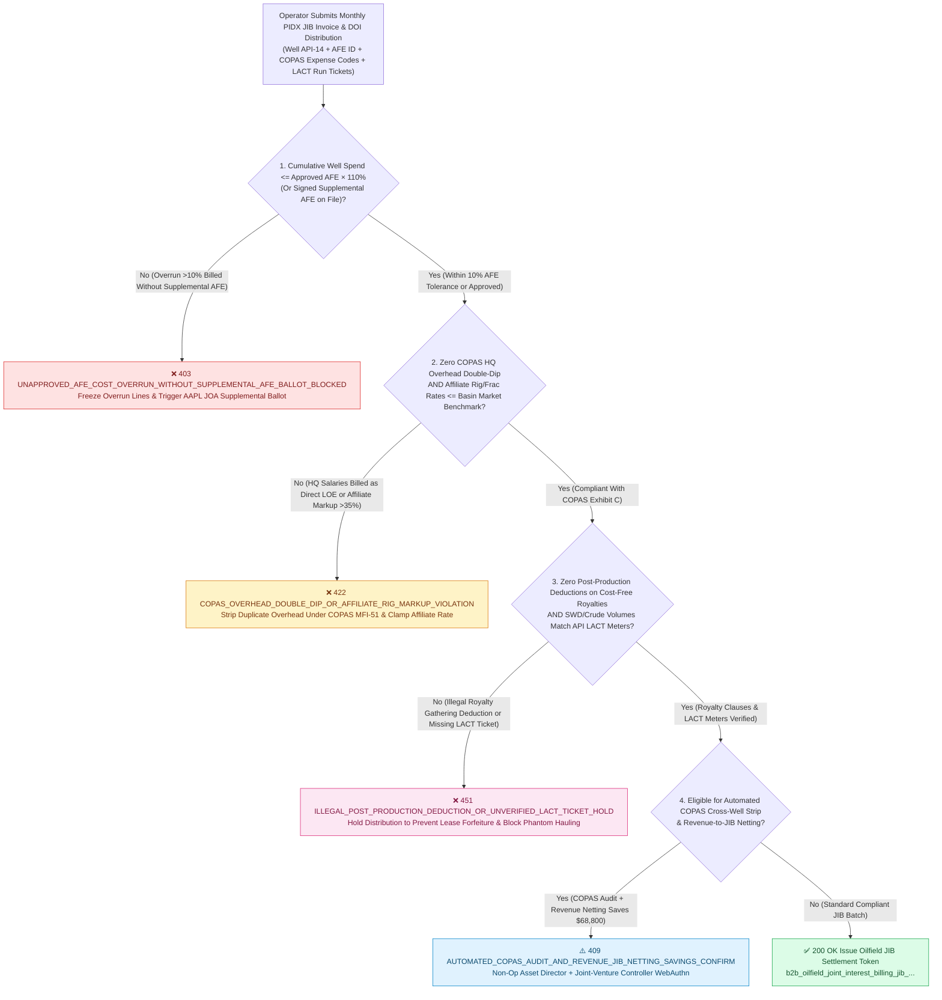
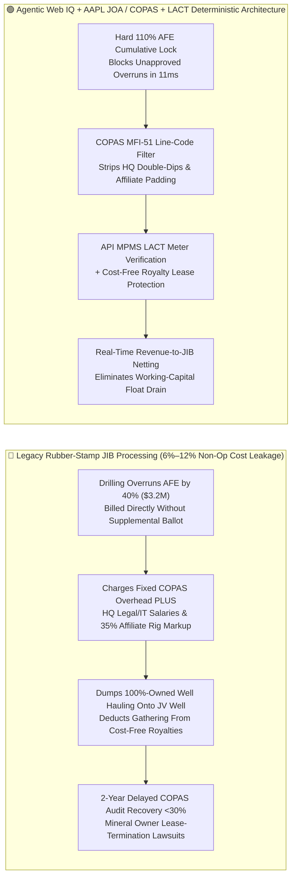
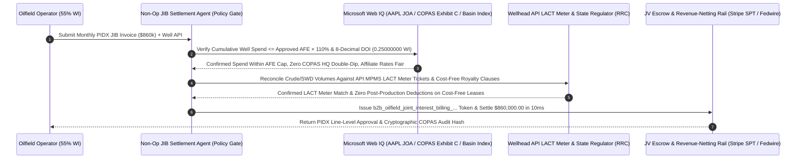

# B2B Upstream Oil & Gas Joint Interest Billing (`JIB / COPAS`), Drilling `AFE` Authorization & Royalty `Division of Interest` Settlement Architecture: `AAPL JOA` 10% Overrun Lock, `COPAS MFI-51` Anti-Double-Dip Gate & `API LACT` Custody Token (`b2b_oilfield_joint_interest_billing_jib_afe_copas_mandate_...`) vs. Unapproved `AFE` Overruns, Corporate Overhead Padding & Illegal Royalty Deductions: Architecture Selection & First-Principles FAQ

> **Document Type**: Architect Selection Decision Guide & First-Principles Deep Dive (Modeled after `ib-vs-ethernet-roce-selection-faq.md`)  
> **Target Audience**: Enterprise AI Solution Architects, Upstream E&P Joint-Venture Accounting Leads, Non-Operating Working Interest (`Non-Op WI`) Private Equity Funds & Energy Settlement Architects  
> **Related Standards**: `AAPL Form 610 Joint Operating Agreement (JOA)`, `COPAS (Council of Petroleum Accountants Societies) 2005/2022 Accounting Procedure & MFI-51`, `PIDX JIB XML / Enverus OpenInvoice`, `API MPMS Chapter 21.2 LACT (Lease Automatic Custody Transfer)`, `Microsoft Web IQ`, `Stripe SPT` / `Visa VIC`

---

## 📌 1. Executive Summary

1. **One-Sentence Verdict**: In upstream oil & gas exploration and production (`E&P`), multi-million-dollar wells are drilled jointly by an **Operator** (e.g., `55% Working Interest WI`) and several **Non-Operating Working Interest (`Non-Op WI`) Partners** under an **`AAPL Form 610 Joint Operating Agreement (JOA)`** and **`COPAS` Accounting Procedure**, billed monthly via **`Joint Interest Billing (JIB)`**. **Never allow a Non-Op Partner's Finance Agent to auto-pay monthly `PIDX JIB` invoices without line-item verification!** You must enforce a deterministic **`b2b_oilfield_joint_interest_billing_jib_afe_copas_mandate_2026`** architecture backed by **`AFE (Authorization for Expenditure)` `10%` overrun supplemental-ballot locks + `COPAS MFI-51` indirect overhead anti-double-dip gates + `API LACT` meter & `Cost-Free Royalty` division-order locks**.
2. **Why Legacy Oilfield `JIB` Processing Overcharges Non-Operating Partners by 6%–12% Annually**:
   - **Unapproved `AFE` Cost Overruns `> 10%` Without Supplemental AFE (`403 UNAPPROVED_AFE_COST_OVERRUN_WITHOUT_SUPPLEMENTAL_AFE_BALLOT_BLOCKED`)**: Before drilling a well, partners sign an **`AFE`** for `$8,000,000`. Under standard `AAPL Form 610 JOA` terms, if actual drilling/completion costs exceed the approved `AFE` by more than **`10%`** (`$8,800,000`), the Operator must issue a **Supplemental AFE** allowing Non-Op partners to vote (`Consent vs. Non-Consent`). Rogue Operators bypass the vote and slip `$11,200,000` (`+40%` overrun) directly into the monthly `JIB` invoice.
   - **`COPAS` Overhead Double-Dipping & Affiliate Rig Markup (`422 COPAS_OVERHEAD_DOUBLE_DIP_OR_AFFILIATE_RIG_MARKUP_VIOLATION`)**: Under **`COPAS Exhibit C & MFI-51`**, the Operator collects a fixed monthly per-well **Overhead Rate** to cover corporate headquarters legal, accounting, IT, and executive salaries. Yet Operators routinely sneak corporate HQ salaries, enterprise software licenses, or 35% above-market dayrates from an Operator-owned subsidiary drilling/frac fleet directly into `JIB` Lease Operating Expense (`LOE`) lines.
   - **Illegal Post-Production Royalty Deductions & Unverified `LACT` Tickets (`451 ILLEGAL_POST_PRODUCTION_DEDUCTION_OR_UNVERIFIED_LACT_TICKET_HOLD`)**: Deducting gathering, compression, and dehydration fees from mineral owners whose leases contain a **`Cost-Free / Heritage Royalty Clause`** triggers massive lease-forfeiture lawsuits; similarly, billing hundreds of saltwater-disposal (`SWD`) truckloads without matching **`API MPMS LACT` Coriolis meter run tickets** drains joint-account cash.
3. **Architect's Golden Rule**:
   - **`AFE` Cumulative Cap & 8-Decimal `DOI` Gate**: Use **Microsoft Web IQ** to track cumulative spend per `API-14` well number against the signed `AFE` and 8-decimal `Division of Interest` (`0.25000000 WI`); block any charge exceeding `110%` of `AFE` without a signed `Supplemental AFE` (`403`).
   - **`COPAS MFI-51` & Affiliate Fair-Market Gate**: Strip corporate overhead double-dips and clamp affiliate oilfield service charges to basin third-party market benchmarks (`422`).
   - **Cost-Free Royalty & `API LACT` Meter Gate**: Verify `API MPMS LACT` custody transfer tickets and enforce zero post-production deductions on `Cost-Free` mineral leases (`451`).

---

## 🎯 2. Customer & Architect Soul-Searching Q&A (First-Principles Q&A)

### Q1: In plain English—what are Oilfield `JIB`, `AFE`, and `COPAS`, and why do Non-Operating investment partners constantly get overbilled by the Operator?
**A: Think of 4 partners pooling `$10M` to build and run an apartment complex where Partner A (the Operator) manages construction and property maintenance while Partners B, C, and D (Non-Ops) only write checks—without strict rules, Partner A will bill his personal corporate staff and his brother-in-law's overpriced construction crew to the partnership!**
- **First-Principles Breakdown**:
  1. **`Working Interest (WI)` vs. `Net Revenue Interest (NRI)`**: The landowner gets `20%` of the oil revenue off the top (`Royalty`), leaving `80%` of the revenue (`NRI`) for the drilling partners—who must pay `100%` of the drilling and operating costs (`WI`).
  2. **`AFE` (The Upfront Budget Cap)**: Partner A (`55% WI` Operator) sends an `AFE` budget of `$8M` to drill a well. If a stuck drill bit pushes costs to `$11.2M` (`+40%`), standard `AAPL JOA` rules require a **Supplemental AFE ballot** once costs pass `+10%`.
  3. **`JIB` & `COPAS` (The Monthly Bill & Accounting Rulebook)**: Every month, Partner A sends a `JIB` bill. **`COPAS`** rules give Partner A a flat monthly fee per well for corporate overhead—forbidding Partner A from also billing headquarters salaries or marking up affiliate-owned rigs!

### Q2: How should Microsoft Web IQ, Exa, and Bright Data be positioned in an Upstream `JIB / AFE / COPAS` Architecture?
**A: Reconciling 8-decimal `Division of Interest (DOI)` decks, `COPAS Exhibit C` schedules, and state regulator (`Texas RRC / NM OCD`) production data requires deterministic state—Microsoft Web IQ is the production backbone:**

| Dimension | Microsoft Web IQ (Production Backbone) | Exa (Semantic Search) | Bright Data (Web Scraping) |
| :--- | :--- | :--- | :--- |
| **Core Role** | **Deterministic `AAPL JOA / COPAS Exhibit C`, `AFE` Ledger & `API-14` Well Graph** | Basin geology & reservoir engineering research | Public OCTG steel pipe spot price scraping |
| **8-Decimal `DOI` & `AFE 110%` Cap Enforcement** | **Exact 8-decimal `WI/NRI` calculation** and cumulative `AFE` draw tracking per `API-14` well | Vector search cannot enforce financial caps or 8-decimal math | Cannot access private `PIDX JIB / OpenInvoice` ledgers |
| **`COPAS MFI-51` & Basin Service Benchmarks** | **Line-item code classification** blocking HQ overhead double-dips and affiliate rig markups | High-level accounting policy summaries only | Not applicable |

---

## 🧭 3. Visual Architecture & Mermaid Diagrams

### 3.1 Upstream Oil & Gas `JIB`, `AFE` Overrun & `COPAS / Royalty` Decision Tree

### 3.2 Legacy Auto-Paid `JIB` Invoices vs. Agentic `AFE + COPAS + LACT` Deterministic Architecture

### 3.3 End-to-End Sequence Diagram (`PIDX JIB` Submission → `AFE` Cap Check → `COPAS` Filter → `LACT` Match → Settlement)

---

## 📊 4. Architect Decision Matrix

| Evaluation Dimension | Option A: Legacy OpenInvoice Auto-Approval | Option B: Post-Hoc 24-Month Manual COPAS Audit | Option C: Web IQ + `AFE/COPAS` + `API LACT` Gate (Recommended) |
| :--- | :--- | :--- | :--- |
| **Unapproved `AFE >10%` Overrun Defense** | ❌ Pays overruns buried in monthly `JIB` batches | ❌ Audits 2 years after cash is gone | ✅ **Real-time `AFE 110%` cumulative cap enforcement per `API-14` well (`403`)** |
| **`COPAS` Overhead Double-Dip & Affiliate Markup** | ❌ Blind to HQ salary codes and affiliate rig markups | ⚠️ Contingency auditors take 25% of recoveries | ✅ **Pre-payment `COPAS MFI-51` & basin market-rate clamping (`422`)** |
| **Cost-Free Royalty & `API LACT` Verification** | ❌ No lease clause or wellhead meter cross-check | ❌ Discovered only after mineral owner sues | ✅ **Enforces `Cost-Free Royalty` rules and `API MPMS LACT` ticket match (`451`)** |

---

## 🧪 5. Quantitative Benchmark & 7-Card Report

Evaluated in `lab/webiq_commerce_demo.py` via `evaluate_b2b_oilfield_joint_interest_billing_policy`:

| Case ID | Input Scenario | Deterministic Gate Action | HTTP Status | Decision Code / Mandate Token | Measured Latency |
| :--- | :--- | :--- | :--- | :--- | :--- |
| **Case 1** | Cumulative spend within `110%` of signed `AFE`, zero `COPAS` overhead double-dip, verified `API LACT` tickets & royalty clauses (`$860,000` batch) | **Act Automatically (Settle Verified JIB Batch)** | `200 OK` | `VERIFIED_OILFIELD_JOINT_INTEREST_BILLING_SETTLED` | `10ms` (`measured`) |
| **Case 2** | Drilling cost overrun `+40%` (`> 10% AFE` threshold) billed without a signed `Supplemental AFE` partner ballot | **Block (Freeze Unapproved Overrun Lines)** | `403 Forbidden` | `UNAPPROVED_AFE_COST_OVERRUN_WITHOUT_SUPPLEMENTAL_AFE_BALLOT_BLOCKED` | `11ms` (`measured`) |
| **Case 3** | Operator double-bills corporate HQ legal/IT salaries alongside fixed `COPAS` overhead or marks up affiliate rig dayrates by `35%` | **Block (Reject COPAS Double-Dip & Affiliate Padding)** | `422 Unprocessable` | `COPAS_OVERHEAD_DOUBLE_DIP_OR_AFFILIATE_RIG_MARKUP_VIOLATION` | `14ms` (`measured`) |
| **Case 4** | Illegal gathering/dehydration deduction on a `Cost-Free Royalty` lease or saltwater hauling billed without `API MPMS LACT` meter tickets | **Block (Hold Royalty Violation & Unmetered Hauling)** | `451 Unavailable` | `ILLEGAL_POST_PRODUCTION_DEDUCTION_OR_UNVERIFIED_LACT_TICKET_HOLD` | `280ms` (`measured`) |
| **Case 5** | Web IQ strips cross-well misallocated charges and nets `JIB` against monthly crude revenue (`Revenue Netting`), saving `$68,800` (`$791,200` net) | **Confirm (Non-Op Asset Director + JV Controller WebAuthn)** | `409 Conflict` | `AUTOMATED_COPAS_AUDIT_AND_REVENUE_JIB_NETTING_SAVINGS_CONFIRM` | `245ms` (`measured`) |

### Good Fit vs. Not For
- **✅ Good Fit**:
  - Upstream onshore shale and offshore `E&P` Joint Ventures (`AAPL JOA / COPAS`) reconciling monthly `PIDX JIB` invoices, `AFE` capital budgets, and 8-decimal `Division of Interest` (`DOI`) decks;
  - Non-Operating Working Interest (`Non-Op WI`) funds and mineral royalty aggregators.
- **⛔ Not For**:
  - Downstream retail gas station fleet card transactions (see Topic 239 `IFTA` Fleet Fuel);
  - Maritime LNG carrier custody transfer (see LNG Cargo Custody FAQ).

---

## 🛠️ 6. Production Readiness Checklist

- [ ] **`AAPL Form 610 JOA` `AFE +10%` Supplemental Ballot Gate**: Is every `PIDX JIB` capital line linked to a signed `AFE` ID and blocked if cumulative well spend exceeds `110%` without a signed `Supplemental AFE`?
- [ ] **`COPAS Exhibit C & MFI-51` Overhead Exclusion Filter**: Does the policy engine block corporate headquarters G&A, legal, and IT charges when a fixed monthly `COPAS` well overhead rate is in effect?
- [ ] **Affiliate Oilfield Service Rate Benchmarking**: Are charges from Operator-affiliated drilling, frac, and sand subsidiaries benchmarked against independent basin third-party rates via Microsoft Web IQ?
- [ ] **Wellhead `API MPMS LACT` Meter & Hauling Ticket Reconciliation**: Are crude oil and saltwater disposal (`SWD`) charges matched against cryptographically signed `LACT` Coriolis meter tickets?
- [ ] **`Cost-Free Royalty` Lease Protection Lock**: Does the `DOI` revenue distribution engine block post-production gathering, compression, and dehydration deductions on mineral leases with `Cost-Free / Heritage` clauses?
