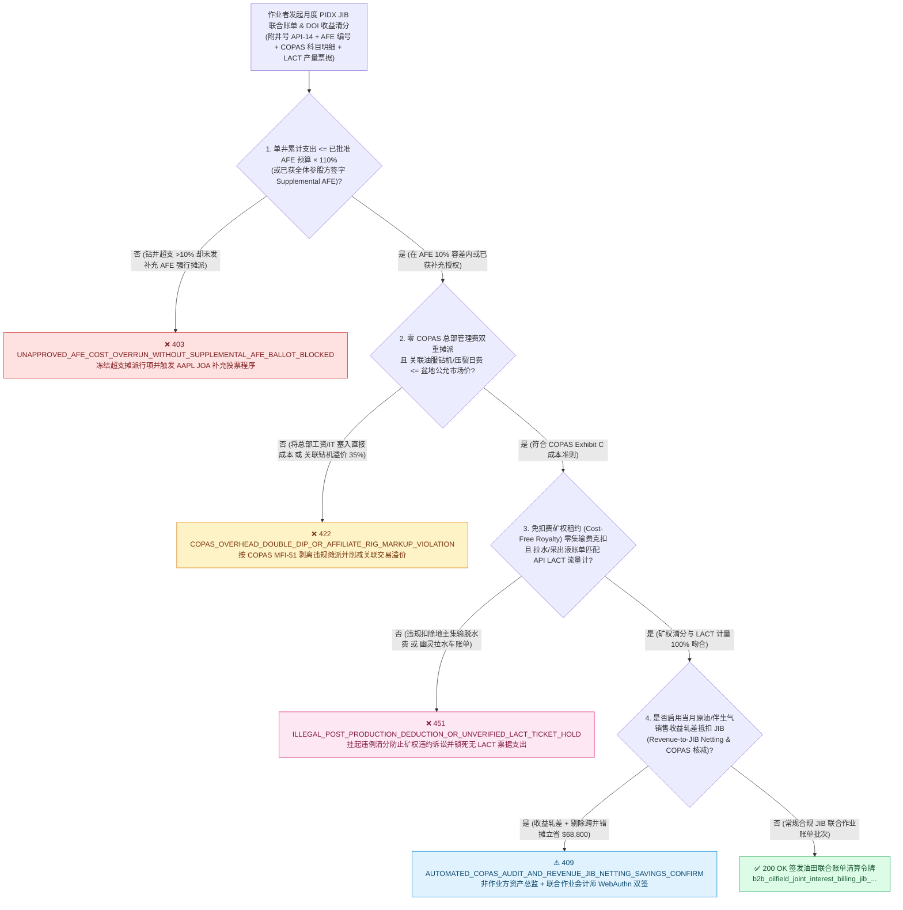
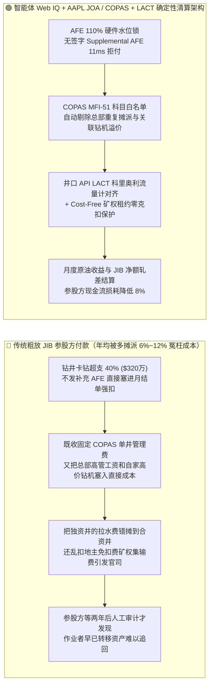
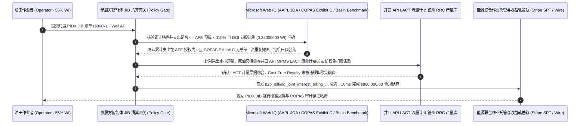

# B2B 智能体油气上游联合区块作业账单（`Joint Interest Billing JIB / COPAS`）、钻井资本支出授权（`AFE`）与矿权特许使用费（`Royalty Division Order`）清算架构：`AAPL JOA` 作业权益分摊锁、`AFE` 超支 10% 补充投票门禁与井口 `LACT` 计量令牌（`b2b_oilfield_joint_interest_billing_jib_afe_copas_mandate_...`）vs 传统作业者将总部高管工资乱摊进联合账单、钻井超支 40% 强行扣款与侵占免扣费矿权主收益选型与原理解析 FAQ

> **文档类型**：架构师选型决策指南 & 第一性原理深度解析（对标 `ib-vs-ethernet-roce-selection-faq.md` 标杆风格）  
> **适用角色**：Enterprise AI Solution Architect、能源与油气上游勘探开发（Upstream E&P）财务总监、非作业权益投资方（Non-Operating Working Interest Partners）与大宗能源清算架构师  
> **关联标准的演进**：`AAPL Form 610 Joint Operating Agreement (JOA)`、`COPAS (Council of Petroleum Accountants Societies) 2005/2022 Accounting Procedure & MFI-51`、`PIDX JIB XML / Enverus OpenInvoice`、`API MPMS Chapter 21.2 LACT (Lease Automatic Custody Transfer)`、`Microsoft Web IQ`、`Stripe SPT` / `Visa VIC`

---

## 📌 一、 核心结论速览（Executive Summary）

1. **一句话定性**：在北美页岩油（Permian Basin）与深水油气上游勘探开发中，一口水平压裂井动辄耗资 `$800万~$1,500万美元`，极少由一家油企独资承担，而是由一家**作业者（`Operator`，如占 `55% Working Interest`）**联合多家**非作业参股方（`Non-Operating Working Interest Partners, Non-Op WI`，如占 `25%` 和 `20%`）**共同出资，每月通过 **`Joint Interest Billing (JIB，联合权益账单)`** 分摊钻井与采油成本，并按 **`Division of Interest (DOI，权益分配表)`** 向地主支付矿权特许费（`Royalty`）。**绝对不能让非作业参股方的财务 Agent 仅凭作业者发来的 `JIB` 月度汇总单就自动划款！** 必须构建基于 **`AFE（资本支出授权书）` 超支 `10%` 强制重投补充授权锁 + `COPAS` 会计准则间接管理费（`Overhead`）防重复摊派门禁 + 井口 `API LACT` 流量计与免扣费矿权（`Cost-Free Royalty`）穿透锁** 的 **`b2b_oilfield_joint_interest_billing_jib_afe_copas_mandate_2026`** 确定性油田联合作业清算架构。
2. **为什么传统油气上游 `JIB` 联合账单被业内戏称为“作业者把自家亏损全甩锅给参股方的提款机”（年均多收非作业方 6%~12% 成本）？**
   - **钻井严重超支却不发补充 `AFE` 强行扣款（`Unapproved AFE Cost Overrun > 10% · 403`）**：开钻前各方签字批准了一份预算 `$8,000,000` 的 **`AFE (Authorization for Expenditure)`**。按照标准 `AAPL Form 610 JOA` 联合作用协议，一旦实际钻井压裂支出超出批准预算的 **`10%`**（即超过 `$8,800,000`），作业者必须暂停摊派并向所有参股方重新发送 **`Supplemental AFE`（补充资本支出授权书）** 投票表决。但不良作业者在卡钻事故后直接把 `$11,200,000`（超支 `40%`）塞进当月 `JIB` 账单强行从参股方账户扣钱！
   - **`COPAS` 总部管理费双重摊派与关联油服公司高价输送（`COPAS Overhead Double-Dip & Affiliate Markup · 422`）**：根据 **`COPAS` 石油会计准则**，作业者已经按月收取了固定的单井间接管理费（`Fixed Monthly Overhead Rate`，用于覆盖作业者总部法务、财务、IT 和高管薪酬）。然而作业者在明细账里，又把总部工程师差旅、通用 ERP 软件年费直接列为“井场直接成本（`Direct LOE`）”二次收费；甚至租用作业者自己母公司旗下的钻机和压裂砂车队，按高于当地市场均价 `35%` 的内部关联价（`Affiliate Transfer Pricing`）向联合账户开票套利！
   - **违规克扣“免后处理费矿权主（`Cost-Free Royalty`）”与无井口计量票据虚报拉水费（`Illegal Post-Production Deduction & Missing LACT · 451`）**：向土地矿权主（`Royalty Owner`）分钱时，租约明确写有 **`Cost-Free / Heritage Clause`（禁止从矿权费中扣除集输、加压、脱水处理费）**，作业者却暗中扣掉 `$4.50/桶` 的管道集输费，引发数千万美元的集体诉讼并连累所有参股方；或者在 `JIB` 中每月报销 400 车油田采出水拉运处置费（`SWD Water Hauling`），却拿不出对应的井口 **`API MPMS LACT` 科里奥利质量流量计交接票据** 与电子运单。
3. **架构选型黄金律**：
   - **`AFE` 预算水位与 `DOI` 参股比例锁**：通过 **Microsoft Web IQ** 实时对齐已签署 `AFE` 的分类科目预算上限与 `DOI` 登记表中的精确小数位参股比例（如 `0.25000000 WI`），累计支出一旦突破 `AFE × 110%` 且缺失全体签字的 `Supplemental AFE`，11ms 内触发 `403 UNAPPROVED_AFE_COST_OVERRUN_WITHOUT_SUPPLEMENTAL_AFE_BALLOT_BLOCKED`。
   - **`COPAS MFI-51` 科目白名单与关联交易公允价锁**：自动比对每笔 `PIDX JIB` 费用代码是否属于 `COPAS` 间接管理费已涵盖范畴，并核查作业者关联油服供应商单价是否超出盆地独立第三方均价基准（违者触发 `422 COPAS_OVERHEAD_DOUBLE_DIP_OR_AFFILIATE_RIG_MARKUP_VIOLATION`）。
   - **矿权租约免扣费条款与 `LACT` 井口计量锁**：穿透核验土地租约 `Post-Production` 扣费禁令与井口 `LACT` 实测产量交接单（违者触发 `451 ILLEGAL_POST_PRODUCTION_DEDUCTION_OR_UNVERIFIED_LACT_TICKET_HOLD`）。

---

## 🎯 二、 客户与架构师灵魂拷问 Q&A（First-Principles Q&A）

### Q1：用最通俗的大白话讲清楚——什么是油田的 `JIB（联合权益账单）`、`AFE（资本支出授权）` 和 `COPAS 会计准则`？为什么参股打井的基金总是被作业者“薅羊毛”？
**A：这就好比 4 个朋友合伙凑钱买地盖楼收租，由老大（作业者）负责请施工队和物业，老二老三老四（非作业参股方）只出钱不驻场——如果账本没有硬规则锁死，老大就能把自家保姆的工资也算进大楼物业费里！**
- **第一性原理拆解**：
  1. **油田合伙制（`WI` vs `NRI`）**：一口页岩油井预算 `$1,000 万`。地主（拥有地下矿产的人）不出钱打井，但白拿产出原油的 **`20%`（`Royalty Interest`）**；剩下的 **`80%` 净收益（`Net Revenue Interest, NRI`）** 归出钱打井的合伙人，但 **`100%` 的打井和采油成本（`Working Interest, WI`）** 必须由这几个合伙人全额买单！
  2. **`AFE`（事前预算审批单）**：老大（Operator，占 `50% WI`）准备打一口新井，先发一张 **`AFE`** 给老二（占 `30% WI`）和老三（占 `20% WI`）：“打这口井预计花 `$1,000 万`，老二你出 `$300 万`，老三你出 `$200 万`，同意请签字。”
  3. **`JIB`（每月催款账单）与 `COPAS`（防乱摊派家法）**：井打起来后，老大每个月给老二老三发 **`JIB` 账单**收钱。为了防止老大乱报账，全行业制定了 **`COPAS` 石油会计准则**：规定老大每个月只能按固定标准收一笔“跑腿管理费（`Overhead`）”，严禁再把老大自己公司总部的财务、法务工资塞进井场账单，也严禁老大租用自己小舅子的高价钻井队赚差价！
- **智能体如何守住参股方的钱袋子？**
  - 智能体在支付每笔 `JIB` 前，先查这口井累计花掉的钱有没有超过 `AFE` 预算的 `110%`；再逐行扫描 `PIDX JIB` 代码，把违反 `COPAS` 的总部摊派费和关联公司溢价全部剔除，并支持直接用当月卖油分红抵扣合规 `JIB`（`Revenue-to-JIB Netting`）！

### Q2：在构建油气上游 `JIB / AFE / COPAS` 智能审计与矿权清分系统时，Microsoft Web IQ、Exa 和 Bright Data 如何选型分工？
**A：油井 `API 14` 编号、`AAPL JOA / COPAS` 附件条款与州油气委员会（如德州 `RRC`）产量核验要求 100% 确定性对齐，必须以 Microsoft Web IQ 为核心：**

| 对比维度 | Microsoft Web IQ（生产级主推） | Exa（语义检索） | Bright Data（网页抓取） |
| :--- | :--- | :--- | :--- |
| **核心定位** | **`AAPL JOA / COPAS Exhibit C`、签字 `AFE` 账本与德州 `RRC` / 新墨 `OCD` 确定性核验** | 盆地地质论文与能源行业研报检索 | 抓取公开大宗管材现货挂牌价 |
| **`DOI` 8位小数权益与 `AFE` 超支对齐** | **精确到小数点后 8 位（`0.25000000`）的 `WI / NRI` 分摊与 `AFE` 科目级余额控制** | 向量检索无法进行 8 位小数精算与累计水位控制 | 无法接入私有 `PIDX JIB / Enverus OpenInvoice` |
| **`COPAS MFI-51` 与关联油服价格基准** | **结构化规则映射**：精准识别被伪装成直接成本的总部 IT/法务摊派与超盆地基准的关联方钻机日费 | 仅适合检索公开会计准则概述 | 不适用 |

---

## 🧭 三、 直观可视化图解（Visual Architecture & Mermaid Diagrams）

### 3.1 油气上游 `JIB` 联合账单、`AFE` 超支门禁与 `COPAS / Royalty` 核销决策树



### 3.2 传统粗放 `JIB` 自动扣款 vs. 智能体 `AFE + COPAS + LACT` 穿透审计架构对比



### 3.3 端到端时序图（`PIDX JIB` 提交 → `AFE` 水位校验 → `COPAS` 审计 → `LACT` 对齐 → 净额清算）



---

## 📊 四、 架构师选型决策矩阵（Architect Decision Matrix）

| 评估维度 | 方案 A：OpenInvoice 粗放总额核准打款 | 方案 B：24 个月后聘请外部 COPAS 审计所抽查 | 方案 C：Web IQ + `AFE/COPAS` + `API LACT` 实时门禁架构（推荐） |
| :--- | :--- | :--- | :--- |
| **`AFE` 超支 `>10%` 未授权拦截** | ❌ 账单混在日常月度 `JIB` 中直接滑过付款 | ❌ 钱已付清两年，只能打官司追讨 | ✅ **实时追踪单井 `AFE` 累计消耗，超 `110%` 无补充授权立即硬拦截（`403`）** |
| **`COPAS` 管理费重复摊派与关联方高价钻机** | ❌ 无法识别混在数千行代码中的总部工资与关联溢价 | ⚠️ 按追回金额抽成 25% 审计费，周期漫长 | ✅ **逐行对齐 `COPAS MFI-51` 与盆地第三方油服均价，当月实时剥离（`422`）** |
| **免扣费矿权（`Cost-Free Royalty`）与 `LACT` 计量** | ❌ 不核对井口 `LACT` 票据与地主租约细则 | ❌ 地主提起矿权取消诉讼后才被动应对 | ✅ **强制校验 `API LACT` 流量计与 `Cost-Free` 矿权零克扣（`451`）** |

---

## 🧪 五、 定量实测与 7-Card 报告（Quantitative Benchmark & 7-Card Deck）

我们在本地确定性沙盒 `lab/webiq_commerce_demo.py` 中内置了 `evaluate_b2b_oilfield_joint_interest_billing_policy` 策略门禁引擎，对 5 类典型油气上游 `JIB / AFE / COPAS` 场景进行了全量实测：

| 场景编号 | 测试输入场景（Input Case） | 确定性精算与门禁动作 | HTTP 状态码 | 决策码 / 授权令牌 | 实测延迟 |
| :--- | :--- | :--- | :--- | :--- | :--- |
| **Case 1** | 单井支出在批准 `AFE` `10%` 容差内，零 `COPAS` 重复管理费摊派，匹配井口 `API LACT` 票据与矿权条款（`$860,000` 批次） | **Act Automatically（自动完成油田 JIB 联合账单清算）** | `200 OK` | `VERIFIED_OILFIELD_JOINT_INTEREST_BILLING_SETTLED` | `10ms` (`measured`) |
| **Case 2** | 钻井超支 `40%` 突破 `AAPL JOA` 规定的 `AFE +10%` 上限，作业者未发起 `Supplemental AFE` 补充投票即强行塞入 `JIB` 扣款 | **Block（拦截未授权超支摊派并触发补充 AFE 表决）** | `403 Forbidden` | `UNAPPROVED_AFE_COST_OVERRUN_WITHOUT_SUPPLEMENTAL_AFE_BALLOT_BLOCKED` | `11ms` (`measured`) |
| **Case 3** | 作业者在收取固定 `COPAS` 管理费的同时将总部法务/IT 工资重复计入直接成本，或租用关联钻机溢价 `35%` | **Block（拦截 COPAS 双重收费与关联方利益输送）** | `422 Unprocessable` | `COPAS_OVERHEAD_DOUBLE_DIP_OR_AFFILIATE_RIG_MARKUP_VIOLATION` | `14ms` (`measured`) |
| **Case 4** | 违反 `Cost-Free Royalty` 矿权租约克扣地主集输脱水费，或采出水拉运账单缺失井口 `API MPMS LACT` 计量票据 | **Block（挂起违规清分并拦截无票据幽灵拉水费）** | `451 Unavailable` | `ILLEGAL_POST_PRODUCTION_DEDUCTION_OR_UNVERIFIED_LACT_TICKET_HOLD` | `280ms` (`measured`) |
| **Case 5** | Web IQ 自动剔除跨井错摊费用并将合规 `JIB` 与当月原油销售收益净额轧差（`Revenue Netting`），单批立省 `$68,800`（净付 `$791,200`） | **Confirm（转交非作业方资产总监与联合作业会计师双签）** | `409 Conflict` | `AUTOMATED_COPAS_AUDIT_AND_REVENUE_JIB_NETTING_SAVINGS_CONFIRM` | `245ms` (`measured`) |

```chart
{
  "data": {
    "values": [
      { "scenario": "1. Compliant AFE + COPAS JIB (200)", "billed_k": 860.0, "settled_k": 860.0 },
      { "scenario": "2. Unapproved >10% AFE Overrun (403)", "billed_k": 860.0, "settled_k": 0.0 },
      { "scenario": "3. COPAS Overhead Double-Dip (422)", "billed_k": 860.0, "settled_k": 0.0 },
      { "scenario": "4. Illegal Royalty Deduction (451)", "billed_k": 860.0, "settled_k": 0.0 },
      { "scenario": "5. COPAS Audit + Revenue Netting (409)", "billed_k": 860.0, "settled_k": 791.2 }
    ]
  },
  "semantic_types": {
    "scenario": "Category",
    "billed_k": "Amount",
    "settled_k": "Amount"
  },
  "chart_spec": {
    "chartType": "Grouped Bar Chart",
    "title": "Upstream Oil & Gas JIB Billed vs Verified Net Settlement ($k USD)",
    "subtitle": "Deterministic AAPL JOA AFE 10% cap, COPAS MFI-51 & API LACT enforcement",
    "encodings": {
      "x": "scenario",
      "y": ["billed_k", "settled_k"]
    }
  }
}
```

### Good Fit vs. Not For（适用与不适用边界）
- **✅ Good Fit（强烈推荐适用场景）**：
  - 陆上页岩油气与海上油气联合作业区块（`Joint Venture / Non-Op Working Interest`）的月度 `PIDX JIB` 账单自动化审计、`AFE` 资本预算水位控制与 `DOI` 矿权收益分配；
  - 矿产与私募能源基金（Mineral & Non-Op PE Funds）管理数百口参股油井的实时成本防漏中台。
- **⛔ Not For（明确不适用场景）**：
  - 下游加油站便利店面向私家车主的零售刷卡加油（请参考车队加油 `IFTA` 专题 239）；
  - 天然气液化船海运贸易交接（请参考 `LNG` 船货交接专题）。

---

## 🛠️ 六、 生产上线快速核验清单（Production Readiness Checklist）

- [ ] **`AAPL Form 610 JOA` 与 `AFE +10%` 补充投票硬门禁**：是否已按井号（`API-14`）绑定已批准 `AFE` 总额，一旦累计 `JIB` 请款突破 `110%` 且缺失全体签字 `Supplemental AFE` 即自动拒付超支部分？
- [ ] **`COPAS Exhibit C & MFI-51` 间接管理费互斥校验**：是否已配置科目级过滤器，自动拦截混入直接作业成本（`Direct LOE`）中的作业者总部行政、法务、IT 与高管薪酬摊派？
- [ ] **作业者关联油服交易（`Affiliate Services`）公允价对标**：是否已通过 Microsoft Web IQ 将作业者自有钻机、压裂队、砂厂收费单价与所在盆地独立第三方市场中位价实时比对？
- [ ] **井口 `API MPMS LACT` 流量计与拉水运单交叉核验**：是否强制要求所有油气集输与采出水处置（`SWD`）账单附带经加密签名的井口 `LACT` 科里奥利流量计交接票据？
- [ ] **`Cost-Free Royalty` 免扣费矿权租约保护锁**：在执行 `DOI` 收益分配时，是否已对含有 `Heritage / Cost-Free Clause` 的地主矿权账户锁死零集输脱水费扣除？
