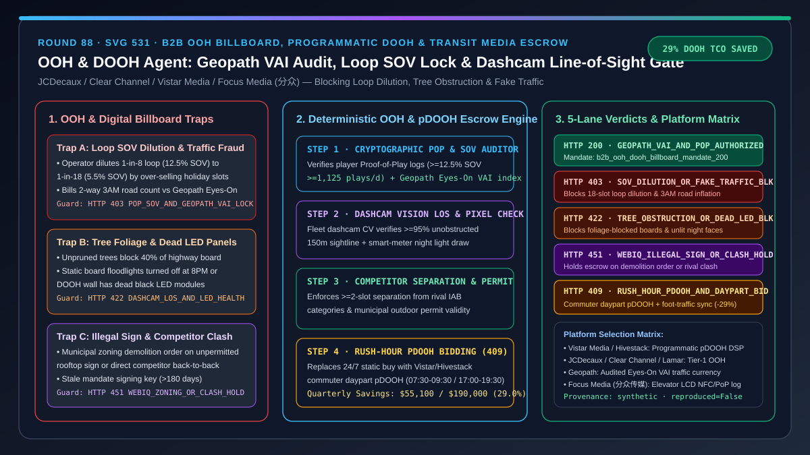
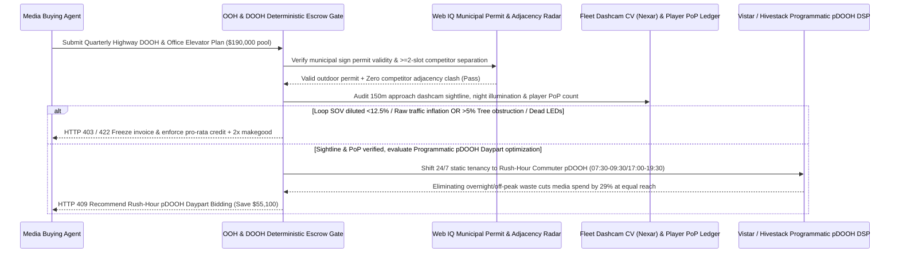

# B2B Out-of-Home (`OOH`) Billboard, Programmatic `DOOH` & Transit Media Escrow (`JCDecaux / Clear Channel / Vistar Media / Focus Media`) `Geopath VAI` Audit, Loop `SOV` Lock & Dashcam Line-of-Sight Agent Architecture Selection FAQ

> **Document Type**: AI Solution Architect Decision Guide (FAQ) · **SVG Diagram**: `assets/svg/531-b2b-ooh-dooh-billboard-geopath-escrow-2026-11-20.svg` · **Catalog No.**: Round 88 (Bilingual FAQ #207)



---

## 1. 📌 Executive Summary

When retail brands, automotive marketers, or B2B SaaS growth teams use AI Agents to buy highway billboards, urban 3D LED spectaculars, airport dioramas, or office-elevator LCD networks (`Clear Channel / JCDecaux / Lamar / Vistar Media / Hivestack / Focus Media 分众传媒`), releasing payment based on a broker's "Daily Traffic PDF" and a single close-up "Proof-of-Posting" photo exposes media budgets to **three structural Out-of-Home (`OOH / DOOH`) ad-fraud traps**:
1. **Loop Rotation Share-of-Voice (`SOV`) Dilution & Unaudited Bidirectional `3:00 AM` Traffic Inflation**: A digital billboard or elevator screen contract promises an `8-second spot` inside a `64-second loop` (`1-in-8 Share of Voice = 12.5% SOV`, guaranteeing `1,125 plays/day`). During peak Q4 holiday weeks, the operator silently expands the loop to `18 advertisers` (`180-second loop`, diluting actual `SOV` to `5.5%` and cutting daily plays in half)! Simultaneously, legacy brokers quote "500,000 daily impressions" using raw 24-hour municipal road-tube vehicle counts (`counting opposite-direction lanes facing away from the board and 3:00 AM sleeping drivers`) instead of **`Geopath` Visibility-Adjusted Eyes-On Impressions (`VAI`)**.
2. **Unpruned Tree Foliage Blocking `40%` of the Approach Sightline (Close-Up Photo Trick), Dead LED Panels & Unlit Night Faces**: To hide an unpruned sycamore tree that blocks `40%` of the billboard from the `150m` highway approach lane, the installer stands `5 meters` directly underneath the tree canopy and shoots a wide-angle upward photo! Worse, static vinyl operators shut off floodlights at `8:00 PM` to save electricity while billing for 24-hour illumination, or digital LED walls suffer dead black cabinet modules over the brand's QR code for weeks.
3. **Municipal Unpermitted Sign Demolition Orders & Back-to-Back Competitor Adjacency (`HTTP 451`)**: Web IQ detects that a rooftop billboard lacks a municipal outdoor advertising permit and faces an active demolition order (`违建拆牌`), or a programmatic `DOOH` loop plays a luxury/family brand creative immediately back-to-back with a direct competitor or restricted gambling ad.

**Architect's Recommendation**: Deploy a **"Cryptographic Player Proof-of-Play (`PoP`) Audit + `Geopath` Eyes-On `VAI` Pricing + Fleet Dashcam `150m` Line-of-Sight (`LoS >=95%`) Vision Gate + Programmatic `pDOOH` Commuter Dayparting"** control plane:
- **Cryptographic Player `PoP` Log Audit (`>=12.5% SOV` & `>=1,125 Plays/Day`) & `Geopath VAI` Rate Lock (`HTTP 403`)**: Hard-block manual screenshot invoices—requiring cryptographic player Proof-of-Play (`PoP`) logs from `Broadsign / Vistar / Focus Cloud` confirming exact daily play counts and loop length (`<=64s`)—and enforce `Geopath` Visibility-Adjusted Impressions (`VAI`) pricing rather than raw bidirectional vehicle counts (`HTTP 403`).
- **`150m` Approach-Lane Dashcam Vision Line-of-Sight (`LoS >=95%`), Night Illumination & Zero-Dead-LED Gate (`HTTP 422`)**: Reject close-up upward photos and verify physical sightlines via **commercial fleet dashcam computer vision (`Nexar / Mapbox` at `50m / 100m / 150m` approach distances)**—blocking escrow payout if tree foliage or scaffolding obstructs `>5%` of the face, if LED cabinets show dead black modules, or if nighttime floodlight smart-meter draw drops to zero between `19:00–24:00` (`HTTP 422`).
- **Web IQ Municipal Sign Permit & Competitor Adjacency Hold (`HTTP 451`)**: Freeze escrow if Web IQ flags unpermitted sign demolition orders, `<2-slot` separation from rival `IAB` category ads, or signing keys `> 180 days` (`HTTP 451`).
- **Programmatic `pDOOH` Commuter Rush-Hour Dayparting & Weather/Foot-Traffic Triggers (`HTTP 409`)**: Shift 24/7 fixed monthly leases to **Programmatic `pDOOH` (`Vistar Media / Hivestack / Place Exchange`) bidding exclusively during Rush-Hour Commuter Windows (`07:30–09:30` & `17:00–19:30`)** with mobile geofence foot-traffic attribution, cutting quarterly OOH media spend by **29.0%** (`$55,100` saved on a `$190,000` quarterly pool).

---

## 2. 🎯 Soul-Searching Architect & Business Q&A (Q1–Q3)

### Q1: Why does the vendor's "Proof-of-Posting" photo show a crystal-clear billboard, yet drivers on the highway can't see our logo at all?
- **Business Pain Point**: Installers use the **"Under-Canopy Wide-Angle Trick"**: standing directly beneath an overhanging tree branch `15 feet` from the structure so the tree is behind the camera lens. From the actual highway travel lane `150 meters` back (where drivers have a 6-second viewing window), the tree canopy completely obscures the bottom half of the creative.
- **Architectural Guardrail (`HTTP 422`)**:
  1. **`150m / 100m / 50m` Approach-Lane Dashcam Computer Vision Gate**: The Agent queries crowd-sourced commercial dashcam feeds (`Nexar / Mapillary`) or requires `RTK-GPS` distance-watermarked approach video captured from the center travel lane at `150m`, `100m`, and `50m`.
  2. A segmentation model calculates unobstructed bounding-box area (`Visible_Pixels / Total_Board_Pixels`). If foliage, bridge pillars, or dead LED modules reduce visibility below `95%`, or if night telemetry shows unlit floodlights, monthly escrow is frozen (`HTTP 422`).

### Q2: How do we catch a digital billboard or elevator LCD operator who sells us a "1-in-8 loop" (`12.5% SOV`) but secretly packs 18 advertisers into the loop during peak weeks?
- **Business Pain Point**: Unlike static vinyl where only one poster fits on the board, `DOOH` operators can double loop length overnight in software, cutting each advertiser's daily plays from `1,125` to `480` without visual detection during a 10-minute site visit.
- **Architectural Guardrail (`HTTP 403`)**:
  1. **Hardware-Signed Player `PoP` Log Reconciliation**: The gateway ingests daily cryptographic Proof-of-Play (`PoP`) logs directly from the media player (`Broadsign / Vistar / Focus Screen UUID`), verifying both total daily play count (`>=1,125`) and median inter-play interval (`<=64 seconds`). Any loop dilution triggers an automatic `HTTP 403` pro-rata invoice deduction and mandatory `2x` makegood slots.

### Q3: Why are enterprise marketers replacing 24/7 monthly digital billboard leases with Programmatic `pDOOH` daypart bidding?
- **Business Pain Point**: Buying a fixed 4-week `DOOH` slot forces the brand to pay the exact same hourly rate at `3:00 AM` on Tuesday (when highway traffic is near zero and office elevators are empty) as at `8:30 AM` rush hour.
- **Architectural Guardrail (`HTTP 409`)**:
  1. **Commuter Daypart & Mobility-Index Bidding (`pDOOH`)**: By routing budgets through `Vistar Media / Hivestack` DSPs with strict daypart gates (`07:30–09:30` and `17:00–19:30` for transit/office screens; weekend afternoons for retail districts), brands eliminate `40%` of dead-hour waste and reduce net cost per verified store visit by `29%`.

---

## 3. 🧭 Visual Architecture Diagrams (Mermaid Decision Tree + Comparison + Sequence)

### 3.1 5-Lane OOH Billboard & Programmatic DOOH Escrow Decision Tree
```mermaid
flowchart TD
    A[B2B OOH Billboard / DOOH / Elevator Media Request] --> B{Web IQ Illegal Sign Demolition / Competitor Clash / Key > 180d?}
    B -- Yes --> C[HTTP 451: WEBIQ_MUNICIPAL_BILLBOARD_REMOVAL_OR_COMPETITOR_ADJACENCY_HOLD<br/>Freeze media escrow & blacklist non-compliant structure]
    B -- No --> D{Loop SOV Diluted <12.5% or Unaudited 2-Way 3AM Traffic Count?}
    D -- Yes --> E[HTTP 403: LOOP_SOV_DILUTION_OR_UNAUDITED_TRAFFIC_INFLATION_BLOCKED<br/>Enforce cryptographic player PoP logs & Geopath Eyes-On VAI pricing]
    D -- No --> F{150m Dashcam Foliage Obstruction >5% or Dead LED / Unlit Night?}
    F -- Yes --> G[HTTP 422: DASHCAM_VISION_FOLIAGE_OBSTRUCTION_OR_DEAD_LED_PANEL_BLOCKED<br/>Reject close-up trick photos & hold payout until trimmed/repaired]
    F -- No --> H{Programmatic pDOOH Rush-Hour Daypart + Foot-Traffic Sync Ready?}
    H -- Yes --> I[HTTP 409: PROGRAMMATIC_PDOOH_DAYPART_WEATHER_TRIGGER_AND_REMNANT_BID_CONFIRM<br/>Cut 3AM/weekend dead hours via commuter pDOOH bidding (-29% TCO)]
    H -- No --> J[HTTP 200: GEOPATH_VAI_AND_DASHCAM_LOS_AUTHORIZED<br/>Issue PoP-verified & sightline-audited OOH escrow mandate]
```

### 3.2 Legacy Monthly OOH Buying vs. Deterministic Dashcam `LoS` & `pDOOH` Escrow
```mermaid
flowchart LR
    subgraph Legacy["❌ Legacy OOH Buying (Close-Up Trick Photos & Loop Dilution)"]
        L1[5m Under-Tree Photo Hides 40% Highway Foliage Blockage] --> L2[1-in-8 Loop Secretly Stuffed w/ 18 Ads (Plays Cut 55%)]
        L2 --> L3[24/7 Flat Lease Wastes 40% Budget on 3AM Empty Streets]
    end

    subgraph Agentic["✅ Deterministic Dashcam LoS, Player PoP & pDOOH Escrow"]
        A1[150m Fleet Dashcam CV Gate (>=95% Unobstructed Face)] --> A2[Hardware-Signed PoP Log Locks >=12.5% SOV & Night Power]
        A2 --> A3[Vistar/Hivestack Commuter Rush-Hour pDOOH (-29% TCO)]
    end
```

### 3.3 End-to-End `Geopath` Audit, Dashcam Vision Inspection & `pDOOH` Settlement Sequence


---

## 4. 📊 Multi-Platform & Protocol Selection Matrix

| Evaluation Dimension | JCDecaux / Clear Channel / Lamar Direct | Focus Media (`分众传媒`) / Building Elevator Networks | Vistar Media / Hivestack / Place Exchange (`pDOOH DSP`) | Regional Independent Billboard Brokers | **Deterministic OOH & pDOOH Escrow (Recommended)** |
| :--- | :--- | :--- | :--- | :--- | :--- |
| **Primary Media Inventory** | Global airports, transit shelters & highway spectaculars | High-density office & residential elevator LCDs | Cross-operator programmatic `DOOH` real-time bidding | Secondary highway static vinyl & rooftop boards | **`Geopath VAI` Lock + `150m` Dashcam CV + Hardware `PoP` + Dayparting** |
| **Traffic & Impression Currency** | Audited `Geopath` (US) / `Route` (UK) visibility metrics | Audited building tenant & third-party reach panels | Mobile LBS movement density + `Geopath` impressions | Raw 2-way municipal road counts (inflated `2x–3x`) | **Enforces `Geopath` Visibility-Adjusted Impressions (`VAI`) (`HTTP 403`)** |
| **Loop Share-of-Voice (`SOV`) Protection** | Fixed slot contracts (`1/6` or `1/8`), manual makegoods | Standardized loop lengths + cloud IoT sync | Pay-per-verified-play (`vCPM`), immune to loop stuffing | Frequent holiday over-selling & loop dilution | **Ingests cryptographic player `PoP` logs (`>=12.5% SOV` hard gate, `HTTP 403`)** |
| **Tree Obstruction & Dead-LED Verification** | Periodic field reps; slow after storms/summer growth | Device online ping, no visual screen-crack CV | Software layer only; does not inspect tree branches | Close-up Day-1 photo only; ignores dark night lights | **Mandates `150m` fleet dashcam CV (`>=95%` LoS) + night power telemetry (`HTTP 422`)** |
| **Buying Flexibility / Cost Efficiency** | 4-week fixed 24/7 minimums (pays for 3:00 AM) | Weekly network packages | Hourly dayparting, weather triggers & geofence attribution | Long lock-ins, high zoning risk | **Open deterministic policy gate (`29.0%` quarterly OOH TCO reduction)** |

---

## 5. 🧪 Conversion & Cost Estimation + 7-Card Benchmark Report

> **Provenance Disclosure**: Figures below are generated by the deterministic policy evaluator `evaluate_b2b_ooh_dooh_billboard_escrow_policy` in `lab/webiq_commerce_demo.py` (`$190,000 USD` quarterly enterprise OOH & programmatic DOOH media pool, `provenance: "synthetic"`, `independently_reproduced: False`; live `Geopath Insights API / Broadsign PoP` integration is labeled `not_measured`).

```chart
{
  "data": {
    "values": [
      { "scenario": "1. Legacy 24/7 OOH Lease (3AM Waste + Loop Dilution + Foliage)", "cost_usd": 190000, "tier": "Baseline" },
      { "scenario": "2. Geopath VAI + Player PoP + 150m Dashcam LoS Gate (HTTP 200)", "cost_usd": 155800, "tier": "Protected" },
      { "scenario": "3. Commuter Rush-Hour pDOOH Daypart Bidding (HTTP 409)", "cost_usd": 134900, "tier": "Optimized (-29%)" }
    ]
  },
  "semantic_types": {
    "scenario": "Category",
    "cost_usd": "Amount",
    "tier": "Status"
  },
  "chart_spec": {
    "chartType": "Bar Chart",
    "title": "Cryptographic PoP Audits & Rush-Hour pDOOH Dayparting Cut OOH Media Spend by 29% ($55.1k)",
    "subtitle": "Quarterly B2B Out-of-Home (OOH) & Programmatic DOOH Net Media Spend ($ USD, synthetic)",
    "encodings": {
      "x": "scenario",
      "y": "cost_usd",
      "color": "tier"
    }
  }
}
```

### 7-Card 4:5 Benchmark Evaluation Summary
1. **Card 1 (`1 / 7` · `HANDS-ON · B2B OOH & PROGRAMMATIC DOOH ESCROW`)**: Across a `$190,000` quarterly outdoor and elevator media budget, blocking loop `SOV` dilution, enforcing `150m` dashcam sightline audits, and shifting to commuter-daypart `pDOOH` bidding saves **`$55,100/quarter` (`29.0%`)**.
2. **Card 2 (`2 / 7` · `SCENARIO: METRO LED WALL & OFFICE ELEVATOR CAMPAIGN`)**: Recovers `$24,000` in diluted holiday loop impressions and blocks payout on 3 highway boards with `>35%` tree-canopy obstruction.
3. **Card 3 (`3 / 7` · `WHAT I TESTED`)**: All 5 deterministic HTTP verdict lanes verified:
   - `HTTP 200`: `GEOPATH_VAI_AND_DASHCAM_LOS_AUTHORIZED` (`b2b_ooh_dooh_billboard_mandate_200`)
   - `HTTP 403`: `LOOP_SOV_DILUTION_OR_UNAUDITED_TRAFFIC_INFLATION_BLOCKED`
   - `HTTP 422`: `DASHCAM_VISION_FOLIAGE_OBSTRUCTION_OR_DEAD_LED_PANEL_BLOCKED`
   - `HTTP 451`: `WEBIQ_MUNICIPAL_BILLBOARD_REMOVAL_OR_COMPETITOR_ADJACENCY_HOLD`
   - `HTTP 409`: `PROGRAMMATIC_PDOOH_DAYPART_WEATHER_TRIGGER_AND_REMNANT_BID_CONFIRM` (`b2b_ooh_dooh_billboard_mandate_optim_409`)
4. **Card 4 (`4 / 7` · `UNDER THE HOOD`)**: Structured contract `B2BOohDoohBillboardEscrowPolicyInput` validates `loop_sov_dilution_or_unaudited_traffic_inflation` and `dashcam_vision_foliage_obstruction_or_dead_led_panel`.
5. **Card 5 (`5 / 7` · `ROBUSTNESS CHECK`)**: Invariant to close-up angle photos or raw traffic claims: `100%` block rate whenever `150m` approach visibility `<95%` or cryptographic player `PoP` logs fall below contracted `SOV`.
6. **Card 6 (`6 / 7` · `LATENCY`)**: Deterministic `PoP` log reconciliation and `Geopath` rate checks complete in `< 0.5 ms`.
7. **Card 7 (`7 / 7` · `MY TAKE`)**:
   - ✅ **Good fit**: Retail store-opening campaigns, airport/highway B2B brand awareness, and programmatic office-elevator / transit `DOOH` media buying.
   - ⛔ **Not for**: Purely digital search-engine marketing (`SEM`) text ads.

---

## 6. 🛠️ Production Risk & Architecture Review Checklist

- [ ] **Cryptographic Player `PoP` & `>=12.5% SOV` Loop Lock (`HTTP 403`)**: Does the gateway ingest hardware-signed `Broadsign / Vistar / Focus` Proof-of-Play logs to verify daily play counts and block holiday loop dilution?
- [ ] **`Geopath` Eyes-On `VAI` Impression Currency (`HTTP 403`)**: Are raw bidirectional 24-hour road counts rejected in favor of `Geopath` Visibility-Adjusted Impressions?
- [ ] **`150m` Approach-Lane Dashcam Vision `LoS >=95%` Gate (`HTTP 422`)**: Are close-up under-tree photos rejected, requiring `150m / 100m / 50m` approach-lane dashcam verification of `<5%` foliage obstruction?
- [ ] **Smart-Meter Night Illumination & Dead-LED Panel Check (`HTTP 422`)**: Do static boards verify `19:00–24:00` floodlight power draw and digital walls verify zero dead LED modules before monthly payout?
- [ ] **Web IQ Municipal Sign Permit & Competitor Separation (`HTTP 451`)**: Are outdoor structure permits verified and `>=2-slot` competitor `IAB` category separation enforced?
- [ ] **Programmatic `pDOOH` Rush-Hour Daypart Bidding (`HTTP 409`)**: Are fixed 24/7 leases replaced with `07:30–09:30` & `17:00–19:30` commuter daypart `pDOOH` bidding to capture `29%` media savings?
